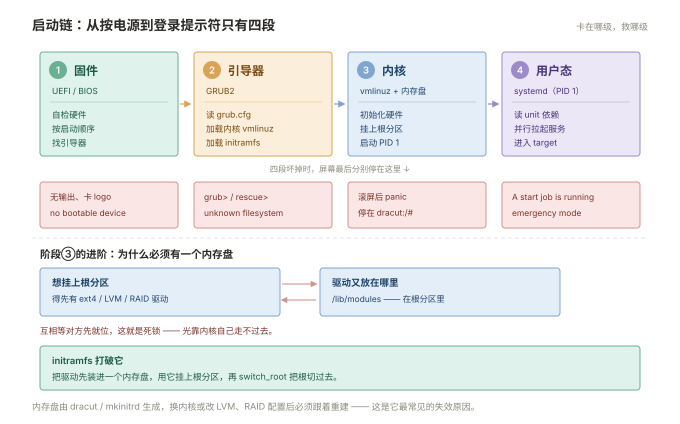
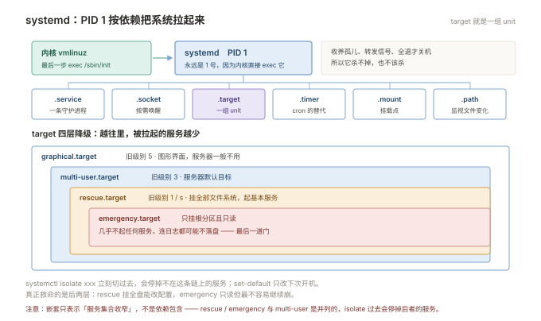
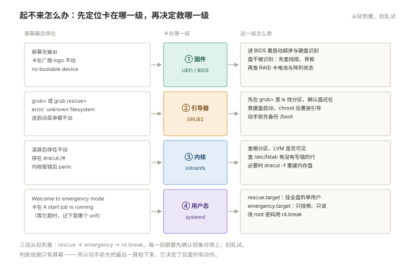

# 01 系统与启动

> **这一册回答**：一台 Linux 由哪些部分组成，开机时它们按什么顺序被拉起来，起不来时从哪一级开始救。  
> **读完能做到**：拿到一台陌生机器 30 秒摸清底细；看懂 `systemctl status` 的每一段；把一台起不来的机器救回来；发现时钟错了能判断会影响什么。  
> **怎么读**：1.0 是知识点地图，标了每个点的**基础 / 进阶**。第一遍跳过带「进阶」的小节不影响主线，第二遍专门补这些。 不认识的词查 [00 术语表](00-术语表.md)。
> **不在这里**：unit 文件怎么写 → 06；性能怎么看 → 09；权限规则 → 03。

---

## 1.0 本册知识点地图

复习时按这张表逐行自问「这个我能讲清吗」，讲不清的回对应节。**加粗的是面试和故障现场最常被问到的。**

| 知识点 | 层次 | 一句话要点 | 节 |
| --- | --- | --- | --- |
| **发行版识别** | 基础 | 一切命令的前提；同属 RHEL 系也可能全不一样 | 1.1 |
| 一屏体检 | 基础 | 版本 / 负载 / 内存 / 磁盘 / 时间，五个数定方向 | 1.1 |
| **FHS 目录职责** | 基础 | `/etc` 只改不删、`/var` 会涨、`/run` 重启清空、`/proc` `/sys` 是窗口 | 1.2 |
| usrmerge | 进阶 | `/bin` 已是 `/usr/bin` 软链，脚本别硬编码路径 | 1.2 |
| 分区规划 | 基础 | `/var` 单独分区，防日志打满根导致无法登录 | 1.2 |
| 硬件识别 | 基础 | `dmidecode` 报修、`lspci` 看卡、`lsblk` 看盘 | 1.3 |
| **磁盘健康** | 基础 | `smartctl -H` 一行判断，FAILED 或重映射扇区非 0 就换盘 | 1.3 |
| 重启溯源 | 进阶 | 有无正常关机记录 → 有无 panic → 硬件信号 → BMC SEL | 1.3 |
| **启动四阶段** | 基础 | 固件 → GRUB → 内核+initramfs → systemd，卡在哪级表现不同 | 1.4 |
| initramfs | 进阶 | 用来打破「驱动在盘上、挂盘又要驱动」的死锁 | 1.4 |
| 内核启动参数 | 进阶 | 改 `/etc/default/grub` 再重建 cfg，验证看 `/proc/cmdline` | 1.4 |
| 启动耗时分析 | 进阶 | `critical-chain` 看谁挡住，`blame` 只看谁自己慢 | 1.4 |
| **systemd 与 PID 1** | 基础 | 内核最后 `exec` 的就是它，所以永远是 1 号进程 | 1.5 |
| **status 五种状态** | 基础 | 常驻服务出现 `active (exited)` 是不正常的 | 1.5 |
| target 与运行级别 | 基础 | 3=`multi-user`、5=`graphical`、`rescue` / `emergency` | 1.5 |
| 救援三种姿势 | 进阶 | rescue / emergency / rd.break，按卡在哪一级选 | 1.6 |
| **时钟三件套** | 基础 | 系统时钟 / RTC / 时区；`synchronized: no` 会引发一串怪事 | 1.7 |
| sysctl 优先级 | 进阶 | `-p` 只读一个文件，`--system` 才读全部目录 | 1.8 |
| ulimit 陷阱 | 进阶 | `limits.conf` 不管 systemd 服务，以 `/proc/<pid>/limits` 为准 | 1.8 |
| 新机基线 | 基础 | 12 项；先定身份、再改网络、最后装东西 | 1.9 |

### 动手前：两句约定

- 命令里的 `<svc>`（服务名）、`<pid>`（进程号）、`/dev/sdX`（盘符）都是占位符，换成你机器上的实际值再敲；只看不换一定报错。
- 标 ⚠️ 的三处（`dracut -f`、改 `/etc/fstab`、`grub2-install`）请在虚拟机上练。这三样改错，机器会起不来——而这正是 1.6 要救的场景。

---

## 1.1 先确认你在哪台机器上

所有判断都从这里开始。同名不同版本差别很大——CentOS 7 和 Rocky 9 都属 RHEL 系，但包管理器、防火墙后端、内核全换了，见附录 B。

```bash
cat /etc/os-release
uname -r
uname -m
```

CentOS 7 预期输出：

```plain
NAME="CentOS Linux"
VERSION="7 (Core)"
ID="centos"
ID_LIKE="rhel fedora"
VERSION_ID="7"
PRETTY_NAME="CentOS Linux 7 (Core)"
```

Ubuntu 22.04 预期输出：

```plain
PRETTY_NAME="Ubuntu 22.04.4 LTS"
NAME="Ubuntu"
VERSION_ID="22.04"
ID=ubuntu
ID_LIKE=debian
```

> **CentOS 6.6 之前没有 `/etc/os-release`**（6.6 起由 `redhat-release` 包提供）。拿不准就用 `cat /etc/redhat-release`，输出形如 `CentOS release 6.10 (Final)`。  
> **Debian** 的 `ID=debian`、`ID_LIKE` 为空；**Rocky** 的 `ID=rocky`、`ID_LIKE="rhel centos fedora"`。

### 一屏体检

接手机器时先跑这一段，五个数定方向：

```bash
{
  echo "=== 系统 ===";      cat /etc/os-release | head -3; uname -r
  echo "=== 运行时长 ===";  uptime
  echo "=== 内存 ===";      free -h
  echo "=== 磁盘 ===";      df -h --output=source,size,used,avail,pcent,target | head -8
  echo "=== 时间 ===";      timedatectl | head -5
} 2>&1
```

预期输出：

```plain
=== 系统 ===
NAME="CentOS Linux"
3.10.0-1160.el7.x86_64
=== 运行时长 ===
 13:50:31 up 42 days,  3:12,  2 users,  load average: 0.08, 0.12, 0.09
=== 内存 ===
              total        used        free      shared  buff/cache   available
Mem:           3.7G        1.2G        412M         18M        2.1G        2.2G
Swap:          2.0G          0B        2.0G
=== 磁盘 ===
Filesystem      Size  Used Avail Use% Mounted on
/dev/sda3        50G   18G   30G  38% /
/dev/sda1      1014M  173M  842M  18% /boot
=== 时间 ===
      Local time: Thu 2026-10-29 13:50:31 CST
```

三个读法先记住：

- `load average` 是 1/5/15 分钟的平均负载，**不是 CPU 使用率**——为什么两者会背离，见 09。
- `free` 的 `free` 列小不要紧，**要看 `available`**。`buff/cache` 是内核拿来缓存的可回收内存，不是被占死了。
- `up 42 days` 与新装机器、最近重启对不上时，先想到 1.3 的重启溯源。

---

## 1.2 目录树：文件放在哪不是随意的

知道了这是哪台机器，接着要弄清它的文件都放在哪——出问题时该去哪个目录找证据，取决于这条规则。

FHS 规定了每类文件该在哪。记住这张表，能省掉一半「这个文件在哪」的搜索。

| 目录 | 放什么 | 能不能动 | 常见坑 |
| --- | --- | --- | --- |
| `/etc` | 全系统配置 | 只改不删 | 唯一配置入口。改前先 `cp x x.bak.$(date +%F)` |
| `/var` | 会持续增长的东西：日志、缓存、队列、数据库 | 可以清，按规矩清 | **磁盘打满的第一来源**，建议单独分区 |
| `/usr` | 程序与库，只读语义 | 由包管理器动 | 手工装的软件放 `/usr/local`，不要混进 `/usr/bin` |
| `/usr/local` | 源码编译安装的软件 | 随意 | 与包管理器隔开，系统升级不会覆盖；卸载时靠 `make uninstall` 或整目录删 |
| `/opt` | 第三方整套软件 | 随意 | 习惯放 `/opt/appname/`，卸载时整目录删 |
| `/home` | 普通用户家目录 | 随意 | 单独分区，防止用户写满根 |
| `/root` | root 家目录 | 随意 | 不在 `/home` 下，`/home` 挂不上也能登录 |
| `/srv` | 服务自身的数据（web、ftp） | 随意 | 规范上该放这里，实际多放 `/data`、`/opt`，知道原意即可 |
| `/tmp` | 临时文件 | 可清 | 有 sticky bit（见 03）；默认在磁盘上、**不随重启清空**，靠 `systemd-tmpfiles` 每天清 10 天未访问的文件 |
| `/run` | 运行时状态：PID、socket、锁 | 不要手工动 | **tmpfs，重启全没**。`/var/run` 是它的软链 |
| `/boot` | 内核、initramfs、GRUB | 极其小心 | 塞满会导致内核升级失败、起不来 |
| `/dev` | 设备文件 | 不要手工建 | udev 管的，`/dev/sdX` 名字可能变 |
| `/proc` | 内核与进程的实时视图 | 部分可写 | 不是磁盘，`ls` 看到的大小基本是 0 |
| `/sys` | 设备与内核对象 | 部分可写 | 写这里等于直接改驱动参数，`echo` 一下就生效 |

### 三个容易混淆的关系

**`/proc` 和 `/sys` 不是文件系统，是窗口。** `cat /proc/cpuinfo` 每次读都是内核现算的；`ls -l /proc/kcore` 显示 128T 不代表占了 128T 空间。

**`/bin` `/sbin` `/lib` 正在消失。** 新系统做了 usrmerge，它们是 `/usr/bin` 等的软链：

```bash
ls -ld /bin /sbin /lib64
# Ubuntu 22.04 / Rocky 9 预期：
# lrwxrwxrwx. 1 root root 7 ... /bin -> usr/bin
# CentOS 7 预期：dr-xr-xr-x. 2 root root 4096 ... /bin   （真目录）
```

写脚本时用 `/usr/bin/env` 或直接命令名，别硬编码 `/bin/xxx`。

**`/var/log` 里的东西要按规矩清。** 直接 `rm` 正在写的日志，空间不会释放（句柄还开着）——原因和处理见 004 §空间诊断。

### 分区规划

单机最小可用：`/` + `/boot` + `swap`。生产建议把 `/var` 单独分出来，理由只有一个：**日志和服务数据涨起来会打满根分区，而根分区满了系统会进入不可登录状态**。已有环境不能重分区时，用日志轮转（06）和独立数据盘兜住。

---

## 1.3 硬件与固件：机器「莫名」重启时

目录是逻辑视图，底下还有一层物理现实。启动链的第一个动作就是固件自检硬件，所以在讲启动之前，先把「机器莫名重启」的判断依据备齐。

系统层查不出原因的重启，往下一层看。这一节也是 1.4 启动链的铺垫——启动的第一阶段就是固件自检硬件。

### 先判断是重启还是宕机

```bash
last reboot | head -5          # 重启记录
journalctl --list-boots        # 每次启动的编号与时间（CentOS 7+）
who -b                         # 本次启动时间
```

- **有正常关机记录**（`systemd-shutdown`、`Stopped target`）→ 是人为、计划任务或自动更新触发的重启；
- **日志直接断掉、没有关机记录** → 掉电、硬件复位、内核 panic；
- 再看 `dmesg` 末尾有没有 `Kernel panic`。

### 抓硬件异常信号

```bash
# 内核报错（-T 显示可读时间）
sudo dmesg -T | grep -iE 'error|fail|mce|edac|corrected|ata[0-9]'

# 内存纠错计数（服务器有 ECC 才有）
sudo dmesg -T | grep -i edac

# 内核崩溃记录
journalctl -k | grep -iE 'panic|oops|BUG:'
```

`MCE`（Machine Check Exception）、`EDAC` 报错、`ata` 链路错误，都是「硬件在报病」的证据，不是软件问题。

### 看盘的健康状况

```bash
sudo yum install -y smartmontools        # CentOS
sudo apt install -y smartmontools        # Ubuntu

sudo smartctl -H /dev/sda
sudo smartctl -a /dev/sda | grep -iE 'Reallocated|Pending|Uncorrectable|Power_On_Hours'
```

预期输出：

```plain
SMART overall-health self-assessment test result: PASSED
```

出现 `FAILED`，或 `Reallocated_Sector_Ct` / `Current_Pending_Sector` 非 0，**立刻准备换盘**，不要等它彻底坏。

### 看硬件清单与温度

```bash
sudo dmidecode -t system            # 厂商、型号、序列号（报修要用）
sudo dmidecode -t memory            # 内存条数量、容量、频率
lsblk -d -o NAME,SIZE,MODEL,ROTA    # 磁盘型号，ROTA=1 是机械盘
lspci | grep -iE 'raid|ethernet|vga'  # 阵列卡与网卡型号

sudo yum install -y lm_sensors && sudo sensors-detect --auto
sensors                             # 温度与风扇转速
```

### 带外管理（进阶）

系统已经挂了、SSH 进不去时，只能靠 BMC / iDRAC / iLO。**这是服务器运维和在自己电脑上折腾的最大区别。**

```bash
sudo ipmitool sel list                  # 硬件事件日志（掉电、温度、风扇、看门狗）
sudo ipmitool sdr type Temperature
sudo ipmitool chassis power status
sudo ipmitool sol activate              # 串口重定向，进 BIOS 或看启动日志
```

**重启原因在 SEL 里通常有明确记录**（`Power Supply`、`Temperature`、`Watchdog`），比猜有用得多。前提是内核启动参数里配了 `console=ttyS0,115200n8`（见 1.4），否则系统起来之后的输出看不见。

> 虚拟机没有 IPMI，`ipmitool` 会直接报打不开设备。云主机上的「莫名重启」优先查宿主机事件和内核 panic。

### 一条判定流程

```plain
重启 → 有无正常关机记录？
  ├─ 有 → 查 crontab / 自动更新 / 有人操作（last、/var/log/secure）
  └─ 无 → journalctl -k 有 panic？
        ├─ 有 → 看 panic 栈：驱动 / 文件系统 / 内存
        └─ 无 → dmesg 有 MCE / EDAC / ata 错误？
              ├─ 有 → 硬件问题，报修（带上 dmidecode 的序列号）
              └─ 无 → 查 BMC SEL 的掉电与温度记录
```

---

## 1.4 启动链：从按电源到登录提示符

硬件没问题，才轮到软件起来。从按下电源到出现登录提示符只有四个阶段，卡在哪一级，屏幕表现完全不同。

四个阶段，任何一阶段坏了表现都不同。**先判断卡在哪一级，再决定救哪一级。** 四段各自「谁在干活、干了什么、坏了什么样」，看一张图就够：



同样的信息按维度逐项列：

| 阶段 | 谁在干活 | 干了什么 | 坏了的典型表现 |
| --- | --- | --- | --- |
| ① 固件 | UEFI / BIOS | 自检硬件，按启动顺序找引导器 | 屏幕无输出、卡在厂商 logo、报 no bootable device |
| ② 引导器 | GRUB2 | 读配置，加载内核与 initramfs | `grub>` 提示符、`error: unknown filesystem`、菜单都不出 |
| ③ 内核 | vmlinuz + initramfs | 初始化硬件、挂根分区、启动 PID 1 | 大量内核报错后 panic、卡在 `dracut:/#` |
| ④ 用户态 | systemd (PID 1) | 按依赖拉起所有服务，进 target | 卡在 `A start job is running...`、进 emergency mode |

### 阶段②：GRUB 的配置在哪

**`grub.cfg` 是生成物，不要手改**——下次内核升级就被覆盖。要改的是 `/etc/default/grub`。

| 用途 | CentOS 7 / Rocky | Ubuntu / Debian |
| --- | --- | --- |
| 主配置（生成物，别动） | `/boot/grub2/grub.cfg` | `/boot/grub/grub.cfg` |
| UEFI 下实际读取位置 | `/boot/efi/EFI/centos/grub.cfg` | `/boot/efi/EFI/ubuntu/grub.cfg` |
| **用户该改的地方** | `/etc/default/grub` | `/etc/default/grub` |
| 菜单项脚本 | `/etc/grub.d/` | `/etc/grub.d/` |
| 重新生成 | `grub2-mkconfig -o <上面那个路径>` | `update-grub` |
| 保存的上次选择项 | `/boot/grub2/grubenv` | `/boot/grub/grubenv` |

查看当前内核启动参数：

```bash
cat /proc/cmdline
```

```plain
BOOT_IMAGE=/vmlinuz-3.10.0-1160.el7.x86_64 root=/dev/mapper/centos-root ro crashkernel=auto rhgb quiet
```

### 改内核启动参数（进阶）

**临时（只对本次生效，救急用）**：GRUB 菜单按 `e`，在 `linux16` / `linux` 行尾加参数，`Ctrl-X` 启动。

**永久**，以关闭透明大页为例：

```bash
sudo cp /etc/default/grub /etc/default/grub.bak
sudo sed -i 's/^GRUB_CMDLINE_LINUX="\(.*\)"/GRUB_CMDLINE_LINUX="\1 transparent_hugepage=never"/' /etc/default/grub
grep GRUB_CMDLINE_LINUX /etc/default/grub

# 重新生成配置
sudo grub2-mkconfig -o /boot/grub2/grub.cfg            # CentOS 7 BIOS
sudo grub2-mkconfig -o /boot/efi/EFI/centos/grub.cfg   # CentOS 7 UEFI
sudo update-grub                                        # Ubuntu / Debian

# 只对 RHEL 系、不想重生成整个 cfg 时（更安全）
sudo grubby --update-kernel=ALL --args="transparent_hugepage=never"
sudo grubby --info=ALL | grep args
```

**重启后验证**：

```bash
cat /proc/cmdline    # 出现新参数才算成功
```

> ⚠️ 改启动参数写错了可能导致起不来。`GRUB_CMDLINE_LINUX` 里的 `root=` 与 `ro/rw` 不要动，只加自己的参数；改前必须备份 `/etc/default/grub`，出问题在 GRUB 菜单按 `e` 删掉参数即可启动。

运维最常加的几个参数：

| 参数 | 作用 |
| --- | --- |
| `console=ttyS0,115200n8` | 输出重定向到串口，**没它 BMC 里看不到启动过程** |
| `crashkernel=auto` | 给 kdump 预留内存，内核崩溃才能留 vmcore |
| `transparent_hugepage=never` | 关透明大页，部分数据库/中间件要求 |
| `nmi_watchdog=0` | 关 NMI watchdog，减少无谓中断 |
| `audit=1` | 从内核启动就开启审计 |

### 阶段③：initramfs 为什么必须有（进阶）

内核要挂载根文件系统才能读 `/etc` `/bin`，**但读磁盘需要驱动，而驱动文件就躺在根文件系统里**——这是个死锁。

initramfs 就是打破死锁的那块垫脚石：一个被打包进内存的迷你根文件系统（cpio.gz），里面装着最小驱动集和挂载脚本。内核先加载它，用它把真正的根分区挂上，再 `switch_root` 切过去，然后才执行 `/sbin/init`。

**所以改了存储层就要重建它**，否则新内核（或新的 LVM/RAID 配置）起不来：

```bash
# CentOS 7 / Rocky
sudo dracut -f
sudo dracut -f /boot/initramfs-$(uname -r).img $(uname -r)

# Ubuntu / Debian
sudo update-initramfs -u -k all
```

> ⚠️ 重建有风险：新镜像缺驱动，下次重启就进不了系统。**改完先确认 `/boot` 有余量**（至少留一个内核镜像的空间），旧内核不要立刻删。

### 阶段④：看这次启动发生了什么

```bash
systemctl status          # 第一行给出"启动了多久"与当前 target
journalctl -b             # 本次启动的全部日志（-b -1 是上一次）
journalctl -b -p err      # 本次启动的错误及以上
```

**CentOS 7 特别注意**：`/var/log/journal` 不存在时 journald 只写内存，**重启后 `journalctl -b -1` 什么都查不到**。先确认：

```bash
ls -d /var/log/journal 2>/dev/null || echo "未持久化"
# 修复：
sudo mkdir -p /var/log/journal && sudo systemctl restart systemd-journald
```

CentOS 6 没有 journald，只能看 `/var/log/messages` 与 `dmesg`。

### 谁拖慢了启动（进阶）

```bash
systemd-analyze                 # 三段耗时：固件 / 引导器 / 用户态
systemd-analyze blame | head -10
systemd-analyze critical-chain  # 关键路径，比 blame 更有意义
```

预期输出：

```plain
Startup finished in 2.031s (kernel) + 18.442s (initrd) + 41.209s (userspace) = 1min 1.682s
graphical.target reached after 41.187s in userspace
```

`blame` 排的是「谁自己耗时最长」，`critical-chain` 排的是「谁挡住了开机完成」——**优化要看后者**。如果 `initrd` 阶段就慢十几秒，通常是 initramfs 里塞了不需要的驱动，或在等网络。

---

## 1.5 systemd：状态怎么看

内核把控制权交给 systemd 之后就退场了，此后所有服务都归它管。看懂它的状态，是判断「服务到底有没有起来」最可靠的依据。

这一节只讲「看懂状态」。**unit 文件怎么写、依赖怎么配，在 06。**

先看清它的位置和它管着哪几类对象，后面读状态才不会混：



### 为什么 systemd 是 1 号进程

内核启动的最后一步是执行 `/sbin/init`，systemd 就是这个程序，所以它必然是 PID 1。确认一下：

```bash
ps -p 1 -o comm=
# systemd  → CentOS 7 / Ubuntu / Rocky / Debian
# init     → CentOS 6（Upstart）
```

PID 1 的特殊性：它负责收养孤儿进程、转发信号、在所有服务退出后才能关机。这也是为什么「杀不掉某个进程」常常和 PID 1 有关，见 02。

### unit 类型

| 后缀 | 是什么 | 例子 |
| --- | --- | --- |
| `.service` | 一个常驻或一次性进程 | `sshd.service` |
| `.socket` | 按需唤醒的监听套接字 | `sshd.socket` |
| `.target` | 一组 unit 的集合，相当于「运行级别」 | `multi-user.target` |
| `.timer` | 定时器，cron 的现代替代 | `logrotate.timer` |
| `.mount` `.automount` | 挂载点 | `var-log.mount` |
| `.path` | 监视文件变化 | `systemd-ask-password-*.path` |

### 常用操作对照

| 目的 | CentOS 7 / Rocky | CentOS 6 |
| --- | --- | --- |
| 启停 | `systemctl start/stop sshd` | `service sshd start/stop` |
| 开机自启 | `systemctl enable/disable sshd` | `chkconfig sshd on/off` |
| 立刻启动并设自启 | `systemctl enable --now sshd` | `chkconfig sshd on && service sshd start` |
| 看状态 | `systemctl status sshd` | `service sshd status` |
| 看全部运行中 | `systemctl list-units --type=service --state=running` | `service --status-all` |

### `systemctl status` 逐段读

```bash
systemctl status sshd
```

```plain
● sshd.service - OpenSSH server daemon
   Loaded: loaded (/usr/lib/systemd/system/sshd.service; enabled; vendor preset: enabled)
   Active: active (running) since Thu 2026-10-29 09:12:31 CST; 4h 38min ago
     Docs: man:sshd(8)
 Main PID: 1234 (sshd)
   CGroup: /system.slice/sshd.service
           ├─1234 /usr/sbin/sshd -D
           └─5678 sshd: root@pts/0
```

- **Loaded** 段：`enabled` 才是开机自启；`disabled` 表示现在跑着但重启不会起；`masked` 是被人为封死，`start` 也会失败。
- **Active** 段：见下表。
- **Main PID**：进程号。为 0 说明服务没起来。
- **CGroup** 段：这个服务下面挂了哪些进程，排查「子进程没跟着重启」时看这里。

| Active 状态 | 含义 | 正常吗 |
| --- | --- | --- |
| `active (running)` | 常驻进程在跑 | 正常 |
| `active (exited)` | 启动脚本跑完就退出并返回成功 | 一次性任务正常；常驻服务出现这个**不正常** |
| `inactive (dead)` | 没在跑 | 看是否该跑 |
| `failed` | 上次运行失败 | 不正常，看 `journalctl -u` |
| `activating (auto-restart)` | 正在反复重启 | 说明 `Restart=` 在生效，但根因没解决 |

### 出问题先看这个服务的日志

```bash
journalctl -u sshd -n 50 --no-pager   # 最近 50 行
journalctl -u sshd --since "10 min ago"
journalctl -u sshd -b -p err          # 本次启动的错误
```

CentOS 6 用 `tail -f /var/log/messages` 或服务自己的日志文件。

### target：运行级别的新名字

| 旧运行级别 | systemd target | 用途 |
| --- | --- | --- |
| 3 | `multi-user.target` | 多用户命令行（服务器默认） |
| 5 | `graphical.target` | 图形界面 |
| 1 / s | `rescue.target` | 单用户，挂载全部文件系统，起基本服务 |
| — | `emergency.target` | 只挂根分区（只读），几乎不起任何服务 |

```bash
systemctl get-default                  # 当前默认
sudo systemctl set-default multi-user.target
sudo systemctl isolate rescue.target   # 立刻切（危险，会停服务）
```

### 开机到底拉起了什么（进阶）

```bash
systemctl list-dependencies multi-user.target --no-pager | head -20
systemctl list-dependencies --reverse sshd.service      # 反过来：谁依赖我
systemctl list-units --type=service --state=failed
```

逆向依赖是排查「服务自己又起来了」的关键——`disable` 之后仍然启动，通常是别的 target 或 socket 把它拉起来了。

### 三个高频坑

**改了 unit 文件不生效。** 必须 `sudo systemctl daemon-reload`，否则 systemd 用的还是内存里的旧版本。

**`disable` 和 `mask` 不一样。** `disable` 只是取消自启，别人仍能 `start`；`mask` 指向 `/dev/null`，谁都起不来。

**`enable` 不等于 `start`。** 新手最常犯：`systemctl enable nginx` 之后重启机器才发现没生效——因为那次没重启。

---

## 1.6 起不来怎么办

前面讲的是正常情况下的读法。这一节讲异常：systemd 根本没起来，或者起来了却卡在某个 unit 上——怎么进得去、怎么改得动。

按「卡在哪一级」选招。三招从轻到重，**每一招都要先确认失败现象对得上**，别乱试。四个阶段各对应什么现象、该往哪救，先摆在一张图上：



### 第 0 步：先判断卡在哪一级

| 现象 | 卡在 | 往下看 |
| --- | --- | --- |
| 厂商 logo 不动、no bootable device | ① 固件 | 进 BIOS 看启动顺序、硬盘是否识别 |
| `grub>` 或 `grub rescue>` | ② 引导器 | 本节「GRUB 本身坏了」 |
| 滚屏后停住、出现 `dracut:/#` | ③ 内核/initramfs | 检查根分区、LVM、`/etc/fstab` |
| `Welcome to emergency mode` | ④ 用户态 | 本节「修 fstab」 |
| 卡在 `A start job is running for xxx (30s / 1min 30s)` | ④ 用户态 | 等它超时，记下是哪个 unit |

### 招一：`rescue.target` —— 挂全盘的单用户

在 GRUB 菜单按 `e` 编辑，找到 `linux16` / `linux` 开头那行，**行尾加**：

```plain
systemd.unit=rescue.target
```

`Ctrl-X` 启动，会要求输入 root 密码。适用：文件系统都正常，但某个服务把启动卡住了。

> 这就是 CentOS 6 时代的「单用户模式」。CentOS 7 之后没有单用户这个概念了，对应的是 rescue / emergency 两个 target。

### 招二：`emergency.target` —— 只挂根分区

同上，改成：

```plain
systemd.unit=emergency.target
```

根分区**只读**挂载，先要：

```bash
mount -o remount,rw /
```

适用：root 密码忘了但能进 GRUB、或者要改 `/etc/fstab`。

### 招三：修 fstab 写错导致的起不来

现象：启动到最后进 `emergency mode`，`journalctl -xb` 里有 `Failed to mount /xxx`。

```bash
mount -o remount,rw /
vi /etc/fstab            # 注释掉写错的那一行
mount -a                 # 验证：没有报错才说明改对了
systemctl reboot
```

**永久预防**：非系统盘一律加两个参数，写错也不会卡住开机：

```plain
UUID=xxxx  /data  xfs  defaults,nofail,x-systemd.device-timeout=10s  0 0
```

`nofail` 表示挂不上也继续启动，`x-systemd.device-timeout=10s` 表示最多等 10 秒。

> ⚠️ 改 `/etc/fstab` 前必须先 `cp /etc/fstab /etc/fstab.bak`。这是「改一行、机器起不来」的头号原因。

### 招四：root 密码忘了（进阶）

GRUB 菜单按 `e`，内核行尾加 `rd.break`：

```plain
linux16 /vmlinuz-3.10.0-1160 root=/dev/mapper/centos-root ro rd.break
```

`Ctrl-X` 启动，进入 `switch_root:/#`：

```bash
mount -o remount,rw /sysroot
chroot /sysroot
passwd root                       # 设新密码
touch /.autorelabel               # 关键：否则 SELinux 拒绝登录
exit
exit                              # 第二次 exit 才会重启
```

> **`touch /.autorelabel` 不能省。** 密码文件被改后 SELinux 上下文不对，登录会失败，而报错现象看起来跟密码毫无关系。这个文件让系统下次启动时重打标签，代价是重启慢几分钟。

**Ubuntu / Debian 没有 `rd.break`**，走 recovery mode：GRUB 菜单选 `Advanced options` → `recovery mode` → `root` 进入 shell，然后 `mount -o remount,rw /` + `passwd root`。

**CentOS 6** 是另一套：GRUB 内核行尾加 `single` 或 `init=/bin/bash`，进去后 `mount -o remount,rw /`。

### GRUB 本身坏了（进阶）

```plain
grub rescue> ls                    # 列出 (hd0,msdos1) 这样的分区
grub rescue> ls (hd0,msdos1)/      # 找带 /boot/grub2 的那个
grub rescue> set root=(hd0,msdos1)
grub rescue> set prefix=(hd0,msdos1)/grub2
grub rescue> insmod normal
grub rescue> normal
```

进了系统之后**必须补这一步**，否则下次重启还是一样：

```bash
# CentOS 7（BIOS 引导）
sudo grub2-install /dev/sda
sudo grub2-mkconfig -o /boot/grub2/grub.cfg

# CentOS 7（UEFI 引导）
sudo grub2-mkconfig -o /boot/efi/EFI/centos/grub.cfg

# Ubuntu / Debian
sudo grub-install /dev/sda
sudo update-grub
```

> ⚠️ `grub2-install /dev/sda` 会重写磁盘引导区。写错盘符（写成 `/dev/sda1` 分区而不是 `/dev/sda` 整盘）会损坏引导。执行前用 `lsblk` 确认哪块是系统盘。

---

## 1.7 时间与时区

能进系统之后，开始处理运行时配置。时间排第一，因为它是唯一一个「错了不报错、却让别的东西全错」的配置。

时间错了不会立刻报错，但会引发一串**看起来毫不相关**的怪事：

- 两台机器日志拼不成一条时间线，排查时得出相反结论；
- `yum` / `apt` 报证书 `not yet valid` 或 `expired`；
- 加入集群被拒（Kerberos 默认允许偏差 5 分钟）；
- `find -mtime`、备份策略、证书续期全部错位。

### 一屏看全

```bash
timedatectl
```

CentOS 7 预期输出：

```plain
      Local time: Thu 2026-10-29 13:50:31 CST
  Universal time: Thu 2026-10-29 05:50:31 UTC
        RTC time: Thu 2026-10-29 05:50:31
       Time zone: Asia/Shanghai (CST, +0800)
     NTP enabled: yes
NTP synchronized: yes
 RTC in local TZ: no
```

> **Ubuntu 22.04（systemd 249）的字段名不一样**：`Local time` 没变，但后三行换成了 `System clock synchronized`（= 旧的 `NTP synchronized`）和 `NTP service: active`（= 旧的 `NTP enabled`）。字段名不同不代表是两个命令，看的是同一件事。

```plain
      Local time: Thu 2026-10-29 13:50:31 CST
  Universal time: Thu 2026-10-29 05:50:31 UTC
        RTC time: Thu 2026-10-29 05:50:31
       Time zone: Asia/Shanghai (CST, +0800)
System clock synchronized: yes      ← CentOS 7 上叫 NTP synchronized
              NTP service: active   ← CentOS 7 上叫 NTP enabled
          RTC in local TZ: no
```

四个字段的含义：**Local time** 是内核里按本地时区换算出来的时间；**RTC time** 是主板电池那块的硬件时钟；**`NTP synchronized` / `System clock synchronized`** 为 `no` 说明没对上时间源；**RTC in local TZ** 为 `yes` 说明硬件时钟存的是本地时间（双系统才会这么设）。

### 改时区

```bash
sudo timedatectl set-timezone Asia/Shanghai
timedatectl | grep "Time zone"
```

CentOS 6 没有 `timedatectl`，用 `cp /usr/share/zoneinfo/Asia/Shanghai /etc/localtime` 并改 `/etc/sysconfig/clock`。

### 时间同步：两套实现

| 发行版 | 默认实现 | 配置文件 | 查看状态 |
| --- | --- | --- | --- |
| CentOS 7 / Rocky | chrony | `/etc/chrony.conf` | `chronyc sources -v` |
| Ubuntu / Debian | systemd-timesyncd | `/etc/systemd/timesyncd.conf` | `timedatectl timesync-status` |
| CentOS 6 | ntpd | `/etc/ntp.conf` | `ntpq -p` |

chrony 换国内源：

```bash
sudo cp /etc/chrony.conf /etc/chrony.conf.bak
sudo sed -i 's/^server .*/server ntp.aliyun.com iburst/' /etc/chrony.conf
sudo systemctl restart chronyd
chronyc sources -v
```

预期输出（`^*` 表示当前选中并同步的那个源）：

```plain
MS Name/IP address         Stratum Poll Reach LastRx Last sample
===============================================================================
^* 203.107.6.88                  2   6   377    35   -128us[ -201us] +/-   32ms
```

`Reach` 是 0 说明完全没收到包——多数是防火墙挡了 UDP 123，或者时间源地址写错。

想看「现在到底差多少」，用 `chronyc tracking`：

```bash
chronyc tracking
```

```plain
Reference ID    : C0A80101 (ntp.aliyun.com)
Stratum         : 3
System time     : 0.000123456 seconds fast of NTP time
Last offset     : +0.000098 seconds
RMS offset      : 0.000456 seconds
```

`System time ... fast of NTP time` 就是当前偏差，单位是秒。**毫秒级属正常，秒级以上要查。**

> **chronyd 和 ntpd 不能同时跑**，两者都监听 123 端口。CentOS 7 从 ntpd 迁过来要 `systemctl disable --now ntpd`。

### 双系统时间差 8 小时

原因：Linux 默认把硬件时钟当 UTC，Windows 当本地时间。两种解法，**只选一种**：

```bash
# 方案 A（推荐）：让 Linux 按本地时间读写 RTC，配合 Windows
sudo timedatectl set-local-rtc 1

# 方案 B：改 Windows 注册表把 RTC 当 UTC（Windows 侧操作，更彻底）
# reg add "HKLM\SYSTEM\CurrentControlSet\Control\TimeZoneInformation" /v RealTimeIsUniversal /t REG_DWORD /d 1 /f
```

单系统机器**不要**设 `set-local-rtc 1`，会引入夏令时和跨时区的偏移问题。

---

## 1.8 内核参数与模块

时间对了，还有一类参数同样影响全局、也更隐蔽：内核参数与资源上限。它们改错，直接决定服务能不能起来。

### sysctl 的三层来源

| 位置 | 谁来读 | 相对优先级 |
| --- | --- | --- |
| `/usr/lib/sysctl.d/*.conf` | 发行版与软件包自带 | 最低。同名文件会被 `/etc` 下的盖掉 |
| `/run/sysctl.d/*.conf` | 运行时临时覆盖 | 中。重启即消失 |
| `/etc/sysctl.d/*.conf` | 管理员自己写的 | 高。三个目录合并后**按文件名全局排序**，`99-` 排最后 |
| `/etc/sysctl.conf` | `sysctl --system` **最后**单独读一次 | **最高**，能覆盖上面所有目录里的同名键 |

> **反直觉的一点**：`/etc/sysctl.conf` 不是「老式入口、优先级低」，而是**最后读的，优先级最高**。`sysctl --system` 会先按顺序扫完所有 `sysctl.d` 目录，最后再读一遍 `/etc/sysctl.conf`，所以后者能压掉前者。CentOS 7 上还额外做了一个软链 `/etc/sysctl.d/99-sysctl.conf → ../sysctl.conf`，让开机时的 systemd-sysctl 也把它排在最后。
>
> 这就是「改了 `99-xxx.conf` 却不生效」最常见的原因：真正的值被 `/etc/sysctl.conf` 里一条旧配置覆盖了。查的时候两个地方都要看。

```bash
sysctl -a | wc -l            # 全部参数有多少个
sysctl net.ipv4.ip_forward   # 查单个
```

### 临时改与永久改

```bash
# 临时（重启失效，验证用）
sudo sysctl -w net.ipv4.ip_forward=1

# 永久：写文件 + 生效
echo "net.ipv4.ip_forward = 1" | sudo tee /etc/sysctl.d/99-custom.conf
sudo sysctl --system          # 读全部目录（推荐）
# sudo sysctl -p              # 只读 /etc/sysctl.conf，容易漏掉 d 目录里的
```

> **`sysctl -p` 与 `sysctl --system` 的区别是最常见误解**：前者只读一个文件，后者按顺序读所有目录。改完发现「参数没生效」，八成是用了 `-p`。

### 运维最常改的几个

| 参数 | 典型值 | 解决什么 |
| --- | --- | --- |
| `fs.file-max` | 655350 | 全系统句柄上限，`Too many open files` 的全局那一半 |
| `net.core.somaxconn` | 4096 | 已完成三次握手的等待队列长度，高并发 accept 慢 |
| `net.ipv4.tcp_max_syn_backlog` | 8192 | 半连接队列，SYN Flood 时被打满 |
| `net.ipv4.ip_forward` | 1 | 做路由/网关/NAT 必须开 |
| `vm.swappiness` | 10（服务器） | 降低换出倾向，默认 60 太积极 |
| `vm.overcommit_memory` | 0 | 内存分配策略，Redis 类要求 1，需配合业务确认 |
| `kernel.panic` | 10 | 内核 panic 后 10 秒自动重启，无人值守机器要设 |

> ⚠️ 改网络与内存参数前，先把原值记下来：`sysctl net.ipv4.tcp_max_syn_backlog > /tmp/sysctl.bak`。回滚就是 `sysctl -w 参数=原值` 并删掉自己写的配置文件。

### `ulimit` 与它的陷阱（进阶）

`ulimit -n` 看当前会话的句柄上限，永久改在 `/etc/security/limits.d/99-custom.conf`：

```plain
*      soft   nofile   65535
*      hard   nofile   65535
```

> **陷阱：`limits.conf` 对 systemd 启动的服务不生效。** systemd 有自己的默认值（CentOS 7 通常是 1024/4096），服务要单独在 unit 里写：
>
> ```ini
> [Service]
> LimitNOFILE=65535
> ```
>
> 现象是：登录后 `ulimit -n` 是 65535，但服务进程 `cat /proc/<pid>/limits` 还是 1024。**一切以 `/proc/<pid>/limits` 为准**，别用 `ulimit` 判断服务。

### 内核模块

```bash
lsmod                          # 已加载的模块
modinfo xfs                    # 看某模块信息与依赖
sudo modprobe br_netfilter     # 加载
sudo modprobe -r br_netfilter  # 卸载（被占用会失败）
```

开机自动加载，写 `/etc/modules-load.d/k8s.conf`（内容就一行模块名）；禁用某模块，写 `/etc/modprobe.d/blacklist.conf`：

```plain
blacklist floppy
```

`/proc/sys/` 下的路径与 sysctl 的键名一一对应：`net.ipv4.ip_forward` ↔ `/proc/sys/net/ipv4/ip_forward`。**知道这个对应关系，就能在文档只给一半信息时自己找到另一半。**

---

## 1.9 新机基线：拿到机器先做这 12 件事

前面八节讲的是「出了问题怎么判断」。这一节反过来，把那些判断依据固化成一份清单，在交付前一次做完，省得每个坑都踩一遍才知道。

新机器交付前跑一遍。**顺序有讲究**：先定身份，再改网络，最后装东西。以下命令均需 root。

| # | 事项 | 命令 | 为什么 |
| --- | --- | --- | --- |
| 1 | 确认版本 | `cat /etc/os-release` | 后面所有命令都依赖它 |
| 2 | 改主机名 | `hostnamectl set-hostname web-01` | 影响日志、监控、集群识别，**改完后要重新登录** |
| 3 | 设时区 | `timedatectl set-timezone Asia/Shanghai` | 见 1.7 |
| 4 | 开时间同步 | `timedatectl set-ntp true` + 确认 `NTP synchronized: yes` | 见 1.7 |
| 5 | 换软件源 | 见 06 | 默认源慢会导致装包超时 |
| 6 | 更新系统 | `yum update -y` / `apt update && apt upgrade -y` | 先补丁再上业务 |
| 7 | 持久化日志 | `mkdir -p /var/log/journal && systemctl restart systemd-journald` | **CentOS 7 必做**，否则日志重启即丢 |
| 8 | 配主机名解析 | 写 `/etc/hosts` | 避免依赖 DNS，内网更快更稳 |
| 9 | 内核参数基线 | 写 `/etc/sysctl.d/99-custom.conf` + `sysctl --system` | 见 1.8 |
| 10 | 句柄上限 | 写 `limits.d` + unit 的 `LimitNOFILE` | 见 1.8 的陷阱 |
| 11 | SSH 加固 | 见 03 | 关 root 直登、改端口、限来源 |
| 12 | 防火墙与 SELinux | 见 05 / 03 | **不要直接关**，按需开端口 |

验证基线是否到位：

```bash
hostnamectl | head -3
timedatectl | grep -E 'Time zone|synchronized'
ls -d /var/log/journal && echo "日志已持久化"
sysctl -n fs.file-max net.core.somaxconn
getenforce                            # RHEL 系；Ubuntu 用 aa-status
systemctl is-enabled firewalld        # CentOS 7；Ubuntu 用 ufw status
```

> **CentOS 6**：主机名改 `/etc/sysconfig/network` 的 `HOSTNAME=`，时区改 `/etc/sysconfig/clock`，没有 `hostnamectl`。  
> **Debian**：默认不装 ufw，`ufw status` 报命令不存在是正常的，见附录 B。

---

## 1.10 本册排错路径

最后把全册的判断按「现象」重排一遍，就是出问题时要走的那条路。

```plain
机器有问题
├─ 起不来 ────────────→ 1.6：先看屏幕停在哪一级，再选招
├─ 起来了但很慢 ──────→ 1.4：systemd-analyze critical-chain，看谁挡住
├─ 某个服务不对 ──────→ 1.5：systemctl status → journalctl -u
├─ 时间不对 ──────────→ 1.7：timedatectl 四个字段逐个看
├─ 参数改了没生效 ────→ 1.8：sysctl --system 而不是 -p；服务看 /proc/<pid>/limits
└─ 莫名重启 ──────────→ 1.3：有无关机记录 → panic → 硬件信号 → BMC SEL
```

> 磁盘满、CPU 高、端口不通**不在本册**：去 04 / 09 / 05。

---

## 1.11 自测

**1. `systemctl status` 显示 `active (exited)`，说明服务正常吗？**
不一定。`exited` 表示进程已退出并返回成功，对一次性任务（如 `systemd-tmpfiles-setup`）正常；对常驻服务（如 `nginx`、`sshd`）说明**进程根本没在跑**，去看 `journalctl -u` 找原因。

**2. 改了 `/etc/systemd/system/xxx.service`，重启服务没变化，为什么？**
漏了 `systemctl daemon-reload`。systemd 缓存了 unit 内容，不重载读的还是旧版本。

**3. `sysctl -p` 执行完，参数还是旧值，最可能的原因？**
参数写在 `/etc/sysctl.d/99-xxx.conf` 里，而 `-p` 只读 `/etc/sysctl.conf`。用 `sysctl --system`。

**4. `ulimit -n` 显示 65535，但服务报 `Too many open files`，为什么？**
`limits.conf` 对 systemd 服务不生效。查 `/proc/<pid>/limits` 确认服务的真实上限，需要改 unit 的 `LimitNOFILE=`。

**5. CentOS 7 上 `journalctl -b -1` 查不到上次启动的日志，为什么？**
`/var/log/journal` 目录不存在，journald 只写内存。`mkdir -p /var/log/journal && systemctl restart systemd-journald` 之后才能跨重启查（历史部分已经丢了）。

**6. 改完 `/etc/fstab` 重启进 emergency mode，最快的恢复步骤？**
`mount -o remount,rw /` → 注释掉写错的行 → `mount -a` 验证无报错 → `reboot`。预防手段是给非系统盘加 `nofail`。

**7. 改了 `/etc/default/grub` 里的启动参数，重启后 `/proc/cmdline` 没变，为什么？**
改的是「生成用的输入」，没重新生成 `grub.cfg`。要补 `grub2-mkconfig -o /boot/grub2/grub.cfg`（或 `update-grub`），重启才生效。

**8. 服务器在机房、SSH 进不去、屏幕也没人看，怎么知道它卡在哪一步？**
走带外：`ipmitool sol activate` 看串口输出（前提是启动参数里有 `console=ttyS0,115200n8`），或 BMC 的 KVM 远程画面。这也是为什么新机基线要把串口重定向配上。

---

## 1.12 命令索引

知道要做什么、忘了敲什么时查这里。原理回对应节。

| 我想… | 命令 | 节 |
| --- | --- | --- |
| 确认发行版与内核 | `cat /etc/os-release; uname -r` | 1.1 |
| 一屏体检 | 见 1.1 的五段脚本 | 1.1 |
| 看硬件型号与序列号 | `dmidecode -t system` | 1.3 |
| 看内存条与磁盘型号 | `dmidecode -t memory; lsblk -d -o NAME,SIZE,MODEL,ROTA` | 1.3 |
| 判断盘要不要换 | `smartctl -H /dev/sda` | 1.3 |
| 看硬件报错 | `dmesg -T \| grep -iE 'mce\|edac\|ata'` | 1.3 |
| 看温度风扇 | `sensors` | 1.3 |
| 查重启原因 | `last reboot; journalctl --list-boots` | 1.3 |
| 看本次启动日志 | `journalctl -b` | 1.4 |
| 看开机谁最慢 | `systemd-analyze critical-chain` | 1.4 |
| 看当前内核参数 | `cat /proc/cmdline` | 1.4 |
| 永久改内核参数 | 改 `/etc/default/grub` + `grub2-mkconfig` / `update-grub` | 1.4 |
| 重建 initramfs | `dracut -f` / `update-initramfs -u -k all` | 1.4 |
| 看服务状态 | `systemctl status <svc>` | 1.5 |
| 看服务日志 | `journalctl -u <svc> -n 50` | 1.5 |
| 看默认运行级别 | `systemctl get-default` | 1.5 |
| 看开机拉起了什么 | `systemctl list-dependencies multi-user.target` | 1.5 |
| 查服务为什么自己起来 | `systemctl list-dependencies --reverse <svc>` | 1.5 |
| 进救援模式 | GRUB 加 `systemd.unit=rescue.target` | 1.6 |
| 重置 root 密码 | `rd.break` + `touch /.autorelabel` | 1.6 |
| 修 fstab | `mount -o remount,rw /` 后改文件 | 1.6 |
| 看/改时区 | `timedatectl` / `timedatectl set-timezone` | 1.7 |
| 看时间同步源 | `chronyc sources -v` | 1.7 |
| 看时间偏差多少 | `chronyc tracking` | 1.7 |
| 改内核参数 | `sysctl -w` 临时；写 `sysctl.d` + `sysctl --system` | 1.8 |
| 看服务的真实句柄上限 | `cat /proc/<pid>/limits` | 1.8 |
| 加载/禁用模块 | `modprobe` / `modules-load.d` / `modprobe.d` | 1.8 |

---

**上一篇**：[README](README.md)　**下一篇**：[002-进程与资源](002-进程与资源.md)
