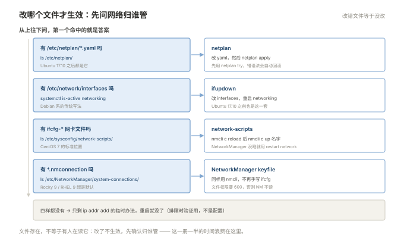

# 05 网络配置与排障

> **这一册回答**：网卡怎么配、地址和路由怎么来的、连不通时该按什么顺序查。  
> **读完能做到**：判断一台机器的网络到底归哪套体系管，改对文件并且改完就生效；配静态 IP 不断远程；用 `ip route get` 一句话定位「走哪条路出去」；用 `ss` 看出是没监听、还是排满了；分清 `Connection refused` 与 `Connection timed out` 背后的两种完全不同的原因；用 `tcpdump` 抓三个包就判断出是被拦还是没人听。  
> **怎么读**：5.0 是知识点地图，标了每个点的**基础 / 进阶**。第一遍跳过带「进阶」的小节不影响主线。 不认识的词查 [00 术语表](00-术语表.md)。  
> **不在这里**：TCP 三次握手/四次挥手的状态机、IP 分片与路由选路的原理、HTTP 报文与状态码 → 「网络」文档集（`001-IP路由与二层`、`002-TCP与连接状态`、`004-HTTP`）；防火墙的 SELinux 侧 → 03；跨机器传文件与跳板 → 06。

---

## 5.0 本册知识点地图

复习时按这张表逐行自问「这个我能讲清吗」，讲不清的回对应节。**加粗的是故障现场最常撞上的。**

| 知识点 | 层次 | 一句话要点 | 节 |
| --- | --- | --- | --- |
| **网络归谁管** | 基础 | `ifcfg` / `netplan` / `ifupdown` 三套，改错文件等于没改 | 5.1 |
| **改完必须让它生效** | 基础 | CentOS 7 `nmcli c up`；Ubuntu `netplan apply` | 5.1 |
| `ip` 取代 `ifconfig` | 基础 | `ip a` / `ip r` / `ip n` 三件套，网络管理工具 | 5.2 |
| **网卡命名规则** | 基础 | `eth0` / `ens33` / `enp0s3`，名字变了配置就不生效 | 5.2 |
| **静态 IP 两套写法** | 基础 | CentOS 7 写 `ifcfg-*`，Ubuntu 写 `netplan/*.yaml` | 5.3 |
| **改 IP 不断远程** | 基础 | 先在同一个窗口留 `at`/`sleep` 回滚，或用 `netplan try` | 5.3 |
| **`ip route get`** | 基础 | 一句话回答「去这个地址从哪个口、走哪个网关」 | 5.4 |
| 多默认路由与 metric | 进阶 | 两条默认路由靠 metric 分优先级，不是看谁先配 | 5.4 |
| `ip_forward` 与 NAT | 进阶 | 当网关或跑容器必须开；不开就是「内网通、出不去」 | 5.4 |
| `rp_filter` 丢包 | 进阶 | 多网卡不对称路由会被反向路径过滤静默丢掉 | 5.4 |
| **`resolv.conf` 会被覆盖** | 基础 | NetworkManager / systemd-resolved 都会重写它 | 5.5 |
| **`getent` 才是程序看到的** | 基础 | `dig` 只测 DNS 服务器，`getent` 走完整解析链路 | 5.5 |
| `nsswitch.conf` 顺序 | 进阶 | `files dns` 决定先查 `/etc/hosts` 还是先问 DNS | 5.5 |
| **`ss -lntp`** | 基础 | 看清有没有人在听、是哪个进程、听在哪个地址 | 5.6 |
| **`Recv-Q` 在 LISTEN 下的含义** | 进阶 | 它显示的是 accept 队列积压，接近 `Send-Q` 就是队列满了 | 5.6 |
| `TIME_WAIT` 很多 | 基础 | 主动关闭方的正常状态，不是故障 | 5.6 |
| **firewalld 的两个坑** | 基础 | 不加 `--permanent` 重启丢；加了不 `--reload` 不生效 | 5.7 |
| **ufw 先放行再启用** | 基础 | 顺序错了会把自己关在外面 | 5.7 |
| **云安全组在系统之外** | 基础 | 本机防火墙全关也不代表外面放行了 | 5.7 |
| **抓三个包定性质** | 基础 | 只有 SYN / SYN+RST / SYN 无回应，对应三种完全不同的原因 | 5.8 |
| **五层排查顺序** | 基础 | 链路 → IP → 路由 → 端口 → 应用，不许跳着查 | 5.9 |
| **refused 与 timeout 的区别** | 基础 | 有 RST 说明到达了；没回应说明被中间拦了 | 5.10 |
| **MTU 卡大包** | 进阶 | 能 ping 通、能登 SSH，但 `scp` 卡死或 HTTPS 握手失败 | 5.11 |
| conntrack 表满 | 进阶 | 表现为「新连接一律失败，老连接正常」 | 5.11 |

### 动手前：造一个不会影响本机的网络沙盒

这一册要反复改 IP、加路由、写防火墙规则。**在真网卡上练，最轻的结果是断掉自己的 SSH，最重的是整台机器失联。** 用 network namespace 造两台「虚拟机器」，它们各有独立的网卡、路由表和防火墙，和本机完全隔离：

```bash
# 造两个网络命名空间，等于两台只有一块网卡的机器
sudo ip netns add lab1
sudo ip netns add lab2

# 拉一根"网线"，两头分别插进两台机器
sudo ip link add veth1 type veth peer name veth2
sudo ip link set veth1 netns lab1
sudo ip link set veth2 netns lab2

# 配地址并启用
sudo ip netns exec lab1 ip addr add 10.0.0.1/24 dev veth1
sudo ip netns exec lab2 ip addr add 10.0.0.2/24 dev veth2
sudo ip netns exec lab1 ip link set veth1 up
sudo ip netns exec lab2 ip link set veth2 up

# 验证：应该能通
sudo ip netns exec lab1 ping -c 2 10.0.0.2
```

```plain
PING 10.0.0.2 (10.0.0.2) 56(84) bytes of data.
64 bytes from 10.0.0.2: icmp_seq=1 ttl=64 time=0.045 ms
64 bytes from 10.0.0.2: icmp_seq=2 ttl=64 time=0.045 ms
--- 10.0.0.2 ping statistics ---
2 packets transmitted, 2 received, 0% packet loss
```

之后所有命令前面加 `sudo ip netns exec lab1`（或 `lab2`），就等于在那台虚拟机器里执行。练完一条命令清干净：

```bash
sudo ip netns del lab1; sudo ip netns del lab2
```

命名空间删掉，里面的 veth 网卡自动消失，对本机零影响。

> **不想用命名空间**也没关系，本册所有结论在两台虚拟机之间同样成立。只是改地址、改路由那几步，请务必用**虚拟机的控制台**操作，别用 SSH——改错的瞬间 SSH 就断了，回滚的机会都没有。

占位符约定：`<网卡>` 换 `eth0` / `ens33` 这类名字（`ip a` 查），`<IP>` / `<网关>` 换实际值，`<端口>` 换数字端口。

**⚠️ 本册有三处会立刻失联**：改 IP、改默认网关、启用防火墙。操作前先确认手上有控制台（云主机的 VNC、虚拟机的 console），不要只靠 SSH。

---

## 5.1 先弄清这台机器的网络归谁管

改网络配错文件，是这一册最常见的时间浪费——文件改了、重启了、`ip a` 里地址纹丝不动，因为**那个文件根本没人读**。所以第一件事不是配 IP，而是问：这台机器的网络配置由哪个服务负责。

「配置文件在不在」和「谁在管这块网卡」是两条线索，从上往下问，第一个命中的就是答案：



### 五套体系，一张判定表

| 体系 | 配置文件 | 生效命令 | 常见于 |
| --- | --- | --- | --- |
| network-scripts | `/etc/sysconfig/network-scripts/ifcfg-*` | `nmcli c reload` + `nmcli c up <名字>`；或 `systemctl restart network` | **CentOS 7** |
| NetworkManager keyfile | `/etc/NetworkManager/system-connections/*.nmconnection` | `nmcli c reload` + `nmcli c up <名字>` | Rocky 9 / RHEL 9 起（CentOS 8 仍默认写 ifcfg） |
| netplan | `/etc/netplan/*.yaml` | `netplan apply`（或 `netplan try`） | **Ubuntu 17.10+** |
| ifupdown | `/etc/network/interfaces` | `systemctl restart networking` | **Debian** |
| 手工临时 | 无 | `ip addr add ...` | 排障时临时验证 |

### 三条命令判断现状

```bash
# 1) 谁在管设备？
nmcli -t -f DEVICE,TYPE,STATE,CONNECTION device status 2>/dev/null
systemctl is-active NetworkManager systemd-networkd networking 2>/dev/null

# 2) 有没有 netplan 配置？
ls /etc/netplan/ 2>/dev/null
sudo netplan get 2>/dev/null | head -20

# 3) 有没有 ifcfg？
ls /etc/sysconfig/network-scripts/ifcfg-* 2>/dev/null
```

四种结果对应四种处理：

| 结果 | 归谁管 | 改哪里 |
| --- | --- | --- |
| 有 `ifcfg-*` 且 `NetworkManager` active | CentOS 7 | 改 `ifcfg-*`，然后 `nmcli c reload && nmcli c up <名字>` |
| 有 `/etc/netplan/*.yaml` | Ubuntu | 改 yaml，然后 `netplan apply` |
| 有 `/etc/network/interfaces` | Debian | 改它，然后 `systemctl restart networking` |
| 都没有 | 可能是容器 / 云镜像精简版 | 用 `ip` 临时配，再考虑装 NetworkManager |

```plain
$ nmcli -t -f DEVICE,TYPE,STATE,CONNECTION device status
eth0:ethernet:connected:eth0
lo:loopback:unmanaged:

$ systemctl is-active NetworkManager systemd-networkd networking
active
inactive
inactive
```

`NetworkManager active` + `eth0` 被一个叫 `eth0` 的连接管理着，就是 CentOS 7 的标准状态。

### 一个必须知道的坑：`network` 与 `NetworkManager` 并存

CentOS 7 上 `systemctl restart network` 和 `systemctl restart NetworkManager` 都能"重启网络"，但它们是两个不同的服务，**同时启用会互相覆盖**。

判断谁真正在管：

```bash
systemctl is-enabled network NetworkManager
nmcli device status        # 被 NetworkManager 管的设备 STATE 才有值
```

**建议统一用 `nmcli`**：它是 NetworkManager 的官方命令行，改 `ifcfg` 之后 `nmcli c reload` 会重新读取文件，比 `systemctl restart network` 更可靠（后者在 NetworkManager 接管设备后有时只是空转）。CentOS 7 之后也没有 `network` 这个服务了，早点习惯 `nmcli` 更省事。

> **Rocky 9 / RHEL 9 起**默认不再写 `ifcfg-*`，配置在 `/etc/NetworkManager/system-connections/`，格式是 keyfile（CentOS 8 / RHEL 8 是新旧并存：NetworkManager 当默认，但落盘仍是 ifcfg）。`nmcli` 的用法完全一样，这是写出跨版本兼容命令的关键——**只记 `nmcli`，不记文件路径**。

---

## 5.2 `ip` 命令族：地址、路由、邻居

上一节确定了归谁管，这一节先学会「看」——`ip a` / `ip r` / `ip n` 这三条命令替代了 `ifconfig` / `route` / `arp`，虽然用法不同，但**必须换过来**：`net-tools` 在 Rocky 9 和 Ubuntu 22.04 上已经默认不装了。

### 三条核心命令

```bash
ip a                    # 地址（address）
ip r                    # 路由（route）
ip n                    # 邻居表 / ARP（neighbor）
```

```plain
$ ip a
1: lo: <LOOPBACK,UP,LOWER_UP> mtu 65536 qdisc noqueue state UNKNOWN
    inet 127.0.0.1/8 scope host lo
2: eth0: <BROADCAST,MULTICAST,UP,LOWER_UP> mtu 1500 qdisc pfifo_fast state UP
    link/ether 00:0c:29:3f:8a:1b brd ff:ff:ff:ff:ff:ff
    inet 192.168.1.10/24 brd 192.168.1.255 scope global eth0
    inet6 fe80::20c:29ff:fe3f:8a1b/64 scope link
```

| 关键字段 | 含义 | 怎么看 |
| --- | --- | --- |
| `<UP,LOWER_UP>` | 管理状态 UP + 物理链路 UP | **缺 `LOWER_UP` 说明网线/对端没通** |
| `mtu 1500` | 最大传输单元 | 云环境常见 1450 |
| `state UP` / `DOWN` | 接口状态 | `DOWN` 就是 `ip link set up` 没做 |
| `inet 192.168.1.10/24` | IPv4 地址与掩码 | `/24` 就是 `255.255.255.0` |
| `link/ether` | MAC 地址 | 同网段通信靠它 |

`<UP>` 与 `<LOWER_UP>` 的区别是排障的第一个分叉：**只有 `UP` 没有 `LOWER_UP`**，说明软件层面启用了但物理链路没起来——查网线、查对端交换机端口、查云平台是否挂载了网卡。这一条能省掉一半"网卡是不是坏了"的猜测。

### 网卡名字变了，配置就不生效

| 名字形态 | 出现环境 | 原因 |
| --- | --- | --- |
| `eth0` / `eth1` | CentOS 6、老内核 | 按探测顺序编号 |
| `ens33` / `ens192` | CentOS 7、VMware | 按 PCI 槽位命名（`en` + `s`lot） |
| `enp0s3` / `enp3s0` | Ubuntu、物理机 | 按 PCI 总线位置命名 |
| `eno1` / `eno2` | 品牌服务器 | 按板载网卡固件编号 |

`ifcfg-eth0` 里的 `DEVICE=eth0` 和实际网卡名对不上，配置就绑不上去——**现象是「配了但 `ip a` 没变化」**，比报错更难查。所以每次改配置前先 `ip a` 抄下真实名字。

改回传统名字（可选，只在必须沿用老脚本时做）：

```bash
# CentOS 7：加内核参数 net.ifnames=0 biosdevname=0
sudo grubby --update-kernel=ALL --args="net.ifnames=0 biosdevname=0"
# Ubuntu：改 /etc/default/grub 的 GRUB_CMDLINE_LINUX 后 update-grub
```

改完要重启。**注意**：网卡名变了，所有 `ifcfg-*` / `netplan` 里的设备名都要跟着改，否则网络直接不通。不建议在生产上做这个动作。

### 临时改地址（重启即失效）

```bash
sudo ip addr add 192.168.1.20/24 dev eth0     # 加一个地址（可多地址共存）
sudo ip addr del 192.168.1.20/24 dev eth0     # 删掉
sudo ip link set eth0 down / up               # 启停接口
```

`ip addr add` 加的地址**不落盘**，重启或 `nmcli c up` 之后就没了。这是排障时验证「换个 IP 是不是就好了」最快的手段，也是唯一不会改坏配置的操作。

### `ip` 的简写与替代品

| 老命令 | 新命令 | 说明 |
| --- | --- | --- |
| `ifconfig` | `ip a` | |
| `ifconfig eth0 up` | `ip link set eth0 up` | |
| `route -n` | `ip r` | |
| `arp -n` | `ip n` | |
| `netstat -lntp` | `ss -lntp` | 见 5.6 |
| `netstat -i` | `ip -s link` | 带收发包与错误计数 |
| `netstat -rn` | `ip r` | |

新版 iproute2（4.x 起）支持 `ip -br a`（简洁模式，一行一个接口）。CentOS 7 早期版本带的是 3.10，没有这个参数，敲了会报 `Option "-br" is unknown`——直接用 `ip a` 就行，不要在脚本里依赖它。

---

## 5.3 配静态 IP：两套写法

看清了现状，现在改。两个发行版的写法完全不同，而且各自的生效方式也不一样——**这套差异是附录 B 的第 4 条，这里展开讲**。

### CentOS 7：`ifcfg-*` + `nmcli`

```bash
sudo vim /etc/sysconfig/network-scripts/ifcfg-eth0
```

```ini
TYPE=Ethernet
BOOTPROTO=none
NAME=eth0
DEVICE=eth0
ONBOOT=yes
IPADDR=192.168.1.10
PREFIX=24
GATEWAY=192.168.1.1
DNS1=223.5.5.5
DNS2=119.29.29.29
```

七个字段的含义：

| 字段 | 作用 | 易错点 |
| --- | --- | --- |
| `BOOTPROTO=none` | 静态地址 | 写 `dhcp` 会忽略下面的 `IPADDR` |
| `ONBOOT=yes` | 开机启用 | 默认是 `no` 时，重启后网卡不启动 |
| `DEVICE` / `NAME` | 绑定的网卡名 | **必须与 `ip a` 的真实名字一致** |
| `IPADDR` | 地址 | |
| `PREFIX=24` | 掩码位数 | 老写法是 `NETMASK=255.255.255.0`，两种都认 |
| `GATEWAY` | 默认网关 | 已经有默认路由时，这里可能不生效 |
| `DNS1` / `DNS2` | 写进 `/etc/resolv.conf` | 加 `PEERDNS=no` 可阻止它改 DNS |

生效：

```bash
sudo nmcli connection reload
sudo nmcli connection up eth0
ip a show eth0
ip r
```

```plain
$ ip r
default via 192.168.1.1 dev eth0 proto static metric 100
192.168.1.0/24 dev eth0 proto kernel scope link src 192.168.1.10 metric 100
```

`metric 100` 是 NetworkManager 加上去的。**同一个网段有多块网卡时，metric 小的优先**（见 5.4）。

> **`systemctl restart network` 还能用吗**：能，但它是老式 `network.service`，与 NetworkManager 并存时可能不生效。`nmcli c reload && nmcli c up <名字>` 是唯一可靠的路径。Rocky 9 上 `network.service` 已经没有了。

### Ubuntu：`netplan` YAML

```bash
sudo vim /etc/netplan/00-installer-config.yaml
```

```yaml
network:
  version: 2
  renderer: networkd
  ethernets:
    ens33:
      dhcp4: no
      addresses:
        - 192.168.1.10/24
      routes:
        - to: default
          via: 192.168.1.1
      nameservers:
        addresses: [223.5.5.5, 119.29.29.29]
```

四个必须知道的地方：

1. **缩进是语法**，用空格不用 Tab。YAML 缩进错会直接 `netplan generate` 失败。
2. **`gateway4` 已废弃**。Ubuntu 22.04 上写 `gateway4:` 会打印 `WARNING: gateway4 has been deprecated, use default routes instead`，虽然还能用，但会被未来的版本移除。用 `routes: - to: default` 才是当前写法。
3. **文件权限建议 600**。否则 `netplan apply` 会打印 `Permissions for /etc/netplan/xxx.yaml are too open` 警告。注意这个警告**不影响配置生效**——它只是提醒，改不改都能应用；但 YAML 里可能写了明文 WiFi 密码，权限放宽等于泄密，所以还是 `chmod 600`。
4. **`renderer` 决定后端**：`networkd`（服务器默认）或 `NetworkManager`（桌面默认）。选错的话配置生成了但没人执行。

生效，两步走：

```bash
sudo chmod 600 /etc/netplan/*.yaml
sudo netplan generate      # 只校验语法，不应用
sudo netplan apply         # 应用
```

**`netplan try` 是这套体系最有价值的功能**：它在应用后启动 120 秒倒计时，这期间**不按键确认就自动回滚**。

```bash
sudo netplan try
```

```plain
Do you want to keep these settings?

Press ENTER before the timeout to accept the new configuration

Changes will revert in 117 seconds
```

远程改 IP 时用它——改错了，两分钟后自己回来；改对了，按一下回车确认。这一条能救掉大部分"改完 IP 就连不上了"的事故。

### ⚠️ 改 IP 前必须先留一条回退路

`netplan try` 只解决 Ubuntu，CentOS 7 没有等价物。通用办法是**让机器自己把配置改回去**：

```bash
# 备份当前配置
sudo cp /etc/sysconfig/network-scripts/ifcfg-eth0 /root/ifcfg-eth0.bak

# 延迟 5 分钟执行回滚（这段时间足够你测试新 IP）
echo "cp /root/ifcfg-eth0.bak /etc/sysconfig/network-scripts/ifcfg-eth0 && nmcli c reload && nmcli c up eth0" | sudo at now + 5 minutes
```

测试新 IP 通了，再取消这个任务：

```bash
sudo atq              # 看排队的任务
sudo atrm <任务号>     # 取消
```

没有 `at` 的话（最小化安装常常没有），用 `nohup sh -c 'sleep 300; 回滚命令' &` 效果类似。**这一步的做法不重要，重要的是"在断网之前就把后悔药安排好"**——靠记忆手动改回来，在 SSH 已断的情况下做不到。

---

## 5.4 路由：去这个地址走哪条路

地址配好了，下一个问题是「出门走哪」。路由是网络排障里最容易被跳过、又最容易出问题的一层——**地址对、网关对、服务在听，但包就是出去了回不来**，九成是路由或转发的问题。

### 看路由表

```bash
ip r
```

```plain
default via 192.168.1.1 dev eth0 proto static metric 100
10.0.0.0/24 via 192.168.1.2 dev eth0 proto static metric 100
172.17.0.0/16 dev docker0 proto kernel scope link src 172.17.0.1
192.168.1.0/24 dev eth0 proto kernel scope link src 192.168.1.10 metric 100
```

四行分别是：默认路由、一条指定网段的静态路由、Docker 的容器网段、直连网段。**匹配规则是最长前缀优先**——去 `172.17.5.5` 走 `docker0`，去 `10.0.0.8` 走网关 `192.168.1.2`，其余全部走 `default`。

`proto kernel` 表示这条路由是内核根据接口地址自动生成的，不是人手配的；`scope link` 表示目标就在直连链路上，不用经过网关。

### 一条命令回答「走哪条路」

这是本册最值得记住的单条命令：

```bash
ip route get 8.8.8.8
```

```plain
$ ip route get 8.8.8.8
8.8.8.8 via 192.168.1.1 dev eth0 src 192.168.1.10 uid 0
    cache
```

四个信息一次给全：**用哪个网关（`via`）、从哪块网卡出（`dev`）、用哪个源地址（`src`）**。判断「为什么不通」时先跑这一条——

- `src` 不是你以为的那个地址 → 多网卡选错了出口，这是跨网段不通的头号原因。
- 报 `Network is unreachable` → 没有匹配的路由，缺默认网关或静态路由。
- `dev` 指向了错误的网卡 → 路由表里两条同长度前缀，metric 小的赢了。

### 多网卡与 metric

一台机器两块网卡都配了默认网关，**只会有一条默认路由生效**，靠 `metric` 决胜负：

```bash
# 临时加一条，metric 更小 = 优先级更高
sudo ip route add default via 192.168.2.1 dev eth1 metric 50

# 永久的：CentOS 7 写 route-eth1，Ubuntu 写 netplan 的 routes
```

CentOS 7 的永久静态路由：

```bash
sudo vim /etc/sysconfig/network-scripts/route-eth1
```

```ini
10.20.0.0/16 via 192.168.2.1
```

Ubuntu 的等价写法在 netplan 里：

```yaml
      routes:
        - to: 10.20.0.0/16
          via: 192.168.2.1
```

> **两条默认路由的陷阱**：即使 metric 不同，如果两条路由指向**同一个网关但不同网卡**，回程包可能从另一块网卡回来，触发反向路径过滤（见下）。多出口机器必须让「出去」和「回来」走同一块网卡。

### `ip_forward`：当网关或跑容器必须开

```bash
sysctl net.ipv4.ip_forward
```

```plain
net.ipv4.ip_forward = 0
```

`0` 表示这台机器**只收发自己的包，不转发别人的**。三种情况必须改成 1：

| 场景 | 为什么 |
| --- | --- |
| 这台机器当内网网关 | 不转发，内网出不去 |
| Docker / K8s 节点 | 容器跨主机通信要转发 |
| 做 NAT（`MASQUERADE`） | 转发的包要被改写源地址 |

```bash
# 临时
sudo sysctl -w net.ipv4.ip_forward=1

# 永久（注意 sysctl -p 只读一个文件，见 001 §1.8）
echo 'net.ipv4.ip_forward = 1' | sudo tee /etc/sysctl.d/99-forward.conf
sudo sysctl --system
```

### `rp_filter`：多网卡不对称路由的隐形杀手（进阶）

内核会做反向路径检查：收到一个包，先查「如果我要回它，会从哪块网卡出去」，如果和收到它的网卡不一致，就悄悄丢掉。**日志里什么都没有，抓包也看不到回包**。

```bash
sysctl net.ipv4.conf.all.rp_filter net.ipv4.conf.eth1.rp_filter
```

```plain
net.ipv4.conf.all.rp_filter = 1
net.ipv4.conf.eth1.rp_filter = 1
```

`1` 是严格模式。多网卡机器（一块内网一块公网，或者做了策略路由）经常被它拦住。判断方法：

```bash
# 看是不是它在丢
nstat -az | grep -i 'IPReversePathFilter'
```

```plain
IpInAddrErrors                 0                  0.0
IPReversePathFilter            1842               0.0
```

计数在涨就是它。处置是放宽到松散模式（`2`）或对特定网卡关掉（`0`）：

```bash
echo 'net.ipv4.conf.eth1.rp_filter = 2' | sudo tee -a /etc/sysctl.d/99-net.conf
sudo sysctl --system
```

`2` 是松散模式：只要求「这个源地址在路由表里可达」，不要求走同一块网卡。**不要直接把 `all` 关掉**，那会同时削弱所有网卡的反欺骗能力。

---

## 5.5 DNS：为什么能连 IP 不能连域名

网络层通了之后，下一层是域名解析。这一节的核心是一句话：**`dig` 通了不代表程序能解析，`ping` 通了也不代表程序能解析**——每条命令走的解析路径不一样。

### 解析链路有四级

```plain
程序调用 getaddrinfo()
   ↓
1. /etc/nsswitch.conf 的 hosts 行决定顺序
   ↓
2. files  → /etc/hosts
3. dns    → /etc/resolv.conf 里的 nameserver
   ↓
返回结果（或 NXDOMAIN / 超时）
```

看这台机器的顺序：

```bash
grep '^hosts' /etc/nsswitch.conf
cat /etc/resolv.conf
```

```plain
$ grep '^hosts' /etc/nsswitch.conf
hosts:      files dns myhostname

$ cat /etc/resolv.conf
# Generated by NetworkManager
nameserver 223.5.5.5
nameserver 119.29.29.29
search example.com
```

`files dns` 表示**先查 `/etc/hosts`，没有再问 DNS**。这个顺序解释了绝大多数「明明 `/etc/hosts` 里写了，程序还是解析错了」——其实没写错，是 DNS 里也有同名记录但顺序不是你以为的那样；反过来，`/etc/hosts` 的优先级**高于** DNS，所以它是覆盖解析最快的办法。

### 三条命令，测的是三段不同的链路

| 命令 | 走什么路径 | 用来判断 |
| --- | --- | --- |
| `getent hosts <名字>` | **完整 NSS 链路**（和程序一致） | 程序到底能不能解析 |
| `dig +short <名字>` | 只问 `resolv.conf` 里的 DNS 服务器 | DNS 服务器是否正常 |
| `ping <名字>` | 完整链路 + 连通性 | 解析 + 网络一起测 |

**排障顺序是 `getent` → `dig`**，不是反过来：

```bash
getent hosts app.internal
```

```plain
$ getent hosts app.internal
10.20.1.15      app.internal
```

`getent` 有结果，**说明程序也能解析**，问题不在 DNS。`getent` 无输出但 `dig` 有结果，说明是 `/etc/hosts` 或 `nsswitch.conf` 的问题（比如 `hosts:` 行被改成了只有 `dns`，或者中间夹了 `mdns` 之类的模块在超时）。

`dig` 的用法：

```bash
dig +short app.internal                 # 只要结果
dig app.internal @223.5.5.5             # 指定 DNS 服务器问
dig app.internal +trace                 # 从根开始逐级查（排查权威解析）
dig -x 10.20.1.15 +short                # 反查 PTR
```

`dig` 也需要装包：CentOS 7 是 `bind-utils`，Ubuntu 是 `dnsutils`。

### ⚠️ `/etc/resolv.conf` 会被覆盖

手改 `resolv.conf` 通常撑不过一次重启，甚至撑不过一次 `nmcli c up`：

| 谁在覆盖 | 怎么阻止 |
| --- | --- |
| NetworkManager | 在 `ifcfg` 里写 `PEERDNS=no`，或在连接里 `nmcli c mod eth0 ipv4.ignore-auto-dns yes` |
| systemd-resolved（Ubuntu） | 不要改 `/etc/resolv.conf`，改 `/etc/systemd/resolved.conf` 或 netplan 的 `nameservers` |
| dhclient | `supersede domain-name-servers` |

Ubuntu 22.04 上的 `resolv.conf` 长这样：

```plain
$ ls -l /etc/resolv.conf
lrwxrwxrwx 1 root root 39 ... /etc/resolv.conf -> ../run/systemd/resolve/stub-resolv.conf

$ cat /etc/resolv.conf
nameserver 127.0.0.53
options edns0 trust-ad
```

`127.0.0.53` 是本机的 stub 解析器（systemd-resolved 提供的缓存代理），真实的 DNS 服务器在别处。要看真实配置：

```bash
resolvectl status
```

```plain
Global
       Protocols: -LLMNR -mDNS -DNSOverTLS DNSSEC=no/unsupported
resolv.conf mode: stub

Link 2 (ens33)
    Current Scopes: DNS
         Protocols: +DefaultRoute
Current DNS Server: 223.5.5.5
       DNS Servers: 223.5.5.5 119.29.29.29
        DNS Domain: example.com
```

**看到 `127.0.0.53` 不要以为配错了**，那是正常的。改 DNS 要在 netplan 的 `nameservers` 里改，或者改 `/etc/systemd/resolved.conf` 后 `systemctl restart systemd-resolved`。

### `search` 域与短名

`resolv.conf` 里的 `search example.com` 让你能只写 `app` 就解析 `app.example.com`。代价是**每次短名查询都会先试拼 `app.example.com`，失败再试原名**，多一次往返；`ndots` 控制「名字里有几个点才直接查原名」，默认 1。

现象是「短名解析慢、全名解析快」，或者「短名解析到了错误的机器」。排查时 `dig app` 看看返回的是不是你以为的那个全名。

---

## 5.6 端口与连接：`ss` 怎么看

解析通了，包能到了，下一层是「有没有人在这个端口上等」。`ss` 是这个环节唯一的工具（`netstat` 在新系统上已经默认不装），但它输出的几列含义经常被误读，尤其是 `Recv-Q` / `Send-Q`。

### 四个最常用的组合

```bash
ss -lntp          # 监听的 TCP 端口 + 进程
ss -antp          # 所有 TCP 连接（含非监听）
ss -s             # 按协议汇总
ss -tan state time-wait | wc -l    # 数一下 TIME_WAIT 有多少
```

```plain
$ ss -lntp
State   Recv-Q  Send-Q  Local Address:Port   Peer Address:Port  Process
LISTEN  0       128     0.0.0.0:22           0.0.0.0:*          users:(("sshd",pid=812,fd=3))
LISTEN  0       511     127.0.0.1:6379       0.0.0.0:*          users:(("redis-server",pid=1103,fd=6))
LISTEN  0       100     0.0.0.0:80           0.0.0.0:*          users:(("nginx",pid=2043,fd=6))
```

**这张表能直接回答三个问题**：

| 问题 | 看哪列 |
| --- | --- |
| 端口有没有人听 | `State` 是 `LISTEN` |
| 谁在听 | `Process` 列（需要 root 才显示进程名） |
| **外网能不能连** | `Local Address` 是 `0.0.0.0` 还是 `127.0.0.1` |

第三行是本节最值钱的一条：`redis-server` 只听在 `127.0.0.1:6379`，**从别的机器一定连不上**，跟防火墙一点关系都没有。判断「端口不通」时，第一眼看的就是这个。

### `Recv-Q` / `Send-Q` 在两状态下意思完全不同

这是 `ss` 最容易读错的地方：

| 状态 | `Recv-Q` | `Send-Q` |
| --- | --- | --- |
| `LISTEN` | **已完成握手、等待应用 accept 的连接数** | **listen backlog 上限** |
| `ESTAB` | 收到但应用还没读走的字节数 | 已发出但对方还没确认的字节数 |

LISTEN 状态下，`Recv-Q` 接近 `Send-Q`（上例 128），说明 **accept 队列快满了**——应用处理不过来，新连接会被丢或被拒。这是判断「服务在跑但连不上」的关键信号，而它看起来完全不像资源问题。

ESTAB 状态下，`Recv-Q` 持续不降，说明**应用卡住了不读数据**（比如被 `strace` 一看就停在 `read` 上，或者线程池满了）。这时连接是"通"的，但业务没响应。

### `TIME_WAIT` 多不是故障

```bash
ss -tan | awk '{print $1}' | sort | uniq -c | sort -rn
```

```plain
   1204 ESTAB
    830 TIME_WAIT
     12 LISTEN
      4 CLOSE_WAIT
```

| 状态 | 含义 | 要不要管 |
| --- | --- | --- |
| `TIME_WAIT` | **主动关闭方**的正常状态，持续 2MSL（约 60 秒） | 通常不用。短连接服务（HTTP 代理）会很多 |
| `CLOSE_WAIT` | 对方关了，本端应用还没 close | **要管**。持续增长就是应用没关连接的 bug |
| `ESTAB` | 已建立 | 看数量与业务是否匹配 |
| `SYN-RECV` | 收到 SYN、回了 SYN-ACK，等对方 ACK | 大量出现可能是 SYN Flood 或回程不通 |

`TIME_WAIT` 堆积的唯一实际影响是**本地端口耗尽**（默认 `ip_local_port_range` 约 2.8 万个）。真要缓解，调内核参数比改代码快，但**先确认是不是短连接真的必要**——把连接复用起来才是根治。

`CLOSE_WAIT` 则完全相反：它不会自己消失，只能由应用调 `close()`。数量只增不减，就是代码里的连接泄漏，重启只能暂时缓解。

### 按条件筛连接

```bash
ss -tn dst 10.20.1.15                  # 连到某个 IP 的
ss -tn sport = :80                     # 源端口 80 的
ss -tn state established '( dport = :3306 )'   # 连到 3306 的已建立连接
ss -tnp | grep nginx                   # 按进程名筛
ss -ltn 'sport = :80'                  # 精确查某个端口有没有在听
```

最后一条在写脚本时很好用：返回为空就是没监听，退出码可判断。

---

## 5.7 防火墙：四套前端，一个内核

端口在听、地址也对，还是连不上——轮到最后一道门。Linux 上"防火墙"其实是四层东西叠着，**分不清层级就会在错误的层面上改规则**。

### 一张图看清四件套的关系

| 层 | 名字 | 在哪个发行版 | 它实际在做什么 |
| --- | --- | --- | --- |
| 前端（高层） | `firewalld` | CentOS 7、Rocky | 管 zone，把规则翻译成 iptables/nftables |
| 前端（高层） | `ufw` | Ubuntu | 简化语法，翻译成 iptables |
| 前端（低层） | `nftables`（`nft`） | Rocky 9、Debian 12 | 直接写规则集 |
| 内核 | netfilter | 所有 Linux | 真正执行包过滤的地方 |

**四者最终都落到 netfilter**。所以「`iptables -L` 是空的但端口还是不通」是可能的——规则在 `nft` 里，或者相反。

### 先判断这台机器用哪套

```bash
systemctl is-active firewalld ufw nftables 2>/dev/null
sudo iptables -L -n 2>/dev/null | head -5
sudo nft list ruleset 2>/dev/null | head -20
```

| 现象 | 用哪套 |
| --- | --- |
| `firewalld active` | 用 `firewall-cmd`，**不要手写 iptables** |
| `ufw active` | 用 `ufw` |
| 前两个都 inactive，`iptables -L` 有规则 | 直接用 `iptables`（需装 `iptables-services` 才能持久化） |
| 只有 `nft list ruleset` 有内容 | 用 `nft` |

### `firewalld`：两个必踩的坑

```bash
# 放行端口
sudo firewall-cmd --add-port=8080/tcp --permanent
sudo firewall-cmd --reload

# 放行服务（预定义的服务名，比端口更语义化）
sudo firewall-cmd --add-service=http --permanent
sudo firewall-cmd --reload

# 看当前 zone 的全部规则
sudo firewall-cmd --list-all
```

```plain
$ sudo firewall-cmd --list-all
public (active)
  target: default
  interfaces: eth0
  services: ssh dhcpv6-client http
  ports: 8080/tcp
  masquerade: no
```

| 坑 | 表现 | 正确做法 |
| --- | --- | --- |
| 不加 `--permanent` | 当时生效，重启后消失 | 加 `--permanent` **再** `--reload` |
| 加了 `--permanent` 但不 `--reload` | 配置文件里有，运行时没有，**不生效** | 必须 `--reload` |

两条要一起做，缺一条就出问题。这是 `firewall-cmd` 设计上的反直觉之处：`--permanent` 写的是磁盘上的 XML，运行时规则是另一份内存中的副本。

`--reload` 会重建规则但**不断开已建立的连接**，所以远程操作是安全的。

### `ufw`：顺序错了会把自己关在外面

```bash
# 正确的顺序：先放行，再启用
sudo ufw allow 22/tcp
sudo ufw allow 80,443/tcp
sudo ufw enable
sudo ufw status verbose
```

```plain
$ sudo ufw status verbose
Status: active
Logging: on (low)
Default: deny (incoming), allow (outgoing), disabled (routed)
New profiles: skip

To                         Action      From
--                         ------      ----
22/tcp                     ALLOW IN    Anywhere
80,443/tcp                 ALLOW IN    Anywhere
```

**`ufw enable` 的默认策略是 deny incoming**，所以「先 enable 再 allow 22」就等于当场切断自己的 SSH。这是新人最常犯的一次性事故。

Ubuntu 上还可以按应用放行（`ufw allow 'Nginx Full'`，配置在 `/etc/ufw/applications.d/`）。

> **Debian 12 默认没装 `ufw`**，`ufw status` 报 `command not found` 是正常的，不是权限问题（附录 B 第 4 条）。Debian 默认用 `nftables`，但最小安装下规则集是空的——**没配规则等于全放行**。

### `iptables`：什么时候才需要碰它

只有三种情况值得直接写 `iptables`：做 NAT、做端口转发、需要按连接状态精细控制。日常放行端口用 `firewall-cmd` 或 `ufw` 就够。

```bash
sudo iptables -L -n -v --line-numbers          # 看规则（带行号，便于插入/删除）
sudo iptables -I INPUT 1 -p tcp --dport 8080 -j ACCEPT   # 插到第 1 条
sudo iptables -D INPUT 3                        # 删第 3 条
```

```plain
$ sudo iptables -L INPUT -n -v --line-numbers
Chain INPUT (policy ACCEPT 1204 packets, 98322 bytes)
num   pkts bytes target     prot opt in     out     source               destination
1       82  4920 ACCEPT     tcp  --  *      *       0.0.0.0/0            0.0.0.0/0            tcp dpt:8080
2        0     0 DROP       all  --  *      *       10.0.0.5             0.0.0.0/0
```

`-I`（insert，插到链首）与 `-A`（append，追加到链尾）的区别很关键：**链是按顺序匹配、命中即停**，所以 `-A` 加在 `DROP all` 后面就永远不生效。这是写 iptables 规则最经典的失效原因。

持久化：

```bash
# CentOS 7 需要 iptables-services
sudo yum install -y iptables-services
sudo service iptables save        # 存到 /etc/sysconfig/iptables

# 或者手工导出/恢复（通用）
sudo iptables-save > /root/iptables.rules
sudo iptables-restore < /root/iptables.rules
```

> **Rocky 9 的 `iptables` 是 nft 兼容层**（附录 B 第 3 条）：`iptables -L` 和 `nft list ruleset` 看到的规则不完全一致。清空规则时 `iptables -F` 只清兼容层对应的表，`nft flush ruleset` 才是全清。两处对不上时不要怀疑自己。

### 云主机的安全组：在系统之外

这是「本机防火墙全关，端口还是不通」的最常见原因：

```plain
你的请求 → 云平台安全组 → 宿主机 → 你的网卡 → firewalld/ufw → 应用
              ↑
        这一层不在机器里，任何本机命令都看不到
```

判断方法只有一个：**在控制台里看安全组规则**。本地能做的验证是「从同网段另一台机器 telnet 一下」——如果同网段通、外网不通，且本机 `iptables -L` 干净，那基本就是安全组或上层网络设备。

云上还有两个容易忽略的：

- **安全组是有方向的**，入站放行了但出站被限制（少见但存在）。
- **绑定在多台机器上的安全组是共享的**，改一处影响全部。

---

## 5.8 抓包：三个包定性质

前面五层都查过了还是不通，就该抓包了。抓包不用懂 TCP 状态机，**只需要认三种组合**，就能把「是被中间拦了、还是没人听、还是人家拒了」区分开。

### 最小必要语法

```bash
# 在 any 接口上抓 80 端口，不解析主机名和端口名（-nn 必加，否则卡在反查上）
sudo tcpdump -i any -nn port 80

# 抓 100 个包就停
sudo tcpdump -i any -nn -c 100 port 80

# 抓某个 IP 的进出
sudo tcpdump -i any -nn host 10.20.1.15

# 抓 SYN 包（只看新连接请求）
sudo tcpdump -i any -nn 'tcp[tcpflags] & tcp-syn != 0 and tcp[tcpflags] & tcp-ack == 0'

# 存成文件，拿去 Wireshark 看
sudo tcpdump -i any -nn -w /tmp/cap.pcap port 80
```

`-i any` 表示所有网卡（包括 lo 和容器网卡），`-nn` 是不做 DNS 与端口名解析。**不加 `-nn` 时，每个包都要反查一次，高流量下会丢包且刷屏极慢**，这是最常见的用法错误。

### 三种组合，三种结论

客户端执行 `curl http://10.20.1.15:8080/`，同时在客户端和服务端各抓一次：

| 抓到什么 | 结论 | 下一步 |
| --- | --- | --- |
| **只有 SYN，没有回包** | 包出去了但没到，或回程被拦 | 查中间防火墙、安全组、路由 |
| **SYN → RST** | 到达了目标，**目标明确拒绝** | 端口没监听，或本地防火墙 reject |
| **SYN → SYN-ACK → ACK** | 三次握手完成，网络没问题 | 问题在应用层，去看 5.10 |

```plain
# 情况一：只有 SYN（重复重传）
14:22:31.104  IP 10.20.1.10.51234 > 10.20.1.15.8080: Flags [S], seq 1234567, win 29200
14:22:32.108  IP 10.20.1.10.51234 > 10.20.1.15.8080: Flags [S], seq 1234567, win 29200
14:22:34.112  IP 10.20.1.10.51234 > 10.20.1.15.8080: Flags [S], seq 1234567, win 29200

# 情况二：SYN 之后立刻 RST
14:22:31.104  IP 10.20.1.10.51234 > 10.20.1.15.8080: Flags [S], seq 1234567, win 29200
14:22:31.105  IP 10.20.1.15.8080 > 10.20.1.10.51234: Flags [R.], seq 0, ack 1234568, win 0
```

**这两种情况对应 `curl` 的两种报错，一定要连起来记**：

| 现象 | 抓包 | 原因 |
| --- | --- | --- |
| `Connection timed out`（等 2 分钟后失败） | 只有 SYN，重传 | 被拦或路由不通 |
| `Connection refused`（立刻失败） | SYN → RST | 到达了，但没人在听 |

「立刻失败」和「等很久才失败」是截然不同的诊断信息，很多人只看报错文案不看耗时，就分不清这两种。

### 服务端也要抓一次

只看客户端会误判。**两端对比才能定位「包到哪一段就没了」**：

| 客户端 | 服务端 | 结论 |
| --- | --- | --- |
| 有 SYN | 有 SYN | 包到了，问题在服务端（防火墙 reject / 没听 / backlog 满） |
| 有 SYN | 没有 SYN | 包没到，问题在中间（安全组、路由、上游设备） |

服务端抓包时记得带上 `-i any`，否则可能漏掉容器网卡或 bond 上的流量。

### 一个常见误判

`tcpdump` 抓不到包，**不等于没有包**——可能是抓错了网卡（`-i eth0` 但流量走 `docker0`）、过滤表达式写错、或者流量走了硬件卸载路径。先 `-i any` 不带过滤抓十个包看看有没有流量，再逐步加过滤条件。

---

## 5.9 五层排查法

前面五节各管一层。真实故障里，**顺序本身就是方法**——跳着查会来回绕，按层走最多五步就能定位。

先记住这五层和每层的一句话判据，下面的细节都只是往这张图上填内容：


细化到每一层该敲哪几条命令：

```plain
第 1 层  链路：网卡起来了吗
   ip a          看 <UP,LOWER_UP> 和 state
   ethtool eth0  看 Link detected: yes
        ↓ 正常
第 2 层  地址：IP 和掩码对吗
   ip a          看 inet，同网段的两台机器掩码是否一致
        ↓ 正常
第 3 层  路由：知道往哪走吗
   ip route get <目标IP>     看 via / dev / src
   ip r                      看有没有默认路由
        ↓ 正常
第 4 层  端口：有人在听吗，门开了吗
   ss -lntp                  看 LISTEN 与监听地址
   firewall-cmd --list-all   或 ufw status
   云控制台安全组
        ↓ 正常
第 5 层  应用：握手成了，业务为什么没响应
   curl -v                   看状态码与响应头
   ss -tn                    看 Recv-Q 是否堆积
   应用日志
```

每层的判断依据：

| 层 | 一条命令 | 通过标准 | 不通过说明 |
| --- | --- | --- | --- |
| 链路 | `ip a` | 有 `<UP,LOWER_UP>` | 网线/对端/云平台网卡问题 |
| 地址 | `ip a` | 有正确 `inet`，掩码与对端一致 | 配置没生效或掩码写错 |
| 路由 | `ip route get <目标>` | 有 `via` 或 `dev` 且 `src` 正确 | 缺网关，或多网卡选错出口 |
| 端口 | `ss -lntp` | 有 `LISTEN` 且地址不是只有 `127.0.0.1` | 服务没起，或只听本机 |
| 应用 | `curl -v` | 有 HTTP 响应 | 应用内部问题 |

**同网段只需查 1、2、4、5 层，跨网段必须五层全查。** 这个区别能省掉很多无用功——同网段不通时去查路由是白费力气，因为同网段根本不经过网关。

---

## 5.10 五个高频场景

五层法是通用路径，这一节是五个具体故障的走法。

### 场景一：能 ping 通，端口连不上

最常见，原因集中在三处：

```bash
# 1) 服务是不是只听在本机回环
ss -lntp | grep :8080
#    127.0.0.1:8080 → 只能本机访问，改配置监听 0.0.0.0

# 2) 本机防火墙
sudo firewall-cmd --list-all | grep -E 'ports|services'
sudo ufw status

# 3) 云安全组（控制台）
```

三处都正常还不行，抓包看是 `RST` 还是没回应（5.8）。

### 场景二：能连 IP，不能连域名

```bash
getent hosts app.internal     # 程序视角
dig +short app.internal       # 只测 DNS 服务器
```

| `getent` | `dig` | 原因 |
| --- | --- | --- |
| 有结果 | 有结果 | DNS 没问题，查应用配置（是不是配了别的域名） |
| 无结果 | 有结果 | `/etc/nsswitch.conf` 或 `/etc/hosts` 的问题 |
| 无结果 | 无结果 | DNS 服务器不可达，或记录不存在 |

`dig` 也不通时，直接问公共 DNS 对比：

```bash
dig app.internal @223.5.5.5
```

内网域名问公网 DNS 当然没有结果，这一步是为了确认「是我们的 DNS 服务器有问题，还是这个记录本身不存在」——**用 `dig @<内网DNS>` 再问一次**才是正确对比。

### 场景三：同网段通，跨网段不通

```bash
ip route get 10.20.1.15
```

看三件事：有没有匹配路由（没有会报 `Network is unreachable`）、`via` 是不是对的网关、`src` 是不是期望的出口地址。

再查对端的回程：

```bash
# 在目标机器上
ip route get <你的IP>
```

**跨网段是双向的**，只有去程通、回程不通，现象和完全不通一模一样。所以查跨网段故障一定要在两端各跑一次 `ip route get`。

三种常见原因：

| 原因 | 判断 | 处置 |
| --- | --- | --- |
| 缺默认网关 | `ip r` 没有 `default` 行 | 加网关（5.3） |
| 多网卡选错出口 | `ip route get` 的 `src` 不是预期的 | 调 metric（5.4） |
| 中间设备不回程 | 两端路由都对，抓包只见去不见回 | `ip_forward`、`rp_filter`（5.4） |

### 场景四：时通时不通

这类问题最难查，因为「抓包时它就好了」。四个方向：

| 可能 | 判断命令 | 特征 |
| --- | --- | --- |
| **IP 地址冲突** | `arping -I eth0 <你的IP>` 收到两个 MAC | 两台机器抢同一个 IP |
| **双网卡同网段** | `ip a` 两个接口在同一网段 | 回程随机走，`rp_filter` 也会拦 |
| **conntrack 表满** | `dmesg \| grep conntrack` | 新连接失败，老连接正常 |
| **MTU 不匹配** | 见 5.11 | 小请求正常，大请求卡住 |

`arping` 是查 IP 冲突最直接的工具（CentOS 7 需装 `iputils`，Ubuntu 自带）：

```bash
sudo arping -I eth0 -c 3 192.168.1.10
```

```plain
ARPING 192.168.1.10 from 192.168.1.10 eth0
Unicast reply from 192.168.1.10 [00:0C:29:3F:8A:1B]  0.612ms
Unicast reply from 192.168.1.10 [00:0C:29:AA:BB:CC]  0.711ms   ← 出现了第二个 MAC
```

两个不同的 MAC 应答同一个 IP，就是冲突。

### 场景五：连接数一多就失败

```bash
# 1) accept 队列满了吗
ss -lnt | awk 'NR==1 || $2>0'
#    LISTEN 状态下 Recv-Q 接近 Send-Q 就是满了

# 2) conntrack 满了吗
cat /proc/sys/net/netfilter/nf_conntrack_count
cat /proc/sys/net/netfilter/nf_conntrack_max

# 3) 本地端口耗尽了吗
ss -s | grep -i timewait
```

三种原因对应三种处置：队列满要调应用的 backlog 与并发数；conntrack 满要调 `nf_conntrack_max`（或缩短 `tcp_timeout_established`）；端口耗尽要减少短连接、开 `tcp_tw_reuse`。

> **`net.core.somaxconn` 与 backlog**：应用 `listen(fd, backlog)` 传的值会被 `somaxconn` 截断。Nginx 的 `backlog=511` 在 `somaxconn=128` 的机器上实际只有 128。CentOS 7 默认 128，Ubuntu 22.04 默认 4096——同一个配置在 CentOS 上更容易撞队列满。

---

## 5.11 MTU 与丢包

「能 ping 通、能 SSH 登录，但 `scp` 一传就卡死、HTTPS 打不开」——这类症状看着像应用问题，实际是 MTU 不匹配。

### MTU 卡大包的原理

一个包超过链路 MTU 就要分片。分片本身没问题，但有两点会坏事：

1. **IPv4 首部带了 `DF`（Don't Fragment）位时，路由器不能分片，只能回一个 ICMP "Fragmentation Needed"**。如果这个 ICMP 被防火墙拦了，发送方永远不知道要减小包，一直重传。
2. **隧道/overlay 网络（VXLAN、IPIP、GRE）会额外加几十字节头**，实际可用 MTU 比 1500 小。

所以现象是：**小包通，大包不通**。而 ping 默认只发 56 字节，测不出来。

### 用 ping 找出真实 MTU

```bash
# -M do 禁止分片，-s 指定数据长度
ping -M do -s 1472 10.20.1.15
```

1472 + 28（IP 头 20 + ICMP 头 8）= 1500，正好一帧。**通，说明链路 MTU 至少 1500**。

```bash
ping -M do -s 1472 10.20.1.15     # 通 → MTU 1500 没问题
ping -M do -s 1452 10.20.1.15     # 1452+28=1480
```

逐步减小，找到「能通的最大值 + 28」就是实际 MTU。云上 VXLAN 环境常见 1450，即 `-s 1422`。

```plain
$ ping -M do -s 1472 10.20.1.15
ping: local error: message too long, mtu=1450
```

系统直接告诉你本地 MTU 是 1450——那就是本机网卡配错了，改回去即可。

### 临时改 MTU 并验证

```bash
# 临时（重启失效）
sudo ip link set eth0 mtu 1450

# 永久：CentOS 7 在 ifcfg 里加 MTU=1450；Ubuntu 在 netplan 里加 mtu: 1450
```

改完再跑一次 `ping -M do -s 1422`，通就说明对了。

### 丢包怎么量化

```bash
ip -s link show eth0
```

```plain
2: eth0: <BROADCAST,MULTICAST,UP,LOWER_UP> mtu 1500
    RX: bytes  packets  errors  dropped overrun mcast
    8823491221 7214503  0       42      0       1204
    TX: bytes  packets  errors  dropped carrier collsns
    1204833921 4330482  0       0       0       0
```

| 计数 | 通常意味着 |
| --- | --- |
| `RX errors` 涨 | 物理层问题：线、光模块、双工不匹配 |
| `RX dropped` 涨 | 内核来不及处理，或 ring buffer 太小 |
| `TX carrier` 涨 | 链路对端问题 |
| `TX dropped` 涨 | 队列满，通常是带宽打满 |

网卡驱动层的丢包（`RX dropped` 但 `errors` 为 0）通常在 `ethtool -S` 里更详细：

```bash
sudo ethtool -S eth0 | grep -iE 'drop|error|miss|discard' | grep -v ': 0$'
```

TCP 层的重传与丢包：

```bash
nstat -az | grep -iE 'TcpRetransSegs|TcpExtTCPLostRetransmit|TcpOutSegs'
```

```plain
TcpRetransSegs                 1842               0.0
TcpOutSegs                     842103             0.0
```

重传率 = `TcpRetransSegs / TcpOutSegs`，**超过 1% 就说明网络质量有问题**（内网应该远低于 0.1%）。这是判断「网络慢」最客观的指标，比 ping 的时延可靠。

### conntrack 表满

连接跟踪表满了会**静默丢新连接**，现象诡异：老连接一切正常，新连接全部超时。

```bash
cat /proc/sys/net/netfilter/nf_conntrack_count
cat /proc/sys/net/netfilter/nf_conntrack_max
```

```plain
$ cat /proc/sys/net/netfilter/nf_conntrack_count
65510

$ cat /proc/sys/net/netfilter/nf_conntrack_max
65536
```

接近上限了。内核日志里会有明确的证据：

```bash
sudo dmesg -T | grep -i conntrack
```

```plain
[Wed Oct 29 10:04:22 2026] nf_conntrack: nf_conntrack: table full, dropping packet
```

处置：调大上限，并缩短长连接的跟踪时间。

```bash
echo 'net.netfilter.nf_conntrack_max = 262144' | sudo tee /etc/sysctl.d/99-conntrack.conf
echo 'net.netfilter.nf_conntrack_tcp_timeout_established = 3600' | sudo tee -a /etc/sysctl.d/99-conntrack.conf
sudo sysctl --system
```

**注意**：`nf_conntrack_max` 调大后内存占用同步上涨（每条约 300 字节），262144 条约 80 MB。这是用内存换连接数，不是白给的。

---

## 5.12 本册排错路径

按现象分六条分支，每条都从「取一个数」开始，不猜。

```plain
完全连不上（ping 都不通）
├─ ip a 没有 LOWER_UP ──────→ 链路问题：网线/对端/云平台网卡（5.2）
├─ ip a 没有 inet ──────────→ 配置没生效，查归谁管（5.1）
├─ 有地址但同网段不通 ──────→ arping 查 IP 冲突（5.10）
└─ 跨网段不通 ──────────────→ ip route get 两端各跑一次（5.4）

ping 通但端口连不上
├─ ss -lntp 没有 LISTEN ────→ 服务没起，查应用日志
├─ 只听在 127.0.0.1 ────────→ 改监听地址（5.6）
├─ 防火墙 / 安全组 ─────────→ firewall-cmd / ufw / 控制台（5.7）
└─ 都正常 ──────────────────→ 抓包看 RST 还是无回应（5.8）

能连 IP 不能连域名
├─ getent 有结果 ───────────→ DNS 没问题，查应用配置（5.5）
├─ getent 无、dig 有 ───────→ nsswitch / hosts（5.5）
└─ 两个都无 ─────────────────→ DNS 服务器不可达或记录不存在（5.5）

连接立刻失败 vs 等很久失败
├─ refused（立刻）─────────→ SYN→RST，端口没开或被 reject（5.8）
└─ timeout（很久）─────────→ 只有 SYN，中间被拦（5.8）

时通时不通
├─ 两台抢同一 IP ───────────→ arping 看两个 MAC（5.10）
├─ 双网卡同网段 ────────────→ 回程不一致 + rp_filter（5.4）
├─ conntrack 表满 ──────────→ dmesg 有 table full（5.11）
└─ 小包通大包卡 ────────────→ MTU（5.11）

网络慢
├─ 重传率高 ────────────────→ nstat 看 TcpRetransSegs 占比（5.11）
├─ RX dropped 涨 ───────────→ ethtool -S 看驱动层（5.11）
└─ 时延高但无丢包 ──────────→ 路由绕远，traceroute 看路径
```

---

## 5.13 自测

先自己答，再往下看答案。答不上来的回对应节。

**1. 改完 `/etc/sysconfig/network-scripts/ifcfg-eth0`，`systemctl restart network` 之后 `ip a` 没变化，先查什么？**
先 `ip a` 确认网卡真名是不是 `eth0`——`DEVICE=` 和实际名字不一致时配置绑不上去，且不报错。再 `systemctl is-active NetworkManager`，如果 NetworkManager 在管这个设备，`network.service` 可能只是空转，应该用 `nmcli c reload && nmcli c up eth0`。

**2. `ip a` 显示 `<UP>` 但没有 `<LOWER_UP>`，说明什么？**
管理状态已启用，但物理链路没起来。查网线、对端交换机端口、云平台是否挂载了网卡。这一层的问题用配置命令怎么改都没用。

**3. 一条命令查出「去 10.20.1.15 会从哪块网卡、用哪个源地址出去」。**
`ip route get 10.20.1.15`。输出里的 `via` 是网关、`dev` 是出口网卡、`src` 是源地址。`src` 不是预期的那块网卡，就是多网卡选错出口。

**4. `dig app.internal` 有结果，但应用仍然报「无法解析主机」，看哪条命令？**
`getent hosts app.internal`。`dig` 直接问 DNS 服务器，`getent` 走完整 NSS 链路（`nsswitch.conf` 的 `hosts:` 行决定顺序）。如果 `getent` 无输出而 `dig` 有，问题在 `nsswitch.conf` 或 `/etc/hosts`，不在 DNS 服务器。

**5. `ss -lntp` 里 `127.0.0.1:6379` 和 `0.0.0.0:80` 有什么区别？**
前者只接受**本机**的连接（走 loopback），从其他机器一定连不上，跟防火墙无关；后者监听所有网卡，外部可达。判断「端口不通」时第一眼看 `Local Address` 列。

**6. `LISTEN` 状态下 `Recv-Q` 接近 `Send-Q`，说明什么？**
accept 队列快满了——已完成三次握手但应用还没 `accept()` 的连接在排队。说明应用处理不过来，新连接会被丢弃或拒绝。这时的现象是「服务在跑、端口在听、就是连不上」，很容易误判成网络问题。

**7. `TIME_WAIT` 有 800 个，要不要处理？**
通常不用。`TIME_WAIT` 是**主动关闭方**的正常状态，持续约 60 秒后自动消失。短连接多的服务上几千个都正常。真正要管的是 `CLOSE_WAIT`——它不会自己消失，只增不减就是应用没 `close()` 的 bug。

**8. `firewall-cmd --add-port=8080/tcp --permanent` 执行完，端口还是不通，为什么？**
少了 `--reload`。`--permanent` 只把规则写进磁盘上的 XML，运行时规则是另一份内存副本，必须 `--reload` 才生效。反过来，不加 `--permanent` 则当时生效、重启后丢失。两条要一起做。

**9. `curl` 报 `Connection refused` 立刻失败，和 `Connection timed out` 等了两分钟，原因有什么本质区别？**
`refused` 说明包**到达了目标**并收到 RST——端口没监听，或本地防火墙 `reject`。`timed out` 说明**包没到达或回程被拦**，只有 SYN 在重传——中间有防火墙 DROP、安全组没放行、或路由不通。前者查服务，后者查网络。

**10. 能 ping 通、能 SSH 登录，但 `scp` 传大文件卡死，最可能是什么问题？**
MTU 不匹配。ping 默认 56 字节、SSH 交互流量也小，都能过；大包超过链路 MTU 且带 `DF` 位，被中间设备丢弃，而「需要分片」的 ICMP 通知又被防火墙拦掉，发送方一直重传。用 `ping -M do -s 1472` 逐步缩小找出实际 MTU，云上 VXLAN 环境常见 1450。

---

## 5.14 命令索引

知道要做什么、忘了敲什么时查这里。原理回对应节。

| 我想… | 命令 | 节 |
| --- | --- | --- |
| 看所有网卡与地址 | `ip a` | 5.2 |
| 看路由表 | `ip r` | 5.4 |
| 看 ARP / 邻居表 | `ip n` | 5.2 |
| 看收发包与丢包计数 | `ip -s link show eth0` | 5.11 |
| 查去某地址走哪条路 | `ip route get <目标IP>` | 5.4 |
| 临时加 / 删地址 | `ip addr add <IP>/24 dev eth0`；`ip addr del ...` | 5.2 |
| 启停网卡 | `ip link set eth0 up` / `down` | 5.2 |
| 看链路是否真的通了 | `ethtool eth0`（看 Link detected） | 5.9 |
| 判断网络归谁管 | `nmcli device status`；`ls /etc/netplan/` | 5.1 |
| 让 CentOS 配置生效 | `nmcli c reload && nmcli c up eth0` | 5.3 |
| 让 Ubuntu 配置生效 | `netplan generate && netplan apply` | 5.3 |
| 安全地试 netplan（自动回滚） | `sudo netplan try` | 5.3 |
| 看 CentOS 连接详情 | `nmcli c show eth0` | 5.3 |
| 加临时默认路由 | `ip route add default via <网关> dev eth1 metric 50` | 5.4 |
| 看是否开了转发 | `sysctl net.ipv4.ip_forward` | 5.4 |
| 查反向路径过滤丢包 | `nstat -az \| grep -i IPReversePathFilter` | 5.4 |
| 看程序能不能解析域名 | `getent hosts <名字>` | 5.5 |
| 只测 DNS 服务器 | `dig +short <名字>`；`dig <名字> @<DNS>` | 5.5 |
| 看 Ubuntu 真实 DNS 配置 | `resolvectl status` | 5.5 |
| 看谁在监听 | `ss -lntp` | 5.6 |
| 看所有连接 | `ss -antp` | 5.6 |
| 按状态统计 | `ss -tan \| awk '{print $1}' \| sort \| uniq -c \| sort -rn` | 5.6 |
| 查某端口有没有在听 | `ss -ltn 'sport = :80'` | 5.6 |
| 放行端口（firewalld） | `firewall-cmd --add-port=8080/tcp --permanent` + `--reload` | 5.7 |
| 看 firewalld 规则 | `firewall-cmd --list-all` | 5.7 |
| 放行端口（ufw） | `ufw allow 22/tcp` 然后 `ufw enable` | 5.7 |
| 看 iptables 规则 | `iptables -L INPUT -n -v --line-numbers` | 5.7 |
| 存 / 恢复 iptables | `iptables-save > f`；`iptables-restore < f` | 5.7 |
| 看 nftables 规则 | `nft list ruleset` | 5.7 |
| 抓某端口所有包 | `tcpdump -i any -nn port 80` | 5.8 |
| 只抓 SYN | `tcpdump -i any -nn 'tcp[tcpflags] & tcp-syn != 0'` | 5.8 |
| 抓包存文件 | `tcpdump -i any -nn -w cap.pcap` | 5.8 |
| 查 IP 冲突 | `sudo arping -I eth0 -c 3 <IP>` | 5.10 |
| 测实际 MTU | `ping -M do -s 1472 <目标>` | 5.11 |
| 临时改 MTU | `sudo ip link set eth0 mtu 1450` | 5.11 |
| 看网卡驱动层丢包 | `ethtool -S eth0 \| grep -i drop` | 5.11 |
| 看 TCP 重传率 | `nstat -az \| grep TcpRetransSegs` | 5.11 |
| 看 conntrack 用量 | `cat /proc/sys/net/netfilter/nf_conntrack_count` | 5.11 |
| 看是不是 conntrack 满 | `dmesg -T \| grep -i conntrack` | 5.11 |
| 看路由路径 | `traceroute <目标>`；`tracepath <目标>` | 5.12 |
| 造网络沙盒练手 | `ip netns add lab1` | 5.0 |

---

**上一篇**：[004 存储与文件系统](004-存储与文件系统.md)　**下一篇**：[006 软件、服务与任务](006-软件服务与任务.md)
