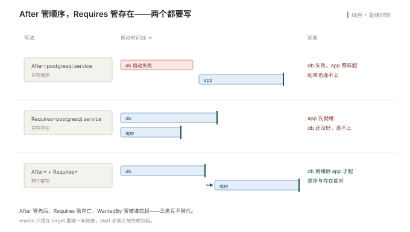

# 06 软件、服务与任务

> **这一册回答**：软件装在哪、怎么装才不埋坑；装完之后怎么让它常驻、挂了自动起来；日志到底写去了哪、为什么磁盘被它打满；定时任务为什么没跑；以及怎么从另一台机器连过来。
> **读完能做到**：判断一个包该用仓库装还是自己编译；把 `yum history` 当成回滚按钮；把任何一个前台程序写成 systemd unit 并验证能起能停；在日志里精确定位到某个服务的某一次启动；用 `logrotate -d` 提前发现磁盘会被打满；分清 cron 没跑是环境问题还是语法问题；用 `~/.ssh/config` 把跳板和端口转发固化下来。
> **怎么读**：6.0 是知识点地图，标了每个点的**基础 / 进阶**。第一遍跳过带「进阶」的小节不影响主线。 不认识的词查 [00 术语表](00-术语表.md)。
> **不在这里**：SSH 加固（`sshd_config` 的 `PermitRootLogin`、密钥权限、`fail2ban`）→ [03](003-用户权限与安全.md)；进程状态与信号 → [02](002-进程与资源.md)；启动链与 target → [01](001-系统与启动.md)；防火墙放行 → [05](005-网络配置与排障.md)。

---

## 6.0 本册知识点地图

复习时按这张表逐行自问「这个我能讲清吗」，讲不清的回对应节。**加粗的是故障现场最常撞上的。**

| 知识点 | 层次 | 一句话要点 | 节 |
| --- | --- | --- | --- |
| **包管理是两层** | 基础 | `rpm`/`dpkg` 管单个包，`yum`/`apt` 管依赖和仓库 | 6.1 |
| **查文件属于哪个包** | 基础 | `rpm -qf` / `dpkg -S`，接手陌生机器时第一步 | 6.1 |
| **`rpm -V` 看文件被改过没有** | 基础 | 怀疑被入侵或被手改，比对比重装快 | 6.1 |
| **换源会搞坏 yum** | 基础 | CentOS 7 已 EOL，官方源必须换 `vault` 才能用 | 6.2 |
| GPG 校验与 `signed-by` | 进阶 | 第三方源不加 key 就装不了，加错了会静默失败 | 6.2 |
| **四种装法怎么选** | 基础 | 仓库 > 官方二进制 > 源码编译，能不编译就不编译 | 6.3 |
| 源码编译装到哪 | 进阶 | `--prefix=/usr/local`，卸载靠 `make uninstall` 或直接删目录 | 6.3 |
| **版本锁定** | 基础 | 防止 `yum update` 顺手把生产版本换掉 | 6.4 |
| **`yum history undo`** | 基础 | 装错了一批包，一条命令退回去 | 6.4 |
| **内核升级不覆盖旧版本** | 基础 | 新内核是并存安装，起不来还能选旧的 | 6.5 |
| **改默认启动内核** | 基础 | `grubby --set-default`，改完要验证 | 6.5 |
| 什么时候必须重启 | 进阶 | `needs-restarting` / `checkrestart` 判断 | 6.5 |
| **unit 三个段** | 基础 | `[Unit]` 描述与依赖、`[Service]` 怎么跑、`[Install]` 何时起 | 6.6 |
| **`Type` 选错就不算启动成功** | 基础 | 简单程序 `simple`，自己 fork 的老程序 `forking` | 6.6 |
| **`ExecStart` 不经过 shell** | 基础 | 管道、重定向、`&&` 全都不认，要用 `/bin/sh -c` | 6.6 |
| **`After` 不等于 `Requires`** | 进阶 | 一个管顺序，一个管「要不要拉起它」 | 6.6 |
| **`Restart` 与启动频率限制** | 基础 | 默认 10 秒内失败 5 次就彻底放弃 | 6.6 |
| **改完 unit 必须 `daemon-reload`** | 基础 | 不 reload 改了等于没改，这是最高频的坑 | 6.7 |
| **`active (exited)` 是假活** | 基础 | 进程早退了，`Type=simple` 会误判 | 6.7 |
| **`journalctl -u` 加 `-b`** | 基础 | 只看本次启动、只看这个服务 | 6.8 |
| **CentOS 7 日志默认不落盘** | 基础 | `/var/log/journal` 不存在就只在内存，重启即丢 | 6.8 |
| **`vacuum` 清日志** | 基础 | journal 自己会涨，不清一样打满 | 6.8 |
| rsyslog 转发 | 进阶 | 集中日志，`@@` 是 TCP、`@` 是 UDP | 6.9 |
| **`logrotate` 不配就是定时炸弹** | 基础 | 磁盘被打满的第一大原因 | 6.10 |
| **`copytruncate` 会丢日志** | 进阶 | 拷贝与截断之间写入的行会丢，且不能与 `create` 同用 | 6.10 |
| **`logrotate -d` 先试跑** | 基础 | 干跑一遍看它打算怎么切，不动文件 | 6.10 |
| **cron 的环境变量是精简的** | 基础 | 只有 `PATH=/usr/bin:/bin`，`java`、`docker` 全找不到 | 6.11 |
| **`%` 在 crontab 里要转义** | 基础 | 不转义会被当成换行，命令被截断 | 6.11 |
| **`/etc/cron.d` 多一列用户** | 基础 | 系统级 cron 文件和用户 crontab 格式不同 | 6.11 |
| **timer 能补跑** | 进阶 | `Persistent=true`，关机期间错过的会补一次 | 6.12 |
| **`OnCalendar` 要验证** | 基础 | `systemd-analyze calendar` 直接告诉你下次什么时候跑 | 6.12 |
| **`~/.ssh/config` 固化连接** | 基础 | 别名、端口、跳板、密钥一次写清，之后只敲别名 | 6.13 |
| **`ProxyJump` 穿跳板** | 基础 | 一条命令穿过堡垒机，不用先登再登 | 6.13 |
| **`-L` 与 `-R` 方向相反** | 进阶 | 本地转发是「我连我这」；远程转发是「对面连对面」 | 6.13 |
| **`ControlPersist` 提速** | 进阶 | 复用一条 TCP，批量操作快一个数量级 | 6.13 |

### 动手前：准备一个能随便折腾的服务

这一册要反复启停服务、写 unit、改日志配置。**不要拿 `sshd` 和 `firewalld` 练**——一个是你的登录通道，一个会把你关在门外。用下面这个不会影响任何东西的脚本当靶子：

```bash
# 造一个"假装是服务"的脚本：每 5 秒往日志写一行
sudo tee /usr/local/bin/demo-svc.sh >/dev/null <<'EOF'
#!/bin/bash
while true; do
  echo "$(date '+%F %T') demo-svc alive pid=$$"
  sleep 5
done
EOF
sudo chmod 755 /usr/local/bin/demo-svc.sh
```

```plain
$ sudo /usr/local/bin/demo-svc.sh
2026-10-29 14:50:01 demo-svc alive pid=23177
2026-10-29 14:50:06 demo-svc alive pid=23177
```

`Ctrl+C` 停掉。等下 6.6 就是把它变成 systemd 服务，6.10 就是给它的日志配轮转。这个脚本的日志走标准输出，正好用来观察 journald 怎么收。

占位符约定：`<pkg>` 换包名（`rpm -qa | grep <关键字>` 查），`<svc>` 换 unit 名（`systemctl list-units --type=service` 查），`<主机>` 换 IP 或域名。

**想练日志打满**：不要真的写满磁盘，在 6.10 用 `logrotate -d` 干跑观察逻辑即可。

**⚠️ 本册有两处会断掉服务**：6.5 的内核升级（要重启）、6.14 的改 `sshd_config`（03 里讲，改错登不进来）。其余操作都在 `demo-svc` 上做，安全。

---

## 6.1 包管理：两层结构，先认清哪层在干活

从这一册开始，所有内容都围绕「把软件弄到机器上并让它跑起来」。第一步是装。而装的第一步，是搞清楚 Linux 的包管理其实有**两层**，混着用是很多莫名其妙的错误的来源。

### 两层各自管什么

| 层 | RHEL 系 | Debian 系 | 管什么 |
| --- | --- | --- | --- |
| 底层 | `rpm` | `dpkg` | 单个 `.rpm` / `.deb` 文件：装了没、装了哪些文件、被改过没 |
| 上层 | `yum`（CentOS 7）/ `dnf`（Rocky 9） | `apt` | 仓库、依赖、版本、批量升级 |

**记一条规则就够了**：**装东西用上层，查东西用底层**。`yum install` 会自动解决依赖，`rpm -ivh xxx.rpm` 不会——它只会告诉你「缺依赖」然后什么都不做。

```bash
# RHEL 系
rpm -qa | grep nginx              # 装了哪些跟 nginx 有关的包
rpm -q nginx                      # 这个包装了没（没装会明确说 not installed）
yum list available nginx          # 仓库里有没有、什么版本

# Debian 系
dpkg -l | grep nginx
dpkg -s nginx                     # 这个包的状态（Status: install ok installed）
apt list nginx                    # 仓库里的版本
```

### 三个查法，接手陌生机器时必用

**① 这个文件属于哪个包**——看到一个不认识的二进制或配置文件，先问它从哪来：

```bash
rpm -qf /usr/sbin/nginx           # RHEL 系
dpkg -S /usr/sbin/nginx           # Debian 系
```

```plain
nginx-1.20.1-10.el7.x86_64
```

如果报 `not owned by any package`，说明它是**手工装的**（编译或解压），升级时不会跟着包管理器走——这类软件要单独记一份清单。

**② 这个包装了哪些文件**——找默认配置在哪、日志目录在哪：

```bash
rpm -ql nginx                     # 全部文件
rpm -qc nginx                     # 只看配置文件（config）
rpm -qd nginx                     # 只看文档
dpkg -L nginx                     # Debian 系对应
```

**③ 这个包的文件被改过没有**——怀疑配置被人手改、或者怀疑机器被动过：

```bash
rpm -V nginx
```

没有输出就是全部正常。有输出时每行开头是 9 位校验码，含义是 `S.5....T.` 这种格式：

| 位 | 含义 | 常见原因 |
| --- | --- | --- |
| `S` | Size 变了 | 文件被追加过内容 |
| `M` | Mode 变了 | 权限被改过 |
| `5` | MD5 摘要变了 | 内容被改过（最常看这一位） |
| `U` / `G` | 属主 / 属组变了 | `chown` 过 |
| `T` | mtime 变了 | 被 touch 或被写过 |
| `.` | 该项正常 | — |

```plain
S.5....T.  c /etc/nginx/nginx.conf
```

`c` 表示这是配置文件。**配置文件被改是正常的**（运维本来就要改），所以看 `rpm -V` 时要滤掉标记为 `c` 的行，剩下的才是可疑项：

```bash
rpm -Va 2>/dev/null | grep -v ' c ' | head -20
```

`grep -v ' c '` 用的是「空格 c 空格」这个特征——配置文件那一列固定印成这样，比数位数可靠。滤完还有输出，就要逐个查了：可能是手工改过，也可能是被入侵替换过。

Debian 系对应 `dpkg -V <pkg>`，只校验 md5，输出格式是 `??5?????? /path`。

### 一个高频误会：`yum install` 之后 `which` 找不到命令

装完了但敲命令还是 `command not found`，三个原因：

| 原因 | 确认 |
| --- | --- |
| 装到了非标准路径，不在 `PATH` 里 | `rpm -ql <pkg> \| grep bin` 看它装到哪了 |
| 装的是库包，本来就没有命令（`-devel`、`-libs`） | `rpm -ql <pkg>` 全是 `.so` 就是这种情况 |
| shell 的命令缓存还记着「没有」 | `hash -r` 清缓存再试 |

---

## 6.2 仓库与换源：源不对，后面全白搭

包管理能用，前提是仓库能用。而**仓库是最容易在半年后突然失效的一环**——尤其是 CentOS 7，它已经在 2024-06-30 EOL，官方镜像站全部下线，`yum` 默认会报一堆 `Could not resolve host: mirrorlist.centos.org`。

### CentOS 7 现在必须换到 vault

**⚠️ 换源会改掉整个系统的软件来源，先备份。** 而且要意识到：换到 `vault` 只是让老系统还能装包，**不会有任何安全更新**。

```bash
# ① 先备份现有的源文件
sudo mkdir -p /etc/yum.repos.d/bak
sudo mv /etc/yum.repos.d/CentOS-*.repo /etc/yum.repos.d/bak/

# ② 换成 vault 源（内容固定、不再更新）
sudo tee /etc/yum.repos.d/CentOS-Vault.repo >/dev/null <<'EOF'
[base]
name=CentOS-7 - Base - Vault
baseurl=https://vault.centos.org/7.9.2009/os/$basearch/
gpgcheck=1
gpgkey=file:///etc/pki/rpm-gpg/RPM-GPG-KEY-CentOS-7
enabled=1

[updates]
name=CentOS-7 - Updates - Vault
baseurl=https://vault.centos.org/7.9.2009/updates/$basearch/
gpgcheck=1
gpgkey=file:///etc/pki/rpm-gpg/RPM-GPG-KEY-CentOS-7
enabled=1
EOF

# ③ 清缓存并验证
sudo yum clean all && sudo yum makecache
sudo yum repolist
```

```plain
repo id        repo name                      status
base           CentOS-7 - Base - Vault        10,072
updates        CentOS-7 - Updates - Vault      3,186
repolist: 13,258
```

**`repolist` 是换源后的唯一验收标准**：状态列有数字就是通的，是 `0` 或报错就是没通。只看 `yum makecache` 不报错不够——它可能所有源都失败了但退出码是 0。

### 加一个第三方源：以 EPEL 为例

EPEL 提供 RHEL 系缺的常用工具（`htop`、`jq`、`ansible` 都在里面）。加源的三个动作是固定的：**装 release 包 → 导入 GPG key → 验证**。

```bash
# CentOS 7
sudo yum install -y epel-release
sudo yum repolist | grep epel

# Rocky 9
sudo dnf install -y epel-release

# Ubuntu 系没有 EPEL，用 universe 仓库（默认已开）
sudo add-apt-repository universe
```

加第三方源时最常踩的是 **GPG 校验失败**：

```plain
Public key for xxx.rpm is not installed
```

意思是包的签名验不过，而这**不是网络问题**。两种处理，选前者：

| 处理 | 后果 |
| --- | --- |
| 导入正确的 key：`sudo rpm --import https://.../RPM-GPG-KEY-xxx` | 正确做法 |
| `--nogpgcheck` 或 `gpgcheck=0` | 等于关掉整条链的校验，**别在生产上用** |

Ubuntu 那边对应的坑是 `apt-key` 已被废弃（22.04 起会打警告），新写法是把 key 存成独立文件，并在源里用 `signed-by` 指定：

```bash
sudo install -m 755 -d /etc/apt/keyrings
curl -fsSL https://example.com/key.gpg | sudo gpg --dearmor -o /etc/apt/keyrings/example.gpg
echo "deb [signed-by=/etc/apt/keyrings/example.gpg] https://example.com/repo jammy main" \
  | sudo tee /etc/apt/sources.list.d/example.list
sudo apt-get update
```

### 离线环境：把仓库搬到内网

内网机器没有外网时，两个办法：搭本地源，或者把包连同依赖一起下载过去。

```bash
# ① 在有网的机器上，把包和依赖全下下来（CentOS 7 需要 yum-utils）
sudo yum install -y yum-utils
sudo repotrack nginx                    # 下载 nginx 及全部依赖

# 只下不装（更常用）
sudo yumdownloader --resolve --destdir=/tmp/rpms nginx

# ② 拷到内网机器，本地装
sudo yum localinstall -y /tmp/rpms/*.rpm
```

```bash
# Ubuntu 侧对应的是 apt-get download + 依赖下载
apt-get install -y --download-only nginx
ls /var/cache/apt/archives/*.deb
```

> **CentOS 6 与 Debian 12 的差异**：CentOS 6 的源要换到 `vault.centos.org/6.10/`，且它 2020-11 已 EOL；Debian 12 的源在 `/etc/apt/sources.list` 里用 `bookworm` 代号，或改用 `/etc/apt/sources.list.d/debian.sources` 的 deb822 格式。见 [附录 B](B-发行版差异.md)。

---

## 6.3 四种装法：能不编译就不编译

源配好了，接下来的问题是「这个软件仓库里没有，怎么装」。四条路，优先级从高到低：

| 装法 | 什么时候用 | 升级怎么办 | 风险 |
| --- | --- | --- | --- |
| **① 官方仓库** | 仓库里有 | `yum update` 一起升 | 最低 |
| **② 厂商官方源**（如 nginx、docker 官方 repo） | 仓库版本太旧，但厂商提供 repo | 同上 | 低 |
| **③ 官方二进制 / 压缩包** | 厂商只提供 tar.gz，如部分中间件 | 手工替换目录 | 中：升级要靠自己记 |
| **④ 源码编译** | 需要改编译参数，或必须特定版本 | 重新编译覆盖 | 高：依赖、卸载、安全更新全靠自己 |

**这条顺序不是偏好，是维护成本**。第 ④ 种的软件，一年后没人记得它编译时加了什么参数、装到了哪个 prefix、依赖哪个版本的 openssl——而这些在出安全漏洞时全都得知道。

### 源码编译的标准流程

真要编译时，按标准三步走，关键是 `--prefix` 的选择：

```bash
sudo yum install -y gcc make autoconf automake libtool   # 编译工具链
tar xf nginx-1.24.0.tar.gz && cd nginx-1.24.0

./configure --prefix=/usr/local/nginx \
            --with-http_ssl_module \
            --with-http_v2_module
make -j"$(nproc)"
sudo make install
```

三段各自会失败的地方不同：

| 阶段 | 典型报错 | 原因 |
| --- | --- | --- |
| `./configure` | `C compiler cc is not found` | 没装 `gcc` |
| `./configure` | `the HTTP rewrite module requires the PCRE library` | 缺 `-devel` 包（`pcre-devel`） |
| `make` | `fatal error: openssl/ssl.h: No such file` | 缺 `openssl-devel` |
| `make install` | `Permission denied` | 忘了 `sudo` |

**`--prefix=/usr/local/<名字>` 是唯一推荐的写法**。好处是卸载就是 `rm -rf /usr/local/<名字>`，不会和包管理器打架；坏处是**包管理器不知道它的存在**，所以：

- 要自己写 systemd unit（6.6），不能指望 `systemctl enable nginx`；
- 要自己配 `logrotate`（6.10）；
- 要自己在 `/etc/ld.so.conf.d/` 里加库路径，否则运行时找不到 `.so`。

```bash
# 编译装的软件运行时报 "error while loading shared libraries"
echo /usr/local/nginx/lib | sudo tee /etc/ld.so.conf.d/nginx.conf
sudo ldconfig
ldd /usr/local/nginx/sbin/nginx | grep "not found"   # 应该没有输出
```

### 一个更省事的中间选项：静态二进制

Go 和 Rust 写的工具（`prometheus`、`caddy`、`frp`、`rclone`）通常提供**静态编译的单个二进制文件**，不依赖系统库。这类东西不用编译、不用装包，解压即用：

```bash
curl -LO https://example.com/tool_linux_amd64.tar.gz
tar xf tool_linux_amd64.tar.gz -C /usr/local/bin/
chmod +x /usr/local/bin/tool
/usr/local/bin/tool --version
```

它比源码编译省事得多，但同样属于「包管理器不知道」的那类，需要自己写 unit 和日志轮转。

---

## 6.4 版本锁定与回滚：装错了要能退

生产环境最怕的不是装不上，是**「本来只想装个 A，结果 `yum update` 顺手把 B、C、D 全升了」**。这一节讲怎么锁住、怎么退回去。

### 锁定版本

```bash
# ① 只升级这一个包，不做全系统升级
sudo yum update -y nginx

# ② 排除某些包，永远不跟着升级（写进 /etc/yum.conf）
echo "exclude=nginx* kernel* docker-ce*" | sudo tee -a /etc/yum.conf

# ③ 锁到精确版本（需要 yum-plugin-versionlock）
sudo yum install -y yum-plugin-versionlock
sudo yum versionlock add nginx
sudo yum versionlock list
```

```plain
0:nginx-1.20.1-10.el7.*
```

Debian 系对应的是 `hold`：

```bash
sudo apt-mark hold nginx
apt-mark showhold
sudo apt-mark unhold nginx      # 解除
```

> **锁定的坑**：锁住的包在依赖冲突时会**阻塞整次升级**，报 `cannot install both`。这时候要判断是「这个包真的不能动」还是「当初随手锁的忘了」。`yum versionlock list` 定期看一眼。

### 回滚：`yum history` 是被低估的功能

`yum` 会记录每一次事务。装错一批包、升级后发现不兼容，可以直接 undo：

```bash
sudo yum history list
```

```plain
ID     | Login user        | Date and time    | Action(s)      | Altered
-----------------------------------------------------------------------
     8 | root <root>       | 2026-10-29 14:20 | Install        |    3
     7 | root <root>       | 2026-10-28 22:11 | I, U           |   17
```

```bash
sudo yum history info 8         # 看清楚这次的 3 个包到底是哪 3 个
sudo yum history undo 8         # 撤销这次安装
```

**先 `info` 再 `undo`**，这是铁的纪律：`undo 7` 会把那次 17 个包的升级全部降级，如果里面有权重很高的包（`glibc`、`openssl`），降级本身就可能把系统搞坏。

Debian 系没有等价功能，靠 `/var/log/apt/history.log` 查历史，然后**手动**装回旧版本：

```bash
grep -A3 "Upgrade:" /var/log/apt/history.log | tail -20
sudo apt-get install -y nginx=1.18.0-6ubuntu14.4     # 指定版本降级
```

版本号从哪来：`apt-cache policy nginx` 会列出所有可用版本。

### 校验一次装载是否完整

装完之后顺手确认一遍，比出事再查便宜得多：

```bash
# 有没有装了一半的包（RHEL 系）
sudo yum check
sudo package-cleanup --problems       # 需要 yum-utils

# Debian 系
sudo dpkg --audit
sudo apt-get install -f               # 修复依赖断裂
```

---

## 6.5 补丁与内核升级：什么时候必须重启

装包解决了「有没有」，接下来是「版本对不对」。而版本里最特殊的一类是**内核**——它不能像普通包那样原地替换，因为正在运行的内核不能覆盖自己。

### 内核是并存安装的

```bash
sudo yum update -y kernel        # 注意：装新内核，不删旧的
sudo reboot
```

重启后新内核生效，旧内核还在 `/boot` 里。这个设计是保命的：新内核起不来，GRUB 菜单里还能选旧的。

```bash
uname -r                                  # 当前跑的内核
rpm -q kernel                             # 装了哪几个内核
grubby --info=ALL | grep -E 'index|title' # GRUB 里有哪些可选项
```

```plain
$ uname -r
3.10.0-1160.108.1.el7.x86_64
$ rpm -q kernel
kernel-3.10.0-1160.108.1.el7.x86_64
kernel-3.10.0-1160.99.1.el7.x86_64
```

保留几个由 `/etc/yum.conf` 的 `installonly_limit` 控制，CentOS 7 默认 5。**别设成 1**——那会在装新内核时删掉旧的，起不来就真起不来了。

### 换默认启动内核

升级完发现新内核有问题，要回到旧的：

```bash
# 看当前默认是哪个
grubby --default-kernel

# 设成指定版本（写全版本号）
sudo grubby --set-default /boot/vmlinuz-3.10.0-1160.99.1.el7.x86_64

# 验证：必须重启前确认，别直接 reboot
grubby --default-kernel
```

```plain
/boot/vmlinuz-3.10.0-1160.99.1.el7.x86_64
```

> **验证方式是看 `grubby --default-kernel` 的输出**，不是看命令有没有报错。改 GRUB 默认项这一步，「命令成功但没生效」很常见——因为 UEFI 和 BIOS 读的配置文件不是同一个（见 [001 §1.6](001-系统与启动.md) 的 GRUB 配置文件表）。

Ubuntu 侧改的是 `/etc/default/grub` 里的 `GRUB_DEFAULT`，然后 `sudo update-grub`。清旧内核用 `sudo apt autoremove --purge`。

### 什么时候必须重启

判断标准不是「装了什么」，而是**有没有正在被进程占用的文件被替换了**。

```bash
# RHEL 系（需要 yum-utils）
sudo needs-restarting -r          # -r 只回答一个问题：内核/关键库需不需要重启
sudo needs-restarting -s          # 列出哪些服务需要重启

# Debian 系
sudo apt-get install -y debian-goodies
sudo checkrestart
```

```plain
$ sudo needs-restarting -r
Core libraries or services have been updated:
  openssl-libs -> 1:1.0.2k-25.el7_9
  systemd -> 219-78.el7_9.9

Reboot is required to ensure that your system benefits from these updates.
```

**不重启也能让单个服务用上新库**：重启那个服务即可。这也是为什么「打了补丁不用重启」在某些场景下成立——只要更新的是某个服务的库，重起那个服务就够了。但内核和 `glibc` 不行。

另一个判断依据在 `/proc`：

```bash
# 看进程用的库是不是已经被替换（deleted 表示磁盘上是新版本，内存里还是旧的）
sudo lsof | grep -i deleted | grep -E '\.so|\.so\.' | head
```

### 不重启的补丁：livepatch 的边界

`kpatch`（RHEL 系）和 `canonical-livepatch`（Ubuntu）能在运行时给内核打补丁，**免重启**。但它只覆盖安全补丁，且需要订阅，普通环境用不上。知道有这个东西、知道它不能替代重启就够了。

---

## 6.6 systemd unit：把任何程序变成服务

装好了、版本对了，接下来是让它**常驻并自动重启**。这一节是全册最核心的一节——学会写 unit，前面装的任何东西（编译的 nginx、解压的二进制、自己写的脚本）都能变成正规服务。

### unit 文件放在哪

| 位置 | 用途 | 优先级 |
| --- | --- | --- |
| `/usr/lib/systemd/system/` | 包管理器装的 | 低 |
| `/etc/systemd/system/` | 你写的、覆盖包自带的 | **高** |
| `/run/systemd/system/` | 运行时临时 | 最高 |

**自己写的 unit 一律放 `/etc/systemd/system/`。** 要改包自带的 unit，不要直接改 `/usr/lib/` 下的（升级会被覆盖），用 `systemctl edit <svc>` 生成覆盖文件：

```bash
sudo systemctl edit nginx
```

它会在 `/etc/systemd/system/nginx.service.d/override.conf` 里写内容，只覆盖你写的那几行，其余继承原文件。这比整份复制出来改安全得多。

### 三个段各自管什么

```ini
[Unit]
Description=Demo Service (writes a line every 5s)
Documentation=man:systemd.service(5)
After=network-online.target
Wants=network-online.target

[Service]
Type=simple
ExecStart=/usr/local/bin/demo-svc.sh
Restart=on-failure
RestartSec=5

[Install]
WantedBy=multi-user.target
```

| 段 | 只放什么 | 常见错误 |
| --- | --- | --- |
| `[Unit]` | 描述、依赖、启停顺序 | 把 `ExecStart` 写在这里（会被忽略） |
| `[Service]` | 怎么跑这个进程 | 漏了 `User=`，默认以 root 跑 |
| `[Install]` | 只有 `systemctl enable` 时用得到 | 漏了这个段，`enable` 会失败 |

### `Type` 选错，服务就是假活

这是最容易出问题的一处。`Type` 告诉 systemd「怎么判断这个服务启动成功了」：

| `Type` | 判定启动成功的时机 | 适合什么程序 |
| --- | --- | --- |
| `simple`（默认） | `ExecStart` 一执行就算成功 | 前台不退出的程序（绝大多数） |
| `forking` | 父进程退出、子进程留下 | 老的 daemon（自己 `daemon()` 两次 fork） |
| `oneshot` | 进程跑完退出才算成功 | 一次性任务（初始化、清缓存） |
| `notify` | 程序主动调 `sd_notify()` 通知 | 支持 notify 的（nginx、部分新版服务） |
| `idle` | 等其他任务做完再启动 | 极少数场景，避免用 |

**`forking` 的坑**：写成 `simple` 时，程序 fork 完父进程立刻退出，systemd 看到「主进程退了」，于是判定服务失败、不断重启——现象是服务其实在跑，但 `systemctl status` 一直 `activating` / `failed`。判断方法：

```bash
# 看真正的进程是不是已经不是 ExecStart 那个 PID 了
systemctl show -p MainPID <svc>
```

如果 `MainPID` 是 0 或者跟 `ps` 看到的对不上，就是 `Type` 选错了。`forking` 还需要配 `PIDFile=`，告诉 systemd 去哪读 pid：

```ini
[Service]
Type=forking
PIDFile=/run/mydaemon.pid
ExecStart=/usr/local/sbin/mydaemon --daemon
```

### `ExecStart` 不经过 shell

这一条不知道会浪费很多时间：`ExecStart` **不做变量展开、不认管道、不认重定向、不认 `&&`**。

```ini
# ❌ 全都不会按预期工作
ExecStart=/bin/echo $HOME > /tmp/x
ExecStart=/usr/bin/cat /var/log/a.log | grep error
ExecStart=/usr/bin/cmd1 && /usr/bin/cmd2

# ✅ 需要 shell 特性就显式起一个 shell
ExecStart=/bin/sh -c '/usr/bin/cat /var/log/a.log | grep error > /tmp/err.txt'
```

另外两条硬规则：**路径必须写绝对路径**（`PATH` 在系统级 unit 里不生效）；**一条 `ExecStart` 就是一次 `execve`，没有 shell 帮你解释**。

要跑多条命令只有两条路：

- **`Type=oneshot` 才允许写多行 `ExecStart=`**，按顺序执行。默认的 `Type=simple` 写第二行会被 systemd 直接拒绝：`Service has more than one ExecStart= setting, which is only allowed for Type=oneshot services. Refusing.`
- 起一个 shell：`ExecStart=/bin/sh -c 'cmd1; cmd2'`。

### 依赖：`After` 和 `Requires` 不是一回事

这是第二个高频误解：

| 指令 | 管什么 | 单独用会怎样 |
| --- | --- | --- |
| `After=B` | **顺序**：B 起完了再起我 | 只管顺序，B 没起我也照起 |
| `Requires=B` | **存在**：B 起不来，我也不起 | 只管存在，不管先后（可能同时起） |
| `Wants=B` | 弱化的 `Requires`：尽力拉起 B，失败我也继续 | **最常用**，比 `Requires` 安全 |
| `BindsTo=B` | 强绑定：B 停了我也停 | 用于「必须同时存在」的场景 |



只写 `After` 和只写 `Requires` 各会出什么问题，看时间线最直观：

**正确写法是两个一起用**：

```ini
[Unit]
After=network-online.target postgresql.service
Wants=network-online.target
Requires=postgresql.service
```

读法是：**在 postgresql 之后启动（`After`），并且要求 postgresql 必须成功（`Requires`）**。只写 `After` 会出现「数据库没起来，应用也起了然后连不上」；只写 `Requires` 会出现「两个同时启动，应用比数据库先就绪」。

> `network.target` 和 `network-online.target` 的区别：前者是「网络子系统初始化完了」，后者是「网卡真的拿到地址了」。**要连远程的服务必须用 `network-online.target`**，否则开机时 DNS 还没好，服务启动就失败。

### 重启策略：默认会「彻底放弃」

```ini
[Service]
Restart=on-failure        # 只有非 0 退出、被信号杀、超时才重启（推荐）
# Restart=always          # 正常退出也重启
# Restart=no              # 默认值，不重启
RestartSec=5              # 每次重启前等 5 秒
# 启动频率限制怎么写在下一段单独说，因为它的键名和段位随版本变
```

**默认值是不够用的**：`StartLimitBurst` 默认 5 次 / 10 秒。一个启动就需要 3 秒的程序，如果配置有错，会在 10 秒内失败 3 次然后进入 `failed`，之后再也不会自动起来。日志里会写：

```plain
start request repeated too quickly.
Failed with result 'start-limit-hit'.
```

看到 `start-limit-hit`，意思是**systemd 已经不再尝试了**，修好配置后必须 `systemctl reset-failed <svc>` 再 `start`，光 `restart` 是没用的。

### 启动频率限制：键名和段位都随版本变（本节最容易白配的一条）

`StartLimitBurst` / `StartLimitInterval*` 这套参数，**在 CentOS 7 和 Ubuntu 22.04 上写法完全不同，而且写错不报错、只是静默失效**。没有一份写法能同时适用于两者：

```ini
# CentOS 7 —— systemd 219
[Service]
StartLimitInterval=60     # 注意：不带 Sec，写 StartLimitIntervalSec 会被当成未知键
StartLimitBurst=5
```

```ini
# Ubuntu 22.04 / Rocky 9 —— systemd 230 以上
[Unit]
StartLimitIntervalSec=60  # 注意：带 Sec，且写在 [Unit] 段
StartLimitBurst=5
```

时间线是两步不是一步：**systemd 229** 把这套参数从 `[Service]` 泛化到 `[Unit]`（所有 unit 类型通用），**systemd 230** 才把 `StartLimitInterval` 改名为 `StartLimitIntervalSec`。所以 219 只有旧名字，230+ 才认新名字。

⚠️ **「拿不准就两处都写」在这里不成立**。systemd 对不认识的键是**静默忽略**（`systemd-analyze verify` 才会打出 `Unknown key name 'StartLimitIntervalSec' in section 'Service'`），所以两处都写不会报错，但也可能两处都不生效——你会以为限流配好了，实际服务还在无限重启。

**唯一的验证方式是问 systemd 自己读到了什么**：

```bash
systemctl show -p StartLimitBurst -p StartLimitIntervalUSec <svc>
```

两个值都是你写的数才算配上了。另外，改完必须 `daemon-reload` + `reset-failed`，否则计数器不清零，服务照样起不来。

### 完整实操：把 demo 脚本变成服务

```bash
sudo tee /etc/systemd/system/demo-svc.service >/dev/null <<'EOF'
[Unit]
Description=Demo Service
After=network-online.target
Wants=network-online.target

[Service]
Type=simple
ExecStart=/usr/local/bin/demo-svc.sh
Restart=on-failure
RestartSec=5
StandardOutput=journal
StandardError=journal

[Install]
WantedBy=multi-user.target
EOF

# ① 先校验语法，不要直接 start
sudo systemd-analyze verify /etc/systemd/system/demo-svc.service

# ② 重载 + 启用 + 启动
sudo systemctl daemon-reload
sudo systemctl enable --now demo-svc

# ③ 验证
systemctl is-active demo-svc
systemctl status demo-svc --no-pager
```

```plain
$ systemctl status demo-svc --no-pager
● demo-svc.service - Demo Service
   Loaded: loaded (/etc/systemd/system/demo-svc.service; enabled; vendor preset: disabled)
   Active: active (running) since Thu 2026-10-29 15:02:11 CST; 12s ago
 Main PID: 24515 (demo-svc.sh)
   CGroup: /system.slice/demo-svc.service
           ├─24515 /bin/bash /usr/local/bin/demo-svc.sh
           └─24516 sleep 5
```

**验收到这一行为止**：`Active: active (running)` + `Main PID` 有值 + `CGroup` 里有子进程。三点齐了才算真的跑起来了。

再验一次「挂了会自己起来」：

```bash
sudo kill -9 $(systemctl show -p MainPID --value demo-svc)
sleep 8
systemctl status demo-svc --no-pager | grep Active
```

```plain
   Active: active (running) since Thu 2026-10-29 15:02:44 CST; 3s ago
```

注意时间变了——说明是新起的进程。**只看 `active` 不看时间，会误以为没重启过。**

### 三个常用的附加项

```ini
[Service]
User=app                      # 不要用 root 跑业务
Group=app
WorkingDirectory=/opt/app     # 相对路径、程序自己找的配置文件都依赖它
Environment=LANG=zh_CN.UTF-8 TZ=Asia/Shanghai
EnvironmentFile=-/etc/sysconfig/app   # 开头的 - 表示文件不存在也不报错
LimitNOFILE=65535             # 句柄数，等价于 ulimit -n
ExecStartPre=/bin/mkdir -p /run/app
ExecStop=/bin/kill -TERM $MAINPID
TimeoutStopSec=30             # 默认 90 秒，卡住的服务能拖 90 秒
```

`WorkingDirectory` 和 `EnvironmentFile` 这两项最能省事：很多程序读的是相对路径的配置文件，不设 `WorkingDirectory` 就会「手动跑正常、systemd 跑报错」。

---

## 6.7 systemd 排错：五个高频现象

unit 写完了，起不来是常态。这一节把最常见的五种现象和判断方法收成一张表，剩下的原理回 6.6 和 [001 §1.5](001-系统与启动.md)。

| 现象 | 原因 | 确认 | 处置 |
| --- | --- | --- | --- |
| 改了 unit 没反应 | 没 `daemon-reload` | 比对 `systemctl cat` 和磁盘文件 | `systemctl daemon-reload` |
| `active (exited)` 但服务不可用 | `Type=simple` + 进程启动后立刻退出 | `systemctl show -p MainPID` 为 0 | 改 `Type`，或查进程为何退出 |
| `start operation timed out` | 启动超过 `TimeoutStartSec`（默认 90s） | `journalctl -u <svc> -n 50` | 查它卡在哪，或调大超时 |
| `start-limit-hit` | 短时间内失败太多次 | `systemctl status` 里有这行 | 修好配置 → `reset-failed` → `start` |
| `status=203/EXEC` | `ExecStart` 路径错或没有执行权限 | `ls -l` 那个路径 | 改绝对路径 / `chmod +x` |

### 排错的标准四步

顺序不要跳。跳过的代价是「猜了半天，其实第一步日志里就写了」。

```bash
# ① 看状态：状态行里通常已经写了失败原因
systemctl status <svc> --no-pager -l

# ② 看日志：加 -b 只看本次启动，-n 50 只看最后 50 行
sudo journalctl -u <svc> -b -n 50 --no-pager

# ③ 手工跑：把 ExecStart 的命令复制出来直接执行，看真实报错
sudo -u app /opt/app/bin/start --config /etc/app.conf

# ④ 校验 unit 语法
sudo systemd-analyze verify /etc/systemd/system/<svc>.service
```

**第 ③ 步是最有效的**。systemd 只负责「执行命令」，命令本身的报错它只能转发；而转发出来的日志经常被截断或换了格式。手工跑一遍，能看到完整的 stderr。

### 看清一个 unit 的最终形态

unit 可能被多个地方覆盖（包自带 + `override.conf` + `EnvironmentFile`），`systemctl cat` 会按顺序全部打印出来：

```bash
systemctl cat <svc>              # 所有来源拼起来的完整内容
systemctl show <svc>             # 全部运行时属性（几百项）
systemctl show -p Restart -p RestartSec -p Type -p MainPID <svc>   # 只看关心的
systemctl list-dependencies <svc>            # 它依赖谁
systemctl list-dependencies --reverse <svc>  # 谁依赖它（disable 了还起来的原因）
```

`--reverse` 那一句能解决一个经典疑问：**「我把服务 disable 了，为什么重启后它又起来了」**——因为有别的 unit `Requires` 或 `Wants` 它，被顺带拉起来了。

---

## 6.8 journald：日志到底写在哪

服务跑起来了，出问题第一件事是看日志。而 Linux 上有**两套日志系统并存**，先搞清楚日志走的是哪一套，否则 `tail` 半天什么也看不到。

| 系统 | 存什么 | 怎么查 | 默认存在哪个文件 |
| --- | --- | --- | --- |
| **journald** | 内核消息 + 所有 unit 的 stdout/stderr + syslog | `journalctl` | 二进制，`/var/log/journal/`（可能不存在） |
| **rsyslog** | 收到 syslog 协议的消息，按规则分文件 | `cat` / `tail` | 文本，`/var/log/messages`、`/var/log/syslog` |

**同一个事件通常两边都有**：程序写 syslog → rsyslog 写文本文件；同时 journald 也从内核 socket 收一份。所以「`/var/log/messages` 里有，`journalctl` 里也有」是正常的。

### CentOS 7 的日志默认不落盘

这是最容易误判的一条，前面 [001 §1.9](001-系统与启动.md) 和 [附录 B](B-发行版差异.md) 都提过，这里给出完整处置。

```bash
ls -d /var/log/journal 2>/dev/null || echo "不存在 → 日志只在内存"
```

不存在时，`journalctl` 读的是 `/run/log/journal`，**重启就全丢**。表现是：

```plain
$ journalctl -b -1
Specified boot ID is not found in the journal files.
```

而 `systemctl status` 一切正常，很容易误判成「服务没写日志」。

```bash
# 打开持久化
sudo mkdir -p /var/log/journal
sudo systemd-tmpfiles --create --prefix /var/log/journal
sudo systemctl restart systemd-journald
```

Rocky 9、Ubuntu、Debian 默认已经持久化，不用做这一步。

### 六个最常用的查法

```bash
# ① 只看某个服务、只看本次启动
sudo journalctl -u demo-svc -b --no-pager

# ② 实时跟踪（等价于 tail -f）
sudo journalctl -u demo-svc -f

# ③ 按时间
sudo journalctl --since "2026-10-29 14:00" --until "2026-10-29 15:00"

# ④ 只看错误级别（emerg/alert/crit/err 合并）
sudo journalctl -p err -b --no-pager

# ⑤ 找谁重启了服务（systemd 自己的记录）
sudo journalctl -u demo-svc | grep -E "Started|Stopped|Failed"

# ⑥ 结构化查询：按字段过滤
sudo journalctl _PID=24515 --no-pager
sudo journalctl -o json-pretty -n 1 -u demo-svc    # 看清有哪些可用字段
```

```plain
$ sudo journalctl -u demo-svc -b --no-pager | tail -4
10月 29 15:02:11 host systemd[1]: Started Demo Service.
10月 29 15:02:11 host demo-svc.sh[24515]: 2026-10-29 15:02:11 demo-svc alive pid=24515
10月 29 15:02:16 host demo-svc.sh[24515]: 2026-10-29 15:02:16 demo-svc alive pid=24515
```

注意每行前面的 `demo-svc.sh[24515]`——这是 journald 自动加的来源标记，**服务名和 PID 都能直接看出来**，比翻文本日志快。

### journal 自己也会把盘写满

这件事很多人不知道：日志持久化之后，默认上限是**文件系统容量的 10%**，最大 4 GiB。一个 100G 的盘，journal 能占到 10G。

```bash
# 看现在占了多少
sudo journalctl --disk-usage

# 按体积清（保留最近 500M）
sudo journalctl --vacuum-size=500M

# 按时间清（保留最近 7 天）
sudo journalctl --vacuum-time=7d
```

```plain
$ sudo journalctl --disk-usage
Archived and active journals take up 1.2G in the file system.
```

永久改上限在 `/etc/systemd/journald.conf`：

```ini
[Journal]
Storage=persistent
SystemMaxUse=2G
SystemMaxFileSize=200M
MaxRetentionSec=30day
```

改完 `sudo systemctl restart systemd-journald` 生效。**注意 `SystemMaxUse` 只对落盘的 journal 有效**，`Storage=volatile`（只在内存）时管的是 `RuntimeMaxUse`。

### 一个常见困惑：服务日志既在 journal 又在文件里

因为服务把日志写给了 syslog，而 journald 也从同一个 socket 收。要判断某条日志走了哪条路：

- `journalctl -u <svc>` 有、`/var/log/messages` 没有 → 只走了 journald（`StandardOutput=journal`）；
- 两边都有 → 走了 syslog（`StandardOutput=syslog`，或程序自己写的）
- 两边都没有 → 程序写到了自己的文件里，回去看它的配置

---

## 6.9 rsyslog：把日志分门别类放好

journald 是按「来源」查的，rsyslog 是按「规则」分文件的。要定制「哪些日志去哪」，动的是 rsyslog。

### 规则长什么样

`/etc/rsyslog.conf` 和 `/etc/rsyslog.d/*.conf` 里的每一行是一条规则：

```plain
<设施>.<级别>    <动作>
```

```plain
# 所有 info 及以上，除了 mail/authpriv/cron，写到 messages
*.info;mail.none;authpriv.none;cron.none    /var/log/messages

# 认证相关单独一个文件
authpriv.*                                  /var/log/secure

# cron 单独一个文件
cron.*                                      /var/log/cron
```

**写法要点**：

- `*` 表示「所有设施」或「该级别及以上」；
- `none` 表示排除，**必须写在同一行里**（分成两行会让日志重复）；
- `&` 开头表示「沿用上一行的动作条件」，用于给同一批日志再加一个动作（如同时转发）。

```plain
# 把 nginx 的日志同时写到本地文件和转发到中心
local0.*    /var/log/nginx/app.log
&           @@10.0.0.10:514
```

### 两个文件名的差别（这个坑很常见）

| 发行版 | 系统日志 | 认证日志 |
| --- | --- | --- |
| RHEL 系 | `/var/log/messages` | `/var/log/secure` |
| Debian 系 | `/var/log/syslog` | `/var/log/auth.log` |

按 CentOS 的经验去 Ubuntu 上 `tail /var/log/secure`，会得到 `No such file or directory`——不是日志没写，是名字不同。

### 转发到中心日志服务器

**`@` 是 UDP，`@@` 是 TCP**。这一条记错会导致「对面收不到，但本地没有任何报错」。

```plain
# 客户端：转发所有日志
*.*    @@10.0.0.10:514
```

服务端要开监听。CentOS 7 的 rsyslog 是 8.x，用新语法：

```plain
# /etc/rsyslog.d/10-remote.conf
module(load="imtcp")
input(type="imtcp" port="514")

# 按来源 IP 分目录存
$template RemoteLogs,"/var/log/remote/%HOSTNAME%/%PROGRAMNAME%.log"
*.* ?RemoteLogs
& stop
```

> 老写法 `$ModLoad imtcp` / `$InputTCPServerRun 514` 在 8.x 上仍兼容，但会和 `module(load=...)` 混用报错。**同一个文件里只用一种写法。** CentOS 6 用的是老写法。

```bash
# 服务端防火墙要放行（本条不讲防火墙原理，见 005 §5.7）
sudo firewall-cmd --add-port=514/tcp --permanent && sudo firewall-cmd --reload
sudo systemctl restart rsyslog
```

---

## 6.10 logrotate：磁盘被打满的第一大原因

日志有了，问题是它会一直长。`logrotate` 负责定时切分和清理，**而它没配好，是磁盘满的第一大原因**——比任何业务代码的 bug 都常见。

### 它靠什么跑起来

```bash
systemctl list-timers | grep logrotate     # 看它下次什么时候跑
cat /etc/cron.daily/logrotate             # CentOS 7 也可以走 cron.daily
```

```plain
$ systemctl list-timers | grep logrotate
Thu 2026-10-29 03:14:00 CST  2h ago  logrotate.timer  logrotate.service
```

**每天只跑一次**。这意味着一个每秒写 100MB 的日志，在两次轮转之间能写满 8TB——所以光靠 logrotate 不够，还要看下面的 `maxsize`。

### 一份能用的配置

```plain
# /etc/logrotate.d/nginx
/var/log/nginx/*.log {
    daily
    rotate 14
    missingok
    notifempty
    compress
    delaycompress
    sharedscripts
    postrotate
        /usr/bin/kill -USR1 $(cat /run/nginx.pid 2>/dev/null) 2>/dev/null || true
    endscript
}
```

逐项的含义，以及不写会怎样：

| 指令 | 作用 | 不写的后果 |
| --- | --- | --- |
| `daily` | 每天轮转一次 | 必须有，否则不轮转 |
| `rotate 14` | 保留 14 份 | 默认 0，**转完就删**，等于没保留 |
| `missingok` | 文件不存在也不报错 | 报错并中断，一个通配符匹配不上整条规则都不执行 |
| `notifempty` | 空文件不轮转 | 空文件也占一个编号，白占位置 |
| `compress` | 旧文件 gzip | 磁盘占用翻几倍 |
| `delaycompress` | 上一份不压缩 | 刚转出来的文件可能还被进程拿着，压缩会失败 |
| `sharedscripts` | `postrotate` 只执行一次 | 通配符匹配多个文件时，每个文件都执行一次 |
| `postrotate` | 通知程序重开日志 | 程序继续写旧文件句柄，**新文件一直是 0 字节** |
| `maxsize 100M` | 超过就提前转 | 一天写满盘的场景完全防不住 |

**`maxsize` 和 `daily` 同时写时是「或」的关系**：到时间了转，或者体积超了也转。日志量大的服务必须加。

### 两个坑

**坑一：`copytruncate` 会丢日志。**

```plain
/var/log/app.log {
    daily
    rotate 7
    copytruncate      # 先复制，再把原文件清零
}
```

它的好处是**不用通知程序重开文件**（程序继续往同一个 inode 写）。代价是**复制和清零之间写入的行会丢**，而且：

- 不能和 `create` 一起用（会互相冲突）；
- 大文件清零时有一瞬间 IO 抖动；
- 程序如果用 `O_APPEND` 且并发写，可能写到错位。

**能发信号让程序重开文件，就不要用 `copytruncate`。** nginx 用 `-USR1`、多数程序用 `-HUP`。

**坑二：日志清了但空间没回来。**

如果程序没重开文件，它还在往**已被删除的旧 inode** 里写。`df` 显示没变、`du` 加起来很小——这就是 [004 §4.5](004-存储与文件系统.md) 表里的第 1 条。

```bash
sudo lsof +L1 | head    # 看到 deleted 且 size 很大的，就是它
```

### 上线前必须干跑一次

**`logrotate -d` 是干跑**：只打印它打算做什么，不动任何文件。配置有语法错、权限不够、路径写错，这一步就能发现。

```bash
sudo logrotate -d /etc/logrotate.d/nginx
```

```plain
reading config file /etc/logrotate.d/nginx
Allocating hash table for state file, size 15360 bytes
Handling 1 logs
rotating pattern: /var/log/nginx/*.log  after 1 days (14 rotations)
empty log files are not rotated, old logs are removed
considering log /var/log/nginx/access.log
  Now: 2026-10-29 15:10
  Last rotated at 2026-10-29 03:14
  log does not need rotating (log has already been rotated)
```

**注意最后一行**：这次干跑说「不需要轮转」，因为它今天已经转过。要看真实的动作，用 `-f` 强制（此时 `-d` 仍然是干跑，不会真动文件）：

```bash
sudo logrotate -d -f /etc/logrotate.d/nginx
```

真跑一次并观察结果：

```bash
sudo logrotate -v -f /etc/logrotate.d/nginx
ls -lh /var/log/nginx/
```

```plain
-rw-r--r-- 1 root root  12K Oct 29 15:10 access.log
-rw-r--r-- 1 root root  89K Oct 29 15:09 access.log.1
-rw-r--r-- 1 root root  21K Oct 28 03:14 access.log.2.gz
```

### 状态文件：为什么它「明明配了却不转」

logrotate 靠一个状态文件记「上次什么时候转的」：

| 发行版 | 状态文件 |
| --- | --- |
| RHEL 系 | `/var/lib/logrotate/logrotate.status` |
| Debian 系 | `/var/lib/logrotate/status` |

**这个文件丢了或坏了，所有规则会重新计算起点**，可能出现「配了 daily 但连续几天不转」的现象。文件损坏时直接删掉，下一次运行会重建。

```bash
sudo cat /var/lib/logrotate/logrotate.status | head -3
```

---

## 6.11 cron：为什么它没跑

日志的问题解决了，接下来是「定时」。cron 用起来极简，但它的失败方式很隐蔽——**没有报错，就是不执行**。

### 五个字段与两个位置

```plain
分 时 日 月 周    命令
*  *  *  *  *    command
```

| 位置 | 格式 | 有用户列吗 | 用途 |
| --- | --- | --- | --- |
| 用户 crontab（`crontab -e`） | 5 段 | **没有** | 个人任务 |
| `/etc/crontab` | 5 段 | **有**（第 6 列） | 系统任务 |
| `/etc/cron.d/*` | 5 段 | **有**（第 6 列） | 装包时带进来的任务 |

**这个差别是最高频的语法错误**：把 `/etc/cron.d/` 里少了用户列的行抄进 `crontab -e`，或者反过来多写一个用户名，两边都静默失败。

```bash
# 用户 crontab：没有用户列
0 3 * * * /usr/local/bin/backup.sh >> /var/log/backup.log 2>&1

# /etc/cron.d/backup：第六列是用户
0 3 * * * root /usr/local/bin/backup.sh >> /var/log/backup.log 2>&1
```

### 坑一：环境变量是精简的

cron 执行时拿到的环境和你登录后完全不同：

```plain
PATH=/usr/bin:/bin
SHELL=/bin/sh
HOME=/root
```

**`/usr/local/bin` 不在 `PATH` 里**，`java`、`docker`、`kubectl` 全都找不到。这是「手动跑没问题、cron 就是不跑」的头号原因。

三种处理，从好到差：

```bash
# ① 命令写绝对路径（最推荐）
0 3 * * * /usr/bin/docker exec app /app/backup.sh

# ② 在 crontab 顶部声明 PATH
PATH=/usr/local/sbin:/usr/local/bin:/usr/sbin:/usr/bin:/sbin:/bin
0 3 * * * backup.sh
```

```bash
# ③ 用 bash -lc 加载登录环境（能拿到 /etc/profile，但依赖 profile 内容）
0 3 * * * /bin/bash -lc '/opt/app/backup.sh'
```

同时**一定要加重定向**，否则输出会当邮件发出去（多数机器没配 MTA，等于丢掉）：

```bash
0 3 * * * /opt/app/backup.sh >> /var/log/backup.log 2>&1
```

### 坑二：`%` 必须转义

cron 里 `%` 是特殊字符（表示「换行」，后面是标准输入）。写日期格式化时一定踩：

```bash
# ❌ 命令在第一个 % 处被截断，date 收到的是 '+%Y'
0 3 * * * /bin/tar czf /backup/$(date +%Y%m%d).tar.gz /data

# ✅ 转义
0 3 * * * /bin/tar czf /backup/$(date +\%Y\%m\%d).tar.gz /data
```

更好的做法是**把逻辑写进脚本**，crontab 里只留一行 `0 3 * * * /opt/app/backup.sh`。所有 `%`、引号、管道的麻烦都没了。

### 坑三：任务跑得比间隔长

```bash
# 每 5 分钟跑一次，但上次跑了 20 分钟
*/5 * * * * /opt/app/sync.sh
```

cron **不会等上一次结束**，会叠加执行，最后同时跑 4 个。用 `flock` 加锁：

```bash
*/5 * * * * /usr/bin/flock -n /var/run/sync.lock /opt/app/sync.sh
```

`-n` 表示拿不到锁就直接退出，不排队。

### 坑四：机器关机的那次不补

cron 是「到点看一眼，过了就过了」。凌晨 3 点的备份，机器 2:50 关到 8:00，这次备份就永远不会执行。

两个解法：

| 解法 | 说明 |
| --- | --- |
| `anacron` | 检查「上次跑是多久以前」，超了就现在补。`/etc/anacrontab` |
| **systemd timer + `Persistent=true`** | 更现代，日志更好查（见 6.12） |

### 排错：它到底跑了没

```bash
# ① 看 cron 自己的日志：有没有被调度、有没有报错
sudo grep CRON /var/log/cron            # RHEL 系
sudo grep CRON /var/log/syslog          # Debian 系

# ② 确认 cron 服务在跑（CentOS 7 是 crond，不是 cron）
systemctl is-active crond

# ③ 确认文件被读进去了
sudo crontab -l -u app                  # 看某个用户的任务
ls -l /etc/cron.d/                      # 权限必须是 644，属主 root
```

```plain
$ sudo grep CRON /var/log/cron | tail -3
Oct 29 15:20:01 host CROND[25103]: (root) CMD (/opt/app/sync.sh)
Oct 29 15:20:01 host CROND[25104]: (root) CMD (run-parts /etc/cron.hourly)
```

**日志里有 `CMD (...)` 说明脚本被启动了**。如果脚本自己失败，那是脚本的问题，不是 cron 的问题——去查那行命令自己的输出重定向到哪了。

**日志里连 `CMD` 都没有**，三种可能：

| 可能 | 确认 |
| --- | --- |
| 文件权限不对（`/etc/cron.d/` 下不是 644 或属主不是 root） | `ls -l` |
| 文件里有语法错（整个文件被跳过） | 用 `crontab -l` 试，或看日志有无 `BAD FILE MODE` |
| 时间字段写错（比如 `0 0 31 2 *` 永远不会到） | 用 `crontab.guru` 或手算 |

---

## 6.12 systemd timer：比 cron 更值得用

cron 能做的事，systemd timer 都能做，而且**多三个能力**：补跑、有日志、能看下次执行时间。新写的东西建议直接用 timer。

### 两个文件：service 干活，timer 定时

```ini
# /etc/systemd/system/backup.service  —— 干什么
[Unit]
Description=Nightly backup

[Service]
Type=oneshot
ExecStart=/opt/app/backup.sh
User=root
```

```ini
# /etc/systemd/system/backup.timer  —— 什么时候干
[Unit]
Description=Run backup every night at 03:00

[Timer]
OnCalendar=*-*-* 03:00:00
Persistent=true
RandomizedDelaySec=300

[Install]
WantedBy=timers.target
```

```bash
sudo systemctl daemon-reload
sudo systemctl enable --now backup.timer

# 只看 timer（--all 连不活跃的也列出来）
systemctl list-timers --all
```

```plain
NEXT                         LEFT     LAST                         PASSED  UNIT          ACTIVATES
Fri 2026-10-30 03:05:00 CST  11h      Thu 2026-10-29 03:02:11 CST  12h     backup.timer  backup.service
```

**`NEXT` 这一行就是「下次什么时候跑」**，比 cron 靠手算省事得多。

### `OnCalendar` 不确定就用命令验证

时间表达式写错是静默失败（永远不会触发），所以写完一定验：

```bash
systemd-analyze calendar "*-*-* 03:00:00"
systemd-analyze calendar "Mon *-*-* 09:00:00"
```

```plain
$ systemd-analyze calendar "*-*-* 03:00:00"
  Original form: *-*-* 03:00:00
Normalized form: *-*-* 03:00:00
    Next elapse: Fri 2026-10-30 03:00:00 CST
       (in UTC): Thu 2026-10-29 19:00:00 UTC
```

输出里有 `Next elapse` 就说明表达式合法且能匹配。

| 需求 | 写法 |
| --- | --- |
| 每天 3 点 | `*-*-* 03:00:00` |
| 每小时整点 | `*-*-* *:00:00` |
| 每 15 分钟 | `*:0/15` |
| 每周一 9 点 | `Mon *-*-* 09:00:00` |
| 每月 1 号 | `*-*-01 02:00:00` |
| 开机 5 分钟后 | 改用 `OnBootSec=5min` |

### 补跑：`Persistent=true`

```ini
[Timer]
OnCalendar=*-*-* 03:00:00
Persistent=true
```

加了这一行，**关机期间错过的会在开机后补一次**。不加就永远错过——这正是 cron 最大的短板。

判断有没有补跑，看 service 的日志：

```bash
sudo journalctl -u backup.service -b
```

如果看到启动时间不是 3:00 而是开机后不久，就是补跑触发的。

### 与 cron 的取舍

| 维度 | cron | systemd timer |
| --- | --- | --- |
| 精度 | 分钟 | 秒 |
| 补跑 | 不支持（要 anacron） | `Persistent=true` |
| 日志 | 靠自己重定向 | 自动进 journal，`journalctl -u` 直接查 |
| 看下次执行 | 手算 | `systemctl list-timers` |
| 资源限制 | 无 | 可用 `MemoryMax`、`CPUQuota`（见 002 §2.10） |
| 依赖其他服务 | 不方便 | `After=` 直接写 |
| 学习成本 | 低 | 要写两个文件 |

**现存的 cron 任务不用急着迁**；新写的、需要补跑或需要限资源的，用 timer。

---

## 6.13 SSH 接入：连得上、穿得过、传得动

前面都是在本机操作。这一节讲怎么从外面进来——**注意分工：`sshd_config` 的加固（禁 root、限用户、密钥权限）在 [003 §3.14](003-用户权限与安全.md)，这一节只管「怎么连」**。

### 免密登录：三步

```bash
# ① 生成密钥（ed25519 比 rsa 短且更安全，CentOS 7 的 OpenSSH 7.4 支持）
ssh-keygen -t ed25519 -C "ops@$(hostname)"

# ② 把公钥送过去
ssh-copy-id -i ~/.ssh/id_ed25519.pub app@10.0.0.21

# ③ 验证：不应该再问密码
ssh app@10.0.0.21
```

如果送完了还要密码，先看**服务端的权限**（这是 `StrictModes` 在拦）：

```bash
ls -ld ~/.ssh ~/.ssh/authorized_keys
```

```plain
drwx------ 2 app app 4096 Oct 29 15:30 /home/app/.ssh
-rw------- 1 app app  102 Oct 29 15:30 /home/app/.ssh/authorized_keys
```

`.ssh` 必须是 `700`、`authorized_keys` 必须是 `600`、属主必须是本人。**权限不对时 sshd 会拒绝使用这个 key，而且在客户端看不出来**——表现就是「一直要密码」。

排查用服务端日志：

```bash
sudo tail -5 /var/log/secure      # RHEL 系
sudo tail -5 /var/log/auth.log    # Debian 系
```

```plain
Authentication refused: bad ownership or modes for directory /home/app/.ssh
```

### `~/.ssh/config`：把所有连接参数固化

这是最能提升日常效率的一件事。把主机、端口、用户、密钥、跳板写进配置文件，之后只敲别名：

```plain
# ~/.ssh/config     权限必须是 600
Host db1
    HostName 10.0.0.31
    User app
    Port 2222
    IdentityFile ~/.ssh/id_ed25519
    ServerAliveInterval 30

Host web*
    HostName %h.example.com
    User deploy

# 穿跳板：先连 bastion，再从那里连内网
Host inner-db
    HostName 192.168.10.5
    User app
    ProxyJump bastion
```

```bash
chmod 600 ~/.ssh/config
ssh db1                # 等价于 ssh -p 2222 -i ~/.ssh/id_ed25519 app@10.0.0.31
```

**`ServerAliveInterval 30` 值得每个客户端都加**：它每 30 秒发一个保活包，防止中间防火墙把空闲连接掐掉（现象是「放着不动十分钟就断了」）。

### 穿跳板：`ProxyJump` 取代老写法

CentOS 7（OpenSSH 7.4）和 Ubuntu 22.04（8.9）都支持 `-J`：

```bash
# 一步穿过堡垒机，不用先登上去再登
ssh -J bastion app@192.168.10.5

# 多级跳板
ssh -J bastion1,bastion2 app@192.168.10.5
```

老写法（`-o ProxyCommand`）在更早的版本上才需要，现在不必用：

```bash
# 仅当对方 OpenSSH 低于 7.3 时才需要
ssh -o ProxyCommand='ssh -W %h:%p bastion' app@192.168.10.5
```

配合 `~/.ssh/config` 的 `Host bastion` 写一次，之后 `ssh -J bastion <任意内网IP>` 都能通。

### 端口转发：`-L` 和 `-R` 的方向

这两个搞混是最常见的，用一句话记住：**`-L` 是「我这边开个门，通向对面」；`-R` 是「对面开个门，通向我这边」**。

| 参数 | 命令形状 | 谁访问 | 典型用途 |
| --- | --- | --- | --- |
| `-L` 本地转发 | `ssh -L 8080:localhost:80 server` | **你**访问 `localhost:8080` | 内网 Web 界面从本机打开 |
| `-R` 远程转发 | `ssh -R 9000:localhost:3306 server` | **对面**访问它的 `9000` | 把本机服务暴露给远端 |
| `-D` 动态转发 | `ssh -D 1080 server` | 本机所有程序走 SOCKS | 浏览器配代理访问内网 |

```bash
# 把远端的 10.0.0.31:3306 映射到本机 13306，然后本地客户端连 127.0.0.1:13306
ssh -N -L 13306:10.0.0.31:3306 app@bastion

# -N 表示不执行命令（只做转发），-f 表示转后台
ssh -f -N -L 13306:10.0.0.31:3306 app@bastion

# 看隧道通了没
ss -lntp | grep 13306
```

```plain
LISTEN  0  128  127.0.0.1:13306  0.0.0.0:*  users:(("ssh",pid=25611,fd=4))
```

**注意 `-L` 默认只绑 `127.0.0.1`**，所以「别人连我的 13306」是连不上的——这是安全设计，不是故障。真要给别人用，写 `-L 0.0.0.0:13306:...`，但那就等于开了一个无认证的入口，慎重。

`-R` 方向上，服务端要允许转发，`sshd_config` 里需要 `AllowTcpForwarding yes`（默认就是 yes）。

### 传文件：`scp` 与 `rsync` 的分工

| 场景 | 用什么 | 为什么 |
| --- | --- | --- |
| 传一两个小文件 | `scp` | 简单，语法跟 `cp` 一样 |
| 传目录、要断点续传 | `rsync -avP` | 只传差异、能续、能显示进度 |
| 大批量同步（TB 级） | `rsync` + 10 章的策略 | 见 [10](010-数据备份与共享.md) |
| 交互式浏览远端文件 | `sftp` | 能 `ls` `cd` `get` |

```bash
# scp
scp ./app.tar.gz app@10.0.0.21:/opt/
scp -r ./conf app@10.0.0.21:/etc/app/
scp app@10.0.0.21:/var/log/app.log ./

# rsync（-a 归档、-v 详细、-P 进度+续传、-z 压缩）
rsync -avP ./dist/ app@10.0.0.21:/opt/app/dist/
rsync -avP --delete ./dist/ app@10.0.0.21:/opt/app/dist/   # ⚠️ --delete 会删掉对面多余的文件
```

**`rsync` 的路径结尾斜杠是有意义的**：`./dist/` 表示「把 dist 里的内容放过去」，`./dist` 表示「把 dist 这个目录本身放过去」。差一个斜杠，结果多一层目录或完全不一样。

### 批量操作：`ControlPersist` 提速

对十台机器连续执行命令时，每条 `ssh` 都要重新握手（TCP + 密钥交换），延迟占大头。开连接复用：

```plain
# ~/.ssh/config
Host *
    ControlMaster auto
    ControlPath ~/.ssh/cm-%r@%h:%p
    ControlPersist 10m
```

开了之后，第一条连接建立后，后续 10 分钟内的连接直接复用，**批量操作能快一个数量级**。验证：

```bash
ssh -O check db1        # 有复用会显示 Master running
ssh -O exit db1         # 主动关掉
```

> 这里只讲单机操作。**批量在多台上做同一件事，属于配置管理工具（Ansible）的范围**，不在本手册内——见 README 的边界表。

---

## 6.14 本册排错路径

把全册判断按现象重排，就是排查时要走的路。

```plain
装不上
├─ 报 Could not resolve / 404           → 源地址失效（6.2）
├─ 报 Public key not installed         → GPG key 没导入（6.2）
├─ 报 conflicts / cannot install both  → 版本锁定或依赖冲突（6.4）
└─ 报 No package xxx available         → 仓库里真没有，换装法（6.3）

装完了跑不起来
├─ command not found                   → 装到非标准路径 / hash 缓存（6.1）
├─ error while loading shared libraries→ 编译装的库路径没配（6.3）
└─ 手动能跑、systemd 报错              → WorkingDirectory / 环境变量（6.6）

服务起不来
├─ active (exited)                     → 进程早退了，Type 选错（6.7）
├─ start-limit-hit                     → 修好配置后要 reset-failed（6.7）
├─ 203/EXEC                            → ExecStart 路径或权限（6.7）
├─ start operation timed out           → 卡在启动，看 journalctl（6.7）
└─ 改了 unit 没变化                    → daemon-reload（6.7）

日志找不到
├─ /var/log/messages 也没有            → Debian 系叫 syslog（6.9）
├─ journalctl -b -1 说 boot ID 不存在  → CentOS 7 没开持久化（6.8）
└─ 两个地方都没有                      → 程序写到自己文件里了（6.8）

磁盘被日志打满
├─ df 满、du 小                        → 进程还开着已删文件（6.10 + 004 §4.5）
├─ 转出来的文件大小是 0                → postrotate 没让程序重开（6.10）
└─ 一天之内就满                        → 没配 maxsize（6.10）

定时任务没跑
├─ /var/log/cron 里连 CMD 都没有        → 文件权限 / 语法（6.11）
├─ 有 CMD 但任务失败                    → 环境变量 / PATH（6.11）
├─ 命令被截断                           → % 没转义（6.11）
└─ 关机那一次没补                       → 换 timer + Persistent（6.12）

连不上 / 传不动
├─ 要密码                              → 密钥权限或 StrictModes（6.13，加固见 003 §3.14）
├─ 十分钟就断                          → ServerAliveInterval（6.13）
├─ -L 转发了别人连不上                  → 只绑了 127.0.0.1，这是设计（6.13）
└─ rsync 多了一层目录                   → 结尾斜杠（6.13）
```

---

## 6.15 自测

先自己答，再对照后面的答案。答不出来的回对应节。

1. 一台机器上执行 `rpm -qf /usr/bin/curl` 报 `not owned by any package`，说明什么？升级时要注意什么？
2. `yum repolist` 的状态列全是 `0`，但 `yum makecache` 没报错。问题在哪？
3. 编译安装的软件运行时提示 `error while loading shared libraries: libxxx.so.1`，三条处置里最该先做哪条？
4. `sudo yum history undo 7` 之前必须先做什么？为什么？
5. 升级内核后重启，新内核起不来。GRUB 里还能选到旧内核吗？为什么？
6. 一个自己 fork 两次的老程序写成 `Type=simple`，`systemctl status` 会是什么样？怎么改？
7. `ExecStart=/usr/bin/cat /var/log/a.log | grep err` 为什么不会工作？正确写法是什么？
8. 服务日志在 `journalctl -u` 里有，`/var/log/messages` 里没有。说明什么？
9. logrotate 配了 `daily rotate 7`，但 `/var/log/nginx/access.log` 一直是 0 字节，`.1` 文件却在增长。原因是什么？
10. crontab 里写 `date +%Y%m%d`，为什么 `date` 只收到了 `+%Y`？

<details>
<summary>答案</summary>

1. 这个文件不是任何包装的——手工编译、解压或脚本安装的。升级时不会跟着包管理器走，要单独记清单（版本、装法、prefix），出安全漏洞时得自己重编。
2. 源地址失效了。`makecache` 对每个源单独失败但整体退出码可能是 0，**唯一可靠的验收是 `repolist` 状态列有数字**。
3. 先在 `/etc/ld.so.conf.d/` 加库路径然后 `ldconfig`（如果库就在本机）；如果库根本没装，装对应的 `-libs` 包。`LD_LIBRARY_PATH` 是临时手段，不要写进生产脚本。
4. `sudo yum history info 7`。因为 `undo` 会把那次事务里**所有**包降级，如果里面有 `glibc`、`openssl` 这类基础包，降级本身可能把系统搞坏。
5. 能。RHEL 系升级内核是**并存安装**，旧内核的 `/boot/vmlinuz-*` 和 initramfs 都还在，GRUB 菜单里可选。前提是 `installonly_limit` 没被设成 1。
6. 状态是 `activating` 或 `failed`，但进程实际在跑；`systemctl show -p MainPID` 是 0 或对不上真实 PID。改成 `Type=forking` 并配 `PIDFile=`。
7. `ExecStart` 不经过 shell，管道符被当成普通参数传给 `cat`，`cat` 会报 `No such file or directory`。写成 `ExecStart=/bin/sh -c '/usr/bin/cat /var/log/a.log | grep err'`。
8. 这个服务的 `StandardOutput=journal`（默认），只写 journald，不走 syslog。要两边都有得设 `StandardOutput=syslog`。
9. `postrotate` 没有让 nginx 重开日志文件，它还在写已被重命名的旧 inode，所以 `.1` 在长、新文件是 0 字节。用 `kill -USR1` 通知重开。
10. cron 把 `%` 当成「换行 + 标准输入」的分隔符，命令在第一个 `%` 处被截断。要写 `\%`，或者把逻辑放进脚本。

</details>

---

## 6.16 命令索引

知道要做什么、忘了敲什么时查这里。原理回对应节。

| 我想… | 命令 | 节 |
| --- | --- | --- |
| 看某包装了没 | `rpm -q <pkg>`；`dpkg -s <pkg>` | 6.1 |
| 查文件属于哪个包 | `rpm -qf <路径>`；`dpkg -S <路径>` | 6.1 |
| 看包装了哪些文件 | `rpm -ql <pkg>`；`dpkg -L <pkg>` | 6.1 |
| 看包的配置文件 | `rpm -qc <pkg>` | 6.1 |
| 查文件被改过没 | `rpm -V <pkg>`；`dpkg -V <pkg>` | 6.1 |
| 查全系统可疑改动 | `rpm -Va \| grep -v ' c '` | 6.1 |
| 清 shell 命令缓存 | `hash -r` | 6.1 |
| 换源后清缓存重建 | `yum clean all && yum makecache` | 6.2 |
| 验收源是否可用 | `yum repolist` | 6.2 |
| 下载包及依赖（不装） | `yumdownloader --resolve --destdir=/tmp/rpms <pkg>` | 6.2 |
| 本地装一批 rpm | `yum localinstall -y /tmp/rpms/*.rpm` | 6.2 |
| 只升级某个包 | `yum update -y <pkg>` | 6.4 |
| 永久排除包 | `exclude=...` 写进 `/etc/yum.conf` | 6.4 |
| 锁定版本 | `yum versionlock add <pkg>`；`apt-mark hold <pkg>` | 6.4 |
| 看 yum 事务历史 | `yum history list` | 6.4 |
| 撤销某次安装 | `yum history undo <ID>` | 6.4 |
| 降级到指定版本（deb） | `apt-get install <pkg>=<版本>` | 6.4 |
| 看装了哪些内核 | `rpm -q kernel` | 6.5 |
| 看当前内核 | `uname -r` | 6.5 |
| 看/改默认启动内核 | `grubby --default-kernel`；`--set-default` | 6.5 |
| 判断要不要重启 | `needs-restarting -r`；`checkrestart` | 6.5 |
| 看哪些进程用着旧库 | `lsof \| grep deleted \| grep '\.so'` | 6.5 |
| 写 systemd unit | `/etc/systemd/system/<svc>.service` | 6.6 |
| 校验 unit 语法 | `systemd-analyze verify <文件>` | 6.6 |
| 改自带 unit（不覆盖原文件） | `systemctl edit <svc>` | 6.6 |
| 重载 unit | `systemctl daemon-reload` | 6.6 |
| 启动并设开机自启 | `systemctl enable --now <svc>` | 6.6 |
| 看 unit 最终内容 | `systemctl cat <svc>` | 6.7 |
| 看某个属性 | `systemctl show -p MainPID <svc>` | 6.7 |
| 谁依赖这个服务 | `systemctl list-dependencies --reverse <svc>` | 6.7 |
| 清掉启动失败计数 | `systemctl reset-failed <svc>` | 6.7 |
| 手工复现 ExecStart | 复制命令出来直接跑 | 6.7 |
| 看服务日志 | `journalctl -u <svc> -b --no-pager` | 6.8 |
| 实时跟日志 | `journalctl -u <svc> -f` | 6.8 |
| 按时间查日志 | `journalctl --since "14:00" --until "15:00"` | 6.8 |
| 只看错误 | `journalctl -p err -b` | 6.8 |
| 按 PID 查日志 | `journalctl _PID=<pid>` | 6.8 |
| 看 journal 占多大 | `journalctl --disk-usage` | 6.8 |
| 清 journal | `journalctl --vacuum-size=500M` | 6.8 |
| 开 journal 持久化 | `mkdir -p /var/log/journal` + 重启 journald | 6.8 |
| 转发日志到中心 | `*.* @@<IP>:514` | 6.9 |
| 手动跑一次 logrotate（干跑） | `logrotate -d /etc/logrotate.d/<名>` | 6.10 |
| 强制真跑一次 | `logrotate -vf /etc/logrotate.d/<名>` | 6.10 |
| 看 logrotate 上次运行 | `cat /var/lib/logrotate/logrotate.status` | 6.10 |
| 查已删但被占用的文件 | `lsof +L1` | 6.10 |
| 编辑当前用户定时任务 | `crontab -e` | 6.11 |
| 看别人的定时任务 | `crontab -l -u <用户>` | 6.11 |
| 查 cron 有没有执行 | `grep CRON /var/log/cron` | 6.11 |
| 给 cron 任务加锁 | `flock -n /var/run/x.lock <命令>` | 6.11 |
| 看所有 timer | `systemctl list-timers --all` | 6.12 |
| 验证时间表达式 | `systemd-analyze calendar "*-*-* 03:00:00"` | 6.12 |
| 生成密钥 | `ssh-keygen -t ed25519 -C "<备注>"` | 6.13 |
| 分发公钥 | `ssh-copy-id -i ~/.ssh/id_ed25519.pub <用户>@<主机>` | 6.13 |
| 穿跳板 | `ssh -J <跳板> <用户>@<内网IP>` | 6.13 |
| 本地端口转发 | `ssh -N -L 13306:目标:3306 <跳板>` | 6.13 |
| 远程端口转发 | `ssh -N -R 9000:localhost:3306 <远端>` | 6.13 |
| SOCKS 代理 | `ssh -D 1080 <主机>` | 6.13 |
| 看隧道通没通 | `ss -lntp \| grep <端口>` | 6.13 |
| 传文件（单文件） | `scp ./f <用户>@<主机>:/opt/` | 6.13 |
| 传目录（可续传） | `rsync -avP ./dir/ <用户>@<主机>:/opt/dir/` | 6.13 |
| 复用 SSH 连接 | `ControlMaster auto` + `ControlPersist 10m` | 6.13 |
| 排查 SSH 认证失败 | `tail /var/log/secure` | 6.13 |

---

**上一篇**：[005 网络配置与排障](005-网络配置与排障.md)　**下一篇**：[007 命令行与文本处理](007-命令行与文本处理.md)
