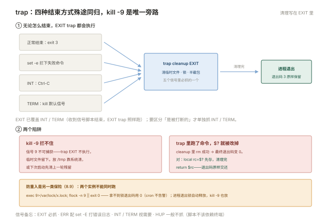

# 08 Shell 脚本

> **这一册回答**：同一套管道，跑一次用命令行就行，跑一百次、或者在半夜三点自动跑，就得写成脚本——怎么写才不出错。
> **读完能做到**：说清 `#!/bin/bash` 到底给谁看；知道 `set -euo pipefail` 拦住了什么、又漏了什么；用 `[[ ]]` 而不是 `[ ]` 写判断；用 `while IFS= read -r` 而不是 `for` 读文件；用 `trap` 保证失败时不留垃圾；用 `getopts` 收参数；用 `flock` 防两个实例打架；用 `shellcheck` 在上线前把问题查出来；写出日志清理、健康检查、备份校验三个能上生产的脚本。
> **怎么读**：8.0 是知识点地图，标了每个点的**基础 / 进阶**。第一遍跳过带「进阶」的小节不影响主线。 不认识的词查 [00 术语表](00-术语表.md)。
> **不在这里**：单个命令有哪些参数 → [附录 A 命令速查](A-命令速查.md)（只查不讲）；管道怎么组合、`awk`/`sed` 怎么用 → [007 命令行与文本处理](007-命令行与文本处理.md)；用 systemd timer 代替 cron → [006 §6.12](006-软件服务与任务.md)；日志该切多大、留几份 → [006 §6.10](006-软件服务与任务.md)。

> **这一册的写法**：不列语法，只讲**会出错的地方**。每个坑都是「现象 → 原因 → 正确写法」三段，代码块可直接跑。文中标了「实测」的输出，是在 bash 5.x 上真实执行的结果；标了版本差异的，说明两个发行版行为不同。

---

## 8.0 本册知识点地图

复习时按这张表逐行自问「这个我能讲清吗」，讲不清的回对应节。**加粗的是日常最常用、也最容易写错的。**

| 知识点 | 层次 | 一句话要点 | 节 |
| --- | --- | --- | --- |
| **`#!/bin/bash` 的作用** | 基础 | 告诉内核用哪个解释器；`bash x.sh` 时它只是一行注释 | 8.1 |
| **`./x.sh` 与 `bash x.sh` 的差别** | 基础 | 前者要 `x` 位且读 shebang，后者不用 | 8.1 |
| **CRLF 导致 `bad interpreter`** | 基础 | Windows 编辑过的脚本带 `\r`，`dos2unix` 一下 | 8.1 |
| **`set -e` 不是万能的** | 基础 | 条件里、`\|\|` 左边、`!` 后面都不触发 | 8.2 |
| **`local v=$(cmd)` 会吞掉失败** | 基础 | `local` 自己的退出码是 0，失败被掩盖；拆两行写 | 8.2 |
| **`((i++))` 在 `i=0` 时返回 1** | 基础 | `set -e` 下直接退出；用 `i=$((i+1))` 或 `\|\| true` | 8.2 |
| **`set -u` 与 `${var:-}`** | 基础 | 开了 `-u` 就得给可能为空的变量兜底 | 8.2 |
| **`pipefail` 与 `PIPESTATUS`** | 进阶 | 管道默认只报最后一段；`PIPESTATUS` 必须紧跟读取 | 8.2 |
| **不加引号就是分词** | 基础 | 变量含空格会被拆成多个参数，`"$var"` 永远加引号 | 8.3 |
| **`${var:-默认}` 系列** | 基础 | `:-` 兜底、`:?` 报错退出、`#`/`%` 掐头去尾 | 8.3 |
| **`"$@"` 与 `"$*"`** | 基础 | 前者一个参数一项，后者拼成一个字符串 | 8.3 |
| **`[ ]` 与 `[[ ]]`** | 基础 | `[ -n $v ]` 空值判断会出错；`[[ ]]` 不会，且支持通配 | 8.4 |
| **数值比较与字典序** | 基础 | `-gt` 比数值，`>` 比字符串；`"10" > "9"` 是假 | 8.4 |
| **`-f` `-d` `-e` `-s`** | 基础 | 判断文件类型与存在性，`-s` 才看是否非空 | 8.4 |
| **不要 `for f in $(ls)`** | 基础 | 文件名带空格就拆开；用 `while read` 或通配符 | 8.5 |
| **`while IFS= read -r` 三个细节** | 基础 | `IFS=` 保首尾空格、`-r` 保反斜杠、`\|\| [ -n "$line" ]` 保最后一行 | 8.5 |
| **管道里的 `while` 是子 shell** | 基础 | 循环里改的变量出了循环就没了 | 8.5 |
| **`read` 多个变量** | 基础 | 最后一个变量吃掉剩余全部，含分隔符 | 8.5 |
| **`return` 只能 0–255** | 基础 | `return 256` 变成 0，看起来像成功 | 8.6 |
| **要返回值用 `echo`** | 基础 | 命令替换接回来；退出码只传「成功/失败」 | 8.6 |
| **`getopts`** | 基础 | 收 `-e prod` 这类短选项，自带未知选项与缺参数处理 | 8.7 |
| **`shift` 与 `OPTIND`** | 基础 | 解析完选项跳过后面的位置参数 | 8.7 |
| **`trap ... EXIT`** | 基础 | 正常退出、`exit 1`、`set -e` 中断都会执行 | 8.8 |
| **`trap` 里的 `$?`** | 进阶 | 保留触发时的退出码，改完要显式 `exit` 原码 | 8.8 |
| **`trap` 拦不住 `kill -9`** | 基础 | 信号 9 不可捕获，临时文件会留下 | 8.8 |
| **`flock` 防重入** | 基础 | cron 任务必须防两个实例同时跑 | 8.9 |
| **锁文件存 PID 的坑** | 进阶 | 进程退出后 PID 会被复用，锁文件不可信 | 8.9 |
| **`bash -n` 只查语法** | 基础 | 上线前先过一遍，不执行 | 8.10 |
| **`bash -x` 与 `PS4`** | 基础 | 看每条命令展开后的真实样子，`PS4` 加行号 | 8.10 |
| **`shellcheck`** | 基础 | 静态检查，`SC2086` 就是「变量没加引号」 | 8.10 |
| **`mkdir -p` 与 `-m`** | 基础 | 建目录顺带定权限，比 `mkdir` 再 `chmod` 少一步 | 8.11 |

### 动手前：建一个能随便练的目录

```bash
mkdir -p ~/shlab && cd ~/shlab
export PATH="$HOME/shlab:$PATH"   # 让脚本能直接按名字跑
```

下文所有脚本都放这里。占位符：`<脚本名>` 换文件名，`<日期>` 换 `20261029` 这种格式。

**只读命令随便敲，带 ⚠️ 的先想三秒**：8.11 的日志清理脚本会真的删文件（默认 dry-run，但不加参数就删）、8.9 的锁文件会挡掉你自己的测试进程。

---

## 8.1 脚本是怎么被执行起来的

地图看完了，从最基础的问题开始：一个纯文本文件凭什么能被系统当成程序跑？以及为什么同一个脚本，`./x.sh` 和 `sh x.sh` 的结果会不一样。

### 两种跑法，走的不是同一条路

```bash
chmod +x backup.sh
./backup.sh          # ① 当成程序执行
bash backup.sh       # ② 把文件名当参数交给 bash
```

**差别在 shebang（第一行的 `#!`）有没有人看**：

| 跑法 | 谁在读文件 | shebang 有用吗 | 需要 `x` 位吗 |
| --- | --- | --- | --- |
| `./backup.sh` | 内核读前两个字节，看到 `#!` 就按后面写的解释器启动 | **有用**，决定用 bash 还是 sh | 需要 |
| `bash backup.sh` | 你直接指定了 bash，内核不参与 | 没用了，就是普通注释 | 不需要 |
| `sh backup.sh` | 同上，但用的是 sh | 没用了 | 不需要 |

这解释了一个常见困惑：**脚本里写了 `#!/bin/bash`，可 `sh x.sh` 跑起来还是不认 `[[ ]]`**——因为 `sh` 在 Ubuntu 上是 dash，根本不看第一行。

> **`#!/bin/bash` 与 `#!/usr/bin/env bash`**：前者写死路径，系统上 bash 不在 `/bin/bash` 就失败（FreeBSD、部分 NixOS）；后者让 `env` 去 `PATH` 里找，可移植性好一点。**运维脚本写 `#!/bin/bash` 就够了**，因为 CentOS 7 和 Ubuntu 上它确实在 `/bin/bash`。只有要跨发行版分发时才用 `env`。

### 第一个高频报错：`bad interpreter`

```plain
$ ./backup.sh
bash: ./backup.sh: /bin/bash^M: bad interpreter: No such file or directory
```

那个 `^M` 就是 Windows 的换行符 `\r`。在 Windows 上编辑过、或者用 FTP 以文本模式传过，行尾就变成 `\r\n`，shebang 那一行成了 `/bin/bash\r`，内核去找一个名叫 `/bin/bash\r` 的程序，当然找不到。

```bash
file backup.sh              # 看到 "with CRLF line terminators" 就是它
sed -i 's/\r$//' backup.sh  # 或者 dos2unix backup.sh
```

同样的 `\r` 还会让脚本报另一种错：

```plain
$ ./check.sh
./check.sh: line 2: $'\r': command not found
```

**判断口诀**：报错里带 `^M` 或者 `$'\r'`，一律是换行符问题，跟代码逻辑无关。

### 退出码：脚本对外的唯一交代

```bash
echo $?        # 上一条命令的退出码，0 是成功
```

脚本的最后一条命令的退出码就是脚本的退出码——除非显式 `exit`。这条规则决定了两件事：

- 调用方（cron、CI、监控）**只看退出码**，你在屏幕上打印一堆「失败」但脚本 `exit 0`，它就是成功的。
- 所以脚本结尾不要写 `echo "完成"` 就完事。要么让最后一条命令自己交代，要么显式 `exit 0` / `exit 1`。

```bash
# 反例：这个脚本永远返回成功
grep -q "ERROR" app.log
echo "检查完毕"        # echo 覆盖了 grep 的退出码，退出码 = 0
```

```bash
# 正例
if grep -q "ERROR" app.log; then
  echo "发现 ERROR"
  exit 1
fi
echo "检查完毕"
exit 0
```

---

## 8.2 `set -euo pipefail`：拦住了什么，漏了什么

脚本能跑起来之后，第一件事是给它装保险。这一节拆开讲人人都在用的那一行 `set -euo pipefail`——它拦住了什么，又在哪些地方悄悄失效。**其中两处失效（`local` 吞错误、`((i++))` 退出）是本册最容易踩的坑。**

这一行几乎是所有严肃脚本的开头。但它经常被当成「加了就安全」，实际它有明确的失效场景——**而那些场景恰好是最容易出事的地方**。

```bash
set -euo pipefail
```

拆开看：

| 选项 | 作用 | 少了它会怎样 |
| --- | --- | --- |
| `-e` | 命令失败（退出码非 0）就退出脚本 | 前面 `cd` 失败了，后面在错误目录里继续删东西 |
| `-u` | 用到未定义的变量就退出 | `rm -rf "$DIR/"` 里 `DIR` 拼错成 `DIRR`，等于 `rm -rf /` |
| `-o pipefail` | 管道中任一段失败，整条管道算失败 | `cmd \| tee log` 里 `cmd` 崩了，`tee` 成功，整条算成功 |


`-u` 那一条值得多说一句：**它是防手滑删库最有效的一行**。

```bash
# 没有 set -u 时，这是个灾难
DIR=/data/app
rm -rf "$DIRR/"        # 变量名打错，展开成空字符串 → rm -rf /
```

带 `-u` 时脚本在这里就退出，报 `DIRR: unbound variable`，什么都还没删。

### `-e` 的三个漏网场景

**（1）条件判断里不触发**

```bash
set -e
if false; then echo x; fi     # 不退出
while false; do :; done        # 不退出
```

这是设计如此——`if` 就是在问「成不成功」，失败是正常答案。副作用是：**`if grep -q ...` 里的失败不会让脚本停**，你得自己处理 else 分支。

**（2）`||` 和 `&&` 的左边不触发**

```bash
set -e
false || echo "左边失败了，但脚本继续"    # 正常打印，不退出
false && echo "不会执行"                  # 整个表达式返回 1，但脚本继续
```

所以 `cmd || true` 是「明确忽略这个错误」的写法，不是 bug。

**（3）`!` 取反后不触发**

```bash
set -e
! true          # 表达式变成失败，但不触发退出
```

### 反直觉的一条：`x=$(false)` 会退出

很多人以为赋值语句不会触发 `set -e`。**实测不是这样**：

```bash
#!/bin/bash
set -e
x=$(false)
echo "不会到这"
```

```plain
$ bash t.sh; echo "exit=$?"
exit=1
```

赋值语句的退出码就是命令替换的退出码，`set -e` 照样拦。

**但是，加上 `local` 就拦不住了**：

```bash
#!/bin/bash
set -e
f() {
  local v=$(false)          # ← 失败被吞掉
  echo "函数内走到了这里"
}
f
echo "脚本继续"
```

```plain
$ bash t.sh; echo "exit=$?"
函数内走到了这里
脚本继续
exit=0
```

原因：这一行的退出码是 `local` 这个内建命令自己的（恒为 0），命令替换失败的 1 被它盖掉了。`declare`、`export`、`readonly` 赋值时同理。**这是 `set -e` 最隐蔽的一个洞**，因为它看起来完全正常。

正确写法是拆成两行——第一行 `local` 声明，第二行赋值，这样失败就会触发：

```bash
f() {
  local v
  v=$(false)                # ← 这一行的退出码是 false 的 1
  echo "不会到这"
}
```

```plain
$ bash t.sh; echo "exit=$?"
exit=1
```

### 第二个反直觉：`((i++))` 在 `i=0` 时返回 1

```bash
#!/bin/bash
set -e
i=0
((i++))
echo "不会到这"
```

```plain
$ bash t.sh; echo "exit=$?"
exit=1
```

`(( ))` 的退出码是「表达式结果是否非 0」。后置自增返回的是**自增之前**的值，`i=0` 时返回 0，于是 `(( ))` 判为失败，`set -e` 直接退出。

三种写法可以避开：

```bash
i=$((i+1))        # 赋值语句，退出码是 0（推荐，最不容易看错）
((++i))           # 前置自增返回新值 1，非 0 → 成功
((i++)) || true   # 显式忽略，但读的人要多想一秒
```

**同一类坑**：任何「结果可能是 0」的算术表达式，在 `set -e` 下都要小心。`((count))` 当 count 是 0 时也算失败。

### `-u` 的代价：所有可能空的变量都要兜底

开了 `-u`，`$1` 没传、数组为空、可选参数没给，全都会直接报错退出。所以要配 `${var:-}` 用：

```bash
name="${1:-}"                    # 没传就是空字符串，不报错
count="${COUNT:-0}"              # 没设就是 0
: "${REQUIRED:?必须设置 REQUIRED}"   # 反过来：没设就报错退出，这是故意的
```

`${REQUIRED:?必须设置 REQUIRED}` 这句很实用——脚本开头把必需的变量这样声明一遍，忘了设就立刻停，而不是跑到一半用空值去 `rm`。

> **空数组在 `-u` 下的版本差异**：`"${arr[@]}"` 当数组为空时，bash 4.4 以前会报 `unbound variable`，4.4 起当作空数组处理。CentOS 7 自带 bash 4.2，属于会报错的那一类；Ubuntu 22.04 是 bash 5.1，不会。**要两种都能跑**，写成 `${arr[@]+"${arr[@]}"}`，或者先判断 `${#arr[@]} -gt 0` 再展开。

### `pipefail` 与 `PIPESTATUS`

管道默认的退出码是**最后一段**的：

```bash
false | true
echo $?          # 0 —— 前面的 false 被完全忽略
```

`set -o pipefail` 让整条管道在任一段失败时算失败。如果要知道**具体哪一段**失败，用 `PIPESTATUS` 数组：

```bash
false | true | false
echo "${PIPESTATUS[@]}"
```

```plain
1 0 1
```

**但它会被下一条命令立刻覆盖**：

```bash
false | true | false
echo "紧跟: ${PIPESTATUS[@]}"     # 1 0 1
echo "再读: ${PIPESTATUS[@]}"     # 0  ← 变成上一条 echo 的了
```

要用就存下来：

```bash
false | true | false
status=("${PIPESTATUS[@]}")
[[ ${status[0]} -eq 0 ]] || echo "第一段失败了"
```

### 该不该用：一个真实的分歧

`set -e` 有个被诟病的点：它让脚本**在没预期的地方静默退出**，而退出时的输出可能只有一行晦涩的报错。于是有另一种写法——不用 `set -e`，每条关键命令自己判断：

```bash
if ! cd "$DIR"; then
  echo "进入 $DIR 失败" >&2
  exit 1
fi
```

**实际的选择**：

| 场景 | 建议 |
| --- | --- |
| 运维脚本、一次性任务、CI 步骤 | 用 `set -euo pipefail`，简明，出错即停更安全 |
| 需要精细错误处理（要重试、要分错误类型、要清理后继续） | 不用 `-e`，逐条判断 |
| 给别人的脚本、要长期维护 | 用 `-e`，但每个外部命令都配 `\|\|` 处理，别指望它兜底 |

**折中做法**：加 `-e` 的同时加一个 ERR trap，出错时打印「哪一行、什么命令、退出码多少」，避免静默：

```bash
set -Eeuo pipefail
trap 'echo "[$(date +%T)] 第 $LINENO 行失败: $BASH_COMMAND (exit $?)" >&2' ERR
```

`-E` 让 ERR trap 在函数和子 shell 里也生效（不加的话函数里的失败抓不到）。

---

## 8.3 变量、引号、展开

保险装好了，接着看脚本里流动的东西：变量。这一节只讲三件事——变量什么时候会被拆开、参数怎么取、以及为什么「变量永远加引号」这句话要背下来。

### 不加引号 = 先分词，再当通配符

这是 shell 脚本里 bug 最多的一条规则。变量展开后如果不加引号，shell 会再做两件事：**按空格拆成多个词**、**把 `*` `?` 当通配符展开**。

```bash
f="my report.txt"
cat $f            # 传给 cat 的是两个参数：my 和 report.txt → 报 No such file
cat "$f"          # 正确，一个参数
```

```bash
pattern="*.log"
ls $pattern       # 展开成所有 .log 文件（可能不是你要的）
echo "$pattern"   # 原样输出 *.log
```

**规则只有一句：变量永远加双引号。** 例外只有三种——你明确要分词（比如把参数列表拼起来传）、在 `[[ ]]` 里（不分词）、在 `(( ))` 里（算术上下文）。

> **`SC2086` 就是 shellcheck 对这条的告警**（Double quote to prevent globbing and word splitting）。8.10 会讲怎么用它。

### 参数展开：一次记住六个

| 写法 | 意思 | 典型用途 |
| --- | --- | --- |
| `${var:-默认}` | var 空或未定义 → 用默认值，**var 本身不变** | 可选配置项 |
| `${var:=默认}` | 空则赋值给 var，并返回该值 | 需要记住的默认值 |
| `${var:?提示}` | 空则报错退出，提示打到 stderr | 必填项检查 |
| `${var:+替代}` | var 非空时返回替代值 | 开关型参数 |
| `${var#前缀}` | 从**头**删掉最短匹配 | 去掉路径前缀 |
| `${var##前缀}` | 从**头**删掉最长匹配 | 取文件名 |
| `${var%后缀}` | 从**尾**删掉最短匹配 | 去扩展名 |
| `${var%%后缀}` | 从**尾**删掉最长匹配 | 去多级扩展名 |

`#` 和 `%` 的方向记法：键盘上 `#` 在左（头），`%` 在右（尾）。

```bash
path="/var/log/nginx/access.log"
echo "${path##*/}"     # access.log        —— 取文件名
echo "${path%/*}"      # /var/log/nginx    —— 取目录
echo "${path%.log}"    # /var/log/nginx/access
echo "${path#/var}"    # /log/nginx/access.log
```

**这几个比 `basename` / `dirname` 好在不启动子进程**，循环里跑几万次差别明显。

### 数组

```bash
hosts=(web01 web02 web03)
echo "${hosts[0]}"          # web01，下标从 0 开始
echo "${#hosts[@]}"         # 3，元素个数
echo "${hosts[@]}"          # 全部元素（要加引号）
hosts+=(web04)              # 追加

for h in "${hosts[@]}"; do  # 遍历的标准写法
  echo "$h"
done
```

**`${arr[@]}` 不加引号同样会被分词**，所以遍历一定写成 `"${hosts[@]}"`。

关联数组（bash 4 起，CentOS 7 的 4.2 支持）：

```bash
declare -A ip
ip[web01]=10.0.0.1
ip[web02]=10.0.0.2
for k in "${!ip[@]}"; do echo "$k → ${ip[$k]}"; done
```

### `"$@"` 与 `"$*"`

这两个在函数和脚本里传参时差别很大：

```bash
#!/bin/bash
echo "参数个数: $#"
for a in "$@"; do echo "  [@] $a"; done
for a in "$*"; do echo "  [*] $a"; done
```

```plain
$ bash e.sh "a b" c
参数个数: 2
  [@] a b
  [@] c
  [*] a b c
```

- **`"$@"`**：每个参数保持独立，`"a b"` 仍然是一个参数。**透传参数永远用它。**
- **`"$*"`**：所有参数用 `$IFS` 拼成一个字符串，只在要打日志时有用。
- 不加引号的 `$@` / `$*`：都会分词，`"a b"` 被拆成两个，通常是错的。

```bash
# 包装脚本的正确写法：把参数原样转给真命令
exec /usr/local/bin/real-tool "$@"
```

---

## 8.4 判断

数据能正确存住了，下一步要让脚本做选择。判断的语法本身很简单，坑几乎全在 `[ ]` 和 `[[ ]]` 的行为差异上。

### `[ ]` 与 `[[ ]]`：不是风格问题，是行为不同

`[` 是一个**外部程序**（`/usr/bin/[`，现代 bash 也内建），它拿到的是已经展开、已经分词的参数；`[[ ]]` 是 **bash 的语法结构**，在分词之前就处理完了。这带来三个实际差别。

**（1）空变量：`[ -n $v ]` 会给你错误答案**

```bash
v=""
if [ -n $v ]; then echo "真"; else echo "假"; fi
```

```plain
真            ← 错了！空字符串应该是假
```

原因：`$v` 展开成空，命令变成 `[ -n ]`，而 `[` 只有一个参数时判断的是「这个字符串非空」，`-n` 本身是非空字符串，所以为真。

`[[ ]]` 不会分词，所以正确：

```bash
if [[ -n $v ]]; then echo "真"; else echo "假"; fi
```

```plain
假
```

**（2）变量含空格：`[ ]` 直接报错**

```bash
v="a b"
if [ $v = "x" ]; then :; fi
```

```plain
bash: [: a: binary operator expected      （或者 too many arguments）
```

`[[ ]]` 里不会：

```bash
v="a b"
if [[ $v == "x" ]]; then :; fi     # 正常判断为假，不报错
```

**（3）`==` 在 `[[ ]]` 里支持通配**

```bash
f="access.log"
[[ $f == *.log ]] && echo "是日志文件"       # 成立
[ "$f" = *.log ] && echo "这个不可靠"        # 右侧会被当文件名展开
```

**结论：脚本里一律用 `[[ ]]`。** 只有两种情况必须用 `[ ]`：写 `#!/bin/sh` 的脚本（dash 不认 `[[ ]]`）、或者要放到极简环境（busybox）里跑。

### 数值比较与字符串比较

| 要比较 | 用 | 例子 |
| --- | --- | --- |
| 数值 | `-eq` `-ne` `-lt` `-le` `-gt` `-ge` | `[[ $n -gt 10 ]]` |
| 字符串相等 | `=` 或 `==` | `[[ $s == "ok" ]]` |
| 字符串不等 | `!=` | `[[ $s != "ok" ]]` |
| 字符串大小 | `<` `>`（`[[ ]]` 里不用转义） | `[[ $a > $b ]]` |

**最容易错的是把 `>` 当数值比较**：

```bash
[[ "10" > "9" ]] && echo "真" || echo "假"
```

```plain
假
```

因为 `>` 在 `[[ ]]` 里是**字典序**，"1" 比 "9" 小。数值比较要用 `-gt`：

```bash
[[ "10" -gt "9" ]] && echo "真"      # 真
(( 10 > 9 )) && echo "真"            # 真，算术上下文最干净
```

> 顺带一个坑：`[ "10" > "9" ]` 里 `>` 会被 shell 当成**重定向**，必须写 `\>`。这也是用 `[[ ]]` 更省心的原因之一。

**小数 bash 比不了**（`-gt` 只认整数）。要比较浮点用 `awk` 或 `bc`：

```bash
awk -v a=1.5 -v b=1.2 'BEGIN{exit !(a>b)}' && echo "1.5 更大"
```

### 文件测试：最常用的七个

| 判断 | 意思 | 备注 |
| --- | --- | --- |
| `-e` | 存在（文件或目录） | |
| `-f` | 存在且是普通文件 | 软链接指向普通文件也算 |
| `-d` | 存在且是目录 | |
| `-s` | 存在且**非空** | 大小为 0 时为假 |
| `-r` `-w` `-x` | 当前用户可读 / 可写 / 可执行 | 对 root 几乎恒为真 |
| `-L` | 是软链接 | `-f` 会跟随软链，要判断本身用 `-L` |

```bash
[[ -d /data/app ]] || { echo "/data/app 不存在" >&2; exit 1; }
[[ -s "$log" ]] || { echo "日志为空，跳过" >&2; exit 0; }
[[ -L /usr/bin/python ]] && echo "这是个软链"
```

注意 `-d` 和 `-e` 的区别在排错时有用：**`-e` 为真但 `-d` 为假**，说明路径存在但是个文件，不是目录。

### 短路：`&&` 和 `||` 的正确用法

```bash
[[ -f "$f" ]] && echo "存在" || echo "不存在"     # 常见，但有个坑
```

坑在这里：如果 `echo "存在"` 本身失败（比如 stdout 已关闭），`||` 也会执行，于是「存在」和「不存在」都打出来。**判断和动作别写在同一行**：

```bash
if [[ -f "$f" ]]; then
  echo "存在"
else
  echo "不存在"
fi
```

`&&` / `||` 适合「出错就退出」这种单向逻辑：

```bash
cd "$DIR" || exit 1
[[ -n "$NAME" ]] || { echo "NAME 不能为空" >&2; exit 1; }
```

`{ ...; }` 里的分号不能省，`;` 前面要有空格——这是个纯语法细节，但写错时的报错很难懂。

---

## 8.5 循环

判断解决「做不做」，循环解决「做多少遍」。这一节的四个坑都不在循环语法上，而在**取数据的方式**上——怎么把一个文件、一段命令输出安全地喂进循环。

### 不要用 `for` 遍历命令输出

```bash
# 反例：文件名带空格就崩
for f in $(ls *.log); do
  echo "$f"
done
```

`$(ls *.log)` 的输出会被分词，`my report.log` 变成两个词，循环两次，每次拿到半截文件名。

三种正确写法，按推荐顺序：

```bash
# ① 直接通配符（最简单，文件名安全）
for f in *.log; do
  echo "$f"
done

# ② 需要递归或复杂筛选时，用 find -print0 + while read
find /var/log -name "*.log" -print0 |
while IFS= read -r -d '' f; do
  echo "$f"
done

# ③ 只要有文件名列表，用 readarray（bash 4 起）
readarray -t files < <(find /var/log -name "*.log")
for f in "${files[@]}"; do echo "$f"; done
```

`-print0` + `read -d ''` 是唯一能处理「文件名里有换行符」的组合。实际很少遇到，但 `-print0` 本身没有代价，习惯用它就行。

### `while read` 的三个细节，缺一个就出错

```bash
while IFS= read -r line; do
  echo "$line"
done < "$file"
```

三个部分各自防一个问题：

| 写法 | 缺了会怎样 |
| --- | --- |
| `IFS=` | 行首行尾的空格被吃掉，配置文件的对齐、缩进全没了 |
| `-r` | 反斜杠被当转义符，`C:\path\to` 读成 `C:pathto`；行尾的反斜杠还会把下一行接上来 |
| `\|\| [[ -n $line ]]` | 文件最后一行**没有换行符**时会漏掉 |

第三条的验证：

```bash
printf 'a\nb\nc' > t.txt          # 最后一行没有 \n
n=0; while read -r l; do n=$((n+1)); done < t.txt; echo "读到 $n 行"
n=0; while read -r l || [[ -n $l ]]; do n=$((n+1)); done < t.txt; echo "读到 $n 行"
```

```plain
读到 2 行
读到 3 行
```

大多数时候配置文件都有结尾换行，所以这条容易被忽略。但处理 `find` 输出、`export` 出来的数据时要小心——**最后一条记录静默丢失**是最难查的 bug 之一。

### 管道里的 `while` 是子 shell

```bash
#!/bin/bash
count=0
printf "a\nb\nc\n" | while read -r line; do
  count=$((count+1))
done
echo "count=$count"
```

```plain
count=0
```

循环确实跑了三次，但它在**子 shell** 里跑的，`count` 的修改出了管道就消失了。

三种改法：

```bash
# ① 进程替换（推荐，读法最接近原意）
while read -r line; do count=$((count+1)); done < <(printf "a\nb\nc\n")

# ② here-string（数据已经是一个字符串时最方便）
while read -r line; do count=$((count+1)); done <<< "$data"

# ③ 重定向文件（读文件时首选）
while read -r line; do count=$((count+1)); done < file.txt
```

验证：

```bash
count=0
while read -r line; do count=$((count+1)); done < <(printf "a\nb\nc\n")
echo "count=$count"      # 3
```

**同理**：`find ... | while read` 里改的变量也拿不出来。这是「为什么我的统计结果永远是 0」的头号原因。

### `read` 拆字段：最后一个变量吃掉剩下的

```bash
echo "admin:2026-10-29 10:00:00:/home/admin" > u.txt
while IFS=: read -r user last login home; do
  echo "user=[$user] last=[$last] login=[$login] home=[$home]"
done < u.txt
```

```plain
user=[admin] last=[2026-10-29 10] login=[00] home=[00:/home/admin]
```

字段比变量多时，**最后一个变量拿到剩余全部内容（含分隔符）**。这条规则经常被用来「取前 N 个字段，剩下的整体保留」：

```bash
while IFS=: read -r f1 rest; do
  echo "第一段: $f1   剩下: $rest"
done <<< "a:b:c:d"
# 第一段: a   剩下: b:c:d
```

### `until` 与 `break` / `continue`

```bash
# 等到端口起来，最多等 30 秒
for i in $(seq 1 30); do
  ss -ltn | grep -q ':8080 ' && break
  sleep 1
done
```

这是运维脚本里最常见的「轮询等待」。三个要点：

1. **必须有次数上限**，不能 `while true`——否则服务永远起不来时脚本永远不退，cron 任务就积压了。
2. `break` 跳出后要判断是「等到了」还是「超时了」，否则会当成成功继续往下走。
3. 间隔别设 0.1 秒，那是给本机进程用的；跨网络的服务启动给 1–2 秒。

写严谨一点：

```bash
ready=0
for _ in $(seq 1 30); do
  if ss -ltn | grep -q ':8080 '; then
    ready=1
    break
  fi
  sleep 1
done
if [[ $ready -eq 0 ]]; then
  echo "等待 8080 超时" >&2
  exit 1
fi
```

---

## 8.6 函数

同一段逻辑要跑多次，除了循环还有函数。区别是函数给「一段操作」起了名字、能带参数、能返回状态。这一节的重点不是语法，是一个设计缺陷：**退出码装不下「数据」**。

### `local` 是必须的

```bash
log() {
  local level="$1" msg="$2"     # 不加 local，同名变量会污染全局
  echo "[$level] $msg"
}
```

bash 的变量默认全局。函数里写 `msg="$1"` 会覆盖外面同名的 `msg`，而这个 bug 往往在几百行之外才发作。**函数里的变量一律 `local`。**

> 但这跟 8.2 那个坑连着：`local v=$(cmd)` 会吞掉失败。所以写法是 `local v` 和 `v=$(cmd)` 分两行。

### `return` 只能返回 0–255

这是 bash 最容易踩的一个「静默错误」：

```bash
#!/bin/bash
f() { return 256; }
f; echo "$?"
g() { return 300; }
g; echo "$?"
h() { return -1; }
h; echo "$?"
```

```plain
0
44
255
```

`return 256` 得到 **0**——看起来像成功。原因：退出码是 8 位，超出部分被截断（256 mod 256 = 0，300 mod 256 = 44，-1 变成 255）。

**所以函数不要把「数据」塞进返回值。** 规矩是：

| 要传的东西 | 用什么 |
| --- | --- |
| 成功 / 失败 | 退出码（`return 0` / `return 1`） |
| 具体错误类型 | 退出码 2、3、4…（255 以内） |
| 一段文本、一个数字、一段 JSON | `echo` 出来，用命令替换接 |

```bash
get_usage() {
  df / | awk 'NR==2 {print $5}' | tr -d '%'
}

usage=$(get_usage)
if [[ $usage -gt 90 ]]; then
  echo "根分区使用率 ${usage}%，告警" >&2
  exit 1
fi
```

如果既要数据又要状态，用全局变量装数据、退出码装状态：

```bash
LAST_ERROR=""
check_disk() {
  local usage
  usage=$(df / | awk 'NR==2 {print $5}' | tr -d '%')
  if [[ $usage -gt 90 ]]; then
    LAST_ERROR="根分区 ${usage}%"
    return 1
  fi
  return 0
}
```

### 函数要先定义后调用

bash 是顺序执行的，调用写在定义前面会报 `command not found`。习惯上把所有函数放在脚本开头、主逻辑之前，最后一行再调用 `main`：

```bash
#!/bin/bash
set -Eeuo pipefail

log()  { echo "[$(date +%T)] $*" >&2; }
die()  { log "错误: $*"; exit 1; }

main() {
  log "开始"
  # ...
}

main "$@"
```

`main "$@"` 传参这一句别省——不传的话 `main` 里拿不到 `$1`。

---

## 8.7 参数处理

函数把内部逻辑封好了，脚本还缺一个对外的入口——别人怎么告诉它「备份哪个目录」。参数处理就是这一层，做得糙就是一堆 `$1` `$2`，做得好就是一个能 `-h` 看帮助的命令。

### 最简形式：位置参数

```bash
#!/bin/bash
set -euo pipefail
src="${1:?用法: $0 <源目录> <目标目录>}"
dst="${2:?用法: $0 <源目录> <目标目录>}"
```

`${1:?提示}` 在没传参时报错退出，提示打到 stderr，退出码 1。**这是最短的参数校验写法**，比手写 `if [[ $# -lt 2 ]]` 省事。

| 变量 | 意思 |
| --- | --- |
| `$0` | 脚本名（含路径） |
| `$1`…`$9` | 第 1–9 个参数，超过 9 要写 `${10}` |
| `$#` | 参数个数 |
| `$@` | 所有参数（加引号用） |
| `$$` | 当前脚本的 PID |
| `$!` | 最后一个后台进程的 PID |

### `getopts`：短选项的标准解法

```bash
#!/bin/bash
set -euo pipefail

usage() { echo "用法: $0 -e <环境> -d <目录> [-v]"; exit "${1:-0}"; }

env=""; dir=""; verbose=0
while getopts ":e:d:hv" opt; do
  case $opt in
    e) env="$OPTARG" ;;
    d) dir="$OPTARG" ;;
    v) verbose=1 ;;
    h) usage 0 ;;
    \?) echo "未知选项: -$OPTARG" >&2; usage 2 ;;   # 开头那个冒号让这里能拿到
    :)  echo "选项 -$OPTARG 需要参数" >&2; usage 2 ;;
  esac
done
shift $((OPTIND - 1))     # 跳过后面的位置参数

echo "env=$env dir=$dir verbose=$verbose 剩余参数=$*"
```

实测输出：

```plain
$ bash d.sh -e prod -d /tmp -v extra1 extra2
env=prod dir=/tmp verbose=1 剩余参数=extra1 extra2

$ bash d.sh -x
未知选项: -x
用法: d.sh -e <环境> -d <目录> [-v]

$ bash d.sh -e
选项 -e 需要参数
用法: d.sh -e <环境> -d <目录> [-v]
```

三个关键点：

1. **选项串开头加冒号** `":e:d:hv"`：不加的话，缺参数时会往 stderr 打一条 bash 自己的报错然后退出；加了才能用 `:)` 分支自己处理。
2. `\?` 和 `:` 两个分支都要写，否则用户输错时是静默跳过。
3. **`shift $((OPTIND - 1))` 不能省**，不然 `$1` 还是那个 `-e`。

`getopts` 只支持**短选项**（`-e prod`）和 `-eprod` 连写，**不支持 `--env=prod`**。要长选项得手写：

```bash
while [[ $# -gt 0 ]]; do
  case "$1" in
    --env)   env="$2"; shift 2 ;;
    --env=*) env="${1#*=}"; shift ;;
    --dir)   dir="$2"; shift 2 ;;
    -h|--help) usage 0 ;;
    *) echo "未知参数: $1" >&2; exit 2 ;;
  esac
done
```

**要不要支持长选项，看谁用这个脚本**：只给自己和 cron 用，短选项够了；要给别的团队调，长选项友好得多。

---

## 8.8 清理与信号：`trap`

参数一收，脚本就开始做真事了：删文件、写文件、改配置。这个阶段最怕的不是报错，而是**报错之后留下一地垃圾**——半截的备份包、没删的临时文件、加了一半的锁。

### 为什么必须有

脚本中途失败会留下什么：临时文件、锁文件、半截的备份包、改了一半的配置。下次跑的时候这些残留会变成新的故障源。

```bash
#!/bin/bash
set -Eeuo pipefail

tmp=$(mktemp /tmp/work.XXXXXX)
cleanup() { rm -f "$tmp"; }
trap cleanup EXIT

echo "临时文件: $tmp"
echo "data" > "$tmp"
# ... 中间任何一步失败都会触发 cleanup
```

验证（成功路径和失败路径都清理）：

```bash
# 失败时也清理
#!/bin/bash
set -Eeuo pipefail
tmp=$(mktemp /tmp/work.XXXXXX)
trap 'rm -f "$tmp"; echo "清理了 $tmp"' EXIT
false                    # set -e 在这里退出
echo "不会到这"
```

```plain
$ bash c.sh; echo "exit=$?"
清理了 /tmp/work.hF8fwF
exit=1
```



### 五个信号该抓哪个

| 信号 | 什么时候来 | 抓不抓 |
| --- | --- | --- |
| `EXIT` | 脚本任何原因结束（正常 `exit`、`set -e`、收到 TERM） | **必抓**，清理写这里 |
| `ERR` | 命令失败（配合 `set -E` 和 `set -e`） | 抓，用于打错误日志 |
| `INT` | Ctrl-C | 抓，用于自定义提示 |
| `TERM` | `kill` 默认信号 | 抓，服务管理器停服务时用它 |
| `HUP` | 终端关闭 | 一般不抓（脚本不该依赖终端） |

`EXIT` 已经覆盖了 INT 和 TERM 的情况（收到信号后脚本结束，EXIT trap 照样执行），所以**大多数脚本只需要 `trap ... EXIT`**。要区分「是正常结束还是被打断」时才单独抓 INT/TERM：

```bash
trap 'echo "被中断了"; exit 130' INT TERM
trap cleanup EXIT
```

### `trap` 里的 `$?` 保留原退出码

```bash
#!/bin/bash
cleanup() { echo "trap 执行，此时 \$? = $?"; }
trap cleanup EXIT
exit 3
```

```plain
trap 执行，此时 $? = 3
```

这带来一个常见错误：**trap 里执行了别的命令，退出码就被改掉了**。

```bash
# 错误：脚本最终的退出码变成 0
cleanup() {
  rm -f "$tmp"        # rm 成功后 $? = 0
}
trap cleanup EXIT
exit 3                # 实际返回 0！
```

正确写法是先存再恢复：

```bash
cleanup() {
  local rc=$?
  rm -f "$tmp"
  # ... 其他清理
  return $rc          # 或者 exit $rc
}
trap cleanup EXIT
```

注意 cleanup 里如果用了 `set -e`，`rm` 失败会让清理中断 —— 清理逻辑里的命令最好都加 `|| true`。

### `trap` 拦不住 `kill -9`

信号 9 不可捕获、不可忽略。这是设计如此，无法绕过。带来的后果：

- 脚本被 `kill -9` 时，`trap EXIT` 不执行，临时文件留下来。
- 所以**临时文件要放在能被系统自动清的地方**（`/tmp`，靠 `systemd-tmpfiles` 清），或者下次启动时先清上一轮的残留。
- 同理，`kill -9` 也拿不到「正在写入」的状态，**数据库类进程被 `-9` 会有数据风险**（这条在 [002 §2.4](002-进程与资源.md) 讲过）。

### `mktemp` 而不是自己拼文件名

```bash
tmp=$(mktemp)                        # /tmp/tmp.aBc123
tmp=$(mktemp /tmp/backup.XXXXXX)     # 指定前缀
dir=$(mktemp -d)                     # 临时目录
```

不要写 `tmp="/tmp/backup.$$"`——PID 会重复使用，而且 `$$` 可预测，多用户机器上能被抢注（安全问题，虽然运维脚本一般不计较，但 `mktemp` 也不麻烦）。

---

## 8.9 防重入：两个实例不能同时跑

`trap` 解决的是「一次执行留下的垃圾」，还有一种故障是「两次执行同时在跑」。在 cron 场景下这几乎是必然发生的——只要有一次跑超时，下一轮就会撞上来。

### 为什么必须有

cron 每 5 分钟跑一次备份，一次备份要 8 分钟。不加防重入的结果：第 5 分钟启动第二个，第 10 分钟启动第三个……最后几十个进程同时读同一批文件、写同一个目标，磁盘 IO 打满，备份全部损坏。

手工执行也一样：上一个还在跑，你又敲了一遍。

### `flock`：内核帮你管

```bash
#!/bin/bash
set -Eeuo pipefail

exec 9>/var/lock/db-backup.lock
if ! flock -n 9; then
  echo "已有实例在运行，本次退出" >&2
  exit 0
fi

# ... 从这里开始的代码，同一时间只可能有一个实例在跑
```

四行，讲清每行的意思：

| 行 | 作用 |
| --- | --- |
| `exec 9>文件` | 打开文件描述符 9 指向锁文件（文件不存在就创建） |
| `flock -n 9` | 对 fd 9 加**非阻塞**排他锁；拿不到立刻返回失败 |
| `!` + `exit 0` | 拿不到锁说明有实例在跑，**退出码用 0** |
| 脚本结束 | fd 关闭，锁自动释放，不用手动删文件 |

**为什么退出码用 0 而不是 1**：cron 看到非 0 会当成失败，给你发告警。「上一次还在跑」是正常情况，不该告警。

`flock` 由 `util-linux` 提供，CentOS 7 和 Ubuntu 都预装，路径 `/usr/bin/flock`。

**锁的释放是自动的**——进程退出（包括被 `kill -9`）时内核会释放它持有的锁。这正是 `flock` 比「锁文件 + PID」可靠的地方。

几点使用细节：

- **锁文件不要放在会被清理的地方**（`/tmp` 会被 `systemd-tmpfiles` 清），放 `/var/lock/` 或 `/run/lock/`。
- **锁文件里存什么是无所谓的**，它只是个加锁的载体。可以顺手写进 PID 便于排查。
- `flock -w 10 9` 是最多等 10 秒（阻塞式），`flock -n` 是立刻返回。备份这种「错过就错过」的场景用 `-n`。

### 「锁文件 + PID」为什么不可靠

```bash
# 老写法，能跑但有坑
if [[ -f $LOCK ]] && kill -0 "$(cat $LOCK)" 2>/dev/null; then
  echo "已在运行"; exit 0
fi
echo $$ > "$LOCK"
```

两个坑：

1. **PID 会被复用**。上一个实例退出、锁文件没删掉，系统把同一个 PID 分给了别的进程（比如某个 `sshd`），`kill -0` 就成功，脚本永远认为「在跑」，从此再也不执行。这种故障非常隐蔽——备份连续几天没跑，而日志里只有「已在运行」。
2. **不是原子的**。两个实例同时执行到「检查」和「写入」之间，都会通过检查。

`flock` 两个问题都没有。所以：**用 `flock`，别自己写 PID 锁。**

### 一个组合：锁 + 超时保护

即使有锁，也要防止「上一个实例卡死不动，锁永远不释放」：

```bash
# 给整个脚本加超时：超过 1 小时强制结束
timeout 3600 /usr/local/bin/db-backup.sh
```

在 crontab 里这样写，卡死的备份会被杀掉，锁随之释放，下一轮能正常开始。

---

## 8.10 调试与静态检查

脚本写完了，怎么确认它是对的？这一节三层检查：语法、静态、运行。顺序有讲究——先用成本最低的查出低级错误，再上真机跑。

### 三层检查，上线前逐一过

| 层 | 命令 | 能查出什么 | 查不出什么 |
| --- | --- | --- | --- |
| 语法 | `bash -n x.sh` | 少 `fi`、少 `done`、引号不配对 | 逻辑错误、变量拼错 |
| 静态 | `shellcheck x.sh` | 变量没加引号、无用的命令、错误的条件写法 | 业务逻辑 |
| 运行 | `bash -x x.sh` | 变量到底展开成什么、走了哪个分支 | 没执行到的分支 |

### `bash -n`：只查语法，不执行

```bash
bash -n backup.sh; echo $?
```

```plain
0                    # 语法没问题
```

少一个 `fi` 时：

```plain
backup.sh: line 4: syntax error: unexpected end of file from `if' command on line 2
```

```plain
2                    # 退出码 2
```

**语法错误时退出码是 2，不是 1**——脚本里如果要判断「语法对不对」，按 `-ne 0` 判就行。

### `bash -x`：看真实的展开结果

```bash
#!/bin/bash
name="web01"
for i in 1 2; do echo "host=$name idx=$i"; done
```

```plain
$ bash -x x.sh
+ name=web01
+ for i in 1 2
+ echo 'host=web01 idx=1'
host=web01 idx=1
+ for i in 1 2
+ echo 'host=web01 idx=2'
host=web01 idx=2
```

三个读法：

- 行首 `+` 的个数表示**嵌套深度**：`+` 是主脚本，`++` 是命令替换或子 shell 里。
- `echo 'host=web01 idx=1'` 的**引号揭示了分词结果**——如果看到 `echo 'host=' 'web01 idx=1'`，就说明变量没加引号被拆开了。
- 变量值直接显示出来，拼错的变量会显示成空（`+ echo 'dir='`），一眼能看出来。

### `PS4` 加行号：定位到行

```bash
#!/bin/bash
PS4='+ [${LINENO}] '
name=web01
echo "host=$name"
```

```plain
$ bash -x p.sh
+ [3] name=web01
+ [4] echo host=web01
host=web01
```

`[3]` `[4]` 就是行号，长脚本里定位快得多。也可以加时间戳：

```bash
PS4='+ $(date +%T) '
```

（代价是每条命令都启动一次 `date`，慢脚本可以用 `$EPOCHREALTIME`。）

### `set -x` 只开一段

整脚本 `-x` 输出太多时，在可疑的那几行前后开关：

```bash
#!/bin/bash
echo "静默段"
set -x
echo "调试段"
set +x
echo "静默段"
```

```plain
静默段
+ echo 调试段
调试段
+ set +x
静默段
```

**调试完记得删掉或注释**——留在生产脚本里会把路径、密码之类的信息打进日志。

### 一个真实场景：`-x` 怎么定位问题

```bash
#!/bin/bash
log_dir="/var/log/nginx"
keep=7
cd "$log_dir" 2>/dev/null || { echo "目录不存在: $log_dir"; exit 1; }
find . -name "*.log" -mtime +"$keep" -print
```

```plain
$ bash -x real.sh
+ log_dir=/var/log/nginx
+ keep=7
+ cd /var/log/nginx
+ echo '目录不存在: /var/log/nginx'
目录不存在: /var/log/nginx
+ exit 1
```

`cd` 后面直接跟着 `echo`，说明 `cd` 失败了——**`-x` 的输出顺序就是执行顺序**，比在代码里加 `echo` 快得多。

### `shellcheck`：上线前必过

```bash
# CentOS 7（要 EPEL）
sudo yum install -y epel-release && sudo yum install -y ShellCheck
# Ubuntu / Debian
sudo apt install -y shellcheck

shellcheck backup.sh
```

它最常报的几条，都是真问题：

| 编号 | 告警 | 对应本册 |
| --- | --- | --- |
| `SC2086` | 变量没加引号（分词/通配） | 8.3 |
| `SC2181` | 用 `$?` 判断，改成直接 `if cmd` | 8.1 |
| `SC2164` | `cd` 失败没处理 | 8.1 |
| `SC2046` | `$(...)` 输出被分词 | 8.5 |
| `SC2002` | `cat file \| grep` 是多余的 `cat` | 07 |
| `SC2155` | `local v=$(cmd)` 吞掉退出码 | **8.2** |

`SC2155` 正好是本册 8.2 那个坑的自动化检查——**它能替你发现「`local` 吞掉失败」这类肉眼看不出的问题**，这是装它的主要理由。

有些告警是误报，可以局部关掉，但**别整文件关**：

```bash
# shellcheck disable=SC2086   # 这里确实要分词
echo $FLAGS
```

---

## 8.11 三个能上生产的脚本

工具都齐了，这一节把前面所有的规矩组装成三个完整脚本。每个都能改改就用，**重点看它们怎么在开头就把自己保护起来**，而不是看它们干了什么。

### 实例一：日志清理（默认只看不删）

需求：删掉 7 天前的日志，但**今天正在写的不能动**，第一次运行先看看要删什么。

```bash
#!/bin/bash
# cleanup-logs.sh —— 清理过期日志
set -Eeuo pipefail

LOG_DIR="${1:-/var/log/app}"
KEEP_DAYS="${KEEP_DAYS:-7}"
DRY_RUN="${DRY_RUN:-1}"          # 默认只看不删，必须显式 DRY_RUN=0

log() { echo "[$(date '+%F %T')] $*"; }
die() { log "错误: $*" >&2; exit 1; }

# 0) 防重入
exec 9>/var/lock/cleanup-logs.lock
flock -n 9 || { log "已有实例在运行，退出"; exit 0; }

# 1) 前置检查：这些条件不满足，一个文件都不要删
[[ -d $LOG_DIR ]] || die "目录不存在: $LOG_DIR"
KEEP_DAYS=$((KEEP_DAYS))
[[ $KEEP_DAYS -ge 1 ]] || die "KEEP_DAYS 必须 ≥ 1，当前: $KEEP_DAYS"
[[ $LOG_DIR != "/" ]] || die "拒绝在根目录上操作"

log "目录=$LOG_DIR 保留天数=$KEEP_DAYS dry_run=$DRY_RUN"

# 2) 先列出候选，人看一眼
mapfile -t victims < <(
  find "$LOG_DIR" -type f -name "*.log" -mtime +"$KEEP_DAYS" \
       ! -newermt "today" -print0 | xargs -0 -r ls -lh 2>/dev/null
)

if [[ ${#victims[@]} -eq 0 ]]; then
  log "没有需要清理的文件"
  exit 0
fi

log "候选 ${#victims[@]} 个文件:"
printf '%s\n' "${victims[@]}"

if [[ $DRY_RUN -ne 0 ]]; then
  log "dry_run=1，未删除。确认无误后执行: DRY_RUN=0 $0 $LOG_DIR"
  exit 0
fi

# 3) 真正删除：用 -print0 传，避免文件名带空格出错
deleted=0
while IFS= read -r -d '' f; do
  if rm -f -- "$f"; then
    deleted=$((deleted + 1))
  else
    log "删除失败: $f"
  fi
done < <(find "$LOG_DIR" -type f -name "*.log" -mtime +"$KEEP_DAYS" ! -newermt "today" -print0)

log "已删除 $deleted 个文件"
```

几个刻意的设计：

- **`DRY_RUN` 默认是 1**，不加参数只打印。这是删除类脚本的标配——第一次上线时没人敢直接删。
- **`! -newermt "today"`** 排除今天修改过的文件。`-mtime +7` 的边界是「7 天前的同一时刻之前」，正在写的文件理论上碰不到，但加上这一条更保险（有些日志会被 `touch` 更新时间戳）。
- **`KEEP_DAYS` 强制 ≥ 1**，防止 `KEEP_DAYS=0` 把今天的日志也删掉。
- **`[[ $LOG_DIR != "/" ]]`** 这一行是防手滑：`cleanup-logs.sh /` 会试图删整个系统的日志。
- **`rm -f -- "$f"`** 里的 `--` 处理文件名以 `-` 开头的情况（虽然 `find` 出来的路径基本都带目录，但习惯了不会错）。

> ⚠️ **删文件是不可逆的**。测试时先把 `LOG_DIR` 指向一个造出来的目录：
> ```bash
> mkdir -p /tmp/logtest && for i in $(seq 1 10); do
>   touch -d "-$i days" /tmp/logtest/app-$i.log
> done
> ```
> 再跑 `DRY_RUN=1 ./cleanup-logs.sh /tmp/logtest`，确认列出的正是第 8–10 天的文件。

### 实例二：健康检查 + 重启

需求：每分钟查一次接口，连续 3 次失败才重启（避免抖动），重启后要有冷却期。

```bash
#!/bin/bash
# healthcheck.sh —— 检查接口，连续失败则重启服务
set -Eeuo pipefail

URL="${URL:-http://127.0.0.1:8080/healthz}"
SVC="${SVC:-myapp}"
FAIL_THRESHOLD="${FAIL_THRESHOLD:-3}"
STATE_DIR="${STATE_DIR:-/var/lib/healthcheck}"
COOLDOWN="${COOLDOWN:-300}"        # 重启后 5 分钟内不再重启

mkdir -p "$STATE_DIR"
count_file="$STATE_DIR/${SVC}.fail"
last_file="$STATE_DIR/${SVC}.last_restart"

log() { echo "[$(date '+%F %T')] [$SVC] $*"; }

# 0) 防重入：两个检查同时跑会互相覆盖计数
exec 9>"$STATE_DIR/${SVC}.lock"
flock -n 9 || exit 0

# 1) 探测：三个超时都要给，否则一次探测能挂几分钟
if curl -fsS --connect-timeout 3 --max-time 5 -o /dev/null "$URL"; then
  : > "$count_file"                       # 成功就清零
  exit 0
else
  rc=$?
fi

# 2) 累计失败次数
fails=$(( $(cat "$count_file" 2>/dev/null || echo 0) + 1 ))
echo "$fails" > "$count_file"
log "探测失败（curl 退出码 $rc），连续第 $fails 次"

if [[ $fails -lt $FAIL_THRESHOLD ]]; then
  exit 0                                  # 没到阈值，继续观察
fi

# 3) 冷却期检查：刚重启过就不再重启，避免把服务打得更死
now=$(date +%s)
last=$(cat "$last_file" 2>/dev/null || echo 0)
if [[ $((now - last)) -lt $COOLDOWN ]]; then
  log "在冷却期内（$((now - last))s < ${COOLDOWN}s），暂不重启"
  exit 1
fi

# 4) 重启
log "连续失败 $fails 次，重启 $SVC"
if systemctl restart "$SVC"; then
  echo "$now" > "$last_file"
  : > "$count_file"
  log "重启命令已下发"
else
  log "重启失败" >&2
  exit 2
fi
```

几个关键点：

- **`curl` 必须有 `--connect-timeout` 和 `--max-time`**。不给的话，网络半通（SYN 无响应）时会卡两分钟以上，这一分钟的检查窗口早就过了，下一次 cron 又启动一个，几十个 `curl` 挂在那里。
- **`curl` 的退出码区分了原因**：7 连不上、28 超时、22 返回 4xx/5xx。要区分处理就按 `rc` 分支，不区分就统一计数。
- **连续 N 次才动手**：单次失败极可能是网络抖动或 GC 停顿，立刻重启等于自己制造故障。
- **冷却期**：重启后服务要几十秒才起来，这期间检查仍然失败。没有冷却期会在 3 分钟内连续重启十几遍，把启动过程打断，服务永远起不来。
- **`systemctl restart` 的退出码**：服务启动失败时 `systemctl` 返回非 0，能拿到。但注意 `Type=simple` 的服务「启动成功」只是指进程拉起来了，不代表业务就绪——这种情况要在 `restart` 后加一段轮询等待（8.5 那个写法）。

> ⚠️ **自动重启是把双刃剑**。「服务挂了」和「服务因为内存泄漏被 OOM 打死了」需要的是不同处置，自动重启会掩盖后者。生产上更稳妥的做法是**只告警不自动重启**，或者自动重启同时必然发一条通知——`exit 1` 就是给 cron 发邮件用的。

### 实例三：备份 + 校验 + 失败告警

需求：打包备份目录，算校验和，**验证包能解开**，任何一步失败都让调用方知道。

```bash
#!/bin/bash
# backup.sh —— 打包、校验、验证可解压
set -Eeuo pipefail

SRC="${1:?用法: $0 <源目录> [目标目录]}"
DST="${2:-/backup/$(hostname)}"
STAMP=$(date +%Y%m%d-%H%M%S)
NAME="$(basename "$SRC")-$STAMP"

log() { echo "[$(date '+%F %T')] $*"; }
die() { log "失败: $*" >&2; exit 1; }

# 出错时打印位置，避免静默退出
trap 'log "第 $LINENO 行失败: $BASH_COMMAND (exit $?)" >&2' ERR

exec 9>/var/lock/backup.lock
flock -n 9 || { log "备份已在进行"; exit 0; }

[[ -d $SRC ]] || die "源目录不存在: $SRC"
mkdir -p "$DST"
[[ -w $DST ]] || die "目标不可写: $DST"

# 临时文件放目标同分区，避免跨分区 mv 变成「复制一遍」
tmp="$DST/.$NAME.tar.gz.part"
trap 'rm -f "$tmp"' EXIT

log "开始打包 $SRC → $DST/$NAME.tar.gz"
tar -czf "$tmp" -C "$(dirname "$SRC")" "$(basename "$SRC")" || die "打包失败"

# 1) 包本身是否完整（tar 能读完）
tar -tzf "$tmp" > /dev/null || die "包损坏，无法读取目录"
entries=$(tar -tzf "$tmp" | wc -l)
log "包内 $entries 个条目"

# 2) 真的解一次（-t 只读目录，不校验内容；这里抽样解一个文件）
if ! tar -xzf "$tmp" -O "$(tar -tzf "$tmp" | head -1)" > /dev/null 2>&1; then
  log "警告：抽样解压失败，包可能有问题" >&2
fi

# 3) 原子改名：改名前的东西别人看不到，改名后才算完成
final="$DST/$NAME.tar.gz"
mv "$tmp" "$final"

# 4) 算校验和。必须在改名之后算，且写成「哈希  文件名」两段
#    ——只留哈希值的话，恢复时 sha256sum -c 用不了
( cd "$DST" && sha256sum "$(basename "$final")" > "$(basename "$final").sha256" )

size=$(du -h "$final" | cut -f1)
log "完成: $final ($size)"
```

几个值得单独说的：

**（1）`.part` + `mv` 的原子性**。备份脚本被中断时，目标目录里不会出现一个「看起来正常、实际是半截」的包。`mv` 在同一文件系统内是原子的，所以临时文件和目标必须在同一分区——放在 `/tmp` 里直接 `mv` 会失败（`Invalid cross-device link`）。

**（1.5）校验和的格式不能省**。这里踩过一个坑：一开始写成 `sha256sum "$tmp" | awk '{print $1}'` 只留哈希值，生成的文件长这样：

```plain
4a581dd73c25b3389249047c798da971a5b932c4f656e030cb25d1edc7a51ed8
```

看着没问题，但恢复时 `sha256sum -c xxx.sha256` 直接报错：

```plain
sha256sum: xxx.sha256: no properly formatted SHA256 checksum lines found
```

`sha256sum -c` 要求每行是「哈希 + 两个空格 + 文件名」。所以：

- **不能只留哈希**，要 `sha256sum 文件名` 原样输出；
- **必须在 `mv` 之后算**，否则记的是 `.part` 的名字，改名后对不上；
- **`cd "$DST"` 再算**，让文件里记的是相对文件名，恢复时在目标目录直接 `sha256sum -c *.sha256` 就能验，不用管绝对路径。

验证这一步是否做对：

```bash
cd /backup/host01 && sha256sum -c *.sha256
```

```plain
app-20261029-150520.tar.gz: OK
```

**（2）校验分三层**，成本从低到高：

| 层 | 命令 | 能发现 |
| --- | --- | --- |
| 完整性 | `tar -tzf` | 包尾被截断（最常见，磁盘满、传输中断） |
| 内容 | 抽样 `tar -xzf ... -O` | 中间某个文件损坏 |
| 一致性 | `sha256sum` | 传走之后被改动/损坏 |

**只做 `tar -czf` 就结束的备份不算备份**——一个磁盘满时的半截包，`ls` 看到的文件大小很正常，恢复时才发现解不开。

**（3）`trap ... ERR` + `set -E`**：出错时自动打出「第几行、什么命令、退出码」，不用在每条命令后面手工加错误处理。这是 8.2 末尾那个折中方案的实际用法。

**（4）`${1:?用法...}`**：没传源目录时直接报用法，不留机会让 `SRC` 变成空字符串。如果 `SRC=""` 而后面写了 `rm -rf "$SRC/"*`，那就是灾难。

**（5）备份不是备份，能恢复才是**。这个脚本只保证「包是好的」，**恢复演练是另一件事**——定期真的从备份里恢复一台机器，才是 3-2-1 里那个「1」的意义。策略与演练见 [010 数据备份与共享](010-数据备份与共享.md)。

---

## 8.12 本册排错路径

```plain
脚本跑不起来
├─ bad interpreter: /bin/bash^M        → CRLF 换行符，dos2unix（8.1）
├─ $'\r': command not found            → 同上（8.1）
├─ Permission denied                    → 没有 x 位；或分区挂载带 noexec（8.1）
├─ 不认 [[ ]]                           → 用了 sh 跑，dash 不支持（8.1）
└─ command not found（明明装了）        → PATH 里没有 /usr/local/bin（8.11）

脚本半路退出，没看到错误
├─ 加了 set -e，某条命令失败            → bash -x 看停在哪（8.2 / 8.10）
├─ set -u 报 unbound variable           → 变量没初始化，用 ${var:-}（8.2）
├─ 静默无输出                           → 加 trap ERR 打印行号（8.2）
└─ 函数里失败没停                       → local v=$(cmd) 吞了退出码（8.2）

判断结果不对
├─ [ -n $v ] 空值判成真                 → 换 [[ ]]（8.4）
├─ 变量含空格报 too many arguments      → 加引号或换 [[ ]]（8.3 / 8.4）
├─ 数值比较走了字典序                   → 用 -gt 而不是 >（8.4）
└─ 小数比较永远为假                     → bash 只认整数，用 awk（8.4）

循环结果不对
├─ 统计变量出了循环变回 0               → 管道里的 while 是子 shell（8.5）
├─ 文件名带空格被拆开                   → 别用 for $(ls)，用 while read（8.5）
├─ 最后一行总是漏掉                     → 加 || [[ -n $line ]]（8.5）
├─ 行首空格消失                         → read 前加 IFS=（8.5）
└─ 反斜杠被吃掉                         → read -r（8.5）

参数处理不对
├─ $1 还是那个 -e                       → 漏了 shift $((OPTIND-1))（8.7）
├─ 用户输错选项时静默跳过               → getopts 串开头加冒号 + 写 \? 分支（8.7）
└─ 长选项 --env 不认                    → getopts 只支持短选项，手写 while case（8.7）

脚本被重复执行
├─ cron 任务堆积                        → flock 防重入（8.9）
├─ 有锁却还是跑了两个                   → 锁文件在 /tmp 被清了（8.9）
└─ 锁永远不释放                         → 用 flock 不用 PID 文件；加 timeout（8.9）

留下垃圾文件
├─ 失败后临时文件还在                   → trap cleanup EXIT（8.8）
├─ trap 写了但没执行                    → 被 kill -9 了，无法捕获（8.8）
└─ trap 里清理没生效                    → trap 里 set -e 让 rm 失败就中断（8.8）

退出码不对
├─ 脚本永远返回 0                       → 结尾的 echo 覆盖了退出码（8.1）
├─ trap 后退出码变成 0                  → cleanup 里先存 $? 再 return（8.8）
└─ return 256 变 0                      → 退出码只有 8 位（8.6）
```

---

## 8.13 自测

先自己答，再对照下面的答案。

**1. 脚本第一行写了 `#!/bin/bash`，但 `sh script.sh` 报 `[[ : not found`。为什么？**

<details>
<summary>答案</summary>

`sh script.sh` 是你指定了用 `sh` 执行，内核不参与，shebang 只是一行注释被忽略。Ubuntu 上 `sh` 指向 dash，dash 不支持 `[[ ]]`。要么 `bash script.sh`，要么 `./script.sh`（这时内核读 shebang 用 bash）。
</details>

**2. 加了 `set -e`，为什么这个脚本还是执行到了 `rm -rf`？**

```bash
set -e
f() { local dir=$(get_dir); rm -rf "$dir/"; }
f
```

<details>
<summary>答案</summary>

`local dir=$(get_dir)` 这一行的退出码是 `local` 内建命令的（恒为 0），`get_dir` 失败被吞掉了，`set -e` 拦不住。拆成 `local dir` 和 `dir=$(get_dir)` 两行才有效。`shellcheck` 的 `SC2155` 就是查这个。
</details>

**3. `i=0; set -e; ((i++))` 为什么让脚本退出？怎么改？**

<details>
<summary>答案</summary>

`(( ))` 的退出码取决于表达式结果是否非 0。后置自增返回自增**前**的值，`i=0` 时返回 0，判为失败。改成 `i=$((i+1))`，或 `((++i))`，或 `((i++)) || true`。
</details>

**4. 这个循环结束后 `count` 为什么是 0？**

```bash
count=0
cat url.txt | while read -r u; do count=$((count+1)); done
echo "$count"
```

<details>
<summary>答案</summary>

管道右边（`while`）在子 shell 里执行，`count` 的修改出了子 shell 就没了。改成 `while ... done < url.txt`，或 `done < <(cat url.txt)`。
</details>

**5. `read -r` 的 `-r` 到底防什么？不写会怎样？**

<details>
<summary>答案</summary>

防反斜杠被当转义符。不写时 `C:\path\to` 读成 `C:pathto`；行尾若是反斜杠，还会把下一行接上来，导致行数变少、内容错位。
</details>

**6. 判断一个文件「存在且非空」，用哪个测试？**

<details>
<summary>答案</summary>

`[[ -s $f ]]`。`-e` 只看存在，`-f` 只看是不是普通文件，都可能是 0 字节。
</details>

**7. `[[ "10" > "9" ]]` 为什么是假？想比较数值该用什么？**

<details>
<summary>答案</summary>

`>` 在 `[[ ]]` 里是字典序，按字符逐个比较，"1" < "9"，所以为假。数值比较用 `-gt`，或 `(( 10 > 9 ))`。
</details>

**8. `trap cleanup EXIT` 之后 `exit 3`，脚本为什么返回 0？**

<details>
<summary>答案</summary>

`cleanup` 里最后一条命令成功执行（`rm -f` 返回 0），覆盖了退出码。要在 cleanup 开头 `local rc=$?`，结尾 `return $rc` 或 `exit $rc`。
</details>

**9. cron 每 5 分钟跑一次备份，某天开始日志里一直是「已在运行」。怎么排查？**

<details>
<summary>答案</summary>

如果用的是「锁文件 + PID」的写法，多半是 PID 被复用：上次异常退出没删锁文件，那个 PID 后来分给了别的进程，`kill -0` 一直成功，脚本永远认为在跑。改成 `flock`（进程退出时内核自动释放锁）。另外确认锁文件不在 `/tmp`（会被清理）。
</details>

**10. 备份脚本只写了 `tar -czf backup.tar.gz /data`，为什么说它不算数？**

<details>
<summary>答案</summary>

没验证包能不能读。磁盘满、进程被中断时会产生半截包，`ls` 看到的大小也正常，恢复时才发现解不开。至少要 `tar -tzf` 读一遍目录，再算 `sha256sum`，最好抽样解一个文件——这就是 8.11 实例三的三层校验。
</details>

---

## 8.14 片段索引

「我想……」→ 直接抄这段。

| 我想 | 写法 | 节 |
| --- | --- | --- |
| 脚本开头固定四行 | `#!/bin/bash` + `set -Eeuo pipefail` + `trap ... ERR` | 8.2 |
| 必填参数缺失就退出 | `dir="${1:?用法: $0 <目录>}"` | 8.7 |
| 可选参数给默认值 | `keep="${KEEP:-7}"` | 8.3 |
| 取文件名 / 取目录 | `${path##*/}` / `${path%/*}` | 8.3 |
| 去掉扩展名 | `${file%.*}` | 8.3 |
| 遍历参数（保空格） | `for a in "$@"; do ...; done` | 8.3 |
| 判断目录存在否则退出 | `[[ -d $d ]] \|\| { echo "无 $d" >&2; exit 1; }` | 8.4 |
| 判断为空字符串 | `[[ -z ${v:-} ]]` | 8.4 |
| 逐行读文件（最稳） | `while IFS= read -r l; do ...; done < f` | 8.5 |
| 逐行读命令输出 | `while IFS= read -r l; do ...; done < <(cmd)` | 8.5 |
| 处理带空格的文件名 | `find ... -print0 \| while IFS= read -r -d '' f` | 8.5 |
| 等端口起来（最多 30s） | `for _ in $(seq 30); do ss -ltn \| grep -q ':80 ' && break; sleep 1; done` | 8.5 |
| 函数返回一段文本 | `f(){ echo "值"; }; x=$(f)` | 8.6 |
| 收短选项 | `while getopts ":e:d:hv" opt; do case ...; done` + `shift $((OPTIND-1))` | 8.7 |
| 收长选项 | `while [[ $# -gt 0 ]]; do case $1 in --env=\*) ...` | 8.7 |
| 临时文件 + 自动清理 | `t=$(mktemp) ; trap 'rm -f "$t"' EXIT` | 8.8 |
| 出错时打印行号 | `trap 'echo "第 $LINENO 行: $BASH_COMMAND" >&2' ERR` + `set -E` | 8.2 |
| 保留原退出码的清理 | `cleanup(){ local rc=$?; ...; return $rc; }` | 8.8 |
| 防两个实例同时跑 | `exec 9>/var/lock/x.lock; flock -n 9 \|\| exit 0` | 8.9 |
| 给整个脚本加超时 | `timeout 3600 ./script.sh` | 8.9 |
| 检查语法 | `bash -n script.sh`（错时退出码 2） | 8.10 |
| 看变量展开成什么 | `bash -x script.sh`，配 `PS4='+ [${LINENO}] '` | 8.10 |
| 只调试一段 | `set -x` ... `set +x` | 8.10 |
| 静态检查 | `shellcheck script.sh`（`SC2086`/`SC2155` 最常见） | 8.10 |
| 大小写转换 | `${var^^}` 全大写、`${var,,}` 全小写（bash 4+） | 8.3 |
| 去掉字符串首尾空格 | `v="${v#"${v%%[![:space:]]*}"}"; v="${v%"${v##*[![:space:]]}"}"` | 8.3 |
| 给输出加上时间戳 | `log(){ echo "[$(date '+%F %T')] $*"; }` | 8.6 |

---

**上一篇**：[007 命令行与文本处理](007-命令行与文本处理.md)　**下一篇**：[009 性能分析与排障](009-性能分析与排障.md)
