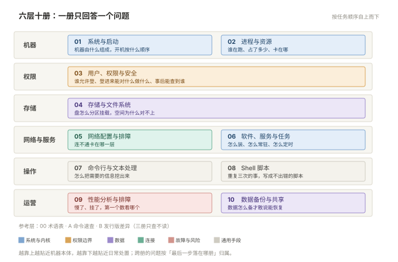

# Linux 运维手册

> **定位**：按运维日常工作编排的 Linux 体系文档，不是命令词典，也不是考证教材——每一册对应一类真实任务。  
> **读者**：会敲命令、但遇到故障还不知道从哪看起的运维人员，也用于团队交接与新人带路。  
> **口径**：主用 **CentOS 7** 与 **Ubuntu 22.04**，正文给这两套命令；**CentOS 6 / Rocky 9 / Debian 12** 只在差异点单行注明，不重复整套。全部差异见 [附录 B](B-发行版差异.md)。  
> **更新**：2026-10-29  
> **术语表**：单独成册 → [00 术语表](00-术语表.md)。114 个术语 · 28 个缩写 · 20 对易混 · 38 条症状反查。

## 体系总览

从「机器是什么」到「怎么让它一直稳」，六层十册。**一册只回答一个问题，一个问题只在一册里答。**



| 层 | 册 | 解决的问题 | 核心主题 |
| --- | --- | --- | --- |
| 机器 | [001 系统与启动](001-系统与启动.md) | 一台机器由什么组成，开机时按什么顺序起来 | 发行版差异 · FHS 目录树 · 启动链（UEFI→GRUB→内核→systemd）· target 与救援模式 · 时间与时区 · 内核参数与模块 · 硬件自检 · 新机基线 |
| 机器 | [002 进程与资源](002-进程与资源.md) | 谁在跑、占了多少、卡在哪 | 进程/线程/父子/僵尸 · 信号 · `strace` 与 `lsof` · `/proc` 读法 · cgroup 与 `ulimit` · 内存口径与 OOM · 优先级 |
| 权限 | [003 用户、权限与安全](003-用户权限与安全.md) | **谁允许登**，登进来能对什么做什么，事后能查到谁 | 用户组三件套 · `rwx` 与 `umask` · SUID/SGID/Sticky · ACL · `chattr` · `sudo` 与 PAM · SELinux/AppArmor · `auditd` · SSH 加固 |
| 存储 | [004 存储与文件系统](004-存储与文件系统.md) | 盘怎么分区挂载，空间为什么对不上 | MBR/GPT · ext4/xfs · `fstab` · LVM · RAID · 在线扩容 · inode · 配额 · `df`/`du` 矛盾 · `dd`/`fio` |
| 网络与服务 | [005 网络配置与排障](005-网络配置与排障.md) | 网卡怎么配，连不通卡在哪一层 | netplan/NetworkManager · `ip` 命令族 · 路由与 DNS · `ss` 端口 · 防火墙四件套 · `tcpdump` · 五层排查 |
| 网络与服务 | [006 软件、服务与任务](006-软件服务与任务.md) | 怎么装、怎么常驻、怎么定时、日志在哪 | RPM/deb/源码/二进制 · 仓库与换源 · 补丁与内核升级 · systemd unit · journald 与 rsyslog · `logrotate` · cron 与 timer · **SSH 接入**（免密·跳板·转发·传文件） |
| 操作 | [007 命令行与文本处理](007-命令行与文本处理.md) | 怎么把需要的信息从系统里挖出来 | 管道与重定向 · `find`/`xargs` · 三剑客 · 正则 · `cut`/`sort`/`uniq` · vim · 打包压缩 |
| 操作 | [008 Shell 脚本](008-Shell脚本.md) | 重复三次以上的事，怎么写成不出错的脚本 | 骨架与 `set -euo pipefail` · 判断/循环/函数 · `getopts` · `trap` 与退出码 · `shellcheck` · 运维实例 |
| 运营 | [009 性能分析与故障排查](009-性能分析与排障.md) | 慢了、挂了，第一个数看哪个 | 五维模型 · `top`/`vmstat`/`iostat`/`pidstat` · 负载高但 CPU 低 · OOM 与 kdump 取证 · 五条故障树 · 从分析到调优 |
| 运营 | [010 数据备份与共享](010-数据备份与共享.md) | 数据怎么备份才敢说能恢复，怎么跨机器共享 | rsync 三模式与 rsyncd · Sersync 实时同步 · NFS 与 SMB · 3-2-1 策略 · 快照 · 恢复演练 · 误删恢复 |
| 参考 | [00 术语表](00-术语表.md) | 这个词是什么意思，这俩差在哪 | 114 个术语中英对照 · 28 个缩写 · 20 对易混 · 38 条症状反查 |
| 参考 | [A 命令速查](A-命令速查.md) | 这个命令有什么参数（只查不讲） | 系统 · 进程 · 文件 · 文本 · 网络 · 磁盘 · 权限 · 包管理 · 压缩，双系对照 |
| 参考 | [B 发行版差异](B-发行版差异.md) | 同样的目的，在另一个发行版上命令叫什么 | 五个发行版 × 九个维度矩阵 · 五个最常踩的差异 · EOL 说明 |

> **03 与 06 的分界**：03 管「谁允许登录、登录后能做什么」，06 管「怎么连、怎么传文件」。SSH 加固在 03，跳板与端口转发在 06。

## 阅读约定

1. **两主三辅**：正文写 CentOS 7 与 Ubuntu 两套；CentOS 6 / Rocky / Debian 有差异才注明，不假设读者用的是哪一个。差在哪见附录 B。
2. **给预期输出**：能给出输出示例的都给，读者靠输出判断自己对不对。
3. **危险操作先备份**：`rm -rf`、`mkfs`、`dd`、改分区、改网络、重启服务，一律标 ⚠️ 并先写备份命令。
4. **改动必有回滚**：配置修改给前后验证命令，并写明改错了怎么退回去。
5. **先诊断后修**：故障章节按「取数 → 判断 → 处置」写，不直接甩修复命令。
6. **每册结构统一**：知识点地图（标基础/进阶）→ 正文（每节开头一句承接上文）→ 排错路径 → 自测带答案 → 命令索引。可以顺序读，也可以只查某一节。

## 边界

| 不写什么 | 去哪 |
| --- | --- |
| TCP/IP、HTTP、抓包原理 | 「网络」文档集 |
| Prometheus 与监控体系 | 「监控」文档集 |
| Nginx、MySQL、Docker、K8s 的使用 | 各自独立文档集 |
| 虚拟化选型（PVE / VMware） | 建议单独成文 |
| 批量操作与配置管理（Ansible） | 独立文档集 |
| 堡垒机与统一审计平台 | 独立文档集 |

## 目录

```plain
001-Linux/
├── README.md
├── 00-术语表.md
├── 001-系统与启动.md
├── 002-进程与资源.md
├── 003-用户权限与安全.md
├── 004-存储与文件系统.md
├── 005-网络配置与排障.md
├── 006-软件服务与任务.md
├── 007-命令行与文本处理.md
├── 008-Shell脚本.md
├── 009-性能分析与排障.md
├── 010-数据备份与共享.md
├── A-命令速查.md
├── B-发行版差异.md
└── 配图/            ← SVG，命名「册号-序号-主题」；现有 21 张（README 与 001~010）
```

## 术语表

术语与概念辨析单独成册——它是**查**的，不是读的，混在 README 里会把体系总览冲散：[**00 术语表**](00-术语表.md)

| 里面有什么 | 条数 | 用来解决 |
| --- | --- | --- |
| 分册术语 · 中英对照 | 114 | 日志里那个词是什么意思 |
| 缩写速查 | 28 | 报错里的 `SELinux`、`PAM`、`PSS` 怎么展开 |
| 最容易混的 20 对 | 20 | 孤儿和僵尸、RSS 和 PSS、利用率 和 饱和度 到底差在哪 |
| 按症状反查 | 38 | 只有一个现象，不知道翻哪一册 |

---

**下一篇**：[001-系统与启动](001-系统与启动.md)
