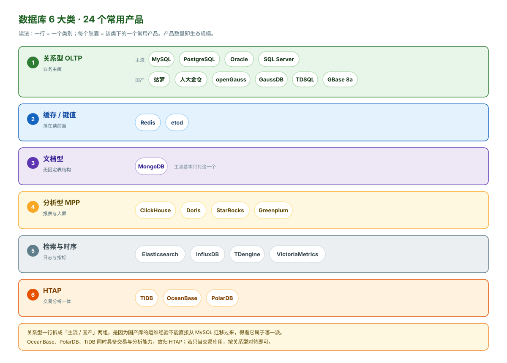

# 000 数据库全貌

> 面向运维的数据库版图。读完能达到三个目的：看到任何数据库名字能立刻判断它属于哪一类、公司要换库时知道风险在哪、面试被问"了解哪些数据库"能说出结构而不是报菜名。
>
> 只讲运维实际会遇到的那几类，冷门类型只在 0.7 末尾一句话带过。本篇不含任何产品的操作细节，001–009 讲 MySQL 怎么用，000 讲**它在版图里的位置**。

## 目录

| 章 | 内容 |
|---|---|
| 0.1 | 版图：六类常用数据库 |
| 0.2 | 为什么会分成这么多类 |
| 0.3 | 关系型 OLTP：五大家族 |
| 0.4 | 缓存与键值：Redis |
| 0.5 | 文档型：MongoDB |
| 0.6 | 分析型与 HTAP |
| 0.7 | 检索与时序 |
| 0.8 | 国产数据库版图 |
| 0.9 | 信创选型的六个现实约束 |
| 0.10 | 迁移：换库时真正会死人的地方 |
| 0.11 | 运维视角的横向对照 |
| 0.12 | 你该掌握到什么程度 |
| 0.13 | 十个误解 |
| 0.14 | 与本系列其余九篇的映射 |
| 0.15 | 云数据库：你还在管什么 |

---

## 0.1 版图：六类常用数据库



这张图是**分类目录**：一行一类，一个胶囊一个产品。产品数量反映生态规模，也大致等于你遇到问题的概率——关系型 10 个最杂，文档型只有 1 个可选。

读图注意三处：

- **关系型拆成了「主流 / 国产」两组**，这不是并列关系，而是提醒：国产库的运维经验不能直接从 MySQL 平移，得先看它属于哪一派（0.8 详述）。
- **OceanBase、PolarDB、TiDB 归在 HTAP**：它们同时承担交易与分析；如果只当交易库用，按关系型那一类对待即可。
- **检索与时序合成一类**：运维上都表现为「写入量大、按时间查询」，Elasticsearch 偏全文检索，InfluxDB / TDengine 偏监控指标。

下面的表补上每一类的一句话判断——**图负责看清「有什么」，表负责说清「怎么用」**。

| # | 类别 | 代表产品 | 一句话判断 |
|---|---|---|---|
| 1 | 关系型 OLTP | MySQL、PostgreSQL、Oracle、SQL Server、国产库 | 绝大多数业务系统的默认选择，运维 80% 的时间花在这 |
| 2 | 缓存 / 键值 | Redis、etcd | 快，但**持久化模型和关系型完全不同**，别当数据库用 |
| 3 | 文档型 | MongoDB | 表结构不固定时用，代价是失去 JOIN 能力 |
| 4 | 分析型 MPP | ClickHouse、Doris、StarRocks | 扫几亿行做聚合，点查和更新很弱 |
| 5 | HTAP / NewSQL | TiDB、OceanBase、PolarDB | 想同时干 OLTP 和 OLAP，代价是复杂度和成本 |
| 6 | 检索、时序 | Elasticsearch、InfluxDB、TDengine | 专用场景的专用容器，**都不是主数据库** |

**这六类里，运维真正会独立负责的是第 1 类和第 2 类。** 其余的多数由开发或数据团队主导，运维的角色是"保证它跑着、能备份、有监控"。

---

## 0.2 为什么会分成这么多类

不是为了炫技。每一类都是因为**上一类在某个维度上撞到了墙**。

| 撞墙的维度 | 撞墙后的产物 | 举例 |
|---|---|---|
| 单机容量（数据装不下） | 分库分表 → 分布式数据库 | MySQL 分库分表 → TiDB |
| 单机写入（QPS 打不上去） | 内存存储 | Redis |
| 分析查询要扫全表 | 列式存储 + MPP | ClickHouse、Doris |
| 表结构频繁变 | 无模式（Schema-less） | MongoDB |
| 数据带强时间属性 | 时序专用压缩与分区 | TDengine、InfluxDB |
| 需要分词/模糊检索 | 倒排索引 | Elasticsearch |

**这张表的用处**：当有人跟你说"我们要上 XX 数据库"，你能反问他"现在撞的是哪面墙"。多数情况下答案是"没撞墙，只是听说它快"——那这个选型大概率是负债。

反面案例很常见：一个日活几千的管理后台，数据量 20GB，上了分布式数据库。结果是三节点集群、运维复杂度翻五倍、跨节点事务偶发超时，而单机 MySQL 完全够用。

---

## 0.3 关系型 OLTP：五大家族

这一类的技术差异其实没那么多，**核心都是 B+ 树 + WAL + MVCC + 事务**。差异在实现细节和生态。

| 家族 | 代表 | 开源 | 运维上手难度 | 关键特征 |
|---|---|---|---|---|
| **MySQL 系** | MySQL、MariaDB、Percona | 是（GPL） | 低 | 生态最广、资料最多、云厂商支持最好 |
| **PostgreSQL 系** | PostgreSQL | 是（类 BSD） | 中 | 功能最强（JSONB、窗口函数、扩展体系）、优化器更聪明 |
| **Oracle** | Oracle Database | 否 | 高 | 金融政企存量巨大，PL/SQL 生态深，许可费贵 |
| **SQL Server** | Microsoft SQL Server | 否 | 中 | 微软技术栈标配，T-SQL 方言 |
| **国产库** | 达梦、金仓、OceanBase 等 | 部分 | 视产品 | 见 0.8，**多数是上面几家的内核改造** |

### 运维最该记住的一句话

**MySQL 的知识 60% 能迁移到 PostgreSQL，但命令和默认行为差异足以出事故。**

举三个照搬就出事的例子：

| 操作 | MySQL 习惯 | 在 PostgreSQL 里的后果 |
|---|---|---|
| 看当前连接 | `SHOW PROCESSLIST` | 语法不存在，要用 `SELECT * FROM pg_stat_activity` |
| 更新一行 | 原行原地改 | **PG 写新版本行，旧行留给 VACUUM 回收**——长期不 VACUUM 会表膨胀 |
| 大小写 | 表名默认不敏感（取决于 `lower_case_table_names`） | 未加引号的标识符**统一转小写**，`User` 和 `user` 是同一张表 |

第三条是迁移期最常见的"表不存在"报错来源。

### 为什么 MySQL 一统互联网、Oracle 守着金融

这不是技术优劣，是历史路径：

- **MySQL** 赶上了 Web 2.0 和 LAMP 组合，免费、轻、易复制，互联网公司大规模使用后又反哺了生态（分库分表中间件、云 RDS）。
- **Oracle** 在 90 年代就解决了银行需要的 RAC、Data Guard、闪回、审计，迁移成本极高，所以金融政企的存量一直没动。国产化替代主要就是替这一块。

---

## 0.4 缓存与键值：Redis

| 产品 | 定位 | 运维最需要知道的 |
|---|---|---|
| **Redis** | 内存 KV，兼作缓存/锁/队列/计数器 | **持久化不等于备份**。RDB 有丢数据窗口，AOF 也不是万无一失；大 key 和热 key 是头号故障源 |
| **etcd** | 分布式 KV，强一致（Raft） | K8s 的元数据就存在这，**它的健康度直接等于集群可用性**；默认 2GB 空间上限，超了会报 `NOSPACE` |

Memcached 只需知道它是"纯缓存、重启即全丢"，现在新系统基本不用了。

**Redis 在运维工作量里占比很高（约 25%），但它的故障模式和关系型完全不同。** 关系型的问题是"慢"，Redis 的问题是"瞬间全崩"——内存打满触发淘汰、大 key 阻塞单线程、主从全量同步打满带宽。

一个必须建立的认知：**大量系统把 Redis 当主存储用**（会话、排行榜、去重、分布式锁）。这意味着"缓存挂了业务降级"这句话在你们系统里可能是假的。接手一个系统时，搞清楚 Redis 里存的是"可丢的"还是"不能丢的"，比调优更重要。

---

## 0.5 文档型：MongoDB

只在一种情况下该用它：**表结构频繁变，或者数据是天然嵌套的 JSON**。其他情况用关系型都更省事，因为 MongoDB 没有 JOIN，复杂查询要在应用层拼。

| 运维要点 | 具体 |
|---|---|
| **部署形态** | 生产必须是副本集（Replica Set），单机不能上生产；分片集群只在数据量真的很大时用 |
| **内存** | WiredTiger 会尽量用满内存缓存，**内存不够时性能断崖式下降**，不是线性退化 |
| **索引** | 索引和热数据抢内存，索引越多内存越紧；`explain()` 看 `COLLSCAN` 就是全表扫 |
| **备份** | `mongodump` 逻辑备份在数据量大时极慢，生产用文件系统快照或 `mongodump --gzip` 配分片 |
| **头号故障** | 磁盘写满导致副本集全部转为只读（`replSet` 无法写 oplog），进而主节点降级 |

一个容易踩的点：**MongoDB 的写入默认是"发出去就算成功"**（`w:1`），主节点宕机可能丢最近的数据。要求不丢就必须配 `writeConcern: majority`，代价是延迟上升。

---

## 0.6 分析型与 HTAP

### 列式 MPP

| 产品 | 特点 | 不适合 |
|---|---|---|
| **ClickHouse** | 单表聚合性能极强，压缩比高 | 高频点更新、复杂多表 JOIN、事务 |
| **Apache Doris** | 国产开源，MySQL 协议兼容，易用性好 | 超大规模单表极致性能略逊 CH |
| **StarRocks** | 从 Doris 分支出来，CBO 优化器更强 | 生态相对新 |

**运维视角的共同点**：这类库的"故障"往往不是宕机，而是**一个大查询把集群资源吃光**。所以资源队列/资源组是必配项，不是可选项。

### HTAP / NewSQL

| 产品 | 架构 | 兼容 | 运维复杂度 |
|---|---|---|---|
| **TiDB** | TiDB Server（计算）+ TiKV（存储）+ PD（调度），存算分离 | MySQL 5.7 协议 | 高，组件多 |
| **OceanBase** | 单机一体化 + Paxos 多副本，LSM 存储 | Oracle / MySQL 双模式 | 高，但一体化程度好 |
| **PolarDB** | 共享存储，一写多读 | MySQL / PG | 中（云上托管为主） |

**这类库的价值和代价是同一个东西**：把分库分表这件事从应用层挪到了数据库层。好处是应用不用改，坏处是**故障域从一台机器变成了一个分布式系统**——网络抖动、时钟偏移、副本选举都会变成你的工单。

一条经验判断：**单机 MySQL 能扛住的业务，不要上分布式数据库。** 单机 MySQL 在合理索引下 5000–10000 QPS 很常见，数据量 2TB 以内也没问题。真正需要分布式的是"写入持续打满单机"或"数据量超过单机能管理的边界"。

---

## 0.7 检索与时序

| 类别 | 代表 | 运维必须知道的一条 |
|---|---|---|
| **搜索** | Elasticsearch | **不是主数据库**。必须配分片数和 ILM（生命周期管理），否则分片过多会把集群拖垮；`refresh_interval` 影响写入吞吐和搜索实时性 |
| **时序** | InfluxDB、TDengine、VictoriaMetrics | 数据量靠**降采样和保留策略**控制，不是靠删表。不配 retention 的时序库半年必爆盘 |

这两类在**日志平台、监控平台**里几乎必遇。ES 的典型事故是"日志量涨了但没人管分片"，时序库的典型事故是"磁盘满了才发现没配保留策略"。

VictoriaMetrics 值得单独提一句：它是 Prometheus 远程存储的常见替代，兼容 PromQL，压缩比远高于 Prometheus 本地存储，K8s 环境的运维经常会碰到。

### 其余类型：知道有就行

下面这些不用专门学，遇到时查一下即可：

- **图数据库**（Neo4j、NebulaGraph）：关系本身就是数据时用，如风控、血缘、社交。
- **宽列**（Cassandra、HBase）：写入吞吐极高、只能按 key 查，国内运维遇到较少。
- **向量数据库**（Milvus、pgvector）：AI 场景的相似度检索，数据量小优先用 pgvector（省一套系统）。
- **湖仓表格式**（Iceberg、Hudi、Paimon）：不是数据库，是"让对象存储看起来像表"的规范，归数据团队。

---

## 0.8 国产数据库版图

这是全篇最重要的一章。原因是：**信创推进下，很多运维第一次接触国产库是被动的**——项目要求换库，你手上突然多了一套不熟悉的系统。

### 先看结构，不要看名单

国产数据库产品有两百多个（各种信创名录里能查到上百个），但**有独立内核研发能力的不到十家**。其余绝大多数按技术来源可以归到三个派系：

```
                    国产数据库
                         │
    ┌────────────┬───────┴────────┬──────────────┐
    │            │                │              │
  自研内核      PostgreSQL 派     MySQL 派      借用商业内核
    │            │                │              │
  达梦 DM      人大金仓 KES      TDSQL(MySQL版)  GBase 8s
  OceanBase    openGauss         GoldenDB        (Informix 技术)
  GBase 8a     GaussDB(华为)     PolarDB-MySQL
  (列存自研)   HighGo(瀚高)      TiDB(协议兼容)
               Vastbase(海量)    OceanBase(MySQL模式)
               AntDB(亚信)
               PolarDB-PG
```

**这个派系划分的实用价值**：它直接决定你的上手速度。

| 派系 | 上手速度 | 为什么 |
|---|---|---|
| **MySQL 派** | 最快，几天 | 命令、协议、备份工具基本通用，改的是分布式架构层 |
| **PG 派** | 快，一两周 | `psql` 换成 `ksql`/`gsql`，系统视图名变了但结构相同 |
| **自研派** | 慢，一两个月 | 系统视图、参数名、工具链全是自己的一套，只有 SQL 语法相似 |
| **Informix 派** | 最慢 | 国内几乎没人有存量经验，只能靠原厂 |

### 主力产品速查

| 产品 | 厂商 | 技术来源 | 兼容 | 常见场景 | 运维上手 |
|---|---|---|---|---|---|
| **达梦 DM8** | 武汉达梦 | 自研 | Oracle 兼容度高（PL/SQL 支持较好） | 政务、金融、军工 | 慢，工具链独立（`disql`、DM 管理工具） |
| **人大金仓 KES** | 人大金仓 | PostgreSQL | Oracle + PG 双模式 | 政务、能源、央企 | 快 |
| **openGauss** | 华为（开源） | PostgreSQL 起点深度改造 | PG 兼容 | 华为生态、运营商 | 中，有独立工具链（`gs_ctl`、CM） |
| **GaussDB** | 华为（商业） | openGauss 演进 | PG / Oracle 兼容 | 金融核心、政企 | 中 |
| **OceanBase** | 蚂蚁集团 | 自研（LSM + Paxos） | Oracle / MySQL 双模式 | 金融核心（支付宝、多家银行） | 慢，体系独立（OBProxy、OCP） |
| **TiDB** | PingCAP | 自研（RocksDB + Raft） | MySQL 5.7 | 互联网、SaaS 的 HTAP | 中，可复用 MySQL 经验 |
| **TDSQL** | 腾讯 | MySQL 内核分支 + 分布式路由 | MySQL | 金融、政务 | 快 |
| **PolarDB** | 阿里云 | MySQL / PG 内核改造 + 共享存储 | MySQL / PG | 阿里云上业务 | 快（云上托管） |
| **GBase 8a** | 南大通用 | 自研列存 MPP | — | 分析型、数据仓库 | 慢 |

其余会听到但不必细究的：瀚高 HighGo、Vastbase、AntDB（都是 PG 派，上手同金仓）、GoldenDB（MySQL 派）、神通 Oscar（自研）、GBase 8s（Informix 技术）。**记住它们属于哪一派就够，具体命令等真要用时再查。**

### 国产库的三个真相

**真相一：兼容度宣传 ≠ 实际兼容度。**

"Oracle 兼容 95%"这类说法，通常指的是**常用 SQL 语法兼容**。真正麻烦的部分——几千行的 PL/SQL 包、系统视图、隐式类型转换、优化器对执行计划的选择——差异仍然很大。**评估兼容度不能看宣传册，必须拿自己最复杂的十条 SQL 和三个存储过程去实测。**

**真相二：性能对比测试水分很大。**

TPC-C 榜单上国产库确实拿过第一（OceanBase、TiDB 都上过），但榜单是"在特定硬件、特定调优下跑特定负载"。你的业务是混合负载、索引未必合理、还有一堆历史遗留 SQL。**榜单说明厂商有能力做好，不说明你的系统会快。**

真实体感上的差距通常在**复杂查询的优化器成熟度**和**执行计划的稳定性**上，不在简单读写吞吐上。

**真相三：真正决定成败的是生态，不是内核。**

一个数据库能不能用好，取决于：

| 维度 | 为什么重要 |
|---|---|
| 监控能不能接入现有体系 | 接不进 Prometheus/Zabbix，等于没有可观测性 |
| 备份工具是否好用 | 备份做不了，其他都白谈 |
| 出问题能不能找到人 | 原厂支持响应时间 vs 社区无人可问，差别巨大 |
| 能不能招到人 | 招不到 DBA 的库，运维成本会长期偏高 |
| 版本升级路径 | 跨大版本升级需要停机多久，有没有官方工具 |

**这五项里任何一项不合格，都比"性能差 10%"严重得多。**

---

## 0.9 信创选型的六个现实约束

运维不一定参与选型，但一定会承担选型的后果。知道这六条，至少在评审会上能提出对的问题。

| # | 约束 | 运维要问的问题 |
|---|---|---|
| 1 | **信创目录与测评** | 这个产品在不在目录里？过了等保、密评了吗？ |
| 2 | **License 模式** | 按 CPU 核数还是按节点？**到期会锁库吗**（商业库常见，会导致生产直接不可写） |
| 3 | **硬件与操作系统适配** | 要跑在鲲鹏/飞腾（ARM）还是海光/兆芯（x86）？麒麟/统信 OS 上有官方认证的版本吗？ |
| 4 | **生态工具链** | 监控、备份、迁移、审计工具是否齐全？能不能对接现有运维平台？ |
| 5 | **人才可得性** | 团队里有人会吗？招人市场上有吗？培训成本多少？ |
| 6 | **原厂支持条款** | 7×24 响应吗？驻场吗？出重大故障的升级路径是什么？ |

**第 2 条是最容易被忽略的运维级风险。** 商业数据库的 license 到期，行为可能是"拒绝新连接"或"只读"——这不是性能问题，是**生产直接停摆**。接手任何商业库（Oracle、达梦、SQL Server、GBase），第一件事是把 license 到期时间写进监控和日历。

---

## 0.10 迁移：换库时真正会死人的地方

换库的风险不在"数据搬过去"，而在"搬过去之后行为和以前不一样"。下面九条是 Oracle → 国产库（尤其 PG 系）迁移中最常见的翻车点。

| # | 差异点 | 具体表现 | 后果 |
|---|---|---|---|
| 1 | **空串 vs NULL** | Oracle 里 `''` 就是 `NULL`；PG 系里 `''` 是空字符串，**不等于 NULL** | `WHERE col = ''` 结果完全不同；`NOT NULL` 约束下 Oracle 能插 `''` 的地方，PG 会报错 |
| 2 | **标识符大小写** | Oracle 未加引号的标识符存为大写；PG 系存为**小写** | 应用里写 `SELECT * FROM "User"` 会报表不存在 |
| 3 | **分页语法** | Oracle `ROWNUM` / `OFFSET FETCH`；MySQL `LIMIT`；PG `LIMIT OFFSET` | 分页查询全部要改写 |
| 4 | **PL/SQL 存储过程** | 包（PACKAGE）、自治事务、游标、异常处理 | **最难的一块**。自动转换工具通常只能转 70–80%，剩余要人工重写 |
| 5 | **序列与自增** | Oracle `SEQUENCE.NEXTVAL`；PG `SERIAL`/`IDENTITY`；MySQL `AUTO_INCREMENT` | 主键生成逻辑要改，且要考虑迁移后序列当前值 |
| 6 | **隐式类型转换** | Oracle `'123' = 123` 成立；PG 直接报类型错误 | 历史 SQL 大量报错，且**这类错误在编译期发现不了，只在运行时暴露** |
| 7 | **日期函数** | `SYSDATE`、`TO_DATE`、`NVL`、`ADD_MONTHS` | 要换成 `NOW()`、`TO_TIMESTAMP`、`COALESCE`、`+ INTERVAL` |
| 8 | **执行计划差异** | 同一 SQL、同一索引，优化器选择不同 | **性能回退**。这是最隐蔽的，测试环境数据量小看不出来，上生产才炸 |
| 9 | **字符集与排序** | Oracle `AL32UTF8`；排序规则（collation）影响 `ORDER BY` 结果 | 中文排序结果可能与原来不一致，涉及分页的业务会错乱 |

### 迁移的正确做法（运维视角）

| 阶段 | 做什么 | 验收标准 |
|---|---|---|
| 1 评估 | 用厂商工具（达梦 DTS、金仓 KDTS、OB OMS）扫描对象，统计不兼容项 | 拿到一份**带明细的不兼容清单**，不是百分比 |
| 2 改造 | 改 SQL、重写存储过程、调整索引 | 全量 SQL 在测试库跑通 |
| 3 数据迁移 | 全量 + 增量追平 | 行数、校验和、抽样数据逐表比对 |
| 4 **压测** | **用生产量级的数据压**，不是用测试数据 | 关键接口 P99 不劣化超过 20% |
| 5 双跑 | 新旧并行，读写比对 | 差异率可解释 |
| 6 切换 | 选低峰期，准备好回滚方案 | **回滚方案必须演练过** |

**第 4 步是最容易被跳过、也最容易出事的。** 测试库一百万行，生产库十亿行，同一 SQL 在两边可能走完全不同的执行计划。用小数据量压测通过就切换，几乎必然遇到"上线后突然变慢"。

**第 6 步的回滚方案**：换库的回滚比换版本难得多——数据已经写进新库了，回滚意味着要把增量数据反向同步回去。所以切换前必须明确：**如果 30 分钟内发现问题，数据怎么回来？** 没有答案就不要切。

---

## 0.11 运维视角的横向对照

同一件事在六款主流库里的做法。这张表的价值是：**换库时照着找对应项，不用从零摸索**。

| 维度 | MySQL | PostgreSQL | Oracle | 达梦 DM | 人大金仓 | OceanBase |
|---|---|---|---|---|---|---|
| 默认端口 | 3306 | 5432 | 1521 | 5236 | 54321 | 2881（代理 2883） |
| 主配置文件 | `my.cnf` | `postgresql.conf` | `spfile<sid>.ora` | `dm.ini` | `kingbase.conf` | 集群参数（OCP 管理） |
| 客户端 | `mysql` | `psql` | `sqlplus` | `disql` | `ksql` | `obclient` |
| 逻辑备份 | `mysqldump` | `pg_dump` | `expdp` | `dexp` | `sys_dump` | `obdumper` |
| 物理备份 | XtraBackup | `pg_basebackup` | RMAN | DMRMAN | `sys_basebackup` | OCP / OBD |
| 高可用 | MHA / MGR / Orchestrator | Patroni / repmgr | RAC + Data Guard | DMDSC / DM 数据守护 | KES RAC / 读写分离 | Paxos 多副本 |
| 慢日志 | `slow_query_log` | `log_min_duration_statement` | AWR | 需开启 SQL 日志 | `log_min_duration_statement` | 审计视图 / OCP |
| 监控采集 | mysqld_exporter | postgres_exporter | oracledb_exporter | 厂商工具 / JDBC | 厂商工具 | OCP + obagent |
| 看连接 | `SHOW PROCESSLIST` | `pg_stat_activity` | `v$session` | `V$SESSIONS` | `sys_stat_activity` | `v$ob_processlist` |
| 看锁 | `performance_schema` | `pg_locks` | `v$lock` | `V$LOCK` | `pg_locks` | `v$ob_locks` |

**注意最后两行**：达梦刻意把系统视图做成 `V$` 风格对齐 Oracle，就是为了降低 Oracle 用户迁移成本。而 PG 派（金仓、Vastbase、openGauss）保留了 `pg_`/`sys_` 视图风格。看这一列就能判断"这个库是想让谁好上手"。

---

## 0.12 你该掌握到什么程度

**不要试图全会，会全等于全不会。**

### 第一档：必须能独立负责（不查文档）

| 库 | 到什么程度 | 为什么 |
|---|---|---|
| **MySQL 或 PostgreSQL（选一）** | 备份恢复、索引优化、主从、故障处理全套 | 90% 的岗位 JD 里有它 |
| **Redis** | 内存管理、持久化、大 key/热 key、主从哨兵 | 几乎每个系统都有 |

这两项是"吃饭的本事"。选 MySQL 还是 PG，取决于你所在行业：互联网多为 MySQL，金融政企和数据分析多为 PG。**两个都粗通，不如一个精通。**

### 第二档：公司用什么就学什么

| 场景 | 学什么 |
|---|---|
| 公司已上信创 | 达梦 / 金仓 / OceanBase 里的那一个，重点学**备份恢复和日常巡检**，不必深挖内核 |
| 有数据分析平台 | ClickHouse 或 Doris 的建表、分区、资源组 |
| 有日志/搜索平台 | Elasticsearch 的分片、ILM、集群健康 |
| 有 K8s | etcd 的容量与备份 |
| 有 Mongo 业务 | 副本集状态、写入关注、索引与内存 |

### 第三档：知道存在、能对话即可

0.7 末尾列的那些（图、宽列、向量、湖仓），加上 Greenplum、DuckDB、CockroachDB 之类。**知道它是哪一类、解决什么问题**就够了，有人提起来你能接上话。

### 一个反直觉的建议

**不要按"库"学，按"问题"学。**

同样是备份，MySQL 的 `xtrabackup` 和 PG 的 `pg_basebackup` 命令完全不同，但**要解决的问题结构完全一样**：全量 + 增量 + 一致性点 + 校验 + 恢复演练。你掌握了"备份这件事的完整方法论"，换任何库都只需要查一遍命令。

反过来，如果只背命令，换库就归零。这也是本系列 005（备份恢复）那篇方法论部分写得比命令多的原因。

---

## 0.13 十个误解

| # | 误解 | 事实 |
|---|---|---|
| 1 | "MySQL 够用了，其他不用学" | 公司换库时你是第一个被冲击的。**换库不提前通知运维**是常态 |
| 2 | "NoSQL 比关系型先进" | 大多数业务用关系型更省事。NoSQL 是为了解决特定约束，不是升级版 |
| 3 | "分布式数据库一定比单机强" | 单机能撑的场景上分布式，只会增加故障面。5000 QPS 以内单机 MySQL 完全够 |
| 4 | "Redis 只是缓存，丢了没关系" | 大量系统拿它当会话、锁、排行榜的主存储。接手系统先搞清楚能不能丢 |
| 5 | "PostgreSQL 就是开源版 Oracle" | 语法、事务行为、大小写规则差异很大。换过去不是改连接串 |
| 6 | "上云了就不用运维数据库" | RDS 接管了实例和备份，不接管你的 SQL 质量、索引设计和容量规划 |
| 7 | "国产库性能不行，只能忍" | 简单读写吞吐不差，真正差距在优化器成熟度和生态。把问题一律归为"性能不行"，会掩盖真正的运维问题 |
| 8 | "兼容度高就能平滑迁移" | "兼容 95%"通常指常用语法。存储过程、系统视图、执行计划仍要重做 |
| 9 | "备份做了就安全了" | 备份文件存在 ≠ 可恢复。必须做恢复演练（见 005 篇） |
| 10 | "数据库问题都是 DBA 的事" | 大量"数据库慢"根因在应用：缺索引的查询、N+1、长事务、连接池太小 |

第 7 条要多说一句：实际遇到的"国产库慢"，多数是索引没建对、统计信息没收集、参数用的是默认值、或者迁移时执行计划变了——**这些和库的国籍无关**。

---

## 0.14 与本系列其余九篇的映射

本系列的 001–009 以 MySQL 为主线。**它们对应的通用能力，在别的库上可以平移**，只要换命令。

| 篇 | 通用能力 | 平移到其他库 |
|---|---|---|
| 001 MySQL 架构与基础 | 架构分层、日志体系、参数 | 每个库都有 redo/undo/慢日志/错误日志，叫法不同 |
| 002 SQL 与数据类型 | 类型选择、安全变更 | 通用，注意方言 |
| 003 索引与执行计划 | B+ 树、最左前缀、`EXPLAIN` | **通用度最高**，几乎所有关系型都是 B+ 树 + 类似执行计划 |
| 004 事务锁与 MVCC | 隔离级别、锁等待、死锁 | 通用，PG 的 MVCC 实现不同（需 VACUUM） |
| 005 备份恢复与迁移 | 备份方法论、恢复演练、RTO/RPO | **通用度最高**，只有命令不同 |
| 006 主从复制与高可用 | 复制原理、延迟、切换 | 通用，PG 是流复制、OB 是 Paxos |
| 007 性能诊断与优化 | 从"慢"到根因的路径 | 通用 |
| 008 日常运维与故障处理 | 巡检、变更规范、故障剧本 | 通用，剧本里的判断逻辑可以照搬 |
| 009 其他数据库 | PG / Redis / MongoDB 的运维差异 | 本篇是横向扩展 |

**如果你只有时间读两篇**：读 003（索引与执行计划）和 005（备份恢复）。前者决定你能不能解决 80% 的性能问题，后者决定出事时你救不救得回来。这两项能力在任何数据库上都成立。

---

## 0.15 云数据库：你还在管什么

云数据库不是新的数据库品类，是**交付形态的变化**：RDS 是托管的 MySQL/PG，PolarDB 是共享存储版，AnalyticDB / Snowflake / BigQuery 是云原生数仓。

真正要搞清楚的是**责任边界**——哪些事云厂商做了，哪些仍然归你。

| 事项 | 云厂商负责 | 你仍然要负责 |
|---|---|---|
| 主机与操作系统 | 是 | 否 |
| 实例安装、打补丁 | 是 | 否（小版本可能需要你点一下） |
| 备份执行 | 是 | **备份保留天数、恢复演练、跨区域备份** |
| 高可用与主备切换 | 是 | **切换后应用重连、只读实例的延迟容忍** |
| 参数配置 | 部分（很多参数锁定） | **能改的那部分怎么设** |
| 慢 SQL 与索引 | 否 | **全部是你的** |
| 容量规划 | 否（扩容要你操作） | **全部是你的**，包括磁盘水位告警 |
| 数据正确性 | 否 | **全部是你的**（误删、误更新） |
| 账单 | 否 | **全部是你的**（规格选大了、备份存储超量） |

一句话：**云厂商把"机器"接管了，没接管"SQL"和"数据"。** 线上 80% 的数据库问题——慢查询、索引缺失、长事务、误删——责任完全在你。

### 云上才会遇到的五个坑

| 坑 | 现象 | 处理 |
|---|---|---|
| **连接数上限与规格绑定** | 应用报 `Too many connections`，但 `max_connections` 改不了或要重启 | 连接数通常随规格提升；加连接池上限，或升规格 |
| **只读实例延迟** | 刚写入的数据立刻读不到 | 写后读走主库；或接受最终一致 |
| **备份保留默认 7 天** | 发现数据被改错已经是第 10 天 | 主动延长保留期，且**跨区域另存一份** |
| **部分参数需提交工单** | 调优卡在某个参数上 | 提前确认哪些参数可自助修改，别到故障时才发现 |
| **磁盘自动扩容有上限** | 到了上限后写入直接失败 | 监控打到 80% 就扩，不要等自动扩 |

---

## 附：选型速查

有人问"这个场景该用什么库"，按下表从上往下判断：

| 场景特征 | 首选 | 备注 |
|---|---|---|
| 有事务、有关系、数据量 < 2TB | MySQL 或 PostgreSQL（单机主从） | 覆盖 80% 的业务系统 |
| 数据量 > 5TB 或写入持续打满单机 | TiDB / OceanBase / PolarDB | 先确认真的打满了，别猜 |
| 需要同时 OLTP + 实时分析 | HTAP（TiDB / OceanBase）或 OLTP + 独立 OLAP | 后者更常见、更稳 |
| 分析为主，扫大量行做聚合 | ClickHouse / Doris / StarRocks | 高频点更新是弱项 |
| 高并发计数、会话、锁、排行榜 | Redis | 明确能不能丢数据 |
| 表结构频繁变、嵌套结构 | MongoDB | 代价是没有 JOIN |
| 监控指标、传感器数据 | TDengine / InfluxDB / VictoriaMetrics | 必须配保留策略 |
| 全文检索、日志分析 | Elasticsearch | 不做主存储 |
| 强制信创要求 | 按信创目录 + 现有采购 + 原厂能力选 | 先看 0.9 的六个约束，再谈技术 |

**最后一条判断原则**：能用一个库解决的，不要用两个。每多一个组件，就多一套备份、监控、高可用、升级流程和故障域。**运维成本是选型里最常被低估的一项。**

---

**下一篇**：[001-MySQL架构与基础](001-MySQL架构与基础.md) —— 选完型，进主线从架构看起。
