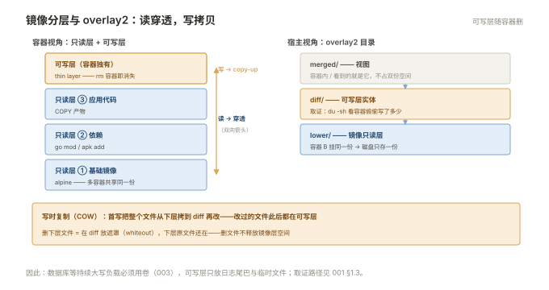

# 001 镜像与容器

> **解决**：镜像怎么变成容器，容器为什么本质上是一个进程。  
> **范围**：镜像分层与写时复制 · overlay2 · 容器生命周期 · `run` 核心参数 · Entrypoint 与 CMD · PID 1 与信号。  
> **口径**：Docker CE 24+，存储驱动 overlay2。  
> **更新**：2026-10-31

## 目录

| 节 | 内容 |
|---|---|
| 1.1 | 镜像、容器、仓库：三个词先分清 |
| 1.2 | 镜像分层与写时复制：拉取快、磁盘省、可共享的根源 |
| 1.3 | overlay2：多层目录怎么叠成一个根文件系统 |
| 1.4 | 容器生命周期：create → start → pause → stop → rm 各步发生了什么 |
| 1.5 | `docker run` 核心参数：`-p` `-e` `-v` `--name` `--restart` 逐个讲透 |
| 1.6 | ENTRYPOINT 与 CMD：谁覆盖谁，shell 形式与 exec 形式 |
| 1.7 | 容器里的 PID 1：为什么 stop 会等 10 秒、僵尸进程谁收尸 |
| 1.8 | 进容器看现场：`exec` / `logs` / `inspect` / `stats` |
| 1.9 | 八个坑 |
| 1.10 | 本章检查清单 |

---

## 1.1 镜像、容器、仓库：三个词先分清

学容器先立三个词的边界，后面所有内容都在这三者之间打转：**镜像（image）是只读模板，容器（container）是镜像跑起来的进程，仓库（registry）是存镜像和分发镜像的服务**。用面向对象的话说：镜像是类，容器是实例。

三者的关系走一遍最直观。拉一个镜像：

```bash
docker pull nginx:1.25-alpine
```

```plain
1.25-alpine: Pulling from library/nginx
Digest: sha256:2b99a1ca04c8ea4b4ee1f8b0c2b3dc1a6d2b0e4c0f5a3b0a9e2f3c4d5e6f7081
Status: Downloaded newer image for nginx:1.25-alpine
```

跑成容器：

```bash
docker run -d --name web -p 8080:80 nginx:1.25-alpine
docker ps
```

```plain
CONTAINER ID   IMAGE                 STATUS         PORTS                   NAMES
a1b2c3d4e5f6   nginx:1.25-alpine     Up 5 seconds   0.0.0.0:8080->80/tcp    web
```

`curl 127.0.0.1:8080` 能看到 nginx 欢迎页——此时宿主的 8080 端口通向的是**一个 Linux 进程**。不信可以用「Linux」002 册的方式验证：

```bash
ps -ef | grep nginx | grep -v grep
```

```plain
root      12345  12300  0 10:00 ?  00:00:00  nginx: master process nginx -g daemon off;
101       12390  12345  0 10:00 ?  00:00:00  nginx: worker process
```

就在宿主的 `ps` 里，容器里的 nginx 和宿主自己的进程同框。这就是容器的本质：**它不是一台小机器，是被 namespace 隔开了视图、被 cgroup 限制了额度的普通进程**（底层原理在「Linux」002 册 §2.6）。

一条 `docker run` 背后发生四步，值得背下来：

| 步 | 动作 | 细节 |
|---|---|---|
| ① | 找镜像 | 本地没有就从 `--registry` 拉，没有指定 tag 默认拉 `latest` |
| ② | 建容器 | 在镜像所有只读层之上挂一个可写层（thin layer） |
| ③ | 配隔离 | 建 namespace（PID/网络/挂载点等视图）和 cgroup（CPU/内存额度） |
| ④ | 跑进程 | 把镜像声明的 ENTRYPOINT/CMD 作为 PID 1 启动 |

第②步挂的"可写层"和第④步的"PID 1"是本章后面两半的主线：1.2/1.3 讲镜像层，1.6/1.7 讲 PID 1。

---

## 1.2 镜像分层与写时复制：拉取快、磁盘省、可共享的根源

上一节说镜像由"只读层"组成，这节把它拆开看。任何一个镜像都能用 `history` 列出各层：

```bash
docker history nginx:1.25-alpine
```

```plain
IMAGE          CREATED BY                                      SIZE
f1823215865f   CMD ["nginx" "-g" "daemon off;"]                0B
<missing>      EXPOSE map[80/tcp:{}]                           0B
<missing>      STOPSIGNAL SIGQUIT                              0B
<missing>      COPY 20-nginx.conf /etc/nginx/conf.d/…          829B
<missing>      RUN /bin/sh -c set -x … make install …          22.6MB
<missing>      RUN /bin/sh -c set -x … apk add …               12.3MB
<missing>      /bin/sh -c #(nop) ADD file:… in /               7.05MB
```

三个观察：

1. **每一层是下面这条 Dockerfile 指令的结果**，只读、不可改；
2. `0B` 的层只是元数据（CMD、EXPOSE 这类声明），不占空间；
3. `<missing>` 表示这一层来自上游镜像——本镜像没有重新存储它。

**层可以跨镜像共享**。再拉一个同样基于 alpine 的镜像：

```bash
docker pull redis:7-alpine
docker system df
```

```plain
Images          2                 2                 118.5MB            66.2MB
```

`SIZE` 是去重前的逻辑总量，`SHARED SIZE` 66.2MB 是两个镜像共享的层——alpine 基础层只存了一份。**这就是"拉取快、磁盘省"的全部机制**：新镜像只传自己独有的层。

### 写时复制（Copy-on-Write）

容器启动时（1.1 的第②步），Docker 在这些只读层之上挂一层**可写层**。读写规则是：

- **读**：从上往下找，可写层没有就下探到镜像层；
- **写**：目标文件在下层镜像里？先把整个文件**拷到可写层**，再在拷贝上改。这就是"写时复制"。

两个直接后果，都是运维要背的：

1. **改动过的文件此后都落在可写层**。想知道容器偷偷写了什么，查可写层就行（1.3 给出宿主路径）；
2. **写密集型负载会 I/O 放大**：每次首写都要整文件拷贝，数据库这种持续大写的应用，可写层根本不是它的家——数据必须放卷（003 册）。可写层只适合"日志尾巴、临时文件"这种轻量写入。



还要记住可写层的寿命：**它跟着容器走，`docker rm` 一起没**。镜像不带走它，卷也不备份它。容器出问题想"重建一个"还能活着的前提，是数据从一开始就没放这里。

---

## 1.3 overlay2：多层目录怎么叠成一个根文件系统

1.2 说的"叠"，在本机是 overlay2 文件系统驱动实现的。看一个容器的真实挂载：

```bash
docker inspect web --format '{{.GraphDriver.Data.MergedDir}}'
```

```plain
/var/lib/docker/overlay2/9f3a…c1e/merged
```

`ls /var/lib/docker/overlay2/9f3a…c1e/` 会看到三个关键目录：

| 目录 | 是什么 |
|---|---|
| `lower` 链（多个 id 目录） | 镜像的各只读层，多个容器可共享同一份 |
| `diff` | 这个容器自己的可写层 |
| `merged` | 叠好之后的视图，即容器内 `/` 看到的根 |

**merged 只是视图，不占双份空间**——读它等于按"可写层优先"的顺序穿透只读层。验证写时复制的落点：

```bash
docker exec web touch /tmp/from-container
ls /var/lib/docker/overlay2/9f3a…c1e/diff/tmp/
```

```plain
from-container
```

在容器里 `touch` 了一个文件，它出现在宿主的 `diff/tmp/` 下——可写层的实体位置。这个位置有两个运维用途：

1. **取证**：容器行为异常时，`du -sh diff/` 看它往可写层灌了多少东西（日志写错地方的容器，这里会异常膨胀）；
2. **理解删除**：在容器里删一个镜像层的文件，overlay2 不会动只读层，而是在可写层放一个"遮罩"（whiteout）——视图里看不见了，下层原文件还在。所以**删文件不释放镜像层空间**，释放空间靠换镜像或清卷。

> 宿主上看 `diff/`/`merged/` 需要小心权限，且这个 id 目录重启容器后不变（容器在，层就在）；但 `docker rm` 后整个 id 目录连同可写层一起删除。

---

## 1.4 容器生命周期：create → start → pause → stop → rm

把 1.1 的四步流程铺开成完整状态机，`docker ps` 的 STATUS 列就是它：

```plain
created ──start──▶ running ──pause──▶ paused
   │                 │  ▲              │ unpause
   │                 │  └──unpause────┘
   │                 ▼
   │              stop / kill / OOM / 应用自己退出
   │                 ▼
   └──▶ Exited (exit code) ──rm──▶ removed
```

对应到命令与 STATUS 显示：

| 命令 | 前状态 → 后状态 | `docker ps` 显示 |
|---|---|---|
| `docker create` | – → created | `Created`（建好了没跑） |
| `docker start` | created/stopped → running | `Up 3 seconds` |
| `docker pause` | running → paused | `Up 3 minutes (Paused)` |
| `docker stop` | running → exited | `Exited (0) 2 minutes ago` |
| `docker rm` | exited → 删除 | 消失（可写层一起删） |

三个运维必懂的细节：

**① `stop` 不是瞬间的事。** 它先给 PID 1 发 `SIGTERM`，默认等 **10 秒**（`docker stop -t 20` 可调），还活着才补 `SIGKILL`。为什么会有"还活着"的进程，1.7 拆解。

**② 括号里的退出码是第一现场。** 读法是 `128 + 信号号`：

| 退出码 | 含义 |
|---|---|
| `0` | 应用自己正常退出 |
| `137` | `128+9`，被 SIGKILL 杀——**stop 宽限超时被强杀，或超内存被 OOM** |
| `143` | `128+15`，被 SIGTERM 终止——通常就是 stop 发的那一下 |

看到 `Exited (137)` 别急着重启了事：先分辨是被 `docker stop` 杀的，还是 OOM（`docker inspect --format '{{.State.OOMKilled}}'` 一看便知），两种修法完全不同。

**③ `pause` 是给备份窗口用的。** 冻结全部进程（信号都投不进去）而不杀掉，做一致性快照时用，`unpause` 恢复。日常排障不要用 pause——它会让探针和日志全部"假死"。

---

## 1.5 `docker run` 核心参数

生命周期掌握后，本节把 `run` 的日常参数过一遍。先给一张最常用的速查表：

| 参数 | 作用 | 备注 |
|---|---|---|
| `-d` | 后台运行 | 不加就是前台，Ctrl+C 直接把容器带走 |
| `--name` | 容器名 | 不起名 Docker 会随机起，排障时名字是索引 |
| `-p 宿主:容器` | 端口发布 | `-p 8080:80`；细节见下 |
| `-e K=V` | 环境变量 | 容器化应用的标准配置入口 |
| `-v 宿主:容器` | 卷挂载 | 003 册的主线，这里先会写 |
| `--restart` | 重启策略 | 开机自启的关键，见下 |
| `--rm` | 退出即删 | 临时容器专用，和 `-d` 天生矛盾 |
| `-it` | 交互终端 | 进容器调试时用（1.8） |

### `-p` 的四种写法

```bash
-p 8080:80                    # 宿主 8080 → 容器 80（最常用）
-p 127.0.0.1:8080:80          # 只绑本机回环：外面进不来，本机和 SSH 隧道能进
-p 80                         # 容器 80 → 宿主随机高位端口，docker ps 看分到哪个
-P                            # 容器里所有 EXPOSE 的端口全部随机发布
```

第三种最值得单独说：**临时起个服务给自己验证、又不想暴露到外面，用 `-p 127.0.0.1:...`**。直接 `-p 8080:80` 是绑 `0.0.0.0`，等于对整个网络开放——云主机上忘了配安全组，就是一次事故。

### `--restart`：always 与 unless-stopped 的分界

| 策略 | 容器自己挂了 | 宿主重启后 | 手工 stop 后 |
|---|---|---|---|
| `no`（默认） | 不拉起 | 不拉起 | 不拉起 |
| `on-failure[:n]` | 拉起（最多 n 次） | 拉起（若上次非正常退出） | 不拉起 |
| `always` | 拉起 | **拉起** | 重启宿主后**拉起** |
| `unless-stopped` | 拉起 | 拉起 | 重启宿主后**保持停** |

`always` 和 `unless-stopped` 只差一格：**手工 stop 之后宿主重启，always 会把容器重新拉起来**。调试时要停某容器改配置，改完重启宿主它又活了——选 `unless-stopped` 能避开这个困惑。

### 一个完整的生产例子

```bash
docker run -d \
  --name mysql-prod \
  --restart unless-stopped \
  -p 127.0.0.1:3306:3306 \
  -v /etc/myapp/secrets/db_root_pw:/run/secrets/db_root_pw:ro \
  -e MYSQL_ROOT_PASSWORD_FILE=/run/secrets/db_root_pw \
  -v /data/mysql:/var/lib/mysql \
  -e TZ=Asia/Shanghai \
  mysql:8.0
```

每一行都有讲究：端口只绑回环（外面从 LB 走）、数据进卷（1.2 的教训）、时区显式给（容器默认 UTC，日志时间对不上多半是它）、密码从文件注入而不是命令行明文。

最后一条铁律：**容器的参数不可变**。想改 `-p`、改 `-e`、改 `--restart`，没有 `docker update`——只能 `docker rm` 后重新 `run`（数据在卷里所以不丢）。生产上这层封装交给 Compose（004 册），把"重建"变成改文件。

---

## 1.6 ENTRYPOINT 与 CMD：谁覆盖谁，shell 形式与 exec 形式

镜像声明启动命令有两个字段，关系是一句话：**ENTRYPOINT 定程序本体，CMD 给默认参数；`docker run` 镜像名后面敲的内容覆盖 CMD**。

```bash
# 镜像里声明了 ENTRYPOINT ["ping"] CMD ["-c","4","127.0.0.1"]
docker run img                    # 实际执行：ping -c 4 127.0.0.1
docker run img -c 100 10.0.0.1    # 实际执行：ping -c 100 10.0.0.1（CMD 被覆盖）
docker run --entrypoint sh img    # ENTRYPOINT 也被覆盖，进调试 shell
```

比覆盖规则重要十倍的是**两种书写形式**，它直接决定 1.7 的信号问题：

```dockerfile
# shell 形式：被 Docker 拼成 /bin/sh -c "nginx -g 'daemon off;'"
CMD nginx -g "daemon off;"

# exec 形式：Docker 直接 exec 这个数组，中间没有 shell
CMD ["nginx", "-g", "daemon off;"]
```

| | shell 形式 | exec 形式 |
|---|---|---|
| PID 1 是谁 | `/bin/sh` | 你的程序本身 |
| 信号能到程序吗 | **到不了**（sh 不转发） | 能 |
| 能用环境变量展开吗 | 能（shell 的能力） | 不能（没有 shell 帮你展开） |

验证方法，跑起来看 PID 1：

```bash
docker exec web ps -ef
```

shell 形式的容器里 PID 1 是 `sh`，nginx 只是 sh 的子进程；exec 形式里 PID 1 直接是 `nginx`。生产镜像**一律 exec 形式**——原因在下一节。

---

## 1.7 容器里的 PID 1：为什么 stop 会等 10 秒

Linux 的 PID 1 有两个内核级特权义务：**收养孤儿进程（收尸）**和**接收并处理信号**。普通应用没有为这两件事设计，所以"你的应用直接当 PID 1"会带来两个经典故障：

**故障一：`docker stop` 卡满 10 秒，最后 137。** 复现链条：shell 形式启动 → PID 1 是 `sh` → stop 发的 SIGTERM 被 sh 收下，但 sh 不转发给子进程 nginx → nginx 无动于衷 → 10 秒宽限到，Docker 对整个容器发 SIGKILL。应用失去了优雅退出（ finishing 请求、刷缓冲）的机会。

**故障二：僵尸进程堆积。** 程序 fork 出的子进程退出后成为僵尸，等着父进程收尸；父进程自己退了，孤儿就该交给 PID 1 收尸——但你的应用不实现 `wait()`，僵尸越积越多。装了「Linux」002 册 §2.2 的底子，这个场景一眼就能认出来。

两个修法，按优先级：

```dockerfile
# 修法一（首选）：exec 形式，让程序自己当 PID 1 并正确处理 SIGTERM
CMD ["nginx", "-g", "daemon off;"]

# 修法二（程序不听话时）：--init，Docker 塞一个 tini 当 PID 1
docker run --init img
```

`--init` 的 tini 就是干 PID 1 本职的微型 init：转发信号 + 收尸。程序既不处理信号又有子进程，用它。

顺带回答一个新手必问：**nginx 为什么要 `daemon off;`**？容器里 PID 1 退出 = 容器退出（1.4 状态机的唯一出口）。nginx 默认 daemon 化——master 拉起后台进程自己退出——那容器立刻 Exited。所以容器里的服务**必须前台运行**，这不是约定，是容器的生死规则。

---

## 1.8 进容器看现场：`exec` / `logs` / `inspect` / `stats`

日常排障四个入口，按使用频率排：

**`exec`——进去。** 在运行中的容器里开新进程：

```bash
docker exec -it web sh          # alpine 镜像没有 bash，用 sh
docker exec web ls /etc/nginx   # 单条命令，不开交互
```

注意和 `attach` 的区别：`attach` 接的是 PID 1 的标准输出，Ctrl+C 会把 PID 1 一起干掉（容器退出）；`exec` 开的是新进程，退出容器无恙。**排障一律 exec**。

**`logs`——看输出。** 容器里打到 stdout/stderr 的所有内容：

```bash
docker logs --tail 100 -f web   # 最近 100 行并跟随
docker logs web 2>&1 | grep -i error
```

前提是应用把日志打 stdout（004 册的日志纪律在这里兑现）。

**`inspect`——查元数据。** 一切"它是怎么配置的"的答案，配合 `--format` 取单值：

```bash
docker inspect web --format '{{.State.Status}} {{.State.ExitCode}} {{.RestartCount}}'
docker inspect web --format '{{.NetworkSettings.IPAddress}}'
```

**`stats`——看额度。** 容器视角的 CPU/内存：

```bash
docker stats --no-stream
```

```plain
CONTAINER   CPU %    MEM USAGE / LIMIT   MEM %
web         0.09%    6.5MiB / 1.944GiB   0.33%
```

它比容器里跑 `free`/`top` 可信——容器里的这些工具读的是宿主全量数据（除非镜像特意带了 cgroup 感知补丁），会给出误导性读数。这也是「Linux」009 册"先看维度再看读数"在容器场景的翻版。

---

## 1.9 八个坑

| # | 坑 | 后果 | 正确做法 |
|---|---|---|---|
| 1 | 容器秒退就 `docker rm` 清掉 | 现场没了，死因永远查不出 | 先 `docker logs -a`，再动删除 |
| 2 | CMD 写成 shell 形式 | stop 卡 10 秒强杀，优雅退出失效 | exec 形式，或 `--init` |
| 3 | 把数据写进可写层（没挂卷） | `docker rm` 数据陪葬 | 数据库/有状态数据一律 `-v`（003） |
| 4 | `docker ps` 找不到自己的容器 | 以为容器丢了 | Exited 也在，加 `-a` |
| 5 | 改端口/环境变量直接再 run 一遍 | 旧容器还占着端口，新容器起不来 | 先 `rm` 旧的（参数不可变），交给 Compose 管 |
| 6 | 拉镜像永远 `latest` | 今天和昨天的 latest 不是同一个镜像，回不了头 | 版本 tag 锁死（002 册展开） |
| 7 | 容器里 `free`/`top` 判断内存 | 读到宿主全量，误判自己的额度 | 用 `docker stats` / `inspect` |
| 8 | 调试期用 `--restart always` 又手工 stop | 改完配置重启宿主，它自己又活了 | 调试环境用 `unless-stopped` |

第 2 条值得再展开一层，因为它最隐蔽：**受影响的往往不是你写的镜像，是网上拉来的旧镜像**。遇到 `stop` 必卡 10 秒的容器，先 `docker exec xxx ps -ef` 看 PID 1——是 `sh` 还是 `bash -c`，实锤；改法要么换 exec 形式的镜像版本，要么 `docker run --init` 兜底。判断别的容器时同样适用。

---

## 1.10 本章检查清单

读完能回答这六个问题，这一章就过了：

| # | 问题 |
|---|---|
| 1 | `docker run nginx` 一条命令，后台发生了哪四步？ |
| 2 | 容器里写的文件，宿主上的哪个目录能找到？容器删除后它还在吗？ |
| 3 | 为什么有些容器 `stop` 要等 10 秒？两种修法分别是什么？ |
| 4 | CMD 和 ENTRYPOINT 谁覆盖谁？`docker run` 时怎么临时覆盖？ |
| 5 | `Exited (137)` 和 `Exited (143)` 各代表什么？先查什么再处理？ |
| 6 | `--restart always` 和 `unless-stopped` 差在哪一格？ |

---

> 下一篇：《002 Dockerfile 与镜像构建》——镜像怎么造出来、怎么瘦下去，构建缓存为什么决定构建速度。
