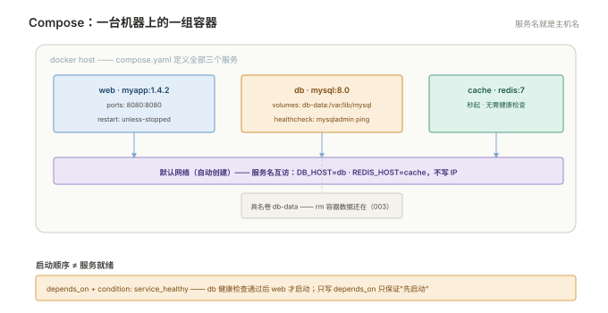

# 004 Compose 与日常运维

> **解决**：一台机器上的一组容器怎么编排、管日志、清磁盘。  
> **范围**：compose 编排 · 容器日志与轮转 · 资源限制 · 磁盘清理与日常巡检。  
> **口径**：Docker Compose v2（`docker compose` 子命令，YAML 无 version 字段）。  
> **更新**：2026-10-31

## 目录

| 节 | 内容 |
|---|---|
| 4.1 | 第一份 compose.yaml：web + 数据库 + 缓存 |
| 4.2 | service 定义逐项讲透：image/build、ports、volumes、environment、restart |
| 4.3 | `depends_on` 与健康检查：启动顺序 ≠ 服务就绪 |
| 4.4 | 多环境复用：override 文件与 env 文件 |
| 4.5 | 容器日志：为什么打 stdout、json-file 轮转配置、`docker logs` 用法 |
| 4.6 | 资源限制：memory / cpus 与超限后果 |
| 4.7 | 磁盘巡检与清理：df 报警后的取证顺序、prune 家族 |
| 4.8 | 容器的开机自启：restart 策略 vs systemd 托管 |
| 4.9 | 八个坑 |
| 4.10 | 本章检查清单 |

---

## 4.1 第一份 compose.yaml

001–003 把单容器的手艺备齐了，本册解决"一台机器跑一组容器"——手工 `docker run` 五条命令、顺序、参数，既难复现也难交接。Compose 把这一组写进一个 YAML：

```yaml
services:
  web:
    image: myapp:1.4.2
    ports:
      - "8080:8080"
    environment:
      - DB_HOST=db
      - REDIS_HOST=cache
    depends_on:
      db:
        condition: service_healthy
      cache:
        condition: service_started
    restart: unless-stopped

  db:
    image: mysql:8.0
    environment:
      - MYSQL_ROOT_PASSWORD_FILE=/run/secrets/db_root_pw
    volumes:
      - db-data:/var/lib/mysql
    healthcheck:
      test: ["CMD", "mysqladmin", "ping", "-h", "127.0.0.1"]
      interval: 10s
      timeout: 5s
      retries: 5
    restart: unless-stopped

  cache:
    image: redis:7-alpine
    restart: unless-stopped

volumes:
  db-data:
```

```bash
docker compose up -d        # 三件套整体拉起
docker compose ps           # 这一组容器的状态
docker compose logs -f web  # 看其中一个的日志
docker compose down         # 整组停掉并删容器（卷默认保留）
```



两个立刻能体会的好处：**这一组容器有了名字前缀**（目录名，如 `myapp-web-1`），`ps` 里一眼一组；**整个部署定义在一个文件里、进 Git**——"这台机器上跑了什么"从口头传说变成可 diff 的代码。注意 Compose v2 是 `docker compose`（空格），不是老版的 `docker-compose` 连字符。

---

## 4.2 service 定义逐项讲透

| 字段 | 作用 | 备注 |
|---|---|---|
| `image` / `build` | 用现成镜像 / 现场构建 | `build: .` 配合 002 册的 Dockerfile；两者都写时默认 build 后用 image 名打 tag |
| `ports` | 端口发布 | 写法同 `docker run -p`；对外服务记得只绑需要的地址 |
| `volumes` | 挂载 | 具名卷（在顶层 `volumes:` 声明）或 bind mount；`:ro` 同样适用 |
| `environment` | 环境变量 | 列表或映射两种写法；敏感值用 `env_file` 或 secrets，别明文进 Git |
| `restart` | 重启策略 | 同 001 §1.5，`unless-stopped` 是服务类默认推荐 |
| `healthcheck` | 健康检查 | 4.3 的主角 |
| `depends_on` | 启动依赖 | 配 `condition` 才有意义，见 4.3 |
| `networks` | 自定义网络 | 不写也有默认网络：**同一 compose 文件的服务互相可用服务名当主机名**（web 里 `DB_HOST=db` 直接生效） |

最后一条值得单独强调：Compose 自动建一个网络，组内 DNS 按服务名解析——这就是 `DB_HOST=db` 不写 IP 的原因。**服务发现的最简形态已经有了**，IP 硬编码反而会在重建后失效。

---

## 4.3 `depends_on` 与健康检查：启动顺序 ≠ 服务就绪

只写 `depends_on: [db]` 是经典的假安全：它只保证 db 容器**先启动**，不保证 MySQL **已经可以接受连接**——应用比数据库快 3 秒起完，连接失败，崩溃重启循环。

解法是给依赖方配 `healthcheck`，依赖方用 `condition: service_healthy`（见 4.1 的例子）。执行顺序变成：db 容器起 → 健康检查通过（`mysqladmin ping` 成功）→ web 才启动。Redis 这类秒起的服务用 `service_started` 即可，别过度要求。

健康检查三参数的调法：`interval` 是检查频率，`retries` 是判死门槛——`interval: 10s, retries: 5` 意味着最长约 50 秒内 db 必须就绪，超时则 web 启动失败并给出明确报错。**把"应用连不上库"从玄学变成明确失败**，就是这一节的价值。

---

## 4.4 多环境复用：override 文件与 env 文件

同一套 compose.yaml 要在 dev 与 prod 跑，两种姿势：

**姿势一：override 文件**。基础文件写共性，差异文件只写覆盖项：

```bash
docker compose -f compose.yaml -f compose.prod.yaml up -d
```

`compose.prod.yaml` 里只写 prod 的差异（如 `ports`、`restart: always`），同名键覆盖、端口列表合并追加。

**姿势二：env 文件**。YAML 里只写变量名引用，值放在环境文件里：

```yaml
services:
  db:
    image: mysql:8.0
    environment:
      - MYSQL_ROOT_PASSWORD=${DB_ROOT_PW}
```

`.env`（同目录自动加载）或 `--env-file prod.env` 提供值，`.env` 进 `.gitignore`——这正好是 002 §2.9"密钥走通道不进 Git"在编排层的延续。

---

## 4.5 容器日志：为什么打 stdout、json-file 轮转配置、`docker logs` 用法

容器日志的纪律只有一句：**应用把日志打到 stdout/stderr，不要自己写文件**。理由在 001 §1.8 已兑现一半（`docker logs` 才看得到），这里补全另一半——集中采集：宿主上的日志采集器（filebeat 等）只需要盯 `/var/lib/docker/containers/*/`log 一处，应用各自写文件的方案要让采集器进每个容器。

`docker logs` 看到的内容由 **logging driver** 决定，默认 `json-file`，它的两个参数就是轮转：

```yaml
services:
  web:
    image: myapp:1.4.2
    logging:
      driver: json-file
      options:
        max-size: "50m"
        max-file: "5"
```

含义：单容器日志最多 5 × 50MB = 250MB，滚动覆盖。**这是每一台 Docker 主机的必配项**——不配的结局是 `docker logs` 无输出、某个容器把 `/var/lib/docker` 写到 100%（001 坑表第 8 条的实锤）。

两个运维常识：改 logging 配置**必须重建容器**生效（又是"参数不可变"）；`docker logs --since 30m` 按时间取日志，比翻文件快。

---

## 4.6 资源限制：memory / cpus 与超限后果

不给限度的容器会吃光整机。Compose 里写法：

```yaml
services:
  web:
    image: myapp:1.4.2
    deploy:
      resources:
        limits:
          memory: 2g
          cpus: "2.0"
        reservations:
          memory: 512m
```

（Compose v2 同时兼容老写法 `mem_limit`/`cpus`，团队统一一种即可。）

超限后果要分清，两个资源的违约成本完全不同：

| 资源 | 超限行为 | 观察点 |
|---|---|---|
| **内存** | **直接 OOMKill**（容器退出 137），没有商量 | `docker inspect --format '{{.State.OOMKilled}}'`；`docker stats` 的 MEM% 逼近 100% 就是预警 |
| **CPU** | 被 throttle（限流变慢），不杀进程 | 容器里 CPU 使用率顶格但业务慢 = 被限流了 |

所以：内存 limit 给"正常峰值 × 安全系数"，宁可稍宽（OOM 的代价是进程死）；CPU limit 可以收紧（慢的代价是延迟）。这组判断和「Linux」009 册的五维模型是同一思想。

---

## 4.7 磁盘巡检与清理：df 报警后的取证顺序、prune 家族

Docker 主机的磁盘有四个吃货，按常见程度排：**容器日志**（4.5 没配轮转）、**悬空镜像**（构建更新的历史层）、**构建缓存**、**卷**（3.8 的匿名卷）。`df -h` 报警后的取证顺序：

```bash
docker system df                 # 总账：Images/Containers/Volumes/Build Cache 各占多少
docker system df -v              # 明细：每个镜像多大、哪些容器在用
docker ps -s                     # 每个容器的可写层大小
```

然后按账单对症下药——`prune` 家族各管一摊，**每个都能删真东西，逐个确认再跑**：

```bash
docker image prune               # 清悬空镜像（<none>，安全）
docker image prune -a            # ⚠️ 连没有容器引用的带 tag 镜像一起删
docker container prune           # 清所有已退出容器
docker builder prune             # 清构建缓存（下次构建变慢）
docker volume prune              # ⚠️ 清无引用卷（003 §3.8，删的是数据）
docker system prune              # 前几项的组合 ⚠️
```

治理优先于清理：日志配轮转（4.5）、CI 产物用带保留策略的仓库（「CICD」006）、构建机上定期 `builder prune`——把"磁盘报警 → 手工 prune"变成"根本到不了报警线"。

---

## 4.8 容器的开机自启：restart 策略 vs systemd 托管

"机器重启后容器要自己起来"有两种实现，选型标准是**复杂度**：

**简单场景：`restart: unless-stopped` 就够。** Docker 服务本身随系统启动，重启策略把该拉的容器拉起。注意 001 §1.5 的那格差异：调试期要"停了就不回来"，用 unless-stopped。

**需要"容器启动前先做点什么"时：systemd 托管。** 依赖挂载点先就绪、依赖网络策略先下发、启动有严格顺序——这些前置条件 Docker 的 restart 策略表达不了。做法是写一个极薄的 unit：

```ini
[Unit]
Description=myapp stack
Requires=docker.service
After=docker.service network-online.target

[Service]
Type=oneshot
RemainAfterExit=yes
ExecStart=/usr/bin/docker compose -f /opt/myapp/compose.yaml up -d
ExecStop=/usr/bin/docker compose -f /opt/myapp/compose.yaml down

[Install]
WantedBy=multi-user.target
```

容器的 `restart` 策略此时**依然保留**（管运行期崩溃），systemd 只负责"开机时按顺序把 stack 拉起来"。两层各司其职。

---

## 4.9 八个坑

| # | 坑 | 后果 | 正确做法 |
|---|---|---|---|
| 1 | 只写 `depends_on` 不配 condition | 应用比数据库先起，连不上反复崩 | healthcheck + `service_healthy` |
| 2 | 日志不配轮转 | 单容器写满整盘 | json-file `max-size`/`max-file` |
| 3 | 不给内存 limit | 一个容器吃垮整机 | limits 全员必配，OOM 看 137 |
| 4 | 密钥明文写进 compose.yaml | 配置进 Git = 泄漏进 Git | `--env-file` / secrets（002 §2.9） |
| 5 | 改了 compose.yaml 只 restart | 旧参数还在跑 | 变更要 `up -d`（按 diff 重建） |
| 6 | `down` 带了 `-v` 习惯 | 每次发布数据卷陪葬 | 默认 `down` 不动卷，`-v` 是显式弃数 |
| 7 | IP 写死在环境变量里 | 重建后 IP 变，服务失联 | 用服务名（组内 DNS） |
| 8 | prune 家族一把梭 | 镜像/卷/缓存真数据陪葬 | 逐项跑，先 `system df` 取证 |

第 5 条展开：`docker compose up -d` 是**声明式**的——它对比当前容器与 YAML 定义，只重建有变化的 service，没变的原样保留。所以"改完配置"的标准动作就是 `up -d`，既应用变更又最小化影响面；`restart` 只是重启进程，读的还是旧定义。这也是 4.4 多环境文件的执行基础。

---

## 4.10 本章检查清单

读完能回答这六个问题，这一章就过了：

| # | 问题 |
|---|---|
| 1 | 为什么组内服务用服务名互联而不用 IP？ |
| 2 | `depends_on` 的假安全指什么？healthcheck 怎么补？ |
| 3 | 容器日志轮转的必配两项是什么？不配的下场？ |
| 4 | 内存超限和 CPU 超限的后果差在哪？各自怎么观察？ |
| 5 | `df` 报警后的四个吃货按什么顺序排查？ |
| 6 | 什么场景需要 systemd 托管而不只是 restart 策略？ |

---

> 下一篇：《005 K8s 架构与核心对象》——从"一台机器"走向"一组机器"，集群由什么组成、应用怎么声明。
