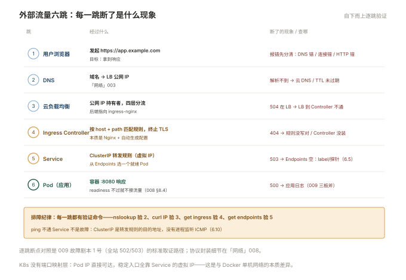

# 006 K8s 网络

> **解决**：Pod 之间怎么互通，外部流量怎么进来。  
> **范围**：Service 类型 · Endpoints · kube-proxy · CoreDNS · Ingress · CNI。  
> **口径**：kubeadm 集群；CNI 以 Calico 为例，包怎么走见「网络」008。  
> **更新**：2026-10-31

## 目录

| 节 | 内容 |
|---|---|
| 6.1 | K8s 网络模型：三条基本约定 |
| 6.2 | Pod IP 与 CNI：地址从哪来、插件在干什么 |
| 6.3 | Service：一组 Pod 的稳定虚拟 IP |
| 6.4 | 三种 Service 类型：ClusterIP / NodePort / LoadBalancer |
| 6.5 | Endpoints：Service 背后的真实 Pod 列表，**不通先看它** |
| 6.6 | kube-proxy：iptables 与 IPVS 两种模式 |
| 6.7 | CoreDNS：`服务名.命名空间.svc` 的解析链 |
| 6.8 | Ingress 与 Ingress Controller：七层路由的规则与执行者 |
| 6.9 | 外部流量的完整路径：DNS → LB → Ingress → Service → Pod |
| 6.10 | 八个坑 |
| 6.11 | 本章检查清单 |

---

## 6.1 K8s 网络模型：三条基本约定

K8s 不规定"网络怎么实现"，只规定三条**所有实现必须满足的约定**：

1. **Pod 之间直接互通，无 NAT**：任何 Pod 用对方的 Pod IP 直连，中间不改地址；
2. **节点与 Pod 互通，无 NAT**：节点上的进程能直接访问任何 Pod IP，反之亦然；
3. **Pod 自己看到的 IP == 别人看到的 IP**：没有 NAT 的另一个面——Pod 看自己也用同一个地址。

约定把"实现"完全交给了 **CNI 插件**。这意味着：集群装好 CNI 之前 Pod 起不来（Pending 或 CreateContainerConfigError），而**换 CNI 不改变上面三条语义**——应用不感知，只影响性能与策略能力。

与 Docker 单机网络（004 册的默认 bridge）对比，最大差异是**没有端口映射这一层**：Docker 靠 `-p` 把容器端口映射到宿主，K8s 里 Pod IP 直接可达，端口就是容器端口。"端口冲突"问题在 Pod 间不存在（各各有独立 IP），在容器与 Pod 内才存在。

---

## 6.2 Pod IP 与 CNI：地址从哪来、插件在干什么

kubelet 创建 Pod 时调用 CNI 插件完成两件事：**给 Pod 分配 IP**（从插件管理的网段里拿）与**把网络接入**（veth、路由或隧道）。常见两个家族：

| 插件 | 跨节点方式 | 特点 |
|---|---|---|
| Calico | 三层路由（BGP）或隧道 | 性能好、支持 NetworkPolicy，最常见 |
| Flannel | VXLAN 隧道（默认） | 简单稳，默认无 NetworkPolicy |

包在跨节点时怎么封装/路由，是纯协议问题——封什么头、MTU 少多少、在哪个节点解包，全部推到「网络」008 册，本册只记运维结论：**CNI 决定了 Pod 网段、MTU 上限与网络策略能力**，集群选型时确认这三项，出问题时按 CNI 的文档排查。

Pod IP 的两个特性决定了后面所有设计：**Pod 会死，IP 随之回收**；**重新调度的 Pod IP 会变**。所以"直接连 Pod IP"在 K8s 里是反模式——稳定入口必须是 Service（下一节）。

---

## 6.3 Service：一组 Pod 的稳定虚拟 IP

Service 解决的问题一句话：**Pod 的 IP 会变，但访问方需要一个不变的地址**。它由两部分组成：

- **一个稳定的虚拟 IP（ClusterIP）与 DNS 名**——VIP 只存在于 iptables/IPVS 规则里，没有进程在监听，ping 不通是正常的（005 册讲过"虚拟"的份量）；
- **一个选择器（selector）**——按 label 圈出这组 Pod，圈中的 Pod IP 进入 6.5 的 Endpoints。

```yaml
apiVersion: v1
kind: Service
metadata:
  name: web-svc
spec:
  selector:
    app: web              # 与 Deployment 的 Pod 模板 label 对应
  ports:
    - port: 80            # Service 自己的端口（访问方用）
      targetPort: 8080    # 容器端口（Pod 里应用监听的）
```

访问 `http://web-svc` 时：DNS 解析出 ClusterIP → 节点上的转发规则把流量分给某个真实 Pod 的 8080。**Pod 死了、换 IP、扩到 10 个副本，Service 的地址与名字纹丝不动**——这就是"稳定入口"的全部含义。

---

## 6.4 三种 Service 类型：ClusterIP / NodePort / LoadBalancer

| 类型 | 谁能访问 | 实现方式 | 用在哪 |
|---|---|---|---|
| ClusterIP（默认） | 集群内部 | 虚拟 IP + 转发规则 | 服务间调用（内部微服务默认） |
| NodePort | 集群外（可达任一节点:端口） | 在每个节点开一个端口（默认 30000–32767）转发到 Service | 临时暴露、没有 LB 的环境 |
| LoadBalancer | 公网/专有网络 | 云厂商的 LB 挂到 Service 前面 | 云上对外服务的标准姿势 |

三者是**叠加关系**：LoadBalancer 底下自动有 NodePort，NodePort 底下自动有 ClusterIP。

选型纪律一句话：**集群内部互调用 ClusterIP；对外生产流量走 Ingress（6.8）或云 LB；NodePort 只用于临时验证与无 LB 环境的兜底**。NodePort 上生产的三个问题：端口高位难看且难固定、流量全量过节点转发、没有七层能力（没有域名/路径路由、没有 TLS 终止的统一管理）。

还有一种无头服务（`clusterIP: None`）不走转发、DNS 直接返回所有 Pod IP，数据库有主从身份的场景用得到（007 册提及），知道即可。

---

## 6.5 Endpoints：Service 背后的真实 Pod 列表，**不通先看它**

Service 只是规则，真正干活的名单在 **Endpoints**（新版叫 EndpointSlice）对象里——`selector` 圈中的"就绪 Pod"的 IP:port 列表：

```bash
kubectl get endpoints web-svc
```

```plain
NAME      ENDPOINTS                          AGE
web-svc   10.244.1.5:8080,10.244.2.7:8080    3d
```

这条命令是 **Service 不通的排查第一站**，三种输出对应三种病因：

| 输出 | 病因 | 修法 |
|---|---|---|
| `<none>`（空） | selector 匹配不到 Pod：label 拼错 / Pod 没起 / **readiness 探针没过** | `get pods --show-labels` 对 label；看探针 |
| 地址是对的但不通 | Pod 应用没听这个端口 / targetPort 写错 | `curl Pod_IP:targetPort` 直连验证 |
| 有地址有端口仍超时 | CNI/网络策略问题 | 查 CNI 与 NetworkPolicy |

注意"就绪"二字：**readiness 探针没过的 Pod 不会进 Endpoints**（008 册）——它已经在跑了，只是被 Service 视为不可服务。这既是保护（流量不打给没准备好的 Pod），也是陷阱（探针配错，服务"看起来活着却 100% 不通"）。

---

## 6.6 kube-proxy：iptables 与 IPVS 两种模式

ClusterIP 是虚拟的，转发规则是谁写的？——每个节点上的 **kube-proxy**。它盯着 Service/Endpoints 的变化，把"访问 ClusterIP:80 → 某个 Pod IP:8080"翻译成本节点的转发规则。两种模式：

| 模式 | 实现 | 特点 |
|---|---|---|
| iptables（默认） | 一串 NAT 规则，随机/轮转选 Pod | 规则线性匹配，Service 数量大时更新慢、匹配慢 |
| IPVS | 内核的哈希表 + 真实 IPVS | 大规模集群（Service 上千）性能稳，支持多种调度算法 |

排查差异：iptables 模式下 `iptables-save | grep <svc名>` 能看到规则；IPVS 模式用 `ipvsadm -Ln`。日常运维需要知道的是：**节点上 kube-proxy 挂了 = 该节点上的 Service 访问全部失效**（Pod 直连不受影响），这是"有的节点通、有的节点不通"类故障的来源之一。

---

## 6.7 CoreDNS：`服务名.命名空间.svc` 的解析链

集群内 DNS 由 CoreDNS 提供，全称解析格式：

```plain
<service>.<namespace>.svc.cluster.local
     web-svc    .default   .svc.cluster.local
```

同一 namespace 内可以只写服务名（`web-svc`）；跨 namespace 必须带 ns（`db.prod.svc.cluster.local`）。排障三连：

```bash
kubectl run tmp --rm -it --image=busybox --restart=Never -- sh
# 进去之后：
nslookup web-svc                 # 解析得到 ClusterIP 即 DNS 正常
wget -qO- -T 3 http://web-svc/health
```

**先验证 DNS 再验证连通**——"通不通"的问题里约一半其实卡在解析。CoreDNS 挂掉的症状是"IP 直连正常、用服务名全挂"，`kubectl get pods -n kube-system -l k8s-app=kube-dns` 一看便知。

---

## 6.8 Ingress 与 Ingress Controller：七层路由的规则与执行者

Service 是四层入口（TCP/UDP），生产对外还需要七层：**按域名和路径分流、统一 TLS 终止**。这就是 Ingress 的职责——但注意本节标题里那个逗号：

- **Ingress** 是一条规则对象（"域名 api.example.com 的 /v1 转给 svc-api"）；
- **Ingress Controller** 是执行规则的进程（社区主流 ingress-nginx、Traefik）——**只创建 Ingress 而没装 Controller，规则永远不会生效**，这是 K8s 新手第一大坑。

```yaml
apiVersion: networking.k8s.io/v1
kind: Ingress
metadata:
  name: main
spec:
  ingressClassName: nginx
  rules:
    - host: app.example.com
      http:
        paths:
          - path: /api
            pathType: Prefix
            backend:
              service:
                name: api-svc
                port:
                  number: 80
```

ingress-nginx 的本质是「接入层」册的 Nginx + 一段自动生成配置的控制器——所以那边的语法（proxy 超时、限流注解）在这里以 annotation 形式延续。Controller 本身需要一个对外入口（HostPort / NodePort / 云 LB），形成 6.9 的完整链路。

---

## 6.9 外部流量的完整路径：DNS → LB → Ingress → Service → Pod

把前面所有环节串成一条公网请求的完整链路，每一跳标出"坏了是什么现象"：

```plain
用户浏览器
  │ ① DNS 解析 app.example.com
  ▼
云负载均衡（公网 IP，TLS 可在此终止）
  │ ② 转发到 ingress-nginx（NodePort/直连 Pod）
  ▼
Ingress Controller（按 host + path 匹配规则，终止 TLS）
  │ ③ 按规则转发到 Service
  ▼
Service（ClusterIP 转发规则）
  │ ④ 从 Endpoints 里选一个就绪 Pod
  ▼
Pod（应用容器 :8080）
```



| 断在哪 | 现象 | 去哪查 |
|---|---|---|
| ① DNS | 域名解析不到 | 云 DNS / CoreDNS（「网络」003） |
| ② LB → Controller | IP 直连 Controller 通、域名不通 | LB 后端配置、Controller 端口 |
| ③ Ingress 规则 | 404 / 503 | `kubectl get ingress` 看 host/path 写没写对、Controller 装没装 |
| ④ Service → Pod | 503 / 超时 | **Endpoints 空**（6.5）、探针没过 |
| 应用本身 | 500 | Pod 日志（009 册） |

这张表就是"全站 502/504"类故障的完整地图——**自下而上逐跳验证**，每一跳都有明确的验证命令。

---

## 6.10 八个坑

| # | 坑 | 后果 | 正确做法 |
|---|---|---|---|
| 1 | 没装 Ingress Controller 就建 Ingress | 规则永不生效，域名 404 | 先装 Controller，`get ingress` 看 ADDRESS 列 |
| 2 | Service selector 与 Pod label 不一致 | Endpoints 空，100% 不通 | `--show-labels` 对账（5.7） |
| 3 | 拿 Pod IP 当稳定地址 | Pod 重调度即失联 | 一律走 Service/DNS |
| 4 | readiness 没配或配错 | 未就绪的 Pod 进了流量，或全部被摘 | 探针语义学扎实（008） |
| 5 | ping ClusterIP 不通当成故障 | 虚拟 IP 本来就不回 ICMP | 用 `wget`/`curl` 验证服务端口 |
| 6 | NodePort 直接上生产 | 端口混乱、无七层能力 | 对外走 Ingress/云 LB |
| 7 | 跨 namespace 只写服务名 | 解析失败 | 全称 `svc.ns.svc.cluster.local` |
| 8 | MTU 没对齐（隧道 CNI） | 大包丢小包通，SSH 能连 HTTPS 卡 | 按 CNI 文档对 MTU（「网络」009 的 PMTUD） |

第 5 条展开：很多人拿「网络」册的 ping 习惯进集群，发现 `ping web-svc` 不通就认定网络故障。ClusterIP 是 iptables/IPVS 规则里的一个地址，**没有任何进程绑定它，ICMP 天然没有回应**——它是"一条转发规则的目的地址"，不是"一台在监听的主机"。验证 Service 永远用应用层探测：`wget -qO- -T 3 http://web-svc/`。

---

## 6.11 本章检查清单

读完能回答这六个问题，这一章就过了：

| # | 问题 |
|---|---|
| 1 | K8s 网络模型的三条约定是什么？由谁负责实现？ |
| 2 | Service 由哪两部分组成？"稳定"稳定的是什么？ |
| 3 | Service 不通，排查第一站看哪个对象？三种输出对应什么病因？ |
| 4 | Ingress 和 Ingress Controller 谁是规则谁是执行者？只建规则会怎样？ |
| 5 | 外部请求到 Pod 要经过哪几跳？每跳断了是什么现象？ |
| 6 | ping ClusterIP 不通说明什么？正确的验证方式是什么？ |

---

> 下一篇：《007 K8s 存储与配置》——配置怎么注入容器，有状态数据怎么落地。
