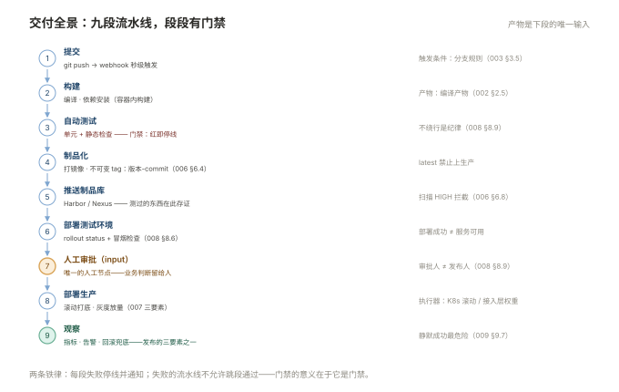

# 000 自动化全貌

> **解决**：手工交付痛在哪，CI/CD 工具链怎么拼成一条路。  
> **范围**：CI/CD 概念 · 交付流程全景 · 选型思路 · 本套学习路径。  
> **口径**：与 [README](README.md) 一致。  
> **更新**：2026-10-31

## 目录

| 节 | 内容 |
|---|---|
| 0.1 | 手工交付的七个痛点 |
| 0.2 | CI / 持续交付 / 持续部署：三个词的边界 |
| 0.3 | 交付全景图：提交 → 构建 → 测试 → 制品 → 部署 → 观察 |
| 0.4 | 工具链地图：每一段的主流选项与职责 |
| 0.5 | 选型思路：Jenkins vs GitLab CI，什么时候要 Argo CD |
| 0.6 | 制品思维：上线的是制品不是代码 |
| 0.7 | 自动化的边界：哪些事不该自动化 |
| 0.8 | 十个误解 |
| 0.9 | 本套学习路径与各册映射 |

---

## 0.1 手工交付的七个痛点

手工发布一个服务，标准剧本是：SSH 登服务器 → 拉代码（或传包）→ 改配置 → 重启 → 看日志 → 祈祷。每个环节都藏着一个痛点，而每个痛点恰好对应流水线的一个阶段——这就是本册目录与后面各册的对应关系：

| # | 痛点 | 流水线的解药 | 本套在哪 |
|---|---|---|---|
| 1 | 代码没有唯一版本，"线上跑的是哪版"说不清 | 提交触发 + 版本号贯穿 | 001 / 008 |
| 2 | 构建步骤在每个人脑子里 | 流水线即代码 | 002 / 003 |
| 3 | 测试靠自觉，上线前才测 | 测试作为门禁 | 008 |
| 4 | 制品在服务器上现场生成 | 统一制品库 | 006 |
| 5 | 多台机器逐台登录改 | 批量配置 | 004 / 005 |
| 6 | 发布方式=停机重启 | 滚动/灰度策略 | 007 |
| 7 | 出了问题回滚靠记忆 | 预案与演练 | 007 |

读完整套回头看这张表，它就是「一条流水线消掉七个痛点」的映射图。

---

## 0.2 CI / 持续交付 / 持续部署：三个词的边界

三个词经常混用，边界其实清晰，按"自动化停在哪一步"分：

```plain
提交 ──▶ 构建 ──▶ 自动测试 ──▶ 产出制品 ──▶ 部署测试环境 ──▶ 部署生产
         └───────── 持续集成（CI）──────┘
         └────────────── 持续交付（Delivery）────────────┘
         └────────────────── 持续部署（Deployment）──────────────┘
```

- **持续集成（CI）**：自动化到"每次提交都构建 + 测试"。目标是让集成问题当天暴露——名字里的"集成"指多人代码的合并；
- **持续交付（CD-Delivery）**：自动化到"制品随时可上线"，最后一步（点按钮上生产）留给人工。**多数团队的合理终点**——生产发布的时机、方式、审批属于业务决策；
- **持续部署（CD-Deployment）**：连按钮都不留，门禁全过自动上生产。要求测试信任度极高，且发布策略极成熟（007 册）。

运维视角的落点：**CI 是开发效率问题，CD 是运维交付问题**——本套的重心在后半段（004–009），但 001–003 的版本控制与流水线是地基。

---

## 0.3 交付全景图

把三个词的边界铺成一张全景图，标注每段的输入/输出与"谁负责"：

```plain
代码提交
  │ 触发：webhook
  ▼
构建（编译、依赖安装）     输入：源码      输出：编译产物      开发为主、运维搭台
  ▼
测试（单元/静态检查）      门禁：不过即停                    开发为主
  ▼
制品化（打镜像/打包）      输出：不可变 tag 的制品           运维主导（002/006）
  ▼
推送制品库（Harbor/Nexus） 存证：可追溯                     运维主导
  ▼
部署测试环境               验证：冒烟通过                    运维
  ▼
[人工审批]
  ▼
部署生产（滚动/灰度）      策略：007 册                      运维
  ▼
观察（指标/日志/告警）      兜底：发现即回滚                 监控体系 + 007
```



两个贯穿全景的原则：**每段产出物是下一段的唯一输入**（不跳段、不旁路）；**每段失败都停线并通知**（009 的静默失败专项）。

---

## 0.4 工具链地图

每一段的主流选项与职责，一张表定位本套各册：

| 段 | 主流选项 | 本套口径 | 册 |
|---|---|---|---|
| 版本控制 | Git + GitLab/GitHub | Git 命令行，GitLab 为例 | 001 |
| CI 引擎 | Jenkins / GitLab CI / GitHub Actions | Jenkins 主线 + GitLab CI 对照 | 002 / 003 |
| 配置自动化 | Ansible / Salt / Terraform | Ansible（Terraform 属 IaC，不展开） | 004 / 005 |
| 制品库 | Harbor（镜像）/ Nexus（通用） | 两者并行 | 006 |
| 容器运行 | K8s | 「容器」册 | 007/008 引用 |
| 发布策略 | 平台原生 + 接入层 | 滚动/蓝绿/灰度 | 007 + 「接入层」003 |
| 观察 | Prometheus / 日志体系 | 「监控」册口径 | 008 末段 |

选型的合并逻辑：**工具越少越好，但 CI 引擎与制品库不建议共用同一台机器**——构建是把不可信代码变成可信制品的过程，资源隔离是安全边界。

---

## 0.5 选型思路：Jenkins vs GitLab CI，什么时候要 Argo CD

主流两条路的真实差异（详细对照在 003）：

| | Jenkins | GitLab CI |
|---|---|---|
| 形态 | 独立服务器 + 插件生态 | GitLab 自带，Runner 分离 |
| 上手 | 学习曲线陡，自由度高 | YAML 声明式，半小时能跑 |
| 维护 | 要养服务器、管插件升级 | 养 Runner 即可 |
| 适合 | 流程复杂、多语言多平台、存量插件依赖 | GitLab 生态内、想少养一套系统 |

选型经验值：**已经有 GitLab 且流程不复杂 → GitLab CI 起步**；**流程复杂（多环境审批、异构构建机、老牌企业存量）→ Jenkins**。两者不是二选一的信仰问题，很多团队 Jenkins 管遗留、GitLab CI 管新项目——但**同一套制品库与发布策略必须统一**。

Argo CD 等 GitOps 工具的定位：把"部署"这段从流水线推模式改成"集群拉取 Git 声明"的模式，带来更强的审计与漂移纠正。它的前提是**声明式交付已经做扎实**（本套 007/008），初学阶段先不打折走这条捷径。

---

## 0.6 制品思维：上线的是制品不是代码

这是整套 CI/CD 里最值得单独强调的观念转变。手工时代的"部署"是"把代码弄到服务器上跑起来"（git pull / 传文件），自动化时代的"部署"是"把一个已构建、已测试、带唯一版本的制品放到目标环境运行"。

差别在三个性质：

1. **不可变**：制品一旦构建不再修改。改代码=出新品，不是在服务器上补丁；
2. **可追溯**：制品 tag ↔ git commit ↔ 流水线记录，三方对得上（008 §8.3）；
3. **可重放**：测试环境跑过的那个制品，原样上生产——**不是"重新构建一次赌它一样"**。依赖升级、基础镜像变动都可能让两次构建产物不同，晋级制品而不是重建制品（006 §6.6）。

001 册的 Git、002/003 的流水线、006 的制品库，全部服务于这三个性质。

---

## 0.7 自动化的边界：哪些事不该自动化

自动化不是把人从流程里删掉，三类事明确留给人：

1. **生产发布的最终审批**：机器可以验证"技术指标全绿"，验证不了"这次发布值不值得冒这个险"（业务时点、重大变更的知会）——0.2 里多数团队停在 Delivery 的原因；
2. **首次设计**：流水线、playbook、发布策略由人设计，机器负责重复执行。"自动化设计自动化"是成熟团队的远期形态；
3. **事故决策**：回滚与否、扩大影响面与否，需要人的判断——预案可以自动化（007 的回滚演练），**决策默认不自动化**。

反向的教训同样重要：**一切依赖人记得住的步骤都是故障源**——这才是自动化的真正定义：不是"用工具"，是"流程里不再有只有某人知道的操作"。

---

## 0.8 十个误解

| # | 误解 | 实际 |
|---|---|---|
| 1 | 上了 Jenkins 就是 CI/CD | 工具是载体，"流程里没有隐性人工步骤"才是 |
| 2 | 流水线绿 = 能上线 | 绿只代表门禁全过，发布还要看策略与审批 |
| 3 | 自动化后不需要回滚演练 | 回滚预案没演练过等于没有（007） |
| 4 | Git 熟练 = 会分支模型 | 分支模型是团队协议，与个人命令熟练度无关 |
| 5 | Ansible 可以乱序跑 | 变量优先级与 handlers 有严格顺序 |
| 6 | 制品库可有可无 | 没有它，"上线的是什么"永远说不清 |
| 7 | 测试是测试团队的事 | CI 门禁里的自动化测试是流水线的成败关键 |
| 8 | 灰度=发布一半等等看 | 有放量节奏、观察指标、终止条件的完整设计 |
| 9 | 自动化=无人值守 | 0.7 的三类决策明确留给人 |
| 10 | 流水线不用监控 | 流水线本身是生产系统（009 §9.9） |

---

## 0.9 本套学习路径与各册映射

```plain
地基        001 Git 与协作
                │
流水线      002 Jenkins ──▶ 003 GitLab CI 对照
                │
批量配置    004 Ansible 基础 ──▶ 005 Ansible 工程化
                │
制品与发布  006 制品库 ──▶ 007 发布策略与回滚
                │
集成        008 流水线实战 ──▶ 009 排错与自测
```

横向衔接：镜像构建细节在「容器」002，部署目标 K8s 在「容器」008，灰度流量切分在「接入层」003——本册 008 是它们的装配车间。

---

> 下一篇：《001 Git 与协作》——代码怎么管，多人协作怎么不互相覆盖。
