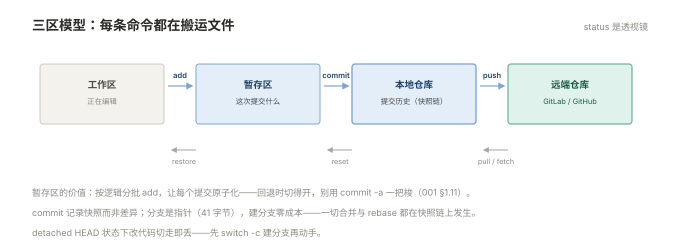

# 001 Git 与协作

> **解决**：代码怎么管，多人协作怎么不互相覆盖。  
> **范围**：三区模型 · 分支与合并 · rebase vs merge · 分支模型 · 回退三兄弟。  
> **口径**：Git 命令行，托管平台以 GitLab 为例（GitHub 通用）。  
> **更新**：2026-10-31

## 目录

| 节 | 内容 |
|---|---|
| 1.1 | 三区模型：工作区、暂存区、仓库，add/commit/push 各走一步 |
| 1.2 | commit 的构成：哈希、父指针、说明怎么写 |
| 1.3 | 分支：指针的本质，建分支为什么零成本 |
| 1.4 | 合并与冲突：`<<<<<<<` 区块怎么解 |
| 1.5 | merge vs rebase：两条历史观，公共分支的红线 |
| 1.6 | tag 与版本：发布为什么打 tag |
| 1.7 | 远端协作：push/pull/fetch、保护分支、PR/MR 评审流 |
| 1.8 | 分支模型：Git Flow 与 trunk-based 的取舍 |
| 1.9 | 回退三兄弟：revert / reset / restore 各自的适用场景 |
| 1.10 | .gitignore 与密钥：第一次提交前必须做的事 |
| 1.11 | 八个坑 |
| 1.12 | 本章检查清单 |

---

## 1.1 三区模型：工作区、暂存区、仓库

Git 的一切命令都在三个区之间搬运文件，先把地图立起来：

```plain
工作区              暂存区(staging)          本地仓库           远端仓库
(你编辑的)   add▶   (下次要提交的)   commit▶  (提交历史)   push▶  (GitLab/GitHub)
        ◀──restore/checkout──            ◀──pull/fetch──
```

对应三条主干命令，各自回答一个问题：

```bash
git add app.py        # 「这次要提交哪些改动」——精确到文件甚至到行（-p）
git commit -m "..."   # 「暂存区的内容定格为一个快照」
git push origin main  # 「把本地历史同步到远端」
```



暂存区是新人最容易忽略的一层，它的价值是**提交的原子性**：你改了三个文件，其中两个属于同一个修复、另一个是无关实验——`add` 前两个、commit，再单独处理第三个。跳过暂存区一把 `commit -a` 的人，历史里很快全是"大杂烩提交"，回退时切不开。

`git status` 是三区之间的透视镜，输出永远分两段：已暂存的（Changes to be committed）与未暂存的（Changes not staged）——养成"动 Git 前先 `status`"的反射，一半的事故消失。

---

## 1.2 commit 的构成：哈希、父指针、说明怎么写

每个 commit 三件套：

1. **SHA-1 哈希**（如 `3f2a1c8`）：内容的指纹，内容变哈希变——这就是"提交不可篡改"的来源；
2. **父指针**：指向上一条提交。提交串成链，分支与历史全是这条链上的指针游戏（1.3）；
3. **说明**：一行的摘要（+ 可选正文）。

提交说明的写法有团队约定最好，没有的话遵守最小公约数：**一行 50 字以内说清"做了什么、为什么"**，正文空一行后写细节。差的说明（"fix"、"修改"、"更新"）在半年后回溯时等于没有说明——Git 历史是给未来的自己和接手的人看的。

另一个反直觉事实：**Git 记录的是快照，不是差异**。每个 commit 存当时全量文件树的指针，"差异"只是查看方式。这解释了 Git 的速度，也解释了 1.3 的"分支零成本"。

---

## 1.3 分支：指针的本质，建分支为什么零成本

分支只是一个**指向某个 commit 的可移动指针**（一个 41 字节的文件），建分支 = 写一个文件，零拷贝：

```bash
git switch -c feature/login    # 建并切换（老语法 git checkout -b）
git branch                     # 列出分支，* 是当前位置（HEAD 指着哪）
git switch main                # 切换
```

`HEAD` 是"你现在站在哪个 commit"的指针：指向分支时提交会移动分支；直接指向某个 commit 时进入 detached 状态——**在 detached HEAD 上做的提交不被任何分支指着，切走就丢**。`git status` 里出现 `HEAD detached at 3f2a1c8`，先 `switch -c` 建分支再干活。

分支的使用纪律一句话：**main（或 master）是可发布状态，任何改动先开分支**。直接在 main 上改代码的团队，迟早有人把半成品推上去。

---

## 1.4 合并与冲突：`<<<<<<<` 区块怎么解

两条分支都改了同一处，`git merge` 无法自动裁决时停下，把冲突原样标进文件：

```plain
<<<<<<< HEAD
    timeout = 30        // 你这条分支上的值
=======
    timeout = 60        // 对方分支上的值
>>>>>>> feature/timeout
```

解决流程是固定的四步：

```bash
# ① git status 看哪些文件冲突（both modified）
# ② 编辑文件：删掉 <<<<<<< / ======= / >>>>>>> 标记，保留正确内容（或两者融合）
# ③ git add <文件> 标记"此文件冲突已解决"
git add config.py
git commit              # 完成合并
```

两条工程纪律：**解冲突前搞清楚对方为什么这么改**（`git log --merge -- <file>` 看两边各自的提交），只按"哪边新"来选是错的；**解决后的代码必须跑过测试再 commit**——冲突解决引入的逻辑错误是回归bug的常客。冲突太多说明分支活太久，1.8 的分支模型就是治它的。

---

## 1.5 merge vs rebase：两条历史观，公共分支的红线

两条分支都各自前进后，把历史拉直有两种哲学：

```bash
git merge main          # merge：造一个合并提交，两条线的分叉史原样保留
git rebase main         # rebase：把我的提交"摘下来"，逐个重放到 main 顶上
```

| | merge | rebase |
|---|---|---|
| 历史形态 | 真实：有分叉有合并 | 整齐：一条直线 |
| 提交哈希 | 不变 | **全部改变**（重放=新建提交） |
| 风险 | 历史略乱 | 已推送的提交被改写 |

**红线由此而来**：rebase 会改写提交哈希，如果这些提交已经推到远端、别人已经基于它们工作，改写等于把别人的地基抽走——push 时被拒、协作历史错乱。所以铁律是：**已推送到公共分支的提交，永不 rebase；rebase 只用于整理自己未推送的本地提交**（`git rebase -i` 还能合并、改写、删减自己的提交，发布前整理历史的好工具）。

merge 没有红线——它只新增不改写，代价是历史图复杂。选择上：团队约定胜于个人偏好，常见约定是 **PR/MR 合入用 merge（保留评审痕迹），个人分支同步 main 用 rebase（保持自己提交干净）**。

---

## 1.6 tag 与版本：发布为什么打 tag

tag 是指向某个 commit 的**固定标记**（与分支的可移动相对）——发布版本打 tag，意味着"这个版本的内容永远可考"：

```bash
git tag -a v1.4.2 -m "release 1.4.2"    # 带说明的附注 tag（推荐）
git push origin v1.4.2                   # tag 不会随 push 自动上去，要显式推
```

为什么要打：制品库的版本（006）、发布的回滚点（007）、CI 的按 tag 构建（002 的触发规则）都以它为锚点。语义化版本（主.次.补丁）的含义与"什么情况升哪一位"在 006 §6.4 展开，这里先立"发布必有 tag"的规矩。

tag 也别乱打：tag 打在哪个 commit、谁打的、什么时候打的，都随附注 tag 存档——**发布追溯的起点不是制品库，是这个 tag**。

---

## 1.7 远端协作：push/pull/fetch、保护分支、PR/MR 评审流

远端是团队协作的汇合点。先把三个同步命令分清：

```bash
git fetch origin        # 只下载远端的新提交，不动工作区（安全的"看看有什么更新"）
git pull                # fetch + merge 一步到位（方便，但合并结果不可预览）
git push origin main    # 上传本地提交
```

push 被拒（non-fast-forward）是最常见的新手故障：远端有你没有的提交。标准处理：`git pull --rebase` 把自己的提交重放到远端之上（自己未发布的提交，1.5 的红线允许），再 push。

团队协作的正式通道是 **PR/MR**（GitHub 叫 Pull Request，GitLab 叫 Merge Request），它把"合入"从命令行为升级成流程：分支推上去 → 发起 MR → 评审意见 → CI 自动跑流水线 → 通过后点合入。配套的服务端设置：

- **保护分支**（Protected Branch）：main 禁止直接 push、必须经 MR、必须 CI 通过——在 GitLab 的 Settings → Repository 里配。**这是唯一可靠的纪律**：靠自觉的"别直接推 main"撑不过第三周；
- **评审要求**：至少一人 approve 才可合入。

---

## 1.8 分支模型：Git Flow 与 trunk-based 的取舍

分支模型是团队协议，两种代表：

| | Git Flow | trunk-based（主干开发） |
|---|---|---|
| 分支 | main + develop + feature/* + release/* + hotfix/* | main + 短命 feature 分支（几小时~几天） |
| 发布 | 从 release 分支出版本 | main 随时可发，特性用**功能开关**控制 |
| 适合 | 版本化发布（桌面软件、阶段性交付） | 持续部署的 Web 服务 |
| 代价 | 分支多、合并地狱风险 | 依赖 CI/CD 成熟度与特性开关纪律 |

创业与互联网服务团队的事实主流是 trunk-based + 短分支，原因不是赶时髦：**分支活得越久，合并冲突越爆炸**（1.4 的病根），短分支让冲突永远很小。本套后续的流水线设计（008）按 trunk-based 口径写——main 上的每个 commit 都应可构建、可发布。

---

## 1.9 回退三兄弟：revert / reset / restore 各自的适用场景

"撤回"有三种，区别在"动历史还是动工作区"：

```bash
git revert 3f2a1c8      # 造一个反向提交抵消指定提交——历史往前走，不篡改
git reset --hard HEAD~1 # 把分支指针搬回去——历史被改写，未推送才可用
git restore app.py      # 只丢弃工作区某文件的未提交改动
```

| 场景 | 用哪个 | 为什么 |
|---|---|---|
| 已推送的提交要撤 | **revert** | 不改写历史，别人 pull 不会炸 |
| 自己未推送的提交不想要 | `reset --hard` | 本地私事，随便改写 |
| 提交没做，工作区改坏了 | `restore` | 只动文件不动历史 |

`reset` 三档要分清：`--soft`（退提交，改动留在暂存区）、`--mixed`（默认，退到工作区）、`--hard`（连工作区一起丢）。**`--hard` 是 Git 里唯一不可逆的常用命令**——未提交的改动被 reset --hard，任何工具都救不回来（`.git` 之外没有备份），执行前必须 `status` 确认清空的是哪些改动。

---

## 1.10 .gitignore 与密钥：第一次提交前必须做的事

`.gitignore` 列出不进版本库的东西，标准起步清单：

```plain
node_modules/      # 依赖，按 lockfile 重建
dist/ build/       # 构建产物
*.log
.env               # ⚠️ 密钥与配置
*.pem *.key
.idea/ .vscode/
```

规则有一条容易翻车的细节：**`.gitignore` 只对"未跟踪"的文件生效**——文件已经被提交过，再加进 ignore 不会让它消失。补救：`git rm --cached <file>`（从索引移除但保留本地文件）后提交。

密钥的规矩比 ignore 更严格一步：**ignore 是防线，不是保险箱**。密钥文件哪怕只提交过一次，它就永久存在于历史中（历史是可以被任何人 checkout 的）——补救不是删文件再提交（历史里还在），而是**轮换密钥**，再用 `git filter-repo` 之类清史。与「容器」002 §2.9 的结论合流：密钥只走通道，不走文件。

---

## 1.11 八个坑

| # | 坑 | 后果 | 正确做法 |
|---|---|---|---|
| 1 | `commit -a` 一把梭 | 无关改动混进同一提交，回退切不开 | 按逻辑分批 add |
| 2 | detached HEAD 上改代码 | 切走即丢 | 先建分支再改 |
| 3 | 公共分支上 rebase / force push | 改写别人依赖的历史，协作爆炸 | 公共分支只 merge/revert |
| 4 | 冲突只挑"新的" | 丢掉对方意图，回归 bug | 看两边提交意图再融合 |
| 5 | `reset --hard` 前不看 status | 未提交改动永久丢失 | --hard 前必 status |
| 6 | 密钥提交过一次 | 永久留在历史，ignore 无效 | 轮换密钥 + filter-repo |
| 7 | 分支活几周不合 | 合并冲突爆炸 | 短分支（trunk-based） |
| 8 | tag 打错位置不纠正 | 发布追溯起点是错的 | tag 附注可删重打（未发布前） |

第 3 条展开，因为它常以"好心"的形式出现：同事说"我帮你 rebase 一下 main，历史干净点"，对象是已推送的 feature 分支且已有多人协作——他的 `git push -f` 会把其他人的提交顶掉。团队协议的写法是在 GitLab 上**开启保护分支的"禁止 force push"**，技术手段兜住协议。

---

## 1.12 本章检查清单

读完能回答这六个问题，这一章就过了：

| # | 问题 |
|---|---|
| 1 | 三区模型里，add / commit / push 各自搬运什么？ |
| 2 | merge 和 rebase 的本质差别？公共分支的红线为什么？ |
| 3 | push 被拒（non-fast-forward）的标准处理流程？ |
| 4 | revert / reset --hard / restore 各用在什么场景？ |
| 5 | 密钥提交进历史后，"删掉再提交"为什么无效？正确动作两步是什么？ |
| 6 | 保护分支配的是什么？为什么必须技术兜底？ |

---

> 下一篇：《002 Jenkins 与流水线》——构建服务器怎么搭，流水线怎么写成代码。
