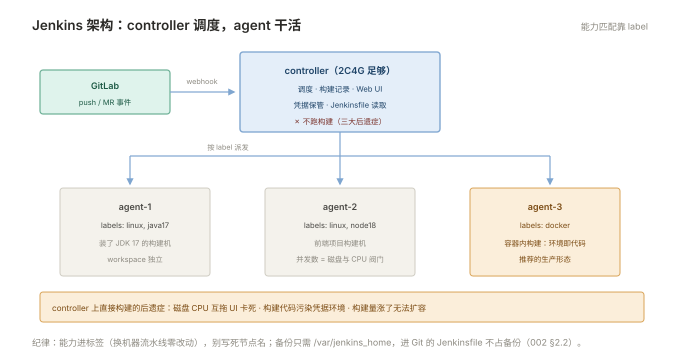

# 002 Jenkins 与流水线

> **解决**：构建服务器怎么搭，流水线怎么写成代码。  
> **范围**：controller/agent 架构 · Jenkinsfile · 声明式语法 · 凭据 · webhook 触发。  
> **口径**：Jenkins LTS，声明式 Pipeline；脚本式只作读旧代码用。  
> **更新**：2026-10-31

## 目录

| 节 | 内容 |
|---|---|
| 2.1 | Jenkins 架构：controller 只调度，构建下放 agent |
| 2.2 | 安装与初始化：LTS 版、反向代理接入 |
| 2.3 | 节点管理：静态 agent 的注册与标签 |
| 2.4 | 第一条流水线：Freestyle 与 Pipeline 的分界 |
| 2.5 | Jenkinsfile 声明式语法：pipeline / agent / stages / post 逐段讲 |
| 2.6 | agent 段：any / label / docker 容器内构建 |
| 2.7 | 凭据管理：Credentials 的存法与 withCredentials 的用法 |
| 2.8 | 触发：webhook 配置、定时 cron、手动参数化 |
| 2.9 | 常用插件清单 |
| 2.10 | 脚本式流水线速读：读得懂旧代码即可 |
| 2.11 | 八个坑 |
| 2.12 | 本章检查清单 |

---

## 2.1 Jenkins 架构：controller 只调度，构建下放 agent

Jenkins 的架构是一句话：**controller 管调度与展示，构建活交给 agent**。

```plain
开发者 push ──▶ GitLab webhook ──▶ controller（调度、记录、Web UI）
                                        │ 分发任务
                    ┌───────────────────┼───────────────────┐
                    ▼                   ▼                   ▼
               agent-1（java 构建机） agent-2（node 构建机）  agent-3（docker 构建机）
```

为什么坚持分离？在 controller 上直接构建有三大后遗症：**磁盘与 CPU 互相拖累**（构建吃满 controller，Web UI 跟着卡死）；**安全污染**（构建执行的是仓库里的代码，controller 上有全集群凭据）；**无法水平扩容**（构建量涨了只能给 controller 加配置）。所以本册的口径从第一节就定死：**controller 起码 2C4G 只做调度，agent 按构建语言分组扩展**。

agent 上的工作目录叫 workspace——每个 job 一份，构建产物与缓存都在里面（磁盘治理见 009）。



---

## 2.2 安装与初始化

LTS（长期支持）版本 + Docker 部署是最省事的组合：

```bash
docker run -d --name jenkins \
  --restart unless-stopped \
  -p 8080:8080 -p 50000:50000 \
  -v jenkins-home:/var/jenkins_home \
  jenkins/jenkins:lts
```

端口说明：8080 是 Web UI；50000 是 **JNLP 入站 agent** 端口——本册推荐的 SSH 方式（controller 主动连 agent）用不到它，仅入站模式需要。

首次初始化三步：`docker logs jenkins` 里拿初始管理员密码 → Web 界面装"建议安装的插件" → 建管理员账号。生产接入的两件事：

1. **反代接入**：套 Nginx 提供域名与 TLS（「接入层」002 的 proxy 配置；Jenkins 的 CSRF 防护要求转发 `X-Forwarded-Proto` 头——那册 §2.4 的 Host 头三件套在这里兑现）；
2. **备份对象只有一个目录**：`/var/jenkins_home`（配置、凭据、job 定义全在里面），定期备份它。**Job 定义也尽量 Jenkinsfile 化**——进了 Git 的部分不需要备份（000 §0.6 的制品思维）。

---

## 2.3 节点管理：静态 agent 的注册与标签

添加静态 agent 的路径：Manage Jenkins → Nodes → New Node，选 Permanent Agent。关键三项：**远程工作目录**（agent 上的 workspace 根，如 `/opt/jenkins-agent`）、**启动方式**（推荐 SSH：controller 用密钥连过去拉起 agent 进程）、**Labels**（给节点贴能力标签）。

标签是 agent 架构的灵魂——**构建需求与机器能力靠标签匹配**：

```plain
agent-1: labels = linux, java17     ← 装了 JDK 17
agent-2: labels = linux, node18     ← 装了 Node 18
agent-3: labels = docker, gpu
```

流水线里 `agent { label 'java17' }` 就会被派到对的机器。纪律：**能力进标签，别在流水线里写死节点名**——换机器时流水线零改动。agent 数量不足时手动加机器，或后续引云弹性 agent（初学阶段静态机足够）。

---

## 2.4 第一条流水线：Freestyle 与 Pipeline 的分界

Jenkins 的任务有两种形态，新人常问要不要学 Freestyle：不要。对照表一句话说清：

| | Freestyle（自由风格） | Pipeline（流水线） |
|---|---|---|
| 定义在哪 | Jenkins 网页表单里 | Jenkinsfile（进 Git） |
| 可评审/可回滚 | ✗（点开 UI 看配置） | ✓（代码评审） |
| 多阶段/并行/条件 | 拼插件，能力有限 | 语法原生支持 |
| 交接成本 | 高（配置散落） | 低（一个文件） |

Freestyle 的历史意义是"有构建"，但它的配置存在 Jenkins 数据库里——**不在版本控制内**，这正是 000 §0.6 制品思维的反面。本册后面全部按 Pipeline（Jenkinsfile）讲。

---

## 2.5 Jenkinsfile 声明式语法

声明式流水线的骨架，五段各司其职：

```groovy
pipeline {
    agent { label 'docker' }                 // ① 在哪跑

    options {
        timestamps()                          // 日志带时间戳
        timeout(time: 30, unit: 'MINUTES')    // 全局超时，防僵死构建
        disableConcurrentBuilds()             // 同 job 并发互斥
    }

    parameters {                              // ② 手动触发时的人机参数
        choice(name: 'ENV', choices: ['test', 'prod'], description: '部署环境')
    }

    environment {                             // ③ 环境变量（凭据在 2.7）
        APP_NAME = 'myapp'
    }

    stages {                                  // ④ 主干：阶段串行
        stage('Checkout') {
            steps { checkout scm }            // 拉取触发本次构建的代码
        }
        stage('Build') {
            steps { sh 'make build' }
        }
        stage('Deploy') {
            when { expression { params.ENV == 'prod' } }   // 条件执行
            steps { sh "./deploy.sh ${params.ENV}" }
        }
    }

    post {                                    // ⑤ 收尾：成败都执行
        success { echo '✅ 构建成功' }
        failure { echo '❌ 构建失败' }
        always  { cleanWs() }                 // 清 workspace，防磁盘膨胀
    }
}
```

三处最值得内化的语义：**`checkout scm`** 拉的是触发本次构建的那个 commit（不是最新 main）——可追溯的根基；**`post.always` 里清 workspace**——009 排错清单里的磁盘预防；**`options.timeout`**——没有超时的构建必然出现"跑了一夜"的僵尸。

---

## 2.6 agent 段：any / label / docker 容器内构建

`agent` 支持三层精细度，按需取用：

```groovy
agent any                        // 任意可用节点
agent { label 'java17' }         // 指定标签（能力匹配）
agent {                          // 容器内构建：环境即代码
    docker {
        image 'golang:1.22-alpine'
        args '-v /root/.cache/go-build:/root/.cache/go-build'   // 缓存复用
    }
}
```

容器内构建的吸引力在于**环境确定性**：构建机只装 Docker，Go/Node/Python 版本全部由镜像锁死——「容器」002 §2.6 的同一思想在 CI 侧的翻版。全局级 agent（pipeline 顶层）与 stage 级 agent（某阶段换环境）可以混用，如编译用 golang 镜像、发布阶段用装了 kubectl 的镜像。

---

## 2.7 凭据管理：Credentials 的存法与 withCredentials 的用法

Jenkins 的凭据统一存在 **Credentials**（Manage Jenkins → Credentials）里，类型覆盖常见需求：Secret text（API token）、Username with password、SSH key、Secret file。流水线里通过 ID 引用：

```groovy
withCredentials([usernamePassword(
        credentialsId: 'harbor-robot',
        usernameVariable: 'USR', passwordVariable: 'PWD')]) {
    sh 'echo "$PWD" | docker login harbor.local -u "$USR" --password-stdin'
    sh 'docker push harbor.local/myapp:1.4.2'
}
```

凭据纪律四条：**密钥只进 Credentials 不进 Jenkinsfile**（Jenkinsfile 在 Git 里）；**日志自动掩码不等于可以 echo**（某些拼接写法会绕过掩码）；**凭据泄漏的处置是轮换**（001 §1.10 同源结论）；**凭据按范围分域**（全局凭据人人可见，项目级凭据只在 folder 内有效——最小权限）。

---

## 2.8 触发：webhook 配置、定时 cron、手动参数化

三种触发方式各管一类场景：

**webhook（主力）**：GitLab 仓库 → Settings → Webhooks → 填 `http://<jenkins>/gitlab-hook/`（装 GitLab 插件后生成）+ token，事件选 Push/Merge Request。效果是 push 后秒级触发。配好后用 GitLab 的 "Test" 按钮验证——不通多半是网络（GitLab 服务器到 Jenkins 的连通性）或 TLS 证书信任问题。

**定时（cron 语法）**：

```groovy
triggers { cron('H 3 * * *') }    // 每天凌晨 3 点左右（H=哈希错峰）
```

适合夜间全量回归、证书检查类巡检任务。`H` 是 Jenkins 的错峰设计，别全写死 `0 3 * * *` 让所有任务同秒开跑。

**手动参数化**：`parameters` 块（2.5 的例子）让"Build with Parameters"出现选项——**部署类任务的标准形态**：环境、版本号由人选择，而非自动触发。

---

## 2.9 常用插件清单

| 插件 | 用途 | 备注 |
|---|---|---|
| Git / GitLab | 源码拉取与 webhook | 装机自带 |
| Pipeline / Pipeline: Groovy | Jenkinsfile 支持 | 必装 |
| Blue Ocean | 可视化流水线视图 | 新团队友好 |
| Credentials / SSH Credentials | 凭据体系 | 必装 |
| Timestamper | 日志时间戳 | 排障必备 |
| Workspace Cleanup | `cleanWs()` | 磁盘纪律 |
| DingTalk / 企业微信通知 | 构建结果推送 IM | 008 的通知段 |

插件管理的两条纪律：**只装需要的**（每个插件都是升级风险面）；**升级在测试 Jenkins 上先走一遍**——插件不兼容是 Jenkins 升级翻车第一名（009 的剧本）。

---

## 2.10 脚本式流水线速读：读得懂旧代码即可

存量团队会碰到脚本式（Scripted Pipeline）——Groovy 直接写，自由度高、结构散：

```groovy
node('docker') {                     // 在哪个节点
    stage('Build') {
        sh 'make build'
    }
    stage('Test') {
        try { sh 'make test' } finally { junit 'reports/*.xml' }
    }
}
```

读法对照：`node` ≈ `agent`，`stage` 同名，`sh` 同名。它没有 post/when 这类结构化语义，错误处理靠 Groovy try/catch。**新项目一律声明式**——本册不展开脚本式写法，能读懂存量文件即可。

---

## 2.11 八个坑

| # | 坑 | 后果 | 正确做法 |
|---|---|---|---|
| 1 | controller 上直接构建 | UI 卡死、凭据污染、无法扩容 | controller 只调度 |
| 2 | 密钥写进 Jenkinsfile | 进 Git 即泄漏 | Credentials + withCredentials |
| 3 | 不清 workspace | 磁盘迟早吃满 | post always + cleanWs |
| 4 | 无 timeout 的构建 | 僵尸构建跑一夜 | options.timeout |
| 5 | 插件装一堆不用的 | 升级时连环不兼容 | 按需安装、测试环境先升级 |
| 6 | 同 job 并发构建 | workspace 互踩、产物错乱 | disableConcurrentBuilds |
| 7 | 流水线里写死节点名 | 换机器全线改 | 用 label |
| 8 | webhook 不通硬扛着用轮询 | 触发延迟分钟级 | 修 GitLab→Jenkins 连通性与 TLS 信任 |

第 8 条展开：webhook 不通的排查顺序是固定的——GitLab 的 Webhooks 页面有 **Test 按钮**和发送记录（Recent events），点击看返回：连接超时 = 网络不通（GitLab 容器/服务器到 Jenkins 的路由与防火墙）；HTTP 403 = token 错或 CSRF 拦截；HTTP 200 但没触发 = Jenkins 侧 job 的触发条件没配对。三分钟内能定位，别让团队退回"手动点构建"。

---

## 2.12 本章检查清单

读完能回答这六个问题，这一章就过了：

| # | 问题 |
|---|---|
| 1 | 为什么 controller 不跑构建？agent 的标签是干什么的？ |
| 2 | Freestyle 与 Pipeline 的本质差别（配置存在哪）？ |
| 3 | `checkout scm` 拉的是哪个 commit？为什么这很重要？ |
| 4 | 凭据的四条纪律是什么？泄漏后的动作？ |
| 5 | webhook 不通的三步定位法？ |
| 6 | post.always 里清 workspace 的理由？ |

---

> 下一篇：《003 GitLab CI 对照》——不维护独立构建服务器时的另一条路。
