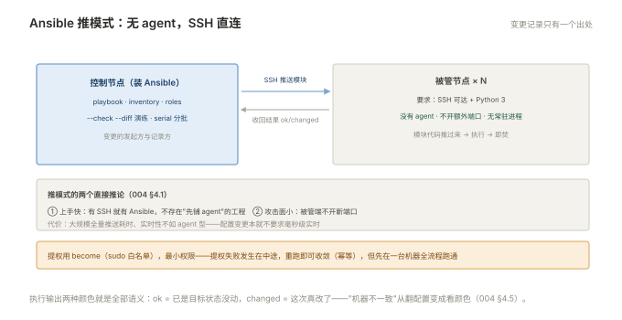

# 004 Ansible 批量配置

> **解决**：一百台机器怎么一条命令改完、改得一致。  
> **范围**：inventory · ad-hoc · playbook · 模块 · 幂等。  
> **口径**：Ansible 2.15+（core），SSH 免密 + become 提权。  
> **更新**：2026-10-31

## 目录

| 节 | 内容 |
|---|---|
| 4.1 | Ansible 的模型：无 agent、SSH 直连、推模式 |
| 4.2 | 准备工作：安装、SSH 免密、become 提权 |
| 4.3 | inventory：静态清单、分组、连接变量 |
| 4.4 | ad-hoc：一条命令做临时取证与操作 |
| 4.5 | 第一份 playbook：装 nginx、下发配置、起服务 |
| 4.6 | 常用模块清单：copy / template / lineinfile / systemd / package / file / user |
| 4.7 | 幂等：模块为什么天然幂等，shell 怎么补 |
| 4.8 | facts：机器信息从哪来、模板里怎么用 |
| 4.9 | 执行控制：--limit / --check / 串行与并发 |
| 4.10 | 八个坑 |
| 4.11 | 本章检查清单 |

---

## 4.1 Ansible 的模型：无 agent、SSH 直连、推模式

Ansible 与其他批量工具（SaltStack/Puppet）的最大架构差异一句话：**被管机器上不装任何 agent**。控制节点通过 SSH 连过去，把模块代码推过去执行，执行完就退——不留进程、不留常驻。

```plain
控制节点（装 Ansible）──SSH──▶ 被管节点 × 100（只要 Python 3 + SSH）
      │
      └── 推送模块 → 执行 → 收回结果（无守护进程）
```

三个直接推论：**上手快**（有 SSH 就有 Ansible，不存在"先铺 agent"的工程）；**攻击面小**（被管端不多开任何端口）；**代价是每次全量连接**（几千台规模时推送耗时明显，且实时性不如 agent 型——但运维配置变更本来就不要求毫秒级实时）。另一个特性是**推模式**：变更由控制节点发起，被动机器不主动拉——"谁在什么时候改了什么"天然有单一出处（控制节点的执行记录）。



---

## 4.2 准备工作：安装、SSH 免密、become 提权

三步初始化，一步都不能省：

```bash
# ① 控制节点安装（pip 或包管理器皆可，pip 版本更新）
pip install ansible-core

# ② SSH 免密：生成密钥并分发到所有被管节点
ssh-keygen -t ed25519
ssh-copy-id ops@web-1        # 对每台机器执行；批量可配合 4 册之外的初始化脚本

# ③ 验证连通
ansible all -m ping -i inventory
```

```plain
web-1 | SUCCESS => { "changed": false, "ping": "pong" }
web-2 | SUCCESS => { "changed": false, "ping": "pong" }
```

`ping` 是连通性测试的第一命令，返回 pong 表示 SSH + Python 通道全通。提权用 `become`（默认 sudo）：生产一般用专门运维账号 + sudoers 白名单命令，而不是直接用 root——最小权限原则（「数据库」008 同源纪律）。

`ansible.cfg` 建议在项目根放一份（作用域明确、进 Git），最常用三项：

```ini
[defaults]
inventory = ./inventory          # 默认清单路径
host_key_checking = True         # 保持校验（关掉是安全劣化）
forks = 20                       # 并发连接数
```

---

## 4.3 inventory：静态清单、分组、连接变量

inventory 是被管机器的花名册，INI 与 YAML 两种写法等价，INI 更常见：

```ini
[web]
web-1 ansible_host=10.0.1.11
web-2 ansible_host=10.0.1.12

[db]
db-1 ansible_host=10.0.2.11

[prod:children]
web
db

[web:vars]
ansible_user=ops
http_port=8080
```

三层的含义：**主机**（`ansible_host` 定真实地址，别名随意起）、**组**（横切维度，如按角色 web/db）、**组的组**（`:children`，跨角色聚合——"所有生产机器"）。`:vars` 给组内统一变量（连接参数、端口），YAML 格式下则拆到 `group_vars/`、`host_vars/` 目录（005 册的变量体系）。

分组设计的心法：**组名对应"要对它做什么"**（部署 nginx 的组、备库的组），而不是对应"机器属于谁"——前者是运维动作的边界。

---

## 4.4 ad-hoc：一条命令做临时取证与操作

playbook 之前的快速武器——不写文件，一条命令直接跑模块：

```bash
ansible web -m ping -i inventory                       # 连通性
ansible web -m command -a 'df -h /' -i inventory       # 逐台看磁盘
ansible web -m shell -a 'free -m | head -2' -i inventory
ansible web -m copy -a 'src=/tmp/n.conf dest=/tmp/n.conf' -i inventory
ansible db  -m service -a 'name=mysql state=started' -i inventory
```

`command` 与 `shell` 的分界要立住：**command 不经过 shell**（无管道无通配，防注入），需要管道/变量展开才用 shell。ad-hoc 的定位是**取证与小操作**——凡是"要重复跑的、要进变更评审的"，一律写进 playbook（4.5），这也是"流程里没有隐性人工步骤"（000 §0.7）在配置层的体现。

---

## 4.5 第一份 playbook

playbook 是 YAML 写的任务清单，从上到下对一组主机执行：

```yaml
- name: 部署 nginx
  hosts: web
  become: true

  tasks:
    - name: 安装 nginx
      ansible.builtin.package:
        name: nginx
        state: present

    - name: 下发站点配置
      ansible.builtin.copy:
        src: files/app.conf
        dest: /etc/nginx/conf.d/app.conf
        mode: "0644"
      notify: reload nginx          # 配置真的变了才通知 handler

    - name: 启动并设置自启
      ansible.builtin.systemd:
        name: nginx
        state: started
        enabled: true

  handlers:
    - name: reload nginx
      ansible.builtin.systemd:
        name: nginx
        state: reloaded
```

```bash
ansible-playbook -i inventory site.yaml
```

输出里每个 task 后面的状态是 Ansible 的核心语义：**`ok` = 已经是目标状态没动；`changed` = 这次改了**。绿色/黄色一目了然——"这台机器和其他机器不一致"从翻配置文件变成看颜色。

---

## 4.6 常用模块清单

运维 90% 的场景被七个模块覆盖：

| 模块 | 用途 | 幂等语义 |
|---|---|---|
| `copy` | 下发静态文件 | 内容一致则 ok，不同才覆盖 |
| `template` | 下发 Jinja2 模板渲染后的文件（005） | 同上，渲染结果比对 |
| `lineinfile` | 精确改一行（sysctl、limits.conf） | 该行存在且内容一致则 ok |
| `file` | 建目录/软链/权限属主 | 状态一致则 ok |
| `package` | 跨发行版装包（自动选 apt/yum） | 已装则 ok |
| `systemd` | 服务状态：started/stopped/reloaded/enabled | 已是目标状态则 ok |
| `user` / `group` | 账号与组管理 | 存在且属性一致则 ok |

选择纪律：**能用模块绝不 `shell`**。模块自带幂等、自带回滚语义、输出结构化；`shell` 是最后的逃生舱（写 `creates:` 补幂等，见 4.7）。

---

## 4.7 幂等：模块为什么天然幂等，shell 怎么补

幂等是 Ansible 的灵魂，定义一句话：**同一份 playbook 跑一次和跑十次，机器的终态相同**。它的工程价值有两层：重复执行安全（中断了重跑即可，天然可重试）；**执行报告可信**（changed 才是真变更，审计有据）。

模块天然幂等（copy 比内容、package 查已装），而 `shell`/`command` 每次跑都算 changed——必须自己补：

```yaml
- name: 下载安装包（已存在则跳过）
  ansible.builtin.get_url:
    url: https://example.com/pkg.tar.gz
    dest: /tmp/pkg.tar.gz

# shell 的补救姿势：creates 指令——目标存在就不执行
- name: 初始化目录
  ansible.builtin.shell: |
    /opt/app/init.sh
  args:
    creates: /opt/app/.initialized
```

验证幂等的标准动作：**连跑两遍 playbook，第二遍全部 ok、零 changed**。做不到就说明有非幂等语句藏在里面——005 册把它升级成生产变更前的仪式。

---

## 4.8 facts：机器信息从哪来、模板里怎么用

每次执行 playbook，Ansible 默认先用 `setup` 模块采集被管机器的**事实数据（facts）**：OS 版本、IP、内存、磁盘、CPU 核数，全部装进 `ansible_facts`：

```yaml
- name: 按 OS 选包
  ansible.builtin.package:
    name: "{{ 'nginx' if ansible_facts['os_family'] == 'Debian' else 'nginx' }}"
```

模板（005 的 Jinja2）里最常用的几个：`ansible_facts['hostname']`、`ansible_facts['default_ipv4']['address']`、`ansible_facts['memtotal_mb']`、`ansible_facts['processor_cores']`——配置文件按机器渲染（每台机器的 worker 数 = 核数）全靠它们。

facts 采集有开销（每台机一次连接），机器多、任务小时可 `gather_facts: false` 关掉——前提是后面的任务真的不需要。

---

## 4.9 执行控制：--limit / --check / 串行与并发

四个执行控制开关，覆盖"只动一部分、先看看、分批来"：

```bash
--limit web-1            # 只跑清单里的这一台（定位单机问题）
--check --diff           # 演练：报告会改什么 + 显示文件差异，不真改
serial: 5                # playbook 内字段：每批 5 台，全绿再下一批（分批发布）
-f 20                    # 并发连接数（默认 5）
```

**`--check --diff` 的地位怎么强调都不过分**：它把"这次变更会动哪些机器的哪些文件"变成一条命令可得的答案——生产变更前必跑（005 册把它写成仪式），也是「CICD」007 发布检查单里的常客。

---

## 4.10 八个坑

| # | 坑 | 后果 | 正确做法 |
|---|---|---|---|
| 1 | `shell` 当万能模块 | 幂等破坏、报告失真 | 模块优先，shell 补 creates |
| 2 | task 不写 name | 执行日志没法读 | 每 task 有意义的 name |
| 3 | 生产直接跑不演练 | 不可预知的大面积变更 | `--check --diff` 先行 |
| 4 | 变量写死在 playbook 里 | 环境切换全靠手改 | inventory/group_vars（005） |
| 5 | 忘记 become 或 sudoers 没配 | 半途权限失败，机器处于半改状态 | 初始化时验证提权 |
| 6 | 首连 host key 确认卡住 | 批量执行挂起 | 先 ssh-copy-id 逐台确认（保持校验开启） |
| 7 | 密钥明文进 playbook | 进 Git 即泄漏 | Vault（005）/ 环境变量 |
| 8 | 一次改一百台不分批 | 出问题波及全量 | serial 分批 |

第 5 条展开：Ansible 的提权失败有个恼人的特点——**失败发生在中途**。前 30 台改完了，第 31 台 sudo 密码过期，playbook 中断：集群处于"半新半旧"状态。这本身不是 Ansible 的缺陷（重跑即可收敛），但它揭示一条纪律：**任何 playbook 上线前，先在一台机器全流程跑通（提权、依赖、验证）**；同时 serial 分批让"半途而废"的影响面可控。

---

## 4.11 本章检查清单

读完能回答这六个问题，这一章就过了：

| # | 问题 |
|---|---|
| 1 | Ansible 的"无 agent 推模式"是什么？带来的两个直接推论？ |
| 2 | command 与 shell 模块的分界线？ |
| 3 | playbook 输出里的 ok 和 changed 各代表什么？为什么重要？ |
| 4 | 幂等的定义与验证动作？shell 怎么补幂等？ |
| 5 | facts 里最常用的四个变量？ |
| 6 | `--check --diff` 的作用是什么？它该出现在流程的哪一步？ |

---

> 下一篇：《005 Ansible 工程化》——playbook 堆成泥球之后，怎么组织成可维护的工程。
