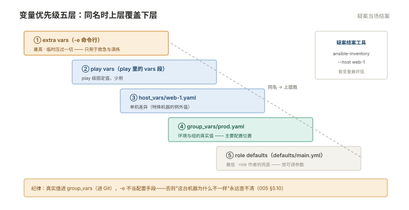

# 005 Ansible 工程化

> **解决**：playbook 堆成泥球之后，怎么组织成可维护的工程。  
> **范围**：roles · 变量与优先级 · Jinja2 模板 · handlers · check mode · vault。  
> **口径**：Ansible 2.15+，工程目录进 Git 管理。  
> **更新**：2026-10-31

## 目录

| 节 | 内容 |
|---|---|
| 5.1 | role 的目录约定：tasks / handlers / templates / files / defaults / vars / meta |
| 5.2 | 第一份 role：把 004 的 nginx playbook 拆成 nginx role |
| 5.3 | 变量体系与优先级：同名覆盖的全序 |
| 5.4 | Jinja2 模板：变量、条件、循环、过滤器 |
| 5.5 | handlers：改了才重载，notify 与 listen |
| 5.6 | role 的复用：requirements.yml 与私有源 |
| 5.7 | 敏感数据：Ansible Vault 的加密与日常使用 |
| 5.8 | 上生产前的仪式：--check --diff、分批、回滚 |
| 5.9 | 工程结构参考：生产仓库的目录树 |
| 5.10 | 八个坑 |
| 5.11 | 本章检查清单 |

---

## 5.1 role 的目录约定

playbook 超过 200 行就进入"泥球"状态：装 nginx、装 redis、下发配置全混在一起，改一处怕碰另一处。**role 是 Ansible 的组件化答案**——按目录约定拆开，每个 role 做好一件事（装 nginx / 配 sysctl / 部署应用）：

```plain
roles/nginx/
├── tasks/main.yml        # 主任务清单（role 的骨架）
├── handlers/main.yml     # 被 notify 的重载动作
├── templates/            # Jinja2 模板（含变量，按机器渲染）
│   └── app.conf.j2
├── files/                # 静态文件（原样拷贝）
│   └── index.html
├── defaults/main.yml     # 变量的默认值（优先级最低，使用者可覆盖）
├── vars/main.yml         # role 内部变量（优先级高，不期望被改）
└── meta/main.yml         # role 的元信息与依赖
```

目录名就是语义——**tasks 是动作，templates/files 是素材，defaults 是"可调参数"，vars 是"内部常量"**。`ansible-galaxy init roles/nginx` 一条命令生成骨架。约定即框架：调用方不需要读 role 的实现，看 defaults 就知道能调什么。

---

## 5.2 第一份 role：把 004 的 nginx playbook 拆开

004 §4.5 的三段 playbook 拆进 nginx role，调用端只剩三行：

```yaml
# playbooks/deploy-web.yaml
- name: 配置 web 机器
  hosts: web
  become: true
  roles:
    - role: nginx
      vars:
        nginx_worker_processes: 4      # 覆盖 defaults 里的默认值
```

```yaml
# roles/nginx/defaults/main.yml
nginx_worker_processes: auto
nginx_port: 80
```

```yaml
# roles/nginx/templates/app.conf.j2
server {
    listen {{ nginx_port }};
    worker_processes {{ nginx_worker_processes }};
    root /usr/share/nginx/html;
}
```

拆分的收益立刻可见：**参数外置**（同一 role 服务于 4 核测试机与 32 核生产机，只是变量不同）；**复用发生**（web 组、proxy 组都引用 nginx role）。role 的拆分粒度心法：**一个 role = 一个可独立描述的软件或职责**，别拆得太碎（一个 role 一个配置文件），也别太粗（"部署整个业务"不是一个 role）。

---

## 5.3 变量体系与优先级：同名覆盖的全序

Ansible 的变量可以出现在十几个地方，**同名时谁覆盖谁有严格全序**。工程上最常打交道的五层，从高到低：

```plain
extra vars（-e 命令行传入）          最高：临时压过一切
play vars（play 里的 vars 段）
host_vars/web-1.yaml                 单机差异
group_vars/prod.yaml                 组差异（子组覆盖父组）
role defaults（defaults/main.yml）   最低：role 作者给的兜底
```

```bash
ansible-playbook site.yaml -e "nginx_port=8081"   # 临时覆盖，演练/救急用
```

工程纪律由此推导：**defaults 里放"可调的一切"，group_vars 里放环境的真实值，-e 只用于救急与演练**。反过来（把真实值写死在 defaults、或用 -e 当配置手段）的团队，迟早被"为什么这台机器配置不一样"的悬案缠住。完整的优先级顺序很长（22 级），记住工程上最有用的这五层，遇到真实冲突时 `ansible-inventory --host web-1` 一条命令看这台机器的变量最终值——疑案当场结案。



---

## 5.4 Jinja2 模板：变量、条件、循环、过滤器

`template` 模块把 `.j2` 模板渲染后下发，四件武器覆盖配置生成：

```jinja
# app.conf.j2 —— 变量 + 默认值过滤器
listen {{ nginx_port | default(80) }}
worker_processes {{ nginx_worker_processes | default('auto') }}

# 条件：按 OS 差异化

pid /run/nginx.pid


# 循环：按变量生成 upstream 列表
upstream backend {

    server {{ hostvars[host]['ansible_facts']['default_ipv4']['address'] }}:{{ nginx_port }};

}
```

常用过滤器速查：`default(x)`（缺省值）、`upper/lower`、`join(',')`、`hash('sha256')`、`int`。两个高频技巧：`{{ var | default(80) }}` 让模板对没配变量的机器也友好；`hostvars` 穿透到其他机器的 facts（循环生成 upstream 就是它的舞台——inventory 是事实源，配置随 inventory 自动更新）。

---

## 5.5 handlers：改了才重载，notify 与 listen

004 §4.5 见过 handlers 的用法，这里补全语义：**handler 只在"被通知过且确实有变更"时执行，且默认在 play 的最后统一执行一次**——

```yaml
tasks:
  - name: 下发配置
    template: src=app.conf.j2 dest=/etc/nginx/conf.d/app.conf
    notify: reload nginx          # 本任务 changed 才发通知

handlers:
  - name: reload nginx            # 名字与 notify 对应
    systemd: { name: nginx, state: reloaded }
```

它解决的问题是精确的：**配置没变就不要重载**（每次都 reload 的 playbook 既产生噪音又造成无谓抖动）。两个进阶细节：多个 task 通知同一个 handler 也只执行一次（去重）；`meta: flush_handlers` 可以强制"此刻就执行已通知的 handler"（后面的任务依赖新配置时用）。

---

## 5.6 role 的复用：requirements.yml 与私有源

好 role 不必自己写第二遍。Ansible Galaxy（公共仓库）与私有 Git 仓库都能作为 role 的来源，`requirements.yml` 声明依赖：

```yaml
roles:
  - name: nginx
    src: https://gitlab.internal/devops/ansible-role-nginx.git
    version: v1.3.0               # 锁版本，与 001 §1.6 的 tag 思想同源
  - name: geerlingguy.redis       # Galaxy 上的社区 role
    version: 1.7.0
```

```bash
ansible-galaxy install -r requirements.yml    # 拉取到 roles/ 目录
```

`version` 锁定是纪律：不锁版本，上游一改你的全集群跟着变。社区 role（geerlingguy 系列最著名）的价值在参考实现——生产使用前**通读 tasks**，确认幂等与安全假设符合自己的环境。

---

## 5.7 敏感数据：Ansible Vault 的加密与日常使用

密码、API token 进 Git 的唯一合规姿势是 **Vault 加密**：

```bash
# 加密一个变量文件
ansible-vault encrypt group_vars/prod/vault.yaml

# 创建即加密 / 编辑（解密-编辑-再加密）
ansible-vault create group_vars/prod/vault.yaml
ansible-vault edit   group_vars/prod/vault.yaml
```

```yaml
# vault.yaml 内部（密文形态）
vault_db_password: S3cr3t!
```

使用时解密在内存中完成，明文不落盘：

```bash
ansible-playbook site.yaml --ask-vault-pass
# 或用密码文件（权限 600，且密码文件本身要安全管理）
ansible-playbook site.yaml --vault-password-file ~/.vault-pass
```

变量命名约定 `vault_` 前缀是社区惯例：加密文件里定义 `vault_xxx`，明文的 `group_vars` 里再写 `xxx: "{{ vault_xxx }}"`——**一眼分清哪些值是敏感的**。Vault 解决的是"进 Git 的形态"，002 §2.7 的掩码纪律在 Ansible 侧同样成立（任务的输出不会自动加密，密钥别被 shell echo 出来）。

---

## 5.8 上生产前的仪式：--check --diff、分批、回滚

004 §4.9 的演练开关，在生产流程里固化成三步仪式：

```bash
# ① 演练：全局看这次会改什么
ansible-playbook site.yaml --check --diff

# ② 分批执行（play 内 serial: 5）+ 每批验证
ansible-playbook site.yaml --limit batch1 && ./verify.sh

# ③ 出错的回退：改回上一个版本的 role（Git tag）再跑
```

仪式的价值不在命令本身（4.9 都讲过），在**它把"变更"从勇气活变成流程活**：`--diff` 的输出就是变更评审的附件；serial 分批让爆炸半径 = 一批；Git 管理的 role 让回退 = 换 tag。与「CICD」007 的发布三要素（受控、可观察、可回退）完全对齐——**配置变更就是发布**，用发布的标准要求它。

---

## 5.9 工程结构参考：生产仓库的目录树

一个可长期维护的 Ansible 仓库长这样（本册全部内容的装配图）：

```plain
ansible-repo/
├── ansible.cfg                 # 项目级配置（inventory 路径等）
├── inventory/
│   ├── production/
│   │   ├── hosts               # 生产清单
│   │   ├── group_vars/
│   │   │   ├── all.yaml
│   │   │   └── prod.yaml
│   │   └── host_vars/
│   └── staging/…               # 环境隔离的清单与变量
├── roles/                      # 自研 role（各自可独立测试）
│   ├── nginx/
│   ├── redis/
│   └── app-deploy/
├── playbooks/
│   ├── site.yaml               # 主入口：分角色装配
│   └── maintenance.yaml
└── requirements.yml            # 外部 role 依赖（锁版本）
```

三条结构纪律：**环境隔离靠 inventory 目录**（同一套 role，不同环境不同变量——000 §0.6 的"配置与代码分离"在配置管理层的形态）；**role 独立可测**（`ansible-playbook -i 单机清单 roles/nginx/tests`）；**入口收敛**（site.yaml 是唯一的生产入口，临时脚本不留在仓库主干）。

---

## 5.10 八个坑

| # | 坑 | 后果 | 正确做法 |
|---|---|---|---|
| 1 | 真实值写进 role defaults | role 不可复用，环境差异靠改源码 | defaults 放可调参数，环境值进 group_vars |
| 2 | `-e` 当配置手段 | 变更无记录，"谁改的"成谜 | -e 只救急，配置进 inventory/Git |
| 3 | handler 名与 notify 对不上 | 静默不执行，配置改了服务没重载 | 名字精确对应，用 --diff 验证 changed |
| 4 | Vault 密码文件权限 644 | 加密形同虚设 | 600 + 单独管理 |
| 5 | 不锁外部 role 版本 | 上游变更直接打进生产 | requirements.yml + version |
| 6 | 生产不跑 --check | 变更影响面靠猜 | 演练是流程的一部分（5.8） |
| 7 | 一个 role 管所有事 | 泥球回归 | 按"一个软件一个 role"拆 |
| 8 | copy 用了模板语法 | `{{ }}` 原样进配置文件 | 动态内容走 template |

第 3 条展开，它是"配置改了服务没重载"的隐形冠军：notify 与 handler name 是**字符串精确匹配**，一个空格差异都会让通知落空——而 playbook 照样绿色（Ansible 不会报"找不到 handler"以外的错，拼写错误会报，但任务被 skip 时通知就是没发）。验证方法直接：改一次配置跑一遍，确认输出里出现 `RUNNING HANDLER` 行；没出现而配置确实变了，检查 changed 是否真的发生（`--diff` 看）。

---

## 5.11 本章检查清单

读完能回答这六个问题，这一章就过了：

| # | 问题 |
|---|---|
| 1 | role 七个目录各放什么？defaults 与 vars 的分工？ |
| 2 | 五层变量优先级排序？`-e` 的正确定位？ |
| 3 | handler 什么时候执行？改了配置没重载的第一嫌疑是什么？ |
| 4 | Vault 的命名约定？它解决的是"哪一段"的安全？ |
| 5 | 生产变更的三步仪式？回退动作是什么？ |
| 6 | 环境隔离靠什么实现？（inventory 目录，不是改 role） |

---

> 下一篇：《006 制品与镜像仓库》——构建产物放哪、版本怎么命名、怎么保证"上线的就是测过的"。
