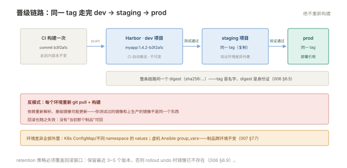

# 006 制品与镜像仓库

> **解决**：构建产物放哪、版本怎么命名、怎么保证"上线的就是测过的"。  
> **范围**：Nexus / Harbor · tag 策略 · 不可变 tag · 保留策略 · 晋级。  
> **口径**：Harbor 2.x（镜像）、Nexus 3（通用制品）。  
> **更新**：2026-10-31

## 目录

| 节 | 内容 |
|---|---|
| 6.1 | 制品思维：为什么"上线的是制品不是代码" |
| 6.2 | 制品库全景：Nexus 管通用包，Harbor 管镜像 |
| 6.3 | Harbor 实操：项目、机器人账号、docker login 对接 |
| 6.4 | tag 策略：语义化版本 + 构建号 |
| 6.5 | 不可变 tag 与可追溯 |
| 6.6 | 晋级：dev → prod 复制制品，而不是重新构建 |
| 6.7 | 保留策略与存储巡检 |
| 6.8 | 镜像扫描与准入：Trivy 扫描、不通过不部署 |
| 6.9 | 八个坑 |
| 6.10 | 本章检查清单 |

---

## 6.1 制品思维：为什么"上线的是制品不是代码"

000 §0.6 立了观念，本册给它的工程载体。先看两种部署模式的对照：

**反模式：服务器上现场生成。** 流水线跑到生产机：`git pull` → `npm install` → `npm run build` → 重启。三个致命问题——**不可重现**（npm install 拉的是当下的依赖版本，这次和上次构建的产物不同）；**不可追溯**（服务器上的代码状态 = 最新拉取时刻的 main，谁也说不出它等于哪个 commit）；**不可回滚**（回滚 = 重新拉旧代码重新构建，赌构建结果与当初一样）。

**正模式：制品晋级。** CI 构建一次 → 产出带唯一 tag 的制品 → 推进制品库 → 测试环境拉这个 tag 验证 → **同一个 tag** 晋级到生产。三个性质全部成立：构建一次、处处相同（不可变）；tag ↔ commit ↔ 流水线记录三方可溯（可追溯）；测试过的就是上线的（可重放）。

一句话记住本册主旨：**制品库是"测过的东西"与"上线的东西"之间的唯一桥梁**。

---

## 6.2 制品库全景：Nexus 管通用包，Harbor 管镜像

两类制品、两个主流组件，职责分工清楚：

| | Harbor | Nexus |
|---|---|---|
| 专长 | **OCI 容器镜像**（docker push/pull 原生） | 通用制品库：jar、tar、rpm、npm、pypi |
| 特色能力 | 镜像扫描（Trivy）、签名、跨仓库复制 | 多格式仓库、代理上游（缓 Maven Central） |
| 部署形态 | Docker Compose / Helm | tar 包 / 系统 service |

团队只用容器时 Harbor 一个就够；有 jar/系统包需求时 Nexus 并存。**不建议一个工具硬管两类**——镜像有 layer/manifest 的特殊结构，通用库管理镜像的体验远差于专用。两者都遵守同一套 tag/保留纪律（6.4/6.7），本册以 Harbor 为主线讲，Nexus 的对应概念一一映射。

---

## 6.3 Harbor 实操：项目、机器人账号、docker login 对接

Harbor 的三层结构：**项目（project）→ 仓库（repository）→ 制品（artifact，按 tag/digest）**。实操四步：

```bash
# ① 建项目（UI 操作）：myapp-prod（私有）
# ② 建机器人账号：Settings → Robot Accounts → 生成（权限只给 push/pull）
# ③ 用机器人账号登录
echo "$HARBOR_TOKEN" | docker login harbor.local -u 'robot$myapp' --password-stdin

# ④ 打 tag、推送（把 CI 构建的镜像挂上仓库地址）
docker tag myapp:1.4.2-b3f2a1c harbor.local/myapp/myapp:1.4.2-b3f2a1c
docker push harbor.local/myapp/myapp:1.4.2-b3f2a1c
```

三个实操要点：**机器人账号优先于人账号**（CI 用人不合规也不可审计，robot 有独立 token 可随时吊销）；**权限最小化**（构建机只给 push，部署机只给 pull）；**`--password-stdin` 而不是 `-p`**（`docker login -p` 会把密码留在 shell history 与进程列表里——002 §2.7 掩码纪律的落地动作）。Harbor 的项目可以建代理缓存模式（proxy cache），上游拉 Docker Hub 的镜像走本地缓存——公网限流与供应链安全的一石二鸟。

---

## 6.4 tag 策略：语义化版本 + 构建号

「容器」002 §2.8 立了"禁用 latest"的规矩，本册给完整的命名方案。推荐格式：

```plain
<名称>:<语义化版本>-<构建信息>
myapp:1.4.2-b3f2a1c          # 版本 + git commit 短哈希
myapp:1.4.2-20261031         # 版本 + 日期（人工可读）
```

语义化版本（SemVer：主.次.补丁）的升位规则：

| 升哪位 | 何时 | 例子 |
|---|---|---|
| 补丁（1.4.**2**→3） | 修 bug，完全兼容 | 修一个空指针 |
| 次（1.**4**.2→3） | 新增功能，向后兼容 | 新增一个接口 |
| 主（**1**.4.2→2.0.0） | **不兼容变更** | 删接口、改参数语义 |

与 001 §1.6 的 tag 打点衔接成完整链路：**git tag v1.4.2 → CI 构建出 myapp:1.4.2-b3f2a1c → Harbor 里这个 tag 对应的 digest 就是 v1.4.2 的最终形态**。tag 策略的价值不在命名好看，在 6.5 的可追溯与 6.6 的晋级。

---

## 6.5 不可变 tag 与可追溯

不可变 tag 是制品库纪律的核心：**同一个 tag 一旦推送，内容永不覆盖**。Harbor 项目设置里可直接开启 tag immutability 规则（如 `**` 全量不可变，或排除特定前缀），覆盖的 push 会被直接拒绝。

为什么它是地基：**可追溯性 = "每个环境跑的是哪个制品"有唯一答案**。tag 可变时，`myapp:1.4.2` 在周一和周五是两个镜像，日志、告警、事故复盘全部失去参照物。配套的追溯键是 **digest**（`sha256:…`，镜像内容的哈希）——tag 是名字（可能被换绑），digest 是身份证：

```bash
docker inspect myapp:1.4.2-b3f2a1c --format '{{index .RepoDigests 0}}'
harbor.local/myapp/myapp@sha256:2b99a1ca…    # 拉取时直接用 digest，绝对一致
```

K8s 部署清单里写 digest 形态是最高强度的版本锁定，常规场景用"不可变 tag"已足够，关键系统（金融、审计要求）用 digest。

---

## 6.6 晋级：dev → prod 复制制品，而不是重新构建

晋级（promotion）是制品思维的最后一个动作，规则一句话：**同一个 tag（同一 digest）从 dev 项目复制到 prod 项目，中间不重新构建**。

```bash
# Harbor UI 的 Replication 规则，或 CLI：
# 把 myapp-prod/myapp:1.4.2-b3f2a1c 从 dev 项目复制到 prod 项目
```

为什么强调"不重新构建"：重新构建意味着重新解析依赖（002 §2.4 的缓存与 001 §1.2 的层都变了）、重新赌网络与上游——**你测试过的那个镜像和上生产的镜像就不是同一个东西**。配套的环境差异应该全部外置在配置里（007 的"配置与代码分离"），制品本身跨环境不变。

晋级链路的工程形态：dev 项目（自动推送）→ 测试通过 → 复制到 staging → 验证 → 复制到 prod 项目（复制需要人工审批的话放在这一步）→ 生产部署引用 prod 项目的 tag。Harbor 的 replication 规则 + 流水线的审批节点即完整实现。



---

## 6.7 保留策略与存储巡检

制品库是磁盘大户（每个镜像几层几百 MB，每天多次构建），没有保留策略的 Harbor 迟早写满。两道闸：

**① Harbor 的 retention 规则**（项目 → Tag Retention）：按条件保留历史——常见组合是"保留最近 10 个 tag + 所有 release-* tag + 最近 30 天"，其余按周期清理。清理的是"不再被引用的制品"，**在跑的 Pod 引用的镜像不受影响**（节点已拉取），但回滚点要靠策略保住——这与 008 册 undo 的前提呼应。

**② 定期巡检**：存储水位 + 回收站（Harbor 删除的制品先进回收站，可挽回）+ 复制任务的失败记录。GC（垃圾回收）是独立操作，低峰执行——GC 期间镜像层文件会移动，正在 push 的任务会失败。

Nexus 侧对应 cleanup policies（按 last download / last updated 清理），思想一致：**构建历史有价值，但只有最近一段有价值**。

---

## 6.8 镜像扫描与准入：Trivy 扫描、不通过不部署

Harbor 内置 Trivy 扫描器，推送后自动扫 CVE。运维视角的三个动作：

1. **推送即扫**：项目设置里开启自动扫描，`docker push` 完成后稍等即可在 UI 看到漏洞报告（按严重级别分级）；
2. **准入拦截**：扫描结果与部署的联动——K8s 场景下 Harbor 提供 admission webhook，高危漏洞的镜像在 `kubectl apply` 阶段直接被拒（而不是部署成功后再发现）；
3. **修复路径的优先级**：升级基础镜像（多数 CVE 在基础层——002 §2.6 的选型直接决定暴露面）→ 升级应用依赖 → 无法修复的评估风险并记录豁免理由。

扫描策略的务实口径：**拦 CRITICAL、盯 HIGH、记录其余**。零漏洞是不存在的目标，准入门槛的精度比门槛高度更重要——门槛太高逼得团队绕过扫描，防线反而失效。

---

## 6.9 八个坑

| # | 坑 | 后果 | 正确做法 |
|---|---|---|---|
| 1 | latest 上生产 | 版本漂移，回滚无从谈起 | 语义化 tag + 不可变（6.4/6.5） |
| 2 | `docker login -p` 明文 | 密码进 history 与进程列表 | `--password-stdin`（6.3） |
| 3 | 重新构建代替晋级 | 上线的不是测过的那个 | 同 tag 复制（6.6） |
| 4 | 保留策略误删回滚点 | undo 时镜像已不存在 | retention 保住 release tag |
| 5 | CI 用人账号 push | 无审计、离职即隐患 | 机器人账号 + 最小权限 |
| 6 | 生产项目与 dev 项目不分 | 误推/误拉，边界混乱 | 项目分环境 + 复制晋级 |
| 7 | 存储满后临时删 tag 应付 | GC 没跑空间不回收，且删错了回滚点 | retention 策略 + 低峰 GC |
| 8 | 私库走 HTTP 不配证书信任 | 拉取失败或全线 insecure | 正规 TLS；内网 CA 也要规范化信任 |

第 4 条展开，它与「容器」008 §8.3 的 undo 前提是同一条链：回滚动作 `kubectl rollout undo` 只是改引用的 tag——**旧镜像必须还在仓库里**。retention 设计因此有一条硬性输入：回滚窗口有多长（通常"最近 3~5 个版本"），保留策略必须 ≥ 这个窗口。retention 跑在回滚窗口之前的团队，安全网是纸糊的。

---

## 6.10 本章检查清单

读完能回答这六个问题，这一章就过了：

| # | 问题 |
|---|---|
| 1 | 制品思维对"部署"定义的改变是什么？三个性质？ |
| 2 | Harbor 与 Nexus 的分工？为什么别混管？ |
| 3 | 为什么 CI 用机器人账号不用人账号？`--password-stdin` 防什么？ |
| 4 | 语义化版本的升位规则？tag 与 git tag 与 digest 的三层关系？ |
| 5 | 晋级为什么禁止重新构建？环境差异放哪？ |
| 6 | 扫描准入的务实口径是什么？ |

---

> 下一篇：《007 发布策略与回滚》——上线方式怎么选、出事怎么退得干净。
