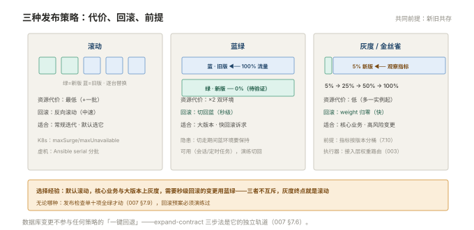

# 007 发布策略与回滚

> **解决**：上线方式怎么选、出事怎么退得干净。  
> **范围**：滚动 / 蓝绿 / 灰度 · 数据库变更顺序 · 回滚预案。  
> **口径**：目标平台为虚机与 K8s 双写；流量切分配置见「接入层」003。  
> **更新**：2026-10-31

## 目录

| 节 | 内容 |
|---|---|
| 7.1 | 发布的本质：一次受控的、可回退的变更 |
| 7.2 | 滚动发布：节奏参数与共存期兼容 |
| 7.3 | 蓝绿发布：双环境整切 |
| 7.4 | 灰度 / 金丝雀：放量节奏与观察指标 |
| 7.5 | 三种策略的选择表 |
| 7.6 | 数据库变更的发布顺序：expand-contract |
| 7.7 | 配置与代码分离 |
| 7.8 | 回滚预案：退代码、退配置、退数据 |
| 7.9 | 发布检查单 |
| 7.10 | 八个坑 |
| 7.11 | 本章检查清单 |

---

## 7.1 发布的本质：一次受控的、可回退的变更

前六册解决了"构建可信的制品"，本册解决最后一公里。先立发布的定义：**发布是一次受控的、可观察的、可回退的变更**——三个形容词各自否掉一类常见做法：

- **受控**：不是"代码写完就上"，是有节奏、有审批、有窗口的流程；
- **可观察**：发布后能立刻看到错误率/延迟的变化（监控对接是发布的前置条件，不是事后补的）；
- **可回退**：从按下发布键那一刻起，回退路径就存在且演练过（006 §6.9 的镜像在库 + 本节的预案）。

这个定义同时解释了为什么"发布策略"是运维的核心技能：策略选错的代价不是"慢一点"，是"退不回来"。

---

## 7.2 滚动发布：节奏参数与共存期兼容

滚动是最常用的策略（K8s 的 Deployment 原生支持，「容器」008 §8.1 的 maxSurge/maxUnavailable 就是节奏参数）。逐台/逐批替换期间有一个**新旧版本共存窗口**，它对应用提出一条硬要求：

**新旧版本必须能同时跑在同一环境里。** 具体包括：同一套数据库 schema 都能读写（老代码遇到新数据不崩）；API 接口向后兼容（新前端打老后端不报错）；缓存/消息的结构兼容（老代码能忽略新字段）。**不满足就停——先修兼容性，再谈发布**。

虚机场景的滚动实现靠 Ansible 的 `serial`（「CICD」005 §5.8）：每批 N 台 → 验证 → 下一批；K8s 场景由 Deployment 控制。回滚动作分别是"反向跑 playbook"与 `rollout undo`——**共存兼容同时也是回滚可行性的前提**。

---

## 7.3 蓝绿发布：双环境整切

蓝绿是"两套完整环境 + 一次流量切换"：

```plain
                ┌── 蓝（当前生产 v1.4.2）◄── 100% 流量
LB ─────────────┤
                └── 绿（新版本 v1.4.3）◄── 0%（部署、验证完毕待切）

发布 = 流量 100% 切到绿；回滚 = 流量 100% 切回蓝（秒级）
```

| 优点 | 代价 |
|---|---|
| 回滚是**切配置**（秒级、零部署动作） | 资源 ×2（两套完整环境） |
| 新版本在真实环境完整验证后才接流量 | 切换瞬间所有用户一起换版 |
| 数据库 schema 变更的灰度期更长 | 切换器本身成为关键组件 |

适用判断：资源宽裕、需要"切换级回滚速度"、发布频率不极高（两套环境的维护成本与频率成正比）。K8s 里可用双 Deployment + Service 选择器切换实现；接入层实现是「接入层」003 的双 upstream + weight。**蓝绿最大的隐患是切换后回不去**：蓝环境的数据库连接、配置时效性要在切走期间保持可用（会话、定时任务），演练要覆盖"切回"这个动作本身。

---

## 7.4 灰度 / 金丝雀：放量节奏与观察指标

灰度（金丝雀）是精细版：**新版本先接一小部分真实流量，观察指标，逐级放量**。三要素设计：

**① 放量节奏**——按业务风险定台阶，例：

```plain
5%（15 分钟）→ 25%（30 分钟）→ 50%（30 分钟）→ 100%
```

第一级放多小取决于"一个实例出事影响多大"；台阶之间的等待时长取决于指标的反应延迟（错误率的统计需要样本量）。

**② 观察指标**——先定"什么算坏"再放量：

| 指标 | 来源 | 红线示例 |
|---|---|---|
| 错误率（5xx 占比） | 接入层/应用监控 | > 1% 即回滚 |
| 延迟 P99 | 监控 | 比基线劣化 > 30% |
| 业务指标 | 下单成功率等 | 环比下滑即停 |

**③ 终止动作**——每个台阶两个出口：继续放量，或**立即切回**（接入层 weight 归零——「接入层」003 §3.8 的权重路由是执行器）。

灰度的适用前提：**新旧版本可按流量比例共存**（7.2 的兼容要求升级版）+ **指标能按版本区分**（否则看到劣化也不知道是哪版造成的）。满足不了这两条，灰度只是仪式。

---

## 7.5 三种策略的选择表

| 维度 | 滚动 | 蓝绿 | 灰度 |
|---|---|---|---|
| 资源代价 | 最低（+一批） | ×2 | 低（多一个实例起） |
| 回滚速度 | 中（反向滚动） | **快（切配置）** | 快（weight 归零） |
| 风险暴露 | 全量渐进 | 切换瞬间全量 | **最小（先 5%）** |
| 前提 | 新旧兼容 | 双环境维护 | 版本区分的指标 + 流量路由 |
| 适合 | 常规迭代 | 大版本、需要快回滚 | 高风险变更、核心业务 |



实务推荐：**默认滚动，核心业务与大版本上灰度，需要秒级回滚能力的变更用蓝绿**。三者不互斥——灰度的放量终点就是滚动。无论哪种，7.9 的检查单是公共前置。

---

## 7.6 数据库变更的发布顺序：expand-contract

数据库变更是发布里唯一"不能一键回退"的部分（数据回滚复杂度远高于代码），处理框架是 **expand-contract（扩展-收缩）三步法**：

```plain
第 1 步【扩展】发布 schema：加新列/新表（兼容旧代码）
              ↓ 发布应用 v2：双写/写新列，读兼容
第 2 步【迁移】历史数据回填，观察稳定
              ↓ 确认 v2 稳定运行
第 3 步【收缩】下个版本里删旧列/旧表（此时没有代码再用它）
```

核心思想：**每一步部署后，系统里都同时兼容新旧两个版本的应用代码**。回滚任何一步都不需要回滚数据（新列留着无害）。与之配套的红线：**变更脚本先在 staging 全量数据量级演练**（「数据库」005 的变更管理口径）；**删列删表的 DDL 至少隔一个版本**（给"发现 v2 有问题要回 v1"留缓冲）。

反向教材就是最常见的发布事故链：应用 v2 与删列的 DDL 一起发 → v2 需要回滚 → v1 代码找不到列 → 回滚失败 → 只能修数据。**数据库变更与代码发布解耦、顺序固定**，这一条排得进运维纪律的前三名。

---

## 7.7 配置与代码分离

同一制品跑遍 dev/staging/prod（006 §6.6 晋级的前提），环境差异全部外置。K8s 里是 ConfigMap/Secret + 不同 namespace 的 values（「容器」007）；虚机里是 Ansible 的 group_vars（「CICD」005 §5.3）。

分离的价值在发布时的两个体现：**发布动作不碰配置**（部署 = 换制品，配置的变更是独立的、可评审的变更）；**回滚不丢配置**（退代码时配置保持当前版本，除非故障根因就是配置——那属于"退配置"，是 7.8 的第二个动作）。反模式提醒：把环境地址、开关写死在镜像里，等于每换环境都要重新构建——001 §1.5 环境变量纪律的体系化版本。

---

## 7.8 回滚预案：退代码、退配置、退数据

回滚不是"把旧版部署回去"一句话，预案要按三层分别设计：

| 层 | 动作 | 前提 | 速度 |
|---|---|---|---|
| **退代码** | 部署上一版制品（006 的镜像在库） | 不可变 tag + 数据库兼容 | 分钟级 |
| **退配置** | 恢复上一版配置（Git revert / 恢复备份） | 配置变更独立记录 | 分钟级 |
| **退数据** | 数据修复（备份恢复/反向 SQL） | 有可用的备份与 binlog（「数据库」005） | 慢，最后手段 |

预案三要素：**顺序**（先止血：通常是退代码或切流量；配置与数据问题单独评估）、**演练**（每个季度在 staging 走一遍完整回滚——没演练的预案是愿望）、**触发权**（谁有权拍板回滚——值班一线就能拍，还是必须升级；犹豫的代价是止损延迟）。

一个反直觉的提醒：**回滚不丢人，延迟回滚才丢人**。灰度的红线触发了就切回，"再观察五分钟"的损失往往是十倍。

---

## 7.9 发布检查单

发布前过一遍，十项全绿才动：

| # | 检查项 |
|---|---|
| 1 | 制品在库里、tag 不可变（006） |
| 2 | 新旧版本兼容确认（schema/API/缓存） |
| 3 | 数据库变更已提前独立执行（expand 已完成） |
| 4 | 发布策略已选（滚动/蓝绿/灰度）且参数确定 |
| 5 | 回滚动作明确到命令级，镜像确认在库 |
| 6 | 监控大盘开着，指标基线已记录 |
| 7 | 相关方知会（业务方、值班、依赖团队） |
| 8 | 非高峰窗口 / 获得窗口豁免 |
| 9 | staging 全量验证通过 |
| 10 | 发布记录模板就绪（谁、何时、什么版本、变更点） |

---

## 7.10 八个坑

| # | 坑 | 后果 | 正确做法 |
|---|---|---|---|
| 1 | 回滚预案没演练过 | 真用时要现学 | 季度演练（7.8） |
| 2 | 应用与 DDL 一起发 | 回滚即数据灾难 | expand-contract（7.6） |
| 3 | 回滚只退代码不退配置 | 根因是配置的故障没止血 | 三层回滚分开设计 |
| 4 | 灰度只看平均值 | 长尾劣化被平均掩盖 | 看 P99 与错误率 |
| 5 | 新旧共存期没设计 | 滚动一半互踩 | 7.2 的兼容硬要求 |
| 6 | 直接删旧列/旧表 | 旧代码回不去 | 收缩隔一个版本 |
| 7 | 灰度长期停在半灰 | 两套并行维护，成本翻倍 | 定放量终点与死线 |
| 8 | 缓存与新代码不同世 | 新代码读到旧缓存结构 | 缓存键带版本或发布时清理 |

第 4 条展开：灰度 5% 时看"平均响应时间"，旧版占 95%，平均指标几乎不动——**劣化信号被稀释**。正确的观察法是**按版本分桶**：监控指标带版本 label（「监控」册的多维度口径），对比 `version=v1.4.3` 与 `v1.4.2` 两个桶的同指标；没有分桶能力的团队退而求其次，看分位数（P99 对尾部劣化敏感）而不是平均值。灰度的本质是小流量里的统计学，分桶是前提。

---

## 7.11 本章检查清单

读完能回答这六个问题，这一章就过了：

| # | 问题 |
|---|---|
| 1 | 发布的三要素定义？各自否掉哪类做法？ |
| 2 | 滚动发布的共存窗口要求什么？它同时是什么的保证？ |
| 3 | 蓝绿回滚为什么快？最大隐患是什么？ |
| 4 | 灰度三要素是什么？指标为什么要按版本分桶？ |
| 5 | expand-contract 三步法？为什么删列要隔版本？ |
| 6 | 回滚三层各自的动作与速度？触发权给谁？ |

---

> 下一篇：《008 流水线实战》——把 001–007 串成一条从提交到上线的完整流水线。
