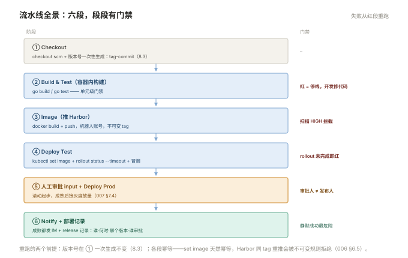

# 008 流水线实战

> **解决**：把 001–007 的组件串成一条从提交到上线的完整流水线。  
> **范围**：提交 → 构建 → 测试 → 镜像 → 部署 → 通知，全链路一条龙。  
> **口径**：Jenkins + Harbor + K8s（部署形态一）与虚机+Ansible（形态二）双写。  
> **更新**：2026-10-31

## 目录

| 节 | 内容 |
|---|---|
| 8.1 | 目标场景：一个 Web 服务从 git push 到可访问 |
| 8.2 | 全景设计：阶段划分、门禁与产物 |
| 8.3 | 阶段一：拉代码与版本号生成 |
| 8.4 | 阶段二：构建与测试（容器内构建） |
| 8.5 | 阶段三：镜像推送 Harbor |
| 8.6 | 阶段四：部署测试环境 |
| 8.7 | 阶段五：人工审批与生产发布 |
| 8.8 | 阶段六：通知与记录 |
| 8.9 | 失败处理：从红了的段重跑 |
| 8.10 | 八个坑 |
| 8.11 | 本章检查清单 |

---

## 8.1 目标场景

一个 Go Web 服务（「容器」002 的 Dockerfile 已就绪），部署目标是 K8s（Deployment `web`）。目标流水线的行为：

- 开发者 push 到 main → 自动构建、测试、推镜像、部署到**测试环境**；
- 测试通过后，**人工点确认** → 部署到**生产环境**（滚动 + 灰度起步）；
- 每一步的结果推送到 IM 群，生产发布有完整记录。

前六册的组件各自就位：Git（001）是输入，Jenkins（002）是引擎，镜像构建（容器 002）是核心步骤，Harbor（006）是制品库，K8s 滚动（容器 008）是发布动作，007 的策略与检查单是流程框架。本册只做一件事：**把它们装配起来，并保证每个环节失败时流水线正确地红**。

---

## 8.2 全景设计：阶段划分、门禁与产物

先画全景表——每个阶段的"触发、动作、门禁、产物"四栏齐了，流水线的骨架就有了：

| # | 阶段 | 触发 | 动作 | 门禁（失败即停） | 产物 |
|---|---|---|---|---|---|
| 1 | Checkout | push main（webhook） | 拉代码、定版本号 | – | 源码 + 版本号 |
| 2 | Build & Test | 同上 | 容器内编译 + 单元测试 | 测试失败即停 | 二进制 |
| 3 | Image | 2 通过 | docker build + push Harbor | 扫描 HIGH 即停（006 §6.8） | 不可变 tag 镜像 |
| 4 | Deploy Test | 3 通过 | K8s 测试环境滚动部署 | rollout status 成功 | 测试环境新版本 |
| 5 | Deploy Prod | **人工确认**（input） | 生产滚动/灰度 | 灰度红线 | 生产新版本 |
| 6 | Notify | post 块 | IM 通知 + 部署记录 | – | 记录 |



设计原则两条：**阶段边界 = 可停的检查点**（每段产物独立存在，失败不必从头跑）；**人工节点只放一个**（生产审批——000 §0.7 的边界：技术判断自动化，业务判断留给人）。

---

## 8.3 阶段一：拉代码与版本号生成

版本号是全链路的追溯主线（006 §6.4），在流水线一开始就定死，后续所有步骤只引用不重新计算：

```groovy
stage('Checkout') {
    steps {
        checkout scm
        script {
            // 版本号 = git 语义化 tag + commit 短哈希
            env.GIT_SHA = sh(returnStdout: true,
                script: 'git rev-parse --short HEAD').trim()
            env.VER = sh(returnStdout: true,
                script: 'git describe --tags --always').trim()
            env.IMAGE = "harbor.local/myapp/myapp:${env.VER}-${env.GIT_SHA}"
            echo "本次构建版本：${env.IMAGE}"
        }
    }
}
```

两个设计点：**`checkout scm` 拉的是触发本次构建的 commit**（002 §2.5 的语义——追溯的起点）；**版本号在此一次性生成**，镜像 tag、部署记录、通知消息全部引用 `env.IMAGE`——出事时从 IM 通知里的版本号一路回查到 commit，一查到底。

---

## 8.4 阶段二：构建与测试（容器内构建）

构建放在容器里做（002 §2.6 的环境确定性），测试失败流水线立即红：

```groovy
stage('Build & Test') {
    agent {
        docker {
            image 'golang:1.22-alpine'
            args '-v /root/.cache/go-build:/root/.cache/go-build'   // 依赖缓存复用
        }
    }
    steps {
        sh 'CGO_ENABLED=0 go build -o app .'
        sh 'go test ./... '
    }
}
```

这里的测试是**单元级门禁**——它的失败直接截断流水线，这是 000 §0.2"持续集成"的本义。集成/冒烟测试不在这一段做（没有可运行的环境），它们的位置在阶段四部署到测试环境之后（8.6 的验证步骤）。

---

## 8.5 阶段三：镜像推送 Harbor

用 002 的 Dockerfile 构建镜像，推送 Harbor（006 的机器人账号 + 不可变 tag）：

```groovy
stage('Image') {
    agent any
    steps {
        withCredentials([usernamePassword(
                credentialsId: 'harbor-robot',
                usernameVariable: 'USR', passwordVariable: 'PWD')]) {
            sh 'echo "$PWD" | docker login harbor.local -u "$USR" --password-stdin'
            sh 'docker build -t ${IMAGE} .'
            sh 'docker push ${IMAGE}'
        }
    }
}
```

推送后接扫描门禁（006 §6.8 的准入）：Harbor 的 admission webhook 在**部署时**拦截高危镜像（K8s 侧的闸门），流水线侧也可主动查扫描状态、HIGH 未清则 fail——双闸并行，漏网概率最低。

---

## 8.6 阶段四：部署测试环境

K8s 部署用 `set image` + `rollout status`（「容器」008 §8.2 的标准组合），部署完跑冒烟验证：

```groovy
stage('Deploy Test') {
    agent any
    steps {
        withCredentials([string(credentialsId: 'k8s-test-kubeconfig',
                                 variable: 'KUBECONFIG')]) {
            sh "kubectl -n test set image deploy/web web=${IMAGE}"
            sh "kubectl -n test rollout status deploy/web --timeout=120s"
        }
        sh "curl -fs --max-time 5 http://web.test.svc/healthz"   // 冒烟
    }
}
```

`rollout status` 是发布自动化的"等待完成"——新 Pod 起不来（ImagePullBackOff、readiness 不过）它会在 timeout 内返回非零，流水线红在**正确的位置**，而不是部署完几分钟后靠用户报障。虚机形态的对应写法是 `ansible-playbook -i test deploy.yaml`（005 的 role + serial 分批），骨架完全同构。

---

## 8.7 阶段五：人工审批与生产发布

生产段两件套：`input` 人工确认 + 灰度起步（007 §7.4 的节奏）：

```groovy
stage('Deploy Prod') {
    agent any
    steps {
        input message: "确认发布 ${IMAGE} 到生产？",
              submitter: 'ops-lead'
        withCredentials([string(credentialsId: 'k8s-prod-kubeconfig',
                                 variable: 'KUBECONFIG')]) {
            sh "kubectl -n prod set image deploy/web web=${IMAGE}"
            sh "kubectl -n prod rollout status deploy/web --timeout=180s"
        }
    }
}
```

灰度的进阶版：生产段拆成"部署 canary Deployment（1 副本）+ 接入层 weight 5% → 观察 15 分钟（008 的指标对比）→ 全量"。第一版流水线不必上灰度——**先让"审批 + 滚动 + 观察指标"稳定运转，灰度是它的增量改进**（007 §7.5 的选择表）。

---

## 8.8 阶段六：通知与记录

`post` 块 + 一条部署记录，完成闭环：

```groovy
post {
    success {
        dingtalkNotify "✅ ${APP_NAME} ${IMAGE} 已发布 ${params.ENV}"
        writeFile file: "release.log", text: "${new Date()} ${IMAGE} -> prod by ${BUILD_USER}\n"
    }
    failure {
        dingtalkNotify "❌ ${APP_NAME} 构建失败 #${BUILD_NUMBER}，查看：${BUILD_URL}"
    }
    always { cleanWs() }
}
```

通知的纪律是**成败都发**（000 §0.7：静默的成功比失败更可怕——绿了但没人知道部署了什么，是 009 静默失败的温床）。示例里的 `dingtalkNotify` 来自钉钉通知插件、`BUILD_USER` 来自 Build User Vars 插件——装上即用，换成企业微信/飞书插件同理。部署记录（release.log 或独立数据库）与 8.3 的版本号一起构成审计链：**谁、何时、哪个版本、谁审批的**。

---

## 8.9 失败处理：从红了的段重跑

流水线红了之后的标准动作，按失败段处理：

| 红在哪 | 多半是 | 动作 |
|---|---|---|
| Checkout | Git 权限/网络 | 修环境，重跑整段 |
| Build & Test | 代码问题 | **开发修代码重新 push**——不绕过测试 |
| Image | Harbor 凭据/磁盘 | 修凭据、清构建机，重推 |
| Deploy Test | K8s 资源/探针 | 「容器」009 的三板斧，修好重跑 |
| Deploy Prod input | 审批人不在 | 换审批人或等——**不跳过** |

核心纪律：**每个阶段的产物独立存在，红段修好后从该段重跑，而不是从 Checkout 全部重来**——前提是版本号不变（8.3 一次性生成）且每段幂等（K8s 的 set image 天然幂等、Harbor push 同 tag 被拒说明真有问题）。另一条红线：**失败的流水线不允许"跳过失败段"的方式通过**——门禁的意义在于它是门禁。

---

## 8.10 八个坑

| # | 坑 | 后果 | 正确做法 |
|---|---|---|---|
| 1 | 版本号每段各算各的 | 追溯链断裂 | 8.3 一次性生成 |
| 2 | 测试失败手动重跑放过 | 门禁失效 | 红了让开发修，不绕行 |
| 3 | 凭据越界（test 的 kubeconfig 能管 prod） | 测试流水线误伤生产 | 凭据按环境分、按权限分 |
| 4 | rollout 不加 timeout | 发布卡住流水线挂死 | `--timeout` 必带 |
| 5 | 通知只发成功 | 静默失败无人知 | 成败都发（8.8） |
| 6 | 部署测试环境后无验证 | "部署成功"≠"服务可用" | 冒烟检查必配 |
| 7 | 审批人就是发布人自己 | 制衡失效 | submitter 分组 |
| 8 | 流水线越改越复杂无人能改 | 全员绕过流水线 | 每段一个职责，定期删冗余 |

第 3 条展开：测试环境流水线与生产流水线如果共用一张 kubeconfig（且权限是集群管理员），一个配置错误（namespace 写错、env 变量传错）就可能让测试部署打在生产集群上。修法是**凭据物理隔离**：test kubeconfig 的 ServiceAccount 只绑定 test namespace 的角色（K8s RBAC），prod 凭据只存在于生产审批后的 job 里。权限的边界 = 爆炸半径的边界，这条在 CI/CD 体系里和在任何系统里一样成立。

---

## 8.11 本章检查清单

读完能回答这六个问题，这一章就过了：

| # | 问题 |
|---|---|
| 1 | 六个阶段各自的门禁与产物是什么？ |
| 2 | 版本号为什么在 Checkout 一次性生成？构成是什么？ |
| 3 | `rollout status` 在流水线里的作用？不加 timeout 会怎样？ |
| 4 | 生产审批节点放在哪？为什么只放这一个？ |
| 5 | 某阶段红了为什么能从该段重跑？两个前提？ |
| 6 | test/prod 凭据隔离的实现与意义？ |

---

> 下一篇：《009 排错与自测》——流水线红了、静默失败了，从哪查起。
