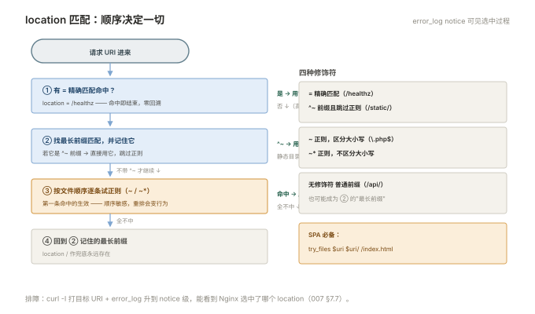

# 001 Nginx 配置体系

> **解决**：配置文件怎么组织，改了怎么验证、怎么生效。  
> **范围**：安装 · 指令继承 · http/server/location · include · `nginx -t` 与平滑重载。  
> **口径**：Nginx 1.24+ 开源版；CentOS 7 与 Ubuntu 22.04 双系对照。  
> **更新**：2026-10-31

## 目录

| 节 | 内容 |
|---|---|
| 1.1 | 安装与目录结构 |
| 1.2 | 配置的骨架：main / events / http 三层各管什么 |
| 1.3 | 指令继承：内层不写用外层，写了就覆盖——以及一个重要例外 |
| 1.4 | server 与虚拟主机：listen + server_name 的匹配规则 |
| 1.5 | location 的四种匹配与生效顺序 |
| 1.6 | include 与目录化：sites-enabled 的组织方式 |
| 1.7 | `nginx -t` 与 reload：验证、平滑重载、失败回退行为 |
| 1.8 | 进程模型：master / worker |
| 1.9 | 第一个站点：静态页 + 验证 |
| 1.10 | 八个坑 |
| 1.11 | 本章检查清单 |

---

## 1.1 安装与目录结构

两系安装（版本以各系统仓库为准，需要新特性用官方仓库）：

```bash
# Ubuntu 22.04
apt install nginx
# CentOS 7（nginx 在 EPEL，或用 nginx.org 官方仓库）
yum install epel-release && yum install nginx
systemctl enable --now nginx
```

装完先认目录（两系一致，差异只在组织方式）：

| 路径 | 内容 |
|---|---|
| `/etc/nginx/nginx.conf` | 主配置（入口） |
| `/etc/nginx/conf.d/*.conf` | 通用站点目录（两系都读） |
| `/etc/nginx/sites-available/` + `sites-enabled/` | Ubuntu 特有：可用/启用分离，enabled 里是软链 |
| `/etc/nginx/mime.types` | 扩展名 → Content-Type 映射 |
| `/var/log/nginx/` | access.log / error.log（007 册的主战场） |

Ubuntu 的 sites 机制是 include 的应用（1.6）：`sites-available` 存放所有站点配置，`ln -s` 到 `sites-enabled` 表示启用——**改了 available 忘了建软链**是 Ubuntu 上"配置改了不生效"的经典原因。

---

## 1.2 配置的骨架：main / events / http 三层各管什么

`nginx.conf` 的结构是三层嵌套，每层职责清晰：

```nginx
# main 层：进程级
user nginx;
worker_processes auto;            # worker 数，auto = CPU 核数
error_log /var/log/nginx/error.log warn;
pid /run/nginx.pid;

events {
    worker_connections 1024;      # 每个 worker 的连接上限（006 册的容量公式）
}

http {
    # http 层：协议与站点级
    include       mime.types;
    default_type  application/octet-stream;
    sendfile      on;
    keepalive_timeout 65;

    server {                      # 虚拟主机：一个站点一个 server 块
        listen 80;
        server_name app.example.com;

        location / {              # URI 匹配规则
            root /usr/share/nginx/html;
        }
    }
}
```

读配置的方法论：**看到任何指令，先问它在哪一层**——同一指令在不同层含义与继承不同（1.3），而"指令放错层"是配置报错与诡异行为的一大来源。`events` 块只有一个且必有；站点相关的一切都从 `http` 开始。

---

## 1.3 指令继承：内层不写用外层，写了就覆盖——以及一个重要例外

继承规则的一句话：**简单值指令内层不写则继承外层，写了就覆盖**。`worker_processes` 这种 main 层指令不存在继承；`root`、`index`、`proxy_*` 这类可以在 http/server/location 三层都写的指令遵循此规则——这让"全局默认 + 局部覆盖"成为可能的组织方式。

**重要例外：数组型指令不叠加，是整体覆盖。** 最典型的是 `add_header`：

```nginx
http {
    add_header X-Frame-Options DENY;      # 全局安全头

    server {
        # ❌ 这个 server 里写了任何 add_header，上面的 X-Frame-Options 就消失
        add_header Cache-Control "no-cache";
    }
}
```

一个 location 里写了 `add_header`，**从 http 层继承下来的所有 add_header 全部失效**——安全头悄悄丢掉，这类问题上线前很难发现。规矩：公共响应头在每个写了 add_header 的块里**重复声明完整清单**，或统一用 include 片段。同类指令还有 `proxy_set_header`（002 册重灾区）、`limit_req`、`expires`。

---

## 1.4 server 与虚拟主机：listen + server_name 的匹配规则

一个 Nginx 进程服务多个站点，靠 server 块区分。请求进来时按两步匹配：

**① 按 listen 的 IP:端口分桶**——`listen 80` 与 `listen 443 ssl` 是两个世界；**② 桶内按 server_name 匹配**，优先级固定：

```plain
1. 精确名            server_name app.example.com;
2. 前导通配          server_name *.example.com;
3. 后缀通配          server_name app.example.*;
4. 正则              server_name ~^app\d+\.example\.com$;
5. 都不匹配 → default_server（谁也没声明就是该端口第一个 server 块）
```

两条纪律由此而来：**显式声明 default_server**（把"兜底"变成有意行为——未匹配域名返回 444 或跳主页，而不是被第一个 server 接走）；**server_name 写全量精确名**，正则留给确实需要的场景——匹配优先级里的正则陷阱（顺序敏感）不值得在生产消耗心智。

---

## 1.5 location 的四种匹配与生效顺序

location 决定"这个 URI 用哪段配置处理"，四种修饰符：

```nginx
location = /healthz        { return 200 "ok"; }        # ① 精确匹配：命中即停
location ^~ /static/       { root /data/web; }          # ② 前缀匹配且**跳过正则**
location ~ \.php$          { fastcgi_pass …; }          # ③ 正则（区分大小写，~* 不区分）
location /                 { proxy_pass http://app; }   # ④ 普通前缀
```

生效顺序背下来：**`= ` 命中立即结束；否则记住最长前缀匹配（若它是 `^~` 则直接用，不再看正则）；否则按文件顺序试正则，第一条命中的生效；正则全不中则用刚才记住的最长前缀**。

工程纪律三条：**写 `= /healthz` 这类高频探测路径**（精确匹配零开销）；**静态目录用 `^~`**（免受正则误伤）；**`location /` 作为兜底永远存在**。匹配顺序出错的排查工具是 `curl -I` 打对应 URI + `error_log` 开 `notice` 级看选中的 location（007 册展开）。

---




## 1.6 include 与目录化：sites-enabled 的组织方式

单文件配置在三个站点以上就会失控，组织方式两派：

**conf.d 派（CentOS 风格）**：每个站点一个文件扔进 `conf.d/`，主配置 `include /etc/nginx/conf.d/*.conf;`。按字母序加载——**文件名带序号**（`010-default.conf`、`020-app.conf`）可以控制加载顺序。

**sites 派（Ubuntu 风格）**：`sites-available/`（仓库）+ `sites-enabled/`（软链=启用）。启用/禁用站点 = 建/删软链，比挪文件干净：

```bash
ln -s /etc/nginx/sites-available/app.conf /etc/nginx/sites-enabled/
nginx -t && systemctl reload nginx
```

两派可以混用（http 块里两条 include 都写），团队统一一种即可。目录化的铁律：**每个改动过的站点文件都要过 `nginx -t`**——include 把 N 个文件的语法错误风险合到了一次 reload 里。

---

## 1.7 `nginx -t` 与 reload：验证、平滑重载、失败回退行为

改配置的标准动作序列，纪律是**顺序不可变**：

```bash
nginx -t                       # ① 语法与语义检查（"syntax is ok / test is successful"）
systemctl reload nginx         # ② 通过才 reload（平滑）
# 等价：nginx -s reload
```

**reload 的平滑语义**：master 收到 SIGHUP → 校验新配置 → 起**新 worker**（用新配置）→ **旧 worker 处理完存量连接后退出**——整个过程不断连接，用户无感。这是 008 高可用的前提之一（改配置不构成事故窗口）。

**reload 失败的行为**要背下来：`nginx -t` 失败则 reload 根本不执行，旧配置继续服务（写错的配置不会把线上打挂——这是 Nginx 的安全设计）；但**`systemctl reload` 在 `nginx -t` 通过后仍可能失败的边缘情况**（如绑一个没有权限的端口）——所以 reload 后必须补验证（`curl -I` 打关键路径，007 的取证起点）。

`restart` 与 reload 的区别：restart 停掉整个服务再起，**存量连接直接断**（适合改了 listen 这类 master 级配置），日常一律用 reload。

---

## 1.8 进程模型：master / worker

`ps -ef | grep nginx` 的标准形态：

```plain
root      1234     1  0 10:00 ?        nginx: master process nginx
nginx     1235  1234  0 10:00 ?        nginx: worker process
nginx     1236  1234  0 10:00 ?        nginx: worker process
```

- **master（root）**：读配置、绑 80/443 特权端口、管理 worker（发 SIGHUP 重载、监听 worker 退出补位）。它不做业务；
- **worker（nginx 用户）**：事件循环干活的进程（0.3 的模型）。

排障价值：master 活着 = 服务在、可 reload；worker 全没了 = master 会自动补起（注意看 error log 里 worker 为什么退）；reload 后旧 worker 长时间不退 = 有慢连接挂着（`ss -tnp | grep nginx` 看它在等谁——通常是后端慢，衔接 007）。

---

## 1.9 第一个站点：静态页 + 验证

把本册动作串一遍，从零到一个可访问的站点：

```bash
# ① 准备内容
mkdir -p /data/web/app && echo "<h1>it works</h1>" > /data/web/app/index.html

# ② 站点配置（conf.d 派）
cat > /etc/nginx/conf.d/app.conf <<'EOF'
server {
    listen 80;
    server_name app.example.com;
    root /data/web/app;
    index index.html;
}
EOF

# ③ 验证 + 重载 + 访问
nginx -t
systemctl reload nginx
curl -I http://127.0.0.1/ -H 'Host: app.example.com'
```

```plain
HTTP/1.1 200 OK
Server: nginx/1.24.0
Content-Type: text/html
```

`-H 'Host: …'` 这个习惯值得养成：本地 curl 没走 DNS，**显式给 Host 头才能精确打到目标 server 块**（1.4 的匹配规则在命令行的复现）——它是本套所有验证动作的基本姿势。

---

## 1.10 八个坑

| # | 坑 | 后果 | 正确做法 |
|---|---|---|---|
| 1 | 不跑 `nginx -t` 直接 reload | 配置错误时 reload 不执行，"改了没生效"还以为成功 | 顺序纪律：t → reload → curl |
| 2 | add_header 继承覆盖 | 全局安全头悄悄消失 | 写过的块重复完整清单（1.3） |
| 3 | Ubuntu 改 available 忘建软链 | 配置永不加载 | enable 机制检查 |
| 4 | 未声明 default_server | 任意域名打到第一个 server | 显式兜底 |
| 5 | location 正则顺序敏感 | 顺序一变行为全变 | `^~` 与 `=` 收编高频路径 |
| 6 | 指令放错层 | unknown directive 报错或行为诡异 | 先问"这指令在哪层" |
| 7 | worker_connections 忘 ulimit | 上限被系统 fd 卡死 | 与 nofile 一起看（006） |
| 8 | restart 当 reload 用 | 存量连接全断 | 日常一律 reload |

第 2 条展开一个真实场景：团队在 http 层统一加了三个安全头（HSTS、X-Frame-Options、X-Content-Type-Options），半年后某站点为了调缓存加了一行 `add_header Cache-Control`——**该站点从此丢掉全部三个安全头**，且任何监控都不会报这个错（响应里只是少了几个头，不是错了什么）。发现手段要么是定期的安全头扫描，要么是 1.3 说的"片段 include"纪律。这是本册所有坑里**最静默、最长线**的一个。

---

## 1.11 本章检查清单

读完能回答这六个问题，这一章就过了：

| # | 问题 |
|---|---|
| 1 | 三层骨架各管什么？"指令放错层"会怎样？ |
| 2 | add_header 的继承陷阱是什么？怎么防？ |
| 3 | server_name 的五级匹配顺序？default_server 为什么必须显式？ |
| 4 | location 四种修饰符的生效顺序？ |
| 5 | reload 的平滑语义是什么？失败时旧配置的行为？ |
| 6 | 本地 curl 为什么要带 `-H 'Host: …'`？ |

---

> 下一篇：《002 反向代理》——请求怎么转给后端应用，客户端真实信息怎么传过去。
