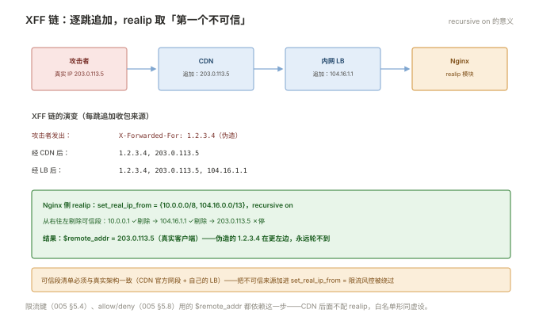

# 002 反向代理

> **解决**：请求怎么转给后端应用，客户端真实信息怎么传过去。  
> **范围**：proxy_pass · 转发头 · 三种超时 · 缓冲 · WebSocket。  
> **口径**：Nginx 1.24+ 开源版。  
> **更新**：2026-10-31

## 目录

| 节 | 内容 |
|---|---|
| 2.1 | 最小反向代理：五条配置转给 8080 |
| 2.2 | proxy_pass 路径规则：末尾带不带 URI，两种结果并排验证 |
| 2.3 | 转发头三件套：X-Real-IP / X-Forwarded-For / X-Forwarded-Proto |
| 2.4 | Host 头：多站点后端为什么必须设 |
| 2.5 | 超时三兄弟：connect / send / read 各管哪一段 |
| 2.6 | 缓冲与大响应：proxy_buffering、慢客户端隔离 |
| 2.7 | WebSocket 与长连接：Upgrade 头转发 |
| 2.8 | internal：内部接口不暴露 |
| 2.9 | 八个坑 |
| 2.10 | 本章检查清单 |

---

## 2.1 最小反向代理

反向代理的定义在 000 §0.2：Nginx 站在应用前面替它接请求。最小实现五条：

```nginx
server {
    listen 80;
    server_name app.example.com;

    location / {
        proxy_pass http://127.0.0.1:8080;
        proxy_set_header Host $host;
        proxy_set_header X-Real-IP $remote_addr;
        proxy_set_header X-Forwarded-For $proxy_add_x_forwarded_for;
        proxy_set_header X-Forwarded-Proto $scheme;
    }
}
```

验证方式沿用 001 §1.9 的姿势，但要**看后端视角**——在后端应用的访问日志里确认：收到了什么路径、什么 Host、什么来源 IP。Nginx 侧的成功（200）不等于代理正确（后端可能收到的路径/头全错）——本册的每一个知识点都配"后端日志怎么看"的验证动作。

---

## 2.2 proxy_pass 路径规则：末尾带不带 URI，两种结果并排验证

`proxy_pass` 是本册最易错的指令，规则一句话：**URL 末尾带了 URI（哪怕只是一个 `/`），就用它替换 location 匹配的部分；不带，就原样透传请求 URI**。

并排实验最直观。后端记录收到的路径，前端两种配置：

```nginx
location /api/ {
    proxy_pass http://app;              # A：不带 URI —— 后端收到 /api/users
}
location /api/ {
    proxy_pass http://app/;             # B：带 URI（/）—— 后端收到 /users（/api/ 被剥掉）
}
```

| 配置 | 请求 `/api/users?id=1` | 后端收到 |
|---|---|---|
| A 不带 URI | 透传 | `/api/users?id=1` |
| B 带 URI | 替换 | `/users?id=1` |

两种都是合法设计——**B 适合"对后端隐藏路径前缀"**（后端代码里没有 /api），**A 适合"透传给懂 /api 的网关"**。翻车点在混用心智：团队一半人按 A 的预期改后端路由，一半人按 B 配置——结果是 404 满天飞。纪律：**该字段写进团队配置规范，review 时专查**。另一个边界：**正则 location（`~`）里的 proxy_pass 不能带 URI**（Nginx 无法确定如何替换，直接报错）——遇到它就说明设计该拆成两层 location 了。

---

## 2.3 转发头三件套：X-Real-IP / X-Forwarded-For / X-Forwarded-Proto

不设转发头，后端看到的"客户端"永远是 Nginx——限流、风控、审计全部失真。三件套的分工：

| 头 | 值 | 含义 |
|---|---|---|
| `X-Real-IP` | `$remote_addr` | 直连 Nginx 的那个 IP（简单直接） |
| `X-Forwarded-For` | `$proxy_add_x_forwarded_for` | **逐跳追加的链**：`客户端IP, 代理1, 代理2…` |
| `X-Forwarded-Proto` | `$scheme` | 客户端到 Nginx 是 http 还是 https（防重定向循环，007） |

三者配合的取值纪律：**应用侧取"真实客户端 IP"永远取 XFF 链的第一个（或用 realip 模块让 Nginx 帮忙重写）**——XFF 可以被客户端伪造第一条，多层代理下"第一个可信值"的判断依赖你信任哪些上游（`set_real_ip_from` 指定可信代理段，realip 模块把 XFF 重写进 `$remote_addr`，005 册限流键的姊妹动作）。

---




## 2.4 Host 头：多站点后端为什么必须设

不设 Host 头的后果：后端收到的 Host 是 **upstream 的名字**（如 `http://app`），对"按域名分站点"的后端（同一台 Nginx 后面还有一层、或应用自己做虚拟主机路由）等于全部请求打进默认站点。

```nginx
proxy_set_header Host $host;            # 透传用户访问的域名
```

延伸两个变体：`$http_host`（原样含端口）与 `$host`（规范化，优先取请求行里的域名）——多数场景用 `$host`；后端要自生成绝对 URL（重定向、资源链接）时，这一行 + X-Forwarded-Proto 两行就是它正确生成 `https://app.example.com/...` 的全部依据。缺它们的症状是**重定向到 `http://127.0.0.1` 或裸 IP**——007 的重定向循环与这两行直接相关。

---

## 2.5 超时三兄弟：connect / send / read 各管哪一段

代理链路上的三个超时各管一段，默认 60s（connect 默认 60s，send/read 各 60s）：

| 指令 | 管哪段 | 超时症状 |
|---|---|---|
| `proxy_connect_timeout` | **与后端建立 TCP 连接** | 后端挂/防火墙拦——502 的来源（007） |
| `proxy_send_timeout` | 把请求**发给**后端，两次成功写之间的间隔 | 上行太慢 |
| `proxy_read_timeout` | **等后端响应**，两次成功读之间的间隔 | **504 的来源**——慢接口的主战场 |

两个必懂的细节：**read 超时不是总时长**——是两次成功读之间的最大间隔，一个每 30 秒吐一块数据的接口永不超时；**调大 read timeout 前先想清楚**：慢接口的根源在后端（慢查询、慢外部调用——「CICD」009 / 「数据库」007 的领地），Nginx 调大只是"忍"，正确姿势是慢接口单独 location 单独调，全局保持紧（全局 60s 是防雪崩的护栏）。

---

## 2.6 缓冲与大响应：proxy_buffering、慢客户端隔离

Nginx 默认开启响应缓冲（`proxy_buffering on`）：**后端的响应先收进 Nginx 的缓冲区，再推给客户端**。它的价值一句话：**把"后端速度"与"客户端速度"解耦**——客户端用 2G 网慢慢下，后端已经把响应交完去处理下一个请求了。

关闭缓冲（`proxy_buffering off`）的合理场景只有一个：流式接口（SSE、下载进度）——响应必须边生成边推。off 的代价：慢客户端会**占住后端连接**直到下完——高并发下这是雪崩的引信（005 的限流防的就是它的连锁反应）。

相关的三个参数：`proxy_buffers 8 8k`（内存缓冲的块数与大小）、`proxy_busy_buffers_size`（正在发送中的缓冲上限）、`proxy_max_temp_file_size`（缓冲装不下时落盘的上限，0 = 禁止落盘）。报错 `upstream sent too big header` 是缓冲区不够装响应头——调 `proxy_buffer_size`。

---

## 2.7 WebSocket 与长连接：Upgrade 头转发

WS 握手是 HTTP 升级请求，Nginx 默认**不转发** Upgrade 头（它是逐跳头），不配必失败。标准两段：

```nginx
# map 放在 http 层：有 Upgrade 才给 Connection 填 upgrade
map $http_upgrade $connection_upgrade {
    default upgrade;
    ''      close;
}

server {
    location /ws/ {
        proxy_pass http://ws-backend;
        proxy_http_version 1.1;                    # WS 要求 1.1
        proxy_set_header Upgrade $http_upgrade;
        proxy_set_header Connection $connection_upgrade;
        proxy_read_timeout 3600s;                  # 长连接空闲期，默认 60s 必断
    }
}
```

症状对应：握手 400/无响应 = 头没转发；**连接每 60 秒掉一次** = `proxy_read_timeout` 没调（它管的是"两次读之间"，WS 空闲即超时——心跳或调大二选一，心跳更稳）。

---

## 2.8 internal：内部接口不暴露

`internal` 标记的 location **只能被内部重定向命中，外部直接请求一律 404**。典型用途：鉴权后的文件下发——

```nginx
location /download/ {
    auth_request /auth;                    # 先问认证服务
    proxy_pass http://files-backend;       # 通过才到这
}
location /auth { internal; proxy_pass http://auth-svc/verify; }
location /files/ { internal; alias /data/files/; }
```

它是"把内部能力藏在 Nginx 后面"的开关——与 005 的 allow/deny（IP 层控制）配合，构成最小暴露面。排查时记住它的特征：**外部 curl 返回 404 而日志显示匹配到了该 location**——不是路径写错，是 internal 在履职。

---

## 2.9 八个坑

| # | 坑 | 后果 | 正确做法 |
|---|---|---|---|
| 1 | proxy_pass 带不带 URI 心智混乱 | 后端 404 满天飞 | 团队规范 + 后端日志验证（2.2） |
| 2 | 忘设 Host 头 | 后端多站点路由全错 | `proxy_set_header Host $host` |
| 3 | 没转发 X-Forwarded-Proto | 应用重定向到 http，循环 | 2.3 三件套 |
| 4 | 默认 read timeout 杀慢接口 | 长任务 504 | 单独 location 调大，全局保持紧 |
| 5 | buffering off 当性能优化 | 慢客户端拖死后端 | 只对流式接口关 |
| 6 | WS 没转发 Upgrade | 握手失败 | 2.7 标准两段 |
| 7 | `upstream sent too big header` | 接口 502 | 调 `proxy_buffer_size` |
| 8 | XFF 链盲信第一条 | 限流/风控被伪造 IP 绕过 | realip 模块 + 可信代理段 |

第 4 条展开一个真实节奏：业务方报告"导出任务 504"→ 排查发现导出要 90 秒 → 把该 location 的 read timeout 调到 300s → 下周另一个慢接口也来申请调大。**这是架构信号不是运维问题**：同步长任务的正确解法是异步化（提交任务返回 ID + 轮询/推送结果），超时值应该收敛而不是无限膨胀——Nginx 的 read timeout 列表是业务健康度的负向指标，review 时值得多看一眼。

---

## 2.10 本章检查清单

读完能回答这六个问题，这一章就过了：

| # | 问题 |
|---|---|
| 1 | proxy_pass 带不带 URI 的两种结果？各自的适用场景？ |
| 2 | 转发头三件套各是什么？XFF 为什么不能盲信第一条？ |
| 3 | 不设 Host 头，后端看到什么？ |
| 4 | read timeout 的确切语义？504 的根因通常在哪侧？ |
| 5 | buffering 的价值与唯一合理的关闭场景？ |
| 6 | WS 每小时掉线一次（或 60 秒）查哪个参数？ |

---

> 下一篇：《003 负载均衡与 upstream》——多个后端怎么分流量、坏一台谁发现。
