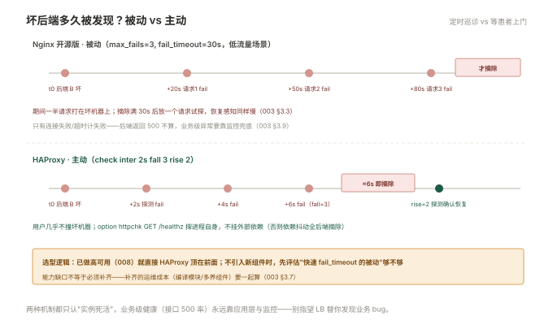

# 003 负载均衡与 upstream

> **解决**：多个后端怎么分流量、坏一台谁发现。  
> **范围**：upstream · 调度算法 · 会话保持 · 失败判定 · 开源版健康检查的限制。  
> **口径**：Nginx 1.24+ 开源版；主动健康检查方案给 HAProxy/三方模块对照。  
> **更新**：2026-10-31

## 目录

| 节 | 内容 |
|---|---|
| 3.1 | upstream 基本用法：三台后端起步 |
| 3.2 | 调度算法：轮询、weight、ip_hash、least_conn 的适用场景 |
| 3.3 | 失败判定与摘除：max_fails / fail_timeout，被动检查的盲区 |
| 3.4 | 会话保持：ip_hash 与它的代价 |
| 3.5 | backup 与降级：全员挂掉时的兜底页 |
| 3.6 | upstream keepalive：到后端的长连接池 |
| 3.7 | 主动健康检查：开源版的三个替代方案 |
| 3.8 | 灰度的接入层配合：按权重路由到新旧版本 |
| 3.9 | 八个坑 |
| 3.10 | 本章检查清单 |

---

## 3.1 upstream 基本用法

upstream 是"后端服务器组"的定义，放在 http 层，`proxy_pass` 按名字引用：

```nginx
upstream app {
    server 10.0.1.11:8080;
    server 10.0.1.12:8080;
    server 10.0.1.13:8080;
}

server {
    location / {
        proxy_pass http://app;          # 引用组名（不带 URI，002 §2.2）
        proxy_set_header Host $host;
        proxy_set_header X-Real-IP $remote_addr;
        proxy_set_header X-Forwarded-For $proxy_add_x_forwarded_for;
    }
}
```

与 002 的单后端相比多出的能力：**分流量、摘坏机、加机器不动 location**。验证手段是看 access log 里 `$upstream_addr`（005 §5.2 加进日志格式的字段）——请求依次落在三台机器上即轮询生效。

---

## 3.2 调度算法：轮询、weight、ip_hash、least_conn 的适用场景

| 算法 | 写法 | 逻辑 | 适用 |
|---|---|---|---|
| 轮询 | 默认 | 依次分发 | 后端配置相同的默认选择 |
| 加权轮询 | `server … weight=5` | 按权重比例分 | 后端性能不齐（8 核 : 4 核 = 2:1） |
| least_conn | `least_conn;` | 发给当前连接数最少的 | 请求处理时长差异大（有长有短） |
| ip_hash | `ip_hash;` | 按客户端 IP 哈希固定 | 会话保持的粗暴版（3.4） |
| 随机 | `random two;` | 随机选两个再取较优 | 特定负载形态，少见 |

两个选择上的常错点：**"均匀"不等于"正确"**——后端处理时长差异大时轮询会把长请求堆到同一台，least_conn 才公平；**weight 值不是"限流"**——weight=5 的机器不会被限制在 5 份，它只是分到更多。算法选错的症状是"负载不均"（005 的日志按 `$upstream_addr` 分桶一眼看出分布）。

---

## 3.3 失败判定与摘除：max_fails / fail_timeout，被动检查的盲区

Nginx 开源版的故障摘除是**被动的**——只有真实请求失败了才记账：

```nginx
upstream app {
    server 10.0.1.11:8080 max_fails=3 fail_timeout=30s;
}
```

语义：30 秒窗口内失败 3 次 → 该后端被摘除 **30 秒** → 到期放一个请求回去探（成功了就恢复，失败再摘）。

三个必懂的推论：

1. **低流量下坏后端发现慢**：每分钟 2 个请求的后端，凑满 3 次失败要一分半——期间一半请求打在坏机器上；
2. **恢复感知也慢**：摘除期结束才试探，好后端"起死回生"最快也要等一个 fail_timeout；
3. **只有"连接失败/超时"计失败**——后端返回 500/502 不算（它活着，只是报错），业务健康要靠应用层的兜底页与监控（005）。

`max_fails=0` 可关闭被动摘除（全部交给上层处理）——极少用，记着它是开关即可。**被动机制的系统性解法是主动健康检查**：3.7 的三个方案。

---

## 3.4 会话保持：ip_hash 与它的代价

应用把 session 存在本地内存（没进 Redis）时，同一用户必须打到同一台后端，ip_hash 是开源版 Nginx 唯一的内建方案。代价三条，决定它只是过渡方案：

1. **破坏负载均匀**：按 IP 哈希分桶，桶大小随用户分布波动——大客户/办公室出口 NAT 的上千用户被哈希到同一台后端；
2. **客户端换网即丢会话**：手机从 WiFi 切 4G，IP 变了，session 丢——用户体验的隐形杀手；
3. **摘除后该桶用户全体掉会话**：那台机器摘除，哈希到它的用户全部重新登录。

正确的长期方案是**session 外置**（Redis，应用侧改造）——一次改造，永久解除对会话保持的依赖。若必须保持且要更精细（按 cookie、慢启动），那是 Nginx Plus / HAProxy（008）的能力位。纪律：**ip_hash 可以作为迁移期的止血，不作为架构的终点**。

---

## 3.5 backup 与降级：全员挂掉时的兜底页

`backup` 标记的机器平时不接流量，组内其他后端全部不可用时才顶上：

```nginx
upstream app {
    server 10.0.1.11:8080;
    server 10.0.1.12:8080;
    server 10.0.1.50:8080 backup;      # 降级机：静态"维护中"页
}
```

配合一个纯静态的降级后端（一个只挂维护页的 nginx 容器），全后端崩溃时用户看到的是体面的维护页而不是 502——**降级页也是产品的一部分**。演练它的方法：手工 stop 全部后端，`curl` 应命中 backup（`$upstream_addr` 指向它）。另一个相关参数 `down` 是手工永久摘除（维护期用，比注释掉更清晰，reload 即生效）。

---

## 3.6 upstream keepalive：到后端的长连接池

002/006 都提过，这里给完整配方。默认 Nginx 对每个请求都与后端新建 TCP 连接（握手开销在高 QPS 下可观），keepalive 开池复用——**但它需要两处配置成对出现**：

```nginx
upstream app {
    server 10.0.1.11:8080;
    keepalive 32;                          # ① 池子大小：每 worker 保持的空闲连接数
}

server {
    location / {
        proxy_pass http://app;
        proxy_http_version 1.1;            # ② 长连接需要 HTTP/1.1
        proxy_set_header Connection "";    # ② 清掉逐跳头（否则默认 close）
    }
}
```

**漏掉第②段是它的经典坑**：只配 keepalive 不清 Connection 头，Nginx 每次仍发 `Connection: close`，池子永远空着——配置了等于没配。验证：后端看连接数（`ss -tn` 对 8080 端口的 ESTABLISHED 数应稳定在池规模附近）或看 QPS 提升前后后端 CPU 的握手开销。

---

## 3.7 主动健康检查：开源版的三个替代方案

主动健康检查（定期探测后端，坏的提前摘）是开源版 Nginx 的能力缺口（000 §0.5）。三个补位方案按推荐排序：

| 方案 | 做法 | 评价 |
|---|---|---|
| **HAProxy 顶在前面** | HAProxy 做四层分发 + 主动检查，Nginx 做七层 | 生产最常见组合（008 册主线） |
| 三方模块 | `nginx_upstream_check_module` 等补丁 | 功能有，但需自行编译维护、跟随升级成本高 |
| 外部探测 + 动态生效 | 独立探测脚本 + `down` 标记切换配置 + reload | 简单粗暴，秒级粒度做不到 |

选型逻辑：**已经在做高可用（008）就直接 HAProxy 方案**——不引入新组件；**没有 HAProxy 且需要主动检查**，先评估"被动摘除 + 快速 fail_timeout"够不够（多数 Web 场景够），再决定引模块。能力缺口不等于必须补齐——补齐的运维成本要一起算。

---




## 3.8 灰度的接入层配合：按权重路由到新旧版本

「CICD」007 §7.4 的灰度三要素里，"按比例分流"由接入层执行。两种实现：

**① 同 upstream 内按权重**——新版本机器加进组里给小权重：

```nginx
upstream app {
    server 10.0.1.11:8080 weight=19;    # 旧版
    server 10.0.1.12:8080 weight=1;     # 新版（canary）：约 5% 流量
}
```

适合"新旧版本机器共存"的虚机部署。放量 = 调 weight 数值 + reload，粒度是 1/总和。

**② 双 upstream + map 按条件分流**——按 cookie/头精确圈人（内部员工先体验新版）：

```nginx
split_clients "${remote_addr}${http_user_agent}" $canary {
    5%      canary;
    *       stable;
}
map $canary $backend {
    canary  http://app-canary;
    stable  http://app-stable;
}
location / { proxy_pass $backend; }
```

`split_clients` 按键哈希切比例，`map` 决定去向——组合起来就是"5% 用户进新版"的完整实现，且同一用户始终进同一组（哈希稳定，会话不丢）。放量 = 改百分比 reload。

K8s 场景的对应物是 Ingress 的 canary 注解（「容器」006 的衔接点）。无论哪种实现，**观察指标按版本分桶**（007 §7.10 的第 4 坑）是灰度有效的前提。

---

## 3.9 八个坑

| # | 坑 | 后果 | 正确做法 |
|---|---|---|---|
| 1 | 负载不均当网络问题查 | 方向就错了 | `$upstream_addr` 分桶看分布（3.2） |
| 2 | 500 也当健康检查失败计 | 好后端被误摘 | 分清"连接失败"与"业务失败"（3.3） |
| 3 | keepalive 漏配 Connection 清空 | 池子空转，等于没配 | 两段成对（3.6） |
| 4 | ip_hash 当长期方案 | NAT 大客户压死单机 | session 外置（3.4） |
| 5 | 摘除后无人恢复探测 | 好 30 秒坏 30 秒震荡 | 理解 fail_timeout 双向语义 |
| 6 | backup 机没准备好 | 全挂时降级页 404 | 演练降级链路 |
| 7 | 灰度 weight 用错方向 | 新版吃了 95% 流量 | 上线前小流量验证 |
| 8 | upstream 名字与 resolve 场景混用 | 动态域名不解析 | 静态 IP 清单或加 resolver（进阶） |

第 2 条展开：`max_fails` 计的"失败"是**连接层面的失败**（connection refused / timeout / 后端无响应），**HTTP 4xx/5xx 不算失败**——后端活着但业务报错，Nginx 照常轮询它。这意味着"后端全 500"的场景 Nginx 不会摘除任何机器（它无能为力），上层要有兜底：应用侧的自愈/重启策略、「监控」册的错误率告警。分清这两层失败，才能在"该摘没摘"与"不该摘摘了"之间准确定位。

---

## 3.10 本章检查清单

读完能回答这六个问题，这一章就过了：

| # | 问题 |
|---|---|
| 1 | 四种调度算法各自的适用场景？"均匀"与"正确"的差异？ |
| 2 | max_fails/fail_timeout 的双向语义（摘除与恢复）？ |
| 3 | ip_hash 的三条代价？长期方案是什么？ |
| 4 | keepalive 的两段成对配置？漏了会怎样？ |
| 5 | 开源版主动健康检查的三个替代方案？选型逻辑？ |
| 6 | 灰度的两种接入层实现？共同前提是什么？ |

---

> 下一篇：《004 HTTPS 与证书运维》——加密在这层怎么落地，证书怎么管才不会到期炸雷。
