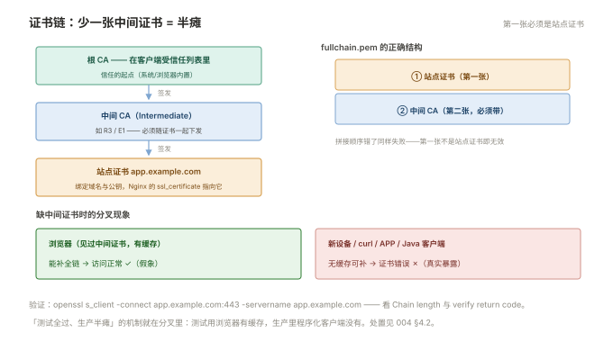

# 004 HTTPS 与证书运维

> **解决**：加密在这层怎么落地，证书怎么管才不会到期炸雷。  
> **范围**：ssl 配置 · 证书链完整性 · SNI 多证书 · HTTP/2 · 续期与到期监控。  
> **口径**：Nginx 1.24+ 开源版；TLS 协议原理见「网络」005。  
> **更新**：2026-10-31

## 目录

| 节 | 内容 |
|---|---|
| 4.1 | 最小 HTTPS 站点：证书、私钥、listen 443 |
| 4.2 | 证书链完整性：fullchain 的拼接，为什么部分用户报错 |
| 4.3 | SNI 多证书：一台机器一个 IP 挂多站 |
| 4.4 | 强制跳转与 HSTS：301 的写法、HSTS 的反悔成本 |
| 4.5 | 协议版本与套件基线：ssl_protocols / ciphers |
| 4.6 | 证书续期：certbot 自动续与人工轮换流程 |
| 4.7 | 续期后的 reload：为什么续了证书不改配置也要 reload |
| 4.8 | 到期监控：35 天/7 天两级告警 |
| 4.9 | OCSP 装订与性能注记 |
| 4.10 | 八个坑 |
| 4.11 | 本章检查清单 |

---

## 4.1 最小 HTTPS 站点

HTTPS 站点 = 普通 server + 三个 ssl 指令 + 443 端口：

```nginx
server {
    listen 443 ssl;                          # 1.25.1+ 也可写 listen 443 ssl; http2 on;
    server_name app.example.com;

    ssl_certificate     /etc/nginx/certs/app.fullchain.pem;   # 证书（含链，见 4.2）
    ssl_certificate_key /etc/nginx/certs/app.key;             # 私钥

    root /data/web/app;
}
```

TLS 握手的原理（非对称换对称、为什么要证书）在「网络」005 §5.2–5.3——本册只记运维视角的对应关系：**`ssl_certificate` 是给客户端看的名片，`ssl_certificate_key` 是握手时用的钥匙**。私钥保护三条纪律：权限 600、属主 root（master 以 root 读它后 worker 已在内存）、**永不进 Git**（001 §1.10 与「CICD」001 §1.10 的同一条红线）。

HTTP/2 的开启：1.25.1 起用独立指令 `http2 on;`（推荐写法），1.24 及以前是 `listen 443 ssl http2;`——口径里两个都给，团队统一即可。

---

## 4.2 证书链完整性：fullchain 的拼接，为什么部分用户报错

证书链（「网络」005 §5.4）要求服务器下发**自己的证书 + 中间证书**。Nginx 的约定：`ssl_certificate` 指向的文件里，**第一张是你的站点证书，后面按序跟中间证书**——这就是 `fullchain.pem` 的含义：

```plain
fullchain.pem:
-----BEGIN CERTIFICATE-----
（app.example.com 的站点证书）        ← 第一张
-----END CERTIFICATE-----
-----BEGIN CERTIFICATE-----
（中间 CA 证书，R3/ Intermediate）    ← 第二张
-----END CERTIFICATE-----
```



**"部分用户报错"的经典机制**：缺中间证书时，浏览器（曾经见过这张中间证书、有缓存）能补全链访问正常，而新设备/APP/程序化客户端（curl、Java 默认信任库的某些路径）直接报证书错误——**测试全过、生产半瘫**。取证工具：

```bash
openssl s_client -connect app.example.com:443 -servername app.example.com 2>/dev/null | head
# 看输出里的 Chain length 与 verify return code —— 链不完整一眼可见
```

证书签发方一般直接给 fullchain（Let's Encrypt 的 `fullchain.pem`），自拼时顺序错了也会失败（第一张必须是站点证书）。

---

## 4.3 SNI 多证书：一台机器一个 IP 挂多站

一个 IP 上服务多个 HTTPS 域名，靠 **SNI**（客户端在握手时带上要访问的域名——「网络」005 §5.6）+ Nginx 按 server 块各配各的证书：

```nginx
server {
    listen 443 ssl;
    server_name app.example.com;
    ssl_certificate /etc/nginx/certs/app.fullchain.pem;
    ssl_certificate_key /etc/nginx/certs/app.key;
}
server {
    listen 443 ssl;
    server_name api.example.com;
    ssl_certificate /etc/nginx/certs/api.fullchain.pem;
    ssl_certificate_key /etc/nginx/certs/api.key;
}
```

Nginx 依据 SNI 选证书——前提是**客户端发了 SNI**（现代浏览器/程序都发；极老的客户端会拿到第一个 server 的证书并报错，属可接受的兼容性损耗）。验证多证书的方法与 1.9 相同：`curl -I https://api.example.com --resolve api.example.com:443:127.0.0.1`，看返回的证书是不是 api 的。

---

## 4.4 强制跳转与 HSTS：301 的写法、HSTS 的反悔成本

HTTP → HTTPS 的标准跳转（独立 server 块）：

```nginx
server {
    listen 80;
    server_name app.example.com;
    return 301 https://$host$request_uri;     # 原路径原参数跳过去
}
```

HSTS 在 HTTPS 站点上追加一个响应头，**告诉浏览器"接下来 N 秒内别再用 http 访问我"**：

```nginx
add_header Strict-Transport-Security "max-age=31536000" always;
```

它的价值（防降级攻击、省一次跳转）与**反悔成本**必须成对记忆：浏览器把这条指令缓存 `max-age` 那么久，期间即使用户手动敲 `http://`、服务器也想退回 http，浏览器都在本地强制走 https（且可能直接拒绝连接）。**上线 HSTS 前确认三件事**：全站所有子域 https 可用（可配 `includeSubDomains` 时尤其）、证书续期流程可靠（4.6）、不再有退回 http 的计划。灰度式上线：`max-age` 从 300 起步逐步加到一年。

---

## 4.5 协议版本与套件基线：ssl_protocols / ciphers

两个指令决定"用什么强度加密"，生产基线：

```nginx
ssl_protocols TLSv1.2 TLSv1.3;        # TLS 1.0/1.1 已弃用，只留 1.2+1.3
ssl_ciphers HIGH:!aNULL:!MD5;         # 简化基线（1.3 的套件不受此控）
ssl_prefer_server_ciphers on;
ssl_session_cache shared:SSL:10m;     # 会话复用，省握手开销（0.3 模型里的握手成本）
ssl_session_timeout 1d;
```

三个运维要点：**TLS 1.0/1.1 必须关**（合规扫描必查项，且确实不安全）；**改套件别抄网上长配置**——直接用 Mozilla SSL Configuration Generator 的对应档位（Modern/Intermediate），按客户端兼容需求选档；**改完用 `openssl s_client -tls1_2` 与在线检测（SSL Labs 思路）双端验证**。这套基线一两年复核一次，加密世界的"过时"比你想的快。

---

## 4.6 证书续期：certbot 自动续与人工轮换流程

Let's Encrypt 的免费证书 90 天有效期，靠 **certbot** 全自动续：

```bash
# 安装并签发（webroot 模式：不动 nginx 配置，用现有站点的目录验证域名）
certbot certonly --webroot -w /data/web/app -d app.example.com

# 签好的位置（注意它自己会生成 fullchain）
# /etc/letsencrypt/live/app.example.com/fullchain.pem
# /etc/letsencrypt/live/app.example.com/privkey.pem

# 自动续期：systemd timer 已随包安装，验证即可
certbot renew --dry-run          # 演练一次完整的续期流程
```

部署钩子把"续完"和"加载"连起来（4.7 的问题）：

```bash
# /etc/letsencrypt/renewal-hooks/deploy/reload-nginx.sh
#!/bin/bash
nginx -t && systemctl reload nginx
```

人工轮换（商业证书/内部 CA）的流程纪律：**新证书先在 staging 验证（链完整、域名 SAN 对）→ 低峰替换文件 → `nginx -t` → reload → `openssl s_client` 复核新证书生效**——与「CICD」007 的发布三要素同构，证书就是一次小发布。

---

## 4.7 续期后的 reload：为什么续了证书不改配置也要 reload

这是证书运维最经典的翻车点：**Nginx 的 master 在启动时把证书读进内存，之后永远用内存里那份**。文件替换了（certbot 改了 live 目录），运行中的 Nginx 依然用旧证书——直到你 reload。

症状特征鲜明：**证书文件是新的（`openssl x509 -enddate -noout -in fullchain.pem` 显示 90 天后到期），浏览器看到的还是旧的（马上到期）**。反射对应：看到这个组合，第一反应 `nginx -s reload`，第二反应查 4.6 的 deploy hook 为什么没跑。

---

## 4.8 到期监控：35 天/7 天两级告警

证书到期是"完全可预防却年年发生"的事故——免费证书 90 天周期把翻车频率提高了三倍。两级告警的分级逻辑：

| 级别 | 时点 | 动作 |
|---|---|---|
| 预警 | 剩余 **35 天** | 例行续期（certbot 自动，人工证书安排采购/签发） |
| 升级 | 剩余 **7 天** | 告警升级到值班与上级，人工介入到底 |

脚本化监控一条命令即可（放 cron/监控定时任务）：

```bash
for domain in app.example.com api.example.com; do
  days=$(( ( $(date -d "$(openssl s_client -connect $domain:443 -servername $domain 2>/dev/null \
      | openssl x509 -noout -enddate | cut -d= -f2)" +%s) - $(date +%s) ) / 86400 ))
  echo "$domain: $days days"
done
```

把它接进「监控」册的告警通道（Prometheus 的 blackbox exporter 也有现成的证书到期探针）。清单化的最后一块：**所有对外域名与证书的台账**——没有台账，监控漏掉一个冷门子域，前面的自动化全部白做。

---

## 4.9 OCSP 装订与性能注记

OCSP 装订（stapling）：Nginx 定期替客户端查证书吊销状态并"装订"进握手响应——客户端不用再自己发起 OCSP 查询（省一次外联、快一点、隐私好一点）：

```nginx
ssl_stapling on;
ssl_stapling_verify on;
resolver 223.5.5.5 valid=300s;      # 查询 OCSP 地址需要 DNS resolver
```

运维视角三点：它需要 Nginx 能出网访问 CA 的 OCSP 服务（内网隔离环境会静默失败，error log 有线索）；Let's Encrypt 已宣布缩短 OCSP 支持（2025 年起逐步停止）——**新配置以 CRL/短有效期策略为方向**，别新建依赖 OCSP 的架构；验证方式 `openssl s_client -status` 看 OCSP response 段。

---

## 4.10 八个坑

| # | 坑 | 后果 | 正确做法 |
|---|---|---|---|
| 1 | 缺中间证书 | 部分客户端报错，测试环境全过 | fullchain + `s_client` 验证（4.2） |
| 2 | 续期后不 reload | 旧证书跑到过期 | deploy hook（4.7） |
| 3 | 私钥进 Git / 权限 644 | 泄漏 = 全站 HTTPS 失守 | 600/root/不进 Git |
| 4 | HSTS 上线太急 | 回退 http 被浏览器拒绝 | max-age 灰度（4.4） |
| 5 | TLS 1.0/1.1 没关 | 合规扫描不过 | 基线只留 1.2/1.3（4.5） |
| 6 | SNI 少配一个 server 的证书 | 那个域名拿到错误证书 | 每 server 独立配（4.3） |
| 7 | 没有证书台账 | 冷门域名到期炸雷 | 台账 + 双级告警（4.8） |
| 8 | 证书与 server_name 不匹配 | 握手告警 name mismatch | 覆盖域名对 SAN（签发时确认） |

第 3 条展开：私钥泄漏的处置没有"撤销重签"那么简单——泄漏的私钥对应证书需要**吊销**（OCSP/CRL 生效有延迟且客户端未必查），所以**泄漏即按事故处理**：立即签发新证书换上（新密钥对）→ 吊销旧证书 → 排查泄漏途径（Git 历史、日志、备份）——与「CICD」001 §1.10 的密钥处置完全同构。防重于治：私钥的生成、存放、备份路径都要在台账里登记。

---

## 4.11 本章检查清单

读完能回答这六个问题，这一章就过了：

| # | 问题 |
|---|---|
| 1 | fullchain 里第一张必须是什么？缺中间证书的"部分用户报错"机制？ |
| 2 | SNI 是什么？多证书怎么配？怎么验证？ |
| 3 | HSTS 的反悔成本是什么？灰度上线怎么做？ |
| 4 | certbot 续期后必须做什么？为什么？ |
| 5 | 35/7 天两级告警的动作分别是什么？台账管什么？ |
| 6 | 私钥泄漏的处置三步？ |

---

> 下一篇：《005 日志与访问控制》——谁来了、被拦了，日志怎么管、流量怎么限。
