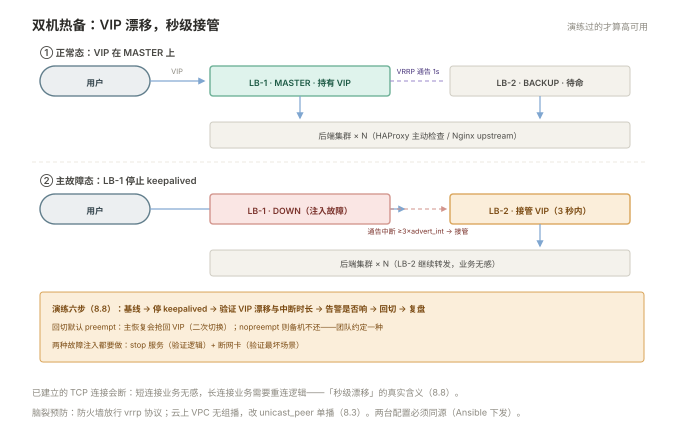

# 008 高可用接入

> **解决**：入口自己挂了怎么办——双机热备的搭建与演练。  
> **范围**：HAProxy 配置 · Keepalived VIP · 双机热备演练。  
> **口径**：HAProxy 2.8+，Keepalived 2.x；VRRP 原理见「网络」006 §6.5。  
> **更新**：2026-10-31

## 目录

| 节 | 内容 |
|---|---|
| 8.1 | 高可用的两层：入口互备 + 后端探测 |
| 8.2 | Keepalived 主备配置：VIP、优先级、通告 |
| 8.3 | 脑裂的预防：VRRP 通路与仲裁 |
| 8.4 | HAProxy 基本骨架：frontend / backend / defaults |
| 8.5 | HAProxy 健康检查：主动探测、宕机秒级摘除 |
| 8.6 | ACL 分流：按域名与路径转发 |
| 8.7 | 统计页与运维接口 |
| 8.8 | 双机热备演练：kill 主机 → 验证漂移 → 回切 |
| 8.9 | 八个坑 |
| 8.10 | 本章检查清单 |

---

## 8.1 高可用的两层：入口互备 + 后端探测

「接入层」的单机 Nginx 有两个单点，本册分别补齐：

```plain
                ┌── LB-1（Keepalived MASTER，持有 VIP）──┐
用户 ──VIP──▶   │                                        │──▶ Nginx 集群（003 的 upstream）
                └── LB-2（Keepalived BACKUP，待命）──────┘
                        │ HAProxy 主动健康检查（秒级摘除坏后端）
                        ▼
                  后端 × N
```



两层分工：**Keepalived 解决"入口机器自己挂了"**（VIP 漂移到备机，003 §3.7 的能力缺口由 HAProxy 的主动检查补上）；**HAProxy 解决"后端坏了发现慢"**（主动探测秒级摘除，不等真实请求失败）。常见整层组合就是 000 §0.4 的选择树落地：Keepalived(VIP) → HAProxy(四层分发+主动检查) → Nginx(七层代理/静态) → 应用。

简化形态（小规模）也可以是：Keepalived 直接管理 Nginx 双机（无 HAProxy），接受被动检查的局限——**先明确你缺的是哪一层，再决定引入哪个组件**。

---

## 8.2 Keepalived 主备配置：VIP、优先级、通告

两台机器的 keepalived.conf（核心段）：

```nginx
# LB-1（主）
vrrp_instance VI_1 {
    state MASTER                 # 初始角色
    interface ens33              # VIP 绑定在哪块网卡
    virtual_router_id 51         # 同一组主备必须相同（0-255）
    priority 100                 # 主高备低：LB-2 配 90
    advert_int 1                 # 每 1 秒发一次 VRRP 通告

    authentication {
        auth_type PASS
        auth_pass S3cretVRRP     # 同组一致
    }
    virtual_ipaddress {
        203.0.113.100/24         # VIP：DNS 指向它
    }
}
```

LB-2 只改两处：`state BACKUP`、`priority 90`。工作机制（「网络」006 的 VRRP）对应到运维视角：**MASTER 每秒广播通告；BACKUP 超过约 3 秒没听到（3 × advert_int）就接管 VIP**——漂移时长因此是秒级（1–3 秒 + ARP 更新）。验证 VIP 在谁身上：`ip addr | grep 203.0.113.100`——只应出现在一台机器。

---

## 8.3 脑裂的预防：VRRP 通路与仲裁

脑裂（两台都认为自己是主、同时持 VIP）的根源是**通告链路断了但服务都活着**——主备之间的心跳线路被防火墙拦、网卡故障。两层预防：

1. **通路保障**：VRRP 协议（IP 协议号 112，组播 224.0.0.18）**不是 TCP 端口**——防火墙要放的是 vrrp 协议而非某个端口（iptables: `-p vrrp -j ACCEPT`）。云上还有一层：**VPC 普遍不支持组播**，组播通告发不出去，因此云上常改用 **unicast 单播模式**——`unicast_peer` 指定对端 IP，通告变成普通单播包；
2. **检测与仲裁**：监控同时抓两台的 VIP 持有状态，**两台同时持有 = 告警**；更稳的架构加第三方仲裁（第三台机器/网关做 ping 检查，主备都失联时按仲裁决定谁退出）——「网络」006 §6.5 的 Keepalived 段落与此呼应。

脑裂发生后的止血：直接在备机 `systemctl stop keepalived`，让主收复 VIP，再排查通告链路。

---

## 8.4 HAProxy 基本骨架：frontend / backend / defaults

HAProxy 的配置三段式：

```nginx
# /etc/haproxy/haproxy.cfg
global
    log 127.0.0.1 local0
    maxconn 20000

defaults
    mode http                      # 七层（tcp 为四层透传）
    log global
    timeout connect 5s             # 与后端建连（002 §2.5 的 connect 同义）
    timeout client  60s
    timeout server  60s

frontend web_front
    bind *:80
    default_backend web_nodes

backend web_nodes
    balance roundrobin
    server web1 10.0.1.11:8080 check
    server web2 10.0.1.12:8080 check
    server web3 10.0.1.13:8080 check
```

结构语义：**frontend** 定义"怎么接流量"（监听端口、分派到哪个 backend），**backend** 定义"分给谁、怎么分"（调度、健康检查、服务器清单）——比 Nginx 的 location 组织更清晰的两分法。`check` 是本册的主角：每个 server 后面跟它，主动健康检查即开。语法校验与平滑重载与 Nginx 同套路：`haproxy -c -f /etc/haproxy/haproxy.cfg` → `systemctl reload haproxy`（reload 同样平滑不断连）。

---

## 8.5 HAProxy 健康检查：主动探测、宕机秒级摘除

`check` 默认探 TCP 连通，升级为 HTTP 探测（推荐）：

```nginx
backend web_nodes
    option httpchk GET /healthz
    http-check expect status 200
    server web1 10.0.1.11:8080 check inter 2s fall 3 rise 2
```

参数语义：**inter 2s**（每 2 秒探一次）、**fall 3**（连续 3 次失败摘除——约 6 秒感知）、**rise 2**（恢复需连续 2 次成功，防抖动）。对比 003 §3.3 的被动机制：**Nginx 要等真实用户撞上失败才开始计数（低流量发现极慢），HAProxy 是定时巡诊**——这就是 8.1 说"秒级摘除"的来源。`/healthz` 的设计要求与「容器」008 §8.4 一致：只探进程自身死活，不挂外部依赖（否则依赖抖动引发全后端摘除——同一个坑换了个组件再踩一遍）。

摘除与恢复的观察都落在 stats 页（8.7）——绿黄红的状态一目了然。

---

## 8.6 ACL 分流：按域名与路径转发

HAProxy 的 ACL 是七层路由的条件语法，与 Nginx 的 server/location 对应：

```nginx
frontend web_front
    bind *:80
    acl is_api  path_beg /api/
    acl is_old  hdr_dom(host) -i legacy.example.com

    use_backend api_nodes  if is_api        # 满足条件走专用 backend
    use_backend legacy     if is_old
    default_backend web_nodes              # 兜底
```

读法：`acl 名字 条件` 定义判断，`use_backend … if 名字` 决定分流——`path_beg`（路径前缀）、`hdr_dom`（域名）是最常用的两个。它承接两件事：「CICD」007 的灰度可以在这里按比例放量（`weight` 与备份队列），多业务共存的入口在这里分家。与 Nginx 的选型语感差异：**HAProxy 的 ACL 是"条件表达式"（可组合、可复用），Nginx 的 location 是"路径匹配"**——复杂分流 HAProxy 更顺手。

---

## 8.7 统计页与运维接口

HAProxy 自带的统计页是运维主界面：

```nginx
listen stats
    bind *:8404
    stats enable
    stats uri /stats
    stats auth admin:S3cret
```

页面四块信息：**每台后端的健康状态**（绿 UP/黄 NOLINK/红 DOWN 与最近的切换记录）、**请求与错误计数**（4xx/5xx/连接错误——比 Nginx 的日志聚合更实时）、**队列与响应时间分布**、**每秒速率**。排障价值：后端摘除事件的时间线、哪台后端错误率高，stats 页第一眼可见（对接「监控」册的 exporter 也有现成的 haproxy exporter）。

进一步是**运行时接口**（不停机改后端）：`set server web_nodes/web1 state ready` 这类命令走管理 socket——维护后端机器时"先从池里摘、维护完放回"不用改配置 reload。初学阶段用 stats 页 + reload 即可，socket 是进阶工具。

---

## 8.8 双机热备演练：kill 主机 → 验证漂移 → 回切

高可用不是配置出来的，是**演练出来的**。标准演练流程：

```plain
① 基线：确认 VIP 在 LB-1（ip addr），业务访问正常，监控告警基线记录
② 模拟主故障：LB-1 上 systemctl stop keepalived（整机故障用 ip link set ens33 down）
③ 验证漂移：VIP 出现在 LB-2；业务侧 curl 持续打（记录中断时长，预期 ≤3 秒）
④ 观察告警：「监控」的 VIP 漂移告警是否按时响
⑤ 回切验证：LB-1 恢复 keepalived —— 注意默认 preempt：主回来会抢回 VIP（二次切换！）
⑥ 复盘：中断时长、告警时延、回切是否造成新抖动
```

三个演练要点：**故障注入用"停服务"与"断网卡"两种**（前者验证 keepalived 逻辑，后者验证最坏场景——ARP/路由层面的真实表现）；**回切默认会抢回**（preempt 特性），如果不想二次切换可配 `nopreempt`（备机接管后不还，直到它自己出问题）——两种策略团队约定一种；**业务侧的中断感受要如实记录**——已建立的 TCP 连接会断（短连接业务无感，长连接业务要重连逻辑），这是"秒级漂移"的真实含义。

---

## 8.9 八个坑

| # | 坑 | 后果 | 正确做法 |
|---|---|---|---|
| 1 | 防火墙没放 VRRP | 主备互相看不见 → 双主脑裂 | `-p vrrp` 放行 / unicast 模式 |
| 2 | 两台 VIP 同现 | 流量分裂，诡异现象 | 监控双持告警（8.3） |
| 3 | virtual_router_id 与邻居冲突 | 同网段其他 keepalived 集群互相干扰 | id 全网段规划唯一 |
| 4 | 回切引发二次切换 | 刚恢复就再抖一次 | preempt/nopreempt 团队约定 |
| 5 | healthcheck 探了外部依赖 | 依赖抖动 → 全后端 DOWN | 只探自身（8.5） |
| 6 | stats 页暴露公网 | 运维信息泄漏 | bind 内网 + auth |
| 7 | 两台配置漂移 | 备机接管后行为不一致 | 配置进 Git，双机同步下发（005） |
| 8 | 演练只测 stop 服务 | 断网卡/整机场景没验证过 | 两种注入都做（8.8） |

第 7 条展开：双机热备的隐含承诺是"备机随时能无缝顶上"——前提是**两台的行为完全一致**（同样的 upstream 清单、同样的证书、同样的 ACL）。手工各改各的 Nginx 配置，几个月后两台早已分叉：主挂了备接管，用户撞上的是"另一套配置的服务"（缺站点、证书不对、限流参数不同）。修法与配置管理的唯一解一致：**两台的配置同源（Git + Ansible 下发，005 §5.9 的工程结构）**，漂移靠 `--diff` 审计兜底。

---

## 8.10 本章检查清单

读完能回答这六个问题，这一章就过了：

| # | 问题 |
|---|---|
| 1 | 高可用的两层分别解决什么？简化形态什么时候够用？ |
| 2 | VRRP 的漂移时长由哪几个参数决定？验证 VIP 在谁身上的命令？ |
| 3 | 脑裂的根源与两层预防？云上为什么要 unicast？ |
| 4 | HAProxy 的 check 参数语义（inter/fall/rise）？与 Nginx 被动检查的本质差异？ |
| 5 | 双机热备演练的六个步骤？回切的 preempt 现象？ |
| 6 | 双机配置漂移为什么是大坑？唯一解是什么？ |

---

> 下一篇：回到 [README](README.md) 总览——「接入层」套完成，横向衔接「CICD」007（灰度）与「容器」006（Ingress）。
