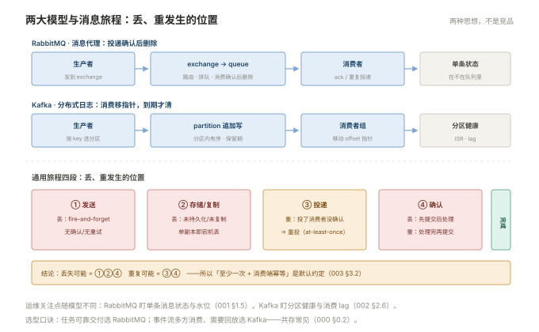

# 000 消息队列全貌

> **解决**：为什么需要 MQ、两大阵营怎么选、可靠性语义是什么。  
> **范围**：解耦/削峰/异步 · 代理 vs 日志 · 消息的旅程 · 可靠性语义 · 选型。  
> **口径**：与 [README](README.md) 一致。  
> **更新**：2026-11-01

## 目录

| 节 | 内容 |
|---|---|
| 0.1 | 为什么需要 MQ：解耦、削峰、异步 |
| 0.2 | 两大阵营：消息代理 vs 分布式日志 |
| 0.3 | 一条消息的旅程与丢/重发生的位置 |
| 0.4 | 可靠性语义：at-least-once 是默认约定 |
| 0.5 | 选型与部署形态 |
| 0.6 | 六个误解 |
| 0.7 | 本套学习路径 |

---

## 0.1 为什么需要 MQ：解耦、削峰、异步

同步调用的三个结构性问题，MQ 一一化解：

- **解耦**：下单服务直连短信、积分、风控三个服务——任一下游慢/挂，下单跟着挂。改为发一条消息到 MQ，下游各自消费，**上下游只认识 MQ 不认识彼此**；
- **削峰**：大促瞬时 1 万单/秒，下游只能处理 2000/秒。MQ 是缓冲池——峰值存起来，下游按自己的能力消费；
- **异步**：用户不需要等"发短信"完成才收到下单成功回执——发消息即返回，耗时动作后置。

代价也要先立住：**引入 MQ = 引入一个需要运维的分布式系统**（堆积、丢失、重复、顺序问题全来了），且**同步变异步后，"失败怎么办"从抛异常变成需要补偿设计**。MQ 不是让问题消失，是把问题的形态变成可缓冲、可观测、可治理的形态。

---

## 0.2 两大阵营：消息代理 vs 分布式日志

RabbitMQ 与 Kafka 经常被摆在一起比，其实它们是**两种思想**：

| | RabbitMQ（消息代理） | Kafka（分布式日志） |
|---|---|---|
| 模型 | 消息按路由规则投递，**消费确认后删除** | 消息追加进分区日志，**消费只移指针，到期才清** |
| 强项 | 灵活路由（四类 exchange）、低延迟投递、管理成熟 | 极高吞吐、消息可回放、分区并行扩展 |
| 弱项 | 高吞吐场景不如 Kafka；堆积敏感 | 路由能力弱（靠 topic/partition 规划）；不在意"单条状态" |
| 典型场景 | 业务指令投递、任务分发、RPC 回复 | 事件流、行为埋点、日志总线、流处理源头 |

选型口诀：**"把任务可靠地交给某个处理者"选 RabbitMQ；"把事件流式地记下来给多方消费"选 Kafka**。两者在同一个系统里共存很常见（业务指令走 MQ、事件流走 Kafka）。运维视角最大的差异：RabbitMQ 关心**单条消息的状态**（在不在队列里、有没有被 ack），Kafka 关心**分区的健康与消费进度**（ISR、lag）——001/002 两册的所有差异都源于此。



---

## 0.3 一条消息的旅程与丢/重发生的位置

```plain
生产者 ──①发送──▶ MQ ──②存储/复制──▶ MQ ──③投递──▶ 消费者 ──④确认──▶ 完成
```

**丢失只可能发生在 ①②④ 三个环节**（发送没确认、存储没落盘/没复制、消费先提交后处理）——003 §3.1 的三环节对账法由此而来。**重复只可能发生在 ③④**（投递后消费者没来得及确认就挂了，MQ 重投）——这就是 0.4 的语义。**分段归因是 MQ 排障的总纲**（004 的剧本按此组织）。

---

## 0.4 可靠性语义：at-least-once 是默认约定

三种语义的取舍：at-most-once（可能丢，最快）、at-least-once（不丢可能重）、exactly-once（不丢不重，最贵）。

**生产默认按 at-least-once 设计**：发送端确认 + broker 持久化/复制 + 消费端确认——做到这三件就得到"至少一次"；而"至少一次"必然带来重复，所以**消费端幂等不是可选项，是标配**（003 §3.2：唯一键去重、数据库唯一约束、版本号比对）。exactly-once 只在 Kafka 事务链路内成立（生产→Kafka→消费全在一套事务语义里），跨系统（MQ→数据库）永远靠消费端幂等兜底——**别追"传输层精确一次"，追"处理效果精确一次"**。

---

## 0.5 选型与部署形态

部署形态按体量递进：**单机**（测试/小流量）→ **三节点集群起步**（生产最低配，RabbitMQ 仲裁队列与 Kafka 三副本都需要 3）→ **跨可用区**（副本分散 AZ）。云托管（AMQP 产品/MSK）把 broker 运维接走，但**堆积治理与消费侧的机制责任不变**（000 §0.6 与「容器」000 §0.6 同构）。

版本口径：RabbitMQ 3.12+（新建队列一律仲裁队列）；Kafka 3.x（新集群 KRaft，存量 ZooKeeper 集群按升级路径迁移）。

---

## 0.6 六个误解

| # | 误解 | 实际 |
|---|---|---|
| 1 | MQ 不会丢消息 | 默认配置下三个环节都可能丢——可靠性是配置出来的 |
| 2 | 消息有序 | 只保证分区内/单队列内有序；全局有序要单分区（牺牲吞吐） |
| 3 | Kafka 一定比 RabbitMQ 高级 | 两种模型；百万级小消息+复杂路由，RabbitMQ 更合适 |
| 4 | 堆积就是消费端慢 | 也可能是生产突增、毒丸、分区规划失衡——先归因再扩容 |
| 5 | exactly-once 谁都该上 | 代价高；消费端幂等 + at-least-once 通常等效且简单 |
| 6 | MQ 是无状态的中间件 | broker 有内存/磁盘水位、有集群状态——它是最"有状态"的基础设施之一 |

---

## 0.7 本套学习路径

```plain
全景      000（本册）
产品      001 RabbitMQ 运维 ──▶ 002 Kafka 运维（对照学，概念互通）
治理      003 堆积与可靠性治理（两产品的公共主战场）
运营      004 故障剧本（四段取证思想同「日志」006）
```

横向衔接：堆积与 ISR 指标进「监控」册告警链路；MQ 自身日志进「日志」册集中采集；"消费端幂等"与「日志」006 的去重同源。

---

> 下一篇：《001 RabbitMQ 运维》——消息代理怎么配、怎么管。
