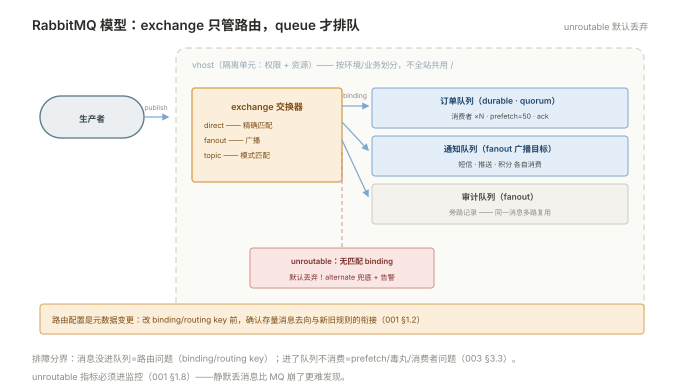
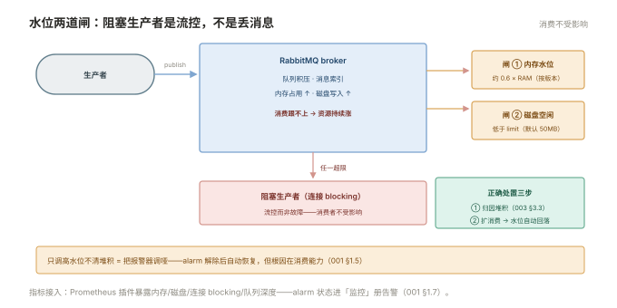

# 001 RabbitMQ 运维

> **解决**：消息代理的模型、可靠性配置、水位治理与集群。  
> **范围**：exchange/queue 模型 · vhost · 持久化三件套 · 仲裁队列 · 内存与磁盘水位 · prefetch。  
> **口径**：RabbitMQ 3.12+；新建队列一律仲裁队列；管理插件启用。  
> **更新**：2026-11-01

## 目录

| 节 | 内容 |
|---|---|
| 1.1 | 模型：producer → exchange → binding → queue → consumer |
| 1.2 | 四类 exchange 与路由选择 |
| 1.3 | vhost、connection 与 channel |
| 1.4 | 可靠性三件套与仲裁队列 |
| 1.5 | 内存与磁盘水位：阻塞生产者的两道闸 |
| 1.6 | prefetch：消费端的流控阀门 |
| 1.7 | 集群与监控 |
| 1.8 | 六个坑 |
| 1.9 | 本章检查清单 |

---

## 1.1 模型：producer → exchange → binding → queue → consumer

与直觉不同，**生产者不把消息直接发到队列**——消息先到 exchange（交换器），exchange 按 binding（绑定规则）把消息路由进一个或多个 queue，消费者从 queue 取：

```plain
producer ──▶ exchange ──binding──▶ queue ──▶ consumer
              （只管路由）        （只管排队）
```

这个分离是 RabbitMQ 灵活路由的根源：同一个 exchange 可以绑多个队列（广播），不同 exchange 可以路由进同一个队列（多来源汇聚）。**运维要管的三个实体**：exchange（路由）、queue（积压与水位所在）、binding（规则）——排障时先搞清楚"消息卡在路由还是卡在队列"（004 §4.1）。



---

## 1.2 四类 exchange 与路由选择

| 类型 | 路由规则 | 典型用途 |
|---|---|---|
| direct | binding key 精确相等 | 点对点任务分发 |
| fanout | 广播给所有绑定队列 | 配置刷新通知、缓存失效广播 |
| topic | 按模式匹配（`order.*.created`） | 按业务前缀分发的复杂路由 |
| headers | 按消息头属性匹配 | 少用，知道即可 |

运维视角的关注点：**路由配置是元数据**，改 binding/routing key 是"业务语义变更"——变更前确认旧消息的去向（binding 解除后，已入队消息仍在队列里，但新消息不再路由进来）。`unroutable` 消息（无匹配 binding）默认被**静默丢弃**——统计里盯着 `return_unroutable` 指标，重要业务要设置 alternate exchange（备用交换器）兜底。

---

## 1.3 vhost、connection 与 channel

- **vhost**：实例内的虚拟隔离单元——每套环境（prod/staging）或每类业务一个 vhost，权限（用户↔vhost）与资源（队列/交换器）都以 vhost 为边界。**不要全站共用 `/`**；
- **connection（TCP 连接）**：贵，一客户端一两条即可；
- **channel（信道）**：connection 内的轻量复用通道，**并发操作在多 channel 上**。channel 频繁报错（如 publish 到不存在的 exchange）会自动关闭——客户端日志里的 "closed channel" 要查原因而不是无视。

容量参考：单机 RabbitMQ 数万连接/十几万 channel 是常见水位——连接数异常暴涨通常是客户端连接池泄漏（每个请求新建连接的写法）。

---

## 1.4 可靠性三件套与仲裁队列

"消息扛住 broker 重启"需要**三件齐备**，缺一不可：

1. **durable exchange**（交换器持久化）；
2. **durable queue**（队列定义持久化）；
3. **消息 persistent**（`delivery_mode=2`）——队列在而消息没持久化，重启后队列在、消息全没。

可靠性再加一层**复制**：仲裁队列（quorum queue）基于 Raft 把队列复制到奇数个节点（通常 3），单节点故障消息不丢不中断。**新建队列一律仲裁队列**；镜像队列（mirrored）是旧方案，已废弃并在 4.0 移除——存量迁移是升级计划的一部分。仲裁队列的代价：吞吐低于非复制队列、强依赖多数派存活——**三节点集群挂两个=仲裁队列不可用**（宁可不可用也不丢，语义如此）。

---

## 1.5 内存与磁盘水位：阻塞生产者的两道闸

RabbitMQ 的自保不是丢消息，而是**阻塞生产者**：

| 闸 | 默认 | 超限行为 |
|---|---|---|
| 内存水位 | 物理内存的比例（版本相关，约 0.6） | **阻塞所有发布连接**（连接状态变 blocking），消费不受影响 |
| 磁盘空闲限制 | 50MB | 同样阻塞生产者 |

被阻塞时管理界面会显示 alarm——**这是流控不是故障**，但如果持续阻塞说明消息消化跟不上生产。处置顺序：查堆积原因（003 §3.3）→ 消费端扩容 → 必要时临时调低水位让业务自己限流——**只调高水位不清堆积 = 把报警器调哑**。指标接入：「监控」口径下 Prometheus 插件暴露 memory/disk/连接/队列深度全套指标。



---

## 1.6 prefetch：消费端的流控阀门

prefetch（basic.qos）= **允许单个消费者手里攥着多少条未 ack 的消息**：

- **prefetch 无限**（老客户端默认）：broker 把队列里的消息全塞给这一个消费者——消息堆积在消费者内存、其它消费者挨饿；
- **prefetch=1**：处理完一条才给下一条——最公平但吞吐低（等 ack 的往返）；
- **合理值**：处理耗时均匀的业务取 10–100 起步，压测校准。**调 prefetch 是 RabbitMQ 消费性能调优的第一杠杆**。

ack 语义配套：消费者处理完发 basic.ack；basic.nack(requeue) 把消息退回队列——**requeue 的消息会立刻重投给（可能同一个）消费者，毒丸消息会形成死循环**，解法在 003 §3.6 的死信。

---

## 1.7 集群与监控

- **集群**：多节点共享全部元数据（exchange/queue 定义）；经典队列数据只在单节点（其余节点仅元数据镜像），**仲裁队列的数据才真正复制**。网络分区的处置策略配 `pause_minority`（少数派自动暂停，防脑裂双写）；
- **监控**：管理插件（15672 端口）看队列深度/消费速率/连接；Prometheus 插件暴露全套指标接「监控」册告警——**最小告警集**：队列堆积、内存/磁盘 alarm、unroutable 数量、节点存活。

---

## 1.8 六个坑

| # | 坑 | 后果 | 正确做法 |
|---|---|---|---|
| 1 | 只持久化队列不持久化消息 | 重启后队列在、消息全没 | 三件套齐备（1.4） |
| 2 | 继续新建镜像队列 | 4.0 移除，迁移变负债 | 新建一律仲裁队列 |
| 3 | prefetch 无限 | 单消费者内存堆积+负载不均 | 显式设值（1.6） |
| 4 | unroutable 静默丢弃 | 业务以为发了，其实没人收到 | alternate exchange + 指标监控 |
| 5 | 全站共用默认 vhost `/` | 权限与资源无边界 | 按 env/业务建 vhost |
| 6 | 水位告警后调高水位了事 | 真正的堆积病被掩盖 | 先归因堆积（003 §3.3） |

第 4 条展开：unroutable 是"路由配置与业务预期脱节"的信号——多发生于 exchange 改名、routing key 拼写变化、队列误删。RabbitMQ 对 unroutable 的默认行为是**丢弃**（生产端若未开启 mandatory 返回甚至无感），因此它必须进监控与告警——静默丢消息比 MQ 崩了更难发现。

---

## 1.9 本章检查清单

读完能回答这六个问题，这一章就过了：

| # | 问题 |
|---|---|
| 1 | exchange 与 queue 的分工？unroutable 消息的默认去向？ |
| 2 | 持久化三件套？缺一件的后果？ |
| 3 | 仲裁队列替代了什么？代价是什么？ |
| 4 | 两道水位的超限行为？"调高水位"为什么是错误处置？ |
| 5 | prefetch 的语义？调它的方向怎么判断？ |
| 6 | 四类 exchange 的路由规则与典型用途？ |

---

> 下一篇：《002 Kafka 运维》——分布式日志怎么配、怎么管。
