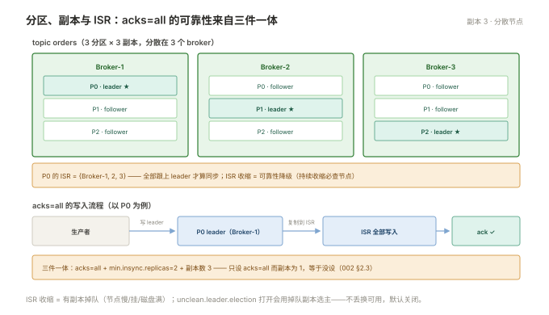
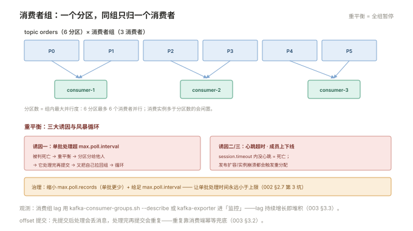

# 002 Kafka 运维

> **解决**：分布式日志的模型、副本与确认、消费组治理、集群健康。  
> **范围**：topic/partition · 顺序 · 副本与 ISR · acks · 消费者组与重平衡 · KRaft · 监控指标。  
> **口径**：Kafka 3.x；新集群 KRaft，存量 ZooKeeper 注记。  
> **更新**：2026-11-01

## 目录

| 节 | 内容 |
|---|---|
| 2.1 | 模型：topic → partition → 追加写日志 |
| 2.2 | 顺序与分区规划 |
| 2.3 | 副本与 ISR：acks 三档 |
| 2.4 | 消费者组、offset 与重平衡 |
| 2.5 | KRaft 与 ZooKeeper |
| 2.6 | 监控指标最小集 |
| 2.7 | 六个坑 |
| 2.8 | 本章检查清单 |

---

## 2.1 模型：topic → partition → 追加写日志

Kafka 的核心是一个**只追加、带保留期的分布式日志**：

```plain
topic "orders"
├── partition 0: [0][1][2][3][4]…   ← 只追加，每条消息有 offset
├── partition 1: [0][1][2]…
└── partition 2: [0][1]…
```

三个模型事实决定全部运维行为：**消息写入只追加**（顺序写磁盘是 Kafka 高吞吐的根基）；**消息消费不删除**（只移动消费位指针，保留期到期才清——历史可回放）；**分区是并行与顺序的单位**（分区内严格有序，跨分区无序）。

与 RabbitMQ 对照：RabbitMQ 队列"消费即出"，Kafka 分区"读完仍在"——所以 Kafka 的"堆积"天然存在且不致命（lag 只是消费进度的落后），运维关注点从"清队列"变成"追 lag、保副本"。

---

## 2.2 顺序与分区规划

分区内有序、跨分区无序——**需要顺序的业务必须让"同 key 的消息进同分区"**（生产者按 key 哈希选分区，如同一订单号的事件进同一分区）。

分区数规划的三条依据：**目标吞吐**（单分区写入约数十 MB/s，消费端每分区一个线程）；**消费者扩展上限**（分区数 = 组内最大并行度，分区 6 个最多 6 个消费者并行）；**键空间的均匀性**（按 key 哈希分布要均匀，热门 key 会造成分区倾斜）。**分区数只能增不能减**——加分区会打破 key→分区的映射（同 key 的新消息落到新分区，顺序性对存量 key 失效），这是 003 §3.5 顺序治理的前置知识。

---

## 2.3 副本与 ISR：acks 三档

每个分区有一个 leader 与若干 follower 副本（多 broker 分散）。**ISR（In-Sync Replicas）** 是"跟上了 leader 的副本集合"——ISR 收缩说明有副本掉队，可靠性正在降级。

生产者的确认级别 `acks`：

| acks | 含义 | 丢消息风险 |
|---|---|---|
| `0` | 发出去就算 | 网络抖动即丢——不用 |
| `1` | 主副本写入即确认 | 主挂且未同步→丢 |
| **`all`** | **ISR 内全部写入才确认** | 配 `min.insync.replicas=2` 后，除非多数派全坏 |

生产配置纪律：**业务 topic 一律 `acks=all` + `min.insync.replicas=2` + 副本数 3**——三者是一个整体（只有 acks=all 而副本 1，等于没设）。消费可靠性不受 acks 控制——那是 offset 提交时机的事（2.4）。



---

## 2.4 消费者组、offset 与重平衡

消费者组（consumer group）是 Kafka 的负载均衡单位：**组内每个分区只分配给一个消费者**，不同组互不影响（同一份数据可被多个组各自消费）。

- **offset 提交**：消费者的进度账本。`enable.auto.commit=true` 定期提交——**先提交后处理会丢消息**（提交了还没处理完就崩）；重要消费用**处理完再手动提交**（先处理再提交会重复消费——靠幂等兜底，003 §3.2）；
- **重平衡（rebalance）**：组成员变化（上下线、心跳超时）或订阅变化时，全组暂停并重新分配分区。**重平衡期间整个组停止消费**——频繁重平衡 = 周期性停服。三大诱因：消费者处理超过 `max.poll.interval.ms`（被认为死亡）、心跳超时、扩缩容。治理：给足 `max.poll.interval`、单批处理量可控、消费者数稳定。

运维的日常观测就是**消费组 lag**：`kafka-consumer-groups.sh --describe` 或 kafka-exporter 进 Prometheus——lag 持续增长即堆积（003）。



---

## 2.5 KRaft 与 ZooKeeper

历史分界：Kafka 曾用 ZooKeeper 存集群元数据（controller 选举、broker 注册）——双系统运维、故障域耦合。**KRaft 用内置 Raft 共识替代 ZooKeeper：3.3 起生产可用，4.0 彻底移除 ZK**。

运维视角的变化：**部署少一套 ZK 集群**、元数据故障域与数据合并、Controller 节点单独规划。存量 ZooKeeper 集群不需要恐慌——按官方升级路径（先 KRaft 迁移工具/逐版升级）迁移即可，迁移前**备份与演练照常**（000 §0.5）。新建集群一律 KRaft。

---

## 2.6 监控指标最小集

接「监控」册 Prometheus 的最小告警集（kafka-exporter + JMX exporter）：

| 指标 | 含义 | 告警条件示例 |
|---|---|---|
| UnderReplicatedPartitions | 副本同步不足的分区数 | > 0 持续 5 分钟 |
| 消费组 lag | 各组各分区的堆积 | 超基线倍数（003 §3.3） |
| OfflinePartitionsCount | 无主分区数 | > 0 立即 page |
| ISRShrink/Expand 频率 | ISR 收缩扩张 | 频繁=节点不稳 |
| 磁盘与网络 | broker 本机水位 | 通用水位规则 |

`kafka-consumer-groups.sh --describe --group <g>` 的 LAG 列是手工排障的第一入口；管理界面可用 Kafka UI 类工具（AKHQ/kafka-ui）但**生产操作仍走命令行与版本化变更**。

---

## 2.7 六个坑

| # | 坑 | 后果 | 正确做法 |
|---|---|---|---|
| 1 | 生产者 acks=1 或 0 | 主副本切换丢消息 | acks=all + min.insync.replicas=2 |
| 2 | 自动提交先提交后处理 | 崩溃丢已提交未处理的消息 | 手动提交，处理完再提 |
| 3 | 单批处理超 max.poll.interval | 被判死亡→重平衡风暴 | 批量可控 + 给足间隔 |
| 4 | 分区数随意扩 | key→分区映射变化，顺序失效 | 规划时留余量，扩前评估 |
| 5 | 副本数 1 上生产 | broker 挂=分区不可用+数据风险 | 副本 3 + 机架/ AZ 分散 |
| 6 | 保留期没按 topic 规划 | 大 topic 撑爆磁盘 | 按 topic 分级 retention（003 §3.4） |

第 3 条展开：`max.poll.interval.ms`（默认 5 分钟）是"两次 poll 之间允许的最大处理时长"——消费者拉一批消息后处理超时，Kafka 判它死亡触发重平衡，分区分给别人，而它处理完一提交又把自己"复活"进组，再次触发重平衡——**循环风暴**。识别：日志里反复出现 `Rebalance` 与 `Attempt to heartbeat failed`。修法：缩小单批 `max.poll.records` 或加大 interval，本质是让"单批处理时间"永远小于上限。

---

## 2.8 本章检查清单

读完能回答这六个问题，这一章就过了：

| # | 问题 |
|---|---|
| 1 | 三个模型事实？与 RabbitMQ"消费即出"的差异？ |
| 2 | 需要顺序的业务怎么设计？扩分区的副作用？ |
| 3 | acks 三档与 min.insync.replicas 的整体配置？ |
| 4 | offset 自动提交为什么会丢消息？正确姿势？ |
| 5 | 重平衡风暴的三大诱因与识别日志？ |
| 6 | 最小告警集的五项？ |

---

> 下一篇：《003 堆积与可靠性治理》——堆积、丢失、重复的治理主战场。
