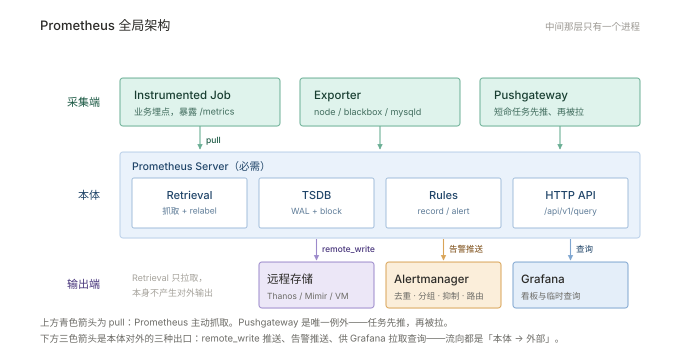
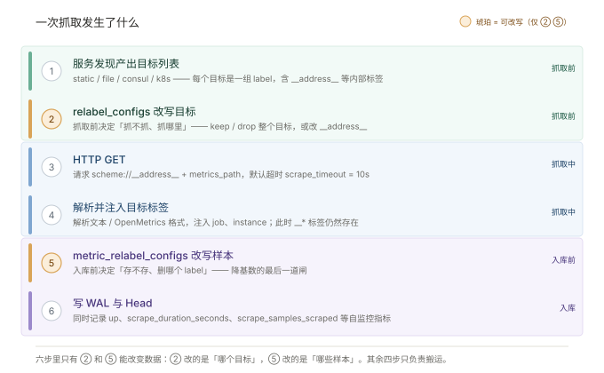

# 01 · 原理与架构

> 本篇回答：Prometheus 为什么是现在这个样子？它由哪几块组成，一次抓取到底发生了什么，以及什么场景不该用它。
> 这一篇不涉及具体配置，配置见 [003-配置与部署](003-配置与部署.md)。

---

## 1.1 一句话

Prometheus 是一个**拉取式（pull）**、**多维标签（label）**、**单机自包含**的开源监控与告警系统，专为**指标（metrics）**设计，不适合做日志和链路追踪。

它解决的问题：把「现在系统是什么状态」变成一个可用 PromQL 任意切片的时序数据库，并在此基础上做阈值告警。

需要先建立的一个认知：**Prometheus 存的是数值随时间的变化，不是事件**。一条 HTTP 请求日志、一个异常堆栈、一次调用链路，都不在它的能力范围内。它只回答"某个数值在某个时刻是多少"，然后靠 label 把这个数值切到足够细的维度。

## 1.2 四条设计哲学

理解这四条，后面很多"为什么这么设计"就不用背了。每一条都直接推出一个运维后果。

| 原则 | 含义 | 直接后果 |
| --- | --- | --- |
| **拉模型** | Prometheus 主动 HTTP GET 目标的 `/metrics` | 目标必须可被发现、可被访问；抓取失败本身即指标 `up=0` |
| **多维数据** | 指标名 + 一组 key/value label 唯一定位一条时间线 | 查询灵活，但**基数（cardinality）失控是头号运维问题** |
| **本地存储** | 自带 TSDB，不依赖外部数据库 | 单机简单可靠；长期存储需 remote_write 外挂 |
| **简单可组合** | 每个组件职责单一，靠 HTTP 接口拼装 | 能用少量原语组合出复杂能力，但需要自己拼 |

这四条里，**「多维数据」是最容易吃亏的一条**。前三条出问题你会立刻看到报错，只有基数问题表现为"内存慢慢涨、查询慢慢慢"，等发现时往往已经 OOM。002 §2.3 会专门讲怎么控住它。

> **3.x**：数据模型引入了 UTF-8 标签名支持，但官方明确不建议在生产使用（会破坏现有 PromQL 生态）。本条只作知识补充，实操仍按 ASCII 命名。

## 1.3 全局架构



结构分三层，**中间那层只有一个进程**——这是 Prometheus 与大多数分布式监控系统最大的不同。

| 组件 | 定位 | 职责 | 是否必需 | 默认端口 |
| --- | --- | --- | --- | --- |
| **Prometheus Server** | 核心 | 抓取、存储、规则计算、提供查询 API | 必需 | 9090 |
| **Exporter / 埋点** | 数据源 | 把目标状态转成文本格式指标，暴露 `/metrics` | 必需（否则无数据） | node 9100 / blackbox 9115 |
| **Alertmanager** | 核心 | 告警去重、分组、抑制、静默、路由、发送 | 要告警则必需 | 9093 |
| **Pushgateway** | 场景 | 接收短命任务主动推送的指标，供 Prometheus 拉取 | 特定场景 | 9091 |
| **服务发现（SD）** | 场景 | 动态产出抓取目标列表 | 静态配置时可不用 | — |
| **Grafana** | 外围 | 可视化与看板 | 可选（内置 UI 也能查） | 3000 |
| **kube-state-metrics** | 外围 | 把 K8s 对象状态转成指标 | K8s 场景常用 | 8080 |

三个容易混的点：

- **Exporter 不是监控系统的一部分**，它只是"把某某东西翻译成 `/metrics`"的小进程。挂了只影响那一个数据源，不影响 Prometheus 本身。
- **服务发现不是要装的组件**，是 Prometheus 内置的一组客户端（static / file / consul / k8s / dns…），配在 `scrape_configs` 里。
- **Grafana 与 Prometheus 无强耦合**，删除 Grafana 不影响采集与告警，只是没图看。

## 1.4 一次抓取发生了什么



这六步是理解 Prometheus 最划算的一段——**后面 80% 的配置问题，都能归到某一步上**。

1. **SD 产出目标列表**：static / file / consul / k8s 等，每个目标是一组 labels（含 `__address__` 等内部标签）。
2. **relabel 改写**：`relabel_configs` 在抓取前筛选与重写标签，决定「抓不抓、抓哪里」。
3. **HTTP GET**：按 `scheme://__address__ + metrics_path` 请求，默认超时 `scrape_timeout=10s`。
4. **解析**：解析文本 / OpenMetrics 格式，注入 `job`、`instance` 等目标标签。
5. **metric relabel**：`metric_relabel_configs` 在入库前删改指标，决定「存不存」。
6. **写 WAL 与 Head**：写入内存 head block 与预写日志，同时记录 `up`、`scrape_duration_seconds`、`scrape_samples_scraped` 等自监控指标。

把六步按"边界"归成三段，排查时定位会快很多：

| 段 | 步骤 | 出问题时的表现 | 去哪看 |
| --- | --- | --- | --- |
| **抓取前** | ①② | 目标根本不出现在列表里，或地址不对 | Status → Targets → 展开看 discovered labels |
| **抓取中** | ③④ | 目标在列表里但 `up=0` | 看该 target 的 Error 字段 |
| **入库前** | ⑤⑥ | 目标 `up=1` 但查不到想要的指标 | 对比 `/metrics` 原文与 `scrape_samples_*` |

第 6 步产出的 `up` 是全文最重要的单个指标：**它由 Prometheus 自己生成，不依赖目标配合**，所以目标彻底宕机时你依然能看到 `up=0`。

## 1.5 为什么是 Pull

| 拉模型优点 | 拉模型代价 |
| --- | --- |
| 抓取失败天然可见（`up=0`），不用额外心跳 | 目标必须能被 Prometheus 网络访问 |
| 目标无需知道监控系统存在，无需配置推送地址 | 短命任务（秒级 job）来不及被拉 |
| 抓取节奏、并发、超时由监控端统一控制 | 大规模下需分片，配置分发变复杂 |
| 配置集中，便于审计与调试（浏览器可手验 `/metrics`） | 跨网络域需代理或 pushgateway 折衷 |

两条代价里，第一条（网络可达）是**架构层面**的：Prometheus 必须与目标同域，跨网段就要靠 federation 或代理。第二条（短命任务）是**使用层面**的，用 Pushgateway 兜，见下节。

## 1.6 Pushgateway 的正确用法与反模式

**唯一适合**：批处理任务、cron job、一次性脚本——运行时间短于抓取间隔，来不及被拉。

**明确反模式**：

+ ❌ 用它做「推模式监控平台」，让常驻服务往这里推。常驻服务应直接暴露 `/metrics`。
+ ❌ 用它做多实例聚合。它会把同一 group 的多个实例指标**互相覆盖**，只剩最后一个。
+ ❌ 推完不清理。过期数据会永久留存并触发假告警，必须在任务结束时 `DELETE` 对应 group。

```bash
# 推送（grouping key 用 label 表达）
echo "batch_last_success_timestamp $(date +%s)" | \
  curl --data-binary @- http://pgw:9091/metrics/job/nightly_backup/instance/backup-01

# 任务结束后清理
curl -X DELETE http://pgw:9091/metrics/job/nightly_backup/instance/backup-01
```

> 上面 `pgw` 是占位主机名，执行前替换成实际地址。如果任务脚本异常退出、没走到清理那一步，数据会一直留着——所以生产上应配一条 `push_time_seconds` 的告警兜底（见 004 §4.6.2 第 9 条）。

## 1.7 适用与不适用边界

这一节比"它有多强"更重要——**用错场景，后面所有努力都是白费**。

**适合**（✅）：

| 场景 | 为什么适合 |
| --- | --- |
| 纯数值时间序列 | 设计目标就是记录数值随时间的变化 |
| 以机器为中心的监控 | 一台机器一组指标，天然对应一条 series 集 |
| 高度动态的服务化架构 | 服务发现 + label 能跟上实例频繁增删 |
| 多维数据切片 | 同一份数据按 `code` / `region` / `version` 任意切 |
| 故障期间的自诊断 | 每个 Prometheus 独立，不依赖网络存储，基础设施坏了它还能查 |

最后一条是 Prometheus 的核心价值观：**可靠性优先**。它宁可牺牲"精确"和"全局视图"，也要保证故障时你仍能看到系统的可用统计。

**不适合**（❌）：

| 场景 | 为什么不适合 | 替代 |
| --- | --- | --- |
| 日志检索 | 无全文索引，样本是数值 | Loki / ES |
| 链路追踪 | 无 trace/span 模型 | Jaeger / Tempo |
| 账单级精确计量 | 采样、丢点、聚合后不可精确还原 | 专用计量系统 |
| 秒级以下高精度 | 抓取间隔通常 10–60s | 专用高频采集 |
| 长期（年级）原始数据 | 本地保留期默认 15 天 | Thanos / Mimir / VictoriaMetrics |

第一条"账单"值得展开：**Prometheus 会丢点**。抓取超时、目标重启、进程 OOM 都会造成空档，而且 `rate` 还有外推。拿它算钱，对账必然对不上。正确做法是"计费用专用系统，监控用 Prometheus"，两者并存。

## 1.8 与其他监控系统对比

原文用了五小节分别对比 Graphite / InfluxDB / OpenTSDB / Nagios / Sensu，压缩成一张表：

| 维度 | Prometheus | Graphite | InfluxDB（开源版） | OpenTSDB | Nagios |
| --- | --- | --- | --- | --- | --- |
| **数据获取** | 主动拉取 | 被动接收 | 被动接收（Telegraf 推） | 被动接收 | 脚本周期性检查 |
| **数据模型** | 指标 + label | 路径式命名（`a.b.c`） | measurement + tag + field | 任意键值对 | 主机 → 服务 |
| **存储** | 自带 TSDB，追加写 | Whisper（RRD 风格，新样本覆盖旧样本） | LSM + WAL，按时间分片 | HBase | 不存储，只保留当前状态 |
| **查询语言** | PromQL（完整） | 函数较简单 | InfluxQL / Flux | 无完整语言，靠 API 聚合 | 无 |
| **告警** | 规则 + Alertmanager（分组/路由/去重/抑制） | 需外部组件 | 需 Kapacitor | 弱 | 有，但无分组路由 |
| **水平扩展** | 需手动分片 | 支持集群 | 商业版支持 | 依赖 HBase 集群 | 不适用 |
| **运维复杂度** | 低（单二进制） | 中 | 中 | 高（要维护 Hadoop/HBase） | 低 |
| **典型适用** | 指标监控、动态环境 | 已有 Graphite 体系 | 事件日志 + 指标混合 | 已在跑 Hadoop | 小型静态系统、黑盒探测 |

选型结论，压成三句：

1. **只做指标监控、环境动态** → Prometheus，没有第二个选项值得考虑。
2. **已经在跑 Hadoop/HBase，且看重长期存储** → OpenTSDB 可以复用现有基础设施，否则不要为了监控去上一套 HBase。
3. **主要存储事件日志、能接受最终一致性** → InfluxDB 更合适；但要注意它的告警能力需要额外组件（Kapacitor），公平比较时要把它算进来。

另外两个概念值得记住，它们是选型时最容易被混淆的：

- **白盒 vs 黑盒监控**：Prometheus 是白盒（读目标内部暴露的指标，知道"为什么慢"）；Nagios 是黑盒（只探端口通不通，知道"挂没挂"）。**两者不冲突**——Prometheus 也能做黑盒，用 blackbox_exporter 探 HTTP/TCP/ICMP，通常两套都要有。
- **拉取 vs 推送**：不是技术优劣，是**责任归属**。拉取把"什么时候采"的决定权放在监控端，所以监控端知道自己漏了什么；推送把决定权放在目标端，监控端无法区分"没数据"和"目标静默"。

---

**下一篇**：[002-数据与查询](002-数据与查询.md) —— 从一条样本讲到 PromQL 能不能查对。
