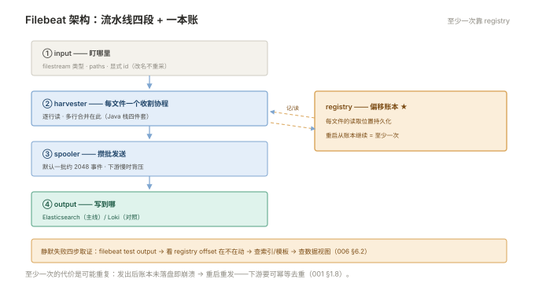
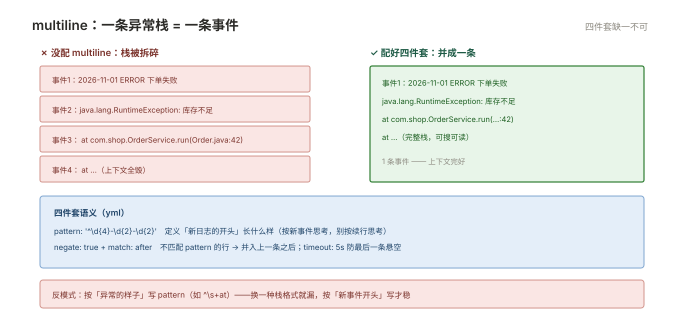

# 001 采集 Filebeat

> **解决**：散落在各机器、各容器里的日志怎么收上来、收全、不丢。  
> **范围**：三类来源 · harvester/registry · 最小配置 · 多行合并 · 字段加工 · K8s DaemonSet · 断点续传。  
> **口径**：Filebeat 8.x；Loki 路线的 Promtail/Alloy 概念同源（004 册对照）。  
> **更新**：2026-11-01

## 目录

| 节 | 内容 |
|---|---|
| 1.1 | 日志从哪来：应用、系统、容器三类来源 |
| 1.2 | Filebeat 架构：input → harvester → spooler → output |
| 1.3 | 最小可用配置：input 与 output |
| 1.4 | 多行合并：Java 异常栈的救星 |
| 1.5 | 字段加工：把主机、环境、服务名写进每条事件 |
| 1.6 | 输出目标：Elasticsearch 与 Loki 双路线 |
| 1.7 | K8s 场景：DaemonSet 与容器元数据 |
| 1.8 | registry 与断点续传：不丢的机制与边界 |
| 1.9 | 八个坑 |
| 1.10 | 本章检查清单 |

---

## 1.1 日志从哪来：三类来源

采集器面对的日志只有三类，配置方式与坑各不相同：

| 来源 | 形态 | 采集方式 | 关键坑 |
|---|---|---|---|
| **应用日志** | 容器 stdout / 文件 | 容器：读 `/var/lib/docker/containers/`；传统：按路径 input | 多行异常栈（1.4） |
| **系统日志** | journald / `/var/log/*.log` | input 指路径；journald 有专门 input | 轮转时的文件切换（1.8） |
| **中间件日志** | nginx/mysql 等 | 路径 input + 字段标注来源 | 格式各异，字段命名要统一（005 §5.2） |

一条纪律先立住：**采集器不生产日志，它只是搬运工**——源头格式混乱（无时间戳、无级别、多行杂糅），搬运只能原样放大混乱。源头的规范在 005 册。

---

## 1.2 Filebeat 架构：input → harvester → spooler → output

四个组件一条流水线，排障时按这个顺序追：

```plain
input（定义盯哪里）
  └─▶ harvester（每个文件一个收割协程：逐行读，记住偏移）
        └─▶ spooler（事件队列：攒批发送）
              └─▶ output（ES / Loki / Kafka……）
registry（账本：每个文件的读取偏移量，断电也记得）
```



- **harvester**：一次 harvest 是"打开文件 → 从上次偏移读到末尾 → 关闭"。一个文件一个 harvester，文件数 = harvester 数——**用通配符盯住几千个文件会耗尽资源**，`close_inactive` 可让不活跃文件的 harvester 退出；
- **spooler**：把 harvester 的行攒成批（默认一批约 2048 事件）再发 output——下游慢时在这里背压；
- **registry**：每个文件的 offset 账本（`registry-filebeat` 数据文件），**Filebeat 敢说"至少一次"全靠它**（1.8 展开）。

---

## 1.3 最小可用配置

一份能跑起来的 `filebeat.yml`（输入两个路径，输出 ES）：

```yaml
filebeat.inputs:
  - type: filestream            # 8.x 推荐 filestream 类型（替代老 log 类型）
    id: app-logs                # 每个 input 必须有唯一 id
    paths:
      - /var/log/myapp/*.log
    fields:                     # 字段加工（1.5）
      service: myapp
      env: prod
    fields_under_root: true

output.elasticsearch:
  hosts: ["https://es.internal:9200"]
  username: "filebeat-writer"   # 凭据走密钥管理，不进 Git（「CICD」002 §2.7）
  password: "${ES_PASS}"
  index: "logs-myapp-%{+yyyy.MM.dd}"    # 按天索引（002 §2.5 的 ILM 由此接管）

setup.kibana:
  host: "https://kibana.internal:5601"
```

```bash
filebeat test config     # ① 语法与凭据校验（同 nginx -t 的纪律）
filebeat test output     # ② 单独测输出连通性
systemctl restart filebeat
```

`filestream` 类型是 8.x 的推荐 input（比老 `log` 类型有更严格的文件指纹与状态管理）；`id` 不配会以路径哈希代替，改名路径即换身份——**显式给 id 是升级迁移不重采的前提**。

---

## 1.4 多行合并：Java 异常栈的救星

默认按行切割——一个 Java 异常栈十几行会被拆成十几条独立事件，上下文全毁。多行合并把它并回一条：

```yaml
    multiline:
      type: pattern
      pattern: '^\d{4}-\d{2}-\d{2}'      # 以日期开头的行 = 新日志
      negate: true
      match: after                        # 不匹配的行并入上一条之后
      timeout: 5s                         # 防止最后一条悬空不发
```

语义读法：`negate: true` + `match: after` = "**不匹配日期开头**的行，并入前一条"。两条铁律：`timeout` 必配（否则不匹配 pattern 的最后一条日志会被无限悬挂）；**pattern 以"新事件的开头"为准**而不是"异常的样子"——按"什么标志是一条新日志"思考，别按"什么标志是续行"。



---

## 1.5 字段加工：把主机、环境、服务名写进每条事件

查询体验的一半来自元数据——没有 `service`、`env` 字段的日志，搜到也无法归属：

```yaml
    fields:
      service: myapp
      env: prod
      team: trade
    fields_under_root: true      # 字段提到事件顶层，而不是塞进 fields 子对象
```

静态字段用 `fields`；主机名、IP 这类机器信息用 `add_host_metadata` 处理器；容器元数据在 K8s 场景由 add_kubernetes_metadata 补（1.7）。**字段命名全库统一**（005 §5.2 的公约），别让每个团队自造轮子。

---

## 1.6 输出目标：Elasticsearch 与 Loki 双路线

同一份采集配置，output 决定走哪条路线：

```yaml
# 主线：直写 ES（本册 1.3）
output.elasticsearch:
  hosts: [...]
  index: "logs-myapp-%{+yyyy.MM.dd}"

# 对照：写 Loki（004 册）——output 换成 loki，要额外声明标签
output.loki:
  hosts: ["http://loki.internal:3100"]
  labels:
    service: myapp
    env: prod
```

混合期可以双写（一份日志两条路线并行），验证查询效果后下线一路——但**双写是过渡手段**，长期双写是双倍成本。输出端的连通性排障：`filebeat test output` 给出认证、证书、网络三层结论，是 006 排障的起点。

---

## 1.7 K8s 场景：DaemonSet 与容器元数据

容器日志的采集标准形态：**每节点跑一个采集 Pod（DaemonSet），读节点的容器日志目录**：

```yaml
filebeat.inputs:
  - type: container
    paths:
      - /var/log/containers/*.log
    processors:
      - add_kubernetes_metadata:        # 从容器 ID 反查 pod/ns/标签
          host: ${NODE_NAME}
          matchers:
            - logs_path:
                logs_path: "/var/log/containers/"
```

三个要点：**hostPath 挂载**节点的 `/var/log/containers` 与 `/var/lib/docker/containers`（读宿主日志目录是 hostPath 的正当用途——「容器」007 §7.4）；`add_kubernetes_metadata` 把 pod 名、namespace、标签补进事件——**Kibana 里按 namespace/service 过滤就靠它**；采集器自身用 DaemonSet 部署，`NODE_NAME` 由 Downward API 注入。容器 stdout 的轮转由 kubelet/docker 负责，采集器跟随轮转文件即可（「容器」004 §4.5 的 json-file 轮转在这里被消费）。

---

## 1.8 registry 与断点续传：不丢的机制与边界

registry（offset 账本）保证的是**至少一次（at-least-once）**：harvester 记住读到的偏移，重启后从账本继续——日志不丢。但"至少一次"的代价是**可能重复**：事件已发出、registry 尚未落盘时崩溃，重启后同一段会重发。

两个边界必须知道：

1. **日志文件被轮转删除后 registry 残留**：账本无限增长（老文件条目不清），配 `clean_inactive` 清理超龄条目；
2. **registry 文件损坏/丢失 = 从头重采**：下游要有幂等去重（ES 按文档 ID 去重，或接受重复——006 §6.2）。

不能采集的场景也立个边界：**应用把日志写到不落盘的地方**（如容器内 /dev/shm）、**采集器到不了的网络位置**——采集是搬运不是创造。

---

## 1.9 八个坑

| # | 坑 | 后果 | 正确做法 |
|---|---|---|---|
| 1 | 异常栈没配 multiline | 一条栈拆几十条，现场毁灭 | pattern+negate+match+timeout 四件套（1.4） |
| 2 | fields 没开 fields_under_root | 字段埋在 fields. 下，KQL 写起来别扭 | 顶层字段统一查询体验 |
| 3 | 通配符盯住海量文件 | harvester 耗尽内存与 fd | 收窄 paths + close_inactive |
| 4 | 老类型 input（log）与 filestream 混用 | registry 身份混乱，重采 | 8.x 统一 filestream + 显式 id |
| 5 | 凭据明文进 yml | 进 Git 即泄漏 | 环境变量/secrets（002 §2.9 同源） |
| 6 | registry 数据目录随容器销毁 | 容器重建即从头重采 | 持久卷挂 registry（K8s 场景） |
| 7 | 采集器版本与 ES 差两个大版本 | 兼容性断崖 | 升级顺序：先 ES 后采集器 |
| 8 | 只配 input 不测 output | 以为在收，实际静默失败 | `filebeat test output` 进部署流程 |

第 8 条展开：静默失败是日志系统最常见的病（与「CICD」009 §9.7 的静默失败同型）——Filebeat 进程活着、日志文件在涨、**ES 里就是没数据**。标准取证顺序：`filebeat test output`（连通与凭据）→ 查 registry（offset 在动吗）→ 查 ES 索引是否存在（ILM/模板问题）→ 查 Kibana 数据视图（时间字段对不对）。每一段都有明确命令，别跳段（006 §6.1 的四段取证在采集段的落地）。

---

## 1.10 本章检查清单

读完能回答这六个问题，这一章就过了：

| # | 问题 |
|---|---|
| 1 | harvester、spooler、registry 各管什么？"至少一次"靠谁保证？ |
| 2 | 多行合并四件套是哪些？pattern 应该匹配"新日志"还是"续行"？ |
| 3 | K8s 容器日志的标准采集形态是什么？容器元数据从哪来？ |
| 4 | registry 损坏会发生什么？下游靠什么应对？ |
| 5 | 为什么每台机器的字段命名必须统一？ |
| 6 | "Filebeat 活着但 ES 没数据"的四步取证？ |

---

> 下一篇：《002 Elasticsearch 入门》——日志存哪、怎么存得住、查得动。
