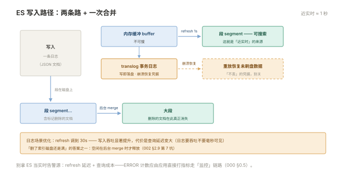
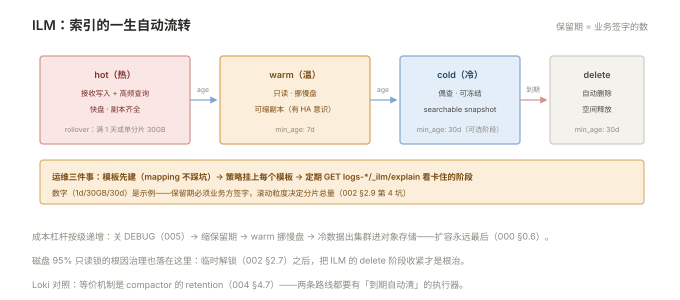

# 002 Elasticsearch 入门

> **解决**：日志存哪、怎么存得住（不丢不爆盘）、查得动（索引与映射不配错）。  
> **范围**：倒排索引 · 五个核心概念 · 写入近实时 · text/keyword · ILM · 磁盘水位 · 集群健康。  
> **口径**：Elasticsearch 8.x，安全默认开启。  
> **更新**：2026-11-01

## 目录

| 节 | 内容 |
|---|---|
| 2.1 | ES 是什么：倒排索引与分布式文档库 |
| 2.2 | 核心概念五件套：index / document / mapping / shard / replica |
| 2.3 | 写入路径：refresh、translog、段合并——为什么是"近实时" |
| 2.4 | mapping：text 与 keyword 的分界，中文分词 |
| 2.5 | 模板与 ILM：索引按天滚动、自动保留 |
| 2.6 | 集群健康：green / yellow / red 判读 |
| 2.7 | 磁盘水位：85 / 90 / 95 三道闸 |
| 2.8 | 基本查询：match 与 term |
| 2.9 | 八个坑 |
| 2.10 | 本章检查清单 |

---

## 2.1 ES 是什么：倒排索引与分布式文档库

Elasticsearch 是**分布式搜索与分析引擎**，日志场景用它做两件事：把海量日志存下来（分布式文档库），并让"从十亿条里按关键词搜出相关几百条"在秒级完成（倒排索引）。

倒排索引的直觉：正排是"文档 → 包含哪些词"，倒排反转为"词 → 出现在哪些文档"。搜 `timeout` 时不用扫全部日志，直接取该词的文档列表——这是 ES 与"grep 一遍文件"的本质区别，也是它吃内存与磁盘的原因（索引本体就是数据结构的实体化）。

运维视角的定位：**ES 是这套体系里最重、最需要主动管理的组件**——它有 JVM、有分片分布、有磁盘水位策略。说"集中日志不用运维"的人，说的都是 Loki 路线（004）。

---

## 2.2 核心概念五件套：index / document / mapping / shard / replica

五个词构成 ES 的世界观，日志场景的对应关系：

| 概念 | 是什么 | 日志场景 |
|---|---|---|
| index（索引） | 文档的存放单位 | `logs-myapp-2026.11.01`——通常按天滚动 |
| document（文档） | 一条 JSON 记录 | 一条日志 |
| mapping（映射） | 字段类型声明 | `service` 是 keyword、`message` 是 text |
| shard（主分片） | 索引的水平切分 | 数据分摊到多节点。**建索引时定死** |
| replica（副本） | 主分片的只读拷贝 | 节点坏一块不丢数据；读可分流 |

关系链：**document 存进 index，index 由若干 primary shard 组成，每个 shard 有 0~N 个 replica**。shard 数在建索引时确定（后续要 reindex 才能改），replica 数随时可调——**磁盘紧张时第一反应可以是"减副本"，但必须有高可用意识（见 2.9 坑表）**。

分片规划的经验区间：单分片 10–50GB（日志场景常取 30GB 左右）；按天索引时 `分片数 ≈ 日增量 ÷ 30GB`。分片本身有管理开销（内存与元数据），**"成千上万个小分片"比"少量大分片"更拖垮集群**——这决定了索引不要按小时滚动，除非日增TB级。

---

## 2.3 写入路径：refresh、translog、段合并——为什么是"近实时"

一条日志写进 ES 的旅程：

```plain
写入 ──▶ 内存缓冲 buffer ──(refresh，默认1s)──▶ 可搜索的段 segment
              │
              └──▶ translog（事务日志，写即落盘）── 崩溃后凭它恢复
段 segment ──(后台 merge)──▶ 大段（删除的文档在此真正消失）
```



三个机制各回答一个运维问题：

- **refresh（默认 1 秒）**：内存缓冲刷成可搜索的段——所以 ES 是"**近实时**"：写入后约 1 秒才搜得到，别拿它当实时告警源（000 §0.7 误解 2）；
- **translog**：每次写入同时追加事务日志——节点崩溃后重放 translog 恢复未刷盘的数据。**它是"不丢"的凭据**，别手动关；
- **merge（段合并）**：小段后台合并成大段，期间占 IO；标记删除的文档在合并时才物理消失——**删除数据后磁盘不立即释放**，是"删了索引磁盘还是满"的答案之一。

日志场景的可调项：把 refresh 调到 30s（写入吞吐显著提升，查询延迟变大）是日志集群的常见优化——日志要的是吞吐不是毫秒可见。

---

## 2.4 mapping：text 与 keyword 的分界，中文分词

mapping 决定字段"能不能搜、怎么搜"，日志场景 90% 的搜索问题出在这里：

| 类型 | 行为 | 用在哪个字段 |
|---|---|---|
| `text` | 分词后全文匹配（match 查询） | `message`（日志正文） |
| `keyword` | 整串精确匹配、可聚合排序 | `service`、`level`、`env`（标签类字段） |

配错的两种症状：**keyword 字段用 match 搜"部分词"搜不到**（整串匹配）；**text 字段做聚合会把一句话拆成 N 个词**（分词粒度）。日志字段的通用配方：`message` 用 text；标签类字段用 keyword；拿不准时用多字段（`text` + 子字段 `.keyword`）两头兼顾。

中文注意：ES 默认分词器把中文切成单字（"运维手册"→ 运/维/手/册），短语搜索可用但体验打折——**中文全文检索装 IK 分词器**（`analysis-ik` 插件，mapping 里 `analyzer: ik_max_word`）。日志正文字段装不装 IK 取决于是否需要中文短语级搜索；标签字段一律 keyword 不受影响。

模板（index template）让"按天滚动的索引"自动带上正确 mapping 与分片配置——**先建模板再写数据**，事后改 mapping 要 reindex（重建索引）。

---

## 2.5 模板与 ILM：索引按天滚动、自动保留

日志索引的标准姿势：**按天（或按大小）滚动 + ILM 自动管理生死**：

```json
PUT _ilm/policy/logs-policy
{
  "policy": {
    "phases": {
      "hot":    { "actions": { "rollover": { "max_age": "1d", "max_primary_shard_size": "30gb" } } },
      "delete": { "min_age": "30d", "actions": { "delete": {} } }
    }
  }
}
```

读法：索引滚动（rollover）在"满 1 天或单分片 30GB"时触发；索引 30 天后进入 delete 阶段自动删除。**保留策略（30 天）是业务方签过字的数**（000 §0.6），ILM 是它的执行器。



中间还可插 warm/cold 阶段（7 天后挪到慢盘、30 天后只读）——冷热分层的成本杠杆（005 §5.6）。运维要做的三件事：**模板先建**（mapping 不踩 2.4 的坑）、**策略挂上每个索引模板**、**定期核对 ILM 状态**（`GET logs-*/_ilm/explain` 看有没有卡在某个阶段不走的）。

---

## 2.6 集群健康：green / yellow / red 判读

```bash
GET _cluster/health
```

| 状态 | 含义 | 处置紧迫度 |
|---|---|---|
| green | 主分片与副本全部就位 | 正常 |
| yellow | **副本分片**未分配 | 观察：节点数少于副本数？磁盘不够？ |
| red | **主分片**未分配——数据已缺失服务 | 立即处置：`_cat/shards` 找 UNASSIGNED，查节点存活 |

yellow 的最常见原因是**副本数大于节点数**（单节点集群配 1 副本=永远 yellow——副本没地方放）。red 的常见原因：节点真挂了 / 磁盘水位触发分片迁移失败。**red ≠ 数据丢了**（未分配的主分片数据还在原节点上，多数情况修复节点/水位后自动恢复）——但 red 期间该分片不可读写。

---

## 2.7 磁盘水位：85 / 90 / 95 三道闸

ES 对磁盘水位的自保机制，三道闸逐级收紧：

| 水位 | 默认 | 行为 |
|---|---|---|
| low（85%） | 不再向该节点**分配新分片** | 预警 |
| high（90%） | 开始把分片**迁走** | 主动减负 |
| flood_stage（95%） | 受影响索引加 `index.blocks.read_only_allow_delete` —— **只读锁** | 拒绝一切写入 |

**"ES 突然不能写日志了"的 90% 是 95% 水位锁**——而且解除后锁**不会自动解**，要手动：

```bash
PUT logs-*/_settings
{ "index.blocks.read_only_allow_delete": null }
```

正确的处置顺序：先清空间（删旧索引/降副本/ILM 加速删除）→ 确认水位回落 → 解锁 → **把根因写进治理**（保留期缩短/扩盘）。只解锁不清空间，几小时后原样再来。

---

## 2.8 基本查询：match 与 term

两个查询动词对应 2.4 的两种字段类型：

```bash
GET logs-myapp-*/_search
{ "query": {
    "bool": {
      "filter": [
        { "term":  { "service": "myapp" } },          # keyword 字段：精确
        { "term":  { "level": "ERROR" } },
        { "range": { "@timestamp": { "gte": "now-15m" } } }
      ],
      "must": [
        { "match": { "message": "timeout" } }         # text 字段：分词全文匹配
      ]
} } }
```

纪律：**过滤条件（标签、时间）放 `filter`**（不算分、可缓存），**全文检索放 `must`**。日志查询的黄金组合是"term 圈定范围 + match 搜正文"——反过来（用 match 搜标签字段）就是 2.4 配错的那类病。

---

## 2.9 八个坑

| # | 坑 | 后果 | 正确做法 |
|---|---|---|---|
| 1 | text/keyword 配反 | 搜不到 / 聚合变碎词 | 标签 keyword、正文 text（2.4） |
| 2 | 没建模板就写数据 | mapping 跑偏，改要 reindex | 模板先行 |
| 3 | 磁盘 95% 只读锁不清理直接重启 | 起来还是只读 | 清空间→确认水位→手动解锁（2.7） |
| 4 | 按小时滚动索引 | 分片数爆炸拖垮集群 | 按天滚动 + rollover 按大小 |
| 5 | 磁盘紧张关副本 | 节点故障即丢数据，yellow | 缩保留期 / 换大盘，副本是底线 |
| 6 | 分片几百 GB 不拆 | 恢复极慢、查询拖尾 | rollover 按 30GB 触发 |
| 7 | 删索引后磁盘没释放 | "删了还是满" | 段合并释放——等或 force-merge/删后观察 |
| 8 | ES 当实时告警源 | 近实时延迟 + 查询成本 | ERROR 计数走指标（000 §0.5） |

第 4 条展开：索引滚动粒度是**分片规划的总开关**——按小时滚动 × 100 天保留 = 2400 个索引 × 分片数，集群元数据与内存先崩；按天滚动则要防"单索引过大"（rollover 的 30GB 上限兜底）。判断现有健康度一条命令：`GET _cat/indices/logs-*?v&s=index` 看每个索引的 primary 大小——**长期大于 50GB 或长期小于 1GB 都说明滚动策略与量不匹配**。

---

## 2.10 本章检查清单

读完能回答这六个问题，这一章就过了：

| # | 问题 |
|---|---|
| 1 | refresh/translog/merge 各自回答什么运维问题？ |
| 2 | text 与 keyword 的分界？两种配错的症状？ |
| 3 | 分片数为什么建索引时定死？单分片的合理区间？ |
| 4 | ILM 的 hot/delete 两阶段做了什么？保留期谁定？ |
| 5 | 95% 水位锁的解锁顺序？为什么直接重启没用？ |
| 6 | red 和 yellow 差在哪？red 是不是数据丢了？ |

---

> 下一篇：《003 Kibana 查询》——存进去了，怎么高效找出来。
