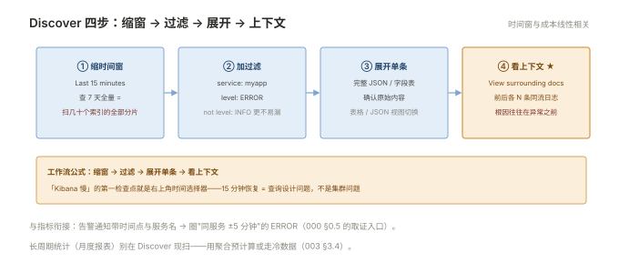

# 003 Kibana 查询

> **解决**：日志存进去了，怎么高效找出来、看起来、长期盯。  
> **范围**：数据视图 · Discover · KQL 速成 · 聚合与仪表盘 · 保存共享 · 权限隔离。  
> **口径**：Kibana 8.x。  
> **更新**：2026-11-01

## 目录

| 节 | 内容 |
|---|---|
| 3.1 | Kibana 定位与数据视图（data view） |
| 3.2 | Discover：时间范围、过滤、上下文 |
| 3.3 | KQL 速成：运算符、嵌套字段、exists |
| 3.4 | 从搜索到聚合：错误率与 TOP 榜 |
| 3.5 | 仪表盘：告警的配套观测面 |
| 3.6 | 保存与共享：saved object 与短链 |
| 3.7 | 权限与多团队：space 隔离注记 |
| 3.8 | 六个坑 |
| 3.9 | 本章检查清单 |

---

## 3.1 Kibana 定位与数据视图（data view）

Kibana 是 ES 的查询界面——**它自己不存日志**（saved object 除外），所有查询都打到 ES。使用前第一件事是建**数据视图（data view）**：声明"看哪些索引、以哪个字段当时间轴"：

```plain
Management → Data Views → Create data view
  Name:    应用日志
  Pattern: logs-*
  Timestamp field: @timestamp        ← 时间轴字段，选错全盘没数据
```

时间字段的两个高频错误：**选了不是时间类型的字段**（如把字符串 time 当时间轴），**时区错位**（ES 内部存 UTC，界面按浏览器时区展示——"差 8 小时"的错觉多来自对比方没统一时区）。数据视图建好后，Discover 里若"能搜到日志但时间轴为空"，先回来改这里。

---

## 3.2 Discover：时间范围、过滤、上下文

Discover 是逐条翻日志的主战场，四个动作构成日常：

1. **缩时间窗**：右上角时间选择器先收到 15 分钟——**时间窗越大查询越慢**（006 §6.4 的超时多半源于此）；
2. **加过滤**：`service: myapp`、`level: ERROR` 点字段即加；
3. **展开单条**：看完整 JSON 与字段表——表格视图（Table）与 JSON 视图切换；
4. **看上下文（View surrounding documents）**：单条错误日志的前后 N 条——**复现现场的最重要功能**，异常前往往有真正的根因日志。

工作流公式：**缩窗 → 过滤 → 展开单条 → 看上下文**。任何"我搜到了但看不懂"的问题，先试上下文视图。



---

## 3.3 KQL 速成：运算符、嵌套字段、exists

KQL 是 Kibana 的默认语法，规则少到一屏写完：

```plain
service: myapp                          # 单条件
service: myapp and level: ERROR         # 组合（and/or/not）
service: my*                            # 通配符
message: "connection refused"           # 短语（带引号按整串匹配 text 分词后的相邻性）
kubernetes.pod.name: web-*              # 嵌套字段用点号
not level: INFO                         # 排除
exists: stack_trace                     # 有这个字段的文档（异常日志利器）
```

三条经验：**标签字段精确值用冒号+裸值**（keyword 等值）；**正文关键词用引号短语**（text 分词后的相邻匹配）；**用 `not level: INFO` 反向排除比正向罗列 ERROR/WARN 更不容易漏**。KQL 表达力不够时（正则/模糊），搜索框切到 Lucene 语法——但团队统一一种，混用会互相看不懂。

---

## 3.4 从搜索到聚合：错误率与 TOP 榜

搜日志是"看个例"，聚合是"看总体"——排障升级为分析的分水岭：

```plain
可视化 → 创建：垂直条形图
  指标：Count（文档数）
  横轴：Terms 聚合，字段 service.keyword，Top 10
  过滤：level: ERROR and @timestamp >= now-1h
→ 得到「最近 1 小时各服务错误数 TOP 10」
```

三张开箱即用的分析图：**各服务错误数 TOP**（定位吵闹者）、**按小时的 ERROR 趋势**（发现突增时段，对齐发布时间线）、**慢请求分布**（`request_time > 1s` 的 TOP URI——与「接入层」005 §5.9 的日志分析互相印证）。聚合字段**必须是 keyword**（002 §2.4 的 text 聚合病在这里复发）。

---

## 3.5 仪表盘：告警的配套观测面

仪表盘（Dashboard）把多张可视化拼成一屏。运维视角的设计纪律：

1. **一屏一主题**：「发布观测」= 错误趋势 + 慢请求 + 各服务错误 TOP；「容量观测」= 日志量/天 + 索引大小 + 采集延迟；
2. **时间选择器联动**：同屏图表共享时间控件——告警发生后改一次时间窗全屏同步（000 §0.5 的"告警响起来日志取证"的界面形态）；
3. **别做成大屏积木**：每张图都要有"看到什么就做什么"的动作含义，否则是装饰。

---

## 3.6 保存与共享：saved object 与短链

有价值的查询/视图/仪表盘全部**保存为 saved object**（Discover 右上角 Share → Save），共享用 **Share → Permalinks 短链**——把长 URL 变成稳定短链发到 IM。两条纪律：**排障结论里的链接用短链**（时间窗固化，对方点开即所见）；**saved object 定期导出备份**（Stack Management → Export，Kibana 升级与迁移的保险）。

---

## 3.7 权限与多团队：space 隔离注记

多团队共用的 Kibana 用两层隔离：**Space**（工作空间：dev/prod 各一个 space，仪表盘与数据视图互不可见）+ **RBAC**（角色绑定 data view 与索引权限——研发只读自己服务的日志）。这与「容器」005 的最小权限、「CICD」006 的机器人账号是同一原则在日志层的落地：**谁能看生产日志，本身就是敏感权限**（日志里有 token、内网拓扑）。

---

## 3.8 六个坑

| # | 坑 | 后果 | 正确做法 |
|---|---|---|---|
| 1 | 时间轴字段选错 | 全盘有索引没数据 | 建视图时核对 @timestamp |
| 2 | 时间窗开太大 | 查询超时，怪 ES 慢 | 先缩窗再加条件（3.2） |
| 3 | text 字段做聚合 | 结果是一堆碎词 | 聚合用 keyword 子字段（3.4） |
| 4 | 时区错觉"差 8 小时" | 误判时间线 | 确认浏览器时区与数据时区（3.1） |
| 5 | 查询不保存 | 每次重写，团队无法复用 | saved object + 短链（3.6） |
| 6 | 生产日志全员可见 | 敏感信息扩散 | space + RBAC（3.7） |

第 2 条展开：时间窗与查询成本是线性关系——查 30 天全量等于让 ES 扫几十个索引的全部分片。感觉"Kibana 慢"时第一步永远是看右上角时间选择器：**"Last 7 days"改"Last 15 minutes"后速度恢复 = 查询设计问题，不是集群问题**。真需要长周期统计的（月度报表），用聚合预计算或走 002 §2.5 的冷数据，而不是每次现扫。

---

## 3.9 本章检查清单

读完能回答这六个问题，这一章就过了：

| # | 问题 |
|---|---|
| 1 | 数据视图的两个关键声明是什么？选错时间轴的症状？ |
| 2 | Discover 的四步工作流？哪个功能用于复现现场？ |
| 3 | KQL 里标签字段与正文关键词各怎么写？ |
| 4 | 聚合字段为什么必须 keyword？ |
| 5 | 排障结论的链接为什么用 permalink 短链？ |
| 6 | "Kibana 慢"的第一检查点是什么？ |

---

> 下一篇：《004 Loki 轻量路线》——不想养 ES 集群时的另一条路。
