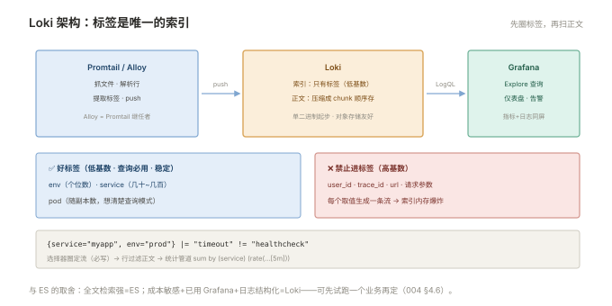

# 004 Loki 轻量路线

> **解决**：不想养 ES 集群时，日志怎么集中、怎么查。  
> **范围**：只索引标签的设计 · 架构三件套 · 标签基数命门 · LogQL 速成 · 与 ES 的取舍 · 保留与压缩。  
> **口径**：Loki 3.x（单二进制起步），采集 Promtail/Alloy，查询 Grafana。  
> **更新**：2026-11-01

## 目录

| 节 | 内容 |
|---|---|
| 4.1 | Loki 的设计：只索引标签，不索引正文 |
| 4.2 | 架构三件套：采集 → Loki → Grafana |
| 4.3 | 标签设计：cardinality 是命门 |
| 4.4 | LogQL 速成：选择器、管道、统计 |
| 4.5 | 管道阶段：采集端解析与标签提取 |
| 4.6 | Loki vs Elasticsearch：成本与能力的取舍 |
| 4.7 | 保留与压缩 |
| 4.8 | 六个坑 |
| 4.9 | 本章检查清单 |

---

## 4.1 Loki 的设计：只索引标签，不索引正文

Loki 与 ES 的本质差异一句话：**Loki 只对"标签"建索引，日志正文只压缩存储、按时间顺序扫描**。

```plain
ES：   词 ──倒排索引──▶ 文档列表        （正文随便搜，索引吃资源）
Loki：标签 ──索引──▶ 日志流 ──压缩块──▶ 顺序扫正文（先圈小范围再搜）
```

两个直接推论：**存储便宜一个数量级**（没有巨型倒排索引，正文压缩后放对象存储都行）；**查询模式被约束**——必须先用标签把范围圈小（比如 `{service="myapp"}`），再在圈内做文本匹配。设计哲学是"把索引的复杂度从存储端挪到打标签的规范上"——**标签设计失败的 Loki 用不了**，这是 4.3 的主题。

---

## 4.2 架构三件套：采集 → Loki → Grafana

```plain
Promtail / Alloy（采集：抓文件 + 解析 + 打标签）
        │ push
        ▼
    Loki（接收 · 存储压缩块 · 查询服务）
        │ LogQL
        ▼
Grafana（查询界面 · 仪表盘 · 告警）
```



- **采集**：Promtail 是传统搭档（抓文件、解析、提取标签）；Grafana **Alloy** 是官方继任者（统一 OTel/日志/指标的采集管线）——新部署选 Alloy，存量 Promtail 照常维护；
- **Loki 部署**：单二进制 monolithic 模式起步（读写一体的最简形态），规模大了再拆读写分离——**从小开始，别一上来就微服务化**；
- **Grafana**：Loki 没有自己的界面，查询全在 Grafana 里（Explore → Loki）——如果你已经在用 Grafana 看「监控」册的 Prometheus，日志界面是零学习成本。

---

## 4.3 标签设计：cardinality 是命门

标签是 Loki 唯一的索引。**每个标签的每个取值组合都会生成一条独立的流（stream）**——取值爆炸（高基数）会让索引与内存同步爆炸，直接压垮 Loki：

| 标签 | 取值规模 | 判定 |
|---|---|---|
| `env`（prod/dev） | 个位数 | ✅ 好标签 |
| `service` | 几十~几百 | ✅ 好标签 |
| `pod` | 几十~几百（随副本） | ⚠️ 可用但要想清楚查询模式 |
| `user_id` / `trace_id` / `request_id` | **百万级** | ❌ 绝对禁止做标签 |

标签设计三原则：**低基数**（取值可枚举且有限）、**查询必用**（每个标签都要被常见查询用到，否则白索引）、**稳定**（不随请求内容变化）。正文的个性化信息（用户 ID、URL 参数）走**正文匹配或 structured metadata**，不上标签。事故特征：加了某个高基数标签后 Loki OOM/变慢——回滚标签即恢复，`/metrics` 里 `loki_distributor_bytes_received_total` 按 label 分组可定位元凶。

---

## 4.4 LogQL 速成：选择器、管道、统计

LogQL 的结构是"选择器 + 管道"，与「Linux」008 的管道思想同构：

```logql
{service="myapp", env="prod"}                    # 选择器：圈定日志流
{service="myapp"} |= "timeout"                   # 行过滤：含 timeout 的行
{service="myapp"} |~ "timeout|refused"           # 正则匹配
{service="myapp"} != "healthcheck"               # 排除健康检查噪音

# 管道：解析出字段再过滤/统计
{service="myapp"}
  | json                                         # 解析 JSON 行
  | level="ERROR"                                # 按解析出的字段过滤
  | line_format "{{.request_id}} {{.msg}}"       # 重排输出

# 统计（指标化）：
sum by (service) (rate({service=~".+"} |= "ERROR" [5m]))   # 各服务错误速率
```

与 KQL 的心智差异：**LogQL 的选择器是"必须写"的**（不写标签=全库扫描，会被拒绝或超时），KQL 的字段过滤是"可选"的。这把双刃剑强制你按 4.3 的规范打标签。

---

## 4.5 管道阶段：采集端解析与标签提取

标签从哪来？——采集端（Promtail/Alloy）的管道阶段（pipeline stages）从原始日志行里解析提取：

```yaml
stages:
  - json:
      expressions: { level: level, service: service }
  - labels:
      level:                    # 提升为标签（低基数才允许）
      service:
  - output:
      source: message           # 正文只留 message
```

架构要点：**解析在采集端做一次**，Loki 端只收打好标签的成品——这也意味着改标签设计要动所有采集端配置（005 的字段公约为什么是公约，这里兑现）。

---

## 4.6 Loki vs Elasticsearch：成本与能力的取舍

000 §0.3 的对照表落到决策：

| 维度 | EFK | Loki |
|---|---|---|
| 全文关键词搜索 | ✅ 强项 | ⚠️ 圈定标签后顺序扫，量大慢 |
| 复杂聚合分析 | ✅ 成熟 | ⚠️ LogQL 可做但弱于 ES 聚合 |
| 存储成本 | 高（索引+副本） | **低一个数量级**（压缩+对象存储） |
| 运维复杂度 | 高（JVM/分片/水位/ILM） | 低（单二进制起步） |
| 界面生态 | Kibana 专精 | Grafana 统一（指标+日志同屏） |

决策树：**已经在用 Grafana + 日志结构化 + 按标签查 → Loki**；**需要全文检索/安全审计/复杂分析 → ES**；**团队拿不定 → 先上 Loki 试跑一个业务**（迁移成本低），不满足再上 EFK。两者并存的团队也不少见：核心业务日志走 ES，基础设施日志走 Loki——但 005 的字段规范必须全库统一。

---

## 4.7 保留与压缩

Loki 的保留由 **compactor** 的 retention 配置执行（如保留 30 天，到期删除过期 chunk），存储后端建议对象存储（S3/MinIO）——压缩后的 chunk 天然适合廉价大容量。成本估算公式：**日增量 × 压缩比（通常 1:10 左右，JSON 尤甚）× 保留天数**——JSON 日志压缩收益最大，这也是 005 推 JSON 的成本理由。

---

## 4.8 六个坑

| # | 坑 | 后果 | 正确做法 |
|---|---|---|---|
| 1 | 高基数标签（user_id 等） | Loki OOM，全库拖垮 | 标签三原则（4.3） |
| 2 | 查询不圈标签 | 全库扫描拒绝或超时 | LogQL 必须写选择器（4.4） |
| 3 | 把正文信息提进标签 | 基数爆炸的变体 | 正文匹配，不进标签 |
| 4 | 没配保留期 | 存储无限增长 | compactor retention 必配（4.7） |
| 5 | Promtail 直存本地没上对象存储 | 单机盘满=日志全丢 | 对象存储后端 |
| 6 | 用 LogQL 当主告警源 | 查询成本高、易超时 | ERROR 计数走指标（同 002 原则） |

第 1 条展开：`user_id`、`trace_id`、`url` 这类"看起来很查询友好"的字段是新人加标签的重灾区——一个百万用户的系统加 `user_id` 标签，等于创建百万条流，每条流都是索引与内存里的实体。识别方法：**问"这个标签的取值我有几个"**——答不出有限个数或超过几千，就进正文。

---

## 4.9 本章检查清单

读完能回答这六个问题，这一章就过了：

| # | 问题 |
|---|---|
| 1 | Loki 只索引什么？两个直接推论？ |
| 2 | 标签三原则？哪类字段绝对不能做标签？ |
| 3 | LogQL 的选择器与管道各干什么？与 KQL 的强制差异？ |
| 4 | 标签从哪来？改标签设计要动哪里？ |
| 5 | Loki 与 ES 的决策树？为什么可以试跑？ |
| 6 | 保留期在哪配？存储后端的推荐与理由？ |

---

> 下一篇：《005 日志规范与治理》——日志泛滥之前先把规矩立好。
