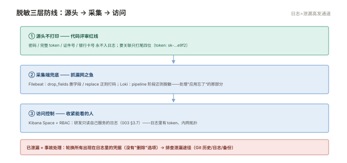

# 005 日志规范与治理

> **解决**：日志泛滥之前先把规矩立好——格式、字段、级别、脱敏、成本。  
> **范围**：stdout 纪律 · JSON 格式 · 字段公约 · 链路 ID · 脱敏 · 级别治理 · 保留与成本。  
> **口径**：规范约束的是"应用怎么打日志"，落地靠评审与模板；采集/存储的机制在 001/002/004。  
> **更新**：2026-11-01

## 目录

| 节 | 内容 |
|---|---|
| 5.1 | 应用日志纪律：打 stdout、JSON、级别克制 |
| 5.2 | 字段命名公约：一套全库通用的字段表 |
| 5.3 | 链路 ID：request_id 与 trace_id |
| 5.4 | 脱敏：密码、token、证件号的处置 |
| 5.5 | 级别治理：ERROR 的告警含义 |
| 5.6 | 保留与成本治理：谁付钱谁定保留期 |
| 5.7 | 八个坑 |
| 5.8 | 本章检查清单 |

---

## 5.1 应用日志纪律：打 stdout、JSON、级别克制

三条纪律是所有后续基础设施的地基（「容器」004 §4.5 的 stdout 纪律在这里扩展成全量规范）：

1. **打 stdout**：不自己写文件——容器场景 `docker logs`/采集器直接消费，轮转交给运行时；传统进程也建议输出到 stdout 由 systemd 接管（「Linux」006 的 journal）；
2. **JSON 每行一条**：字段天然可解析，采集端零解析成本（001 §1.4 的 multiline 也省了——JSON 编码器保证一条事件一行）；
3. **级别克制**：INFO 记"业务有意义的状态变化"，不是"每个函数执行到了"。

```json
{"ts":"2026-11-01T10:00:00.123+08:00","level":"ERROR","service":"order","request_id":"r-8f3a","msg":"下单失败：库存不足","sku":"SKU-9981"}
```

一行 JSON 的五要素：**时间（ISO8601 带时区）、级别、服务名、请求 ID、可读消息**——这五个字段在任何采集与查询体系里都是一等公民。

---

## 5.2 字段命名公约：一套全库通用的字段表

字段命名的碎片化是集中日志体验差的头号原因（A 团队 `svc`、B 团队 `service_name`、C 团队 `app`）。公约表一次定死：

| 字段 | 类型 | 含义 | 必打 |
|---|---|---|---|
| `ts` | ISO8601 字符串 | 事件时间（带时区） | ✅ |
| `level` | keyword | DEBUG/INFO/WARN/ERROR | ✅ |
| `service` | keyword | 服务名（与部署名一致） | ✅ |
| `env` | keyword | prod/staging/dev | ✅ |
| `request_id` | keyword | 请求唯一编号 | ✅（入口生成） |
| `msg` | text | 人读的消息 | ✅ |
| `trace_id` | keyword | 链路追踪 ID（有追踪系统才打） | ⭕ |
| `error_kind` | keyword | 错误分类码（如 `timeout` / `inventory_short`） | ⭕（ERROR 时） |

公约的维护方式：**放进服务脚手架/日志库模板**，让新服务默认合规——靠文档提醒的公约撑不过两个季度。

---

## 5.3 链路 ID：request_id 与 trace_id

两个 ID 的分工（000 §0.7 误解 9 的展开）：

- **request_id**：业务侧的请求唯一编号——入口网关或第一个服务生成，**随响应返回给调用方**（用户报障时能提供）；日志系统里跨服务串时间线；
- **trace_id**：链路追踪系统（OTel/Jaeger）的编号——由追踪 SDK 传播，用于还原调用图。

实践建议：**入口生成 request_id 并向下游透传**（HTTP 头 `X-Request-ID`——「接入层」002 §2.3 的转发头家族），日志全打它；若上了链路系统，trace_id 与 request_id 二选一为主、另一个映射。排障时序由此成立：用户给出 request_id → Kibana 一搜 → 全链路时间线尽收。

---

## 5.4 脱敏：密码、token、证件号的处置

日志是数据泄漏的高发通道（日志权限普遍比数据库宽）。三层防线：

1. **源头不打印**：代码评审红线——密码、完整 token、证件号、银行卡号**永不入日志**；要关联就打尾四位（`token: sk-…e9f2`）；
2. **采集端兜底**：Filebeat 的 `drop_fields`/`replace` 处理器、Loki 的 pipeline 阶段做正则脱敏——兜底抓"漏网之鱼"；
3. **访问控制**：003 §3.7 的 RBAC 收紧"谁能看生产日志"。



已经泄漏的按事故处理：**轮换所有出现在日志里的凭据**（与「CICD」001 §1.10、「容器」002 §2.9 同源结论——泄漏的凭据没有"删除"选项，只有轮换）。

---

## 5.5 级别治理：ERROR 的告警含义

级别不是"严重程度的心情"，是与告警联动的契约：

| 级别 | 契约 | 生产可见性 |
|---|---|---|
| ERROR | **需要人介入的异常**——打它就要接受"可能触发告警" | 常驻告警指标 |
| WARN | 自动恢复的异常/值得注意的状态 | 看趋势，不逐条告警 |
| INFO | 有业务意义的状态变化（请求完成、任务结束） | 正常记录 |
| DEBUG | 开发排障细节 | **生产默认关闭** |

两条最常见的级别病：**ERROR 轰炸**（把可自动重试的异常打成 ERROR——告警疲劳后真 ERROR 被淹没）与**静默失败**（该 ERROR 的打成 INFO——故障查不到）。治理手段：ERROR 的定义写进团队规范、每次告警风暴后评审级别使用。

---

## 5.6 保留与成本治理：谁付钱谁定义保留期

000 §0.6 的三铁律落到执行层：

1. **保留期分级**：生产 ERROR 90 天 / 全量日志 30 天 / DEBUG 不上生产——按"查证需要"而非"多多益善"；
2. **量化的月度仪式**：报表回答"哪个服务贡献了日志量的增长"（Kibana 聚合或 `GET _cat/indices` 按日对比）——006 §6.5 的突增定位在这里变成例行动作；
3. **降量的优先级**：关 DEBUG → 缩保留期 → 冷热分层（002 §2.5 warm 阶段）→ 采样（高流量接口按比例记日志）——**扩容永远最后**。

---

## 5.7 八个坑

| # | 坑 | 后果 | 正确做法 |
|---|---|---|---|
| 1 | DEBUG 上生产 | 量与成本翻几倍，噪音淹没 ERROR | 级别配置化，生产默认 INFO+ |
| 2 | ERROR 当日志用（打非异常） | 告警疲劳，真 ERROR 被淹没 | ERROR 契约化（5.5） |
| 3 | 字段命名各造各的 | 跨服务查询瘫痪 | 公约进脚手架（5.2） |
| 4 | 时间戳不带时区 | 多地服务时间线错乱 | ISO8601 + 偏移（5.1） |
| 5 | 明文凭据进日志 | 泄漏事故 | 三层脱敏（5.4），泄漏即轮换 |
| 6 | 日志风暴无防护 | 异常时把采集与存储打爆 | 限速/采样 + 风暴告警 |
| 7 | request_id 不透传 | 跨服务时间线断裂 | 入口生成 + HTTP 头透传（5.3） |
| 8 | 保留期"先都留着" | 存储成本指数涨 | 业务签字的分级保留（5.6） |

第 6 条展开：日志风暴的经典形态是"重试失败 → 打 ERROR → 再重试"，异常放大时每秒几万条。防线两层：**应用侧**（重试日志做指数退避与限频）、**采集侧**（Filebeat 对超量输出有背压，但采集器自身也会被磁盘 IO 卡住）。识别手段：006 §6.5 的量曲线——**突增量与某服务的错误率曲线重合，就是风暴现场**。

---

## 5.8 本章检查清单

读完能回答这六个问题，这一章就过了：

| # | 问题 |
|---|---|
| 1 | 一行 JSON 日志的五要素？为什么时间要带时区？ |
| 2 | 字段公约靠什么落地？为什么文档提醒不够？ |
| 3 | request_id 与 trace_id 的分工与衔接？ |
| 4 | 脱敏三层防线？已泄漏的凭据怎么处置？ |
| 5 | ERROR 的契约含义？两类级别病？ |
| 6 | 降量手段的优先级？为什么扩容排最后？ |

---

> 下一篇：《006 排障与治理》——日志链路自己坏了怎么办。
