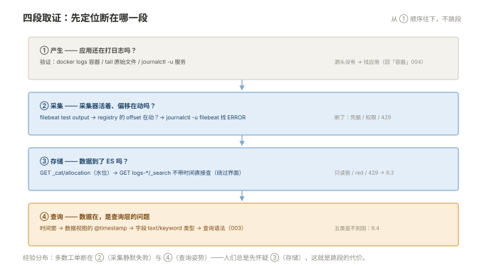

# 006 排障与治理

> **解决**：日志链路自己坏了怎么办——查不到、断流、爆盘、超时的分段取证。  
> **范围**：四段取证总纲 · 采集侧 · 存储侧 · 查询侧 · 成本侧 · 故障剧本。  
> **口径**：主线 EFK 为主，Loki 现象单独注记。  
> **更新**：2026-11-01

## 目录

| 节 | 内容 |
|---|---|
| 6.1 | 排障总纲：四段取证 |
| 6.2 | 采集侧：断流与 registry |
| 6.3 | 存储侧：水位、red、写入拒绝 |
| 6.4 | 查询侧：查不到的五类原因、超时 |
| 6.5 | 成本侧：日志量突增的定位 |
| 6.6 | 十个故障剧本 |
| 6.7 | 本章检查清单 |

---

## 6.1 排障总纲：四段取证

「日志看不到」是这一册所有问题的总症状。000 §0.4 的五段旅程去掉治理，就是取证的四段——**先判断断在哪一段，再进对应手册**：

```plain
① 产生    应用还在打日志吗？——上机器看原始文件/容器 stdout
② 采集    Filebeat/Promtail 活着吗？offset 在动吗？——001 §1.8
③ 存储    ES/Loki 收到了吗？——直接查 API/索引（绕过查询界面）
④ 查询    数据在，是查询层的问题——时间窗/字段/视图（003）
```



每段有明确的验证动作，**从 ① 顺序往下走，不跳段**——与「网络」009、「容器」009 的排障纪律同源。绝大多数"日志系统坏了"的工单，最后都断在 ② 或 ④（采集静默失败、查询姿势不对），而人们总是先怀疑 ③。

---

## 6.2 采集侧：断流与 registry

**症状**：文件在涨、Kibana 没新数据。取证三步（001 §1.9 第 8 坑的展开）：

```bash
# ① 连通与凭据
filebeat test output            # ES 地址/认证/证书三层结论

# ② registry 账本
cat /var/lib/filebeat/registry/filebeat/log.json | tail   # offset 在动吗？

# ③ 输出队列与错误
journalctl -u filebeat -n 200   # 找 ERROR：429 / 401 / x509
```

| 取证结果 | 病因 | 处置 |
|---|---|---|
| `test output` 401/403 | 凭据过期/权限不足 | 轮换凭据（「CICD」009 §9.4 同型） |
| offset 不动 | harvester 停了：文件句柄/权限 | `ls -l` 对权限；看 Filebeat 日志 |
| offset 在动但 ES 无文档 | 索引名/模板/ILM 拦截 | 002 §2.5；直接 `GET logs-*/_search` 绕过 Kibana 验证 |
| 重启后重复日志 | registry 丢失，at-least-once 重放 | 幂等去重（001 §1.8），接受短期重复 |

---

## 6.3 存储侧：水位、red、写入拒绝

**症状一：ES 突然不收日志**——先查是不是 95% 水位只读锁（002 §2.7）：`GET _cat/allocation` 看磁盘，`GET logs-*/_settings` 找 `read_only_allow_delete: true`。处置：清空间（删旧索引）→ 水位回落 → 手动解锁 → 根因进治理（保留期/扩盘）。

**症状二：集群 health red**——`GET _cat/shards` 找 UNASSIGNED 的 **p**（主分片）。多为节点挂/水位迁移失败；数据通常还在原节点，修复后自动恢复。**red 期间不要重平衡或删分片**。

**症状三：写入报 429（es_rejected_execution_exception）**——批量队列打满：写入峰值超过集群消化能力。处置：采集端限流/降批（Filebeat 的 `bulk_max_size` 调小）、ES 侧扩容或削峰；**短期不要用"重试风暴"对抗 429**——只会在队列上叠队列。

---

## 6.4 查询侧：查不到的五类原因、超时

「数据在 ES 里，Kibana 搜不到」的五类原因（003 章的排错汇总）：

| # | 原因 | 取证 |
|---|---|---|
| 1 | 时间窗不含它 | 直接 `GET index/_search` 不带时间过滤 |
| 2 | 时间字段/时区错位 | 数据视图的 @timestamp 配置 |
| 3 | mapping 类型配错 | `GET index/_mapping` 看 text/keyword |
| 4 | 索引没进 data view | 视图 pattern 是否覆盖 `logs-新服务-*` |
| 5 | 查询语法问题 | KQL 切 Lucene 对照试 |

**查询超时**的三个杠杆：缩时间窗（最大头）、加过滤条件先圈小、用 keyword 精确代替 text 模糊。超时也是**分片规划失衡**的症状（002 §2.9 第 4 条）——反复超时的查询要记录并回到索引设计。

---

## 6.5 成本侧：日志量突增的定位

日志量突增（账单/磁盘报警）的标准定位：

```bash
# 按索引（≈按服务+天）看量
GET _cat/indices/logs-*?v&s=store.size:desc
# 按服务聚合一小时写入量（Kibana 聚合，3.4 的方法）
```

三类元凶与处置：**某服务 DEBUG 上线**（回滚配置 + 评审 5.5）、**异常风暴**（重试日志放大——与该服务错误率曲线对齐验证，5.7 第 6 条）、**新服务上线未接公约**（打进了全量请求体）。治理动作全部回到 005：级别、公约、采样。

---

## 6.6 十个故障剧本

| # | 现象 | 第一动作 | 深入 |
|---|---|---|---|
| 1 | Kibana 没新数据 | 四段取证从 ① 走 | 6.1/6.2 |
| 2 | ES 集群只读 | 查 95% 水位锁 | 6.3 |
| 3 | 集群 red | `_cat/shards` 找 UNASSIGNED 主分片 | 6.3 |
| 4 | 写入 429 | 采集端降批，ES 扩容评估 | 6.3 |
| 5 | 查询全部超时 | 时间窗 + 分片健康 | 6.4 |
| 6 | 中文搜不到 | IK 分词器 | 002 §2.4 |
| 7 | 异常栈碎成多行 | multiline | 001 §1.4 |
| 8 | Loki OOM/变慢 | 高基数标签排查 | 004 §4.3 |
| 9 | 日志量突增 | 按服务聚合定位吵闹者 | 6.5 |
| 10 | 采集机磁盘满 | registry/队列数据目录 | 6.2 |

---

## 6.7 本章检查清单

读完能回答这六个问题，这一章就过了：

| # | 问题 |
|---|---|
| 1 | 四段取证的顺序？为什么人们总先怀疑错段？ |
| 2 | 采集断流的三步取证与三种病因？ |
| 3 | 95% 水位锁的正确解除顺序？ |
| 4 | red 状态的取证命令？为什么别急着删分片？ |
| 5 | 查不到的五类原因里，哪两类最常见？ |
| 6 | 日志量突增的三类元凶与定位命令？ |

---

> 下一篇：回到 [README](README.md) 总览——「日志」套完成，可观测性三支柱已就其二（指标在「监控」册）。
