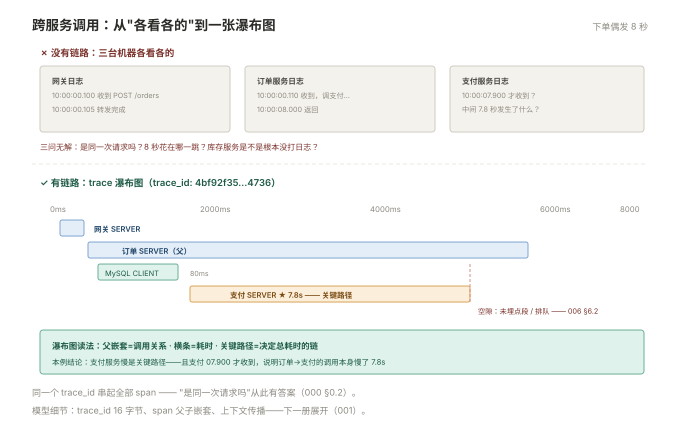

# 000 链路全貌

> **解决**：微服务为什么必须有链路追踪、trace/span 模型长什么样、后端怎么选。  
> **范围**：第三支柱的定位 · 一次跨服务调用的困境 · 核心模型 · 三支柱协作 · 技术版图。  
> **口径**：与 [README](README.md) 一致——OTel 标准，Jaeger/Tempo 后端对照。  
> **更新**：2026-11-01

## 目录

| 节 | 内容 |
|---|---|
| 0.1 | 一次跨服务调用的困境：三台机器各看各的 |
| 0.2 | 核心模型：trace、span 与上下文传播 |
| 0.3 | 三支柱协作：指标告警 → 日志取证 → 链路定位 |
| 0.4 | 技术版图：埋点 → 采集 → 存储 → 查询 |
| 0.5 | 后端选型：Jaeger vs Tempo |
| 0.6 | 六个误解 |
| 0.7 | 本套学习路径 |

---

## 0.1 一次跨服务调用的困境

用户反馈"下单偶尔要 8 秒"。同步架构下你手里只有三台机器各自的日志：网关说"收到请求 10:00:00.100"；订单服务说"10:00:00.110 收到，调用支付"；支付服务说"10:00:07.900 才收到"。

三个问题无解：**这三条日志是同一次请求吗**（没有共同 ID）；**8 秒花在哪一跳**（每段日志只有自己的时刻）；**缺了谁**（库存服务根本没打日志）。

链路追踪的解法一句话：**请求入口生成全局唯一的 trace_id，随请求一路传播；每一跳记一个带起止时间的 span，同 trace_id 的 span 在后端拼成一棵调用树（瀑布图）**——8 秒花在哪、谁调谁、缺了谁，一张图看全。

单体应用不需要它；**服务一旦拆开（跨进程就算），链路就从"加分项"变成"排障刚需"**。



---

## 0.2 核心模型：trace、span 与上下文传播

三个词的准确定义（细节在 001 展开）：

- **trace**：一次请求的完整调用树，由 128 位的 trace_id 全局标识；
- **span**：树上的节点——一段有名字、有起止时间、有状态的工作。span 之间是**父子嵌套**（调用了谁）与**先后兄弟**（顺序调用）；
- **上下文传播**：把 trace_id 与当前 span_id 随请求传给下游（HTTP 走 W3C `traceparent` 头，MQ 走消息头），下游据此创建"子 span"并继续传播——**树就是这么长起来的**。

一个最少的心智图：**网关生成 trace_id → 订单服务创建 SERVER span（父）→ 调数据库时创建 CLIENT span（子）→ 调支付时透传 trace_id，支付创建自己的 SERVER span（子）**——后端按父子关系还原整棵树。

---

## 0.3 三支柱协作：指标告警 → 日志取证 → 链路定位

「日志」000 §0.1 的三支柱在这里闭环：

```plain
指标（监控册）────▶ 日志（日志册）────▶ 链路（本套）
 出告警：P99 涨了      解释：错误日志带 trace_id      定位：瀑布图看哪一跳
```

两个方向的反向衔接同样重要：**链路数据可以聚合出指标**（spanmetrics 自动产出每服务/每接口的 RED 指标——请求率、错误率、耗时）；**指标点可以携带 exemplar**（样本上带 trace_id，从告警图上一键跳到对应的 trace）。三支柱由此不是三套孤立系统，而是一条证据链。

---

## 0.4 技术版图：埋点 → 采集 → 存储 → 查询

```plain
应用（SDK 自动埋点 + 关键路径手写）
   ▼ OTLP
Agent（节点侧 Collector：批量 · 脱敏 · 初筛）
   ▼ OTLP
Gateway（中心 Collector：尾部采样 · 路由）
   ▼ OTLP
后端（Jaeger / Tempo：存储 · 按 trace_id 查询）
   ▼
查询（瀑布图 · 服务图 · 与日志/指标互跳）
```

与「日志」册的旅程结构同构——差异只在数据形态（离散文本 → 结构化 span 树）与查询方式（全文/标签 → 按 trace_id 还原）。**Collector 是强制推荐**而非可选：应用直发后端会带来重试逻辑分散、采样无法统一、后端耦合应用三大问题（002 §2.1 展开）。

---

## 0.5 后端选型：Jaeger vs Tempo

| | Jaeger | Grafana Tempo |
|---|---|---|
| 存储 | Cassandra / Elasticsearch / ClickHouse | 对象存储（S3/MinIO） |
| 查询 | 支持搜索（服务/标签/耗时） | TraceQL + 按 trace_id 精确查 |
| 成本 | 存储与索引较贵 | **便宜一个量级**（无重索引） |
| 生态 | 老牌、独立 UI | 与 Grafana/Loki/Mimir 同家族 |

决策口诀：**要"按属性搜索历史 trace"（审计/分析）选 Jaeger + ES**；**已用 Grafana 全家桶、按 trace_id 查、追求低成本选 Tempo**。数据面两者都原生吃 OTLP，切换成本主要在存储与查询习惯。详细对照在 003。

---

## 0.6 六个误解

| # | 误解 | 实际 |
|---|---|---|
| 1 | 上了链路就不用日志 | 三支柱互补：日志有 trace 之外的细节（请求体、堆栈） |
| 2 | 链路是实时监控 | trace 是事后查的证据，近实时指标靠监控 |
| 3 | 埋点会显著拖慢应用 | SDK 开销通常 <1%，采样进一步降低后端压力 |
| 4 | 采样会丢"坏"trace | 尾部采样可以"错误全留"——头部采样才有此盲区 |
| 5 | trace_id 就是 request_id | 可合一也可映射，但要全库统一（日志 005 §5.3） |
| 6 | 所有 span 都必须采 | 高频低值调用（健康检查）该被过滤——采样即治理 |

---

## 0.7 本套学习路径

```plain
全景      000（本册）
模型      001 OTel 数据模型（trace/span/传播/语义约定）
管线      002 采集与 Collector ──▶ 003 后端 Jaeger 与 Tempo
实战      004 trace 贯通实战（全链路打通）──▶ 005 采样与成本 ──▶ 006 排障实战
```

横向衔接：Python 埋点示例与「Python」板块衔接；trace_id 与日志互通在「日志」005 §5.3；延迟/错误指标在「监控」册。

---

> 下一篇：《001 OTel 数据模型》——链路数据的形状长什么样。
