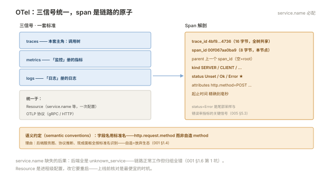

# 001 OTel 数据模型

> **解决**：链路数据的形状长什么样——看懂一个 span 的每个字段。  
> **范围**：OTel 三信号与 Resource · Span 解剖 · SpanKind · W3C traceparent · 语义约定 · 埋点两形态。  
> **口径**：OpenTelemetry traces 信号（SDK 已稳定）；字段名遵循 OTel 语义约定。  
> **更新**：2026-11-01

## 目录

| 节 | 内容 |
|---|---|
| 1.1 | OTel 三信号统一与 Resource |
| 1.2 | Span 解剖：身份、时间、属性、状态 |
| 1.3 | 上下文传播：W3C traceparent 与 Baggage |
| 1.4 | 语义约定：别自己发明字段名 |
| 1.5 | 埋点两形态：自动埋点与 SDK 手写 |
| 1.6 | 六个坑 |
| 1.7 | 本章检查清单 |

---

## 1.1 OTel 三信号统一与 Resource

OpenTelemetry 把指标、日志、链路统一成一套标准：**同一个 SDK 家族、同一个传输协议（OTLP）、同一套 Resource 描述**。

**Resource** 是"这些数据是谁产生的"的描述，只设置一次全局生效：

```python
from opentelemetry.sdk.resources import Resource

resource = Resource.create({
    "service.name": "order",          # ⚠️ 必配——没有它后端全是 unknown_service
    "service.version": "1.4.2",
    "deployment.environment": "prod",
})
```

`service.name` 是全链路的**归组主键**：服务图、按服务过滤、按服务告警全靠它。它的缺失与错乱是最常见的上线事故（1.6 坑 1）。

---

## 1.2 Span 解剖：身份、时间、属性、状态

一个 span 的完整字段（Python SDK 视角）：

```python
from opentelemetry.trace import SpanKind, Status, StatusCode

with tracer.start_as_current_span(
    "POST /orders",                       # span 名：操作语义，不是 URL 全串
    kind=SpanKind.SERVER,                 # 身份：我是被调方
    attributes={
        "http.request.method": "POST",
        "url.path": "/orders",
        "order.channel": "app",
    },
) as span:
    do_work()
    span.set_status(Status(StatusCode.ERROR, "库存不足"))   # 失败要显式标注
```

| 字段 | 是什么 | 运维用途 |
|---|---|---|
| trace_id | 16 字节全局 ID，trace 内所有 span 共享 | 把一棵树串起来 |
| span_id | 8 字节本节点 ID | 父子关系的挂点 |
| parent_span_id | 父节点 | 还原调用树 |
| SpanKind | SERVER/CLIENT/INTERNAL/PRODUCER/CONSUMER | 区分"我被调/我调人/内部段/跨 MQ" |
| attributes | 键值属性 | 过滤与检索的依据 |
| status | Unset/Ok/**Error** | 尾部采样与错误率的信号源 |
| 起止时间 | 精确到毫秒/微秒 | 瀑布图与耗时计算 |

**SpanKind 的价值**容易被低估：后端的服务图、协议推断、采样策略都依赖它——CLIENT/SERVER 配对说明"跨进程调用"，PRODUCER/CONSUMER 配对说明"跨 MQ"，INTERNAL 表示"进程内一段工作"。Kind 配错，服务图就画出错误的拓扑。



---

## 1.3 上下文传播：W3C traceparent 与 Baggage

跨进程时，"我是谁的子 span"这个信息靠**传播头**携带。W3C Trace Context 标准只定义一个头：

```plain
traceparent: 00-4bf92f3577b34da6a3ce929d0e0e4736-00f067aa0ba902b7-01
             版本  trace_id(32 hex)        span_id(16hex)      采样标志
```

下游 SDK 读到它：trace_id 沿用（同树）、以头里的 span_id 为 parent、采样标志跟随——**调用树跨进程生长的机制就这么简单**。Baggage 是随行的业务键值（如 `tenant=acme`），会继续向下游传播但**不参与 trace 组树**——想让它进 span 需显式读取并写入 attributes。

传播是**逐跳的约定**：任何一跳没接（没埋点的服务）、没传（手工 forward 时丢了头），树就在那里断掉——004 §4.5 的断链排查就是沿这条机制找。

---

## 1.4 语义约定：别自己发明字段名

OTel 为常见操作规定了**标准属性名**：HTTP（`http.request.method`、`url.path`、`http.response.status_code`）、数据库（`db.system`、`db.statement`）、消息（`messaging.system`、`messaging.destination.name`）……

两条理由让你必须遵守：**后端与仪表盘按标准名识别**（服务图、协议推断、现成面板全靠它）；**自造字段名等于放弃生态**（换个后端全丢）。自己业务的专有字段（如 `order.channel`）才自定义——前缀区分即可。

---

## 1.5 埋点两形态：自动埋点与 SDK 手写

| 形态 | 做法 | 覆盖 |
| --- | --- | --- |
| 自动埋点 | Python：`opentelemetry-instrument` 启动器 + 各框架 instrumentation 包 | HTTP 服务/客户端、主流库（requests、SQLAlchemy…）——**零改码打底** |
| SDK 手写 | `tracer.start_as_current_span("关键业务步骤")` | 自动埋点覆盖不到的：业务段落、批处理内部、MQ 生产语义 |

Python 最小接入（与「Python」板块的 venv 纪律一致）：

```bash
pip install opentelemetry-sdk opentelemetry-exporter-otlp \
            opentelemetry-instrumentation-flask opentelemetry-instrumentation-requests
```

工程配比：**自动埋点覆盖框架层（HTTP/DB/Redis），手写只补业务关键段**——全手写成本高，全自动则缺业务语义。

---

## 1.6 六个坑

| # | 坑 | 后果 | 正确做法 |
|---|---|---|---|
| 1 | service.name 没配 | 后端全是 unknown_service | Resource 全局必配 |
| 2 | SpanKind 不配或全 INTERNAL | 服务图拓扑错误 | 按语义选 SERVER/CLIENT 等 |
| 3 | 失败 span 不设 Error status | 错误率指标为 0、尾部采样漏掉 | 失败显式 set_status |
| 4 | 自造属性名 | 生态面板与后端识别不了 | 遵循语义约定（1.4） |
| 5 | 手工转发请求丢 traceparent 头 | 断链 | 检查代理/转发代码的头的透传 |
| 6 | 高基数数据塞 attributes | 后端存储与查询压力 | user_id 类进日志，不进 span |

第 1 条展开：`service.name` 错误的隐蔽性在于**链路完全正常工作**——只是后端里所有服务都叫 `unknown_service:python`，服务图变成一团按主机名聚合的谜。Resource 是进程级配置，改它需要重启服务——上线前核对是最便宜的时机。

---

## 1.7 本章检查清单

读完能回答这六个问题，这一章就过了：

| # | 问题 |
|---|---|
| 1 | Resource 与 span attributes 的分工？service.name 为什么必配？ |
| 2 | SpanKind 五种？配错服务图会怎样？ |
| 3 | traceparent 头的组成？下游 SDK 读到它做什么？ |
| 4 | 语义约定为什么必须遵守？ |
| 5 | 自动埋点与手写埋点的配比原则？ |
| 6 | 失败的 span 要显式做什么？否则影响哪两个下游机制？ |

---

> 下一篇：《002 采集与 Collector》——埋点数据怎么送到后端。
