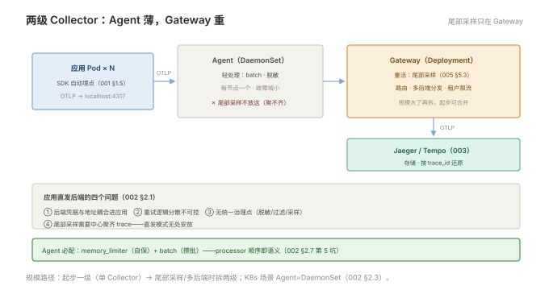

# 002 采集与 Collector

> **解决**：埋点数据怎么送到后端——为什么中间必须有一层 Collector。  
> **范围**：Collector 的价值 · 管线三段 · Agent/Gateway 两级部署 · 常用 processor · 采样入口。  
> **口径**：OpenTelemetry Collector（contrib 发行版）；部署以 K8s DaemonSet + Gateway 两级为主。  
> **更新**：2026-11-01

## 目录

| 节 | 内容 |
|---|---|
| 2.1 | 为什么要有 Collector：应用直发的四个问题 |
| 2.2 | Collector 管线：receivers → processors → exporters |
| 2.3 | 部署形态：Agent（DaemonSet）与 Gateway 两级 |
| 2.4 | 常用 processor：batch、memory_limiter、resource、attributes |
| 2.5 | 采样入口：头部采样在哪做 |
| 2.6 | 六个坑 |
| 2.7 | 本章检查清单 |

---

## 2.1 为什么要有 Collector：应用直发的四个问题

应用 SDK 理论上可以直连 Jaeger/Tempo——生产上不这么做，四个理由：

1. **凭据与网络耦合**：每个应用都要知道后端地址与凭据——后端迁移=全员改配置重发版；
2. **重试与缓冲逻辑分散**：后端抖动时，N 个应用各自实现重试——行为不可控；
3. **无统一治理点**：脱敏、过滤、采样策略想改一处生效？直发模式下不存在这个位置；
4. **尾巴采样无处安放**：尾部采样需要"收齐整棵 trace 再决策"（005 §2.3）——必须有个中心点先聚齐。

Collector 就是这个**统一的遥数据中转站**：应用只管 OTLP 发给本机/本节点，其余交给管线。

---

## 2.2 Collector 管线：receivers → processors → exporters

Collector 的配置就是三段管道（数据流按序通过）：

```yaml
receivers:                          # 收：支持多协议
  otlp:
    protocols:
      grpc: { endpoint: 0.0.0.0:4317 }
      http: { endpoint: 0.0.0.0:4318 }

processors:                         # 处理：按序执行
  memory_limiter: { check_interval: 1s, limit_mib: 512 }
  resource: { attributes: [ { key: deployment.environment, value: prod, action: upsert } ] }
  batch: { timeout: 5s, send_batch_size: 1024 }

exporters:                          # 发：到后端
  otlp/tempo:
    endpoint: tempo-gateway.internal:4317
    tls: { insecure: false }

service:
  pipelines:
    traces: { receivers: [otlp], processors: [memory_limiter, resource, batch], exporters: [otlp/tempo] }
```

三个必懂 processor：**batch**（攒批发送，保护后端）、**memory_limiter**（Collector 自保，内存超限先丢/暂停——防雪崩）、**resource/attributes**（统一补改元数据——"prod 环境标签全库统一"在这里实现，而不是每个应用自己写）。

---

## 2.3 部署形态：Agent（DaemonSet）与 Gateway 两级

生产标准形态是**两级**：

```plain
应用 Pod（SDK，OTLP → localhost:4317）
   ▼
Agent Collector（DaemonSet：每节点一个，只做轻处理：batch + 脱敏）
   ▼ OTLP（带负载均衡）
Gateway Collector（Deployment：重处理——尾部采样、路由、多后端分发）
   ▼ OTLP
Jaeger / Tempo
```

分工原则：**Agent 尽量薄**（网络跳数少、延迟低、故障域小——节点挂只丢本节点缓冲）；**Gateway 承担重活**（尾部采样要聚齐整棵 trace、多后端路由、租户限流）。小规模可以合并为一级——但尾部采样上线时就该拆两级。



---

## 2.4 常用 processor：batch、memory_limiter、resource、attributes

| processor | 用途 | 备注 |
|---|---|---|
| `batch` | 攒批发送 | 保护后端，两级都要配 |
| `memory_limiter` | Collector 自保 | 防止突发流量打爆 Collector |
| `resource` | 统一补/改 Resource 属性 | 环境标签、区域——一处配置全量生效 |
| `attributes` | 改 span 属性：删除敏感字段、改名 | 脱敏与字段公约（「日志」005 同源） |
| `tail_sampling` | 尾部采样决策 | 需要聚齐 trace——**只放 Gateway 层** |
| `filter` | 丢弃噪声 span | 健康检查等高频低值 span 在这里滤 |

---

## 2.5 采样入口：头部采样在哪做

头部采样（005 §5.2）的决策点有两个可选位置，效果不同：

- **SDK 侧（应用/Agent）**：入口服务掷骰子，`parent-based` 让整棵树跟随——**省的是全部下游的采集与传输**，链路完整（同 trace 全留或全丢）；
- **Collector 侧（Gateway）**：按比例丢弃已收到的 span——**省的是后端存储**，但树可能残缺（部分 span 已发）。

纪律：**头部采样决定"采不采"，必须在最入口统一决策**（parent-based 保证一致性）；Collector 侧只做尾部采样（005 §5.3）与治理性丢弃。两处采样叠加时想清楚"谁的决定优先"。

---

## 2.6 六个坑

| # | 坑 | 后果 | 正确做法 |
|---|---|---|---|
| 1 | 应用直发后端 | 凭据耦合、无治理点、采样无处安放 | 两级 Collector |
| 2 | Collector 没配 memory_limiter | 突发流量打爆 Collector 自身 | 必配 + 磁盘发送队列 |
| 3 | 尾部采样放 Agent 层 | trace 聚不齐，决策失真 | 只放 Gateway |
| 4 | processor 顺序随意 | batch 在前、limiter 失效 | 官方推荐顺序：memory_limiter → … → batch |
| 5 | Agent 单点（无 DaemonSet 分散） | 节点故障丢整节点缓冲 | DaemonSet + 本地队列 |
| 6 | 版本升级跨大版本直跳 | 配置项不兼容 | 逐版本升级，先测试环境 |

第 4 条展开：Collector 的 processor 是**有序管线**，顺序即语义——`memory_limiter` 必须在最前（先自保再干活），`batch` 必须在最后（发送前攒批），中间才是业务处理（resource/attributes/tail_sampling）。官方文档的示例顺序就是经过验证的模板——自定义顺序前先理解每个 processor 对内存与延迟的影响。

---

## 2.7 本章检查清单

读完能回答这六个问题，这一章就过了：

| # | 问题 |
|---|---|
| 1 | 应用直发后端的四个问题？ |
| 2 | 管线三段各干什么？两个必配 processor？ |
| 3 | Agent 与 Gateway 的分工原则？尾部采样放哪层？ |
| 4 | 头部采样的两个决策位置？效果差异？ |
| 5 | processor 的正确顺序与原因？ |
| 6 | K8s 采集形态？Agent 为什么用 DaemonSet？ |

---

> 下一篇：《003 后端 Jaeger 与 Tempo》——span 存哪、怎么按 trace_id 还原。
