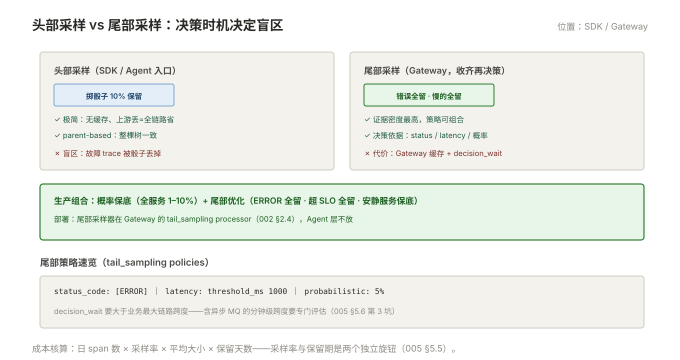

# 005 采样与成本

> **解决**：全量采集不可行时，留哪些 trace、留多少、成本怎么算。  
> **范围**：为什么采样 · 头部采样 · 尾部采样 · 策略设计 · 成本核算。  
> **口径**：头部采样在 SDK/Agent，尾部采样在 Gateway 的 tail_sampling processor（002 §2.3）。  
> **更新**：2026-11-01

## 目录

| 节 | 内容 |
|---|---|
| 5.1 | 为什么采样：全量的算术 |
| 5.2 | 头部采样：简单但有盲区 |
| 5.3 | 尾部采样：看完整 trace 再决策 |
| 5.4 | 策略设计：比例、保底与组合 |
| 5.5 | 成本核算 |
| 5.6 | 六个坑 |
| 5.7 | 本章检查清单 |

---

## 5.1 为什么采样：全量的算术

全量采集的账：中型系统每天 1 亿 span、平均每 span 1KB → **单日约 100GB、全量保留 14 天约 1.4TB 纯 trace 数据**——存储尚可承受，真正的成本在**查询与写入吞吐**（后端要伺候持续写入与偶尔的还原查询）。

采样的前提认知：**链路的用途是排障取证，不是记账**——健康流量的 trace 大多相似，保留 1% 足以还原形态；异常与慢请求的 trace 才是稀缺证据。所以采样的目标不是"省"，是**把预算花在信息密度高的 trace 上**。

---

## 5.2 头部采样：简单但有盲区

头部采样 = 请求入口处掷骰子，**决策随整棵树传播**（parent-based，001 §1.3）：

```python
# SDK 侧配置（示例：概率 10%）
sampler = TraceIdRatioBased(0.1)        # 10% 的 trace 全量保留，其余丢弃
ParentBased(sampler)                     # 子 span 跟随父决策
```

| 优点 | 缺点 |
|---|---|
| 实现极简、零缓存 | **决策时不知道这单会不会出错/变慢** |
| 上游丢=整条管线全省 | 低频故障的 trace 可能被骰子丢掉 |

盲区场景：错误率 0.1% 的服务，10% 概率采样下，**故障 trace 被保留的概率只有 10%**——你最需要的那条证据，恰好在骰子的另一面。这正是尾部采样存在的理由。

---

## 5.3 尾部采样：看完整 trace 再决策

尾部采样 = Gateway 的 tail_sampling processor **收齐整棵 trace 后再做留弃决策**：

```yaml
tail_sampling:
  decision_wait: 10s
  policies:
    - name: errors-all
      type: status_code
      status_code: { status_codes: [ERROR] }     # 错误 trace 全留
    - name: slow-all
      type: latency
      latency: { threshold_ms: 1000 }            # 超过 1s 的全留
    - name: baseline
      type: probabilistic
      probabilistic: { sampling_percentage: 5 }  # 其余 5% 保底
```

| 优点 | 代价 |
|---|---|
| **错误全留、慢的全留**——证据密度最高 | Gateway 要缓存整棵 trace（decision_wait 期间） |
| 策略可组合、可按业务调 | 内存与算力成本上移 |

部署纪律（002 §2.3）：**尾部采样只放 Gateway 层**——Agent 层无法聚齐 trace。两条配套：`decision_wait` 要大于"trace 的最大跨度时间"（异步长链路要加大）；缓存容量按峰值 span 速率估算，溢出会强制决策（默认保留）。



---

## 5.4 策略设计：比例、保底与组合

生产采样策略的推荐组合：

| 流量 | 策略 |
|---|---|
| 健康常规流量 | 概率 1–10%（按量定） |
| ERROR trace | 100% 保留 |
| 慢 trace（超 SLO 相关阈值） | 100% 保留 |
| 低频安静服务 | 保底：至少每天 N 条（否则故障时无证据） |
| 高频健康检查 | 接近 0%（healthz 不值得采） |

三条原则：**先保底再优化**（安静服务永远有证据）；**错误与慢是硬通货**（其余是背景）；**采样率是动态参数**（新服务上线初期高采样观察，稳定后降）。

---

## 5.5 成本核算

链路成本公式（以 Tempo + 对象存储为例）：

```plain
日存储 ≈ 日 span 数 × 采样率 × 平均 span 大小（约 0.3–1KB 压缩后）× 副本系数
月成本 ≈ 日存储 × 保留天数 + 查询算力（Gateway/后端规格）
```

四个旋钮按杠杆排序：**采样率**（线性影响）、**保留天数**（线性影响）、**span 属性瘦身**（高基数/大字段进日志不进 span——001 §1.6）、**后端选型**（Tempo vs Jaeger+ES，003 §3.4）。与「日志」005 §5.6 的治理公式同源——**两大支柱的成本治理是同一套思想：先降量、再分级、扩容最后**。

---

## 5.6 六个坑

| # | 坑 | 后果 | 正确做法 |
|---|---|---|---|
| 1 | 全量采集不设采样 | 存储与查询成本失控 | 概率保底 + 尾部优化（5.4） |
| 2 | 头部采样当万能 | 故障 trace 被骰子丢掉 | 尾部采样兜"错误全留" |
| 3 | decision_wait 过短 | 长链路 trace 被截断决策 | 大于最大链路跨度 |
| 4 | 尾部采样缓存溢出 | 强制决策，策略失效 | 按峰值速率估缓存 |
| 5 | 低流量服务没保底 | 故障时无任何证据 | 保底策略（5.4） |
| 6 | 采样率写死不可调 | 突增时无法快速降载 | 配置化 + 可热更（Collector 配置热更） |

第 3 条展开：`decision_wait` 是尾部采样的隐形参数——Gateway 要等"这棵 trace 的最后一个 span"到达才能决策，但"最后一个 span 什么时候到"不可知，只能按最大链路跨度估（含异步消息的分钟级跨度要专门评估）。等待过短 → trace 被拆成两半分别决策（可能只留一半）；过长 → 内存缓存与延迟上升。**它必须随业务的链路长度重新校准**，不是一劳永逸的默认值。

---

## 5.7 本章检查清单

读完能回答这六个问题，这一章就过了：

| # | 问题 |
|---|---|
| 1 | 全量采集的账怎么算？采样的目标是什么？ |
| 2 | 头部采样的盲区场景？ |
| 3 | 尾部采样的优点、代价与部署位置？ |
| 4 | 生产策略组合的五张牌？ |
| 5 | 链路成本的四个旋钮按杠杆排序？ |
| 6 | decision_wait 为什么必须随业务校准？ |

---

> 下一篇：《006 排障实战》——从告警到 trace 到 span 的定位全流程。
