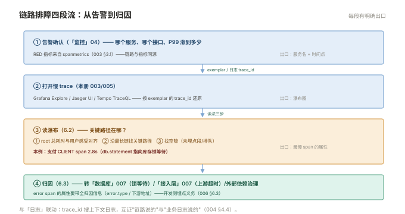

# 006 排障实战

> **解决**：从告警到 trace 到 span 的定位全流程，以及链路自身的常见异常。  
> **范围**：排障总纲 · 瀑布图读法 · 错误归因 · 常见异常 · 与指标日志联动。  
> **口径**：与 [README](README.md) 一致；RED 指标来自 spanmetrics（003 §3.1）。  
> **更新**：2026-11-01

## 目录

| 节 | 内容 |
|---|---|
| 6.1 | 排障总纲：从告警到 trace 到 span |
| 6.2 | 瀑布图读法：关键路径与"消失的时间" |
| 6.3 | 错误归因：error span 与下游 |
| 6.4 | 链路自身的异常：断链、时钟偏移、采样漏单 |
| 6.5 | 与指标/日志的联动定位流 |
| 6.6 | 六个坑 |
| 6.7 | 本章检查清单 |

---

## 6.1 排障总纲：从告警到 trace 到 span

P99 告警响后的标准定位流（四段，每段有明确出口）：

```plain
① 告警/仪表盘确认：哪个服务、哪个接口、P99 涨到多少（「监控」004）
② 跳 trace：exemplar / 日志里的 trace_id / 按时间+service 过滤还原慢 trace（003）
③ 读瀑布：找关键路径——最长的那条 span 链（6.2）
④ 归因：慢 span 的属性（db.statement / http.url）指向下游 → 转对应册取证
```

与前几册的关系：**①是「监控」的出口、③的取证材料是「日志」、④的归因指向「数据库」/「接入层」/外部依赖**——链路排障是各板块取证路线的**汇合点**，也是四段取证思想（「日志」006 §6.1）在第三支柱的形态。



---

## 6.2 瀑布图读法：关键路径与"消失的时间"

瀑布图的三步读法：

1. **找 root span 的总耗时**：与用户感受对齐（8 秒就是 8 秒）；
2. **找关键路径**：从 root 沿"最晚开始、最早结束中耗时最长"的链走——**优化它才缩短总延迟**，非关键路径上的慢 span（如并行的日志写入）优先级低；
3. **找"空隙"**：root 总时长 − 可见 span 覆盖 = 消失的时间。空隙的两种来源：**未埋点的段落**（内部计算、未 instrument 的库）与**排队等待**（线程池/连接池排队——这类 span 常被漏埋）。

"每一段都快但总耗时慢"的经典解法：**并行度不足**（本应并行的三次调用被串行）或**空隙**（未埋点段）——瀑布图上空隙位置一目了然，这正是链路比日志强大的地方。

---

## 6.3 错误归因：error span 与下游

错误 trace 的归因规则：

| 瀑布图形态 | 归因 | 动作 |
|---|---|---|
| 某 CLIENT span 标 Error | **下游返回错误** | 读该 span 属性（db.statement / http.url / status）→ 转下游册取证 |
| SERVER span 自身 Error、子 span 全正常 | **应用内部逻辑错误** | 应用日志（带同一 trace_id）+ 代码 |
| 根因 span 未标 Error 但结果错 | 业务"成功但结果错" | 转业务/数据对账——链路只反映协议层状态 |

纪律：**error span 的属性要带全归因信息**（`error.type`、下游地址）——这是开发侧的埋点义务（001 §1.2），运维侧在验收时核对（错误 span 点开能看到"错在哪类、哪个下游"）。

---

## 6.4 链路自身的异常：断链、时钟偏移、采样漏单

链路系统自己的三类异常，症状与处置：

| 异常 | 症状 | 处置 |
|---|---|---|
| **断链** | 一棵树在某服务后分叉成新 trace | 004 §4.5 的断链排查（传播丢失） |
| **时钟偏移** | 子 span 开始时间早于父 span | 后端自动校正（正常）；偏移巨大=主机 NTP 失准，修时钟 |
| **采样漏单** | 日志里有 trace_id 但后端查不到 | 头部采样骰子丢的——尾部采样"错误全留"可根治（005） |

三类的共同点：**先确认是链路系统的问题，还是链路忠实记录了"系统确实如此"**——时钟偏移是前者的典型，而"span 显示 DB 慢"即使看着不合理，也往往是真的。

---

## 6.5 与指标/日志的联动定位流

三支柱联动的完整排障流（000 §0.3 的落地）：

```plain
指标（监控册）        告警：order P99 > 2s（RED 指标来自 spanmetrics）
   │ exemplar / 时间点
   ▼
链路（本册）          打开同时段慢 trace → 瀑布图 → 关键路径定位到支付调用
   │ trace_id
   ▼
日志（日志册）        用 trace_id 搜支付调用的上下文日志 → 发现银行接口超时明细
   │
   ▼
归因完成：转「接入层」/外部依赖治理，复盘进「SRE」003
```

spanmetrics 的 RED 指标让"按服务/接口的错误率告警"零开发成本；exemplar 让告警图上的毛刺点直接携带 trace_id——**三支柱的接口宽度，决定了排障的流畅度**。

---

## 6.6 六个坑

| # | 坑 | 后果 | 正确做法 |
|---|---|---|---|
| 1 | 只看总耗时找慢 span | 忽略并行与空隙 | 关键路径分析（6.2） |
| 2 | 拿 trace 当唯一证据 | 链路反映协议层，非业务全貌 | 与日志互证（6.5） |
| 3 | error span 属性不全 | 归因需要二次取证 | 埋点义务（6.3） |
| 4 | 时钟偏移误判为数据错 | 错误地"修"正常数据 | 理解后端校正（6.4） |
| 5 | 排障不校验 trace 完整性 | 断链导致误归因 | 004 §4.5 的验收习惯 |
| 6 | 健康检查等噪声进 trace | 存储与查询被低值数据淹没 | Collector filter（002 §2.4） |

第 6 条展开：健康检查、高频心跳类请求的 span 量可达总量的 30%——它们在 002 §2.4 的 filter processor 里被丢弃，属于"采样即治理"（000 §0.6）的延伸。**低值数据不进链路的另一个理由**：尾部采样的缓存被它们占满，会挤掉真正需要保留的错误 trace。

---

## 6.7 本章检查清单

读完能回答这六个问题，这一章就过了：

| # | 问题 |
|---|---|
| 1 | 排障总纲的四段？每段的出口？ |
| 2 | 瀑布图三步读法？"消失的时间"两种来源？ |
| 3 | 三种错误形态的归因动作？ |
| 4 | 三类链路自身异常的处置？ |
| 5 | 三支柱联动的完整排障流？spanmetrics 与 exemplar 的作用？ |
| 6 | 健康检查 span 为什么该被过滤？在哪一层滤？ |

---

> 下一篇：回到 [README](README.md) 总览——「链路」套完成，可观测性三支柱全部齐备。
