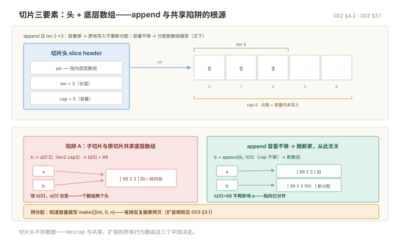

# Go 入门

> 目标：能独立写出一个 200 行以内、带错误处理、能读文件、能起 HTTP 服务的 Go 程序。
> 环境：Go 1.22+。所有示例可直接 `go run` 跑。

## 目录

| 章 | 内容 |
|---|---|
| 1 | 认识 Go：编译、运行、程序结构 |
| 2 | 变量、常量与类型 |
| 3 | 流程控制 |
| 4 | 复合类型：切片、map、struct |
| 5 | 函数与 defer |
| 6 | 指针 |
| 7 | 方法与接口 |
| 8 | 错误处理 |
| 9 | 包与模块 |
| 10 | 常用标准库 |
| 11 | 并发第一课 |
| 12 | 命令速查 |
| 13 | 新手十个坑 |
| 14 | 练习 |

---

## 1. 认识 Go

### 1.1 它是什么

Go 是**编译型、静态类型、自带垃圾回收**的语言。三个特点决定了它在运维和后端领域的地位：

| 特点 | 意味着 |
|---|---|
| 编译成单个静态二进制 | 拷到目标机器就能跑，不用装运行时，不担心依赖冲突 |
| 并发是语言内置的 | `go f()` 一行起协程，不用引第三方库 |
| 标准库自带 HTTP / JSON / 加密 | 起个服务不用挑框架 |

对比一下：Python 要装解释器和包，Java 要装 JVM，Go 只要一个文件。这是它成为运维工具首选语言的核心原因——Kubernetes、Docker、Prometheus、etcd、Terraform 全是 Go 写的。

### 1.2 跑通第一个程序

```bash
mkdir hello && cd hello
go mod init hello        # 生成 go.mod，声明模块名
```

新建 `main.go`：

```go
package main             // 可执行程序必须是 main 包

import "fmt"             // 导入标准库 fmt

func main() {            // 入口函数，无参数无返回值
	fmt.Println("hello")
}
```

```bash
go run main.go           # 编译并运行，不留下二进制
go build -o hello        # 编译出二进制
./hello
```

### 1.3 一个完整程序长什么样

```go
package main

import (
	"errors"
	"fmt"
	"os"
)

// 定义结构体
type Config struct {
	Name string
	Port int
}

// 定义方法（带指针接收者，可修改）
func (c *Config) SetPort(p int) error {
	if p < 1 || p > 65535 {
		return fmt.Errorf("端口 %d 非法", p)
	}
	c.Port = p
	return nil
}

func main() {
	cfg := &Config{Name: "demo", Port: 80}

	if err := cfg.SetPort(8080); err != nil {
		fmt.Fprintln(os.Stderr, "配置错误:", err)
		os.Exit(1)
	}

	fmt.Printf("%s 监听 %d\n", cfg.Name, cfg.Port)
}
```

需要记住的只有四件事：`package` 声明、`import` 导入、`func main()` 是入口、**大括号不换行**（Go 自动加分号，换行会编译报错）。

---

## 2. 变量、常量与类型

### 2.1 声明变量的三种写法

```go
var a int = 10      // 完整写法，类型明确
var b = 10          // 类型推导，b 是 int
c := 10             // 短声明，只能在函数内部用
```

**函数内部一律用 `:=`，包级别用 `var`**。`:=` 左边至少要有一个新变量，否则编译报错。

批量声明：

```go
var (
	name string
	age  int
)

x, y := 1, 2        // 同时声明多
```

### 2.2 零值：不用手动初始化

Go 的变量声明后就有确定的值，不存在"未定义"：

| 类型 | 零值 |
|---|---|
| 数字（int/float） | `0` |
| string | `""`（空串，不是 nil） |
| bool | `false` |
| 指针、切片、map、channel、接口、函数 | `nil` |
| struct | 每个字段各自零值 |

这一点很重要：**`nil` 的 map 可以读，不能写**。

```go
var m map[string]int
fmt.Println(m["a"])  // 输出 0，不 panic
m["a"] = 1           // panic: assignment to entry in nil map
```

### 2.3 常量与 iota

```go
const Pi = 3.14159

const (
	StatusOK       = 200
	StatusNotFound = 404
)
```

`iota` 是自增计数器，用来写枚举：

```go
type Level int

const (
	LevelDebug Level = iota  // 0
	LevelInfo                // 1
	LevelWarn                // 2
	LevelError               // 3
)

// 给它一个 String 方法，打印时就是名字而不是数字
func (l Level) String() string {
	return [...]string{"DEBUG", "INFO", "WARN", "ERROR"}[l]
}
```

### 2.4 基本类型速查

| 类型 | 说明 | 默认用哪个 |
|---|---|---|
| `int` | 有符号整数，64 位机上 8 字节 | **整数默认用它** |
| `int8/16/32/64` | 指定位宽 | 只在对接协议/二进制格式时用 |
| `uint` | 无符号 | 少用，减法会回绕 |
| `float64` | 双精度浮点 | **浮点默认用它** |
| `string` | 不可变字节序列（UTF-8） | — |
| `bool` | true / false | — |
| `byte` | `uint8` 的别名 | 处理二进制 |
| `rune` | `int32` 的别名，表示一个字符 | 处理中文/emoji |
| `error` | 接口，表示错误 | — |

### 2.5 类型转换：必须显式

Go **没有隐式类型转换**，哪怕 int32 到 int64 也要写出来：

```go
var i32 int32 = 100
var i64 int64 = int64(i32)   // 不写就编译报错

var f float64 = 3.9
var n int = int(f)           // 3，直接截断，不四舍五入

s := "123"
// n2 := int(s)              // 错！字符串转数字用 strconv
n2, err := strconv.Atoi(s)   // 正确
```

这个设计初看啰嗦，但它避免了 C 里那种"悄悄溢出"的事故。

---

## 3. 流程控制

### 3.1 if

```go
if err := doSomething(); err != nil {   // 可以在条件前执行一条语句
	fmt.Println("失败:", err)
}
```

这个写法是 Go 的特色，`err` 的作用域仅限这个 if 块，出了块就不可见——逼你立刻处理错误。

### 3.2 for：唯一的循环

Go 没有 `while`，`for` 一个顶三个：

```go
// 1. 标准三段式
for i := 0; i < 10; i++ {
	fmt.Println(i)
}

// 2. 当 while 用
n := 0
for n < 10 {
	n++
}

// 3. 死循环
for {
	break
}

// 4. 遍历（range）
nums := []int{10, 20, 30}
for i, v := range nums {
	fmt.Println(i, v)     // 索引, 值
}

for _, v := range nums {  // 不要索引用 _
	fmt.Println(v)
}

m := map[string]int{"a": 1}
for k, v := range m {
	fmt.Println(k, v)     // 注意：map 遍历顺序是随机的
}

for i := range 5 {        // Go 1.22+，等价 for i := 0; i < 5; i++
	fmt.Println(i)
}
```

### 3.3 switch

不用写 `break`，匹配到就退出：

```go
switch status {
case 200:
	fmt.Println("成功")
case 301, 302:
	fmt.Println("重定向")
case 404:
	fmt.Println("未找到")
default:
	fmt.Println("其他")
}
```

需要"贯穿"到下一个 case 才写 `fallthrough`。

不带条件的 switch 相当于 if-else 链，可读性更好：

```go
switch {
case score >= 90:
	fmt.Println("A")
case score >= 60:
	fmt.Println("B")
default:
	fmt.Println("C")
}
```

### 3.4 标签跳出多层

```go
outer:
	for i := 0; i < 3; i++ {
		for j := 0; j < 3; j++ {
			if i*j > 2 {
				break outer      // 直接跳出外层
			}
		}
	}
```

---

## 4. 复合类型：切片、map、struct

### 4.1 数组 vs 切片

| | 数组 `[3]int` | 切片 `[]int` |
|---|---|---|
| 长度 | 类型的一部分，固定 | 动态 |
| 传参 | **整个复制** | 传的是描述符（指向同一底层数组） |
| 用得多吗 | 很少 | **几乎只用切片** |

```go
arr := [3]int{1, 2, 3}        // 数组
sli := []int{1, 2, 3}         // 切片（中括号里没数字）
```

### 4.2 切片的三个要素

切片本身不存数据，它只是三个字段：**指针（指向底层数组）+ 长度 len + 容量 cap**。

```go
s := make([]int, 2, 5)   // len=2, cap=5，已初始化两个 0
fmt.Println(len(s), cap(s))   // 2 5

s = append(s, 3)
fmt.Println(len(s), cap(s))   // 3 5，容量够，不重新分配
```

`append` 时如果容量不够，会分配一块更大的新数组（通常是 2 倍或 1.25 倍），把数据拷过去。**这意味着原切片的修改不会反映到新切片上**：

```go
a := []int{1, 2, 3}
b := a[0:2]        // b 和 a 共享底层数组
b[0] = 99
fmt.Println(a)     // [99 2 3]  ← a 被改了

b = append(b, 100) // 容量不够，b 指向新数组
b[0] = 88
fmt.Println(a)     // [99 2 3]  ← 这次 a 不受影响
```

**预分配能省大量内存拷贝**，知道要装多少就写 `make([]int, 0, n)`。



### 4.3 map

```go
m := map[string]int{
	"a": 1,
	"b": 2,
}

m["c"] = 3          // 写
v := m["a"]         // 读，不存在返回零值
delete(m, "b")      // 删

// 判断 key 是否存在（重要）
if v, ok := m["x"]; ok {
	fmt.Println("存在:", v)
} else {
	fmt.Println("不存在")
}
```

三个必须记住的点：

1. **遍历顺序随机**，不要依赖顺序，需要有序就另外存 key 再排序。
2. **不是并发安全的**，多协程同时写会直接 `fatal error`（不是普通 panic，`recover` 抓不到）。并发场景用 `sync.RWMutex` 或 `sync.Map`。
3. `nil` map 能读不能写，务必用 `make` 或字面量初始化。

### 4.4 struct

```go
type Server struct {
	Name    string
	Port    int
	Tags    []string
	Created time.Time
}

// 键值写法（推荐，字段增减不会错位）
s := Server{
	Name: "web-01",
	Port: 8080,
}

// 位置写法（字段一改就编译报错，不推荐跨包用）
s2 := Server{"web-02", 8080, nil, time.Now()}

fmt.Println(s.Name)   // 访问字段
```

**结构体是值类型**，赋值、传参都是整个复制。字段多了或要修改时用指针：

```go
func (s *Server) Addr() string {
	s.Port++                       // 指针接收者，能改
	return fmt.Sprintf("%s:%d", s.Name, s.Port)
}
```

结构体标签用于序列化：

```go
type User struct {
	ID       int    `json:"id"`
	Name     string `json:"name"`
	Password string `json:"-"`         // - 表示不输出
	Email    string `json:"email,omitempty"`  // 空值则省略
}
```

### 4.5 字符串与字符

字符串是**不可变的字节序列**，UTF-8 编码。中文一个字占 3 字节：

```go
s := "你好"
fmt.Println(len(s))                  // 6，字节数
fmt.Println(len([]rune(s)))          // 2，字符数

for i, r := range s {                // range 按 rune 遍历，正确
	fmt.Println(i, string(r))        // i 是字节偏移
}
```

```go
// 常用操作
strings.Contains(s, "你")
strings.HasPrefix(s, "http")
strings.Split("a,b,c", ",")
strings.Join([]string{"a", "b"}, "-")
strings.TrimSpace(s)
strings.ToUpper(s)
strings.ReplaceAll(s, "a", "b")

// 拼接：少量用 +，循环里必须用 Builder
var b strings.Builder
for i := 0; i < 1000; i++ {
	b.WriteString("x")
}
result := b.String()
```

循环里用 `+` 拼字符串是 O(n²)，一万次拼接能差出几百倍。

---

## 5. 函数与 defer

### 5.1 多返回值

Go 最常见的错误处理形态：

```go
func divide(a, b int) (int, error) {
	if b == 0 {
		return 0, errors.New("除数不能为 0")
	}
	return a / b, nil
}

// 调用
result, err := divide(10, 2)
if err != nil {
	return err
}
```

### 5.2 命名返回值

```go
func parse(s string) (n int, err error) {
	n, err = strconv.Atoi(s)
	return          // 裸返回，返回已命名的变量
}
```

只在函数很短时用。长了会让人找不到到底返回了什么。

### 5.3 可变参数

```go
func sum(nums ...int) int {
	total := 0
	for _, n := range nums {
		total += n
	}
	return total
}

sum(1, 2, 3)
sum([]int{1, 2, 3}...)   // 传切片要加 ...
```

### 5.4 闭包

函数可以捕获外部变量：

```go
func counter() func() int {
	n := 0
	return func() int {
		n++
		return n
	}
}

c := counter()
fmt.Println(c())   // 1
fmt.Println(c())   // 2
```

### 5.5 defer：函数返回前执行

```go
func readFile(path string) error {
	f, err := os.Open(path)
	if err != nil {
		return err
	}
	defer f.Close()      // 函数结束时一定执行，不管有没有 return/panic

	data, err := io.ReadAll(f)
	// ...
	return err
}
```

三个要点：

```go
// 1. 多个 defer 是后进先出（栈）
defer fmt.Println("1")
defer fmt.Println("2")
defer fmt.Println("3")
// 输出：3 2 1

// 2. 参数在 defer 那一刻就求值了
n := 1
defer fmt.Println(n)   // 打印 1，不是后面的 100
n = 100

// 3. 别在循环里 defer
for _, p := range paths {
	defer os.Remove(p)   // 一万个文件 → 一万个待执行，内存涨，最后才删
}
```

---

## 6. 指针

Go 有指针，但没有指针运算，比 C 安全得多。

```go
n := 10
p := &n           // 取地址
fmt.Println(*p)   // 解引用，输出 10
*p = 20           // 通过指针改
fmt.Println(n)    // 20
```

**什么时候用指针：**

| 场景 | 用不用 |
|---|---|
| 要在函数里修改原值 | 用 `*T` |
| 结构体很大（几个字段以上），避免复制 | 用 `*T` |
| 需要表达"没有这个值" | 用 `*T`（nil 表示不存在） |
| 小结构体、基本类型只读 | 不用，直接传值 |

`new` 很少用，因为 `&T{}` 更常见：

```go
p := new(int)        // 指向零值 int 的指针
p2 := &Server{}      // 更常用
```

**空指针解引用是 panic**，所以指针字段用完前先判空：

```go
if s == nil {
	return errors.New("nil server")
}
```

---

## 7. 方法与接口

### 7.1 方法

方法是带接收者的函数：

```go
type Rect struct {
	W, H float64
}

// 值接收者：不修改原值
func (r Rect) Area() float64 {
	return r.W * r.H
}

// 指针接收者：可修改
func (r *Rect) Scale(k float64) {
	r.W *= k
	r.H *= k
}
```

**规则：同一个类型的方法集，要么全用指针接收者，要么全用值接收者。** 混用会导致接口实现变得难以预料。经验上：结构体有可变状态就用指针，否则用值。

### 7.2 接口：隐式实现

Go 的接口是**鸭子类型**——只要方法签名对得上，就自动实现了，不需要写 `implements`：

```go
type Writer interface {
	Write(p []byte) (int, error)
}

type FileLogger struct{ path string }

// 没有声明它实现 Writer，但方法签名一致，就是实现了
func (l *FileLogger) Write(p []byte) (int, error) {
	return os.WriteFile(l.path, p, 0644)
}

func logAll(w Writer, msgs []string) {
	for _, m := range msgs {
		w.Write([]byte(m))
	}
}

logAll(&FileLogger{path: "app.log"}, []string{"a", "b"})
```

这个设计的好处：**接口在使用方定义，不在实现方定义**。你用标准库的 `io.Writer`，自己的类型不用引任何包就实现了它，依赖是单向的。

### 7.3 空接口与类型断言

`any`（`interface{}` 的别名）可以装任意值，取出来要断言：

```go
var v any = 42

// 带 ok 的断言，安全
if n, ok := v.(int); ok {
	fmt.Println("是 int:", n)
}

// 不带 ok，类型不对直接 panic
n := v.(int)
```

多类型判断用 `type switch`：

```go
switch x := v.(type) {
case int:
	fmt.Println("int", x)
case string:
	fmt.Println("string", x)
case error:
	fmt.Println("error", x.Error())
default:
	fmt.Printf("未知类型 %T\n", x)
}
```

**接口是 nil 不等于里面的值是 nil**，这是新手最常踩的坑：

```go
func doWork() error {
	var e *MyError = nil
	return e            // 返回的 err != nil！因为类型信息还在
}

if err := doWork(); err != nil {
	// 这里会进来，即使 e 是 nil
}
```

判据：**接口 == nil 要求类型和值都为 nil**。所以函数不要返回 `*T` 类型的 nil 当作"无错误"，要返回字面量 `nil`。

---

## 8. 错误处理

Go 不用异常，错误是普通返回值。

```go
f, err := os.Open("a.txt")
if err != nil {
	return fmt.Errorf("打开配置文件失败: %w", err)   // %w 包装，保留原始错误
}
defer f.Close()
```

**包装链的意义**：调用方既能加上下文，又能在上层用 `errors.Is` 精确判断：

```go
// 底层
var ErrNotFound = errors.New("not found")

func find(id int) error {
	return fmt.Errorf("查询用户 %d: %w", id, ErrNotFound)
}

// 上层
if errors.Is(err, ErrNotFound) {     // 能穿透包装匹配到 ErrNotFound
	fmt.Println("用户不存在")
}
```

取自定义错误类型用 `errors.As`：

```go
type ConfigError struct {
	Field string
	Err   error
}

func (e *ConfigError) Error() string { return e.Field + ": " + e.Err.Error() }

var ce *ConfigError
if errors.As(err, &ce) {
	fmt.Println("出错的字段:", ce.Field)
}
```

### panic 与 recover

**panic 只用于程序无法继续的状态**：数组越界、空指针、初始化缺配置。业务错误一律用 `error`。

```go
func safeRun(fn func()) {
	defer func() {
		if r := recover(); r != nil {
			log.Printf("捕获 panic: %v", r)
		}
	}()
	fn()
}
```

三条边界：

- `recover` 只在 `defer` 里直接调用才有效，套一层函数就失效。
- 只在**服务的最外层**（HTTP handler、goroutine 起点）兜底，不要到处写。
- `recover` 抓不到 `fatal error`（如并发写 map、栈溢出），这类只能靠代码正确性避免。

---

## 9. 包与模块

### 9.1 概念区分

| 概念 | 是什么 |
|---|---|
| **模块 module** | 一个 `go.mod` 文件管理的一组包，是版本管理单位 |
| **包 package** | 同一目录下的 `.go` 文件，是编译单位 |

```bash
go mod init github.com/you/project    # 初始化模块
go get github.com/gin-gonic/gin       # 加依赖，自动写入 go.mod
go mod tidy                           # 清理没用到的，补齐缺的
```

### 9.2 导出的规则：首字母大写

```go
package mypkg

var Exported = 1      // 大写：其他包能访问
var internal = 2      // 小写：仅包内可见

func Do() {}          // 导出
func helper() {}      // 不导出
```

没有 `public/private` 关键字，就靠首字母。**这是 Go 唯一、也是必须遵守的可见性规则。**

### 9.3 标准项目结构

```
project/
├── go.mod
├── go.sum
├── main.go                 # 程序入口
├── internal/               # 私有代码，外部模块无法导入
│   ├── config/
│   ├── handler/
│   └── service/
├── pkg/                    # 可被外部引用的公共包（可选）
└── Makefile
```

`internal/` 是编译器强制的边界，不是约定——外部模块 `import` 会直接编译报错。

### 9.4 包的导入习惯

```go
import (
	"context"
	"fmt"
	"os"

	"github.com/gin-gonic/gin"          // 第三方，空一行

	"myproject/internal/config"         // 本项目，再空一行
)
```

分组只是 gofmt 的美化结果，不影响编译，但团队评审会看。

---

## 10. 常用标准库

### 10.1 fmt

```go
fmt.Println("普通输出")
fmt.Printf("%s 有 %d 个\n", name, count)
s := fmt.Sprintf("拼接后返回字符串: %v", obj)
fmt.Fprintf(os.Stderr, "错误: %v\n", err)

// 格式化动词
%v   默认格式
%+v  带字段名（调试结构体最常用）
%T   类型
%q   带引号的字符串
%d   十进制   %x 十六进制
%f   浮点     %.2f 保留两位
%p   指针地址
%w   包装错误（只在 fmt.Errorf 里用）
```

### 10.2 os 与文件

```go
data, err := os.ReadFile("config.yaml")       // 一次读全（小文件）
os.WriteFile("out.txt", data, 0644)

f, err := os.Open("big.log")                  // 大文件用流式
defer f.Close()
scanner := bufio.NewScanner(f)
for scanner.Scan() {
	line := scanner.Text()
}

os.Getenv("HOME")
os.Args                        // 命令行参数
os.MkdirAll("a/b/c", 0755)     // 递归建目录
os.Remove("f.txt")
```

### 10.3 strconv

```go
n, err := strconv.Atoi("123")           // string → int
s := strconv.Itoa(123)                  // int → string
f, err := strconv.ParseFloat("3.14", 64)
b, err := strconv.ParseBool("true")
```

### 10.4 time

```go
now := time.Now()
now.Add(24 * time.Hour)
now.Format("2006-01-02 15:04:05")     // 记住这个"魔数"模板，不是 YYYY-MM-DD

t, err := time.Parse("2006-01-02", "2026-10-28")
d := time.Since(start)                 // 耗时
time.Sleep(2 * time.Second)
```

Go 的时间模板用固定的参考时间 `2006-01-02 15:04:05`，写 `"2026-10-28"` 不会报错但结果错——这是新手必踩的坑。

### 10.5 encoding/json

```go
type User struct {
	ID   int    `json:"id"`
	Name string `json:"name"`
}

data, err := json.Marshal(u)              // struct → []byte
err = json.Unmarshal(data, &u)            // []byte → struct（注意传地址）

// 流式读写
json.NewEncoder(w).Encode(u)
json.NewDecoder(r).Decode(&u)
```

`Unmarshal` 传的是指针，忘了 `&` 编译不报错但数据是空的（JSON 里 null 解到 nil 指针不赋值）。

---

## 11. 并发第一课

Go 的并发是**协程 + 通道**，口号是"不要通过共享内存来通信，要通过通信来共享内存"。

### 11.1 goroutine

```go
go doSomething()          // 一行起一个协程，开销约 2KB 栈

// 常见写法：起 N 个并发任务
for _, url := range urls {
	go fetch(url)         // 注意：这里不等结果，main 退出就全没了
}
```

**main 函数返回时，所有 goroutine 立即终止**，所以要等：

```go
var wg sync.WaitGroup
for _, url := range urls {
	wg.Add(1)
	go func(u string) {          // 显式传参，别直接闭包捕获
		defer wg.Done()
		fetch(u)
	}(url)
}
wg.Wait()
```

### 11.2 channel

channel 是协程间的管道：

```go
ch := make(chan int)        // 无缓冲：发送方阻塞，直到有人接收
ch2 := make(chan int, 10)   // 有缓冲：满 10 个才阻塞

go func() {
	ch <- 42                // 发送
}()

v := <-ch                   // 接收
close(ch)                   // 关闭（由发送方关）
```

三个语义必须记牢：

| 操作 | 结果 |
|---|---|
| 向已关闭的 channel 发送 | **panic** |
| 从已关闭的 channel 接收 | 立即返回零值，`v, ok := <-ch` 中 ok 为 false |
| 关闭已关闭的 channel | **panic** |

**规则：谁发送谁关闭，接收方永远不要关。** 多个发送方时不要关，让它们都结束后由协调者关。

### 11.3 for range channel

```go
ch := make(chan int, 3)
ch <- 1
ch <- 2
ch <- 3
close(ch)

for v := range ch {        // channel 关闭后自动退出循环
	fmt.Println(v)
}
```

### 11.4 select

同时等多个 channel，谁先来走谁：

```go
select {
case v := <-ch1:
	fmt.Println("来自 ch1:", v)
case ch2 <- 10:
	fmt.Println("写入 ch2 成功")
case <-time.After(3 * time.Second):
	fmt.Println("超时")
default:
	fmt.Println("都没准备好")
}
```

`time.After` 是超时控制的常用手段。注意在**高频循环**里它会不断新建定时器，要用 `time.NewTimer` 复用。

---

## 12. 命令速查

### 12.1 日常

```bash
go run .                  # 运行当前包
go run main.go            # 运行单文件
go build -o app .         # 编译
go test ./...             # 跑所有测试
go test -v -run TestFoo   # 跑指定测试，带输出
go fmt ./...              # 格式化（也可用 gofmt -w .）
go vet ./...              # 静态检查
```

### 12.2 模块

```bash
go mod init <module>      # 初始化
go mod tidy               # 整理依赖（最常用）
go mod download           # 下载依赖到本地缓存
go list -m all            # 列出所有依赖
go get pkg@v1.2.3         # 拉指定版本
go clean -modcache        # 清模块缓存（磁盘不够时）
```

### 12.3 交叉编译

```bash
GOOS=linux GOARCH=amd64 go build -o app-linux .
GOOS=linux GOARCH=arm64 go build -o app-arm64 .
GOOS=windows GOARCH=amd64 go build -o app.exe .

# 静态编译（不依赖 glibc，适合塞进 scratch/alpine 镜像）
CGO_ENABLED=0 GOOS=linux go build -ldflags="-s -w" -o app .
```

`-s -w` 去掉符号表和调试信息，二进制体积能小 30%。

### 12.4 排查

```bash
go env                    # 看环境配置
go version
go doc fmt.Println        # 查文档，不用开浏览器
go vet ./...              # 找可疑代码（打印格式不匹配、锁复制等）
```

---

## 13. 新手十个坑

| # | 坑 | 现象 | 正确做法 |
|---|---|---|---|
| 1 | 循环体里用 `:=` 重新声明 err | 错误被内层变量吃掉，外层仍是 nil | 用 `=`，或每层立刻 return |
| 2 | 循环里 `defer` | 资源迟迟不释放，内存涨 | 抽成函数，defer 在函数内 |
| 3 | 循环变量闭包捕获 | 所有协程拿到同一个值（Go 1.22 前） | 显式传参 `go func(u string)` |
| 4 | nil map 写入 | panic | `make` 初始化 |
| 5 | 忘记 `wg.Done()` | `wg.Wait()` 永久阻塞 | `defer wg.Done()` |
| 6 | channel 写入后忘记关 | `for range` 死等 | 发送方 close |
| 7 | 返回 `*T` 的 nil 当 error | `err != nil` 成立但内容是 nil | 直接 `return nil` |
| 8 | 时间格式写 `"2026-10-28"` | 不报错但格式化结果错 | 固定模板 `"2006-01-02"` |
| 9 | 切片 append 后原切片被改 | 数据"莫名"变化 | 用 `make` + `copy` 隔离 |
| 10 | 大括号换行 | `unexpected newline` | `{` 必须和语句同行 |

还有一个高频的：**没跑 `go fmt`**。Go 社区不接受未格式化的代码，提交前必须过一遍。

---

## 14. 练习

按顺序做，每道都能跑通再往下：

1. **命令行参数**：读 `os.Args`，支持 `-n 5 -name xxx`，用 `flag` 包实现。
2. **读文件统计**：读一个日志文件，统计行数、含 `ERROR` 的行数，输出到 stdout。
3. **JSON 转换**：定义一个 struct，从文件读 JSON，改一个字段后写回另一个文件，处理所有 error。
4. **并发展开**：给一组 URL，并发发起 GET（用 `net/http`），收集状态码，用 `WaitGroup` 等全部完成，失败不中断。
5. **简易 HTTP 服务**：`/health` 返回 `{"ok":true}`，`/echo` 把请求体原样返回，带 5 秒超时和优雅退出。

第 5 题的骨架：

```go
func main() {
	mux := http.NewServeMux()

	mux.HandleFunc("/health", func(w http.ResponseWriter, r *http.Request) {
		w.Header().Set("Content-Type", "application/json")
		json.NewEncoder(w).Encode(map[string]bool{"ok": true})
	})

	mux.HandleFunc("/echo", func(w http.ResponseWriter, r *http.Request) {
		if r.Method != http.MethodPost {
			http.Error(w, "只接受 POST", http.StatusMethodNotAllowed)
			return
		}
		body, err := io.ReadAll(r.Body)
		if err != nil {
			http.Error(w, err.Error(), http.StatusBadRequest)
			return
		}
		w.Write(body)
	})

	srv := &http.Server{Addr: ":8080", Handler: mux}

	go func() {
		if err := srv.ListenAndServe(); err != nil && err != http.ErrServerClosed {
			log.Fatal(err)
		}
	}()

	// 等信号，优雅退出
	quit := make(chan os.Signal, 1)
	signal.Notify(quit, syscall.SIGINT, syscall.SIGTERM)
	<-quit

	ctx, cancel := context.WithTimeout(context.Background(), 5*time.Second)
	defer cancel()
	srv.Shutdown(ctx)
}
```

写完这五道，来读 [003 Go 进阶](003-Go进阶.md)。
