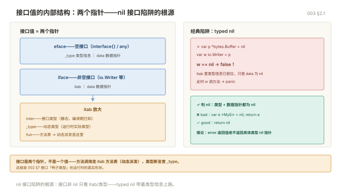

# Go 进阶

> 目标：从"能写"到"写得对、写得快、测得全"。这一册讲的都是**评审时会被追问**的点。
> 前置：读过《002 Go 入门》。环境 Go 1.22+。

## 目录

| 章 | 内容 |
|---|---|
| 1 | 类型系统：定义、别名、方法集 |
| 2 | 接口进阶：内部结构、设计原则 |
| 3 | 切片与 map 的底层 |
| 4 | 字符串与字节 |
| 5 | 内存管理与 GC |
| 6 | 值语义 vs 指针语义 |
| 7 | 并发模式 |
| 8 | channel 进阶 |
| 9 | 错误处理进阶 |
| 10 | 测试与基准 |
| 11 | 工程化：日志、配置、优雅退出 |
| 12 | 代码组织 |
| 13 | 十二个坑 |

---

## 1. 类型系统

### 1.1 类型定义 vs 类型别名

```go
type MyInt int          // 定义：全新类型，和 int 不能混用
type Alias = int        // 别名：完全是同一个类型，只是换个名字
```

```go
var a MyInt = 1
var b int = 2
// a + b               // 编译错误：类型不匹配
a2 := int(a) + b       // 必须显式转换

var c Alias = 3
var d int = 4
_ = c + d              // 可以，Alias 就是 int
```

**关键差别：定义新类型不会继承原类型的方法**，别名会。

```go
type MyInt int
func (m MyInt) Double() int { return int(m) * 2 }

// 如果写 type MyInt = int，上面这行会报错：不能在非本地类型上定义方法
```

这也是为什么 `type any = interface{}` 是别名——它是为了给你一个短名字，不是为了造新类型。

### 1.2 底层类型

每个类型都有一个底层类型，转换和比较都看它：

```go
type Celsius float64
type Fahrenheit float64

var c Celsius = 100
// f := Fahrenheit(c)      // 可以转换，底层都是 float64
```

但**同名方法不共享**，两个类型的值不能直接比较。

### 1.3 类型断言与类型切换

接到 `any` 后必须还原类型：

```go
func describe(v any) string {
	switch x := v.(type) {
	case nil:
		return "nil"
	case int, int64:
		return fmt.Sprintf("整数 %v", x)
	case string:
		return "字符串 " + x
	case fmt.Stringer:              // 走接口：任何实现了 String() 的类型
		return x.String()
	case error:
		return "错误: " + x.Error()
	default:
		return fmt.Sprintf("未知 %T", x)
	}
}
```

**case 顺序有意义**：`case nil` 放最前，具体类型放前，接口放后。`fmt.Stringer` 写在 `string` 之前会拦住 string 吗？不会——具体类型优先匹配，但写在前面读起来更清楚。

### 1.4 嵌入：Go 的"继承"

Go 没有继承，用组合加嵌入：

```go
type Logger struct{ prefix string }

func (l Logger) Log(msg string) {
	fmt.Println(l.prefix, msg)
}

type Service struct {
	Logger              // 嵌入（不带字段名），方法被提升
	Name   string
}

s := Service{Logger: Logger{prefix: "[svc]"}, Name: "api"}
s.Log("启动")           // 直接调用，等价于 s.Logger.Log(...)
```

嵌入的坑：**同名方法/字段会被外层覆盖**，且不会报错。

```go
type A struct{ Name string }
type B struct{ Name string }
type C struct {
	A
	B
}
// c.Name 会编译报错：有歧义
// 必须写 c.A.Name
```

### 1.5 什么时候该定义新类型

| 场景 | 例子 |
|---|---|
| 需要附加方法 | `type UserID int64` + `func (u UserID) Valid() bool` |
| 需要类型安全隔离 | `type Celsius float64` 防止和 `Fahrenheit` 混 |
| 需要实现接口 | `type HandlerFunc func(...)` 让它有 `ServeHTTP` |
| 只是缩短名字 | 用别名 `type Alias = X` |

---

## 2. 接口进阶

### 2.1 内部结构

接口值在内存里是**两个指针**：类型信息 + 数据指针。

```go
var w io.Writer = os.Stdout
// w 内部 = { *itab（类型+方法表）, 指向 os.Stdout 的指针 }
```

这解释了那个经典陷阱：

```go
var p *bytes.Buffer = nil
var w io.Writer = p            // w 不是 nil！
fmt.Println(w == nil)          // false
```

因为类型信息 `*bytes.Buffer` 已经有了，只有数据指针是 nil。所以：

```go
// 判断接口是否为 nil，必须类型和值都为 nil
if w != nil {
	w.Write([]byte("x"))       // 这里会 panic：nil 指针调方法
}
```

**推论：函数返回 error 时，绝对不要返回具体类型的 nil 指针。**

```go
func bad() error {
	var e *MyErr = nil
	return e                    // ❌
}

func good() error {
	return nil                  // ✅
}
```



### 2.2 方法集与接收者

这是 Go 最反直觉的规则之一：

| 类型 | 值方法 | 指针方法 |
|---|---|---|
| `T` | 有 | **无** |
| `*T` | 有（自动解引用） | 有 |

```go
type S struct{}
func (s S) ValMethod()  {}
func (s *S) PtrMethod() {}

var s S
var ps *S = &s

// 接口要求 ValMethod
var i1 interface{ ValMethod() } = s     // OK
var i2 interface{ ValMethod() } = ps    // OK（自动解引用）

// 接口要求 PtrMethod
var i3 interface{ PtrMethod() } = ps    // OK
// var i4 interface{ PtrMethod() } = s  // ❌ 编译错误：S 没有 PtrMethod
```

**结论：如果一个类型的指针接收者方法要实现接口，就只能传指针。** 这也解释了为什么 `json.Unmarshal` 必须传 `&v`。

### 2.3 接口设计原则

**接口应该由使用方定义，而不是实现方。**

```go
// ❌ 实现方定义一个大接口
package storage
type Storage interface {
	Get(key string) ([]byte, error)
	Put(key string, val []byte) error
	Delete(key string) error
	List(prefix string) ([]string, error)
	Close() error
}

// ✅ 使用方按需定义小接口
package service
type Reader interface {
	Get(key string) ([]byte, error)
}

func LoadConfig(r Reader) error { ... }   // 只依赖它真正用到的方法
```

好处：`LoadConfig` 不引 storage 包，测试时给个 3 行的假实现就行。

**接口越少越好，1-2 个方法最佳。** 标准库的 `io.Reader`、`io.Writer`、`error`、`fmt.Stringer` 都是单方法接口，这是 Go 生态可组合性的根源。

### 2.4 常用标准库接口

| 接口 | 方法 | 你在什么时候实现它 |
|---|---|---|
| `io.Reader` | `Read(p []byte) (int, error)` | 自定义数据源 |
| `io.Writer` | `Write(p []byte) (int, error)` | 自定义输出目标 |
| `io.Closer` | `Close() error` | 需要释放资源 |
| `fmt.Stringer` | `String() string` | 想让 `%v` 打印好看 |
| `error` | `Error() string` | 自定义错误 |
| `sort.Interface` | `Len/Less/Swap` | 自定义排序（现在更推荐 `slices.SortFunc`） |
| `http.Handler` | `ServeHTTP(w, r)` | 自定义 HTTP 处理器 |
| `encoding.TextMarshaler` | `MarshalText() ([]byte, error)` | 让类型能作为 map key 序列化 |

### 2.5 接口零值

`nil` 接口调用任何方法都 panic：

```go
var h http.Handler
h.ServeHTTP(w, r)     // panic: nil pointer dereference
```

所以结构体里存接口字段，用之前必须判空，或者给个默认实现（null object 模式）。

---

## 3. 切片与 map 的底层

### 3.1 切片扩容规则

`append` 容量不够时：

| 原容量 | 新容量 |
|---|---|
| < 256 | 翻倍 |
| ≥ 256 | 每次增长约 1.25 倍，并做内存对齐 |

实际数值不保证，官方只承诺"至少能装下"。**不要依赖具体倍数**。

```go
// 知道最终大小就预分配，省掉所有拷贝
result := make([]string, 0, len(input))
for _, v := range input {
	result = append(result, transform(v))
}
```

一万条数据，预分配和不预分配的性能差通常在 3-5 倍。

### 3.2 切片共享底层数组的三个陷阱

```go
// 陷阱一：截取后修改互相影响
a := []int{1, 2, 3, 4, 5}
b := a[1:3]           // b=[2 3]，共享同一个底层数组
b[0] = 99
fmt.Println(a)        // [1 99 3 4 5]

// 陷阱二：大切片持有小切片，内存不释放
func getFirst(data []byte) []byte {
	return data[:10]   // 只用了 10 字节，但整个 data 数组不能 GC
}
// 修法：拷贝出来
func getFirstSafe(data []byte) []byte {
	out := make([]byte, 10)
	copy(out, data[:10])
	return out
}

// 陷阱三：append 到"看起来独立"的切片
s1 := make([]int, 3, 10)
s2 := append(s1, 1)    // 容量够，直接写在 s1 的底层数组后面
s2[0] = 100
fmt.Println(s1[0])     // 100，s1 被改了
```

全切片表达式可以限制容量：

```go
b := a[1:3:3]          // 第三个参数是 cap，限制为 3
// 此后 append 一定重新分配，不会污染 a
```

### 3.3 切片比较

切片不能直接用 `==` 比较（只能和 nil 比）：

```go
s1, s2 := []int{1, 2}, []int{1, 2}
// if s1 == s2 {}                     // 编译错误

if slices.Equal(s1, s2) {}             // Go 1.21+
if len(s1) == 0 {}                     // 判空用 len，别用 == nil
```

**判空一律用 `len(s) == 0`**，因为 nil 切片和空切片都合法，`== nil` 会漏判。

### 3.4 map 的实现要点

map 是哈希表，内部是"桶数组 + 每桶 8 个键值对"。

| 特性 | 说明 |
|---|---|
| 遍历顺序 | **随机**，每次都不一样（故意的，防止依赖顺序） |
| 并发写 | `fatal error: concurrent map writes`，**recover 抓不到** |
| 扩容 | 元素太多或溢出桶太多时翻倍，渐进式迁移 |
| key 要求 | 必须可比较（slice/map/function 不行） |
| 内存 | 删除 key 不会缩容，长期增删要有重建策略 |

并发安全三种做法：

```go
// 1. 读写锁（最常用，读多写少）
type SafeMap struct {
	mu sync.RWMutex
	m  map[string]int
}
func (s *SafeMap) Get(k string) (int, bool) {
	s.mu.RLock()
	defer s.mu.RUnlock()
	v, ok := s.m[k]
	return v, ok
}

// 2. sync.Map（键集合稳定、读远多于写的场景，如缓存）
var sm sync.Map
sm.Store("k", 1)
v, ok := sm.Load("k")
sm.Range(func(k, v any) bool { return true })

// 3. 分片锁（高并发计数，按 key 哈希到 N 个 map）
```

`sync.Map` 不是"更快的 map"，只在特定场景（读多、键基本不变）优于 RWMutex。普通场景用锁。

---

## 4. 字符串与字节

### 4.1 三者的关系

```
string  ←→ []byte   （编码转换，会复制）
string  ←→ []rune   （UTF-8 解码，会复制）
```

```go
s := "Go语言"
fmt.Println(len(s))            // 8 字节（Go 2 + 语言 6）
fmt.Println(len([]rune(s)))    // 4 字符

// 按字符遍历（正确）
for i, r := range s {
	fmt.Printf("%d:%c ", i, r)  // 0:G 1:o 2:语 5:言（i 是字节偏移）
}

// 按字节遍历（会切坏中文）
for i := 0; i < len(s); i++ {
	fmt.Printf("%x ", s[i])
}
```

**取子串要按 rune 转，不能按字节切：**

```go
s := "你好世界"
// bad := s[:2]                // 切半个汉字，变成无效 UTF-8
r := []rune(s)
good := string(r[:2])          // "你好"
```

### 4.2 拼接的性能

| 方式 | 适用 |
|---|---|
| `+` | 2-3 个短字符串 |
| `fmt.Sprintf` | 需要格式化，少量 |
| `strings.Builder` | **循环拼接，首选** |
| `strings.Join` | 拼接切片 |
| `bytes.Buffer` | 需要同时读写的场景 |

```go
var b strings.Builder
b.Grow(1024)                  // 预分配，进一步减少扩容
for i := 0; i < 1000; i++ {
	b.WriteString("x")
}
s := b.String()
```

### 4.3 零拷贝转换（了解即可）

`[]byte` 和 `string` 互转默认会复制。标准库内部有些函数能避免，但普通代码里不要用 `unsafe` 去省这一次复制——除非你已经用 pprof 证明它是瓶颈。

```go
// 安全写法，日常就用这个
b := []byte(s)
s2 := string(b)
```

---

## 5. 内存管理与 GC

### 5.1 栈和堆

- **栈**：函数调用时分配，函数返回自动回收，极快。每个 goroutine 初始 2KB，按需增长。
- **堆**：逃逸出函数的变量，由 GC 管理。

**逃逸分析**决定变量去哪：

```bash
go build -gcflags='-m' ./...      # 看逃逸分析结果
go build -gcflags='-m -m' ./...   # 更详细的原因
```

输出示例：

```
./main.go:10:2: moved to heap: x
./main.go:15:9: s does not escape
```

常见逃逸原因：

| 原因 | 例子 |
|---|---|
| 返回局部变量指针 | `return &T{}` |
| 存进 interface | `fmt.Println(x)` 里 x 装箱 |
| 闭包捕获 | 引用了外部变量 |
| 切片/map 元素是指针 | 底层数组在堆上 |
| 变量太大 | 超过栈帧限制 |
| 发送到 channel | 跨协程必须共享 |

**优化方向不是"消灭所有逃逸"**，而是"减少高频路径上的分配"。用 `go build -gcflags='-m'` 找到热点的逃逸，再针对性改。

### 5.2 GC 工作方式

Go 的 GC 是**并发三色标记 + 写屏障**，目标是 STW 控制在亚毫秒级。

| 阶段 | 做什么 | 是否 STW |
|---|---|---|
| Mark Setup | 开启写屏障 | 极短 STW |
| Concurrent Mark | 并发标记可达对象 | 否（和业务并行） |
| Mark Termination | 收尾 | 极短 STW |
| Concurrent Sweep | 并发清扫 | 否 |

关键参数：

```bash
GOGC=100          # 默认。堆增长 100% 触发一次 GC。调大=GC 更少但内存更高
GOGC=off          # 关闭 GC（只适合批处理短程序）
GOMEMLIMIT=4GiB   # Go 1.19+，软内存上限，防止 OOM
GODEBUG=gctrace=1 # 打印每次 GC 的详细数据
```

`GOGC` 和 `GOMEMLIMIT` 应该配合用：`GOMEMLIMIT` 是硬约束，`GOGC` 是调节频率。

```bash
# 看 GC 开销是否过高：gc CPU 占比 > 20% 就该优化了
GODEBUG=gctrace=1 ./app 2>&1 | head
```

### 5.3 减少 GC 压力的手段

```go
// 1. 复用对象
var bufPool = sync.Pool{
	New: func() any { return make([]byte, 0, 4096) },
}

func handle() {
	b := bufPool.Get().([]byte)
	defer bufPool.Put(b[:0])           // 注意重置长度
	// 用 b
}

// 2. 预分配容器
m := make(map[string]int, 1000)

// 3. 避免不必要的指针（结构体存值比存指针 GC 扫描量小）

// 4. 大对象用指针，小对象用值（避免复制开销大于 GC 收益）
```

---

## 6. 值语义 vs 指针语义

这是 Go 代码评审里最常被挑的点。

### 6.1 判定表

| 类型 | 语义 | 说明 |
|---|---|---|
| 基本类型（int/string/bool） | 值 | 复制代价小 |
| 数组 | 值 | **整个复制**，这是和切片的关键区别 |
| struct | 值 | 字段多时复制昂贵 |
| 切片/map/channel | **引用语义**（描述符是值） | 复制描述符，共享底层数据 |
| 指针 | 引用 | — |

```go
// 传数组：复制整个
func modify(a [1000]int) { a[0] = 1 }    // 外面看不到变化

// 传切片：共享底层
func modify2(s []int) { s[0] = 1 }        // 外面能看到
```

### 6.2 什么时候用指针接收者

```go
// 用指针的情况
func (s *Service) Start() error     // 修改状态
func (b *BigStruct) Method()        // 结构体大（> 3-4 个字段或含大数组）
func (n *Node) Method()             // 类型本身是可变的（如 sync.Mutex 不能复制）

// 用值的情况
func (t Time) Add(d Duration) Time  // 不可变类型，返回新值
func (p Point) Distance() float64   // 小结构体、只读
```

**硬规则：一个类型的方法要么全用值接收者，要么全用指针接收者。** 混用会让方法集变得难以推理，还会让复制语义不一致。

### 6.3 不要复制带锁的结构体

```go
type Counter struct {
	mu sync.Mutex
	n  int
}

// ❌ 值接收者会复制锁，锁失效
func (c Counter) Inc() {
	c.mu.Lock()
	defer c.mu.Unlock()
	c.n++
}

// ✅
func (c *Counter) Inc() {
	c.mu.Lock()
	defer c.mu.Unlock()
	c.n++
}
```

`go vet` 能查出这个问题，所以 `go vet ./...` 必须进 CI。

---

## 7. 并发模式

### 7.1 WaitGroup

```go
var wg sync.WaitGroup
for _, id := range ids {
	wg.Add(1)
	go func(id int) {
		defer wg.Done()
		process(id)
	}(id)
}
wg.Wait()
```

`Add` 必须在 `go` 之前调用。放在 goroutine 里可能 `Wait` 已经返回了才 Add，导致漏等。

### 7.2 context：取消与超时

`context` 是**跨调用链传递取消信号和超时**的标准机制，函数第一个参数通常就是它。

```go
ctx, cancel := context.WithTimeout(context.Background(), 5*time.Second)
defer cancel()                       // 必须调用，否则泄漏

req, _ := http.NewRequestWithContext(ctx, "GET", url, nil)
resp, err := client.Do(req)
```

四个派生函数：

| 函数 | 用途 |
|---|---|
| `context.WithCancel` | 手动取消 |
| `context.WithTimeout` | 超时自动取消 |
| `context.WithDeadline` | 指定时间点 |
| `context.WithValue` | 传请求级数据（**只放元数据，不放业务参数**） |

在 goroutine 里响应取消：

```go
func worker(ctx context.Context) error {
	for {
		select {
		case <-ctx.Done():
			return ctx.Err()               // context.Canceled 或 DeadlineExceeded
		case job := <-jobs:
			handle(job)
		}
	}
}
```

**三条纪律：**

1. `cancel` 一定要 `defer cancel()`，即使提前返回。
2. 不要在结构体里存 context，要显式传参。
3. `WithValue` 的 key 用自定义类型，避免撞车：

```go
type ctxKey struct{}
ctx = context.WithValue(ctx, ctxKey{}, "req-123")
```

### 7.3 errgroup：并发 + 错误

`golang.org/x/sync/errgroup` 比裸 WaitGroup 好用得多：

```go
g, ctx := errgroup.WithContext(context.Background())

for _, url := range urls {
	url := url
	g.Go(func() error {
		return fetch(ctx, url)     // 任一失败，ctx 被取消，其他任务收到信号
	})
}

if err := g.Wait(); err != nil {
	return err                          // 返回第一个错误
}
```

带并发上限：

```go
g.SetLimit(10)      // 最多 10 个并发
```

### 7.4 worker pool

固定 N 个消费者处理队列，是最常用的限流手段：

```go
func workerPool(jobs <-chan Job, results chan<- Result, workers int) {
	var wg sync.WaitGroup
	for i := 0; i < workers; i++ {
		wg.Add(1)
		go func() {
			defer wg.Done()
			for j := range jobs {
				results <- process(j)
			}
		}()
	}
	wg.Wait()
	close(results)
}
```

调用方负责 `close(jobs)`，否则 worker 永远阻塞在 `range`。

### 7.5 pipeline

多阶段流水线，用 channel 串起来：

```go
func gen(nums ...int) <-chan int {
	out := make(chan int)
	go func() {
		defer close(out)
		for _, n := range nums {
			out <- n
		}
	}()
	return out
}

func square(in <-chan int) <-chan int {
	out := make(chan int)
	go func() {
		defer close(out)
		for n := range in {
			out <- n * n
		}
	}()
	return out
}

for v := range square(gen(1, 2, 3)) {
	fmt.Println(v)     // 1 4 9
}
```

**每个阶段的函数都返回只读 channel 并由自己负责关闭**，这是 pipeline 的约定。

### 7.6 限流

```go
// 简单令牌桶
limiter := rate.NewLimiter(100, 10)   // 每秒 100 个，桶容量 10

if err := limiter.Wait(ctx); err != nil {
	return err
}
doRequest()
```

`golang.org/x/time/rate` 是标准方案。自己用 channel + ticker 实现容易在突发流量下不准。

### 7.7 singleflight：合并重复请求

缓存击穿场景，同一 key 的并发请求只放一个到后端：

```go
var g singleflight.Group

func Get(key string) (string, error) {
	v, err, _ := g.Do(key, func() (any, error) {
		return loadFromDB(key)          // 同一 key 只执行一次
	})
	return v.(string), err
}
```

### 7.8 并发总结

| 需求 | 用什么 |
|---|---|
| 等一批任务完成 | `WaitGroup` |
| 等一批任务完成 + 错误传播 | `errgroup` |
| 超时/取消 | `context` |
| 限并发数 | `errgroup.SetLimit` 或 worker pool |
| 限速率 | `rate.Limiter` |
| 合并重复请求 | `singleflight` |
| 后台定时任务 | `time.Ticker` + `select ctx.Done()` |

---

## 8. channel 进阶

### 8.1 三种状态的语义

| channel 状态 | 发送 | 接收 | close |
|---|---|---|---|
| `nil` | 永久阻塞 | 永久阻塞 | panic |
| 打开 | 阻塞或成功 | 阻塞或成功 | 成功 |
| 已关闭 | **panic** | 立即返回零值 | **panic** |

**nil channel 的妙用**：在 select 里可以让某个分支永久禁用。

```go
// 优雅关闭：先把 ch 置 nil，从 select 里摘掉
var ch chan int = make(chan int)
for {
	select {
	case v, ok := <-ch:
		if !ok {
			ch = nil          // 这个 case 以后再也不会被选中
		}
	}
}
```

### 8.2 缓冲的选择

| 缓冲 | 行为 | 适用 |
|---|---|---|
| 0（无缓冲） | 发送和接收必须同时就绪，强同步 | 需要确认对方收到 |
| N | 满 N 个才阻塞 | 生产者/消费者解耦，削峰 |
| 无限 | Go 不支持，别自己实现 | — |

**默认用无缓冲**，除非你有明确理由。缓冲过大会掩盖背压问题，让上游以为发成功了，实际下游已经堵死。

### 8.3 单向 channel

函数签名里限制方向，防止误用：

```go
func produce(out chan<- int)   // 只能发
func consume(in <-chan int)    // 只能收
```

调用方传双向的即可，Go 会自动转换。写库的时候这么定义，接口更清晰。

### 8.4 select 的几个细节

```go
// 1. 多个 case 同时就绪时，随机选一个（不是按顺序）
select {
case <-ch1:
case <-ch2:
}

// 2. 有 default 就不阻塞
select {
case v := <-ch:
	fmt.Println(v)
default:
	// 没数据，立刻走这里
}

// 3. 用 for + select 循环取
for {
	select {
	case <-done:
		return
	case v := <-ch:
		handle(v)
	}
}
```

**不要用 `len(ch)` 判断有没有数据**，它只是一个瞬间快照，多协程场景下毫无意义。

### 8.5 超时的正确写法

```go
// ❌ 高频循环里：每次都新建 Timer，不 GC
for {
	select {
	case <-ch:
	case <-time.After(time.Second):   // 每次都创建
	}
}

// ✅ 复用 Timer
t := time.NewTimer(time.Second)
defer t.Stop()
for {
	t.Reset(time.Second)
	select {
	case <-ch:
	case <-t.C:
	}
}
```

---

## 9. 错误处理进阶

### 9.1 三种错误形态

```go
// 1. 哨兵错误：可预知的特定错误，用 errors.Is 判断
var ErrNotFound = errors.New("not found")

// 2. 自定义错误类型：需要携带字段，用 errors.As 取
type ValidationError struct {
	Field string
	Msg   string
}
func (e *ValidationError) Error() string {
	return e.Field + ": " + e.Msg
}

// 3. 动态错误：需要格式化消息
return fmt.Errorf("连接 %s 失败: %w", addr, err)
```

### 9.2 包装链的判断

```go
// Is：判断链上是否有某个哨兵错误
if errors.Is(err, os.ErrNotExist) { ... }

// As：把链上某个类型的错误提取出来
var ve *ValidationError
if errors.As(err, &ve) {
	fmt.Println("字段:", ve.Field)
}

// Unwrap：继续向上拆（也可以用 errors.Unwrap 手动拆）
```

**`errors.Is` 不要拿来做字符串比较**，要比较错误值本身。

### 9.3 一次包装，别重复包装

```go
// ❌ 每层都加前缀，最后日志里是 5 层堆叠
func a() error { return fmt.Errorf("a failed: %w", err) }
func b() error { return fmt.Errorf("b failed: %w", err) }

// ✅ 只在跨层边界包装一次，同层内直接 return err
```

判断标准：**包装是为了给上层提供新信息**（哪个资源、哪个 ID），如果只是加个函数名，别加。

### 9.4 panic 的边界

| 该用 error | 该用 panic |
|---|---|
| 文件不存在、网络超时、参数校验失败 | 初始化时配置缺失（`main` 里 `log.Fatal`） |
| 业务逻辑错误 | 代码 bug：不可达分支、类型断言失败 |
| 可恢复、需要调用方决策 | 程序无法继续 |

**库代码不要 panic**，除非是在 `init` 或明确文档化的情况下。库 panic 会迫使每个调用方写 recover。

### 9.5 错误处理反模式

```go
// ❌ 忽略错误
_ = f.Close()

// ❌ 只打日志不返回（错误被吞，上层以为成功）
if err != nil {
	log.Println(err)
}

// ❌ 用 panic 传递业务错误
if user == nil {
	panic("user not found")
}

// ❌ 错误信息没有上下文
return err                    // 上层不知道是哪一步失败

// ✅
return fmt.Errorf("加载用户 %d 的配置: %w", id, err)
```

---

## 10. 测试与基准

### 10.1 表驱动测试

Go 测试的标准写法：

```go
func TestAdd(t *testing.T) {
	tests := []struct {
		name string
		a, b int
		want int
	}{
		{"正数", 1, 2, 3},
		{"零", 0, 0, 0},
		{"负数", -1, 1, 0},
	}

	for _, tt := range tests {
		t.Run(tt.name, func(t *testing.T) {
			if got := Add(tt.a, tt.b); got != tt.want {
				t.Errorf("Add(%d,%d) = %d, want %d", tt.a, tt.b, got, tt.want)
			}
		})
	}
}
```

`t.Run` 的子测试可以单独跑：`go test -run 'TestAdd/正数'`。

### 10.2 并行测试

```go
func TestParallel(t *testing.T) {
	t.Parallel()          // 和其他 t.Parallel 的测试并行
	// ...
}
```

注意：并行测试**不能修改共享的包级变量**。

### 10.3 辅助函数

```go
func mustJSON(t *testing.T, s string) map[string]any {
	t.Helper()                     // 报错时指向调用方行号，不是这里
	var m map[string]any
	if err := json.Unmarshal([]byte(s), &m); err != nil {
		t.Fatalf("解析 JSON 失败: %v", err)
	}
	return m
}
```

`t.Fatalf` 和 `t.Errorf` 的区别：前者立即终止当前测试，后者继续执行。

### 10.4 基准测试

```go
func BenchmarkConcat(b *testing.B) {
	for i := 0; i < b.N; i++ {
		var s string
		for j := 0; j < 100; j++ {
			s += "x"
		}
	}
}
```

```bash
go test -bench=. -benchmem
```

```
BenchmarkConcat-8   10000   105000 ns/op   48000 B/op   99 allocs/op
                          ↑ 每次耗时    ↑ 内存   ↑ 分配次数
```

`-benchmem` 必须加，`B/op` 和 `allocs/op` 是判断有没有优化的关键。

**对比改动前后的性能**，用 benchstat：

```bash
go test -bench=. -count=10 > old.txt
# 改代码
go test -bench=. -count=10 > new.txt
benchstat old.txt new.txt
```

### 10.5 覆盖率

```bash
go test -cover ./...
go test -coverprofile=cover.out ./...
go tool cover -html=cover.out      # 浏览器里看哪几行没覆盖
```

覆盖率 60-80% 是合理区间。**100% 覆盖率不等于没有 bug**，但核心逻辑（金额计算、权限判断）应该覆盖到。

### 10.6 httptest

测 HTTP handler 不用起真服务：

```go
func TestHealth(t *testing.T) {
	req := httptest.NewRequest("GET", "/health", nil)
	w := httptest.NewRecorder()

	healthHandler(w, req)

	resp := w.Result()
	if resp.StatusCode != 200 {
		t.Fatalf("状态码 %d", resp.StatusCode)
	}
}
```

### 10.7 模糊测试

Go 1.18+ 内置 fuzz，用于找边界崩溃：

```go
func FuzzParse(f *testing.F) {
	f.Add("123")                       // 种子
	f.Fuzz(func(t *testing.T, s string) {
		Parse(s)                       // 不 panic、不越界就算过
	})
}
```

```bash
go test -fuzz=FuzzParse -fuzztime=30s
```

找到的崩溃输入会自动写进 `testdata/fuzz/`，变成回归用例。

---

## 11. 工程化

### 11.1 结构化日志：log/slog

Go 1.21 起用 `slog` 替代 `log`：

```go
logger := slog.New(slog.NewJSONHandler(os.Stdout, &slog.HandlerOptions{
	Level: slog.LevelInfo,
}))

logger.Info("请求完成",
	"method", "GET",
	"path", "/api/users",
	"status", 200,
	"cost_ms", 12,
)
```

输出：

```json
{"time":"2026-10-28T17:30:00Z","level":"INFO","msg":"请求完成","method":"GET","path":"/api/users","status":200,"cost_ms":12}
```

JSON 格式可以直接被 Loki/ES 采集，不用写正则。**键值对数量必须是偶数**，否则会输出 `!BADKEY`。

### 11.2 配置管理

优先级从高到低：命令行参数 > 环境变量 > 配置文件 > 默认值。

```go
type Config struct {
	Addr string `json:"addr"`
	Port int    `json:"port"`
}

func Load(path string) (*Config, error) {
	cfg := &Config{Addr: "0.0.0.0", Port: 8080}   // 默认值

	data, err := os.ReadFile(path)
	if err != nil && !errors.Is(err, os.ErrNotExist) {
		return nil, fmt.Errorf("读配置: %w", err)
	}
	if len(data) > 0 {
		if err := json.Unmarshal(data, cfg); err != nil {
			return nil, fmt.Errorf("解析配置: %w", err)
		}
	}

	if v := os.Getenv("APP_PORT"); v != "" {
		cfg.Port, err = strconv.Atoi(v)
		if err != nil {
			return nil, fmt.Errorf("APP_PORT 非法: %w", err)
		}
	}

	return cfg, nil
}
```

**敏感信息（密码、token）只从环境变量读，不进配置文件、不进 git。**

### 11.3 优雅退出

```go
func main() {
	srv := &http.Server{Addr: ":8080", Handler: mux}

	go func() {
		if err := srv.ListenAndServe(); err != nil && !errors.Is(err, http.ErrServerClosed) {
			log.Fatalf("服务启动失败: %v", err)
		}
	}()

	ctx, stop := signal.NotifyContext(context.Background(), os.Interrupt, syscall.SIGTERM)
	defer stop()
	<-ctx.Done()

	// 给在途请求 10 秒处理完
	shutdownCtx, cancel := context.WithTimeout(context.Background(), 10*time.Second)
	defer cancel()
	if err := srv.Shutdown(shutdownCtx); err != nil {
		log.Printf("强制退出: %v", err)
	}
}
```

`signal.NotifyContext` 是 Go 1.16+ 的写法，比自己建 channel 干净。

**HTTP Server 的三个超时必须配**，否则慢连接会耗尽连接数：

```go
srv := &http.Server{
	Addr:              ":8080",
	Handler:           mux,
	ReadHeaderTimeout: 5 * time.Second,    // 防慢速攻击
	ReadTimeout:       30 * time.Second,
	WriteTimeout:      30 * time.Second,
	IdleTimeout:       60 * time.Second,
}
```

### 11.4 依赖注入：手工优先

小项目不要引 wire/fx，构造函数注入就够了：

```go
type UserService struct {
	repo   UserRepo
	logger *slog.Logger
}

func NewUserService(repo UserRepo, logger *slog.Logger) *UserService {
	return &UserService{repo: repo, logger: logger}
}
```

`main` 里手工组装：

```go
repo := postgres.NewUserRepo(db)
svc := NewUserService(repo, logger)
handler := NewUserHandler(svc)
```

依赖关系一眼可见，测试时替换成假实现也方便。**只有在对象图超过 30 个节点时才考虑自动注入。**

---

## 12. 代码组织

### 12.1 包命名

| 原则 | 说明 |
|---|---|
| 短、小写、无下划线 | `config` 不是 `Config`，`userstore` 不是 `user_store` |
| 不要用 `util`、`common`、`helper` | 这类名字会变成垃圾场 |
| 包名不重复类型名 | `user.User` 而不是 `user.UserStruct` |
| 按职责分，不按层分 | 小项目里 `handler/service/repo` 三层是过度设计 |

### 12.2 避免循环依赖

A 引 B，B 又引 A，编译直接失败。解法：

1. **把共用类型抽到第三个包**（如 `internal/model`）。
2. **用接口反转依赖**：下层定义自己需要的接口，上层实现。
3. **合并包**：如果两个包互相依赖，很可能本来就该是一个包。

### 12.3 分层建议

```
internal/
├── handler/      # 只做协议转换：解析请求 → 调 service → 写响应
├── service/      # 业务逻辑，不碰 HTTP 也不碰 SQL
├── repo/         # 数据访问，只碰 DB
└── model/        # 共用结构体
```

判断分层是否正确的标准：**能不能在不启动 HTTP 的情况下测 service**。能，就分对了。

---

## 13. 十二个坑

| # | 坑 | 后果 | 正确做法 |
|---|---|---|---|
| 1 | 接口值里塞 nil 指针 | `err != nil` 但值是 nil | 直接 `return nil` |
| 2 | 值接收者复制了 Mutex | 锁失效，数据竞争 | 用指针接收者；`go vet` 会报 |
| 3 | goroutine 泄漏 | 内存持续涨，goroutine 数只增不减 | 每个 goroutine 都要有退出路径（ctx 或 close） |
| 4 | 无缓冲 channel 没人收 | 发送方永久阻塞，泄漏 | 确认接收方存在，或加缓冲 + default |
| 5 | `time.After` 在循环里 | Timer 堆积 | `NewTimer` + `Reset` |
| 6 | 大切片持有小切片 | 整个底层数组不释放 | `copy` 出来 |
| 7 | `append` 覆盖原数据 | 数据莫名变化 | 注意共享底层数组，必要时全切片表达式限定 cap |
| 8 | map 并发写 | `fatal error`，recover 抓不到 | 加锁或 sync.Map |
| 9 | `context.WithValue` 传业务参数 | 类型断言满屏，编译期无保障 | 只放请求 ID、trace 等元数据 |
| 10 | 忘记 `defer cancel()` | context 泄漏，计时器不释放 | 每个 With* 都配 defer cancel |
| 11 | 在 goroutine 里 recover 后不记录 | 崩溃静默丢失 | recover 里必须打日志 + 堆栈 |
| 12 | `defer` 里改命名返回值搞混 | 返回值被意外覆盖 | 命名返回值 + defer 要谨慎 |

坑 3 的检查方法：

```go
import "runtime"

n := runtime.NumGoroutine()      // 定期打点，只增不减就是泄漏
```

有 pprof 时直接看 `go tool pprof http://localhost:6060/debug/pprof/goroutine`。

---

下一册 [004 Go 高阶](004-Go高阶.md)讲运行时、性能调优、pprof、泛型、反射和生产事故复盘。
