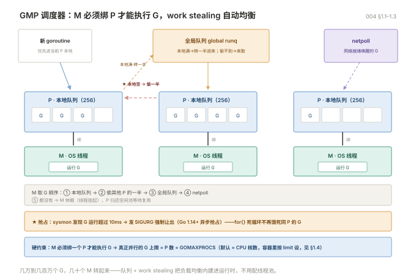
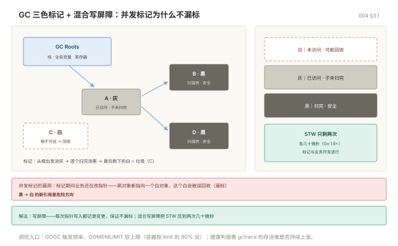
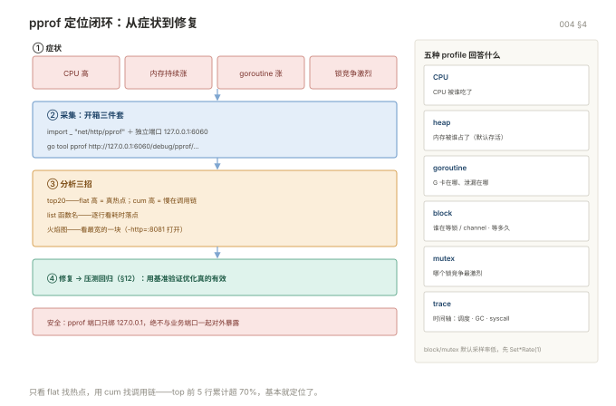

# Go 高阶

> 目标：能从运行时和性能的角度解释"为什么慢、为什么涨、为什么卡"，并动手改掉。
> 前置：读过《003 Go 进阶》。环境 Go 1.22+。

## 目录

| 章 | 内容 |
|---|---|
| 1 | 运行时与调度器 GMP |
| 2 | 内存模型与数据竞争 |
| 3 | GC 深入与调优 |
| 4 | pprof 全家桶 |
| 5 | 高性能写法 |
| 6 | 并发高级：原子操作与选型 |
| 7 | 泛型 |
| 8 | 反射与 unsafe |
| 9 | 编译、链接与交付 |
| 10 | 可观测性 |
| 11 | 云原生与分布式要点 |
| 12 | 性能回归与压测 |
| 13 | 六起生产事故复盘 |
| 14 | 源码阅读路线 |

---

## 1. 运行时与调度器 GMP

### 1.1 三个字母

| 符号 | 是什么 | 数量 |
|---|---|---|
| **G** | goroutine，协程 | 几万到几百万 |
| **M** | machine，操作系统线程 | 默认上限 10000（`debug.SetMaxThreads`） |
| **P** | processor，逻辑处理器，持有运行队列 | 启动时固定 = `GOMAXPROCS`，默认等于 CPU 核数 |

关键约束：**M 必须绑定一个 P 才能执行 G**。所以真正并行的 goroutine 数量上限就是 P 的数量。

```go
runtime.NumCPU()        // 物理核数
runtime.GOMAXPROCS(0)   // 当前 P 的数量（读，不改）
runtime.NumGoroutine()  // 当前 goroutine 数
```

### 1.2 调度流程

```
新 goroutine → 优先放入当前 P 的本地队列（容量 256）
                  ↓ 满了
              转移一半到全局队列
                  ↓
空闲 M ← 绑定 P ← 从本地队列取 G 执行
                  ↓ 本地为空
              先偷其他 P 的一半（work stealing），再取全局队列
                  ↓ 全局也为空
              从 netpoll 取（网络事件唤醒的 G）
                  ↓ 都没有
              M 休眠，P 放回空闲池
```

**work stealing 是 Go 调度的核心**：它让负载自动均衡，不需要用户配置线程池。

### 1.3 抢占：为什么死循环不会饿死别人

Go 1.14 之前是协作式抢占（只在函数调用点检查），所以 `for {}` 这种无函数调用的循环会导致整个 P 被独占，其他 goroutine 饿死。

Go 1.14 起是**基于信号的异步抢占**：`sysmon` 检测到某个 G 运行超过 10ms，发 `SIGURG` 强制它让出。



```go
func main() {
	go func() {
		for {          // 现在不会饿死主 goroutine 了
		}
	}()
	time.Sleep(time.Second)
	fmt.Println("能打印出来")
}
```

`sysmon` 是一个不绑定 P 的特殊线程，还负责：触发 GC、回收长时间阻塞的 P、netpoll。

### 1.4 GOMAXPROCS 怎么设

| 场景 | 建议 |
|---|---|
| 纯 CPU 计算 | 等于核数（默认就是） |
| 大量 IO 等待（HTTP 服务） | 可以略小于核数，减少线程切换，但收益有限 |
| **容器里** | **必须显式设置**，见下 |

**容器里的坑**：Go 1.24 之前，`NumCPU` 读的是**宿主机核数**，不是 cgroup 限制。一个 4 核 limit 的容器跑在 64 核机器上，会创建 64 个 P，导致严重的线程切换和内存开销。

```go
// Go 1.25 起默认尊重 cgroup 限制。旧版本用 automaxprocs：
import _ "go.uber.org/automaxprocs"
```

或者启动时显式设：

```bash
GOMAXPROCS=4 ./app
```

### 1.5 goroutine 的开销

| 项 | 数值 |
|---|---|
| 初始栈 | 2KB |
| 栈增长 | 按需翻倍，最大默认 1GB |
| 创建耗时 | 约 200ns（线程是 10μs 级） |
| 切换耗时 | 约 100ns（线程是 1μs 级） |

所以"起 10 万个 goroutine"完全正常，但"每个 goroutine 都阻塞在一个没人写的 channel 上"就是泄漏。

---

## 2. 内存模型与数据竞争

### 2.1 什么是数据竞争

两个 goroutine 同时访问同一变量，至少一个是写，且没有同步 → **数据竞争（data race）**，行为未定义。

```go
var counter int

for i := 0; i < 1000; i++ {
	go func() { counter++ }()      // 竞争！counter++ 是读-改-写三步
}
```

`counter++` 不是原子操作，两个 goroutine 可能都读到 5，都写 6，最终少加一次。

### 2.2 竞态检测器

```bash
go test -race ./...
go run -race main.go
go build -race -o app-race .
```

`-race` 会让程序慢 5-10 倍、内存涨 5-10 倍，**只能在测试和预发用，不能上生产**。

输出会精确指出两处访问的代码行：

```
WARNING: DATA RACE
Write at 0x00c00001a0a8 by goroutine 7:
  main.main.func1()
      /app/main.go:8 +0x44
Previous write at 0x00c00001a0a8 by goroutine 8:
  main.main.func2()
      /app/main.go:8 +0x44
```

**CI 里必须跑 `-race`**，这是 Go 项目最容易漏掉的一环。

### 2.3 happens-before

Go 内存模型保证的同步关系（Go 1.19 起有正式文档）：

| 操作 A | 操作 B | 保证 |
|---|---|---|
| channel 发送 | 对应的接收完成 | A happens-before B |
| channel 关闭 | 接收到零值 | 关闭前的写对接收方可见 |
| `sync.Mutex.Unlock` | 后续的 `Lock` | 临界区内的写对下一个持锁者可见 |
| `sync.Once.Do` 返回 | 所有 `Do` 返回 | 初始化内容对所有调用方可见 |
| `atomic` 操作 | 后续的 atomic 操作 | 顺序一致（Go 1.19 的 atomic 类型） |
| `wg.Done` | `wg.Wait` 返回 | goroutine 内的写对 Wait 之后可见 |

不在这张表里的"看起来像同步"的写法都不保证：

```go
// ❌ 靠 sleep 保证顺序，不可靠
go func() { data = 1 }()
time.Sleep(time.Millisecond)
fmt.Println(data)          // 可能还是 0

// ✅ 用 channel 建立 happens-before
done := make(chan struct{})
go func() {
	data = 1
	close(done)
}()
<-done
fmt.Println(data)          // 一定是 1
```

### 2.4 三种正确姿势

```go
// 1. 消息传递（首选）
ch <- v

// 2. 互斥锁
mu.Lock()
v++
mu.Unlock()

// 3. 原子操作（只适合简单计数、标志位）
atomic.AddInt64(&counter, 1)
```

---

## 3. GC 深入与调优

### 3.1 三色标记 + 混合写屏障

| 颜色 | 含义 |
|---|---|
| 白 | 未访问，可能被回收 |
| 灰 | 已访问但子对象未扫描完 |
| 黑 | 已访问且子对象扫描完，安全 |

标记过程：从根（栈、全局变量、寄存器）出发，把可达对象涂灰，逐个扫描涂黑，最后剩下的白对象就是垃圾。

**并发标记的问题**：标记进行时，业务代码还在改指针，可能把黑对象指向白对象，导致白对象被误回收。

解法是**写屏障**：每次写指针时记录变更，保证不漏标。Go 1.8 起用**混合写屏障**，把 STW 压到两次几十微秒的短停顿。



### 3.2 两个调优参数

```bash
GOGC=100            # 默认。上次 GC 后堆大小翻倍就触发下一次
GOGC=200            # GC 频率减半，内存翻倍
GOGC=off            # 只在极短命的批处理里用
GOMEMLIMIT=2GiB     # 软上限。接近时提前触发 GC，防 OOM
```

**正确组合方式**：`GOMEMLIMIT` 设成容器 limit 的 80% 左右，`GOGC` 保持默认或略调大。

```bash
# 容器 limit 4GiB 的服务
GOMEMLIMIT=3200MiB GOGC=100 ./app
```

`GOMEMLIMIT` 是**软限制**，它不会阻止内存超过上限，只是提前更卖力地回收。如果存活对象真的超过上限，还是会 OOM。

### 3.3 怎么看 GC 是否有问题

```bash
GODEBUG=gctrace=1 ./app 2>&1 | head -5
```

```
gc 1 @0.012s 0%: 0.008+0.12+0.003 ms clock, 0.064+0.10/0.05/0.002+0.024 ms cpu, 4->4->2 MB, 5 MB goal, 8 P
```

| 字段 | 含义 | 关注点 |
|---|---|---|
| `@0.012s` | 程序启动后时间 | GC 是否越来越频繁 |
| `0%` | GC 占用 CPU 比例 | **> 20% 就该优化** |
| `0.008+0.12+0.003` | STW + 并发标记 + STW | 总 STW 是否超毫秒 |
| `4->4->2 MB` | GC前堆 → GC后堆 → 存活堆 | 存活堆持续涨 = 内存泄漏 |
| `5 MB goal` | 下次触发的目标 | — |

**判据**：如果 `存活堆` 在长时间运行后稳定不涨，那就没泄漏；如果一路向上，就是泄漏，去 pprof 看 heap。

### 3.4 降低 GC 压力的四个手段

```go
// 1. sync.Pool（高频短命对象）
var bufPool = sync.Pool{New: func() any { return new(bytes.Buffer) }}

func handle() {
	b := bufPool.Get().(*bytes.Buffer)
	b.Reset()                    // 必须重置！
	defer bufPool.Put(b)
	// ...
}

// 2. 预分配（能算出大小的都预分配）
result := make([]Item, 0, len(input))
m := make(map[string]*User, 1000)

// 3. 减少指针（GC 只扫描指针，结构体存值比存指针扫描量小）
type Point struct{ X, Y int }
// []Point 比 []*Point 对 GC 友好得多

// 4. 批处理（减少分配次数）
// 一次分配 1000 个，比循环里分配 1000 次省 999 次 GC 记账
```

`sync.Pool` 有两个特性必须知道：**内容可能在任何一次 GC 后被清空**（不能当缓存用），且**取出的对象必须重置状态**（否则带上一次的数据，是经典 bug）。

---

## 4. pprof 全家桶

### 4.1 开箱即用

```go
import _ "net/http/pprof"          // 匿名导入即注册路由

func main() {
	go func() {
		// 用独立端口，别和业务端口混在一起对外暴露
		log.Println(http.ListenAndServe("127.0.0.1:6060", nil))
	}()
	// 业务代码
}
```

命令行程序也可以直接写 profile 文件：

```go
f, _ := os.Create("cpu.prof")
pprof.StartCPUProfile(f)
defer pprof.StopCPUProfile()
```

### 4.2 五种 profile

| 类型 | 路径 | 回答什么问题 |
|---|---|---|
| **CPU** | `/debug/pprof/profile?seconds=30` | CPU 被谁吃了 |
| **heap** | `/debug/pprof/heap` | 内存被谁占了（默认是存活对象） |
| **goroutine** | `/debug/pprof/goroutine?debug=2` | 这么多 goroutine 卡在哪 |
| **block** | `/debug/pprof/block` | 谁在等锁/channel，等了多久 |
| **mutex** | `/debug/pprof/mutex` | 哪个锁竞争最激烈 |
| **trace** | `/debug/pprof/trace?seconds=5` | 时间轴：调度、GC、syscall 全景 |

`block` 和 `mutex` 默认采样率很低，要先开：

```go
runtime.SetBlockProfileRate(1)        // 1 = 每次阻塞都记录（开销大，只用于排查）
runtime.SetMutexProfileFraction(1)
```

### 4.3 分析命令

```bash
# CPU：采 30 秒
go tool pprof http://127.0.0.1:6060/debug/pprof/profile?seconds=30
# 进入交互后
(pprof) top20                 # 前 20 个热点函数
(pprof) list myFunc           # 逐行看某函数的耗时
(pprof) web                   # 生成调用图（需要 graphviz）

# 堆：看谁占内存
go tool pprof http://127.0.0.1:6060/debug/pprof/heap
(pprof) top20 -cum            # 按累计内存排序
(pprof) list myFunc

# goroutine 泄漏：直接看文本
curl -s 'http://127.0.0.1:6060/debug/pprof/goroutine?debug=2' | head -50
```

**读 `top` 输出的关键**：

```
flat  flat%   sum%        cum   cum%
 1.2s  30.0%  30.0%      2.4s  60.0%  runtime.mallocgc
 0.8s  20.0%  50.0%      0.8s  20.0%  encoding/json.Marshal
```

| 列 | 含义 | 怎么看 |
|---|---|---|
| `flat` | 函数自身耗时（不含调用子函数） | 高 = 这里真的在算 |
| `cum` | 函数累计耗时（含子函数） | 高但 flat 低 = 只是调用了别人的慢函数 |
| `sum%` | 累计占比 | 前 5 行超过 70% 就基本定位了 |

**只看 flat 找热点，用 cum 找调用链。**

### 4.4 火焰图

```bash
go tool pprof -http=:8081 http://127.0.0.1:6060/debug/pprof/profile?seconds=30
```

浏览器自动打开，选 Flame Graph。**看最宽的那块，横向是占比，纵向是调用栈（上宽下窄）。**



### 4.5 trace：看时间轴

CPU profile 是统计采样，trace 是逐事件记录，用来看**调度延迟和 GC 停顿**：

```bash
go tool trace http://127.0.0.1:6060/debug/pprof/trace?seconds=5
```

能回答的问题：为什么 P 有空闲但请求延迟高（可能是 sysmon 抢占不及时）、GC 停顿的具体时刻和多长、某个 goroutine 从创建到执行的等待时间。

### 4.6 生产环境的安全

**pprof 端点绝对不要暴露在公网**，里面有内存内容、函数名、调用栈，属于信息泄露。

| 做法 | 说明 |
|---|---|
| 只监听 127.0.0.1 | 通过 SSH 隧道访问 |
| 独立端口 + 防火墙白名单 | 和业务端口隔离 |
| 独立管理端口，只在内网 | K8s 里用单独的 named port |
| 带认证的 mux | 自己注册而不是匿名导入 |

```bash
# SSH 隧道访问生产 pprof
ssh -L 6060:127.0.0.1:6060 user@prod-host
# 然后本地 go tool pprof http://127.0.0.1:6060/debug/pprof/heap
```

---

## 5. 高性能写法

### 5.1 减少分配

最有效的优化几乎都是"少分配"，因为分配要触发 GC，GC 要占 CPU。

```go
// ❌ 每次循环都分配
for _, s := range items {
	fmt.Println("item: " + s)          // 一次字符串拼接 = 一次分配
}

// ✅ 复用 buffer
var b strings.Builder
for _, s := range items {
	b.Reset()
	b.WriteString("item: ")
	b.WriteString(s)
	_, _ = os.Stdout.WriteString(b.String())
}
```

### 5.2 常见分配来源

| 来源 | 消除方法 |
|---|---|
| `fmt.Sprintf` | 用 `strconv` + `strings.Builder` 替代 |
| 字符串与 `[]byte` 互转 | 尽量在一侧处理完，不来回转 |
| 接口装箱（`any` 参数） | 热路径用泛型或具体类型 |
| 闭包捕获 | 抽成普通函数或传参 |
| 返回指针 | 小结构体返回值 |
| 切片未预分配 | `make([]T, 0, n)` |
| map 未预分配 | `make(map[K]V, n)` |

### 5.3 字符串与数字转换

```go
// 慢：fmt.Sprintf 要解析格式串
s := fmt.Sprintf("%d", n)

// 快：strconv 专用函数
s := strconv.Itoa(n)
```

在每秒几十万次调用的路径上，这个差别是数量级的。

### 5.4 避免不必要的接口

```go
// 慢：每次调用都要装箱 + 动态派发
func Sum(vs []any) int { ... }

// 快：泛型，编译期单态化
func Sum[T ~int | ~int64](vs []T) T { ... }
```

泛型在 Go 里不是零成本（有字典传递开销），但比接口装箱便宜得多。

### 5.5 批量而非逐条

```go
// ❌ 一次一条 SQL，1 万条 = 1 万次往返
for _, u := range users {
	db.Exec("INSERT INTO t VALUES (?)", u.Name)
}

// ✅ 批量提交，几百倍差距
db.Exec("INSERT INTO t (name) VALUES " + placeholders, args...)
```

同理适用于：HTTP 请求、Redis 命令（pipeline）、日志写入（批量 flush）。

### 5.6 CPU 密集用池，IO 密集用并发

| 场景 | 策略 |
|---|---|
| CPU 密集（编解码、压缩、加密） | 并发数 = 核数，超过只会增加切换 |
| IO 密集（HTTP、DB、文件） | 并发数可以远大于核数（几十到几百） |
| 混合 | 分开两个池，别让 IO 阻塞占满 CPU 池 |

### 5.7 优化顺序（重要）

```
1. 先测量：pprof 定位真正的热点
2. 再优化：只改占比 > 5% 的地方
3. 再测量：benchstat 确认有提升
4. 不满意就重复
```

**没测量过的优化一律不做。** 凭直觉优化的结果经常是：代码难读了，性能没变，甚至更慢（因为破坏了缓存局部性）。

---

## 6. 并发高级

### 6.1 原子操作

```go
import "sync/atomic"

var counter atomic.Int64
counter.Add(1)
counter.Load()
counter.Store(0)
counter.CompareAndSwap(old, new)

// 指针
var p atomic.Pointer[Config]
p.Store(cfg)
c := p.Load()
```

Go 1.19 起的 `atomic.Int64` 等类型比 `atomic.AddInt64(&x, 1)` 更安全——**旧的函数式 API 如果忘了用 `atomic.Load` 读，就会混入非原子读写**，竞态检测也查不出来。

**用原子操作替换锁的条件**：单个变量、操作简单（加减、交换）、不需要多个变量的原子性。

### 6.2 锁 vs channel 怎么选

| 场景 | 选 |
|---|---|
| 保护结构体的内部状态 | `sync.Mutex` |
| 传递数据所有权 | channel |
| 等待事件/信号 | channel + `close` |
| 限流、排队 | channel |
| 简单计数 | `atomic` |
| 读多写少的缓存 | `sync.RWMutex` 或 `sync.Map` |

**经验法则：用锁写出来的代码更短、更好读，就用锁。** "用 channel 才优雅"是误解——Go 官方也强调 channel 不是万能替代品。

### 6.3 RWMutex 的陷阱

`RWMutex` 在**读远多于写**时才比 Mutex 快。如果读写比例接近 1:1，RWMutex 因为内部维护读者计数反而更慢。

另一个坑：**读锁里不能再获取写锁**（会死锁），且 RWMutex 不支持锁升级：

```go
mu.RLock()
if needUpdate {
	mu.RUnlock()      // 必须先释放
	mu.Lock()
	// 重新检查条件（可能别人已经改了）
	mu.Unlock()
	mu.RLock()
}
```

### 6.4 单飞与缓存

```go
type Cache struct {
	mu   sync.RWMutex
	data map[string]string
	sf   singleflight.Group
}

func (c *Cache) Get(key string) (string, error) {
	c.mu.RLock()
	if v, ok := c.data[key]; ok {
		c.mu.RUnlock()
		return v, nil
	}
	c.mu.RUnlock()

	// 缓存未命中，同 key 只放一个请求到后端
	v, err, _ := c.sf.Do(key, func() (any, error) {
		return c.load(key)
	})
	if err != nil {
		return "", err
	}
	return v.(string), nil
}
```

这是缓存击穿的标准解法。注意 `singleflight` 期间**所有等待者共享同一个结果**，包括错误。

### 6.5 并发安全的数据结构

标准库只提供了 `sync.Map`。其他常用的在 `golang.org/x/sync`：

| 包 | 用途 |
|---|---|
| `errgroup` | 并发任务 + 错误传播 |
| `singleflight` | 请求合并 |
| `semaphore` | 加权信号量（按权重限流） |
| `sync/atomic` | 原子类型 |

第三方的高性能结构（`ants` 协程池、`fastcache`、`ristretto`）在需要时再引，别一开始就上。

---

## 7. 泛型

### 7.1 基本用法

```go
func Max[T int | float64 | string](a, b T) T {
	if a > b {
		return a
	}
	return b
}

// 类型集用 ~ 支持底层类型
type Number interface {
	~int | ~int8 | ~int16 | ~int32 | ~int64 | ~float32 | ~float64
}

func Sum[T Number](vs []T) T {
	var total T
	for _, v := range vs {
		total += v
	}
	return total
}

type MyInt int
Sum([]MyInt{1, 2})       // 可以，~int 覆盖了底层是 int 的类型
```

### 7.2 常用约束

```go
// comparable：可用 == 比较（map key 的要求）
func Contains[T comparable](s []T, v T) bool {
	for _, x := range s {
		if x == v {
			return true
		}
	}
	return false
}

// any：无约束
func Map[T, R any](s []T, f func(T) R) []R {
	out := make([]R, 0, len(s))
	for _, v := range s {
		out = append(out, f(v))
	}
	return out
}
```

`cmp.Ordered`（Go 1.21+）已经包含了所有可比较大小的类型，不用自己写 `Number`。

### 7.3 什么时候不该用泛型

| 场景 | 不要用泛型 |
|---|---|
| 只有一种类型 | 直接写具体类型 |
| 需要不同类型有不同逻辑 | 用接口 |
| 需要运行时类型判断 | 用 `any` + 类型断言 |
| 参数超过 3 个类型参数 | 泛型会变得比重复代码更难读 |

**泛型解决的是"逻辑完全相同、只有类型不同"的问题。** 一旦逻辑有分叉，就该用接口。

### 7.4 迭代器（Go 1.23+）

```go
func Count(n int) iter.Seq[int] {
	return func(yield func(int) bool) {
		for i := 0; i < n; i++ {
			if !yield(i) {
				return
			}
		}
	}
}

for v := range Count(3) {
	fmt.Println(v)          // 0 1 2
}
```

`yield` 返回 false 表示调用方 break 了，生成方要立即停止——这是 `iter.Seq` 的约定。

---

## 8. 反射与 unsafe

### 8.1 反射三定律

```go
import "reflect"

var x float64 = 3.4
v := reflect.ValueOf(x)

v.Type()                 // float64
v.Kind()                 // reflect.Float64
v.Float()                // 3.4
v.CanSet()               // false —— 因为传的是副本

// 要修改必须传指针
p := reflect.ValueOf(&x)
p.Elem().SetFloat(7.1)
```

| 定律 | 内容 |
|---|---|
| 1 | 反射可以把接口值拆成 `Value` 和 `Type` |
| 2 | 反射对象可以还原成接口值（`Interface()`） |
| 3 | **要修改值，必须从指针出发**（`CanSet` 为 true） |

### 8.2 反射的代价与场景

| 指标 | 反射 vs 直接调用 |
|---|---|
| 耗时 | 慢 10-100 倍 |
| 分配 | 显著增加 |
| 编译期检查 | 完全没有 |

合理的用武之地：序列化库（json/yaml）、ORM、依赖注入、配置映射、通用校验。

**业务代码里不要用反射。** 需要类型分派用 `type switch`，需要动态行为用接口。

### 8.3 unsafe.Pointer 的三条规则

```go
// 1. *T1 → unsafe.Pointer → *T2（类型转换）
p := unsafe.Pointer(&floatVal)
intVal := (*int64)(p)

// 2. unsafe.Pointer ↔ uintptr（算偏移，但必须在同一个表达式里用）
// 3. 不要保存 uintptr 再转回 Pointer（GC 可能已经移动了对象）
```

生产代码里用 unsafe 的正当理由基本只有两个：

```go
// 1. 零拷贝 string ↔ []byte（性能关键路径，且已用 pprof 证明值得）
func StringToBytes(s string) []byte {
	return unsafe.Slice(unsafe.StringData(s), len(s))
}

// 2. 结构体对齐优化（减少 padding）
```

其余场合，性能收益抵不上维护成本和出错风险。**`unsafe` 一旦用错，是内存踩踏，不是报错。**

---

## 9. 编译、链接与交付

### 9.1 构建标签

```go
//go:build linux && amd64

package main
```

```go
//go:build ignore

// 这个文件不会被编译（常用于脚本）
```

注意 `//go:build` 后面必须空一行再接 `package`，且**构建标签在文件最顶部，前面不能有普通注释**。

### 9.2 交叉编译

```bash
# 单一目标
CGO_ENABLED=0 GOOS=linux GOARCH=amd64 go build -o app .

# 多平台批量（用循环）
for os in linux darwin windows; do
	for arch in amd64 arm64; do
		CGO_ENABLED=0 GOOS=$os GOARCH=$arch go build \
			-o dist/app-$os-$arch .
	done
done

# 看支持哪些平台
go tool dist list
```

### 9.3 版本注入

```go
var (
	Version   = "dev"
	BuildTime = "unknown"
	GitCommit = "none"
)
```

```bash
go build -ldflags "-s -w \
  -X main.Version=1.2.3 \
  -X main.BuildTime=$(date -u +%Y-%m-%dT%H:%M:%SZ) \
  -X main.GitCommit=$(git rev-parse --short HEAD)" \
  -o app .
```

`-s` 去符号表，`-w` 去 DWARF 调试信息，合计减 25-30% 体积。**代价是无法用 gdb 调试，也无法从 core dump 里还原堆栈**——如果生产要分析崩溃，别加 `-w`。

### 9.4 go:embed：把静态文件编进二进制

```go
import "embed"

//go:embed static/*
var staticFS embed.FS

//go:embed config.yaml
var defaultConfig []byte

func main() {
	http.Handle("/", http.FileServer(http.FS(staticFS)))
}
```

这让"单个二进制直接能跑"成为可能——前端打包产物、模板、默认配置全塞进去，部署只要拷一个文件。

`//go:embed` 的路径**不能是绝对路径，不能用 `..` 跳出包目录**。

### 9.5 CGO 取舍

| | CGO_ENABLED=1 | CGO_ENABLED=0 |
|---|---|---|
| 能用 C 库 | 是 | 否 |
| 二进制 | 依赖 glibc | **完全静态** |
| 交叉编译 | 需要交叉工具链，很痛苦 | 一条命令 |
| 性能 | 调用 C 有开销（约 50ns/次） | 纯 Go |
| 部署 | 基础镜像要有 glibc | 可以塞进 `scratch` |

**默认用 `CGO_ENABLED=0`**，除非必须用 C 库（少数数据库驱动、加密库、SQLite）。

### 9.6 最小镜像

```dockerfile
FROM golang:1.24 AS build
WORKDIR /src
COPY go.mod go.sum ./
RUN go mod download
COPY . .
RUN CGO_ENABLED=0 go build -ldflags="-s -w" -o /app .

FROM scratch
COPY --from=build /etc/ssl/certs/ca-certificates.crt /etc/ssl/certs/
COPY --from=build /app /app
ENTRYPOINT ["/app"]
```

从 `scratch` 起，镜像只有二进制大小（通常 10-20MB）。**记得拷 CA 证书**，否则 HTTPS 请求全部失败，报 `x509: certificate signed by unknown authority`。

---

## 10. 可观测性

### 10.1 三根支柱

| 类型 | 工具 | 回答 |
|---|---|---|
| 日志 | `slog` → Loki/ES | 发生了什么 |
| 指标 | `prometheus/client_golang` | 有多少、多快 |
| 链路 | OpenTelemetry | 慢在哪一段 |

### 10.2 指标埋点

```go
import (
	"github.com/prometheus/client_golang/prometheus"
	"github.com/prometheus/client_golang/prometheus/promauto"
)

var (
	reqTotal = promauto.NewCounterVec(
		prometheus.CounterOpts{
			Name: "http_requests_total",
			Help: "HTTP 请求总数",
		},
		[]string{"method", "path", "status"},
	)

	reqDuration = promauto.NewHistogramVec(
		prometheus.HistogramOpts{
			Name:    "http_request_duration_seconds",
			Buckets: []float64{.005, .01, .025, .05, .1, .25, .5, 1, 2.5, 5},
		},
		[]string{"method", "path"},
	)
)

func instrument(next http.Handler) http.Handler {
	return http.HandlerFunc(func(w http.ResponseWriter, r *http.Request) {
		start := time.Now()
		rec := &statusRecorder{ResponseWriter: w, status: 200}
		next.ServeHTTP(rec, r)
		reqTotal.WithLabelValues(r.Method, r.URL.Path, strconv.Itoa(rec.status)).Inc()
		reqDuration.WithLabelValues(r.Method, r.URL.Path).Observe(time.Since(start).Seconds())
	})
}
```

**标签基数（label cardinality）是最大的坑**：把 `user_id`、`trace_id`、原始 URL 放进标签，会导致指标数量爆炸，Prometheus 直接被打死。**标签只放有限枚举值（method、status、路由模板），不放无限值。**

### 10.3 健康检查两种

| 端点 | 含义 | 检查内容 |
|---|---|---|
| `/healthz`（liveness） | 进程还活着吗 | 只检查自己没死锁，**不查依赖** |
| `/readyz`（readiness） | 能接流量吗 | 检查 DB/Redis 连接、配置加载完成 |

**liveness 千万不能查数据库**：DB 一抖，所有 Pod 的 liveness 失败，K8s 会把它们全部重启，雪崩。

### 10.4 关键指标清单

| 指标 | 告警阈值参考 |
|---|---|
| `go_goroutines` | 持续增长（斜率 > 0）就查泄漏 |
| `go_gc_duration_seconds` 的 p99 | 超 50ms 关注 |
| `process_resident_memory_bytes` | 接近容器 limit 的 80% |
| `go_memstats_heap_alloc_bytes` | 存活堆持续涨 |
| `http_request_duration_seconds` 的 p95/p99 | 按业务定 |
| `go_threads` | 接近 10000 说明线程暴涨 |
| `process_open_fds` | 接近 `ulimit -n` |

---

## 11. 云原生与分布式要点

### 11.1 HTTP 客户端的四个超时

```go
client := &http.Client{
	Timeout: 30 * time.Second,          // 整个请求（含重定向）
	Transport: &http.Transport{
		DialContext: (&net.Dialer{
			Timeout:   5 * time.Second,   // 建连
			KeepAlive: 30 * time.Second,
		}).DialContext,
		TLSHandshakeTimeout:   5 * time.Second,
		ResponseHeaderTimeout: 10 * time.Second,
		IdleConnTimeout:       90 * time.Second,
		MaxIdleConns:          100,
		MaxIdleConnsPerHost:   10,        // 默认只有 2！高并发一定要改
		MaxConnsPerHost:       0,         // 0 = 不限
	},
}
```

**`MaxIdleConnsPerHost` 默认是 2**，这是 Go 最著名的性能坑：高并发场景下连接不断被建又不断被关，表现为 TIME_WAIT 暴涨、延迟抖动、TLS 握手 CPU 高。

### 11.2 用 context 控制全链路

```go
func (s *Service) GetUser(ctx context.Context, id int) (*User, error) {
	ctx, cancel := context.WithTimeout(ctx, 3*time.Second)
	defer cancel()

	u, err := s.repo.Find(ctx, id)        // DB 查询带 ctx，超时会中断
	if err != nil {
		return nil, fmt.Errorf("查用户 %d: %w", id, err)
	}
	return u, nil
}
```

关键是**每一层都要往下传 ctx**，而不是在中途新建 `context.Background()`——那会切断取消链，上层超时了下层还在跑。

### 11.3 重试的正确做法

```go
func retry(ctx context.Context, n int, fn func() error) error {
	var err error
	for i := 0; i < n; i++ {
		if err = fn(); err == nil {
			return nil
		}
		// 指数退避 + 抖动，避免重试风暴
		delay := time.Duration(1<<uint(i)) * 100 * time.Millisecond
		delay += time.Duration(rand.Int63n(int64(delay / 2)))
		select {
		case <-ctx.Done():
			return ctx.Err()
		case <-time.After(delay):
		}
	}
	return fmt.Errorf("重试 %d 次仍失败: %w", n, err)
}
```

三条纪律：**只重试幂等操作**、**必须带抖动**、**必须受 ctx 控制**（否则超时了还在重试，放大故障）。

### 11.4 熔断与限流

| 机制 | 作用 | 常用实现 |
|---|---|---|
| 限流 | 保护自己不被压垮 | `rate.Limiter`、令牌桶 |
| 熔断 | 保护自己不被下游拖死 | `sony/gobreaker` |
| 隔离 | 故障不扩散 | 按下游分组用独立连接池/协程池 |
| 降级 | 有损服务 | 返回缓存、默认值 |

### 11.5 gRPC 生产要点

| 配置 | 建议 |
|---|---|
| `MaxRecvMsgSize` | 默认 4MB，大消息要显式调大 |
| Keepalive | 客户端开，避免被中间设备静默断连 |
| 超时 | 每个调用都必须带 `context.WithTimeout` |
| 拦截器 | 统一做日志、metrics、trace、鉴权 |
| 负载均衡 | 用 `round_robin` + resolver，别用默认的 pick_first |

**gRPC 的默认负载均衡策略是 `pick_first`**——K8s 里 Service 是个 VIP，客户端只连到一个 Pod，其他 Pod 全空闲。这是上线后"为什么只有一个实例有流量"的经典原因。

---

## 12. 性能回归与压测

### 12.1 基准对比流程

```bash
# 1. 改动前，跑 10 轮降低噪声
git stash
go test -bench=BenchmarkHandle -count=10 -benchmem > old.txt
git stash pop

# 2. 改动后
go test -bench=BenchmarkHandle -count=10 -benchmem > new.txt

# 3. 对比
benchstat old.txt new.txt
```

```
                │   old.txt    │          new.txt           │
                │    sec/op    │   sec/op     vs base       │
HandleRequest-8   1.245µ ± 2%   0.872µ ± 1%  -29.96% (p=0.000)
                │    B/op      │    B/op      vs base       │
HandleRequest-8    512.0 ± 0%    128.0 ± 0%  -75.00% (p=0.000)
```

`p=0.000` 表示差异显著，`± 2%` 是波动范围。**波动超过 10% 说明测试环境不稳定，结果不可信**（可能是 CPU 降频、其他进程干扰）。

### 12.2 压测工具

| 工具 | 特点 |
|---|---|
| `hey` | 简单，`hey -n 10000 -c 100 URL` |
| `wrk` | 高性能，支持 Lua 脚本 |
| `vegeta` | 恒定速率压测，结果可导出图表 |
| `k6` | 脚本化场景，适合复杂业务流程 |

**压测必须看 p99 而不是平均值。** 平均值 50ms 但 p99 是 2s，说明有 1% 的用户在挨打。

### 12.3 常见性能问题定位顺序

```
1. 先看是不是 GC：GODEBUG=gctrace=1，看 gc CPU%
2. 再看 CPU 热点：pprof profile，top20 flat
3. 再看内存：pprof heap，看存活对象和分配点
4. 再看阻塞：pprof block / mutex，看锁竞争
5. 再看调度：trace，看 P 是否空闲、goroutine 等待时间
6. 最后看外部：DB 慢查询、下游超时、网络 RTT
```

**顺序不能反**。直接从第 6 步猜"是不是数据库慢"，会浪费大量时间。

---

## 13. 六起生产事故复盘

### 13.1 goroutine 泄漏：HTTP 请求没设超时

```go
// 事故代码
resp, err := http.Get(url)          // 没有超时！默认永久等待
if err != nil {
	return err
}
defer resp.Body.Close()
```

下游一旦挂起不响应，这个 goroutine 永久阻塞，`resp.Body` 也不关，连接不释放。跑一周后 goroutine 从 200 涨到 8 万，内存 12GB。

**修法**：

```go
client := &http.Client{Timeout: 10 * time.Second}
resp, err := client.Get(url)
```

**检查方法**：`curl 'localhost:6060/debug/pprof/goroutine?debug=2' | grep -c 'net/http.(*persistConn)'`，持续增长就是它。

### 13.2 连接池默认值：MaxIdleConnsPerHost=2

服务 QPS 3000，每次请求都要新建 TCP + TLS 连接。现象：CPU 花在 TLS 握手上占 40%，TIME_WAIT 稳定在 3 万，p99 延迟 800ms。

**根因**：`http.DefaultTransport` 的 `MaxIdleConnsPerHost` 是 2，高并发下连接刚用完就被关掉。

**修法**：改成 50-100，`MaxIdleConns` 同步调大。改完 p99 降到 40ms。

### 13.3 内存泄漏：全局 map 只增不删

```go
var cache = map[string][]byte{}      // 存了所有请求的响应

func handle(k string) []byte {
	if v, ok := cache[k]; ok {
		return v
	}
	v := load(k)
	cache[k] = v                     // 永不过期，永不删除
	return v
}
```

key 是用户 ID，用户越多内存越大。**而且没有锁**——并发写直接 `fatal error: concurrent map writes`，进程崩溃无 core。

**修法**：用带 TTL 和容量上限的 LRU（`hashicorp/golang-lru` 或 `ristretto`），加锁。

### 13.4 defer 在循环里：fd 耗尽

```go
for _, path := range files {         // 5000 个文件
	f, err := os.Open(path)
	if err != nil {
		return err
	}
	defer f.Close()                  // 全部堆到函数结束才关
	process(f)
}
```

跑到第 1024 个文件时 `too many open files`。`defer` 不是"立刻关"，是"函数返回时关"。

**修法**：

```go
for _, path := range files {
	if err := func() error {         // 包一层，函数返回时 close
		f, err := os.Open(path)
		if err != nil {
			return err
		}
		defer f.Close()
		return process(f)
	}(); err != nil {
		return err
	}
}
```

### 13.5 context 泄漏：Timer 堆积

```go
for {
	ctx, cancel := context.WithTimeout(parent, time.Second)
	doWork(ctx)
	// 忘了 cancel()
}
```

`WithTimeout` 内部会创建一个 Timer，不调用 `cancel` 就要等超时到点才释放。循环每秒执行一次、超时 1 秒，看起来还好；但如果超时设成 5 分钟，就会有 300 个 Timer 同时存活。

**修法**：`defer cancel()` 或直接 `cancel()`。

**静态检查**：`go vet` 的 `lostcancel` 检查能发现部分场景，但循环里漏掉的情况未必报，要靠人看。

### 13.6 容器 GOMAXPROCS 未适配

Go 1.25 之前的服务，容器 limit 2 核，跑在 96 核宿主机上。`GOMAXPROCS=96`，创建 96 个 P，每个 P 有自己的 mcache 和运行队列，内存占用比预期高 30%，且线程频繁切换导致 p99 抖动。

**修法**：

```go
import _ "go.uber.org/automaxprocs"
```

或者 Go 1.25+ 直接用（默认读 cgroup）。

### 13.7 六个事故的共同点

| 共同点 | 说明 |
|---|---|
| 都是**默认值**惹的祸 | 默认超时是"永不"，默认连接池是 2，默认 GOMAXPROCS 是宿主核数 |
| 都是**渐进式**故障 | 不是启动就崩，是跑几天后慢慢恶化，所以监控要看趋势不看瞬时值 |
| 都能被**三类指标**提前发现 | goroutine 数、内存 RSS、fd 数量，任一条持续涨就是泄漏 |
| 都**不是**语法错误 | 编译通过、单元测试通过、happy path 正常 |

**所以：所有外部调用必须有超时，所有无限增长的容器必须有上限，所有 `With*` 必须配 `cancel`。**

---

## 14. 源码阅读路线

不建议从 `runtime` 开始读，太抽象。按这个顺序走：

| 阶段 | 读什么 | 学到 |
|---|---|---|
| 1 | `sync/waitgroup.go`、`sync/once.go` | 原子操作和状态机的写法 |
| 2 | `sync/pool.go` | 无锁 + per-P 缓存的设计 |
| 3 | `context/context.go` | 树形取消传播 |
| 4 | `net/http/server.go` 的 `conn.serve` | 连接生命周期、超时处理 |
| 5 | `net/http/transport.go` | 连接池实现 |
| 6 | `runtime/proc.go`（`schedule`、`findRunnable`） | GMP 调度 |
| 7 | `runtime/mgc.go` | GC 触发与阶段 |
| 8 | `runtime/malloc.go` | 内存分配器（size class、span） |

读法：**先看类型定义和注释，再看主流程函数，跳过所有 `//go:linkname` 和汇编**。`runtime` 里大量代码是给编译器看的，对理解模型没帮助。

官方文档优先级高于任何博客：

- 《The Go Memory Model》— 同步语义的唯一权威
- 《Go Code Review Comments》— 社区约定，评审必看
- 《Effective Go》— 写法惯例（部分内容偏旧，以 Code Review Comments 为准）

---

## 五册的能力对应

| 册 | 学完能做到 |
|---|---|
| 000 环境配置 | 15 分钟从零跑通第一个 Go 测试 |
| 001 语言全貌 | 判断 Go 是否值得投入、该用在哪 |
| 002 入门 | 独立写完一个带错误处理的命令行工具或 HTTP 服务 |
| 003 进阶 | 通过代码评审；写出可测试、可维护的并发代码；定位常见 bug |
| 004 高阶 | 用 pprof 定位性能问题并优化；设计可观测的服务；避免六类生产事故 |

---

> 下一篇：回到板块根目录——Go 服务的可观测性出口对接「监控」与「日志」，静态二进制交付对接「容器」。

