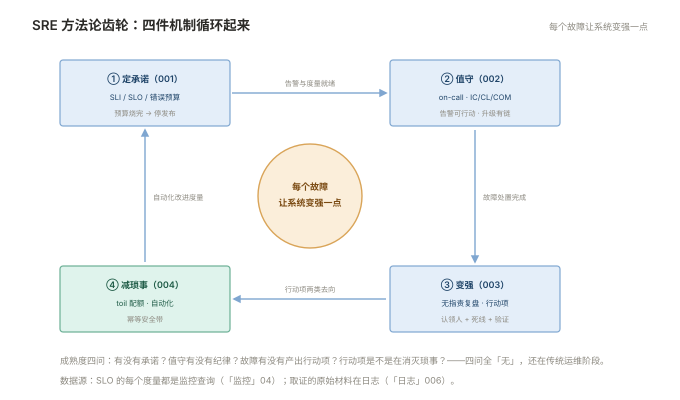

# 000 SRE 全貌

> **解决**：SRE 是什么、与传统运维差在哪、方法论地图长什么样。  
> **范围**：定义与职责分界 · SLO 思维 · 方法论五件 · 与本库各板块的衔接。  
> **口径**：方法论通用不绑工具；实例一律引用本库各板块。  
> **更新**：2026-11-01

## 目录

| 节 | 内容 |
|---|---|
| 0.1 | SRE 是什么：用软件工程方法做运维 |
| 0.2 | SLO 思维：从「保机器」到「保承诺」 |
| 0.3 | 方法论地图：五件机制的相互关系 |
| 0.4 | 与本库其它板块的关系 |
| 0.5 | 十个误解 |
| 0.6 | 学习路径 |

---

## 0.1 SRE 是什么：用软件工程方法做运维

SRE（Site Reliability Engineering）源于 Google 的实践定义：**把"让系统可靠"当作一个软件工程问题来解决，而不是靠人盯**。它对传统运维的改造有三个支点：

1. **可靠性可度量**：不满足于"感觉挺稳"，用 SLI/SLO 把可靠性变成数字（001 册）；
2. **风险可预算**：接受"100% 可靠是错的"——错误预算让稳定与迭代从对立变成分配问题（001 §1.3）；
3. **琐事可治理**：重复手工劳动（toil）有配额上限，超出就立项自动化——运维人从救火队员转型为工程师（004 册）。

一句话记住 SRE 与传统运维的分界：**传统运维的目标是"别出事"，SRE 的目标是"出事在预算内、响应有纪律、每个故障让系统变强"**。

---

## 0.2 SLO 思维：从「保机器」到「保承诺」

SLO 思维是 SRE 的哲学内核，它改写了三个日常问题的答案：

- **"要不要发布新版本？"** → 看错误预算余额：有余额就可以发（快速迭代），烧完就冻结（优先修可靠性）——争论被数据仲裁（001 §1.3）；
- **"这个告警要不要响？"** → 与 SLO 挂钩的才配 page：burn rate 快烧的告紧急、慢烧的开工单——噪音告警失去存在理由（001 §1.4、002 §2.2）；
- **"这个故障严重吗？"** → 看它烧掉了多少预算、影响了多少用户，而不是看"机器 CPU 多高"——影响面取代资源指标成为严重度的标尺。

SLO 思维的前提是**度量诚实**：SLI 必须是用户视角的信号（成功率、P99 延迟），而非"机器活着"——「监控」册的五维模型提供全部数据源。

---

## 0.3 方法论地图：五件机制的相互关系

本册 001–004 各讲一件机制，它们不是并列菜单而是循环齿轮：

```plain
        ① 定承诺：SLI/SLO/错误预算（001）
              │ 预算烧完→停发布；burn rate→告警
              ▼
        ② 值守：on-call 与应急响应（002）
              │ 故障处置完成
              ▼
        ③ 变强：无指责复盘与行动项（003）
              │ 行动项两类去向
              ▼
   ④ 减琐事：toil 治理与自动化（004）──▶ 回到 ①：改进 SLO 与自动化
              │
        ⑤ 循环：每个故障让系统变强一点
```



诊断团队的 SRE 成熟度就按这个齿轮检查：**有没有承诺（SLO）？值守有没有纪律（002）？故障有没有产出行动项（003）？行动项是不是在消灭 toil（004）？**——四问全"无"的团队，还在传统运维阶段。

---

## 0.4 与本库其它板块的关系

| 本库板块 | 与 SRE 的关系 |
|---|---|
| 监控 | SLO 的数据源：SLI 的每一个度量都是监控查询（「监控」004 的告警链路承接 burn rate 告警） |
| 日志 | 故障取证的证据库：应急响应（002）与复盘时间线（003）的原始材料 |
| CICD | 错误预算的仲裁对象：预算烧尽收紧发布；007 的发布检查单是风险控制的战术面 |
| 容器/接入层/数据库/Linux | 各自的排错册与故障剧本 = 002 runbook 体系的素材库 |
| 检查清单（各册末尾） | 000 "生产就绪清单"的分散形态——SRE 把它们汇总进发布评审 |

---

## 0.5 十个误解

| # | 误解 | 实际 |
|---|---|---|
| 1 | SRE = 给运维改名 | 是机制与度量，不是头衔 |
| 2 | SLO 越高越好 | 100% 不可实现且扼杀迭代——预算机制的前提就是允许失败 |
| 3 | 上了 K8s 就是 SRE | 齿轮（000 §0.3）没转，工具只是摆设 |
| 4 | 错误预算烧完要罚人 | 是停发布优先修可靠性，指向系统不指向个人 |
| 5 | 复盘要找出"是谁干的" | 找系统缺陷；个人问责会杀死信息流动 |
| 6 | on-call 就是随叫随到 | 有轮换保护、升级链、补偿与脱离机制 |
| 7 | 告警多=监控好 | 不可行动的告警是负债（002 §2.2） |
| 8 | 自动化=写脚本 | 顺序是先流程化再自动化，幂等是安全带（004） |
| 9 | SRE 是大公司的事 | 五件机制 5 人团队照样转，起步成本反而更低 |
| 10 | 有了 SRE 不会出故障 | 出故障在预算内且每次变强——这才是 SRE 的正常状态 |

---

## 0.6 学习路径

```plain
① 先立承诺    001 SLO 与错误预算（需要「监控」册的数据源就绪）
② 再建值守    002 待命与应急响应（runbook 素材来自各板块排错册）
③ 持续变强    003 故障复盘与改进（第一次复盘就是起点）
④ 长期健康    004 Toil 治理与自动化（toil 度量先行）
```

---

> 下一篇：《001 SLO 与错误预算》——可靠性怎么变成可度量的承诺。
