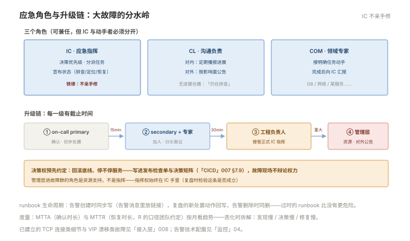

# 002 待命与应急响应

> **解决**：故障发生时谁来管、怎么管、怎么不让一个人被烧干。  
> **范围**：on-call 设计 · 告警纪律 · 应急指挥 · 升级链 · runbook · 沟通。  
> **口径**：机制通用；告警的技术配置在「监控」004，runbook 素材在各板块排错册。  
> **更新**：2026-11-01

## 目录

| 节 | 内容 |
|---|---|
| 2.1 | on-call 制度设计：轮换、双岗、保护 |
| 2.2 | 告警纪律：每个 page 必须可行动 |
| 2.3 | 应急指挥：IC / CL / COM 角色分工 |
| 2.4 | 升级链与决策权 |
| 2.5 | runbook：告警与动作的绑定 |
| 2.6 | 沟通：对内与对外 |
| 2.7 | 度量：MTTA 与 MTTR |
| 2.8 | 六个坑 |
| 2.9 | 本章检查清单 |

---

## 2.1 on-call 制度设计：轮换、双岗、保护

on-call 不是"谁年轻谁多值"，制度设计四要素：

1. **轮换周期**：1–2 周一换——太短交接成本高，太长人被拖垮；
2. **主备双岗**：primary 接警，secondary 兜底（primary 15 分钟没确认，自动升级给 secondary）——单人 on-call 是脆弱的单点；
3. **值班补偿**：夜间与周末的 page 有补偿或调休——**无偿的 on-call 撑不过两个季度**；
4. **交接清单**：换班时交接"进行中的事件、近期变更、已知问题"三件事，5 分钟书面完成。

保护性规则：被 page 后次日可调休；连续 page 超过 N 次（如一夜 5 次）触发"告警熔断"——暂停非关键告警并复盘告警质量（2.2）。

---

## 2.2 告警纪律：每个 page 必须可行动

告警是消耗人注意力的货币。纪律三条：

1. **每个 page 必须可行动**：响的时候你知道"该做什么"——做不到就不是 page，降级为工单或仪表盘（「监控」004 的告警分级）；
2. **每个 page 必须链接 runbook**：告警消息里附处置文档链接（2.5）——没有 runbook 的告警不允许 page；
3. **定期清理**：每月审一次"哪些 page 从未需要行动"——**删掉它们**。告警疲劳（alert fatigue）不是 receiver 的问题，是告警质量问题。

不可行动告警的典型：CPU > 80%（应有容量规划替代）、磁盘 > 85%（该是趋势预测）、任何"知道了也没用"的通知。

---

## 2.3 应急指挥：IC / CL / COM 角色分工

小故障（单人 10 分钟修复）不需要指挥体系；**影响面大、跨团队、时间不可预测的大故障**，角色分工决定效率：

| 角色 | 职责 | 铁律 |
|---|---|---|
| **IC（Incident Commander）** | 指挥与分派：决定优先级、分派任务、宣布状态 | **不亲手修**——IC 动手=没人看全局 |
| **CL（Communications Lead）** | 沟通：对内同步进展、对外发通知 | 定期播报（如每 15 分钟），哪怕"仍在排查" |
| **COM（Subject Matter Expert）** | 领域专家：数据库/网络/某服务的干活人 | 接到明确任务，完成后汇报 |

三人可以由两三个人兼任（小团队 IC 兼 CL），**但 IC 与"动手者"必须分开**——这是从"一群人围着一台机器七嘴八舌"到"有序响应"的分水岭。IC 的产生：默认当值 on-call 担任，可按影响面升级（2.4）。



---

## 2.4 升级链与决策权

升级链回答两个问题："修不动了找谁"、"谁有权做重大决定"：

```plain
on-call（primary）──15 分钟无进展──▶ secondary + 领域专家
        ──30 分钟无进展或影响扩大──▶ 工程负责人（升级为正式 IC）
        ──重大业务影响──▶ 管理层（决策：对外公告/停服务/回滚底线）
```

两条纪律：**每一级有截止时间**（"找谁"没有时限就等于没有升级链）；**决策权预先约定**（回滚到什么程度、停不停服务，写进 007 §7.9 的检查单与这里的决策矩阵——故障现场不辩论权力）。管理层进故障群的角色是资源支持，不是指挥——**指挥权始终在 IC 手里**（003 复盘时检验这条是否成立）。

---

## 2.5 runbook：告警与动作的绑定

runbook 是"这个告警响了 → 按这些步骤处置"的文档。最小模板：

```plain
# 告警：OrderErrorRateHigh（order 服务 5 分钟错误率 > 5%）
影响：下单功能受损，用户无法下单
① 确认影响面：dashboard 链接（错误率大盘）
② 快速检查清单：
   - 最近 15 分钟有发布？（CICD 记录 → 是则先回滚，007 §7.8）
   - 数据库连接数/慢查询？（「数据库」007）
   - 下游依赖健康？（依赖清单）
③ 升级：30 分钟无进展 → 升级链第 2 级
④ 恢复后：确认错误率回落 → 补一条事件记录
```

runbook 的生命线是**跟告警一起维护**：每个告警创建时同步写 runbook（告警规则里放链接），告警删除时 runbook 同删；复盘发现的"新处置动作"回写进 runbook（003 §3.4 行动项的去向之一）。**过时的 runbook 比没有更危险**——照着错误步骤操作是二次故障源。

---

## 2.6 沟通：对内与对外

大故障的沟通缺位比技术修复慢更伤信誉。两个频道分开：

- **对内（故障频道）**：CL 定期播报——"10:00 事故开始；10:05 IC 介入；10:20 定位到支付下游超时；10:25 已回滚，观察中"。**模板化**：现状 / 影响面 / 下一步 / 下次播报时间；
- **对外（面向用户/业务方）**：由 CL 或管理层按 SLA 与影响面决定是否公告——工程师不直接对外发声。

沟通纪律：**播报频率固定**（哪怕无进展）、**不确定就说不确定**（"初步定位"不等于"已定位"）。

---

## 2.7 度量：MTTA 与 MTTR

响应效率的两个度量，看板化并按月复盘：

| 度量 | 定义 | 反映什么 |
|---|---|---|
| MTTA | 告警触发 → 有人确认 | 值班响应速度（慢=轮换设计或告警质量问题） |
| MTTR | 告警触发 → 恢复 | 整体响应能力（R 的口径团队约定：恢复 or 修复） |

用法提醒：**趋势比绝对值重要**，团队间不做排名（业务复杂度不同）；MTTR 恶化时按 003 的复盘法拆解——是发现慢（监控缺口）、决策慢（无 IC）、还是修复慢（缺 runbook）。

---

## 2.8 六个坑

| # | 坑 | 后果 | 正确做法 |
|---|---|---|---|
| 1 | 单人 on-call 无备份 | 人不可用=响应中断 | 主备双岗 |
| 2 | 噪音告警不清理 | 告警疲劳→漏掉真故障 | 月度清理 + 熔断（2.2） |
| 3 | IC 亲手修故障 | 无人看全局，决策滞后 | 角色分离（2.3） |
| 4 | 升级链无时限 | "找领导"变成不敢找 | 每级有截止时间（2.4） |
| 5 | runbook 过时 | 照做即二次故障 | 与告警同生命周期维护 |
| 6 | 沟通缺位 | 信誉损失大于技术损失 | CL 角色 + 定期播报（2.6） |

第 3 条展开，它是大故障响应最常见的失控源：故障群里七八个人，五个人同时在敲命令，两个领导在问"好了吗"，没人回答"我们处于什么状态、下一步是什么"。IC 的价值不是技术更强，而是**腾出一只眼睛看全局**——分派"你查网络、你查发布记录、你 10 分钟后给我一次数据"，并保持对外沟通。训练方式：下一次故障指定一人只做 IC 不动手，复盘时对比效率。

---

## 2.9 本章检查清单

读完能回答这六个问题，这一章就过了：

| # | 问题 |
|---|---|
| 1 | on-call 的四要素？主备双岗解决什么？ |
| 2 | page 的三条纪律？什么样的告警不配 page？ |
| 3 | IC 的职责边界？为什么 IC 不能亲手修？ |
| 4 | 升级链的两个必备要素？ |
| 5 | runbook 的生命周期怎么管理？ |
| 6 | MTTA 与 MTTR 各反映什么？恶化的拆解方向？ |

---

> 下一篇：《003 故障复盘与改进》——故障之后怎么变强而不是追责。
