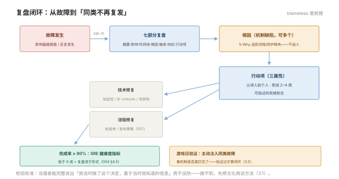

# 003 故障复盘与改进

> **解决**：故障之后怎么让系统变强而不是追责——复盘机制与改进闭环。  
> **范围**：无指责文化 · 复盘模板 · 根因分析 · 行动项跟踪 · 游戏日。  
> **口径**：复盘对象是"满足复盘条件的故障"（影响面超阈值/预算烧超/反复发生），小事口头即可。  
> **更新**：2026-11-01

## 目录

| 节 | 内容 |
|---|---|
| 3.1 | 无指责复盘：为什么必须 blameless |
| 3.2 | 复盘模板：七个必备部分 |
| 3.3 | 根因分析：5-Why 与多重根因 |
| 3.4 | 行动项跟踪：有认领人、有死线 |
| 3.5 | 游戏日与演练 |
| 3.6 | 六个坑 |
| 3.7 | 本章检查清单 |

---

## 3.1 无指责复盘：为什么必须 blameless

复盘的文化前提只有一条：**说出自己做了什么的人不会因此受罚**。理由不是宽容，是信息论——运维事故的最后一环几乎总是"某个人的某个操作"，如果操作者会因为诚实而受罚，复盘得到的第一手信息就是美化过的版本，根因分析从源头失真。

无指责不等于无责任：**系统的责任落在机制上**（为什么一个操作能打挂生产？没有灰度？没有检查单？），改进也落在机制上。出现"人为失误"时的正确问法是"什么样的机制让这个失误成为可能"（003 §3.3 的 5-Why 会自然引到这里）。

culture 的检验标准很具体：**复盘会上，当值者能完整说出"我当时做了这个决定，基于当时我知道的信息"而不设防**——做不到，先修文化再谈方法。

---

## 3.2 复盘模板：七个必备部分

书面复盘（postmortem）七部分模板，48 小时内完成初稿（趁记忆新鲜）：

| 部分 | 内容 | 常见缺陷 |
|---|---|---|
| ① 概要 | 一段话说清：什么坏了、多久、影响 | 写成技术流水账 |
| ② 影响面 | 受影响用户/业务量、SLO 预算消耗 | 只说"部分用户"不说比例 |
| ③ 时间线 | 关键事件精确到分钟：诱因→首告→定位→处置→恢复 | 只记处置不记"何时开始坏" |
| ④ 根因 | 机制缺陷（可多个） | 停在表面（"配置错了"） |
| ⑤ 触发因素 | 什么让缺陷暴露（发布/流量/运维操作） | 与根因混淆 |
| ⑥ 响应评价 | 发现多快（MTTD）、响应多快（MTTA/MTTR）、runbook 是否够用 | 只评价技术不评价响应 |
| ⑦ 行动项 | 整改清单：认领人+死线+验证方式 | 没有归属与死线（3.4） |

复盘会的角色：**主持人**（控流程，通常由非当事人担任）、**当事人**（完整陈述）、**记录者**。会上产出的是行动项草稿，书面稿会后补全并归档——**复盘文档全员可读**（跨团队借鉴是复利的来源）。



---

## 3.3 根因分析：5-Why 与多重根因

5-Why 的纪律是**每一问都落到"机制"而不是"人"**：

```plain
现象：下单服务 30 分钟不可用
为什么1：订单库连接耗尽 → 为什么：慢查询堆积
为什么2：慢查询来自新上线的报表功能 → 为什么：它扫了无索引的大表
为什么3：上线前没有 SQL 审查 → 为什么：发布检查单没有"新 SQL 需 EXPLAIN"项
为什么4：检查单遗漏 → 为什么：报表功能属于"分析侧"，发布流程没覆盖到它
根因①：发布检查单未覆盖分析类变更（机制缺陷）
根因②：大表无索引治理机制缺失（并列根因——它让后果变重）
```

两条纪律：**多重根因是常态**（复杂系统事故是多个缺陷叠加的结果——"只有一个根因"多半是没挖够）；**5-Why 的终点必须可行动**（挖到"人不行"就停=没挖到机制）。每条根因对应至少一个行动项，行动项回填到根因编号——保证"每个缺陷有着落"。

---

## 3.4 行动项跟踪：有认领人、有死线

复盘的价值全部在行动项的闭环里。三个必要属性：

1. **认领人到个人**（"团队"不算认领人）；
2. **死线**（默认 2–4 周，与严重度挂钩）；
3. **验证方式**（怎么证明完成——"加强培训"不可验证，"检查单新增 SQL EXPLAIN 项并纳入 007 §7.9 流程"可验证）。

跟踪机制：行动项进任务系统与 backlog 同权管理；**复盘行动项完成率是 SRE 健康度指标**（004 §4.5）——完成率低于 60% 的团队，复盘已流于形式。行动项的两类去向：技术修复（改架构/加监控/补 runbook——回各板块落地）与流程修复（改检查单/改发布策略——回「CICD」007）。

---

## 3.5 游戏日与演练

游戏日（game day）是**主动注入故障来验证预案与待命体系**的演练：选一个低峰窗口，故意制造一类故障（kill 主节点、填满磁盘、拔掉某依赖），观察告警是否按时响、runbook 是否照得通、IC 分派是否顺畅。

设计四要素：**目标明确**（验证某条具体预案，不是"看看会怎样"）、**影响可控**（注入范围与熔断开关预先定）、**观察者就位**（记录发现的问题——游戏日的产出就是一份"待办行动项"）、**复盘照常**（游戏日也复盘——它暴露的同样是机制缺陷）。频率：季度一次起步。与「CICD」007 的回滚演练、日志 005 的演练要求同源——**游戏日是它们的集成形态**。

---

## 3.6 六个坑

| # | 坑 | 后果 | 正确做法 |
|---|---|---|---|
| 1 | 复盘变追责会 | 当事人隐瞒信息，根因失真 | blameless 先行（3.1） |
| 2 | 复盘 48 小时后才开始 | 细节遗忘，时间线失真 | 48 小时初稿 |
| 3 | 根因停在"操作失误" | 同类故障必然复发 | 追到机制（3.3） |
| 4 | 行动项无认领无死线 | 复盘=开完会就完 | 三属性（3.4） |
| 5 | 只复盘大故障 | 小故障模式被忽视 | 小故障批量口头复盘，模式化后升级 |
| 6 | 复盘文档锁进小圈子 | 跨团队重复踩坑 | 全员可读（敏感信息脱敏） |

第 3 条展开：**"操作失误"是最需要追问的根因类别**——因为它是纯机制信号。5-Why 追问的句式固定为："什么样的流程缺失让这个失误容易发生？""什么样的防护能让这个失误即使发生也无害？"答案通常是检查单、灰度、权限收紧、自动回滚之一——全部可行动。把"下次小心"写进行动项的复盘，等于宣告这次复盘白开。

---

## 3.7 本章检查清单

读完能回答这六个问题，这一章就过了：

| # | 问题 |
|---|---|
| 1 | 无指责的文化检验标准是什么？ |
| 2 | 复盘七部分里最常缺的是哪两个？（影响面与响应评价） |
| 3 | 5-Why 的两条纪律？多重根因为什么是常态？ |
| 4 | 行动项的三属性？完成率的健康值？ |
| 5 | 游戏日四要素？它与回滚演练的关系？ |
| 6 | 为什么"操作失误"类根因最有价值？ |

---

> 下一篇：《004 Toil 治理与自动化》——人被琐事淹没时怎么自救。
