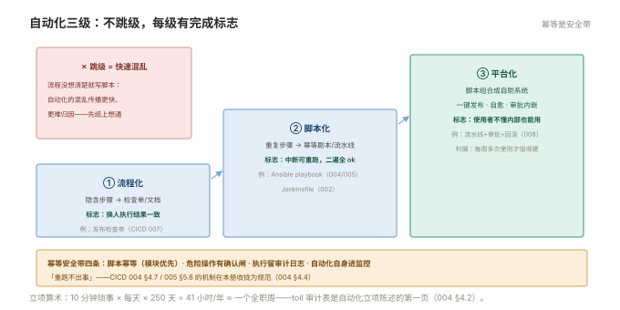

# 004 Toil 治理与自动化

> **解决**：人被重复琐事淹没时怎么识别、怎么配额、怎么用正确的顺序自动化。  
> **范围**：toil 定义与配额 · 识别方法 · 自动化顺序 · 幂等前提 · SRE 健康度。  
> **口径**：自动化落地引用「CICD」（流水线/Ansible）与各板块；本册只定机制与顺序。  
> **更新**：2026-11-01

## 目录

| 节 | 内容 |
|---|---|
| 4.1 | Toil 的定义：四问判定与配额 |
| 4.2 | 识别方法：一周 toil 审计 |
| 4.3 | 自动化的顺序：先流程化，再脚本化，后平台化 |
| 4.4 | 幂等前提与安全带 |
| 4.5 | SRE 健康度：团队自身的度量 |
| 4.6 | 六个坑 |
| 4.7 | 本章检查清单 |

---

## 4.1 Toil 的定义：四问判定与配额

Toil（琐事）不是"所有运维工作"，它的判定是四问——**全答"是"才算**：

```plain
① 手动：人敲命令/点按钮才能完成
② 重复：每次做没有新的学习与判断
③ 可自动化：机器理论上能做
④ 随规模线性增长：服务翻倍，它也翻倍
```

有分析价值的工作（排障、架构评审）不是 toil——它随规模增长的是**深度**不是**时长**。四问全中的典型：每天手动检查备份是否成功、每周手工拼容量报表、每次发布重复敲同一组命令、逐台机器手工打补丁。

**配额机制**：每人每月 toil 占比上限 50%（Google 经验值）——**低于是问题**（说明工程投入不足，长期竞争力流失），**高于也是问题**（人在被琐事消耗）。配额不是考核个人的，是**立项自动化的依据**：toil 审计清单里排名最前的，就是下个自动化的对象。

---

## 4.2 识别方法：一周 toil 审计

toil 的直觉会被高估或低估，**记一周账**才准：

| 工作 | 时长/次 | 频次/周 | 月折算 | 四问 | toil? |
|---|---|---|---|---|---|
| 手动核对备份成功 | 10min | 7 | 4.3h | ①②③④ ✓ | ✅ |
| 容量报表手工拼 | 30min | 1 | 2h | ①②③④ ✓ | ✅ |
| 发布后盯 30 分钟 | 30min | 2 | 4h | ②③✓ ④✗ | ⚠️ 半 toil |
| 故障根因分析 | 2h | 0.5 | 4h | ②✗ | ❌ 工程 |

审计的产出排序（按"月折算 × 自动化难度"），就是 004 册之后的自动化 backlog。数字的作用是把"我感觉天天在救火"变成"我每月 14 小时在对账"——立项时无法被"就这几分钟"打发。

---

## 4.3 自动化的顺序：先流程化，再脚本化，后平台化

自动化的失败大多源于跳级：流程没想清楚就写脚本，脚本没稳定就上平台。三级的正确顺序：

| 级 | 做什么 | 例子 | 完成标志 |
|---|---|---|---|
| ① 流程化 | 把隐含步骤写成文档/检查单 | 发布检查单（「CICD」007 §7.9） | 照单能做，换人结果一致 |
| ② 脚本化 | 把重复步骤写成幂等脚本/流水线 | Ansible playbook、Jenkinsfile（「CICD」004/002） | 中断可重跑，第二遍全 ok |
| ③ 平台化 | 脚本组合成自助平台（一键发布/自愈） | 流水线+审批+回滚一体化（「CICD」008） | 使用者不需要懂内部步骤 |

第②级的幂等与第一级的流程化是前提——**自动化一段混乱的流程，得到的是快速混乱**。第③级的判据是"使用者频率"：每周多次的操作才值得平台化。



---

## 4.4 幂等前提与安全带

所有自动化共享一条安全带：**重跑不出事**（幂等）。四条工程要求（「CICD」004 §4.7 / 005 §5.8 的机制在此收拢为规范）：

1. **脚本幂等**：Ansible 用模块不用裸 shell；shell 补 `creates`/`changed_when`；
2. **危险操作有闸**：rm/force 类命令必须有人工确认位（`--check` 演练先行）；
3. **变更有审计**：自动化执行留日志——"谁在何时让机器改了什么"可查；
4. **自动化本身要被监控**：流水线成功率与时长进告警（「CICD」009 §9.9）——自动化坏掉比手工慢更危险，因为它被信任。

---

## 4.5 SRE 健康度：团队自身的度量

SRE 团队也要用度量管自己（000 §0.3 齿轮的润滑检查）。四个最小指标：

| 指标 | 含义 | 健康线 |
|---|---|---|
| toil 占比 | 琐事时长 ÷ 总时长 | ≤ 50%，且趋势下降 |
| 复盘行动项完成率 | 按期完成的行动项比例 | ≥ 80%（003 §3.4） |
| 告警质量 | page 中"需要行动"的比例 | ≥ 90%（002 §2.2） |
| runbook 覆盖 | 有 runbook 的 page 占比 | ≥ 90% |

月度复盘这四个数字——**它们恶化是团队过载的领先指标**，比"人离职了"早三个月预警。toil 下降的释放时间投向哪：架构改进、SLO 校准、演练（000 §0.3 齿轮的加速）。

---

## 4.6 六个坑

| # | 坑 | 后果 | 正确做法 |
|---|---|---|---|
| 1 | 跳过流程化直接写脚本 | 自动化一段混乱流程 | 三级顺序（4.3） |
| 2 | 非幂等脚本进自动化 | 重跑即事故 | 幂等安全带（4.4） |
| 3 | 自动化无审计 | 出事查不到谁改的 | 执行日志（4.4） |
| 4 | 自动化自身无监控 | 静默失败被信任放大 | 流水线进告警 |
| 5 | toil 审计靠感觉 | 立项被打发 | 记一周账（4.2） |
| 6 | 自动化完成即胜利 | 平台腐化无人维护 | 平台也有 runbook 与度量 |

第 5 条展开：toil 审计最大的阻力是"这活很简单，不值得记"。反驳用算术：**10 分钟 × 每天 × 250 天 = 41 小时/年 ≈ 一整个工作周**——全团队五个人各自的 10 分钟琐事，就是失去一个全职工程师。审计表本身就是立项陈述的第一页。

---

## 4.7 本章检查清单

读完能回答这六个问题，这一章就过了：

| # | 问题 |
|---|---|
| 1 | toil 的四问判定？为什么排障不算 toil？ |
| 2 | 配额机制的用途？50% 的两个方向含义？ |
| 3 | 自动化三级顺序？跳级的代价？ |
| 4 | 幂等安全带的四条工程要求？ |
| 5 | SRE 健康度四指标？恶化预示什么？ |
| 6 | "10 分钟琐事"的立项算术？ |

---

> 下一篇：回到 [README](README.md) 总览——五件机制循环起来：定承诺 → 值守 → 复盘 → 减琐事 → 回到承诺。
