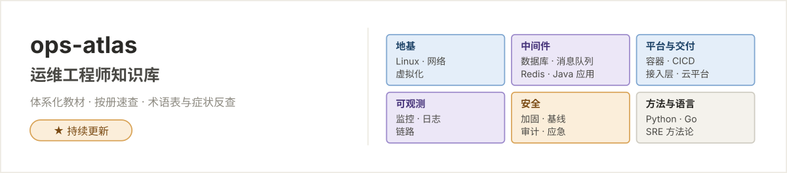

<picture>
  <source media="(prefers-color-scheme: dark)" srcset="体系文档/配图/README-00-横幅-暗色.svg">
  
</picture>

# 运维工程师知识库 · 总览

> **这是什么**：一套面向初中级运维 → DevOps/SRE 方向的体系化知识库，18 个板块、156 册正文，每册对应一类真实任务。  
> **读者**：会基本命令但体系未成型的运维新人，与需要系统查证的在职运维。  
> **怎么用**：顺序读当教材，按册查当手册，术语表与症状反查当字典——三种用法对应三种阅读场景。  
> **更新**：2026-11-08 · 全库 156 册正文 · 20 份术语表 · 127 张手写 SVG 配图（含主页横幅明暗 2 张，全部 1200 宽）· 体例与配图规范见 [AGENTS.md](AGENTS.md)

---

## 全库地图：18 板块

| 层 | 板块 | 册数 | 回答的问题 | 入口 |
| --- | --- | --- | --- | --- |
| **🧱 地基** | [001 Linux](体系文档/001-Linux/README.md) | 001~010 + A/B | 一台 Linux 机器怎么管好、坏了从哪查 | [README](体系文档/001-Linux/README.md) |
| | [002 网络](体系文档/002-网络/README.md) | 000~009 | 包能不能到、连接建不建得起来、慢在哪 | [README](体系文档/002-网络/README.md) |
| | [017 虚拟化](体系文档/017-虚拟化/README.md) | 000~002 | VMware/KVM 虚拟机与集群怎么管 | [README](体系文档/017-虚拟化/README.md) |
| **⚙️ 中间件** | [003 数据库](体系文档/003-数据库/README.md) | 000~010 | 数据怎么存、怎么查得快、坏了怎么救 | [README](体系文档/003-数据库/README.md) |
| | [008 消息队列](体系文档/008-消息队列/README.md) | 000~004 | RabbitMQ/Kafka 怎么管、堆积丢失怎么治 | [README](体系文档/008-消息队列/README.md) |
| | [014 Redis](体系文档/014-Redis/README.md) | 000~007 | 缓存怎么用不踩坑、高可用怎么搭、出事怎么救 | [README](体系文档/014-Redis/README.md) |
| **🚢 平台与交付** | [005 容器](体系文档/005-容器/README.md) | 000~009 | Docker 与 K8s 怎么跑、怎么编排、怎么排障 | [README](体系文档/005-容器/README.md) |
| | [006 CICD](体系文档/006-CICD/README.md) | 000~009 | 提交到上线的流水线怎么搭、怎么排错 | [README](体系文档/006-CICD/README.md) |
| | [007 接入层](体系文档/007-接入层/README.md) | 000~009 | 流量第一跳（Nginx/HAProxy）怎么配怎么救 | [README](体系文档/007-接入层/README.md) |
| | [015 云平台](体系文档/015-云平台/README.md) | 000~005 | 上云之后运维管什么：网络/主机/数据/IaC/观测 | [README](体系文档/015-云平台/README.md) |
| **👀 可观测** | [009 监控](体系文档/009-监控/README.md) | 000~009 + zabbix 000–005 | 指标怎么采、怎么看、怎么告警、规模大怎么办 | [README](体系文档/009-监控/README.md) |
| | [010 日志](体系文档/010-日志/README.md) | 000~007 | EFK/Loki：日志怎么收、怎么查、怎么治 | [README](体系文档/010-日志/README.md) |
| | [011 链路](体系文档/011-链路/README.md) | 000~006 | OTel/Jaeger/Tempo：跨服务调用怎么还原 | [README](体系文档/011-链路/README.md) |
| **🛡️ 安全** | [016 安全运维](体系文档/016-安全运维/README.md) | 000~005 | 加固、防火墙策略、基线漏扫、等保、应急 | [README](体系文档/016-安全运维/README.md) |
| **🧰 方法与语言** | [004 Python](体系文档/004-Python/README.md) | 000~006 | 运维实战脚本与胶水自动化 | [README](体系文档/004-Python/README.md) |
| | [012 Go](体系文档/012-Go/README.md) | 000~017 | Go 语言基础到生产事故复盘 | [README](体系文档/012-Go/README.md) |
| | [018 Java 应用](体系文档/018-Java应用运维/README.md) | 000~002 | Java 应用在运维手里怎么管：JVM/Tomcat | [README](体系文档/018-Java应用运维/README.md) |
| | [013 SRE](体系文档/013-SRE/README.md) | 000~004 | SLO、待命、复盘、toil 治理的机制 | [README](体系文档/013-SRE/README.md) |

> 每个板块自带 **README 导航**（体系总览/阅读约定/边界）、**00 术语表**（术语·缩写·易混对·症状反查）与**统一体例的分册**。  
> **目录前缀 001~018 = 建议学习顺序**（依据下节五阶段路径）；本表按主题分层，所以序号在层内不连续——如数据库属中间件层，学习上排在第二阶段。

---

## 分层学习路径（新人 → DevOps）

```plain
第一阶段 · 地基        Linux 001~006（机器/进程/权限/存储/网络/服务）
                       网络 001~004（模型/连通/TCP/DNS/HTTP）
第二阶段 · 操作与数据  Linux 007~010（文本/脚本/性能/备份）
                       数据库 000/010（版图与选型）→ 001~005（MySQL 主线/备份）
第三阶段 · 语言与交付  Python 001~002（脚本/系统）→ 003~005（API/报表/实战）
                       虚拟化 000~002（VMware/KVM）→ 容器 000~004（Docker）→ CICD 000~010
                       容器 005~009（K8s）→ 接入层 001~003（Nginx）→ 云平台 000~005（上云与 IaC）
第四阶段 · 中间件与观测 消息队列 000~005 · Redis 000~007 · Java 应用 000~002 · 接入层 004~008 · 数据库 006~010
                       监控 001~009 + zabbix 000~005 · 日志 000~006 · 链路 000~006
第五阶段 · 方法收口    SRE 000~004 · 各板块排错册/剧本 · Linux 009 · 安全运维 000~005
```

原则：**每一阶段的地基都在前一阶段**——容器前的 cgroup 在 Linux 002，CICD 前的脚本在 Linux 008，SLO 前的指标在监控。跳阶段读会缺一层直觉。**目录前缀 001~018 就是这条路线的板块顺序。**

---

## 贯穿全库的四条主线

跨板块反复出现的概念——在一处立住，处处引用：

1. **三语言分工**：Shell（<20 行胶水）→ Python（20–500 行逻辑与生态粘合）→ Go（并发与常驻）——Python 000 §0.2 立，Go 板块呼应。
2. **可观测性三支柱**：指标（出告警，监控册）→ 日志（解释原因，日志册）→ 链路（定位跳角，链路册）——日志 000 §0.1 是枢纽，链路册是收官。
3. **可靠性语义与幂等**：at-least-once + 消费端幂等（消息队列 000/003）、脚本幂等（SRE 004）、制品不可变（CICD 006）——同一思想在不同层的形态。
4. **分段取证排障**：网络 009 的分层排查、容器 009 的三板斧、日志 006 的四段取证、SRE 002 的响应纪律——"先定位段落再取证，不跳读"是全库纪律。

---

## 按任务找册（速查）

| 任务/症状 | 从哪进 |
| --- | --- |
| 机器起不来 / 性能异常 | Linux 001.6 / 009 |
| 网络不通、端口不通、抓包 | 网络 001 / 009 |
| 数据库慢、主从异常、误删找回 | 数据库 007 / 006 / 005 |
| 引入新库、换库评估、信创评审 | 数据库 010 |
| 上云迁移、云资源选型、IaC 入门 | 云平台 000 / 004 |
| 账号加固、等保测评准备、漏扫修复 | 安全运维 001 / 003 / 004 |
| 服务发布与回滚 | CICD 007 / 008 |
| 容器起不来、K8s Pod 异常 | 容器 009 |
| 流量入口 502/504、证书告警 | 接入层 007 / 004 |
| 告警响了、日志搜不到 | 监控 004 / 日志 006 |
| 交换机/网络设备采不到数、Windows 主机纳管 | 监控 zabbix 001 / 002 |
| 队列堆积、消息丢失 | 消息队列 003 / 004 |
| 缓存穿透击穿雪崩、Redis OOM 与大 key | Redis 005 / 006 |
| 虚拟机迁移、快照、ESXi/KVM 告警 | 虚拟化 001 / 002 |
| Java 应用 OOM、GC 日志、Tomcat 排障 | Java 应用 001 / 002 |
| RocketMQ 选型与堆积 | 消息队列 005 |
| 应用交付想走 GitOps 自动同步 | CICD 010 |
| 想把手工活自动化 | SRE 004 → Python 005 → CICD 008 |
| 新服务上生产前的自查 | 各板块「检查清单」+ SRE 001（SLO） |

---

<details>
<summary><b>全库约定 与 全库边界（点开展开）</b></summary>

### 全库约定

1. **每册结构统一**：目录 → 正文（每节开头直接给定义/结论，不强制承接句）→ N 个坑（表格）→ 检查清单 → 下一篇；部分册在检查清单后附一节「最小可复现实验」，作为把机制带回真实环境的迁移环节，不改变前述主干顺序。
2. **配图规范**：手写 SVG、**1200 宽纸面风**（语义色：蓝=常态、琥珀=关键、红=错误/风险；内部 680 坐标系等比 1.764706）、与正文一同演进；**全库 127 张（125 教材配图 + 2 主页横幅，明暗各一）均为 1200 宽**；绘制流程为定信息源 → 分层列实体 → 先算坐标再落笔 → 渲染目视；渲染仅为临时校验步骤，**PNG 不落盘，全库只保留 SVG**。
3. **引用规范**：教材配图一律 ``；主页横幅用 `<picture>` 配 `prefers-color-scheme` 挂明暗两版——全库 127 张配图与 127 处嵌入引用一一对应（各板块 README 的配图索引以路径形式另列）。
4. **术语表体系**：每板块一份——分册术语 / 缩写速查 / 易混对 / 按症状反查，四种查法。
5. **危险操作先说后果**：`rm -rf`、`--delete`、删索引/分区等一律 ⚠️ 标注并给回滚/备份路径。
6. **跨板块引用带册号**：如「CICD」007 §7.9——所指章节必须真实存在。

---

### 全库边界（不写什么）

| 主题 | 状态 |
| --- | --- |
| 链路追踪深入（OTel/Tempo） | 已独立成板块：「链路」000~006 |
| 云平台与 IaC（Terraform） | 已建成：「云平台」000~005 |
| 安全运维与等保 | 已建成：「安全运维」000~005（Linux 003 / 网络 005 为前置） |
| 消息队列之外的大数据组件 | 不写 |
| Windows 运维 | 不写 |

</details>

---

## 状态

| 项目 | 数值 |
| --- | --- |
| 板块 | 18 |
| 正文册 | 158 |
| 术语表 | 20 份（1893 条条目） |
| 手写 SVG 配图 | 127 张（125 教材配图 + 2 主页横幅，明暗各一，全部 1200 宽；另有 5 张归档原图仅存不引用，不计入本数与引用数） |
| 图片引用 | 127 处嵌入引用，全 SVG、零损坏 |

> **术语表条目数口径**：20 份 `00-术语表.md` 的全部表格数据行合计 **1893** 条（由 `kb-validate` 对账，增删术语后须同步状态表与本行）。

维护方式：**任何 AI 进入本库先读 [AGENTS.md](AGENTS.md)**（体例、配图、校验与提交纪律的入口）；配图改完必渲染、渲染必目视；每次扩充先补本页体系表，再写正文。

---

**从 [001-Linux/README.md](体系文档/001-Linux/README.md) 开始**，或按上方地图直达任一板块。
