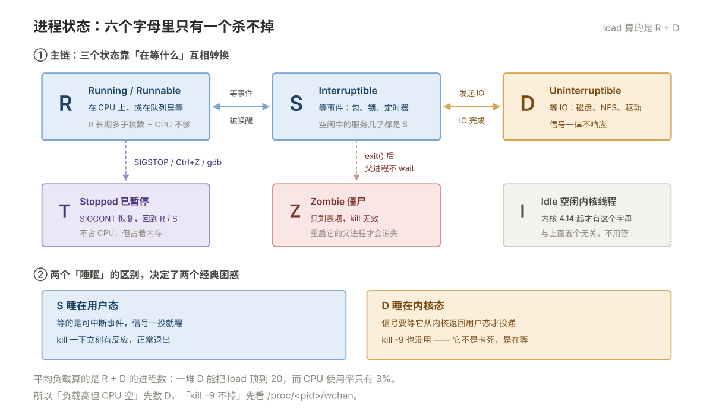
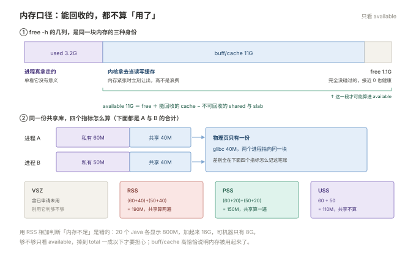

# 02 进程与资源

> **解决**：机器上谁在跑、占了多少、卡在哪里，以及怎么在不搞崩业务的前提下处理它。  
> **范围**：进程是什么，长什么样 · 状态列 · 父子关系、孤儿与僵尸 · 信号 · /proc/<pid>  
> **口径**：正文以 CentOS 7 / Ubuntu 22.04 / CentOS 6 举例；命令、路径与发行版差异在节内注记，不绑定单一版本。  
> **更新**：2026-11-06  
> **读完能做到**：看懂 `ps` 状态列的每一个字母；判断一个进程是「在等」还是「在算」还是「死了没收尸」；查出谁占着端口和文件；读懂 OOM 记录并找到被杀的原因。  
> **怎么读**：2.0 是知识点地图，标了每个点的**基础 / 进阶**。第一遍跳过带「进阶」的小节不影响主线。 不认识的词查 [00 术语表](00-术语表.md)。
> **不在这里**：CPU / 内存 / IO 的**读数与调优** → 09；unit 文件怎么写 → 06；权限规则 → 03。

---

## 目录

| 节 | 内容 |
|---|---|
| 2.0 | 本册知识点地图 |
| 2.1 | 进程是什么，长什么样 |
| 2.2 | 状态列：六个字母定性质 |
| 2.3 | 父子关系、孤儿与僵尸 |
| 2.4 | 信号：让进程退出或重载 |
| 2.5 | `/proc/<pid>`：进程的一切都在这里 |
| 2.6 | `strace`：进程卡住时看它在干什么 |
| 2.7 | `lsof`：谁占着这个文件 / 端口 / 目录 |
| 2.8 | 内存口径：三个数字，别用错 |
| 2.9 | OOM：谁被杀，为什么是它 |
| 2.10 | cgroup：给进程划资源上限 |
| 2.11 | 优先级：让不重要的先让路 |
| 2.12 | 后台运行：为什么 `nohup` 了还是死 |
| 2.13 | 本册排错路径 |
| 2.14 | 自测 |
| 2.15 | 命令索引 |

---

## 2.0 本册知识点地图

复习时按这张表逐行自问「这个我能讲清吗」，讲不清的回对应节。**加粗的是面试和故障现场最常被问到的。**

| 知识点 | 层次 | 一句话要点 | 节 |
| --- | --- | --- | --- |
| **进程与线程的区别** | 基础 | 进程有独立地址空间，线程共享；`ps -eLf` 才看得见线程 | 2.1 |
| 进程树 | 基础 | 一切用户进程最终都挂在 PID 1 下，孤儿由它收养 | 2.1 |
| **状态列的六个字母** | 基础 | `R/S/D/T/Z/I`，`D` 是唯一 kill -9 也杀不掉的 | 2.2 |
| D 状态 | 进阶 | 在等内核 IO，负载高但 CPU 空的第一嫌疑 | 2.2 |
| **僵尸进程** | 基础 | 已经死了，杀不动，只能让父进程收尸 | 2.3 |
| **信号与 kill 顺序** | 基础 | 先 TERM 等十秒再 KILL；`-9` 会留烂摊子 | 2.4 |
| `HUP` 与 reload | 基础 | 很多服务收到 HUP 是重载配置而不是退出 | 2.4 |
| **`/proc/<pid>` 读法** | 基础 | 进程的一切都在这里，`cmdline` / `cwd` / `exe` / `fd` 最常用 | 2.5 |
| `exe` 带 deleted | 进阶 | 二进制升级了但没重启，还在跑旧文件 | 2.5 |
| `strace` | 进阶 | 进程卡住时看它在调什么系统调用 | 2.6 |
| **`lsof` 四个用途** | 基础 | 端口被谁占、目录为何卸不掉、deleted 文件、谁在读 | 2.7 |
| **VSZ / RSS / PSS** | 基础 | RSS 把共享库重复算了，PSS 才准 | 2.8 |
| `available` 而非 `free` | 基础 | 判断内存够不够看 `available`，cache 不是浪费 | 2.8 |
| **OOM 归因** | 基础 | 读 `dmesg` 的 total-vm / anon-rss，分清泄漏与流量 | 2.9 |
| `oom_score_adj` | 进阶 | 保护关键进程不被杀，范围 -1000 到 1000 | 2.9 |
| **cgroup v1 / v2** | 进阶 | CentOS 7 是 v1，Ubuntu 22.04 是 v2，限制参数名完全不同 | 2.10 |
| nice 与 ionice | 基础 | 只在有竞争时生效；nvme 上 ionice 基本没用 | 2.11 |
| **nohup 为什么还死** | 基础 | `&` 的进程挂在终端会话上，退出登录发 HUP | 2.12 |
| 长期跑用 systemd | 基础 | `nohup` 只适合一次性脚本，常驻服务交给 systemd | 2.12 |

### 动手前：造两个可以观察的对象

这一册大半命令要填 PID。只看不敲等于没读，先花十秒造两个靶子：

```bash
sleep 3600 &            # 造一个 S 状态（可中断睡眠）的进程
echo $!                 # $! 就是它的 PID，下文所有 <pid> 都能换成它
ps -o pid,ppid,stat,tty,cmd -p $!

md5sum /dev/zero &      # 造一个 R 状态（吃满 CPU）的进程
kill %1 %2              # 读完清掉
```

占位符约定：`<pid>` 换进程号（`pgrep -a <名字>` 查），`<svc>` 换 unit 名（`systemctl list-units --type=service` 查），`<dir>` / `<file>` 换实际路径。

**只读命令随便敲，带 ⚠️ 的先想三秒**：2.4 的 `kill -9`、2.8 的 `drop_caches`、2.9 的 `oom_score_adj`、2.11 的 `chrt`，都会真的改动系统。

---

## 2.1 进程是什么，长什么样

### 程序、进程、线程

| 概念 | 说人话 | 资源 |
| --- | --- | --- |
| 程序 | 磁盘上的文件（`/usr/sbin/nginx`） | 只占空间，不占 CPU |
| 进程 | 程序被加载执行一次 | 独立地址空间、独立 PID、独立打开的文件表 |
| 线程 | 进程内部的执行流 | 共享地址空间和文件表，各有独立栈和寄存器 |

所以：**一个进程的内存被它所有线程共用，杀掉一个线程不影响别的线程，杀掉进程则全没了。**

```bash
ps -eLf | head -5          # -L 展开线程，NLWP 列是线程数
ls /proc/<pid>/task        # 每个线程一个子目录，目录名就是 TID
```

### 进程的身证

每个进程有一组属性，运维判断问题基本就靠这几个：

```bash
ps -p 1,2 -o pid,ppid,user,stat,comm
```

```plain
  PID  PPID USER     STAT COMMAND
    1     0 root     Ss   systemd
    2     0 root     S    kthreadd
```

- **PID 1 是 systemd**，`PPID 0`，它没有父进程（见 001 §1.5）。
- **PID 2 是 kthreadd**，所有内核线程的父亲。名字带方括号的 `[kworker/0:1]` 都是内核线程，不是病毒。

看进程树比看列表直观：

```bash
pstree -p 1234        # 指定 PID 展开它和它的子进程
pstree -p | head -20
```

```plain
systemd(1)─┬─NetworkManager(812)─┬─{gdbus}(834)
           ├─sshd(1024)───sshd(20431)───bash(20435)───pstree(20500)
           └─nginx(2100)─┬─nginx(2102)
                         └─nginx(2103)
```

注意 `nginx` 那个结构：**一个 master（2100）带两个 worker**。master 只负责读配置、管 worker，真正处理请求的是 worker。这解释了为什么 `kill -HUP <master>` 能平滑重载——master 收到 HUP 后起新 worker、退老 worker。

### 进程的四个身份

| 维度 | 看什么 | 为什么重要 |
| --- | --- | --- |
| 用户 | `ps -o user`、`/proc/<pid>/status` 的 `Uid` | 决定它能读写什么（见 03） |
| 会话 | `ps -o sid,tty` | 决定退出登录时它会不会被 HUP 带走（见 2.12） |
| cgroup | `systemctl show -p ControlGroup <svc>` | 决定它受哪套资源限制（见 2.10） |
| 命名空间 | `ls -l /proc/<pid>/ns` | 容器里的进程和宿主机看到的不一样 |

> **容易搞混**：`ps aux` 的 `%CPU` 是**进程生命周期内的平均占用**，不是当前瞬时值。要看瞬时值用 `top` 或 `ps -o pcpu` 配合采样，读数的解释在 09 的「工具与读数」一节。

---

## 2.2 状态列：六个字母定性质

上一节认清了进程的身份和归属，这一节回答「它此刻在做什么」——答案就在 `STAT` 列的第一位。

`ps` 的 `STAT` 列第一位是进程状态，这是排查时第一个要看的东西。

六个字母不是并列的六种情况，而是一条主链加三个例外——先看清它们怎么互相转换，后面判断异常才有依据：



逐个说明，重点看最后一列的「典型场景」：

| 字母 | 名称 | 含义 | 典型场景 |
| --- | --- | --- | --- |
| `R` | Running / Runnable | 正在 CPU 上跑，或在运行队列里等 CPU | 计算型任务；`R` 长期多于核数就是 CPU 不够 |
| `S` | Interruptible Sleep | 可中断睡眠，等事件（网络包、锁、定时器） | **绝大多数空闲中的服务都是 S**，这是正常的 |
| `D` | Uninterruptible Sleep | 不可中断睡眠，等内核 IO 完成，**不响应信号** | 磁盘坏、NFS 服务端失联、驱动卡死 |
| `T` | Stopped | 被 `SIGSTOP`/`SIGTSTP` 暂停，或被调试器挂住 | `kill -STOP`、`Ctrl+Z`、gdb 断点 |
| `Z` | Zombie | 已退出但父进程还没收尸 | 父进程不调 `wait()`，见 2.3 |
| `I` | Idle | 空闲的内核线程（内核 4.14+ 才有） | 正常，不用管 |

统计一下各状态有多少，一眼看出方向：

```bash
ps -eo stat --no-headers | cut -c1 | sort | uniq -c | sort -rn
```

```plain
     94 S
     11 I
      3 R
      1 D
      1 Z
```

后面还会跟一些修饰字母，常见三个：

| 修饰 | 含义 | 影响 |
| --- | --- | --- |
| `s` | 会话首进程（session leader） | 退出登录时，它下面的进程会收到 HUP |
| `l` | 多线程 | 说明 `ps -L` 才看得全 |
| `<` / `N` | 高优先级 / 低优先级 | 对应 nice 值为负 / 正（见 2.11） |
| `+` | 在前台进程组 | `Ctrl+C` 能直接打到它 |

### `S` 和 `D` 的区别，为什么这个区分值钱

两个都是「睡眠」，但断点不在一个地方：

- **`S` 睡在用户态**，等的是「可中断」的事件，`kill` 一下立刻醒。
- **`D` 睡在内核态**，等的是「不可中断」的 IO，信号只能等它从内核返回用户态才能投递——**这期间 `kill -9` 也没用**。

这解释了两个经典困惑：

1. **「负载很高但 CPU 是空的」**——平均负载算的是 `R` + `D` 的进程数。一堆 `D` 状态进程会把负载顶到 20，而 CPU 使用率只有 3%。根因在磁盘或 NFS，不在 CPU。完整分析见 09 的「负载高但 CPU 低」一节。
2. **「`kill -9` 杀不掉，像卡住了」**——它根本没在用户态，收不到信号。等 IO 完成（可能是几十秒超时）或者修好底层存储，它自己就走了。

找出所有 `D` 状态的进程，看它们在等什么：

```bash
ps -eo stat,pid,comm | awk '$1 ~ /^D/'
cat /proc/<pid>/wchan          # 内核里卡在哪个函数，需要 root
cat /proc/<pid>/stack          # 内核调用栈，更详细，需要 root
```

`wchan` 是纯文本函数名，`stack` 是完整调用栈。看到 `nfs_*`、`rpc_*` 就是 NFS 卡了，看到 `blk_*` 或 `ext4_*` 就是本地盘。

> 想省掉表头又怕参数不兼容，用 `ps -eo stat | tail -n +2`，任何版本都成立。

---

## 2.3 父子关系、孤儿与僵尸

六个状态里最难理解的两个，是 `Z` 和「为什么有进程挂在 PID 1 下面」，它们都是父子关系的产物。

### 孤儿：父进程先死了

子进程还活着、父进程退出了，它就被「挂到」PID 1（systemd）名下，由 systemd 接手收养。这是正常现象，不需要处理。

```bash
ps -eo pid,ppid,comm | awk '$2 == 1' | head   # PPID 是 1 的「孤儿」
```

看到一堆 `PPID=1` 的进程别急着判定异常——systemd 自己拉起的服务（nginx、sshd）本来就是 `PPID=1`。

### 僵尸：子进程死了，父进程不埋

僵尸是**已经退出的进程留下的表项**，它不占 CPU、不占内存（只占极少的内核结构），只占一个 PID。存在的原因是：子进程的退出码还在等父进程用 `wait()` 取走，取走之后表项才消失。

```bash
ps -eo stat,ppid,pid,comm | awk '$1 ~ /^Z/'
```

```plain
STAT  PPID   PID COMMAND
Z+    2043  2044 defunct
```

三条结论必须记住：

1. **`kill -9` 对僵尸无效**。它已经死了，没有可杀的东西。你看到的 `defunct` 就是「尸体」。
2. **处置方式是处理它的父进程**，不是它自己。`PPID` 指向的那个进程重启一次，僵尸自动消失（父进程退出，僵尸被 systemd 收走）。
3. **几十个僵尸不影响性能，几千个才危险**——PID 会被耗尽（`fork: retry: Resource temporarily unavailable`）。

```bash
# 找出僵尸的父进程是谁，重点看那个
ps -eo stat,ppid,pid,comm | awk '$1 ~ /^Z/ {print $2}' | sort | uniq -c
```

> **常见来源**：自己写的 shell 守护脚本用 `cmd &` 循环拉起子进程却从不 `wait`；或者某个服务的代码有 bug。这不是系统问题，是程序问题，要改代码或者改用 systemd 托管。

---

## 2.4 信号：让进程退出或重载

状态看清了，下一步是改变它。让进程退出、重载或暂停，靠的都是信号。

### 常用信号

`kill` 这个命令的名字有误导性——它实际是「发信号」，信号不一定是杀。

| 编号 | 名字 | 默认动作 | 运维里什么时候用 |
| --- | --- | --- | --- |
| 1 | `HUP` | 终止 | **很多服务把它实现成「重载配置」**：`nginx`、`rsyslog`；对普通进程就是退出 |
| 2 | `INT` | 终止 | 等同于 `Ctrl+C` |
| 15 | `TERM` | 终止 | **默认的优雅退出**，进程可以捕获它做清理 |
| 9 | `KILL` | 终止（不可捕获） | 最后手段，见下方代价 |
| 19 | `STOP` | 暂停（不可捕获） | 冻结进程，排查时用；恢复用 `18`（`CONT`） |
| 18 | `CONT` | 继续 | 解冻 |
| 3 | `QUIT` | 终止 + core dump | 需要现场时用（先确认 `ulimit -c` 不为 0） |
| 10 / 12 | `USR1` / `USR2` | 终止 | 由程序自定义：nginx 用它重开日志、切二进制；有些程序用它 dump 状态 |

```bash
kill -l                 # 列出全部信号名和编号
kill -l TERM            # 反查编号，输出 15
```

### 顺序：TERM → 等 → KILL

```bash
kill -TERM 1234
for i in $(seq 10); do
  kill -0 1234 2>/dev/null || { echo "已退出"; break; }
  sleep 1
done
kill -9 1234 2>/dev/null
```

`kill -0` 不发送信号，只检查进程是否存在——用它轮询是标准做法。

```plain
已退出
```

如果十秒后循环没有打印「已退出」，说明这个进程屏蔽了 `TERM` 或者正卡在 `D` 状态（见 2.2），只能等或者修底层问题——这时才轮到下一行的 `kill -9`。

**为什么 `-9` 要放最后**：`SIGKILL` 由内核直接执行，进程没有任何机会做清理。

- 数据库杀到一半，下次启动要做崩溃恢复，慢的话几十分钟。
- 写文件写到一半，留下损坏的临时文件。
- 锁文件、PID 文件不删，下次启动报「already running」。
- 共享内存段、信号量残留，要手工 `ipcrm`。

所以**业务进程优先用服务管理器停**，它知道正确的信号和顺序：

```bash
systemctl stop nginx        # 走 unit 里定义的 ExecStop，比手工 kill 稳
```

> **只有一种情况直接 `-9` 是对的**：进程已经卡死、`systemctl stop` 也超时了。这时先 `systemctl stop` 等它自己超时（默认 90 秒），再 `kill -9`，然后用 `systemctl reset-failed` 清状态。

### `pkill` 的坑

```bash
pgrep -a -f 'app.jar'           # 先用 pgrep 看清楚会命中谁
pkill -f 'java -jar app.jar'    # 确认后再杀
```

`pkill -f` 匹配的是**完整命令行**，而你执行 `pkill` 时，你自己这条命令行的文本里就含有 `java -jar app.jar`——某些情况下会把自己的 shell 或上层脚本打死。表现是「脚本执行到一半莫名其妙断了」。

安全做法：用 `pgrep` 拿到 PID 再逐个 `kill`，或者加 `-x` 精确匹配进程名（不含参数）。

> **CentOS 6** 的 `pgrep -a` 不支持 `-a`（显示完整命令行），改用 `pgrep -fl` 的效果相近，或 `ps -ef | grep`。

---

## 2.5 `/proc/<pid>`：进程的一切都在这里

信号是「怎么动它」，从这里开始换角度——「怎么看透它」。`ps` 给的是一行摘要，`/proc` 给的是全部细节。

`/proc` 不是真的文件系统，是内核内存的窗口（见 001 §1.2）。`/proc/<pid>/` 下每个文件都是这个进程的一个侧面。这条技能的价值在于：**`ps` 显示不全的信息，在这里都能拿到，而且不需要装任何工具。**

| 文件 | 内容 | 什么时候用 |
| --- | --- | --- |
| `cmdline` | 完整命令行，参数用 `\0` 分隔 | `ps` 截断成一屏时看完整启动参数 |
| `status` | 状态、UID、线程数、VmRSS、VmSwap | 快速看内存与状态，比 `ps` 全 |
| `environ` | 启动时的环境变量，`\0` 分隔 | 服务读不到变量时，确认它继承的是什么 |
| `cwd` | 软链到工作目录 | 「脚本里用了相对路径，到底在哪跑的」 |
| `exe` | 软链到可执行文件 | **判断是否在跑旧二进制**（见下） |
| `fd/` | 这个进程打开的所有文件描述符 | 查句柄泄漏、查它开着哪个日志 |
| `limits` | 实际生效的各类上限 | `ulimit` 改了没生效时看这个（见 001 §1.8） |
| `io` | 累计读写字节与真实磁盘 IO | 判断是谁在压磁盘 |
| `maps` | 内存映射段 | 查共享库版本冲突 |
| `smaps_rollup` | 内存汇总（含 PSS） | 内核 4.14+；CentOS 7 没有，见 2.8 |
| `task/` | 每个线程一个子目录 | 定位具体哪个线程吃满 CPU |
| `wchan` / `stack` | 内核里卡在哪 | 诊断 `D` 状态（见 2.2） |
| `ns/` | 命名空间 | 容器相关 |

### 三条立刻能用的

参数被 `ps` 截断，看完整版：

```bash
tr '\0' ' ' < /proc/1234/cmdline; echo
```

它到底在哪个目录下跑（相对路径问题的根源）：

```bash
ls -l /proc/1234/cwd
```

```plain
lrwxrwxrwx 1 root root 0 Oct 29 10:12 /proc/1234/cwd -> /opt/app/current
```

**它跑的是哪个二进制、是不是已经删掉的那个**：

```bash
ls -l /proc/1234/exe
```

```plain
lrwxrwxrwx 1 root root 0 Oct 29 10:12 /proc/1234/exe -> /usr/sbin/nginx (deleted)
```

看到 `(deleted)` 就是典型事故现场：**升级时覆盖了二进制文件，但进程没重启，它还在内存里跑着旧代码**。这时候：

- `systemctl restart` 一下就好；
- 但如果升级方式是 `rm` 后放新文件，磁盘上的文件已经换 inode 了，**进程占着的那份空间不会释放**，`df` 显示不出来的空间就是这么丢的（配合 2.7 的 `lsof` 找）。

### 全局的 `/proc`

| 文件 | 用途 |
| --- | --- |
| `/proc/meminfo` | 内存明细，`free` 的数据源 |
| `/proc/loadavg` | 1/5/15 分钟负载 + 运行中/总进程数 |
| `/proc/stat` | 每个 CPU 的时间片分配，`top` 的数据源 |
| `/proc/diskstats` | 每块盘的 IO 计数，`iostat` 的数据源 |
| `/proc/sys/` | 内核参数，可写（见 001 §1.8） |
| `/proc/<pid>/` | 见上表 |

---

## 2.6 `strace`：进程卡住时看它在干什么

`/proc` 给的是某一瞬间的快照，看不出进程在反复做什么。要看清它正在执行的动作序列，用 `strace`。

`strace` 跟踪进程的**系统调用**——也就是进程向内核提的每一个请求（打开文件、读网络、分配内存、等锁）。进程「卡住」时，它最后停在哪一个系统调用上，基本就指向了根因。

| 用法 | 命令 | 说明 |
| --- | --- | --- |
| 跟已有进程 | `strace -p 1234` | 最常用；`Ctrl+C` 结束跟踪，**不会杀掉被跟踪进程** |
| 连子进程一起 | `strace -f -p 1234` | 多进程/多线程程序必须加 `-f` |
| 只看文件相关 | `strace -e trace=openat,open,stat -p 1234` | 输出量能少 90% |
| 只看网络 | `strace -e trace=network -p 1234` | |
| 显示每步耗时 | `strace -T -p 1234` | 输出里 `<0.000123>` 是这次调用花了多久 |
| 统计汇总 | `strace -c -p 1234` | 按调用次数和总耗时排序，找热点 |
| 显示 fd 对应的路径 | `strace -y -p 1234` | 输出 `read(3</etc/nginx/nginx.conf>)`，省得自己查 fd |
| 加大字符串长度 | `strace -s 256 ...` | 默认只打 32 字节，路径被截断 |

### 三个典型场景

**场景一：服务启动就退出，日志里什么都没写**

```bash
strace -f -e trace=file /usr/local/bin/app 2>&1 | tail -30
```

最后几行的 `ENOENT` 就是它找不到的文件。常见于 `chroot` 后缺库、`LD_LIBRARY_PATH` 没传到服务里。

**场景二：进程不响应，但 `ps` 显示还在**

```bash
strace -p 1234
```

```plain
...（光标停住，没有任何输出）
```

**如果挂上去完全没有输出，说明它没在发系统调用**——它在等某个事件（网络、锁、信号）。这时候 `strace` 帮不上忙，换查：

```bash
cat /proc/1234/wchan          # 卡在哪个内核函数
ls -l /proc/1234/fd | wc -l   # 句柄是不是满了
cat /proc/1234/status | grep -E 'State|Threads'
ss -tnp | grep 1234           # 有没有半开的连接
```

**场景三：慢，但不知道慢在哪**

```bash
strace -c -p 1234      # 跑 10 秒后 Ctrl+C
```

```plain
% time     seconds  usecs/call     calls    errors syscall
------ ----------- ----------- --------- --------- ----------------
 92.31    0.480000       48000        10           futex
  6.15    0.032000          32      1000           read
  1.54    0.008000           8      1000           write
```

92% 的时间在 `futex` 上——这不是 IO 慢，是**锁竞争**，要往程序内部的线程模型查，加机器或改配置都没用。

> ⚠️ **生产环境慎用**。`strace` 会让目标进程慢几倍到几十倍（每次系统调用都要停下来通知跟踪器），高并发服务上可能直接触发超时雪崩。规矩是：**只跟踪单线程进程、或者只跟踪几十秒、业务低峰期做**。要长期观测用 `perf`、`bpftrace` 或应用自身的 metrics（见「监控」文档集）。
>
> **容器内**的进程，宿主机 `strace -p` 可能因权限或 PID 命名空间受限，需要 `nsenter -t <pid> -p` 进命名空间，或加 `--cap-add=SYS_PTRACE`。

---

## 2.7 `lsof`：谁占着这个文件 / 端口 / 目录

`strace` 回答「它在干什么」，`lsof` 回答「它占着什么」。两者常连着用：`strace` 里看到 `open` 失败，再用 `lsof` 确认那个 fd 被谁攥着。

四个高频用途，每个都对应一个真实故障。

| 我想知道 | 命令 |
| --- | --- |
| 端口被哪个进程占了 | `lsof -i :8080` |
| 谁占着这个目录，导致卸不掉 | `lsof +D /mnt/data` |
| 有没有被删掉但还占着空间的文件 | `lsof +L1` |
| 谁在读写这个日志/配置 | `lsof /var/log/app.log` |
| 这个进程打开了哪些文件 | `lsof -p 1234` |
| 某个用户的所有打开文件 | `lsof -u deploy` |

### 端口被占

```bash
lsof -i :8080
```

```plain
COMMAND   PID   USER   FD   TYPE DEVICE SIZE/OFF NODE NAME
java    20431 deploy   45u  IPv6  51234      0t0  TCP *:8080 (LISTEN)
```

等价且更快的做法（不需要 lsof）：

```bash
ss -tlnp | grep ':8080'
```

> `lsof` 会遍历 `/proc` 下所有进程的所有 fd，**大机器上（几千进程）可能跑几十秒**。只查端口时优先 `ss`。

### 目录卸不掉：`device is busy`

```bash
umount /mnt/data
# umount: /mnt/data: target is busy.

lsof +D /mnt/data
```

八成是有人 `cd` 进去了（表现为一个 `cwd` 行），或者有个进程开着里面的日志。找到 PID，处理掉，再卸。

不想装 `lsof` 也能查：

```bash
fuser -vm /mnt/data          # 列出占用的进程
```

### 删了文件，空间没回来

这是磁盘告警的经典场景：`du` 加起来只有 30G，`df` 显示 100G 用满。

原因：**文件被删了，但还有进程开着它的 fd**。inode 不释放，空间就不还。

```bash
lsof +L1 | head
```

```plain
COMMAND   PID USER   FD   TYPE DEVICE SIZE/OFF NLINK  NODE NAME
java    20431 depl    7w   REG  253,0  42G     0 12345 /var/log/app/debug.log (deleted)
```

三种处置，按侵入性排序：

1. **让进程自己重开日志**（最安全）：`kill -HUP <pid>` 或 `systemctl reload`。很多服务支持，日志文件立刻重建，旧空间释放。
2. **清空 fd（不推荐，会丢数据）**：`: > /proc/<pid>/fd/7`——注意是清空内容，不是关 fd。
3. **重启进程**。最后手段。

> ⚠️ **不要用 `rm` 删正在写的日志**，这是产生这个问题的根因。正确做法是 `logrotate` + 让进程收到 HUP 重开句柄（见 06）。已经踩了坑，就先 `lsof +L1` 定位，别急着重启。
>
> **注意 `lsof +L1` 的条件**：只列出 `link count < 1` 的文件，也就是真正被删掉的。如果进程打开的是被 `mv` 走的文件，link count 还是 1，这个命令看不到。

### 从被删的文件里救数据

如果删掉的是重要文件且进程还开着，可以抢回来一份：

```bash
cp /proc/20431/fd/7 /root/rescue-debug.log
```

⚠️ 只对**没有被压缩、没有被稀疏化**的普通文件有效；文件正在被写入时拷出来可能不完整。拷完立刻把它移到安全位置，别放在原分区。

---

## 2.8 内存口径：三个数字，别用错

前面四节看的都是单个进程。从这一节换视角：整机的内存怎么算才算得对——以及为什么大多数人算错了。

两个问题要分开看：**整机还剩多少**（看 `free` 的哪一列），和**某个进程到底占多少**（看哪一指标）。一张图把两边对齐：



### `free` 怎么读

```bash
free -h
```

```plain
              total        used        free      shared  buff/cache   available
Mem:           15Gi       3.2Gi       1.1Gi       180Mi        11Gi        11Gi
Swap:         4.0Gi       256Mi       3.8Gi
```

| 列 | 含义 | 判断 |
| --- | --- | --- |
| `total` | 物理内存总量 | |
| `used` | 已用（procps 3.3.10+ 起**不含** buff/cache） | 单看它没意义 |
| `free` | 完全没被用到的 | **单看它最容易被误导**，它接近 0 是健康的 |
| `buff/cache` | 缓存。内存够用时内核会尽量拿来做缓存，需要时能立刻回收 | 高是好现象，不是浪费 |
| `available` | 估算的「不给系统添麻烦就能给新进程用」的量 | **判断内存够不够只看这个** |

`available` = `free` + 可回收的 cache − 不可回收部分。它是内核算出来的估算值，比 `free` 靠谱得多。

```bash
# 一眼判断：available 小于 total 的 10% 就要警惕
free -m | awk '/^Mem:/ {printf "可用 %.1f%%\n", $7/$2*100}'
```

### VSZ / RSS / PSS / USS

同一个进程，四个数字，差别在**共享内存怎么算**。

| 指标 | 含义 | 从哪看 | 用途 |
| --- | --- | --- | --- |
| VSZ / VmSize | 虚拟地址空间大小，**含已申请未使用的** | `ps -o vsz` | 几乎没参考价值，Java 常显示几十 G 却只用 2G |
| RSS / VmRSS | 实际驻留物理内存，**共享库被重复计算** | `ps -o rss` | 单进程看还行，加起来会超过物理内存 |
| PSS | 共享页按比例分摊后的真实占用 | `/proc/<pid>/smaps_rollup` | **多个进程共享库时最准** |
| USS | 完全私有的部分 | 计算 `smaps` | 判断杀掉它能省多少 |

```bash
# 内核 4.14+（Ubuntu 22.04、Rocky 9 可用）
grep -E '^(Rss|Pss)' /proc/1234/smaps_rollup

# CentOS 7（内核 3.10）没有 smaps_rollup，自己加
awk '/^Pss:/ {s+=$2} END {printf "PSS %.1f MB\n", s/1024}' /proc/1234/smaps
```

**为什么这事重要**：一台机器上跑 20 个 Java 进程，每个 RSS 显示 800M，加起来 16G，但机器只有 8G 内存——很多是同一份 glibc 和 JDK 共享的。用 RSS 相加得出的「内存不足」结论是错的。

### 什么时候该担心

| 现象 | 说明 | 去哪 |
| --- | --- | --- |
| `available` 持续低于 10% | 快没内存了，OOM 在靠近 | 2.9 |
| `Swap` 的 `used` 持续增长 | 有内存压力，性能会掉 | 09 |
| `si` / `so` 非 0（`vmstat 1`） | **已经在换页了，这是硬告警** | 09 |
| `buff/cache` 很高 | 正常，别动 | |

> ⚠️ **不要在生产敲 `echo 3 > /proc/sys/vm/drop_caches`**。它把缓存全丢掉，接下来一段时间所有读写都打到磁盘上，性能断崖式下跌。只有在压测前想取「冷启动」数据、或者排查「缓存是否在掩盖 IO 问题」时才用，并且要挑低峰、并且提前告知业务方。同一个位置还有 `1`（丢 page cache）、`2`（丢 slab），`3` 是两个都丢。

---

## 2.9 OOM：谁被杀，为什么是它

内存口径理清了才能回答「够不够」。不够的后果是 OOM，这一节讲内核怎么挑出被杀的那一个。

### 先确认是不是 OOM

```bash
dmesg -T | grep -iE 'out of memory|killed process'
```

```plain
[Wed Oct 29 03:12:44 2026] java invoked oom-killer: gfp_mask=0x100cca, order=0, oom_score_adj=0
[Wed Oct 29 03:12:44 2026] CPU: 3 PID: 8123 Comm: java Not tainted 3.10.0-1160.el7.x86_64 #1
[Wed Oct 29 03:12:44 2026] [ pid ]   uid  tgid total_vm      rss nr_ptes swapents oom_score_adj name
[Wed Oct 29 03:12:44 2026] [ 8123]     0  8123  8388608  4194304   40000        0        0  java
[Wed Oct 29 03:12:44 2026] Out of memory: Kill process 8123 (java) score 812 or sacrifice child
[Wed Oct 29 03:12:44 2026] Killed process 8123 (java) total-vm:33554432kB, anon-rss:16777216kB, file-rss:0kB
```

这份记录里有四个关键信息：

| 看什么 | 含义 |
| --- | --- |
| `java invoked oom-killer` | **谁触发的**（申请内存的那一方），不一定是被杀的 |
| `[ pid ] ... total_vm rss` 表 | 当时所有进程的占用快照，能看出谁是大户 |
| `score 812` | 该进程的 OOM 分数，**分数最高的被杀** |
| `anon-rss:16777216kB` | 匿名内存 16G——是程序自己分配的（堆），不是文件缓存 |

> 日志也可能在 `/var/log/messages`（RHEL 系）或 `/var/log/syslog`（Debian 系），`dmesg` 环形缓冲区满时会被冲掉。

### 为什么是它被杀

内核算一个 `oom_score`（0–1000）：

- **RSS 越大分越高**——占得多，杀了能救最多人；
- 再叠加 `oom_score_adj`（-1000 到 1000），可以人工加权。

```bash
cat /proc/1234/oom_score        # 当前分数
cat /proc/1234/oom_score_adj    # 当前调整值
```

保护关键进程（数据库、监控 agent）：

```bash
echo -1000 > /proc/1234/oom_score_adj       # 临时，重启失效
```

```ini
# 永久：写进 unit 的 [Service] 段
OOMScoreAdjust=-1000
```

> `-1000` 是「**永不杀**」，但这个保护不是绝对的：如果所有进程都被保护了，内核会杀 PID 1 或者直接 panic。所以是「保护少数几个」，不是「全部保护」。反过来，想把某个批处理任务优先牺牲掉，设成 `1000`。

### 两种 OOM 要分清

| 类型 | 日志特征 | 原因 |
| --- | --- | --- |
| 全局 OOM | `Out of memory: Kill process` | 整机内存耗尽 |
| cgroup OOM | `Memory cgroup out of memory` | 某个 unit / 容器的限额用完了，**整机还有空闲内存** |

第二种在做资源限制的机器上很常见——机器 look 起来内存够，但 `java` 一直在重启，因为它的 unit 有 `MemoryMax`（见 2.10）。

### `overcommit`：为什么申请了不等于拿到了

Linux 默认允许「超额申请」：程序 `malloc(10G)` 立刻返回成功，但物理页是**用到时才分配**。好处是程序不用关心机器大小，坏处是**报错点在真正写入的时候，而不是申请的时候**——所以 Java 的 `OutOfMemoryError` 有时来自系统，有时来自堆，要分清。

```bash
sysctl vm.overcommit_memory
```

| 值 | 策略 | 建议 |
| --- | --- | --- |
| `0` | 启发式（默认），明显过分的申请才拒绝 | 保持默认 |
| `1` | 永远答应，OOM 风险最高 | 只适合确定不会真用满的场景（如 Redis 的 fork 场景下有人会调） |
| `2` | 严格，按 `overcommit_ratio` 算总额 | 少数要求确定性分配的场景 |

> **Ubuntu 22.04 的额外一层**：`systemd-oomd` 会按 cgroup 的内存压力**提前**杀进程，日志里出现的是 `systemd-oomd` 而不是内核 OOM killer。用 `systemctl status systemd-oomd` 确认它是否在跑。CentOS 7 没有这个组件。

### 归因：泄漏还是流量涨

拿到 `anon-rss` 之后，往下分两条路：

| 判断 | 依据 | 处置方向 |
| --- | --- | --- |
| 内存**单调上升**不回落 | 长期观察 RSS 曲线（监控），重启后归零再涨 | 内存泄漏，要看代码或升级版本 |
| 内存**阶梯上升**且与请求量相关 | 高峰涨、低谷降但不完全回落 | 容量不足或缓存配置过大 |
| 涨得很快（几分钟内） | 单个大请求、批量任务、`max_connections` 配太大 | 限流、加连接数上限 |

具体的内存曲线分析与调优在 09 的「内存」一节和「监控」文档集。

---

## 2.10 cgroup：给进程划资源上限

OOM 是内核在事后动手，cgroup 是你在事前划界——让超限只打垮一个服务，而不是整台机器。

### 先判断是 v1 还是 v2

```bash
stat -fc %T /sys/fs/cgroup
```

```plain
cgroup2fs        # v2（Ubuntu 22.04、Rocky 9）
tmpfs            # v1（CentOS 7），再 ls 看有没有 memory/ cpu/ 子目录
```

| | cgroup v1 | cgroup v2 |
| --- | --- | --- |
| 发行版 | CentOS 7、CentOS 6 | Ubuntu 22.04、Rocky 9、Debian 12 |
| 目录 | `/sys/fs/cgroup/<子系统>/`，一个子系统一棵树 | `/sys/fs/cgroup/` 单棵树统一挂载 |
| systemd 内存限制 | `MemoryLimit=` | `MemoryMax=` |
| systemd CPU 权重 | `CPUShares=` | `CPUWeight=` |
| CPU 配额 | `CPUQuota=` | `CPUQuota=`（两代都支持） |

**这是一条很容易踩的差异**：在 Ubuntu 22.04 的 unit 里写 `MemoryLimit=512M`，会打一条 deprecated 警告并且**不生效**；反过来在 CentOS 7 写 `MemoryMax` 直接被忽略。

### systemd 已经替你建好了 cgroup

每个 unit 天然是一个 cgroup，不需要手工去 `/sys/fs/cgroup` 里建目录：

```bash
systemctl show -p ControlGroup nginx
```

```plain
ControlGroup=/system.slice/nginx.service
```

看谁在吃资源：

```bash
systemd-cgtop -m          # -m 按内存排，默认按 CPU
```

```plain
Control Group                    Tasks   %CPU   Memory  Input/s Output/s
/system.slice/nginx.service          3   12.4   128.5M        -        -
/system.slice/mysql.service          1    3.1     1.8G        -        -
```

### 两种限制方式

**临时（立即生效，重启保留、重装丢失）**：

```bash
# Ubuntu 22.04 / Rocky 9（cgroup v2）
systemctl set-property nginx.service MemoryMax=512M

# CentOS 7（cgroup v1）
systemctl set-property nginx.service MemoryLimit=512M
```

`set-property` 会写入 `/etc/systemd/system.control/`，所以重启还在；但 `daemon-reload` 或重装包可能丢。

**永久（推荐）**：写 drop-in，不覆盖原 unit 文件：

```ini
# /etc/systemd/system/nginx.service.d/limits.conf
[Service]
MemoryMax=512M
CPUQuota=200%
```

```bash
systemctl daemon-reload && systemctl restart nginx
systemctl show nginx -p MemoryMax -p CPUQuota          # 验证
```

`CPUQuota=200%` 表示最多用满 **2 个核**（不是 200 个，也不是 2%）。

> ⚠️ **限制内存会改变故障形态**。设了 `MemoryMax` 之后，超限被杀的是**这个 cgroup 内部**，日志是 `Memory cgroup out of memory`，整机 `free` 看起来完全正常。加了限制之后「服务莫名重启」，第一件事查 `journalctl -u nginx` 里有没有 cgroup OOM，别去查整机内存。
>
> **限制太紧比不限更糟**：Java 堆设 2G 而 cgroup 限制 2.2G，JVM 自身的元空间、线程栈、堆外内存加起来轻松超过 400M，结果是频繁被 cgroup 杀。经验值：**cgroup 限制 ≥ JVM 堆 × 1.5**。

`ulimit` 是另一个维度（单进程的句柄数、进程数），它属于内核 rlimit，不是 cgroup，两者别混：

| 机制 | 管什么 | 单位 | 哪一册 |
| --- | --- | --- | --- |
| `ulimit` / rlimit | 单进程的句柄数、栈大小、进程数 | 每进程 | 001 §1.8 |
| cgroup | 一组进程的 CPU / 内存 / IO 总量 | 每个 cgroup | 本节 |

---

## 2.11 优先级：让不重要的先让路

cgroup 划的是硬上限，nice 调的是软顺序。没设上限时，靠它让备份把 CPU 让给业务。

### nice：CPU 竞争时的排队顺序

范围 `-20`（最优先）到 `19`（最谦让），默认 `0`。**数字越大越客气**，这个反直觉的方向要记住。

```bash
nice -n 10 tar czf /backup/src.tar.gz /data     # 以低优先级启动
renice -n 10 -p 1234                            # 改运行中的进程
top 里按 r 也能改
```

```plain
$ ps -o pid,ni,comm -p 1234
  PID  NI COMMAND
 1234  10 tar
```

三条现实：

1. **只在有竞争时才有效**。机器空闲时，nice 19 的进程照样能跑满 CPU。
2. **只能朝「更客气」的方向改**（0 → 10 可以，10 → 0 需要 root）。
3. **不能解决 IO 问题**。nice 只管 CPU 时间片，磁盘排队它管不着。

### ionice：磁盘 IO 优先级

```bash
ionice -c 3 -p 1234        # 改成 idle：别人不用磁盘时才给它用
ionice -c 2 -n 7 -p 1234   # best-effort 最低档
ionice -p 1234             # 查看
```

| 类别 | `-c` | 含义 |
| --- | --- | --- |
| Realtime | 1 | 最高，慎用，可能饿死其他进程 |
| Best-effort | 2 | 默认，配合 `-n 0-7`（0 最高） |
| Idle | 3 | 只在磁盘空闲时给 |

> **现实**：`ionice` 依赖 IO 调度器的优先级实现。现代内核默认 `mq-deadline` / `none`（nvme），**优先级基本被忽略**。所以「给备份任务降 IO 优先级」在 SSD/nvme 机器上往往没效果，真正有效的办法是限速（`rsync --bwlimit`）或者放到独立磁盘。

### 实时优先级：能不用就不用

```bash
chrt -f -p 10 1234     # 改成 SCHED_FIFO 优先级 10
```

⚠️ 实时进程会**抢占所有普通进程**，写错了能让整机失去响应（连 SSH 都进不来）。除非在明确的低延迟场景（音视频、工业控制）且理解后果，否则不要碰。已经误操作的补救：另一条已登录的 root 会话执行 `chrt -o -p 0 <pid>` 改回普通调度。

---

## 2.12 后台运行：为什么 `nohup` 了还是死

到这里进程的完整生命周期已经走完：它是谁（2.1）、在干什么（2.2–2.7）、能用多少（2.8–2.11）。剩下最后一个问题——它怎么活过你的登录会话。

### 根因是会话与 SIGHUP

```bash
./long-task.sh &          # 挂在当前 shell 的会话下
exit                      # 退出登录
```

退出登录时，终端驱动会给这个会话的**所有进程**发 `SIGHUP`，默认动作是终止。所以 `&` 只是「放到后台」，不是「脱离终端」。

四种脱身方式的区别：

| 方式 | 抗退出登录 | 抗终端断线 | 输出去哪 | 适合 |
| --- | --- | --- | --- | --- |
| `cmd &` | 否 | 否 | 终端 | 几秒就结束的 |
| `nohup cmd &` | 是（忽略 HUP） | 是 | `nohup.out` | 一次性长任务 |
| `setsid cmd` | 是（新会话，无控制终端） | 是 | 需要自己重定向 | 脚本里拉起守护进程 |
| `tmux` / `screen` | 是 | 是 | 会话内，可回看 | **人要在旁边看着的任务** |
| `systemd-run` / 写 unit | 是 | 是 | journald | **要长期跑的服务** |

### `nohup` 的三个陷阱

```bash
nohup ./task.sh > /var/log/task.log 2>&1 &
```

1. **不重定向就写到 `nohup.out`**，默认落在当前目录。在 `/` 或只读目录下启动会直接失败（`nohup: cannot open 'nohup.out'`）。
2. **只忽略 `HUP`，不忽略别的**。父 shell 退出时如果发的是 `TERM`，照样死。
3. **标准输入还是连在终端上**。脚本里如果有 `read`，退出登录后可能收到 `SIGTTIN` 被暂停（状态变 `T`）。彻底一点加 `< /dev/null`。

```bash
nohup ./task.sh < /dev/null > /var/log/task.log 2>&1 &
```

### 判断是不是「被 HUP 带走的」

进程莫名消失，先确认它原来挂在哪：

```bash
ps -eo pid,sid,tty,stat,cmd | grep task
```

```plain
  PID   SID   TTY      STAT CMD
 4201  4201   ?        Ss   /usr/bin/tmux: server
 4210  4210   ?        S    ./task.sh            ← 已脱离，退出登录不受影响
 5302  5290   pts/0    S+   ./task.sh            ← 挂在终端上，退出登录必死
```

`TTY` 是 `?` 表示没有控制终端（已经脱离），是 `pts/0` 这种表示还挂在终端上——**这种进程在退出登录时必死**。`SID` 相同的一组属于同一个会话，会话首进程退出时会带走整组。

看 systemd 有没有记录（如果是被 systemd 管的）：

```bash
journalctl -u xxx --since "10 min ago"
```

### 结论

| 场景 | 用什么 |
| --- | --- |
| 跑 20 分钟的迁移脚本，人在旁边看着 | `tmux`，断线能接回来 |
| 需要跑几天的一次性任务 | `nohup ... < /dev/null > log 2>&1 &`，记下 PID |
| 业务服务 | **写 systemd unit**，不要用 nohup（见 06） |

`nohup` 的根本问题是：**没有重启、没有日志轮转、没有开机自启、没有资源限制、没人知道它死了**。这些 systemd 全都免费给你。

---

## 2.13 本册排错路径

把上面所有判断按「现象」重排一遍，就是排错时要走的路。

```plain
进程有问题
├─ 服务没起来 ──────────→ 2.1：pstree 看有没有这个进程；有但立刻退了看 06 的日志
├─ 进程在但没响应 ──────→ 2.2：先看状态是 S 还是 D
│                          ├─ S → 2.6 strace -p 看它卡在哪个系统调用
│                          └─ D → 查 wchan / stack，大概率是磁盘或 NFS
├─ 杀不掉 ──────────────→ 2.2：D 状态杀不掉是正常的，等 IO 或修存储
├─ 端口被占 ────────────→ 2.7：ss -tlnp 或 lsof -i :端口
├─ df 满了但 du 不大 ───→ 2.7：lsof +L1 找 deleted 文件
├─ 内存不够 / 被杀 ─────→ 2.9：dmesg 找 OOM，看 anon-rss 与 score
├─ 限制没生效 ──────────→ 2.10：先确认 cgroup 是 v1 还是 v2，参数名不同
├─ 退出登录进程就死 ────→ 2.12：ps -o tty 看是不是还挂着终端
└─ 负载高但 CPU 空 ─────→ 2.2 的 D 状态 + 09 的负载分析
```

> 磁盘满的完整处置在 04；CPU / IO 的读数与调优在 09；端口不通的分层排查在 05。

---

## 2.14 自测

**1. `ps` 里看到几个进程状态是 `D`，`kill -9` 毫无反应，为什么？**
`D` 是不可中断睡眠，进程在内核里等 IO 完成，信号要等它返回用户态才能投递。这期间 `SIGKILL` 也无效。查 `cat /proc/<pid>/wchan` 看卡在哪，通常是磁盘故障或 NFS 服务端失联。

**2. 机器上有一堆 `defunct` 进程，占内存吗？怎么清？**
不占内存、不占 CPU，只占 PID 表项。它们是已退出但父进程没 `wait()` 的僵尸，**杀不掉**。清法是处理父进程（重启它），父进程退出后僵尸由 systemd 收走。

**3. `free` 显示 `free` 只剩 200M，是内存不足吗？**
不是，要看 `available`。`free` 接近 0 是健康的——内核把空闲内存都拿去做 `buff/cache` 了，需要时能立刻回收。`available` 低于 `total` 的 10% 才是真的紧张。

**4. 一个 Java 进程 RSS 显示 800M，20 个这样的进程能放进 8G 的机器吗？**
可能可以。RSS 把共享库（glibc、JDK 的 .so）在每个进程里都算了一遍。真实占用要看 PSS（`/proc/<pid>/smaps_rollup` 或累加 `smaps`），共享部分会按比例分摊。

**5. `df` 显示 `/var` 用了 100G，`du -sh /var` 只有 30G，差在哪？**
有文件被删除但进程还开着 fd，inode 没释放。`lsof +L1` 找出来，优先用 `kill -HUP` 让进程重开日志，而不是重启。

**6. 服务在 Ubuntu 22.04 上写了 `MemoryLimit=512M` 没生效，为什么？**
Ubuntu 22.04 用 cgroup v2，限制内存要用 `MemoryMax=`。`MemoryLimit=` 是 v1 的参数，在 v2 上会打 deprecated 警告并被忽略。CentOS 7 反之。

**7. 加了 `MemoryMax=512M` 之后服务反复重启，但整机 `free` 显示还有 10G，怎么回事？**
是 cgroup OOM，不是整机 OOM。日志特征是 `Memory cgroup out of memory`。看 `journalctl -u <svc>` 确认，然后检查限制是否低于应用真实需求（Java 的经验值是 cgroup 限制 ≥ 堆 × 1.5）。

**8. `nohup ./task.sh &` 之后退出登录，进程还是死了，可能的原因？**
三个方向：① 没有重定向，`nohup.out` 写不进去导致启动即失败；② 脚本里有 `read` 或往终端写，被 `SIGTTIN`/`SIGTTOU` 暂停（状态变 `T`，看起来像死了）；③ 父进程发的不是 `HUP`，`nohup` 只忽略 `HUP`。用 `ps -o pid,sid,tty,stat` 确认它的会话归属。

**9. `strace -p <pid>` 挂上去完全没输出，说明什么？**
说明进程当前没在发系统调用，它在等事件（锁、网络、信号）。`strace` 看不出这类等待，要换 `cat /proc/<pid>/wchan`、`cat /proc/<pid>/status` 的 `State`、`ss -tnp | grep <pid>` 一起看。

**10. 备份任务已经把 `ionice` 设成 idle 了，为什么服务器还是卡？**
`ionice` 依赖 IO 调度器的优先级实现，nvme/mq-deadline 下基本无效。有效的办法是限速（`rsync --bwlimit`、`tar` 配合 `pv -L`）或让备份写到独立磁盘。

---

## 2.15 命令索引

知道要做什么、忘了敲什么时查这里。原理回对应节。

| 我想… | 命令 | 节 |
| --- | --- | --- |
| 看进程树 | `pstree -p` | 2.1 |
| 看线程 | `ps -eLf`；`top -H -p <pid>` | 2.1 |
| 看某进程全部信息 | `ps -p <pid> -o pid,ppid,user,stat,etime,cmd` | 2.1 |
| 按内存排序前几名 | `ps -eo pid,pmem,rss,comm --sort=-rss \| head` | 2.1 |
| 统计各状态进程数 | `ps -eo stat --no-headers \| cut -c1 \| sort \| uniq -c` | 2.2 |
| 找 D 状态进程 | `ps -eo stat,pid,comm \| awk '$1 ~ /^D/'` | 2.2 |
| 看进程卡在内核哪里 | `cat /proc/<pid>/wchan`；`cat /proc/<pid>/stack` | 2.2 |
| 找僵尸及其父进程 | `ps -eo stat,ppid,pid,comm \| awk '$1 ~ /^Z/'` | 2.3 |
| 优雅停止 | `kill -TERM <pid>` | 2.4 |
| 强制杀 | `kill -9 <pid>`（最后手段） | 2.4 |
| 让服务重载配置 | `kill -HUP <pid>` 或 `systemctl reload <svc>` | 2.4 |
| 按名字找/杀进程 | `pgrep -a -f <pat>` → `pkill -f <pat>` | 2.4 |
| 看完整命令行 | `tr '\0' ' ' < /proc/<pid>/cmdline` | 2.5 |
| 看进程工作目录 | `ls -l /proc/<pid>/cwd` | 2.5 |
| 看进程跑的是哪个二进制 | `ls -l /proc/<pid>/exe` | 2.5 |
| 看进程的环境变量 | `tr '\0' '\n' < /proc/<pid>/environ` | 2.5 |
| 看进程的句柄上限 | `cat /proc/<pid>/limits` | 2.5 |
| 看进程真实磁盘 IO | `cat /proc/<pid>/io` | 2.5 |
| 跟踪系统调用 | `strace -f -p <pid>`；`strace -c -p <pid>` | 2.6 |
| 跟踪启动失败原因 | `strace -f -e trace=file <cmd>` | 2.6 |
| 端口被谁占 | `ss -tlnp \| grep :<port>`；`lsof -i :<port>` | 2.7 |
| 目录为何卸不掉 | `lsof +D <dir>`；`fuser -vm <dir>` | 2.7 |
| 找 deleted 但占空间的文件 | `lsof +L1` | 2.7 |
| 看内存总量与可用 | `free -h`（看 available） | 2.8 |
| 看进程真实内存（PSS） | `grep Pss /proc/<pid>/smaps_rollup`；CentOS 7 累加 `smaps` | 2.8 |
| 查 OOM 记录 | `dmesg -T \| grep -i 'killed process'` | 2.9 |
| 保护进程不被 OOM 杀 | `echo -1000 > /proc/<pid>/oom_score_adj` | 2.9 |
| 判断 cgroup 版本 | `stat -fc %T /sys/fs/cgroup` | 2.10 |
| 限制服务内存 | `systemctl set-property <svc> MemoryMax=512M`（v2）/ `MemoryLimit=`（v1） | 2.10 |
| 限制服务 CPU | `systemctl set-property <svc> CPUQuota=200%` | 2.10 |
| 看谁吃资源最多 | `systemd-cgtop -m` | 2.10 |
| 降优先级跑任务 | `nice -n 10 <cmd>`；`renice -n 10 -p <pid>` | 2.11 |
| 降 IO 优先级 | `ionice -c 3 -p <pid>`（nvme 上常无效） | 2.11 |
| 后台跑且不断线 | `nohup <cmd> < /dev/null > log 2>&1 &` | 2.12 |
| 断线可恢复的会话 | `tmux` / `screen` | 2.12 |
| 判断进程挂在哪 | `ps -eo pid,sid,tty,stat,cmd` | 2.12 |

---

**上一篇**：[001-系统与启动](001-系统与启动.md)　**下一篇**：[003-用户权限与安全](003-用户权限与安全.md)