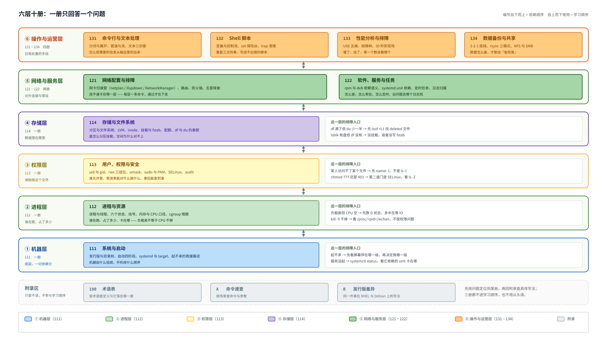

# Linux 全景图

> **这一册回答**：Linux 板块十册之间的层次关系，一张图看清。
> **怎么用**：看图定层，再回 [001-Linux全貌](001-Linux全貌.md) 按模块选册。

## 体系一张图

## 图例说明

| 元素 | 含义 | 落在哪册 |
| --- | --- | --- |
| 机器层 | 发行版、目录树、启动链、内核 | 111 |
| 进程层 | 进程/线程、信号、资源口径、cgroup | 112 |
| 权限层 | 用户组、rwx、sudo/PAM、SELinux、audit | 113 |
| 存储层 | 分区/文件系统、LVM、inode、配额 | 114 |
| 网络与服务层 | 网卡配置、防火墙、软件包、systemd、定时 | 121 / 122 |
| 操作与运营层 | 文本处理、Shell、性能排障、备份共享 | 131 ~ 134 |
| 附录区 | 术语表 / 命令速查 / 发行版差异 | 190 / A / B |

图自下而上是**依赖顺序**：上层问题常因下层而起（服务起不来先查启动、权限拒先查属主），排障自底向上取数，学习自顶向下使用。

---

**上一篇**：[002-排障方法论](002-排障方法论.md)　**下一篇**：进模块 [110-系统基座/111-系统与启动](110-系统基座/111-系统与启动.md)
