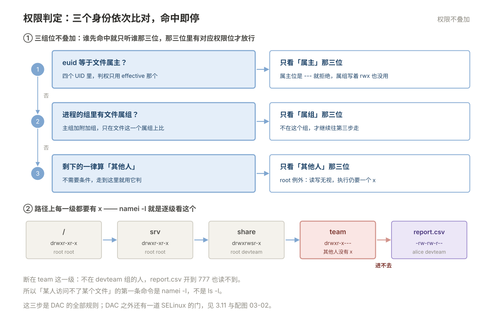
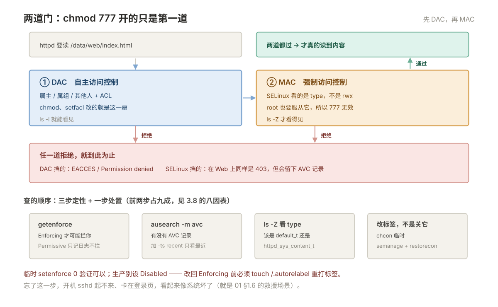

# 03 用户、权限与安全

> **这一册回答**：谁能登进来、进来之后能对什么做什么、事后能不能查到是谁做的。  
> **读完能做到**：看懂任意一个文件的权限并说清「谁能动它」；解释清楚「为什么 `chmod 777` 还是不行」；用 `sudo` 发放权限而不是发 root 密码；判断问题出在权限、SELinux 还是挂载；从 `auditd` 里查出谁删了文件。  
> **怎么读**：3.0 是知识点地图，标了每个点的**基础 / 进阶**。第一遍跳过带「进阶」的小节不影响主线。 不认识的词查 [00 术语表](00-术语表.md)。
> **不在这里**：SSH 怎么连、怎么传文件、跳板与端口转发 → 06；防火墙与端口 → 05；进程的资源限制 → 02。

---

## 3.0 本册知识点地图

复习时按这张表逐行自问「这个我能讲清吗」，讲不清的回对应节。**加粗的是面试和故障现场最常被问到的。**

| 知识点 | 层次 | 一句话要点 | 节 |
| --- | --- | --- | --- |
| **用户与组的存储** | 基础 | 三个文件：`passwd`（身份）、`shadow`（密码）、`group`（组） | 3.1 |
| UID 分段 | 基础 | 0 是 root，1–999 系统用户，1000 起是普通用户 | 3.1 |
| **目录的 rwx** | 基础 | `r` 列名字、`x` 进得去、`w` 能增删**目录里的条目** | 3.2 |
| **删除看目录不看文件** | 基础 | 能不能删一个文件，取决于它所在目录的 `w`，与文件自身权限无关 | 3.2 |
| `umask` | 基础 | 新建文件被扣掉的位；默认 022 得到 644 / 755 | 3.3 |
| **SUID / SGID / Sticky** | 基础 | `passwd` 靠 SUID、共享目录靠 SGID、`/tmp` 靠 Sticky | 3.4 |
| 大写 S / T | 进阶 | 出现大写说明对应的 `x` 位没设，配置是坏的 | 3.4 |
| **权限判定顺序** | 基础 | 属主 → 属组 → 其他人，命中即停，不会叠加 | 3.5 |
| 有效 UID | 进阶 | 程序实际用 `euid` 判权；`ps -o euid` 才看得出来 | 3.5 |
| root 的例外 | 基础 | root 能无视读写位，但执行仍需至少一个 `x` 位 | 3.5 |
| **ACL** | 基础 | 三元组之外单独授权；`+` 号是标记 | 3.6 |
| **ACL mask 陷阱** | 进阶 | `chmod` 会改 mask，把 ACL 的实际权限一起改小 | 3.6 |
| `chattr +i` | 进阶 | 连 root 都改不动，解铃还需 `-i` | 3.7 |
| **`chmod 777` 还不行** | 基础 | 八个原因，按表逐条排，别乱试 | 3.8 |
| **`sudo` 规则** | 基础 | `用户 主机=(以谁身份) 命令`；改完必须 `visudo -c` | 3.9 |
| PAM | 进阶 | 认证不只在 `sshd_config` 里；改错会把自己锁在外面 | 3.10 |
| **SELinux 三模式** | 基础 | `enforcing` / `permissive` / `disabled`；关掉再开需要重打标签 | 3.11 |
| SELinux 上下文 | 进阶 | 四段 `user:role:type:level`，真正起作用的是 `type` | 3.11 |
| `chcon` vs `semanage` | 进阶 | `chcon` 临时、重打标签就丢；`semanage` 才是永久的 | 3.11 |
| **`auditd` 查人** | 进阶 | `-w 文件 -p wa -k 键`，事后 `ausearch -k 键` | 3.13 |
| **SSH 加固四项** | 基础 | 禁 root 直登、禁密码、限定用户/来源、密钥权限 | 3.14 |
| 提权面自查 | 进阶 | SUID 清单、sudo 通配符、可写的 cron 与 PATH | 3.15 |

### 动手前：造一个可以随便折腾的靶子

这一册要反复改权限、改属主，别拿 `sshd` 或业务目录练。先建一个隔离目录和一个测试用户：

```bash
sudo useradd -m tester && echo 'tester:Test@1234' | sudo chpasswd
sudo mkdir -p /tmp/perm-lab && cd /tmp/perm-lab
sudo touch a.txt && sudo mkdir sub && sudo chmod 700 sub
ls -l /tmp/perm-lab
```

```plain
total 4
-rw-r--r-- 1 root root  0 Oct 29 14:20 a.txt
drwx------ 2 root root 12 Oct 29 14:20 sub
```

练习方式：`su - tester` 切到测试用户，去 `cat` / `rm` / `cd` 这些文件，**看它报什么错**——报错信息本身就是权限判定顺序的证据。练完 `sudo userdel -r tester && sudo rm -rf /tmp/perm-lab`。

占位符约定：`<user>` 换用户名，`<file>` / `<dir>` 换路径，`<svc>` 换服务名。

**⚠️ 本册有三类操作会把你关在门外**：改 `sudoers`、改 PAM 配置、改 `sshd_config`。动手前务必**保持一个已登录的 root 会话不关**，新开一个窗口验证成功后再关旧的。

---

## 3.1 用户与组：身份从哪来

### 三个文件

| 文件 | 存什么 | 能不能直接改 |
| --- | --- | --- |
| `/etc/passwd` | 用户名、UID、GID、家目录、登录 shell | 能，用 `vipw`（加锁，比 vim 安全） |
| `/etc/shadow` | 密码哈希、有效期、锁定状态 | 能，用 `vipw -s` 或 `passwd` 命令 |
| `/etc/group` | 组名、GID、附加成员 | 能，用 `vigr` / `gpasswd` |

```bash
grep '^deploy:' /etc/passwd
```

```plain
deploy:x:1001:1001:Deploy User:/home/deploy:/bin/bash
```

七个字段依次是：**用户名 : 密码占位 : UID : GID : 描述 : 家目录 : 登录 shell**。

`passwd` 里的 `x` 不是密码，是「密码在 `shadow` 里」的占位符。密码哈希只有 root 能读，这就是 `/etc/shadow` 权限必须是 `000` 或 `640` 的原因。

```bash
sudo grep '^deploy:' /etc/shadow
```

```plain
deploy:$6$xxxx$yyyy:19720:0:99999:7:::
```

九个字段：**用户名 : 哈希 : 最后修改日（从 1970 起的天数） : 最短可用天数 : 最长有效期 : 到期前警告天数 : 失效宽限 : 账号失效日 : 保留**。

> `$6$` 是 SHA-512，`$1$` 是 MD5（弱，该换），`$y$` 是 yescrypt（Ubuntu 22.04 新装默认）。看到 `!!` 或 `!` 开头表示**账号被锁定**，不是没有密码。

### UID 分段

| 范围 | 用途 | 说明 |
| --- | --- | --- |
| `0` | root | **UID 为 0 就是 root**，叫不叫 root 无所谓 |
| `1–999` | 系统用户 | 服务专用的低权限账号（nginx、mysql）。不用于登录 |
| `1000+` | 普通用户 | 新建用户默认从这里开始 |

```bash
awk -F: '$3>=1000 && $3<65534 {print $1, $3}' /etc/passwd    # 所有普通用户
awk -F: '$3==0 {print $1}' /etc/passwd                        # 谁有 root 权限
```

第二条命令值得定期跑——**多出来的 UID 0 账号就是后门**，这是入侵排查的第一步。

### 常用操作

```bash
# CentOS 7
useradd -m -s /bin/bash deploy          # 建用户（-m 建家目录）
passwd deploy                           # 设密码（交互）
usermod -aG wheel deploy                # 加入附加组，-a 必须带，否则会覆盖原组
userdel -r deploy                       # 删用户并删家目录

# Ubuntu 22.04
adduser deploy                          # 交互式，自动建家目录、设密码、设 shell
usermod -aG sudo deploy
deluser --remove-home deploy
```

> **`useradd` 与 `adduser` 不是一回事**。`useradd` 是底层命令，两个发行版都有，参数一致但**默认行为不同**：CentOS 7 默认建家目录，Ubuntu 的 `useradd` 默认**不建**（要加 `-m`）。`adduser` 在 Debian/Ubuntu 上是交互式脚本，在 RHEL 系上只是 `useradd` 的软链。跨发行版写脚本时一律用 `useradd` 并显式写全参数。
>
> **`usermod -G` 不加 `-a` 会清空原附加组**，把人从所有组里踢出来。这是最容易犯的一次性错误，养成 `-aG` 一起写的习惯。

### 账号生命周期

| 我要 | 命令 |
| --- | --- |
| 锁定账号（保留家目录） | `passwd -l <user>` 或 `usermod -L <user>` |
| 解锁 | `passwd -u <user>` |
| 强制下次登录改密码 | `passwd -e <user>` 或 `chage -d 0 <user>` |
| 看密码策略 | `chage -l <user>` |
| 设定 90 天过期 | `chage -M 90 <user>` |
| 看谁在线 | `w` / `who` |
| 看登录历史 | `last -n 20` |
| **看登录失败** | `lastb -n 20`（读 `/var/log/btmp`，需要 root） |
| 看某用户最近登录 | `lastlog -u <user>` |

```plain
$ chage -l deploy
Last password change                                    : Oct 29, 2026
Password expires                                        : Jan 27, 2027
Password inactive                                       : never
Account expires                                         : never
Minimum number of days between password change          : 0
Maximum number of days between password change          : 90
Number of days of warning before password expires       : 7
```

> ⚠️ `passwd -l` 只是在哈希前加 `!`，**用密钥登录仍然能进**。要彻底禁止登录，把 shell 改成 `/sbin/nologin`，或者 `usermod -e 1 <user>` 让账号过期。

---

## 3.2 文件权限：九个字符

上一节解决了「你是谁」。这一节解决「你能对文件做什么」——从 `ls -l` 的那九个字符开始。

```bash
ls -l /etc/passwd /etc/shadow /tmp /usr/bin/passwd
```

```plain
-rw-r--r--  1 root root   2841 Oct 20 09:12 /etc/passwd
----------. 1 root root   1503 Oct 20 09:12 /etc/shadow       ← 000，只有 root 能读
drwxrwxrwt 10 root root   4096 Oct 29 14:20 /tmp             ← t 是 Sticky bit
-rwsr-xr-x. 1 root root  27832 Jun 10  2014 /usr/bin/passwd   ← s 是 SUID
```

### 逐列读

| 位置 | 例子 | 含义 |
| --- | --- | --- |
| 1 | `-` / `d` / `l` | 类型：普通文件 / 目录 / 软链接 |
| 2–4 | `rwx` | 属主权限 |
| 5–7 | `r-x` | 属组权限 |
| 8–10 | `r-x` | 其他人权限 |
| 11 | `.` / `+` | `.` 有 SELinux 上下文；`+` 有 ACL（见 3.6） |
| 2 | `1` | 硬链接数。**目录的这个数 = 子目录数 + 2** |
| 3–4 | `root root` | 属主、属组 |
| 5 | `2841` | 大小（目录显示的是目录项本身的大小，不是内容总和） |

### rwx 对文件和目录是两套含义

这是最容易记混的地方，必须分开记：

| 位 | 对文件 | 对目录 |
| --- | --- | --- |
| `r` | 读内容（`cat`） | **列出里面有哪些名字**（`ls`） |
| `w` | 改内容（`echo >>`） | **增删改目录里的条目**（`touch`/`rm`/`mv`/改名） |
| `x` | 执行（脚本、二进制） | **进入并穿过**（`cd`、访问里面的文件） |

由此推出两条反直觉但极其重要的结论：

**1. 能不能删一个文件，看的是目录的 `w`，跟文件自己的权限无关。**

```bash
ls -l /tmp/perm-lab/a.txt          # -rw-r--r-- root root
rm /tmp/perm-lab/a.txt             # 如果 /tmp/perm-lab 对你有 w，就能删！
```

文件是 `444`（只读）也照样能删——`rm` 删的是**目录里的那个名字**，不是文件内容。反过来，目录没有 `w`，文件是 `777` 也删不掉。

**2. 目录没有 `x`，里面的文件权限再大也访问不到。**

```bash
chmod 744 sub          # 其他人变成 r--：有 r、无 x
ls sub                 # 能列出文件名（r 起作用）
cat sub/a.txt          # Permission denied —— 缺 x，进不去
```

`ls` 能成功是因为 `r` 允许读目录项；`cat` 失败是因为穿过目录需要 `x`。这两个位是分开的，很多人以为「能 ls 就能访问」是错的。

### 两种写法

```bash
chmod 755 file          # 数字法：r=4 w=2 x=1，三位相加
chmod u=rwx,go=rx file  # 符号法：u 属主 / g 属组 / o 其他人 / a 全部
chmod g+w,o-r file      # 增减
chmod -R 750 dir        # 递归
```

| 数字 | 权限 | 典型用途 |
| --- | --- | --- |
| `644` | `rw-r--r--` | 普通文件、配置文件的默认值 |
| `600` | `rw-------` | 私钥、`/etc/shadow`、含密码的配置 |
| `755` | `rwxr-xr-x` | 目录、可执行程序 |
| `700` | `rwx------` | 私有目录（`~/.ssh`） |
| `777` | `rwxrwxrwx` | **正常系统里不该出现**，见 3.8 |

> ⚠️ **`chmod -R 777` 是运维里最典型的错误操作**。它同时毁掉三件事：把私钥和配置暴露给所有用户；让可执行目录变成任何人可写（可以被替换成木马）；事后无法从权限上判断原本该是什么。已经执行了，恢复办法只有从备份/另一台同版本机器上同步权限：`rpm --setperms <包>`（CentOS）或 `dpkg --verify` 对照后修（Ubuntu）。
>
> **软链接的权限是假象**：`lrwxrwxrwx` 恒为 777，`chmod` 改不到它，实际生效的是**目标文件**的权限。

---

## 3.3 `umask`：新建文件的默认权限

已有文件靠 `chmod`，新建的文件权限从哪来？从 `umask`。

```bash
umask          # 022（普通用户和 root 常见值）
umask -S       # u=rwx,g=rx,o=rx（符号形式）
```

规则是**从基准值里扣掉**，不是直接设：

| 对象 | 基准值 | `umask 022` 之后 |
| --- | --- | --- |
| 普通文件 | `666` | `644` |
| 目录 | `777` | `755` |

文件基准是 `666` 而不是 `777`，因为新建的文件不带执行位（防止误把数据文件当程序跑）。

> **为什么不能简单相减**：`umask 027` 时 `666 - 027 = 639` 是错的，正确答案是 `640`。因为这是**按位与非**：`666 & ~027`。口算容易错，`umask 027; touch f; mkdir d; ls -ld f d` 验证一下最稳。

```bash
umask 027
touch f && mkdir d && ls -ld f d
```

```plain
-rw-r----- 1 deploy deploy 0 Oct 29 14:31 f
drwxr-x--- 2 deploy deploy 6 Oct 29 14:31 d
```

改永久值：写进 `/etc/profile` 或 `~/.bashrc`（影响登录 shell）；**对 systemd 服务不生效**，服务要在 unit 里写：

```ini
[Service]
UMask=0027
```

> 这也是 001 §1.8 那个陷阱的同款：**登录 shell 的设置管不到 systemd 起的服务**。判断服务真实生效的值，看 `systemctl show <svc> -p UMask`。

---

## 3.4 特殊权限：SUID、SGID、Sticky

九个位之外还有三个特殊位，占了 `x` 的位置。

| 位 | 数字 | 显示位置 | 作用 |
| --- | --- | --- | --- |
| SUID | `4000` | 属主的 `x` 变成 `s` | 执行时**以文件属主的身份**运行 |
| SGID | `2000` | 属组的 `x` 变成 `s`（文件） | 文件：以属组身份运行；**目录：新建文件继承目录的属组** |
| Sticky | `1000` | 其他人的 `x` 变成 `t` | 目录里**只有文件属主（或 root）能删** |

### SUID：`passwd` 为什么能改 `/etc/shadow`

```bash
ls -l /usr/bin/passwd
```

```plain
-rwsr-xr-x. 1 root root 27832 /usr/bin/passwd
```

普通用户执行 `passwd` 时，进程的**有效 UID 变成 0**（文件属主是 root），所以能写只有 root 能写的 `/etc/shadow`。程序内部再判断「你只能改自己的密码」。这就是 SUID 的全部机制——**借身份执行，靠程序自己约束范围**。

> SUID 是提权的主要入口之一：一个 SUID 程序如果有命令注入或参数没校验，就能拿到 root shell。所以 3.15 的自查清单第一项就是「列出所有 SUID 文件，逐个确认认识」。

### SGID 目录：共享目录的正确做法

团队共享目录的经典需求：所有人能读写，但新建文件的属组自动是团队组。

```bash
sudo mkdir /srv/share
sudo chgrp devteam /srv/share
sudo chmod 2775 /srv/share        # 2 就是 SGID
```

```plain
drwxrwsr-x 2 root devteam 6 Oct 29 14:35 /srv/share
```

效果：任何人在里面新建文件，属组自动是 `devteam`，不用每次手动 `chgrp`。配合 `umask 002`（让组有写权限），团队协作就顺了。

### Sticky：`/tmp` 为什么人人可写却删不掉别人的文件

```plain
drwxrwxrwt 10 root root 4096 /tmp
```

`/tmp` 是 `777`（所有人可写，否则没法用），但因为有 `t`，**你只能删自己的文件**。没有 Sticky 的 `777` 目录，任何用户都能删掉别人的文件。

```bash
chmod 1777 /srv/public      # 给共享目录加 Sticky
```

### 大写 `S` / `T` 是配置错误

```plain
-rwSr--r--   ← 大写 S：SUID 设了，但属主的 x 位没设
drwxrwxrwT   ← 大写 T：Sticky 设了，但其他人的 x 位没设
```

小写 `s`/`t` 表示「特殊位 + 有 `x`」，大写表示「特殊位 + 没有 `x`」。**SUID 程序没有 `x` 位根本不能执行，SUID 就失效了**；Sticky 目录没有 `x` 别人也进不去。看到大写就知道有人 `chmod` 时把位设漏了。

```bash
chmod u+s file        # 设 SUID（要确保本来就有 x）
chmod u-s file        # 去掉
chmod 4755 file       # 数字法，4 是 SUID
find / -perm -4000 -type f 2>/dev/null    # 找所有 SUID 文件
```

---

## 3.5 内核到底怎么判权限

前面几节讲了「权限怎么设」。这一节讲「怎么判」——判错的想象是绝大多数权限问题的根源。

### 判定顺序：命中即停

权限的判定过程一张图看清：



三条推论，每条都对应一个真实误解：

1. **不叠加**。属主位是 `---`（无权限），即使属组位是 `rwx` 也没用——第一步命中了，就直接按属主那三位判，结果是拒绝。
2. **只看一次属组**。文件只有一个属组，进程的「组」包含主组 + 所有附加组，命中任意一个就算。
3. **root 走另一条路**。root 无视读写检查（`444` 的文件也能写），但**执行仍然要求至少有一个 `x` 位**——所以 `chmod 000` 的程序 root 也跑不了。

验证这几条最直观的工具是 `namei`，它把路径上每一级的权限都列出来：

```bash
namei -l /srv/share/team/report.csv
```

```plain
f: /srv/share/team/report.csv
drwxr-xr-x root root /
drwxr-xr-x root root srv
drwxrwsr-x root devteam share
drwxr-x--- root devteam team          ← 关键在这行
-rw-rw-r-- alice devteam report.csv
```

一眼看出：`team` 目录对「其他人」没有 `x`，所以不在 `devteam` 组里的人，无论文件权限多大都访问不到。**排查「某人访问不了某个文件」，第一条命令就是 `namei -l`，不是 `ls -l`。**

### 有效 UID：程序实际用的是哪个身份

每个进程有四个 UID：

| UID | 含义 |
| --- | --- |
| real（ruid） | 谁启动的 |
| **effective（euid）** | **判权用的就是这个** |
| saved（suid） | 用于临时切换回来 |
| fs | 访问文件系统时用（极少用） |

```bash
ps -eo pid,euid,ruid,cmd | grep passwd
cat /proc/<pid>/status | grep '^Uid:'
```

```plain
Uid:	1001	0	0	1001
      real    euid  saved  fs
```

这行说明：进程是 `deploy`（1001）启动的，但因为 `/usr/bin/passwd` 有 SUID，**euid 变成了 0**，所以它能写 `/etc/shadow`。

`ps -o user=` 显示的也是 euid，不是 ruid——这就是为什么有时候「明明是普通用户起的进程，`ps` 里显示 root」。

### 以别人的身份验证

排查时最有效的办法是**站在对方的位置试一次**：

```bash
sudo -u tester test -r /srv/share/team/report.csv && echo 可读 || echo 不可读
sudo -u tester namei -l /srv/share/team/report.csv
```

比在那里推理「他应该能访问」快得多。

---

## 3.6 ACL：三元组不够用时

需求：`/srv/report` 只允许 `alice` 和 `bob` 读写，其他人只读。用 `chmod` 做不到——它只能表达「属主/属组/其他人」三档。这时用 ACL。

```bash
getfacl /srv/report
```

```plain
# file: srv/report
# owner: root
# group: root
user::rwx
group::r-x
other::r-x
```

加一条针对单个用户的规则：

```bash
setfacl -m u:alice:rwx /srv/report
setfacl -m u:bob:rwx /srv/report
getfacl /srv/report
```

```plain
# file: srv/report
# owner: root
# group: root
user::rwx
user:alice:rwx
user:bob:rwx
group::r-x
mask::rwx
other::r-x
```

注意两件事：`ls -l` 的权限位末尾多了一个 `+`（`drwxrwxr-x+`），并且 `getfacl` 里多了一行 **`mask::rwx`**。

### mask 是 ACL 的实际上限，而 `chmod` 会改它

这是 ACL 最容易踩的坑。**mask 决定了所有 ACL 条目（除属主和 other 外）能生效的最大权限**。`getfacl` 里看到的 `#effective` 才是真实生效值：

```plain
user:alice:rwx		#effective:r--    ← 写了 rwx，但 mask 只允许 r
mask::r--
```

而 `mask` **会被 `chmod` 顺手改掉**：`chmod g-w file` 实际改的就是 mask。所以典型事故是——ACL 配好了，过两天有人为了别的事跑了个 `chmod 644`，`alice` 的写权限就悄悄没了，而且 `ls -l` 看起来一切正常。

```bash
# 手动把 mask 设回 rwx（不动任何条目的值）
setfacl -m m::rwx /srv/report
getfacl /srv/report | grep -E 'mask|effective'
```

### 常用操作

| 我要 | 命令 |
| --- | --- |
| 给某用户授权 | `setfacl -m u:alice:rw <file>` |
| 给某组授权 | `setfacl -m g:dev:rx <dir>` |
| 递归 | `setfacl -R -m u:alice:rx <dir>` |
| 设默认 ACL（目录内新建文件自动继承） | `setfacl -d -m u:alice:rw <dir>` |
| 删除某条 | `setfacl -x u:alice <file>` |
| 清空所有 ACL | `setfacl -b <file>` |
| 备份/恢复 | `getfacl -R /dir > acl.bak`；`setfacl --restore=acl.bak` |
| 复制时保留 | `cp -a`（`cp -p` 不含全部 ACL 场景） |

> **默认 ACL 只对目录有效**，作用是「以后在这个目录里新建的东西自动带上这套规则」。做共享目录时这一条比 `-R` 更实用——`-R` 只管当下的文件，新文件会漏。

---

## 3.7 `chattr`：连 root 都改不动

`chmod` 管的是「谁能动」，`chattr` 管的是「能不能动」——它是文件系统层的属性，**root 也要先去掉属性才能改**。

| 属性 | 作用 | 典型用途 |
| --- | --- | --- |
| `i` | 不可修改：不能写、不能删、不能改名、不能建硬链接 | 保护关键配置、防误删 |
| `a` | 只能追加：可以 `>>`，不能覆盖、不能删 | 审计日志（写入方也无法篡改历史） |
| `A` | 不更新访问时间 | 减少小文件读操作的元数据写 |
| `e` | ext4 的 extent 标志，正常文件都有 | 不用管 |

```bash
sudo chattr +i /etc/resolv.conf
sudo echo "nameserver 8.8.8.8" >> /etc/resolv.conf
```

```plain
bash: /etc/resolv.conf: Operation not permitted
```

```bash
lsattr /etc/resolv.conf
```

```plain
----i---------e---- /etc/resolv.conf
```

`lsattr` 第二列出现 `i` 就是这个属性。**解除必须先 `chattr -i`**，直接 `chmod` 或 `sudo rm` 都没用，报错还都很模糊（`Operation not permitted`），极易误判成「权限配错了」。

> ⚠️ **别对日志目录用 `+a` 或 `+i`**。日志轮转需要改名和删除文件，加了 `+a` 之后 `logrotate` 会静默失败（它记自己的日志，不报错到 stdout），结果是**磁盘照常涨满，而你以为轮转在正常工作**。真要保护日志，用远程收集（rsyslog 转发）而不是本地锁死。
>
> 支持度：ext4 完整支持；XFS 支持 `+i` / `+a` 等常用项，但部分属性不支持；NFS、tmpfs 上基本无效。

---

## 3.8 `chmod 777` 之后还是不行

这是权限问题的「总收口」。前面六节各讲了一个侧面，这一节把它们排成一张按可能性排序的表。**遇到「权限明明给了却不行」，从上往下逐条排，不要乱试。** 之所以会「明明给了」，是因为权限不止一层——一个请求要连过两道门（图下半部把 MAC 那道门该查什么也列了出来）：



动手前先把这三样收齐，后面的判断全靠它们：

```bash
namei -l /path/to/file          # 路径上每一级的权限
getfacl /path/to/file           # 有没有 ACL、mask 是多少
lsattr /path/to/file            # 有没有 chattr 属性
```

| # | 原因 | 怎么确认 | 怎么修 |
| --- | --- | --- | --- |
| 1 | **某一级目录缺 `x`** | `namei -l` 逐级看，找到第一个没有 `x` 的 | 给那一级目录补 `x`（不是给文件） |
| 2 | **SELinux 拒绝** | `getenforce` 是 `Enforcing`；`ausearch -m avc -ts recent` 有记录 | 见 3.11，改上下文，**不是关 SELinux** |
| 3 | **ACL mask 被改小** | `getfacl` 里 `#effective` 比设定值小 | `setfacl -m m::rwx` |
| 4 | **`chattr +i`** | `lsattr` 第二列有 `i` | `chattr -i` |
| 5 | **文件系统只读或 `ro` 挂载** | `mount \| grep ' ro,'`；`touch /path/x` 报 Read-only | 查 `dmesg` 里的 IO 错误，修盘或重新挂载 |
| 6 | **NFS `root_squash`** | `mount \| grep nfs`；root 写失败但普通用户能写 | 改服务端 export 选项，或用对应用户操作 |
| 7 | **不是你以为的那个文件** | `readlink -f` 看软链真实指向；`findmnt -T /path` 看是哪个挂载点 | 改真实目标 |
| 8 | **容器/命名空间里改的** | `findmnt -T /path` 显示的挂载与宿主机不同 | 在正确的命名空间里改 |

排序依据很实际：**1 和 2 占九成**。所以流程永远是 `namei -l` → `getenforce` → 其余。

一个高频特例：Web 服务放静态文件到自定义目录后 403，`chmod 777` 无效——因为 SELinux 的 `type` 还是 `default_t`，httpd 不允许读。这正是原因 2，处置见 3.11。

---

## 3.9 `sudo`：不发 root 密码怎么给权限

前面讲的都是「文件允许谁动」。但日常运维需要的是「某个用户能执行某几条 root 命令」——直接给 root 密码不可审计、无法回收、无法限定范围。`sudo` 解决的就是这件事。

### 规则长什么样

```plain
用户  主机=(可切换的身份) 命令
```

```bash
sudo cat /etc/sudoers | grep -vE '^#|^$'
```

```plain
Defaults   !visiblepw
Defaults    always_set_home
Defaults    secure_path = /sbin:/bin:/usr/sbin:/usr/bin
root    ALL=(ALL)       ALL
%wheel  ALL=(ALL)       ALL          ← CentOS 7 默认有这一行（可能是注释状态）
```

| 写法 | 含义 |
| --- | --- |
| `deploy ALL=(ALL) ALL` | deploy 在任何主机上可以以任何身份执行任何命令 |
| `deploy ALL=(root) /usr/bin/systemctl restart nginx` | 只能重启 nginx |
| `%wheel ALL=(ALL) ALL` | wheel **组**的所有成员（`%` 表示组） |
| `deploy ALL=(ALL) NOPASSWD: ALL` | 免密码——**等于给了 root，只是名字不同** |
| `deploy ALL=(root) NOPASSWD: /usr/bin/systemctl restart nginx` | 自动化脚本常用，范围限定住就行 |

### 正确做法：写 drop-in，不动主文件

```bash
sudo visudo -f /etc/sudoers.d/deploy-ops
```

```plain
deploy ALL=(root) /usr/bin/systemctl restart nginx, /usr/bin/systemctl status nginx
deploy ALL=(root) /usr/bin/journalctl -u nginx
```

两条硬规矩：

1. **必须用 `visudo`**。它会在保存时做语法检查，语法错了拒绝写入。直接 `vim /etc/sudoers` 写错一个字符，**所有 sudo 全部失效**，包括 root 用 sudo——那时候只能靠 `pkexec`、单用户模式或另一个已登录的 root 会话救。
2. **`/etc/sudoers.d/` 下的文件名只要含 `.` 或以 `~` 结尾，就被静默跳过**，一个字符的报错都没有。所以 `deploy.conf`、`ops.conf.bak` **全都无效**——这条最坑，因为名字看起来完全正常，`visudo -c` 也会说语法没问题。要写成 `deploy-ops` 或 `99-deploy`（不带扩展名）。权限必须是 `0440`。

验证：

```bash
sudo visudo -c                        # 检查全部 sudoers 语法
sudo -l -U deploy                     # 看 deploy 到底有什么权限
sudo -u deploy -l                     # 以 deploy 身份看自己的权限
```

```plain
$ sudo -l -U deploy
User deploy may run the following commands on web-01:
    (root) /usr/bin/systemctl restart nginx, /usr/bin/systemctl status nginx
    (root) /usr/bin/journalctl -u nginx
```

### 常用姿势

| 我要 | 命令 | 说明 |
| --- | --- | --- |
| 以 root 执行一条 | `sudo <cmd>` | |
| 以别人身份执行 | `sudo -u www-data <cmd>` | 排查「他能不能访问」时最有用 |
| 拿 root 登录 shell | `sudo -i` | 加载 root 的完整环境（PATH、家目录） |
| 拿 root shell 但保留环境 | `sudo -s` | 环境还是你的，容易踩 PATH 的坑 |
| 换用户 | `su - deploy` | **`-` 必须带**，否则环境变量和 PATH 还是原用户的 |
| 看自己的权限 | `sudo -l` | |
| 让 sudo 重新问密码 | `sudo -k` | |

### 审计

`sudo` 的每次使用都有记录：

```bash
# CentOS 7
sudo grep sudo /var/log/secure | tail -5
# Ubuntu
sudo grep sudo /var/log/auth.log | tail -5
```

```plain
Oct 29 14:40:11 web-01 sudo:   deploy : TTY=pts/1 ; PWD=/home/deploy ; USER=root ; COMMAND=/usr/bin/systemctl restart nginx
```

记录里有**谁、从哪个终端、在哪个目录、切成谁、执行了什么**。这是「事后能查到是谁」的主要依据之一（另一个是 3.13 的 `auditd`）。

> ⚠️ **两个常见配置错误**：① 规则里用通配符 `ALL` 收尾（如 `/usr/bin/systemctl *`），看起来限定了命令，实际能通过 `systemctl` 的参数执行任意 unit 甚至任意命令；② 给了 `NOPASSWD: ALL`，等于免密 root。要限定就限定到具体参数，宁可多写几行。

---

## 3.10 PAM：认证其实在这里

`sudo` 解决「能做什么」，这一节解决「怎么证明你是你」。很多人以为改 `/etc/ssh/sshd_config` 就能控制登录行为，但**密码校验、账号锁定、家目录创建这些实际是 PAM 在做**。

### 它在哪

```bash
ls /etc/pam.d/ | head
```

```plain
chfn  chsh  login  passwd  remote  runuser  sshd  su  sudo  system-auth ...
```

| 发行版 | 关键文件 |
| --- | --- |
| CentOS 7 | `system-auth`（认证）、`password-auth`（改密码）、`sshd`、`sudo` |
| Ubuntu 22.04 | `common-auth`、`common-account`、`common-password`、`common-session` |

`sshd` 里的 `Include system-auth`（或 Ubuntu 的 `@include common-auth`）就是「把认证交给这套公共规则」的意思。

### 四个管理组

| 类型 | 管什么 | 典型模块 |
| --- | --- | --- |
| `auth` | 证明身份（密码、密钥、OTP） | `pam_unix`、`pam_faillock` |
| `account` | 账号是否可用（过期、时段、锁定） | `pam_nologin`、`pam_access` |
| `password` | 改密码时的规则 | `pam_pwquality`、`pam_unix` |
| `session` | 登录前后要做什么 | `pam_mkhomedir`、`pam_limits`、`pam_systemd` |

控制位决定流程怎么走：

| 控制位 | 失败时 |
| --- | --- |
| `required` | 记下失败，**继续走后面的模块**，最后统一拒绝 |
| `requisite` | **立刻拒绝**，不再往下走 |
| `sufficient` | 成功就**跳过剩下的同类型模块**，直接通过 |
| `optional` | 失败也不影响 |

### 两个实用场景

**场景一：连续登录失败锁定账号**

```plain
# CentOS 7：/etc/pam.d/system-auth 的 auth 段第一行加
auth        required      pam_tally2.so deny=5 unlock_time=300 even_deny_root
```

```bash
# 查看/解锁
pam_tally2 --user deploy
pam_tally2 --user deploy --reset
```

> **Ubuntu 22.04 一侧对应的是 `pam_faillock`**（默认没启用，要自己加进 `/etc/pam.d/common-auth`），查看和重置用：
> ```bash
> faillock --user deploy
> faillock --user deploy --reset
> ```
> 两套模块的参数不通用，照抄会失效（甚至因为模块不存在导致**所有登录失败**）。

**场景二：登录时自动建家目录**（LDAP/AD 用户常见）

```plain
session     required      pam_mkhomedir.so skel=/etc/skel umask=0022
```

### 改 PAM 前的保命三件事

⚠️ PAM 改错的表现是**所有认证方式同时失效**，包括 root 本地登录、`su`、`sudo`。锁在外面之后，控制台不在手边就只能进单用户模式（见 001 §1.6）。

1. **先备份**：`cp -a /etc/pam.d /root/pam.d.bak.$(date +%F)`
2. **保持一个已登录的 root 会话不关**，另开窗口测试
3. **测试顺序**：先 `su - tester` 测普通用户，再 `sudo -l` 测 sudo，最后才测 SSH

验证配置有没有把模块名写错，最快的办法是**先确认模块文件存在**：

```bash
ls /lib64/security/pam_tally2.so        # CentOS 7
ls /usr/lib/x86_64-linux-gnu/security/pam_faillock.so   # Ubuntu
```

文件不存在就说明这个模块在当前系统上不可用，写进配置只会让所有登录失败。

---

## 3.11 SELinux：权限全开还被拒的那一层

到这里权限体系已经讲完：用户身份（3.1）、普通权限（3.2–3.5）、ACL（3.6）、文件属性（3.7）、临时借权（3.9）、认证（3.10）。它们全都是**自主访问控制（DAC）**——由文件属主决定。SELinux 是另一层：**强制访问控制（MAC）**，由系统策略决定，**root 也要服从**。

这解释了那个经典现象：`chmod 777` 之后依然 `403`，`ls -l` 上权限全开，看不出任何问题。

### 三种模式

```bash
getenforce
```

```plain
Enforcing
```

| 模式 | 行为 | 用途 |
| --- | --- | --- |
| `Enforcing` | 拒绝并记日志 | 正常状态 |
| `Permissive` | **只记日志，不拒绝** | 排查「是不是 SELinux 的问题」，最有用 |
| `Disabled` | 完全关闭 | 不推荐 |

```bash
sudo setenforce 0        # 临时切 Permissive（重启失效）
sudo setenforce 1        # 切回 Enforcing
```

```bash
# 永久（需要重启）
grep '^SELINUX=' /etc/selinux/config
```

> ⚠️ **临时切到 `Permissive` 验证问题是对的，永久 `disabled` 是错的。** 关闭之后系统少了整整一层防护，而且在 `disabled` 状态下创建的文件**没有任何安全上下文**；再想开回 `Enforcing`，必须先全盘重打标签：
> ```bash
> sudo touch /.autorelabel     # 然后重启，重启过程会很久
> ```
> 忘了这一步，开机会卡在登录页、`sshd` 起不来，报一堆 `Permission denied`——看起来像系统坏了。这个场景和 001 §1.6 的救援是连着的。

### 上下文：真正起作用的是 `type`

```bash
ls -Z /var/www/html/index.html
```

```plain
-rw-r--r--. root root system_u:object_r:httpd_sys_content_t:s0 /var/www/html/index.html
```

四段 `user:role:type:level`：

| 段 | 例子 | 说明 |
| --- | --- | --- |
| user | `system_u` | SELinux 用户，不是 Linux 用户 |
| role | `object_r` | 文件都是 `object_r`，进程才有角色 |
| **type** | `httpd_sys_content_t` | **策略真正比对的就是它** |
| level | `s0` | MLS 层级，默认系统不用 |

进程也有上下文：

```bash
ps -eZ | grep httpd | head -3
```

```plain
system_u:system_r:httpd_t:s0   1024 ?  00:00:00 httpd
```

规则是「**`httpd_t` 这个域，只能读 `httpd_sys_content_t` 这类类型**」。你把文件放在 `/web`（类型 `default_t`），就算权限是 777，`httpd_t` 也读不了——不是权限不够，是**类型不在允许清单里**。

### 标准处置：三步

以「把网站根目录改到 `/web`」为例：

```bash
# 1. 告诉 SELinux 这个路径应该是什么类型（永久规则，写进策略库）
sudo semanage fcontext -a -t httpd_sys_content_t '/web(/.*)?'

# 2. 按规则给现有文件打标签
sudo restorecon -Rv /web

# 3. 验证
ls -Zd /web
```

```plain
drwxr-xr-x. root root system_u:object_r:httpd_sys_content_t:s0 /web
```

`chcon` 也能改，但**它是临时的**：只改当前 inode 的标签，一旦 `restorecon` 或任何重打标签的操作（包升级、`fixfiles relabel`）就会还原。**永久生效必须用 `semanage fcontext`。**

| 我要 | 命令 | 是否永久 |
| --- | --- | --- |
| 临时改标签 | `chcon -t httpd_sys_content_t /web` | ❌ 会被还原 |
| 永久改路径规则 | `semanage fcontext -a -t <type> '/path(/.*)?'` | ✅ |
| 按规则重打标签 | `restorecon -Rv /path` | — |
| 看某路径的规则 | `semanage fcontext -l \| grep /web` | — |
| 删掉自定义规则 | `semanage fcontext -d '/web(/.*)?'` | ✅ |

### 布尔开关：不写策略就能开的权限

很多常见需求（让 httpd 连数据库、让 httpd 发网络请求）不需要写策略，改个开关就行：

```bash
getsebool -a | grep httpd | grep off
```

```plain
httpd_can_network_connect --> off
httpd_can_network_connect_db --> off
```

```bash
sudo setsebool -P httpd_can_network_connect on     # -P 才是永久
```

不加 `-P` 重启就还原。这也是一个高频错误。

### 排错：拒绝记录在哪

```bash
sudo ausearch -m avc -ts recent
```

```plain
type=AVC msg=audit(1761720000.123:456): avc:  denied  { read } for  pid=2048 comm="httpd"
  name="index.html" dev="sda1" ino=131
  scontext=system_u:system_r:httpd_t:s0
  tcontext=system_u:object_r:default_t:s0 tclass=file permissive=0
```

读这条记录只需看四个东西：

| 看什么 | 例子 | 含义 |
| --- | --- | --- |
| `denied { read }` | `read` / `write` / `name_bind` | 被拒的动作 |
| `comm` | `httpd` | 谁被拒 |
| `tcontext` | `default_t` | **目标该是什么类型，就是问题所在** |
| `tclass` | `file` / `dir` / `tcp_socket` | 对象类别，决定用哪种处置 |

装 `setroubleshoot-server` 后可以用 `sealert -a /var/log/audit/audit.log` 拿到人话建议（CentOS 7 默认装；Ubuntu 没有 SELinux）。

> **端口不在允许范围**也是同一类问题：改 httpd 监听 8080，会报 `name_bind` 被拒。处置是把端口加进策略，而不是关 SELinux：
> ```bash
> sudo semanage port -a -t http_port_t -p tcp 8080
> ```

---

## 3.12 AppArmor：Ubuntu 侧的那一层

SELinux 主要在 RHEL 系。Ubuntu 22.04 默认用的是 **AppArmor**——同样是强制访问控制，思路不同：SELinux 按**标签类型**，AppArmor 按**路径**写规则文件。

```bash
sudo aa-status
```

```plain
apparmor module is loaded.
28 profiles are loaded.
25 profiles are in enforce mode.
3 profiles are in complain mode.
```

| 概念 | 说明 |
| --- | --- |
| profile | 一个程序的行为白名单，文件在 `/etc/apparmor.d/`，如 `usr.sbin.nginx` |
| enforce 模式 | 违规就拒绝并记日志 |
| complain 模式 | **只记日志不拒绝**——等同于 SELinux 的 `Permissive`，排查时用 |

```bash
sudo aa-complain /etc/apparmor.d/usr.sbin.nginx     # 切到只记录
sudo aa-enforce /etc/apparmor.d/usr.sbin.nginx      # 切回强制
sudo apparmor_parser -r /etc/apparmor.d/usr.sbin.nginx   # 改完规则重载
```

拒绝日志在 `dmesg` 或 `journalctl -k` 里：

```bash
sudo dmesg | grep -i 'apparmor.*DENIED' | tail -5
```

> **和 SELinux 的对应关系**记住三行就够：`getenforce` ↔ `aa-status`；`setenforce 0` ↔ `aa-complain`；`semanage fcontext` ↔ 改 `/etc/apparmor.d/` 下的 profile。**两者互斥**，一台机器上不会同时是主要的那层。

---

## 3.13 `auditd`：事后查是谁干的

前面所有内容都是「事前管住」。这一节是「事后查证」——权限被绕过了、文件被删了、账号被加了，怎么找出是谁。

### 先确认它在跑

```bash
systemctl is-active auditd
sudo auditctl -s | head -5
```

```plain
enabled 1
failure 1
pid 812
rate_limit 0
```

`enabled 1` 表示审计开启。RHEL 系默认装了并启用；Ubuntu 需要 `apt install auditd`。

### 加规则

```bash
# 监控 /etc/passwd 的写入和属性变更
sudo auditctl -w /etc/passwd -p wa -k passwd_change

# 记录所有删除和重命名（不带 -F dir=，老内核也支持）
sudo auditctl -a always,exit -F arch=b64 -F auid>=1000 -F auid!=4294967295 \
  -S unlink,unlinkat,rename -k file_delete

# 查看当前规则
sudo auditctl -l
```

| 参数 | 含义 |
| --- | --- |
| `-w <路径>` | 监控这个路径 |
| `-p wa` | 权限：`r` 读、`w` 写、`x` 执行、`a` 改属性。查改动用 `wa` |
| `-k <键>` | 给规则起名，事后按这个名字查——**不加 `-k` 事后很难捞** |
| `-a always,exit` | 在系统调用返回时记录（追删除/重命名这类没有固定路径的操作要用这个） |

⚠️ `auditctl` 加的规则**重启就没了**。永久规则写在 `/etc/audit/rules.d/audit.rules`，然后：

```bash
sudo augenrules --load
sudo systemctl restart auditd
sudo auditctl -l | wc -l        # 确认条数
```

### 查

```bash
sudo ausearch -k passwd_change -i
```

```plain
type=SYSCALL msg=audit(10/29/2026 14:52:03.114:789) : arch=x86_64 syscall=openat
  success=yes exit=3 a0=0xffffff9c a1=0x7ffd... 
  uid=deploy gid=deploy euid=root ... comm="vim" exe="/usr/bin/vim"
  key=passwd_change
type=PATH msg=audit(...) : item=0 name="/etc/passwd" inode=131 nametype=CREATE
```

一次操作会有两条记录：`SYSCALL` 说**是谁**（`uid`、`comm`、`exe`），`PATH` 说**动了什么**（`name`、`nametype`）。两个时间点之间发生的所有动作，靠同一个 `msg=audit(时间:序号)` 串起来。

| 我要查 | 命令 |
| --- | --- |
| 按规则名查 | `ausearch -k <键> -i` |
| 查最近 10 分钟 | `ausearch -ts recent -i` |
| 查某个时间段 | `ausearch -ts 10/29/2026 14:00 -te 10/29/2026 15:00 -i` |
| 查某个用户 | `ausearch -ua <user>` （`-ua` 按 uid 或名字） |
| 查所有失败 | `ausearch -m USER_AUTH,USER_LOGIN --success no -i` |
| 汇总报告 | `aureport --auth` / `aureport --failed` / `aureport -k` |
| 查谁登录过 | `aureport --login -i` |

```plain
$ sudo aureport --auth | tail -5
   12. 10/29/2026 14:38:02 deploy sudo yes 2 0
   13. 10/29/2026 14:45:11 unknown ssh no 12 0    ← 12 次失败，值得追
```

### 一个真实的排查顺序

「`/etc/passwd` 里多了一个 UID 0 的账号」：

```bash
awk -F: '$3==0 {print $1}' /etc/passwd          # 1. 确认多了谁
sudo grep -E 'passwd|useradd' /var/log/secure | tail   # 2. 有没有 sudo 记录
sudo ausearch -k passwd_change -i | grep -A2 comm=      # 3. auditd 里谁改的
sudo last -n 20                                        # 4. 那个时间谁登录了
```

四步能定位到「哪个账号、在哪个时间段、用什么程序改的」。**这就是 `auditd` 存在的意义**——`/var/log/secure` 只记录认证和 sudo，直接的 `vi /etc/passwd` 它看不到，`auditd` 看得到。

> ⚠️ 审计日志本身是证据，要保护：`chattr +a /var/log/audit/audit.log`（只追加，写入方也删不掉），或者用 `audisp-remote` 实时转发到另一台机器。**只在本地留一份，入侵害者第一件事就是删它**。
>
> 注意 `chattr +a` 会让日志轮转失败（见 3.7 的警告），所以审计日志的轮转要用 `auditd` 自己的 `max_log_file` / `num_logs` 配置，不要交给 `logrotate`。

---

## 3.14 SSH 加固：谁能连、怎么连

这一节只管一件事：**把入口收紧**。怎么连、怎么传文件、跳板与端口转发在 06，不在这里重复。

### 四项核心配置

```bash
sudo cp /etc/ssh/sshd_config /etc/ssh/sshd_config.bak   # ⚠️ 必须先备份
sudo vi /etc/ssh/sshd_config
```

```plain
PermitRootLogin no                 # 禁止 root 直接登录
PasswordAuthentication no          # 只允许密钥
PubkeyAuthentication yes
MaxAuthTries 3                     # 只给三次机会
LoginGraceTime 30                  # 30 秒内完成认证
AllowGroups sshusers               # 只有这个组能连（比 AllowUsers 好维护）
ClientAliveInterval 300            # 5 分钟无响应就断，回收僵死会话
ClientAliveCountMax 2
UsePAM yes                         # 保留 PAM 认证链（见 3.10）
```

| 配置 | 说明 | 注意 |
| --- | --- | --- |
| `PermitRootLogin` | `no` 最安全；`prohibit-password` 允许 root 用密钥 | **改之前先确认你有 sudo 账号能上去** |
| `PasswordAuthentication` | 关掉之前**必须先确认密钥能登** | 关错了就彻底进不去 |
| `AllowGroups` / `AllowUsers` | 白名单，其余一律拒绝 | 比 `DenyUsers` 可靠（默认拒绝优于默认放行） |
| `MaxAuthTries` | 超过就断连 | 配合 3.10 的失败锁定 |
| `Match` 块 | 对某组/某地址单独放宽 | 放在文件**末尾**，其后的配置都属于这个块 |

按来源区别对待（运维网段允许密码，其他只允许密钥）：

```plain
Match Address 10.0.0.0/8
    PasswordAuthentication yes

Match all
    PasswordAuthentication no
```

### 改完必须验证，别直接重启

```bash
sudo sshd -t && echo "语法 OK"          # 只检查语法
sudo sshd -T | grep -E 'permitrootlogin|passwordauthentication|allowgroups'   # 看实际生效值
```

`sshd -t` 通过只说明语法对，**逻辑错（比如把你自己排除在白名单外）它检查不出来**。所以：

1. **保持当前 SSH 会话不关**（这是你的救生索）；
2. 另开一个终端，用目标账号**新连一次**；
3. 连上了再 `sudo systemctl reload sshd`；
4. 确认新连接正常，才关旧会话。

```bash
# CentOS 7
sudo systemctl reload sshd
# Ubuntu 22.04（服务名是 ssh，不是 sshd）
sudo systemctl reload ssh
```

### 密钥的权限要求

`sshd` 默认 `StrictModes yes`，只要密钥文件的权限「太开放」就**直接拒绝使用**，而且日志只说 `Authentication refused: bad ownership or modes`，看起来像密钥错了：

```bash
chmod 700 ~/.ssh
chmod 600 ~/.ssh/authorized_keys
chmod 600 ~/.ssh/id_rsa            # 私钥绝不能是 644
chmod 644 ~/.ssh/id_rsa.pub
```

家目录本身也不能是组或其他可写：

```bash
ls -ld ~        # 应该是 drwx------ 或 drwxr-xr-x，不能有 g+w / o+w
chmod g-w,o-w ~
```

### 在 `authorized_keys` 里进一步收窄

一行公钥前面可以加限制，比在 `sshd_config` 里写一堆 `Match` 更精确：

```plain
from="10.0.0.0/8",no-port-forwarding,no-pty,command="/usr/local/bin/backup.sh" ssh-rsa AAAA... backup@host
```

| 选项 | 作用 |
| --- | --- |
| `from=` | 只允许这些来源 IP |
| `command=` | 强制只执行这个命令（**这把钥匙只能干一件事**） |
| `no-port-forwarding` | 禁止端口转发（防隧道） |
| `no-pty` | 不给交互终端 |
| `expiry-time="20261231"` | 到期失效（OpenSSH 7.2+） |

### 验证清点

```bash
sudo sshd -T | grep -E 'permitrootlogin|passwordauthentication|allowgroups|maxauthtries'
sudo grep -c '' /root/.ssh/authorized_keys 2>/dev/null    # root 有没有残留密钥
sudo awk -F: '$7!~/(nologin|false)$/ {print $1, $7}' /etc/passwd   # 谁能登录
sudo lastb -n 20                                          # 暴力破解痕迹
```

最后一条经常被忽略：`lastb` 里如果有一堆来自陌生 IP 的失败记录，说明 22 端口暴露在公网，先看 05 的防火墙，再考虑换端口或上 fail2ban。

---

## 3.15 提权面自查

上面讲的是「怎么配」。这一节是从攻击者视角反过来检查：**这台机器上有哪些口子能让普通用户变成 root**。防守方的价值在于定期跑一遍、逐个确认认识。

### 六项清单

| # | 检查什么 | 命令 | 危险信号 |
| --- | --- | --- | --- |
| 1 | 多余的 UID 0 账号 | `awk -F: '$3==0 {print $1}' /etc/passwd` | 出现不认识的账号 |
| 2 | SUID 程序 | `find / -xdev -perm -4000 -type f 2>/dev/null` | 出现 `nmap`、`vim`、`find`、`bash` 这类**不该有 SUID 的** |
| 3 | 可写的系统目录 | `find / -xdev -type d -perm -0002 2>/dev/null` | `/etc`、`/usr/bin`、`/usr/local/bin` 可写 |
| 4 | sudo 通配符 | `sudo -l` 逐个看 | `(ALL) NOPASSWD: ALL`；`/usr/bin/systemctl *` 这类带星的 |
| 5 | 可写的 cron / systemd | `ls -l /etc/cron* /etc/systemd/system` | 普通用户可写的脚本，且被 root 定时执行 |
| 6 | 密钥与历史 | `ls -l /root/.ssh /home/*/.ssh`；`cat ~/.bash_history` | 私钥是 644；命令历史里有明文密码 |

```bash
# 一次性跑完前四项
sudo bash -c '
echo "== UID 0 ==";      awk -F: "\$3==0 {print \$1}" /etc/passwd
echo "== SUID ==";       find / -xdev -perm -4000 -type f 2>/dev/null
echo "== 可写目录 ==";    find / -xdev -type d -perm -0002 2>/dev/null | grep -vE "^/tmp|^/var/tmp|^/dev/shm"
'
```

### 为什么带 `-xdev`

`find /` 会跨进 `/proc`、`/sys` 和所有挂载的网络盘、容器卷，慢到跑不完，还会被 `/proc` 的假文件干扰。`-xdev` 让它**只留在根文件系统**，速度差几个数量级，结果也更有意义。

### 通配符 sudo 为什么危险

```plain
deploy ALL=(root) /usr/bin/systemctl *
```

看起来只放开了 `systemctl`，实际上：

```bash
sudo systemctl link /tmp/evil.service     # 把任意 unit 链进系统
sudo systemctl edit --force nginx         # 改 unit 内容，加 ExecStartPre
```

`systemctl` 本身就能执行任意命令，所以这行等于给了 root。**限定 sudo 规则必须限定到具体参数**——`*` 结尾基本等于全放。

### 发现之后的处置顺序

1. 先**记录**（截图/存档命令输出），再动手改——很多事故是「清理时把证据删了」；
2. 确认这个口子是**怎么来的**（包自带的？有人手工加的？），来源不清时按入侵处理；
3. 按 3.9 / 3.4 的正确做法收窄，不要图快直接 `chmod -s` 了事（可能弄坏正常功能）；
4. 复查 `last`、`/var/log/secure`、3.13 的 `ausearch`，确认没有被利用过。

---

## 3.16 本册排错路径

```plain
访问不了 / 权限有问题
├─ 某用户读不了某文件 ──→ 3.5：namei -l 逐级看，先找缺 x 的目录
├─ chmod 777 也没用 ───→ 3.8 八条表：1 目录缺 x → 2 SELinux → 3 ACL mask → …
│                          ├─ getenforce 是 Enforcing → 3.11（不是关掉它）
│                          └─ getfacl 有 #effective → 3.6（mask 被 chmod 改小）
├─ 改完过几天又不行了 ──→ 3.6 的 mask / 3.11 用了 chcon（都会被覆盖）
├─ 连 root 都改不动 ────→ 3.7：lsattr 看有没有 i
├─ 服务读不到自己的文件 → 3.11：SELinux 类型；3.12：AppArmor profile
├─ 需要给某人几条 root 命令 → 3.9：sudoers.d + visudo -c
├─ 登录被拒但密码没错 ──→ 3.10：PAM 锁定（pam_tally2 / faillock）
├─ 想知道是谁改的 ──────→ 3.13：auditd 规则 + ausearch
├─ 收窄入口 ────────────→ 3.14：四项配置 + sshd -t + 新窗口验证
└─ 定期体检 ────────────→ 3.15：六项清单
```

> 端口不通、防火墙拦截在 05；SSH 连不上但配置没错（网络层）也在 05；服务起不来先看 06 的日志。

---

## 3.17 自测

**1. 一个文件的权限是 `444`，为什么还能被 `rm` 删掉？**
`rm` 删的是**目录里的目录项**，判定用的是文件所在目录的 `w` 位，与文件自身权限无关。文件是 `444` 只说明内容不能改。

**2. 目录权限 `744`（`rwxr--r--`），别人能 `ls` 却不能 `cat` 里面的文件，为什么？**
`ls` 只需要目录的 `r`（列出名字），`cat` 需要穿过目录的 `x`（访问 inode）。`744` 的「其他人」有 `r` 无 `x`，所以能看名字不能访问。

**3. `ls -l` 显示 `-rwSr--r--`，大写 S 说明什么？**
SUID 设了但属主的 `x` 位没设。SUID 程序没有执行位就无法执行，特殊位形同失效。修法是 `chmod u+x`（小写 `s` 表示特殊位与 `x` 同时存在）。

**4. 同一个文件，属主位是 `---`、属组位是 `rwx`，属主本人能读写吗？**
不能。判定顺序是属主 → 属组 → 其他人，**命中即停**。属主的 UID 匹配后直接按属主那三位判，结果是拒绝，不会再去叠加属组的权限。

**5. 给 `alice` 配了 ACL `rwx`，第二天她说不能写了，`ls -l` 看起来正常，怎么回事？**
有人跑了 `chmod`，把 ACL 的 `mask` 改小了。`getfacl` 里 `#effective` 会显示真实生效值。用 `setfacl -m m::rwx` 修回 mask。

**6. 根目录下新建 `/web` 放网站，权限 777，httpd 仍然 403，最可能是什么？**
SELinux。`/web` 的类型是 `default_t`，`httpd_t` 域不允许读。用 `semanage fcontext -a -t httpd_sys_content_t '/web(/.*)?'` 加规则，再 `restorecon -Rv /web`。用 `chcon` 改的会被下次重打标签还原。

**7. 把 SELinux 从 `disabled` 改回 `enforcing`，重启后登录不了，为什么？**
`disabled` 期间创建的文件没有安全上下文。改回来之前必须先 `touch /.autorelabel` 让系统在下次启动时全盘重打标签，否则大量服务因 `Permission denied` 起不来。

**8. 在 `/etc/sudoers.d/` 下建了 `ops.conf`，内容写得对，`visudo -c` 也通过，但用户就是没拿到权限，为什么？**
因为文件名含 `.`，被 `#includedir` **直接跳过、从未解析**。改成 `ops` 或 `99-ops`（不带扩展名）即可。注意 `visudo -c` 只校验语法，它不会告诉你「这个文件压根不会被读」——所以「检查通过」和「规则生效」是两件事。备份也别往这个目录里放，扔到 `/root/`。

**9. 改了 PAM 的 `pam_tally2` 配置后，所有账号（含 root）都登不上，怎么救？**
`pam_tally2` 在 Ubuntu 22.04 上已不是默认模块，写了不存在的模块会让认证链整体失败。救法：控制台进单用户/rescue 模式（001 §1.6），把 `/etc/pam.d` 从备份恢复。预防手段是改前备份 + 保持一个 root 会话不关。

**10. 关掉 `PasswordAuthentication` 后连不上，但密钥是对的，日志说 `Authentication refused: bad ownership or modes`，为什么？**
`StrictModes yes` 会检查密钥文件权限。`~/.ssh` 必须是 `700`，`authorized_keys` 必须是 `600`，家目录不能对组/其他人可写。权限太开放时 `sshd` 直接拒绝使用这把钥匙，报错看起来像密钥错了。

**11. 想知道 `/etc/passwd` 是谁改的，`/var/log/secure` 里查不到，怎么办？**
`secure` 只记录认证和 sudo，直接 `vi /etc/passwd` 它看不到。要用 `auditd`：先加规则 `auditctl -w /etc/passwd -p wa -k passwd_change`，之后用 `ausearch -k passwd_change -i` 查。规则本身要写进 `/etc/audit/rules.d/` 才能持久。

---

## 3.18 命令索引

知道要做什么、忘了敲什么时查这里。原理回对应节。

| 我想… | 命令 | 节 |
| --- | --- | --- |
| 看所有普通用户 | `awk -F: '$3>=1000 && $3<65534 {print $1}' /etc/passwd` | 3.1 |
| 查有没有多余的 root | `awk -F: '$3==0 {print $1}' /etc/passwd` | 3.1 |
| 建用户（跨发行版通用） | `useradd -m -s /bin/bash <user>` | 3.1 |
| 加进附加组（不覆盖原有） | `usermod -aG <group> <user>` | 3.1 |
| 锁定 / 解锁账号 | `passwd -l <user>` / `passwd -u <user>` | 3.1 |
| 强制下次登录改密码 | `passwd -e <user>` | 3.1 |
| 看密码策略 | `chage -l <user>` | 3.1 |
| 看谁在线 / 登录历史 | `w` / `last -n 20` | 3.1 |
| 看登录失败记录 | `lastb -n 20` | 3.1 |
| 改权限 | `chmod 755 <file>`；`chmod u+s <file>` | 3.2 |
| 改属主属组 | `chown user:group <file>`；`chown -R` | 3.2 |
| 看路径上每一级的权限 | `namei -l /path/to/file` | 3.5 |
| 看新建文件的默认权限 | `umask`；`umask 027` | 3.3 |
| 找所有 SUID 程序 | `find / -xdev -perm -4000 -type f 2>/dev/null` | 3.4 |
| 设共享目录（SGID + Sticky） | `chmod 2775 <dir>`；`chmod 1777 <dir>` | 3.4 |
| 看 ACL | `getfacl <file>` | 3.6 |
| 加 ACL | `setfacl -m u:<user>:rw <file>` | 3.6 |
| 修 ACL 的 mask | `setfacl -m m::rwx <file>` | 3.6 |
| 目录默认 ACL | `setfacl -d -m u:<user>:rw <dir>` | 3.6 |
| 看/去文件属性 | `lsattr <file>`；`chattr +i` / `-i` | 3.7 |
| 以别人身份验证访问 | `sudo -u <user> test -r <file>` | 3.5 |
| 给某人几条 root 命令 | `visudo -f /etc/sudoers.d/<name>` | 3.9 |
| 检查 sudoers 语法 | `visudo -c` | 3.9 |
| 看某人有什么 sudo 权限 | `sudo -l -U <user>` | 3.9 |
| 看 sudo 使用记录 | `grep sudo /var/log/secure`（Ubuntu: `auth.log`） | 3.9 |
| 看 SELinux 模式 | `getenforce`；`setenforce 0/1` | 3.11 |
| 看文件的安全上下文 | `ls -Z <file>`；`ps -eZ` | 3.11 |
| 永久改路径类型 | `semanage fcontext -a -t <type> '/path(/.*)?'` + `restorecon -Rv` | 3.11 |
| 看/改布尔开关 | `getsebool -a`；`setsebool -P <bool> on` | 3.11 |
| 查 SELinux 拒绝 | `ausearch -m avc -ts recent` | 3.11 |
| 放行自定义端口 | `semanage port -a -t http_port_t -p tcp 8080` | 3.11 |
| 看 AppArmor 状态 | `aa-status` | 3.12 |
| 切 AppArmor 到只记录 | `aa-complain <profile>` | 3.12 |
| 加审计规则 | `auditctl -w <file> -p wa -k <key>` | 3.13 |
| 按规则名查审计 | `ausearch -k <key> -i` | 3.13 |
| 看认证失败汇总 | `aureport --auth` | 3.13 |
| 检查 sshd 配置 | `sshd -t`；`sshd -T \| grep -i permitroot` | 3.14 |
| 修密钥权限 | `chmod 700 ~/.ssh; chmod 600 ~/.ssh/authorized_keys` | 3.14 |
| 提权面体检 | 见 3.15 的六项清单 | 3.15 |

---

**上一篇**：[002-进程与资源](002-进程与资源.md)　**下一篇**：[004-存储与文件系统](004-存储与文件系统.md)
