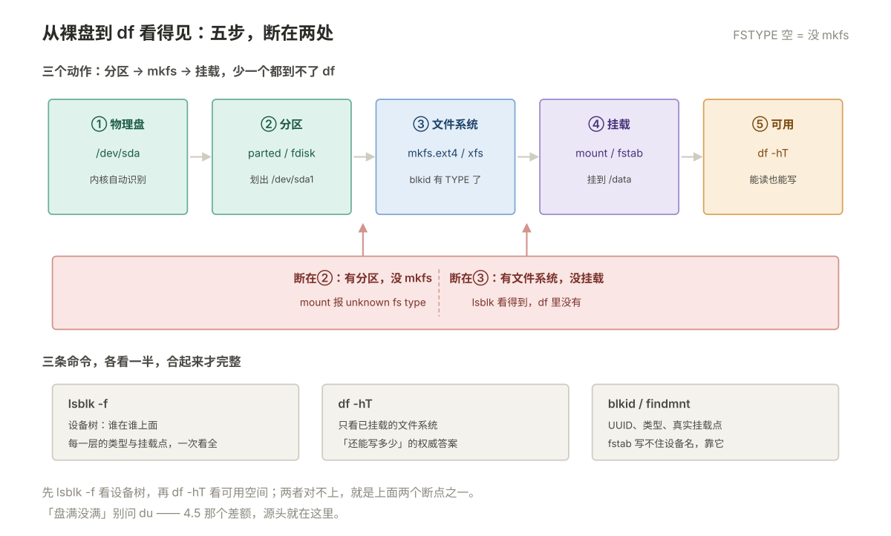
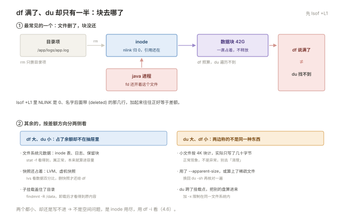

# 04 存储与文件系统

> **解决**：一块盘怎么变成能写文件的目录，空间为什么对不上，不够了怎么在不丢数据的前提下扩，坏了怎么判断。  
> **范围**：认清三层 · 分区表 · 文件系统 · 挂载 · 空间去哪了  
> **口径**：正文以 CentOS 7 / Ubuntu 22.04 / Rocky 9 举例；命令、路径与发行版差异在节内注记，不绑定单一版本。  
> **更新**：2026-11-06  
> **读完能做到**：用三条命令看清任意机器的存储布局；给新盘分区、格式化、挂载并写进 `fstab` 而不把机器搞挂；解释清楚「`df` 满了但 `du` 算不出那么多」并定位到具体文件；在线扩容不停业务；判断一块盘是不是该换了。  
> **怎么读**：4.0 是知识点地图，标了每个点的**基础 / 进阶**。第一遍跳过带「进阶」的小节不影响主线。 不认识的词查 [00 术语表](00-术语表.md)。  
> **不在这里**：进程打开着文件导致空间不释放的机制 → 002 §2.7；磁盘 IO 高把负载顶起来 → 09；备份策略、快照规划、NFS/SMB 共享 → 10；文件权限 → 03。

---

## 目录

| 节 | 内容 |
|---|---|
| 4.0 | 本册知识点地图 |
| 4.1 | 认清三层：盘、分区、文件系统 |
| 4.2 | 分区表：MBR 还是 GPT |
| 4.3 | 文件系统：ext4 与 xfs |
| 4.4 | 挂载：`mount` 与 `fstab` |
| 4.5 | 空间去哪了：`df` 与 `du` 对不上 |
| 4.6 | inode 用尽：还有空间，但写不进 |
| 4.7 | LVM 与在线扩容 |
| 4.8 | RAID：坏一块还能跑 |
| 4.9 | swap：磁盘上的内存缓冲 |
| 4.10 | 配额：防止某个人写满（进阶） |
| 4.11 | 性能：怎么测、怎么读 |
| 4.12 | 坏盘：什么时候该换 |
| 4.13 | 本册排错路径 |
| 4.14 | 自测 |
| 4.15 | 命令索引 |

---

## 4.0 本册知识点地图

复习时按这张表逐行自问「这个我能讲清吗」，讲不清的回对应节。**加粗的是故障现场最常撞上的。**

| 知识点 | 层次 | 一句话要点 | 节 |
| --- | --- | --- | --- |
| **盘 / 分区 / 文件系统三层** | 基础 | 三样东西都叫「磁盘」，但分别由 `lsblk`、`parted`、`mkfs` 管 | 4.1 |
| **三个视角不重合** | 基础 | `lsblk` 看设备树、`df` 只看已挂载、`blkid` 看 UUID | 4.1 |
| **MBR vs GPT** | 基础 | MBR 卡在 4 个主分区与 2 TiB；GPT 128 个分区、无容量上限 | 4.2 |
| 分区对齐 | 进阶 | 起始扇区按 1 MiB 对齐，否则跨块写放大 | 4.2 |
| **ext4 vs xfs** | 基础 | xfs 不能缩、扩容工具不同、修复工具不同 | 4.3 |
| **重建文件系统会换 UUID** | 基础 | `mkfs` 之后 UUID 变了，`fstab` 里写 UUID 的必须跟着改 | 4.3 |
| **`fstab` 六字段** | 基础 | 设备 · 挂载点 · 类型 · 选项 · dump · pass | 4.4 |
| **改 `fstab` 先 `mount -a`** | 基础 | 不验证就重启，机器会停在 emergency 模式 | 4.4 |
| `nofail` / `_netdev` | 进阶 | 挂不上也不阻止启动 / 等网络就绪再挂 | 4.4 |
| **`df` 与 `du` 对不上** | 基础 | 八个原因，按表逐条排，别乱扫盘 | 4.5 |
| **deleted 文件占着空间** | 基础 | `lsof +L1` 找；重启或截断释放 | 4.5 |
| `du -x` 的意义 | 基础 | 不跨文件系统，否则会把挂载进来的别的盘算进去 | 4.5 |
| ext4 保留块 | 进阶 | 默认 5% 留给 root，`df` 的 Size 与 Avail 差额出自这里 | 4.5 |
| **inode 用尽** | 进阶 | `df -i`；ext4 的 inode 数在建文件系统时就定死了 | 4.6 |
| **LVM 三层** | 基础 | PV → VG → LV；扩容先扩 LV，再扩文件系统 | 4.7 |
| **`xfs_growfs` 给挂载点** | 基础 | 它作用于挂载点，`resize2fs` 作用于设备——最高频的写错 | 4.7 |
| ext4 缩容顺序 | 进阶 | 先卸挂 → 查 fs → 缩 fs → 再缩 LV，顺序反了必丢数据 | 4.7 |
| LVM 快照 | 进阶 | 写时复制；快照区写满即失效，不是无限回滚点 | 4.7 |
| **RAID 级别** | 基础 | 0 无冗余、1 镜像、5 校验、6 双校验、10 镜像加条带 | 4.8 |
| **RAID 不是备份** | 基础 | 误删、勒索、逻辑损坏会一字不差同步到每一块盘 | 4.8 |
| 重建窗口 | 进阶 | 大盘重建数小时到数天，这期间再坏一块就全没 | 4.8 |
| **swap 怎么定** | 基础 | 现代机器取 RAM 的 1/2～1 倍即可；k8s 节点要关 | 4.9 |
| 配额 | 进阶 | 按用户限容量与 inode，只防「某个人写满」 | 4.10 |
| **`dd` 测速的三个坑** | 基础 | 不 direct 测的是缓存、`bs` 太小、只测了顺序写 | 4.11 |
| **`%util` 会骗人** | 进阶 | SSD/NVMe 有并行队列，100% 不等于饱和，要看 `await` 与 `aqu-sz` | 4.11 |
| **SMART 五项** | 基础 | 重映射、待决扇区、不可纠正、CRC、温度 | 4.12 |
| **文件系统变只读** | 基础 | 出现这句就说明底层已经不行了，先备份再修 | 4.12 |

### 动手前：造一块可以随便毁的盘

这一册要分区、格式化、删盘，**绝对不要拿真机的 `/dev/sdX` 练**。用一个文件冒充磁盘（loop 设备），坏了直接删文件：

```bash
# 造两个 512M 的空文件当假盘
dd if=/dev/zero of=/tmp/disk1.img bs=1M count=512 status=none
dd if=/dev/zero of=/tmp/disk2.img bs=1M count=512 status=none

# 挂成块设备
sudo losetup -fP /tmp/disk1.img
sudo losetup -fP /tmp/disk2.img
lsblk /dev/loop0 /dev/loop1
```

```plain
NAME  MAJ:MIN RM  SIZE RO TYPE MOUNTPOINT
loop0   7:0    0  512M  0 loop
loop1   7:1    0  512M  0 loop
```

`/dev/loop0` 从此可以像真盘一样 `parted` / `mkfs` / `mount` / 组 RAID，重启自动消失。练完清理：

```bash
sudo umount /mnt/lab 2>/dev/null
sudo losetup -d /dev/loop0 /dev/loop1
rm -f /tmp/disk1.img /tmp/disk2.img
```

占位符约定：`/dev/sdX` 换实际盘符（**先 `lsblk` 确认**），`<vg>` / `<lv>` 换卷组与逻辑卷名，`<dir>` 换目录。

**⚠️ 本册有两类操作不可逆**：`mkfs.*` 会抹掉整个分区，`parted` / `fdisk` 写分区表改错会覆盖相邻分区。执行前先确认设备名，`lsblk` 看一眼它现在挂在哪。

---

## 4.1 认清三层：盘、分区、文件系统

开机时内核要挂根文件系统才能跑（001 §1.4 的第三阶段），但从一块裸盘到 `/` 目录之间还隔着好几层。**日常误判大半来自把这几层混为一谈**——「盘满了」到底指哪一层，决定了该敲哪条命令。

### 四层结构

| 层 | 是什么 | 谁来管 | 例子 |
| --- | --- | --- | --- |
| 物理盘 | 一整块设备 | 内核识别 | `/dev/sda`、`/dev/nvme0n1`、`/dev/vda` |
| 分区 | 盘上划出的一段 | `parted` / `fdisk` | `/dev/sda1`、`/dev/nvme0n1p1` |
| 容器 | 把多块盘拼起来或做冗余 | LVM / mdadm | `/dev/mapper/vg_data-lv_app`、`/dev/md0` |
| 文件系统 | 数据在分区上怎么排布 | `mkfs.*` | ext4、xfs、swap |

关键点：**分区可以存在但没有文件系统**（刚 `parted` 完就是这个状态，`lsblk` 的 `FSTYPE` 列是空的）；**文件系统可以存在但没挂载**（`df` 里就看不到它）。这两句能解释后面一半的「为什么对不上」。

把这几层按顺序串起来，那两个断点就摆在明面上了：



### 三个视角，各看一半

```bash
lsblk -o NAME,SIZE,TYPE,FSTYPE,MOUNTPOINT   # 设备树：谁在谁上面
df -hT                                       # 已挂载的文件系统：还能写多少
sudo blkid                                   # 每个设备的 UUID 与类型
```

```plain
$ lsblk -o NAME,SIZE,TYPE,FSTYPE,MOUNTPOINT
NAME            SIZE TYPE FSTYPE      MOUNTPOINT
sda             200G disk
├─sda1            1G part xfs         /boot
└─sda2          199G part LVM2_member
  ├─centos-root 150G lvm  xfs         /
  ├─centos-swap   4G lvm  swap        [SWAP]
  └─centos-home  45G lvm  xfs         /home
sdb             500G disk
└─sdb1          500G part xfs         /data
sr0            1024M rom
```

同一个 `sda`，`lsblk` 显示成三层嵌套（盘 → 分区 → 逻辑卷），`df` 只显示最上面那三个文件系统。**两者永远对不上，这是正常的**，原因有三个：

| 差异 | 谁有谁没有 |
| --- | --- |
| 未挂载的分区、未分区的空闲空间 | `lsblk` 有，`df` 没有 |
| `tmpfs`、`overlay`、`nfs` 这类非块设备文件系统 | `df` 有，`lsblk` 没有 |
| LVM / RAID 的中间层（`sda2`、`centos-root`） | `lsblk` 有，`df` 只显示最终文件系统 |

所以判断顺序是固定的：**先 `lsblk` 看设备在不在、有没有文件系统，再 `df` 看挂没挂上、还剩多少。** 反过来先看 `df`，一块没挂载的新盘会「完全不存在」。

补充两个好用的：

```bash
findmnt                  # 挂载关系树，比 mount 输出干净
findmnt /data            # 单个挂载点的详细信息（源设备、选项）
stat -f /data            # 文件系统的块大小与 inode 总数/剩余，一次看全
```

```plain
$ stat -f /data
  File: "/data"
    ID: 5f3c... Namelen: 255     Type: xfs
Block size: 4096       Fundamental block size: 4096
Blocks: Total: 131072000  Free: 104857600  Available: 104857600
Inodes: Total: 65536000   Free: 65535000
```

`Fundamental block size` 是 4K 还是 512，直接决定 4.5 里「小文件多时 `du` 为什么偏大」。

### 设备名的读法

| 名字 | 含义 | 注意 |
| --- | --- | --- |
| `sda` / `sdb` | SATA / SAS / USB / virtio-SCSI | **盘符会变**，别写进 `fstab` |
| `vda` | KVM 的 virtio 盘 | 云主机常见 |
| `nvme0n1` | NVMe 盘，分区是 `nvme0n1p1` | **多一个 `p`**，别写成 `nvme0n11` |
| `dm-0` / `mapper/...` | device-mapper，LVM 与加密卷 | `/dev/mapper/vg-lv` 是稳定名字 |
| `md0` | 软 RAID 阵列 | 设备是阵列，不是单盘 |
| `loop0` | 用文件冒充的盘 | 本册练习用的就是它 |

> **`/dev/disk/by-*` 四个稳定入口**：`by-uuid`、`by-label`、`by-path`（接在哪个槽位）、`by-id`（盘序列号）。`fstab` 一律用 UUID，因为盘符会因插拔顺序和内核探测顺序变化，UUID 不会。

---

## 4.2 分区表：MBR 还是 GPT

三层里最容易被跳过的是分区——很多人直接对整盘 `mkfs`，省了分区。这在小盘上能用，但一旦盘超过限制就会撞墙。**分区表决定了「这块盘最多能切几份、最大能认多大」。**

### 两者的硬差别

| 维度 | MBR（msdos / dos） | GPT |
| --- | --- | --- |
| 最大寻址 | **2 TiB**（2³² 扇区 × 512B） | 2⁶⁴ 扇区，实际无上限 |
| 主分区数 | **4 个**，靠扩展分区 + 逻辑分区绕 | 默认 **128 个** |
| 分区表备份 | 只有主表，坏了就没了 | 头和尾各一份，可互相恢复 |
| 完整性校验 | 无 | 每项带 CRC32 |
| UEFI 启动 | 不支持（UEFI 要求 GPT） | 支持 |
| 常用工具 | `fdisk`（默认 mbr） | `parted`、`gdisk` |

**判断这块盘是哪种**：

```bash
sudo parted -l
```

```plain
Model: VMware Virtual disk (scsi)
Disk /dev/sda: 215GB
Sector size (logical/physical): 512B/512B
Partition Table: gpt                 ← 这里就是答案
Disk Flags:

Number  Start   End    Size   File system  Name   Flags
 1      1049kB  1075MB 1074MB xfs          boot   boot, esp
 2      1075MB  215GB  214GB                               lvm
```

`Partition Table: msdos` 就是 MBR。另外 `fdisk -l` 首行会写 `Disklabel type: gpt` / `dos`。

### 实操：给新盘做 GPT + 一个分区

```bash
# 1) 建分区表，建一个占满全盘的分区
sudo parted -s /dev/loop0 mklabel gpt
sudo parted -s /dev/loop0 mkpart data xfs 1MiB 100%

# 2) 让内核重读分区表
sudo partprobe /dev/loop0

# 3) 确认
lsblk /dev/loop0
```

```plain
NAME      MAJ:MIN RM  SIZE RO TYPE MOUNTPOINT
loop0       7:0    0  512M  0 loop
└─loop0p1   7:1    0  512M  0 part
```

三点必须知道：

- **起始位置写 `1MiB` 而不是 `0`**，是分区对齐。传统硬盘一个物理扇区 4K，分区若从第 63 扇区起，每次写都会跨两个物理块，写放大会让性能掉 10%～30%。`parted` 默认就按 1MiB 对齐（`-a optimal`），手写 `0` 反而破坏对齐。
- **`partprobe` 不能省**。内核缓存着旧分区表，不重读的话 `/dev/loop0p1` 这个设备节点根本不存在，下一步 `mkfs` 会报 "No such file or directory"。老系统上等价命令是 `partx -u /dev/loop0`。
- **`parted -s` 是脚本模式，不问确认**。省事，但也意味着敲错设备名不会有任何阻拦。执行前 `lsblk` 看一遍。

> **CentOS 7 的 `fdisk` 不要用来建 GPT**：系统自带 util-linux 2.23，GPT 支持是实验性的，会打印 `GPT support is currently new` 的告警，行为不完全可靠。建 GPT 用 `parted` 或 `gdisk`；Ubuntu 22.04 的 util-linux 2.37 已经没有这个问题。

### ⚠️ 边界与回滚

**分区表操作只改分区表，不动分区里的数据**——所以「删一个分区」不会立刻毁数据，只要不再往上建新分区。但反过来，**把分区起点改小、或建重叠分区，下一次写就会覆盖别人的数据**。

回滚方式只有一个：**分区表本身没法撤销**。所以动生产盘之前：

```bash
sudo sfdisk -d /dev/sda > /root/sda-partition-backup.txt   # 备份分区表
```

恢复用 `sudo sfdisk /dev/sda < /root/sda-partition-backup.txt`。这条命令在「分区表被误删」时是唯一的救命手段，**新建机器时值得顺手存一份**。

---

## 4.3 文件系统：ext4 与 xfs

分区只划了边界，真正决定「文件怎么存、能存多大、怎么修」的是文件系统。**两个发行版的默认选择不同，这个差异会一路影响后面的扩容和修复命令**，所以必须先定下来。

### 谁用哪个

| 发行版 | 默认 | 备注 |
| --- | --- | --- |
| CentOS 7 / Rocky 9 | **xfs** | RHEL 7 起全面转向 xfs |
| Ubuntu 22.04 / Debian 12 | **ext4** | 安装器可选 LVM + ext4 |
| CentOS 6 | ext4 | 老系统上也能见到 ext3 |

`df -T` 或 `lsblk -f` 的 `FSTYPE` 列就是答案。

### 差异表（这张表决定你后面敲哪条命令）

| 维度 | ext4 | xfs |
| --- | --- | --- |
| 缩小容量 | **可以**（`resize2fs`，必须先卸载） | **不可以**，只能扩 |
| 扩容工具 | `resize2fs <设备>` | `xfs_growfs <挂载点>` |
| 扩容前提 | 设备先变大，挂载与否都行 | **必须处于挂载状态** |
| inode 数量 | 建文件系统时**定死**（默认 16 KiB 一个） | 动态分配，用尽的情况罕见 |
| 检查工具 | `e2fsck -f` | `xfs_repair`（必须先卸载） |
| 看信息 | `tune2fs -l` / `dumpe2fs -h` | `xfs_info` |
| 元数据校验 | 只校验日志 | 校验元数据 CRC，坏了自己报错 |
| 单文件上限 | 16 TiB | 8 EiB |
| 适合 | 通用、小文件多、需要缩容 | 大文件、大容量、并发写 |

**「xfs 不能缩」是硬限制，不是参数没找对。** 磁盘从 500G 缩到 300G 这种需求，在 xfs 上只能新建文件系统迁数据。这也是很多人换 ext4 的唯一理由。

### 建文件系统

```bash
# xfs（CentOS 7 默认）
sudo mkfs.xfs /dev/loop0p1

# ext4，并显式加大 inode 密度（小文件多的场景）
sudo mkfs.ext4 -T small /dev/loop0p1
```

```plain
$ sudo mkfs.xfs /dev/loop0p1
meta-data=/dev/loop0p1            isize=512    agcount=4, agsize=32704 blks
         =                       sectsz=512   attr=2, projid32bit=1
data     =                       bsize=4096   blocks=130816, imaxpct=25
         =                       sunit=0      swidth=0 blks
naming   =version 2              bsize=4096   ascii-ci=0, ftype=1
log      =internal log           bsize=4096   blocks=855, version=2
realtime =none                   extsz=4096   blocks=0, rtextents=0
```

`mkfs.xfs` 的几个参数值得记：

| 参数 | 作用 | 什么时候用 |
| --- | --- | --- |
| `-f` | 覆盖已有文件系统 | 盘上已经有 fs，重做时必须加 |
| `-L <label>` | 打卷标 | 想用 `LABEL=` 挂载时 |
| `-d agcount=N` | 指定分配组数量 | 超大容量盘调并发（一般不用手调） |
| `-b size=4096` | 块大小 | 默认 4K，一般不动 |
| `-m crc=1` | 开元数据校验 | 默认已开，无法关闭 |

`mkfs.ext4` 的三个关键参数：

| 参数 | 作用 | 代价 |
| --- | --- | --- |
| `-m 0` | 取消 5% 保留块 | 盘满时 root 也没有应急空间，**根分区不要设 0** |
| `-N <数量>` | 直接指定 inode 总数 | 只能建时设，之后改不了 |
| `-T small` | 4 KiB 一个 inode（默认 16 KiB） | inode 表占更多空间，但小文件场景不会用尽 |

### 格式化之后的两个必查项

**一、UUID 变了。** `mkfs` 每次都会生成新 UUID，`fstab` 里写 UUID 的条目会立刻失效——重启就起不来。所以格式化完必须回头改 `fstab`：

```bash
sudo blkid /dev/loop0p1          # 拿新 UUID
grep loop0p1 /etc/fstab          # 看旧的是不是还在
```

**二、原来的数据全没了。** 这不是提醒，是必须说清的事实：`mkfs` 不校验、不确认、不备份，只写元数据。所以本节所有命令都是对着 `/dev/loop0p1` 敲的。

### 修复：先查，再修

```bash
# ext4：-n 只检查不改，先看有没有问题
sudo e2fsck -fn /dev/sdb1

# xfs：-n 同样是只检查
sudo xfs_repair -n /dev/sdb1
```

```plain
$ sudo xfs_repair -n /dev/sdb1
Phase 1 - find and verify superblock...
Phase 2 - using internal log
        - zero log...
        - scan filesystem freespace and inode maps...
...
No modify flag set, skipping phase 5
done
```

`xfs_repair` **必须在卸载状态下跑**，对已挂载的文件系统跑会直接拒绝。根分区没法卸载，只能进救援模式（001 §1.6）。`-n` 这一步不能省：先确认「有问题」，再决定要不要真修，因为 `xfs_repair` 不带 `-n` 时可能把损坏的目录项直接丢弃。

---

## 4.4 挂载：`mount` 与 `fstab`

文件系统建好了，但它还没出现在目录树里——**在 Linux 里「能用」的标准是「挂上了」**。这一节的两个坑（`fstab` 写错、挂载点被覆盖）能让机器起不来或让数据凭空消失。

### `mount` 的四种用法

```bash
sudo mount /dev/loop0p1 /mnt/lab            # 按设备挂
sudo mount -t xfs -o noatime /dev/loop0p1 /mnt/lab   # 指定类型与选项
sudo mount -a                                # 按 fstab 挂载所有未挂的（验证 fstab）
sudo mount -o remount,rw /                   # 不卸载，改挂载选项
```

`findmnt /mnt/lab` 看结果，比 `mount | grep` 干净得多。

### 常用挂载选项

| 选项 | 作用 | 典型场景 |
| --- | --- | --- |
| `defaults` | `rw,suid,dev,exec,auto,nouser,async` 的合集 | 绝大多数情况 |
| `noatime` | 不更新访问时间 | **数据库、高并发读**，能省掉大量元数据写 |
| `nodiratime` | 不更新目录访问时间 | 目录多的场景 |
| `noexec` | 禁止执行这里的程序 | `/tmp`、上传目录（防提权） |
| `nosuid` | 忽略 SUID 位 | `/tmp`、`/home` |
| `nodev` | 不解释设备文件 | `/tmp`、`/home` |
| `ro` | 只读 | 取证、救援、NFS 客户端 |
| `nofail` | 挂不上也继续启动 | 云盘、可插拔盘 |
| `_netdev` | 等网络就绪后再挂 | NFS / iSCSI |
| `x-systemd.device-timeout=10s` | 等设备超时时间 | 云盘偶尔枚举慢 |

`/tmp` 的标准写法是 `nosuid,nodev,noexec` 三个一起上，这是最省事的一道提权防线。

### `fstab` 六字段

```plain
UUID=6f8a...  /data  xfs  defaults,noatime  0 0
```

| # | 字段 | 写什么 | 说明 |
| --- | --- | --- | --- |
| 1 | 设备 | `UUID=...` 或 `/dev/mapper/vg-lv` | **不要写 `/dev/sdb1`**，盘符会变 |
| 2 | 挂载点 | 绝对路径 | 必须先存在，`mount` 不会帮你建目录 |
| 3 | 类型 | `xfs` / `ext4` / `swap` / `nfs` | 写 `auto` 也能识别，但不推荐 |
| 4 | 选项 | `defaults` 或逗号分隔 | 见上表 |
| 5 | dump | `0` | 早就没人用 dump 备份了，一律 0 |
| 6 | pass | `0` 不检查 / `1` 根 / `2` 其他 | 非根分区填 2 或 0；**`/` 必须是 1** |

### ⚠️ 改 `fstab` 的标准动作（顺序不能变）

`fstab` 写错是「机器起不来」的头号原因。三步验证法：

```bash
# 1) 先改，然后在不动现有挂载的前提下验证
sudo cp /etc/fstab /etc/fstab.bak.$(date +%F)
sudo vim /etc/fstab
sudo mount -a          # 有错会立刻报出来，且不影响已挂载的

# 2) 没有报错，再让 systemd 重新生成挂载单元
sudo systemctl daemon-reload

# 3) 最后才重启验证
sudo reboot
```

`mount -a` 是关键一步：它按 `fstab` 挂载所有「还没挂」的条目，语法错、UUID 不存在、挂载点不存在，都会在这里暴露，**而此时系统还是好的，改回来就行**。跳过这一步直接重启，代价是进 emergency 模式（001 §1.6）。

如果已经重启失败了：在 emergency shell 里 `mount -o remount,rw /`，然后 `vi /etc/fstab` 改回来，或者直接 `cp /etc/fstab.bak.* /etc/fstab`。

### `nofail` 与 `_netdev`：为什么云主机必须加

默认行为是「挂不上就卡在启动里等」，直到超时（通常 90 秒）后进 emergency。对一块**可能不存在的盘**（云盘、移动硬盘、NFS）来说，这是灾难——盘没了，机器也就起不来了。

```plain
UUID=xxxx  /data  xfs  defaults,nofail,x-systemd.device-timeout=10s  0 0
```

`nofail` 让挂载失败只产生一条日志，不阻塞启动。`_netdev` 解决的是另一个问题：NFS 挂载必须等网络就绪，否则一定失败，所以网络类挂载一律加 `_netdev`。

### 挂载点被覆盖：数据「消失」的经典原因

如果 `/data` 原本是个普通目录，里面已经有 50G 文件，然后你把一块盘挂到 `/data` 上——**那 50G 立刻从视线里消失**，`df` 显示的是新盘的容量，`du` 也看不到旧文件。文件其实还在，只是被挂载盖住了。

```bash
# 卸载后旧文件会重新出现
sudo umount /data && ls /data

# 或者在挂载状态下从根文件系统里看
sudo mkdir /mnt/root && sudo mount --bind / /mnt/root
ls /mnt/root/data
```

避免办法只有一条：**挂载前确认挂载点是空的**（`ls -A /data` 无输出）。这是新机器初始化时最容易踩的坑，因为「先建目录、后挂盘」的顺序天然会留下这种状态。

---

## 4.5 空间去哪了：`df` 与 `du` 对不上

能挂载之后，第一个问题永远是「还剩多少」。而这一节要解决的是排查里出现频率最高的一句抱怨：**`df` 说 100%，`du` 加出来只有 60G**。

### 两条命令算的不是一回事

| 命令 | 问的是谁 | 得到什么 |
| --- | --- | --- |
| `df -h` | **文件系统** | 这个分区一共多大、用了多少、还剩多少 |
| `du -sh /path` | **文件** | 这个目录下所有文件加起来多大 |

一个是「账本余额」，一个是「把抽屉里的东西挨个称一遍」。两者不一致时，说明**有东西占了余额但不在抽屉里**。

差额的方向只有两种，去向也就那么几条：



### 八个原因，按出现概率排

| # | 现象 | 原因 | 确认命令 | 处置 |
| --- | --- | --- | --- | --- |
| 1 | `df` 大、`du` 小 | **文件被删了但进程还开着 fd** | `sudo lsof +L1` | 重启进程，或截断 fd |
| 2 | `df` 大、`du` 小 | 文件系统元数据（日志、inode 表、保留块） | `stat -f <挂载点>` | 正常现象，算进容量 |
| 3 | `df` 大、`du` 小 | **快照 / 备份软件占用**（LVM、虚机快照） | `lvs`；虚机看平台 | 删快照 |
| 4 | `df` 大、`du` 小 | 挂载点被子挂载覆盖 | `findmnt -R /data` | 卸载看真实内容 |
| 5 | `du` 大、`df` 小 | 块对齐：小文件按 4K 计，实际只写了几十字节 | `stat -f` 看 block size | 正常现象 |
| 6 | `du` 大、`df` 小 | 用了 `du --apparent-size` 或算上了稀疏文件 | `du -sh --apparent-size` | 换成 `du -sh` |
| 7 | `du` 大、`df` 小 | `du` 跨了挂载点，把别的盘算进来了 | — | 加 `-x` |
| 8 | 都小，但写不进 | **inode 用尽**，不是空间问题 | `df -i` | 见 4.6 |

前三条占了实际遇到的九成。逐条说清。

### 原因一：`deleted` 文件（最常见）

日志文件被 `rm` 了，但写日志的进程还开着它——**inode 没释放，磁盘块自然也不释放**。`du` 遍历目录时看不到它（目录项已经没了），`df` 却照算。

```bash
sudo lsof +L1
```

```plain
COMMAND   PID USER   FD   TYPE DEVICE SIZE/OFF NLINK    NODE NAME
rsyslogd  812 root    5w   REG  253,0  18G     0    1043 /var/log/messages (deleted)
java     2043  app   12w   REG  253,0  42G     0    8821 /app/logs/app.log (deleted)
```

`NLINK` 是 0、名字后面带 `(deleted)`，就是它。两个文件 60G，与 `df` 和 `du` 的差额完全对得上。

处置有两种：

```bash
# 方式一：重启这个服务（最干净，日志句柄会重新打开）
sudo systemctl restart rsyslog

# 方式二：不重启，直接把 fd 截断（业务进程常用）
sudo truncate -s 0 /proc/2043/fd/12

# 或者等价写法
sudo sh -c ': > /proc/2043/fd/12'
```

**截断之后空间立刻回来**，进程继续往同一个 fd 写，不会报错。这也是「删日志前先 `truncate` 而不是 `rm`」的原因——`logrotate` 的 `copytruncate` 选项做的是同一件事。

### 原因二：元数据与保留块

一个刚 `mkfs.xfs` 完、什么都没放的 500G 分区，`df` 里就已经有几百 MB 的 `Used`：

```plain
$ df -h /data
Filesystem      Size  Used Avail Use% Mounted on
/dev/sdb1       500G  1.2G  499G   1% /data
```

这 1.2G 是 xfs 的日志（log）和分配组元数据，`du` 一个字都看不到。**不是异常。**

ext4 上还有另一个来源：**默认 5% 的块保留给 root**。

```bash
sudo tune2fs -l /dev/sdb1 | grep -i 'reserved block count\|block count'
```

500G 的盘会有 25G 只对 root 可用。`df -h` 的 `Size` 包含这部分，`Avail` 不包含——所以「500G 的盘只有 475G 可用」是设计如此，不是丢了。`tune2fs -m 0` 可以取消，但**根分区不要这么做**：满了之后连 root 都没法登录清理。

### 原因五：块对齐，`du` 反而偏大

一个 1 字节的文件，`ls -l` 显示 1 字节，但实际占一个 4K 块。几百万个小文件就能让 `du` 比真实占用大出几倍：

```bash
du -sh /var/spool/postfix       # 按块算，比如 8.2G
du -sh --apparent-size /var/spool/postfix   # 按字节算，比如 1.8G
```

差 4 倍以上、且目录里全是小文件，就是块对齐。**`du` 的数才是真实占用**（块是分配单位），`--apparent-size` 只用于对账。

### 标准排查脚本

按这个顺序敲，五分钟内能定位：

```bash
# 1) 先分清是空间还是 inode
df -h /data; df -i /data

# 2) 看有没有 deleted 文件占着
sudo lsof +L1 | grep -i deleted

# 3) 找大目录（-x 不跨文件系统）
sudo du -x -h --max-depth=1 /data | sort -h | tail -10

# 4) 对某个可疑目录继续下钻
sudo du -x -h --max-depth=1 /data/logs | sort -h | tail -10

# 5) 确认有没有快照
sudo lvs -o lv_name,lv_size,lv_attr,snap_percent 2>/dev/null
```

第 3 步的 `-x` 很重要：不加的话 `du` 会跨进挂在 `/data` 下面的其他分区，把别人的容量算到你头上。第 4 步反复执行，一层层往下，直到找出那个占大头的目录。

> **`du` 的权限注意事项**：普通用户跑 `du`，读不到的目录会被**静默跳过**，结果偏小且不报错。排查一律加 `sudo`。

---

## 4.6 inode 用尽：还有空间，但写不进

上一节的第 8 条是个独立问题——**`df -h` 显示还有 40% 空闲，`touch` 却报 `No space left on device`**。这时要换一个指标看。

### 什么是 inode

文件系统给每个文件分配一个 inode（索引节点），存权限、属主、大小、数据块位置。**目录项里存的是「文件名 → inode 号」的映射**。inode 是有限的，用完了就建不了新文件——哪怕一个字节的空间都还有。

```bash
df -i /data
```

```plain
Filesystem      Inodes  IUsed   IFree IUse% Mounted on
/dev/sdb1      3276800 3276800      0  100% /data
```

`IUse%` 100% 就是它。

### ext4 与 xfs 的区别

| | ext4 | xfs |
| --- | --- | --- |
| inode 数量 | `mkfs` 时**定死**，之后不能增减 | 动态分配，需要时才建 |
| 默认比例 | 每 16 KiB 一个 | 按需 |
| 会不会用尽 | **会**，小文件多的场景很容易 | 罕见，但理论上有上限 |

所以「inode 用尽」基本是 ext4 的问题。一个存了几百万个 session 文件或邮件队列的 ext4 分区，很容易先耗 inode 而非空间。

### 找出是谁用光了

```bash
# 按 inode 数量排序，找最"碎"的目录
sudo du -x --inodes -d 1 /var | sort -n | tail -10
```

```plain
1024    /var/log
20480   /var/cache
3152896 /var/spool/postfix
```

CentOS 7 的 coreutils 是 8.22，`--inodes` 可用。更老的系统（CentOS 6 的 8.4）没有这个参数，改用：

```bash
sudo find /var/spool/postfix -xdev -type f | wc -l
```

三百万个文件全在 `postfix` 的队列目录里——这就是典型场景：**大量小文件堆积**，而不是某个大文件。

### 三种处置

| 手段 | 做法 | 代价 |
| --- | --- | --- |
| 清理 | 删掉不需要的碎文件（`find ... -mtime +30 -delete`） | 最快，需确认不能误删 |
| 迁移 | 把这个目录挂到另一个文件系统上 | 治标，但立刻见效 |
| 重建 | 备份 → `mkfs.ext4 -N <更大值>` → 恢复 | 唯一根治，要停机 |

`-N` 只能建文件系统时指定。要估算数量，先看现状：`df -i` 的 `IUsed` 乘以 3～5 倍是个合理值。代价是 inode 表本身占空间——每多一个 inode 就多几百字节，一百万个约 256 MB。

> **选型建议**：明确要存海量小文件（邮件队列、图片缩略图、缓存）的分区，**直接用 xfs**，从根上绕开这个问题。这是 CentOS 7 全面转 xfs 的实际理由之一。

---

## 4.7 LVM 与在线扩容

前面六节讲的都是「一块盘从头用到尾」。真实环境里盘总是不够，而且**扩容不能停机、不能丢数据、不能改业务路径**。LVM 就是为这个存在的。

### 三层概念

| 层 | 全称 | 是什么 | 命令 |
| --- | --- | --- | --- |
| PV | Physical Volume | 一块盘或一个分区，被 LVM 接管后变成「可分配的存储块」 | `pvcreate` / `pvs` |
| VG | Volume Group | 多个 PV 组成的池子，容量可以跨盘累加 | `vgcreate` / `vgs` |
| LV | Logical Volume | 从池子里切出来的一块，**这才是能 `mkfs` 的东西** | `lvcreate` / `lvs` |

好处有三个：**容量可以跨盘拼**（三块 500G 拼成 1.5T 的池子）、**可以在线扩**（池子还有余量就直接切）、**能做快照**。

一条命令看全现状：

```bash
sudo pvs; sudo vgs; sudo lvs
```

```plain
$ sudo pvs
  PV         VG     Fmt  Attr PSize   PFree
  /dev/sda2  centos lvm2 a--  199.00g  10.00g

$ sudo vgs
  VG     #PV #LV #SN Attr   VSize   VFree
  centos   1   3   0 wz--n- 199.00g  10.00g

$ sudo lvs
  LV   VG     Attr       LSize   Pool Origin Data%  Meta%  Move Log Cpy%Sync Convert
  root centos -wi-ao---- 150.00g
  swap centos -wi-ao----   4.00g
  home centos -wi-ao----  45.00g
```

`VFree 10.00g` 是关键数字：**池子里还有 10G 没分出去，扩容可以直接用，不需要加盘。**

### 从零建一套（在 loop 盘上练）

```bash
# 1) 盘变成 PV
sudo pvcreate /dev/loop0
# 2) 建卷组
sudo vgcreate vg_lab /dev/loop0
# 3) 切一个 300M 的逻辑卷
sudo lvcreate -L 300M -n lv_data vg_lab
# 4) 建文件系统
sudo mkfs.xfs /dev/vg_lab/lv_data
# 5) 挂载
sudo mkdir -p /mnt/lab && sudo mount /dev/vg_lab/lv_data /mnt/lab
```

`fstab` 里的设备名写 `/dev/mapper/vg_lab-lv_data`（VG 与 LV 之间用 `-`，不是 `/`），或者写 `UUID=`。**两种都行，别写 `/dev/dm-0`**——那个数字会随加载顺序变。

### 扩容：两种情形

**情形 A：卷组还有余量（最常见）**

```bash
sudo lvextend -L +200M /dev/vg_lab/lv_data     # 扩 LV
sudo xfs_growfs /mnt/lab                        # 扩文件系统
```

**情形 B：卷组没余量，加一块新盘**

```bash
sudo pvcreate /dev/loop1
sudo vgextend vg_lab /dev/loop1                 # 池子变大
sudo lvextend -l +100%FREE /dev/vg_lab/lv_data  # 把新增的全部给这个 LV
sudo xfs_growfs /mnt/lab
```

`-l +100%FREE` 是「把池子里剩的全给它」，`-L +200M` 是「再加 200M」。前者更常用，因为扩完一般不想留零头。

### 顺序铁律，以及最容易写错的那条命令

**扩容永远是两步：先扩 LV（设备变大），再扩文件系统（在上面铺满）。** 顺序反了没意义——文件系统不能超过它所在的设备。

第二步的命令**因文件系统而不同，而且参数类型不一样**：

| 文件系统 | 命令 | 参数是 | 状态要求 |
| --- | --- | --- | --- |
| xfs | `xfs_growfs /mnt/lab` | **挂载点** | **必须已挂载** |
| ext4 | `resize2fs /dev/vg_lab/lv_data` | **设备** | 挂载或卸载都行 |

这是本册最高频的错误：在 xfs 上敲 `xfs_growfs /dev/vg_lab/lv_data`，会报 `xfs_growfs: /dev/vg_lab/lv_data is not a mounted XFS filesystem`；在 ext4 上敲 `resize2fs /mnt/lab`，会报 `Bad magic number in super-block`。两个命令的参数类型正好相反。

> **省一步的办法**：`lvextend -r -L +200M /dev/vg_lab/lv_data`。`-r` 会自动调用 `fsadm` 扩文件系统，xfs 与 ext4 都支持。RHEL 7+ 与 Ubuntu 18.04+ 都有。**但它出错时的报错信息不如分两步清晰**，生产上第一次操作建议还是分两步，确认每一步都成功。

### ext4 缩容：顺序完全相反

xfs 不能缩，所以这里只说 ext4。**必须卸载，且顺序反过来**：

```bash
sudo umount /mnt/lab
sudo e2fsck -f /dev/vg_lab/lv_data       # 必须先查，不查不让缩
sudo resize2fs /dev/vg_lab/lv_data 200M  # 先缩文件系统
sudo lvreduce -L 200M /dev/vg_lab/lv_data  # 再缩 LV
sudo e2fsck -f /dev/vg_lab/lv_data
```

**先缩文件系统，再缩 LV**。反过来的话，LV 变小而文件系统还以为自己有那么大，下一次写就落到不存在的块上，文件系统直接报废。这一步没有「大概」，顺序错了就是丢数据。

`lvreduce` 会提示确认，加 `-f` 可以跳过——**别加**，让它问一次。

### LVM 快照：能回滚，但会失效

```bash
# 建一个 100M 的快照（大小只要装得下"变化量"，不用等于原卷）
sudo lvcreate -s -L 100M -n lv_data_snap /dev/vg_lab/lv_data
sudo lvs -o lv_name,lv_size,lv_attr,snap_percent
```

快照是**写时复制**：创建瞬间不占空间，之后原卷每改一个块，就把旧块复制到快照区。所以：

- **快照区写满，快照立刻失效**：`lvs` 的 `Attr` **第 5 位（State）**变成 `I`（invalid）或 `X`（unknown），此时它既回滚不了，也保护不了原卷。别把第 1 位的 `O` 当异常——`O` 是「正在合并快照的源卷」，属正常状态，判断快照好坏要看第 5 位和 `snap_percent`。
- 快照不是备份。它和原卷在同一块盘上，盘坏了两个一起没。
- 用途是「升级前留个后悔药，几小时内回滚」，不是长期归档。

```bash
# 回滚（先卸载）
sudo umount /mnt/lab
sudo lvconvert --merge /dev/vg_lab/lv_data_snap
```

`--merge` 会在下次挂载时生效，合并后快照自动消失。

---

## 4.8 RAID：坏一块还能跑

LVM 解决「不够大」，RAID 解决「坏一块就停」。**两者不是替代关系**，生产上常见的是「RAID 做冗余 + LVM 做灵活切分」，一层套一层。

### 级别对比

| 级别 | 最少盘 | 可用容量 | 冗余 | 随机读 | 随机写 | 说明 |
| --- | --- | --- | --- | --- | --- | --- |
| RAID 0 | 2 | 100% | **无** | 最快 | 最快 | 条带，坏一块全没，**别用于生产** |
| RAID 1 | 2 | 50% | 1 块 | 快 | 一般 | 镜像，最简单可靠，系统盘首选 |
| RAID 5 | 3 | (n-1)/n | 1 块 | 快 | **慢**（写要算校验） | 小容量盘时代的折中 |
| RAID 6 | 4 | (n-2)/n | 2 块 | 快 | 更慢 | 双校验，大容量盘才考虑 |
| RAID 10 | 4 | 50% | 每组 1 块 | 快 | 快 | 镜像 + 条带，**数据库首选** |

选择很简单：**系统盘 RAID 1，数据库 RAID 10，纯临时数据 RAID 0，其余尽量别用 5。**

### ⚠️ RAID 5 在大容量盘上为什么不推荐

三个原因叠在一起：

1. **重建时间长**。4T 盘重建通常 10 小时以上，期间阵列没有冗余。
2. **重建期间再坏一块就全丢**。而重建时全盘扫描的高负载，恰恰是逼出第二块盘故障的时候。
3. **URE（不可恢复读错误）概率**。消费级盘标称误码率 10⁻¹⁴，4T 盘全盘读一遍碰到读错的概率约 30%——重建到一半读不过去，阵列直接失效。

RAID 6 能扛住这个，代价是写性能更差。所以现在的主流做法是 **RAID 10**：容量利用率低，但重建快、无校验计算、坏一块毫无感觉。

### mdadm：软 RAID 实操

上一节那两块假盘已经变成 LVM 的 PV 了，先拆掉再拿来做 RAID（顺便记住拆除顺序是反过来：LV → VG → PV）：

```bash
sudo umount /mnt/lab 2>/dev/null
sudo lvremove -y vg_lab/lv_data
sudo vgremove -y vg_lab
sudo pvremove /dev/loop0 /dev/loop1
```

```bash
# 用两块 loop 盘建 RAID1
sudo mdadm --create /dev/md0 --level=1 --raid-devices=2 --run /dev/loop0 /dev/loop1

# 看状态
cat /proc/mdstat
```

```plain
$ cat /proc/mdstat
Personalities : [raid1]
md0 : active raid1 loop1[1] loop0[0]
      523776 blocks super 1.2 [2/2] [UU]
      bitmap: 0/4 pages [0KB], 65536KB chunk
```

`[UU]` 是两个成员都正常；`[U_]` 表示第二块掉了。`[2/2]` 是「2 块可用 / 共 2 块」。

```bash
sudo mdadm --detail /dev/md0      # 详细信息，含 State、每个成员的角色
sudo mkfs.xfs /dev/md0            # 对阵列建文件系统，不是对成员盘
```

`/proc/mdstat` 要在监控里读（06 的 timer 或 Prometheus 的 `node_md_disks`），**`[U_]` 出现就要告警**——很多事故是「掉了一块没人管，几个月后第二块掉了才发现」。

### 换盘流程

```bash
# 1) 标记故障并移除
sudo mdadm /dev/md0 --fail /dev/loop1
sudo mdadm /dev/md0 --remove /dev/loop1

# 2) 物理换盘后，把新盘加回去
sudo mdadm /dev/md0 --add /dev/loop1

# 3) 看重建进度（会跑很久）
watch -n 5 cat /proc/mdstat
```

```plain
md0 : active raid1 loop1[2] loop0[0]
      523776 blocks super 1.2 [2/1] [U_]
      [====>................]  recovery = 22.3% (117000/523776) finish=1.2min speed=5400K/sec
```

重建期间**不要做重活**（大批量备份、全表扫描），那会拖慢重建、拉长风险窗口。RAID 配置要落盘，否则重启后阵列名可能变：

```bash
sudo mdadm --detail --scan | sudo tee -a /etc/mdadm.conf
```

> **硬件 RAID 与软 RAID**：服务器带阵列卡时，RAID 在卡上做，操作系统看到的是「一块已经做好冗余的盘」。查状态用厂商工具（`storcli` / `MegaCli` / `ssacli`），`/proc/mdstat` 是空的。这一层要单独看，不能靠 `mdadm`。

### RAID 不是备份

必须单独说清，因为这是最贵的误解：

| 场景 | RAID 能不能救 |
| --- | --- |
| 一块盘物理损坏 | **能**，这正是它的用途 |
| 误删文件 / 误 `rm -rf` | **不能**，删除操作会同步到每一块盘 |
| 勒索病毒加密 | **不能**，加密后的内容同样是「正常写」 |
| 文件系统损坏 | **不能**，损坏的元数据一样被镜像 |
| 机房进水 / 整机丢失 | **不能**，所有盘在同一个机箱 |

**RAID 保证的是「硬件坏了服务不停」，不是「数据还能回来」。** 后者只有备份能给（10 那一册）。

---

## 4.9 swap：磁盘上的内存缓冲

02 §2.9 讲了内存耗尽时内核怎么挑进程杀。swap 是同一件事的另一面——**内存不够时，有不活跃的页可以先挪到磁盘上，腾出空间**。

### 现在还需要 swap 吗

需要，但理由变了。老说法「swap = 2 倍内存」来自内存只有 256M 的年代，现在不适用。

| 内存大小 | 建议 swap | 说明 |
| --- | --- | --- |
| ≤ 2G | 2 × 内存 | 老规矩仍然合理 |
| 2G – 8G | 等于内存 | |
| 8G – 64G | 4G – 8G | 只为应对极端情况 |
| > 64G | 8G 或不设 | 但要留出监控空间 |
| 需要休眠（hibernate） | ≥ 内存 | 否则无法休眠 |
| **k8s 节点** | **关闭** | kubelet 要求 `swapoff` |

「不为 0」的实际价值不是「能扛住内存不够」，而是**让内核能回收不活跃的页**——一部分长期不用的内存（比如启动后就没动过的库）可以挪出去，把物理内存留给 page cache。完全不设 swap 的机器，在内存紧张时会直接触发 OOM，没有缓冲。

### 看现状

```bash
free -h; swapon --show; cat /proc/swaps
```

```plain
$ swapon --show
NAME      TYPE      SIZE USED PRIO
/dev/dm-1 partition   4G   0B   -2
```

`USED` 长期是 0 不代表没用——它只是还没到需要换出的程度。真正要看的是 `vmstat 1` 的 `si` / `so` 两列（002 §2.8），持续非 0 才是「正在频繁换页」，那时候性能已经受影响了。

### 加一个 swap 文件（不改分区）

```bash
# 1) 建文件
sudo dd if=/dev/zero of=/swapfile bs=1M count=4096 status=progress
sudo chmod 600 /swapfile

# 2) 格式化成 swap
sudo mkswap /swapfile

# 3) 启用
sudo swapon /swapfile

# 4) 写进 fstab 才能开机自动启用
echo '/swapfile none swap defaults 0 0' | sudo tee -a /etc/fstab

# 5) 确认
swapon --show
```

```plain
$ sudo mkswap /swapfile
Setting up swapspace version 1, size = 4 GiB (4294963200 bytes)
no label, UUID=8f3a1c2e-...
```

**`chmod 600` 不能省**：`swapon` 会拒绝权限过于开放的 swap 文件（其他用户能读，等于能读内存内容）。报错是 `swapon: /swapfile: insecure permissions 0644, 0600 suggested`。

**用 `dd` 不用 `fallocate`**：部分 ext4 场景下，`fallocate` 预分配的 extent 不被 `swapon` 接受，会报 `swapon failed: Invalid argument`。xfs 上 `fallocate` 一般可用，但为了跨发行版一致，`dd` 最稳。

### `swappiness`

```bash
cat /proc/sys/vm/swappiness        # 默认 60
```

含义是「内核有多积极地把匿名页换出去」，0–100：

| 值 | 倾向 | 适合 |
| --- | --- | --- |
| 60（默认） | 平衡 | 通用 |
| 10 | 尽量留在内存 | 数据库、Redis（但要保证内存够） |
| 1 | 几乎不换，只在快 OOM 时换 | 对延迟极敏感的服务 |
| 0 | 内核尽量不换（**但不是完全禁止**） | 误解高发区 |

`0` 不等于关闭：内核在内存真正紧张时仍会换出。要彻底不用 swap 只能 `swapoff -a`。

`vm.swappiness` 的持久化写进 `/etc/sysctl.d/`，注意 `sysctl -p` 只读一个文件（001 §1.8）。

### 关掉 swap

```bash
sudo swapoff -a
sudo sed -i '/\sswap\s/s/^/#/' /etc/fstab    # 注释掉 fstab 里的 swap 行
free -h
```

`swapoff -a` 会把 swap 里的页读回内存——**如果 swap 已经用了很多、而内存不够装回去，这一步会直接触发 OOM**。所以要关 swap 之前先看 `free -h` 的 available 够不够。

---

## 4.10 配额：防止某个人写满（进阶）

前面所有限制都是「整机」层面的。一台机器给多个用户或项目共用时，需要的是「**每个人最多能用多少**」——这是配额要解决的问题，也是共享存储场景的基本要求。

### 两种文件系统的两套命令

| | ext4 | xfs |
| --- | --- | --- |
| 挂载选项 | `usrquota,grpquota` | `uquota,gquota`（或 `usrquota`） |
| 初始化 | `quotacheck -cugm /data` + `quotaon -v /data` | 无需初始化，挂载即生效 |
| 设限额 | `edquota -u <user>` / `setquota` | `xfs_quota -x -c 'limit ...'` |
| 看用量 | `repquota -a` / `quota -u <user>` | `xfs_quota -x -c 'report -h'` |
| 关闭 | `quotaoff /data` | 改挂载选项 |

### ext4 流程

```bash
# 1) fstab 加选项后重挂
#    UUID=xxx /data ext4 defaults,usrquota,grpquota 0 2
sudo mount -o remount /data

# 2) 建配额文件并打开
sudo quotacheck -cugm /data
sudo quotaon -v /data

# 3) 给用户设限额（会打开编辑器）
sudo edquota -u alice
```

`edquota` 打开的内容是：

```plain
Disk quotas for user alice (uid 1001):
  Filesystem  blocks  soft  hard  inodes  soft  hard
  /dev/sdb1   1024000    0     0       0     0     0
```

`blocks` 单位是 KB。`soft` 是软限（超了只警告，进入宽限期），`hard` 是硬限（到了直接写失败），宽限期用 `edquota -t` 设（默认 7 天）。

### xfs 流程

```bash
# 1) fstab 换成 uquota 后重挂
sudo mount -o remount,uquota /data

# 2) 看用量
sudo xfs_quota -x -c 'report -h' /data

# 3) 设限额：软限 5G，硬限 6G
sudo xfs_quota -x -c 'limit -u bsoft=5g bhard=6g alice' /data

# 4) 查某人
sudo xfs_quota -x -c 'quota -h -u alice' /data
```

`xfs_quota` 的参数是 `bsoft`（块软限）/ `bhard`（块硬限）/ `isoft` / `ihard`（inode 数），可以只设其中几个。

### 什么时候不该用配额

- **单用户机器**：没意义，不如监控告警（09）。
- **容器环境**：容器有自己的存储驱动与镜像层配额，宿主机的用户配额管不到容器内的写入。
- **云盘**：容量本身就是上限，超额直接写失败并触发监控，不需要再叠一层。

配额真正的场景是「**一台机器、多个真实用户、共享一个数据分区**」，比如跳板机的家目录、实验室的公共存储。

---

## 4.11 性能：怎么测、怎么读

容量和冗余都解决了，最后一类问题是「慢」。这一节只讲存储侧的量化和读法，整机性能模型在 09。

### 三个数，以及它们的换算

| 指标 | 含义 | 单位 |
| --- | --- | --- |
| IOPS | 每秒能完成多少次 IO | 次/秒 |
| 吞吐 | 每秒搬多少数据 | MB/s |
| 时延 | 一次 IO 从发出到完成 | ms 或 μs |

三者由块大小绑定：

```plain
吞吐 = IOPS × 块大小
时延 ≈ 队列深度 ÷ IOPS
```

所以「这块盘 5000 IOPS」这句话在 4K 和 1M 块下完全是两回事：4K 时是 20 MB/s，1M 时是 5 GB/s（实际上限会被接口带宽卡住）。

典型量级（顺序读，供参照）：

| 介质 | IOPS（4K 随机） | 吞吐（顺序） | 时延 |
| --- | --- | --- | --- |
| 机械盘 7200 转 | 75 – 150 | 100 – 200 MB/s | 5 – 15 ms |
| SATA SSD | 30k – 90k | 500 MB/s | 0.1 – 0.3 ms |
| NVMe SSD | 200k – 1M | 2 – 7 GB/s | 0.02 – 0.1 ms |
| 云盘（普通） | 数千 | 100 – 200 MB/s | 1 – 5 ms |

**机械盘的随机 IO 比顺序慢两个数量级**，这就是数据库「一定要 SSD」的根本原因——不是吞吐不够，是随机寻道太慢。

### `dd` 测速的三个坑

`dd` 简单，但很容易测出一个漂亮而无意义的数。

```bash
# 错误示范：测的是 page cache 和内存带宽
dd if=/dev/zero of=/data/test bs=1M count=1024

# 正确写法：绕过缓存、块够大、最后落盘
dd if=/dev/zero of=/data/test bs=1M count=1024 oflag=direct
dd if=/dev/zero of=/data/test bs=1M count=1024 conv=fdatasync
rm -f /data/test

# 读测试（也要绕过缓存）
dd if=/data/test of=/dev/null bs=1M count=1024 iflag=direct
```

| 坑 | 后果 | 解法 |
| --- | --- | --- |
| 不 `direct` / 不 `fdatasync` | 数据还在内存里就返回了，测出几 GB/s | `oflag=direct` 或 `conv=fdatasync` |
| `bs` 太小（如 4K） | 每次 syscall 开销占比过高 | 顺序测试用 `bs=1M` |
| 只测顺序写 | 真实业务多半是随机 | 随机用 `fio`，`dd` 测不了 |

**`dd` 只能测顺序吞吐，测不了 IOPS。** 这是它的能力边界，不是用法问题。

### `fio`：随机 IO 的正确工具

```bash
# CentOS 7 需要 EPEL：yum install -y fio
sudo fio --name=randwrite --rw=randwrite --bs=4k --iodepth=32 \
  --ioengine=libaio --direct=1 --size=1G --runtime=30 --time_based \
  --filename=/data/fio.test --group_reporting
```

```plain
randwrite: (g=0): rw=randwrite, bs=(R)4096B-4096B, (W)4096B-4096B, (T)4096B-4096B
Jobs: 1 (f=1): [w(1)][100.0%][r=0KiB/s,w=102MiB/s][r=0,w=26112 IOPS][eta 00m:00s]
  write: IOPS=26.1k, BW=102MiB/s (107MB/s), 102MiB/s-102MiB/s (107MB/s-107MB/s), io=3060MiB
    lat (usec): min=412, max=8214, avg=1221.03, stdev=310.22
```

四个参数决定这个数有没有参考价值：

| 参数 | 含义 | 怎么定 |
| --- | --- | --- |
| `--rw=randwrite` | 随机写（还有 `randread` / `read` / `write` / `rw`） | 按业务形态 |
| `--bs=4k` | 块大小 | 数据库 4K/8K，大文件 1M |
| `--iodepth=32` | 队列深度（同时发几个请求） | 单线程同步应用填 1，异步/多线程填 32+ |
| `--direct=1` | 绕过 page cache | **一定要开**，否则测的是内存 |

`--iodepth=1` 和 `--iodepth=32` 测出来的 IOPS 能差一个数量级，因为前者每次都等上一次完成（时延的倒数就是 IOPS 上限）。报性能数时**必须连队列深度一起说**，否则没法比较。

### `iostat` 怎么读

```bash
iostat -x 1 5          # 每秒一次，共五次
```

```plain
Device   r/s     w/s   rkB/s   wkB/s  r_await  w_await  aqu-sz  %util
sdb      2.00  812.00   64.0  32480   0.62     1.85     2.41   38.20
```

| 列 | 含义 | 判断 |
| --- | --- | --- |
| `r/s` `w/s` | 每秒读写次数 | 就是 IOPS |
| `rkB/s` `wkB/s` | 每秒读写字节 | 就是吞吐 |
| `r_await` `w_await` | 平均等待时间（含排队） | **最该看的列**，持续 > 20ms 就有问题 |
| `aqu-sz` | 平均队列长度 | 持续 > 4 说明在排队 |
| `%util` | 设备忙碌时间占比 | **会骗人，见下** |

### ⚠️ `%util` 的陷阱

在机械盘时代，`%util 100%` 意味着「盘已经跑满了」。但在 **SSD / NVMe / 存储阵列上，这个结论不成立**——它们内部有几十到上千个并行通道，一个请求在等，其他通道还在干活，`%util` 依然会显示 100%。

判断设备是否真的饱和，看两列：

- **`r_await` / `w_await` 明显上升** → 真的在排队，饱和了。
- **`%util` 高但 `await` 低** → 还在并行处理，没饱和，别急着扩容。

> **字段名随版本变**：CentOS 7（sysstat 10.x）是 `r_await` / `w_await` / `aqu-sz`；CentOS 6（sysstat 9.x）是 `await` / `svctm` / `avgrq-sz`。`svctm` 在新版本里已被移除，因为它算不准。

### 找是哪个进程在写

```bash
sudo pidstat -d 1 5        # 按进程看读写速率
sudo iotop -o -P           # 只看有 IO 的进程
```

`pidstat -d` 输出里的 `kB_rd/s` / `kB_wr/s` 就是每个进程的实时吞吐。**先定位进程，再谈优化**——不知道是谁在写，调什么参数都是碰运气。

### 云盘的两个额外事实

- **IOPS 与容量挂钩**。多数云厂商的云盘 IOPS 上限随容量线性增长（比如每 GB 给 30 IOPS），买 100G 的盘和买 1T 的盘性能差十倍。**「盘太小所以慢」在云上是真事**。
- **基线性能与突发性能**。部分云盘平时是基线值，短时间可以突发到更高。持续压测会把突发额度用完，测出来的第二遍数据会明显低于第一遍——这不是盘坏了。

---

## 4.12 坏盘：什么时候该换

空间和性能都正常，也可能是盘在坏。**判断依据有三个，按可信度排序：内核日志 > SMART 计数 > 性能异常。** 后两个都可能被别的因素干扰，内核日志最直接。

### 信号一：内核日志里的 IO 错误

```bash
sudo dmesg -T | grep -iE 'I/O error|medium error|ata.*failed|reset'
```

```plain
[Wed Oct 29 03:12:44 2026] sd 2:0:0:0: [sdb] tag#0 FAILED Result: hostbyte=DID_OK driverbyte=DRIVER_SENSE
[Wed Oct 29 03:12:44 2026] blk_update_request: I/O error, dev sdb, sector 81923456 op 0x0:(READ)
[Wed Oct 29 03:12:47 2026] XFS (sdb1): metadata I/O error: block 0x2710000 ("xfs_trans_read_buf_map") error 5
```

出现 `I/O error` + 具体的 `dev sdb` + `sector`，基本可以确定这块盘有问题。想反查这个扇区落在哪个文件，**先换算单位**：扇区号 ÷ 8 = 4K 块号。

```bash
# 81923456 扇区 ÷ 8 = 10240432 块
sudo debugfs -R 'icheck 10240432' /dev/sdb1     # ext4
```

xfs 上这个反查要绕好几步（扇区 → fsblock → inode），实务价值不高。更快的路是看 `dmesg` 里若直接报了 inode 号，用 `find / -inum <n> -xdev` 定位；再不然就跳过定位，直接进备份换盘流程——**盘都要换了，知道是哪个文件的意义有限**。

### 信号二：文件系统变成只读

这是最危险的信号，因为它**看起来像权限问题**：

```bash
sudo dmesg -T | grep -i 'remounting filesystem read-only'
mount | grep ' ro,'
```

```plain
[Wed Oct 29 03:13:02 2026] XFS (sdb1): Corruption detected. Unmount and run xfs_repair
[Wed Oct 29 03:13:02 2026] XFS (sdb1): Remounting filesystem read-only
```

内核发现元数据损坏后，会主动把文件系统重挂成只读——**这是保护机制，不是故障本身**。此时应用会在写操作上报 `Read-only file system`。

处置顺序，一步都不能跳：

1. **先备份能读出来的数据**（此时还能读）。
2. 停掉写这个分区的服务。
3. `umount`，然后 `xfs_repair -n` / `e2fsck -fn` 检查。
4. 修（`xfs_repair` / `e2fsck -f`）。
5. 修完再 `dmesg` 看还有没有 IO 错误——**如果底层盘在坏，修完还会再坏**。

### 信号三：SMART 五项

```bash
sudo smartctl -H /dev/sdb        # 一行结论
sudo smartctl -a /dev/sdb        # 全部属性
```

```plain
$ sudo smartctl -H /dev/sdb
SMART overall-health self-assessment test result: PASSED
```

`PASSED` 只说明「厂商认为还没到报废线」，**不代表没问题**。真正要看的是五个计数：

| ID | 属性名 | 含义 | 危险信号 |
| --- | --- | --- | --- |
| 5 | Reallocated_Sector_Ct | 已重映射的坏扇区数 | **> 0 就要关注**，持续增长必须换 |
| 187 | Reported_Uncorrect | 无法纠正的错误数 | > 0 |
| 197 | Current_Pending_Sector | 待决扇区（读失败、等着重映射） | **> 0 立刻备份** |
| 198 | Offline_Uncorrectable | 离线扫描发现的不可纠正扇区 | > 0 |
| 199 | UDMA_CRC_Error_Count | 接口传输校验错误 | **> 0 但盘是好的**，查线缆/背板 |

第 199 项要单独说：它记录的是「数据在线上传输出错」，通常**不是盘的问题**，而是 SATA 线松、背板接触不良、或者线太长。看到它高而其他四项都是 0，先换线。

主动跑一次自检（短检约 2 分钟）：

```bash
sudo smartctl -t short /dev/sdb
# 等两分钟后
sudo smartctl -l selftest /dev/sdb
```

### 坏道扫描

```bash
# 只读扫描（安全），-s 显示进度，-v 详细
sudo badblocks -sv /dev/sdb
```

**不要加 `-n`，更不要加 `-w`**：`-n` 是非破坏性读写测试（很慢），`-w` 是写测试（**会毁掉整盘数据**）。只读扫描能发现的问题已经够判断了。

### 换盘的判断线

| 情况 | 处置 |
| --- | --- |
| 197 或 198 > 0 | **立即备份，安排换盘**，不要等 |
| 5 持续增长（每周都在涨） | 安排换盘 |
| 5 有值但一年没变 | 观察，加强备份 |
| 只有 199 高 | 换线/换槽位，盘继续用 |
| `dmesg` 反复 I/O error | 换盘 |
| 文件系统已只读重挂过一次 | 先修 fs，再看盘；**修复后仍报错就换** |
| 云主机 | 没有 SMART（virtio 不透传，`smartctl` 报 `Unable to detect device type`），只能看 `dmesg` 与云监控 |

> **顺序永远是「备份 → 换盘 → 再修」**。先修文件系统再备份，等于拿唯一的副本去冒险。

---

## 4.13 本册排错路径

按现象分五条分支，每条都从「取一个数」开始。

```plain
写不进文件（No space left on device）
├─ df -h 显示 100% ────────→ 4.5 的八因表
│   ├─ lsof +L1 有 deleted ─→ 重启进程或 truncate（4.5）
│   ├─ lvs 有快照 ─────────→ 删快照（4.7）
│   └─ 都没有 ─────────────→ du -x 逐层下钻（4.5）
├─ df -h 还有空 ───────────→ df -i 看 inode（4.6）
└─ df 和 du 都正常 ────────→ 查配额（4.10）与只读挂载（4.12）

df 与 du 差很多
├─ df 大 ──────────────────→ deleted 文件 / 快照 / 元数据（4.5）
└─ du 大 ──────────────────→ 块对齐 / 少加了 -x（4.5）

盘不够了要扩
├─ vgs 有 VFree ───────────→ lvextend + 扩 fs（4.7）
├─ 没余量 ─────────────────→ 加盘 → pvcreate → vgextend → lvextend（4.7）
└─ 不是 LVM（直接分区）────→ 云盘先在线扩容 → growpart → 扩 fs

挂载失败 / 改完 fstab 起不来
├─ mount -a 有报错 ────────→ 按报错查 UUID / 挂载点 / 类型（4.4）
├─ 已经起不来 ─────────────→ emergency 模式 remount,rw 改回来（001 §1.6）
└─ 挂上了但看不到数据 ─────→ 挂载点被覆盖（4.4）

存储慢
├─ iostat 的 await 高 ─────→ 真饱和，查是谁在写（4.11）
├─ %util 高但 await 低 ────→ SSD 并行，不是瓶颈（4.11）
└─ 只有随机 IO 慢 ─────────→ 机械盘寻道，换 SSD 或加缓存

盘可能坏了
├─ dmesg 有 I/O error ─────→ 备份 → 换盘（4.12）
├─ 文件系统变只读 ─────────→ 备份 → 卸载 → 修 fs → 再看盘（4.12）
└─ SMART 197/198 > 0 ──────→ 立即备份换盘（4.12）
```

---

## 4.14 自测

先自己答，再往下看答案。答不上来的回对应节。

**1. 一块 500G 的新盘，`lsblk` 能看到 `/dev/sdb`，但 `df -h` 里没有它，为什么？**
因为 `df` 只列**已挂载的文件系统**。新盘可能还没分区、没建文件系统、或者建好了但没挂载。要用 `lsblk -f` 看它有没有 `FSTYPE`，没有就先 `parted` + `mkfs`；有但 `MOUNTPOINT` 空着，就是没挂。

**2. `df -h` 显示 `/data` 用了 400G，`du -sh /data` 只有 120G，最可能是什么？**
有文件被删了但进程还开着 fd。`sudo lsof +L1` 看到 `NLINK` 为 0、带 `(deleted)` 的就是。处置是重启那个进程，或者 `truncate -s 0 /proc/<pid>/fd/<n>`。如果 `lsof` 干净，再查快照（`lvs`）。

**3. 为什么 `du` 排查一定要加 `sudo` 和 `-x`？**
不加 `sudo`，读不到的目录会被**静默跳过**，结果偏小还不报错；不加 `-x`，`du` 会跨进挂在下面的其他文件系统，把别人的容量算进来，结果虚高。

**4. xfs 分区要扩容，`lvextend` 敲完之后该敲什么？为什么不能敲 `resize2fs`？**
敲 `xfs_growfs /挂载点`（注意参数是挂载点，不是设备）。`resize2fs` 是 ext4 的工具，对 xfs 会报 `Bad magic number in super-block`。

**5. 一块 ext4 分区要缩容，四步的顺序是什么？**
① `umount` 卸载 → ② `e2fsck -f` 检查 → ③ `resize2fs` 缩文件系统 → ④ `lvreduce` 缩 LV。**先缩文件系统再缩 LV**，反了就会让文件系统指向不存在的块。

**6. RAID 1 的两块盘，其中一块坏了，服务没有中断，是不是不用管？**
不行。此时阵列处于降级状态，没有冗余了，**第二块盘坏掉数据就全丢**。而且降级状态下读性能会下降。要尽快换盘并让重建完成，同时监控里 `[U_]` 必须告警。

**7. `dd if=/dev/zero of=/tmp/t bs=1M count=1024` 测出 1.8 GB/s，这个数能说明磁盘性能吗？**
不能。没加 `oflag=direct` 或 `conv=fdatasync`，数据还在 page cache 里就返回了，测的是内存带宽。而且 `/tmp` 可能是 tmpfs，压根没落盘。

**8. `iostat -x` 显示 `%util` 接近 100%，是不是说明磁盘到瓶颈了？**
不一定。在 SSD / NVMe / 阵列上，`%util` 接近 100% 很常见但设备仍在并行处理。要看 `r_await` / `w_await` 有没有明显上升，以及 `aqu-sz` 队列长度。**`await` 持续升高才是真饱和。**

**9. `df -h` 还有 30% 空闲，但 `touch` 报 `No space left on device`，看哪个指标？**
`df -i`。inode 用尽了。ext4 的 inode 数量在 `mkfs` 时就定死了，大量小文件会先耗尽 inode 而不是空间。用 `du --inodes -d 1` 找是哪个目录碎文件最多。

**10. `smartctl -H` 显示 `PASSED`，是不是说明盘没问题？**
不是。`PASSED` 只表示「未到厂商设定的报废阈值」。要看具体计数：`197 Current_Pending_Sector` 或 `198 Offline_Uncorrectable` 大于 0 就要立即备份换盘；`5 Reallocated_Sector_Ct` 持续增长也要换；只有 `199 UDMA_CRC_Error_Count` 高的话，问题在线缆而不是盘。

---

## 4.15 命令索引

知道要做什么、忘了敲什么时查这里。原理回对应节。

| 我想… | 命令 | 节 |
| --- | --- | --- |
| 看所有盘与分区的关系 | `lsblk -o NAME,SIZE,TYPE,FSTYPE,MOUNTPOINT` | 4.1 |
| 看谁挂在哪、还剩多少 | `df -hT` | 4.1 |
| 看挂载树 | `findmnt`；`findmnt /data` | 4.1 |
| 看分区的 UUID | `sudo blkid`；`lsblk -f` | 4.1 |
| 看文件系统块大小与 inode 总量 | `stat -f /data` | 4.1 |
| 看是 MBR 还是 GPT | `sudo parted -l` | 4.2 |
| 建 GPT 分区表 | `sudo parted -s /dev/sdX mklabel gpt` | 4.2 |
| 建一个占满全盘的分区 | `sudo parted -s /dev/sdX mkpart data xfs 1MiB 100%` | 4.2 |
| 让内核重读分区表 | `sudo partprobe /dev/sdX`；`sudo partx -u /dev/sdX` | 4.2 |
| 备份 / 恢复分区表 | `sfdisk -d /dev/sda > bak.txt`；`sfdisk /dev/sda < bak.txt` | 4.2 |
| 建 xfs | `sudo mkfs.xfs /dev/sdX1` | 4.3 |
| 建 ext4 且 inode 更密 | `sudo mkfs.ext4 -T small /dev/sdX1` | 4.3 |
| 看文件系统信息 | `xfs_info /data`；`tune2fs -l /dev/sdX1` | 4.3 |
| 只检查不修（xfs） | `sudo xfs_repair -n /dev/sdX1` | 4.3 |
| 只检查不修（ext4） | `sudo e2fsck -fn /dev/sdX1` | 4.3 |
| 挂载 | `sudo mount /dev/sdX1 /data` | 4.4 |
| 按 fstab 挂全部（验证用） | `sudo mount -a` | 4.4 |
| 改挂载选项不卸载 | `sudo mount -o remount,rw /` | 4.4 |
| 看某目录被哪个 fs 覆盖 | `findmnt -R /data` | 4.4 |
| 找 deleted 但仍占空间的文件 | `sudo lsof +L1` | 4.5 |
| 释放 deleted 文件的空间 | `sudo truncate -s 0 /proc/<pid>/fd/<n>` | 4.5 |
| 找最占空间的目录 | `sudo du -x -h --max-depth=1 /data \| sort -h \| tail -10` | 4.5 |
| 看 ext4 保留块比例 | `sudo tune2fs -l /dev/sdX1 \| grep -i reserved` | 4.5 |
| 看 inode 用量 | `df -i /data` | 4.6 |
| 找 inode 最多的目录 | `sudo du -x --inodes -d 1 /var \| sort -n \| tail` | 4.6 |
| 看 LVM 三层 | `sudo pvs; sudo vgs; sudo lvs` | 4.7 |
| 建 PV / VG / LV | `pvcreate` → `vgcreate` → `lvcreate -L 100G -n lv1 vg1` | 4.7 |
| 扩 LV | `sudo lvextend -l +100%FREE /dev/vg/lv` | 4.7 |
| 扩 LV 并自动扩 fs | `sudo lvextend -r -L +10G /dev/vg/lv` | 4.7 |
| 扩 xfs | `sudo xfs_growfs /data`（给挂载点） | 4.7 |
| 扩 ext4 | `sudo resize2fs /dev/vg/lv`（给设备） | 4.7 |
| 缩 ext4 | `e2fsck -f` → `resize2fs` → `lvreduce` | 4.7 |
| 建 / 回滚 LVM 快照 | `lvcreate -s -L 1G -n snap /dev/vg/lv`；`lvconvert --merge` | 4.7 |
| 建 RAID1 | `mdadm --create /dev/md0 -l 1 -n 2 --run /dev/sdb /dev/sdc` | 4.8 |
| 看阵列状态 | `cat /proc/mdstat`；`mdadm --detail /dev/md0` | 4.8 |
| 换盘 | `mdadm /dev/md0 --fail/--remove/--add <dev>` | 4.8 |
| 保存 RAID 配置 | `mdadm --detail --scan >> /etc/mdadm.conf` | 4.8 |
| 看 swap | `swapon --show`；`free -h` | 4.9 |
| 加 swap 文件 | `dd` → `chmod 600` → `mkswap` → `swapon` → 写 fstab | 4.9 |
| 看 / 改 swappiness | `cat /proc/sys/vm/swappiness` | 4.9 |
| 关 swap | `sudo swapoff -a` | 4.9 |
| 开 ext4 配额 | fstab 加 `usrquota,grpquota` → `quotacheck -cugm` → `quotaon -v` | 4.10 |
| 给用户设配额 | `sudo edquota -u <user>`；`xfs_quota -x -c 'limit -u bhard=6g <user>' /data` | 4.10 |
| 看配额用量 | `sudo repquota -a`；`xfs_quota -x -c 'report -h' /data` | 4.10 |
| 测顺序写（绕过缓存） | `dd if=/dev/zero of=/data/t bs=1M count=1024 oflag=direct` | 4.11 |
| 测随机 IOPS | `fio --rw=randwrite --bs=4k --iodepth=32 --ioengine=libaio --direct=1` | 4.11 |
| 看磁盘忙碌与等待 | `iostat -x 1` | 4.11 |
| 找是哪个进程在写 | `pidstat -d 1`；`iotop -o -P` | 4.11 |
| 看盘的健康结论 | `sudo smartctl -H /dev/sdb` | 4.12 |
| 看关键 SMART 计数 | `sudo smartctl -A /dev/sdb` | 4.12 |
| 跑短自检 | `sudo smartctl -t short /dev/sdb`；`-l selftest` | 4.12 |
| 只读扫坏道 | `sudo badblocks -sv /dev/sdb` | 4.12 |
| 查 IO 错误 | `sudo dmesg -T \| grep -i 'I/O error'` | 4.12 |
| 查是否被重挂为只读 | `mount \| grep ' ro,'` | 4.12 |
| 在线扩云盘分区 | `sudo growpart /dev/sda 2` + 扩 fs | 4.7 |

---

**上一篇**：[003 用户、权限与安全](003-用户权限与安全.md)　**下一篇**：[005 网络配置与排障](005-网络配置与排障.md)