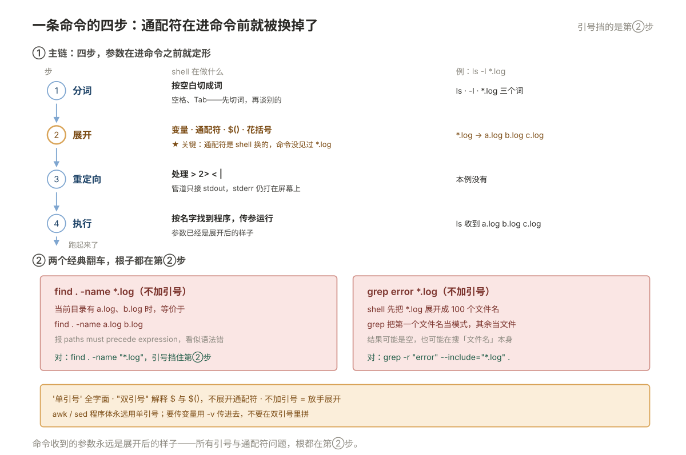
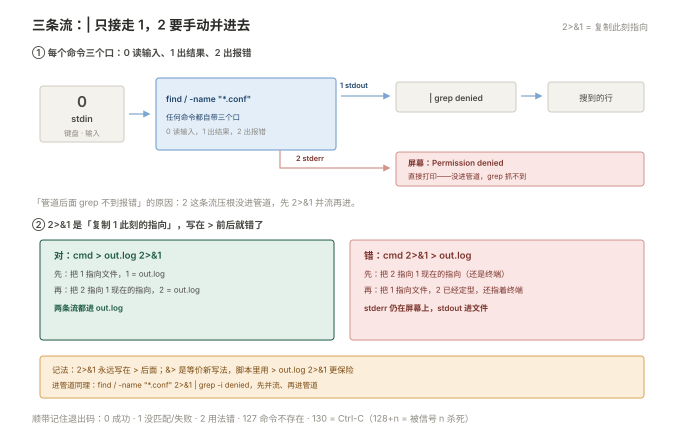

# 07 命令行与文本处理

> **解决**：面对一个目录、一个几十万行的日志、一堆没格式的输出，怎么用几条命令把需要的那点信息挖出来。  
> **范围**：一条命令在 shell 里到底走了几步 · 三条流与退出码 · 定位文件 · 定位内容 · 取出字段  
> **口径**：正文以 CentOS 7 / Windows 10 举例；命令、路径与发行版差异在节内注记，不绑定单一版本。  
> **更新**：2026-11-06  
> **读完能做到**：说清一条命令在 shell 里经过了哪四步、为什么引号加不加结果完全不同；分清 `>` `2>` `&>` 与 `2>&1` 的位置关系；用 `find` 按时间/大小/权限精确定位文件而不误删；用 `awk` 取代「先 `cut` 再想办法」的手工拼凑；在 `sed -i` 之前先预览；写出「统计访问 IP Top10」「找出最大的日志」「按小时统计错误数」这三条真实管道；处理 GBK 与大文件时不踩内存。
> **怎么读**：7.0 是知识点地图，标了每个点的**基础 / 进阶**。第一遍跳过带「进阶」的小节不影响主线。 不认识的词查 [00 术语表](00-术语表.md)。
> **不在这里**：单个命令有哪些参数 → [附录 A 命令速查](A-命令速查.md)（只查不讲）；写成可复用的脚本 → [008 Shell 脚本](008-Shell脚本.md)；性能数据的含义 → [09](009-性能分析与排障.md)；日志该放哪、怎么轮转 → [06](006-软件服务与任务.md)。

> **这一册的写法**：不是命令词典，而是**「要什么信息 → 怎么挖出来」**。每个工具只在解决具体问题时出场，参数只讲这次用得到的那个。想查参数翻附录 A。

---

## 目录

| 节 | 内容 |
|---|---|
| 7.0 | 本册知识点地图 |
| 7.1 | 一条命令在 shell 里到底走了几步 |
| 7.2 | 三条流与退出码：管道接的是哪一条 |
| 7.3 | 定位文件：`find` 的四个维度 |
| 7.4 | 定位内容：`grep` 的三种用法 |
| 7.5 | 取出字段：`cut` 不够用的时候上 `awk` |
| 7.6 | 变换：`sed` 的用法与风险 |
| 7.7 | 汇总：`sort` 与 `uniq` 的固定三连 |
| 7.8 | 正则：和通配符不是一回事 |
| 7.9 | 把工具串成一条管道：三个真实场景 |
| 7.10 | 大文件：不要 `cat`，不要全读进内存 |
| 7.11 | 超出「文本三件套」的三件事 |
| 7.12 | vim：够用就好的十个动作 |
| 7.13 | 打包与压缩：`tar` 的参数顺序有讲究 |
| 7.14 | 本册排错路径 |
| 7.15 | 自测 |
| 7.16 | 命令索引 |

---

## 7.0 本册知识点地图

复习时按这张表逐行自问「这个我能讲清吗」，讲不清的回对应节。**加粗的是日常最常用、也最容易用错的。**

| 知识点 | 层次 | 一句话要点 | 节 |
| --- | --- | --- | --- |
| **一条命令在 shell 里走四步** | 基础 | 分词 → 展开 → 重定向 → 执行。搞错大半是第二步 | 7.1 |
| **通配符归 shell，正则归程序** | 基础 | `*.log` 由 shell 展开，`.*\.log` 才是正则 | 7.1 |
| **引号决定谁来看这个字符串** | 基础 | 单引号全字面，双引号认变量，不加引号会被展开 | 7.1 |
| **三条流** | 基础 | stdin 0 / stdout 1 / stderr 2，管道只接 stdout | 7.2 |
| **`2>&1` 的顺序不能换** | 基础 | 它表示「此刻 1 指向哪，2 就跟到哪」，写反就错 | 7.2 |
| **退出码** | 基础 | 0 才是成功；脚本判断全靠它 | 7.2 |
| **`find` 的时间参数** | 基础 | `-mtime -7` 是 7 天内，`+7` 是 7 天前 | 7.3 |
| **`find -exec` 与 `xargs`** | 基础 | `{} +` 批量传、`\;` 逐个传；文件名带空格要用 `-print0` | 7.3 |
| **`find -delete` 等于删** | 基础 | 先去掉 `-delete` 看它要删什么 | 7.3 |
| **`grep -r` 与 `-l`** | 基础 | 递归搜内容；只要文件名用 `-l`，比 `-n` 快得多 | 7.4 |
| **`grep` 的上下文参数** | 基础 | `-A` 后、`-B` 前、`-C` 前后，看报错必用 | 7.4 |
| **`cut` 只适合固定分隔符** | 基础 | 多个空格分隔时 `cut -d' '` 会切出一堆空字段 | 7.5 |
| **`awk` 自动压缩空白** | 基础 | 不加 `-F` 时按任意空白分列，这是它比 `cut` 强的地方 | 7.5 |
| **`awk` 的 `NR`/`NF`/`$0`** | 基础 | 行号 / 字段数 / 整行，三个变量解决大半问题 | 7.5 |
| `awk` 的 `BEGIN` 与 `END` | 进阶 | 求和求均值靠 `END`；加表头靠 `BEGIN` | 7.5 |
| **`sed -i` 前必须预览** | 基础 | 先不带 `-i` 跑一遍，再带 `-i.bak` | 7.6 |
| **`sed` 的地址范围** | 基础 | `/起/,/止/p` 取一段，日志里最常用 | 7.6 |
| **`uniq` 只处理相邻重复** | 基础 | 不先 `sort` 就等于没去重 | 7.7 |
| **`sort -k` 与 `-n`** | 基础 | 按第几列排、按数字排，顺序错了结果全错 | 7.7 |
| **统计频次三连** | 基础 | `sort` → `uniq -c` → `sort -rn`，几乎所有 TopN 都是它 | 7.7 |
| **正则的 `.` 与 `*`** | 基础 | `.` 是任意字符、`*` 是「前一个」重复任意次，和通配符完全不同 | 7.8 |
| **`grep -E` 才支持 `+` `?` 与竖线** | 基础 | 基本正则里 `+` 就是字面加号 | 7.8 |
| **贪婪匹配** | 进阶 | `.*` 会吃到最远，要收窄用 `[^"]*` | 7.8 |
| **管道是流式的** | 进阶 | 数据边产边消，不会全读进内存 | 7.9 |
| **`tail -F` 与 `-f` 的区别** | 基础 | 日志轮转后用 `-F`（按名字跟），`-f` 会跟丢 | 7.10 |
| **大文件不要 `cat`** | 基础 | 用 `less +F`；排序大文件要 `-S`/`-T` | 7.10 |
| **编码问题** | 基础 | GBK 文件先 `iconv`，Windows 换行先 `dos2unix` | 7.11 |
| **`tar` 的 `-f` 后面必须紧跟文件名** | 基础 | `tar -czf a.tar.gz dir`，参数顺序不是随便排的 | 7.13 |
| **`tar` 的 `-C` 位置** | 基础 | `-C` 之后的路径才相对它，写后面不生效 | 7.13 |
| **zip 中文名乱码** | 基础 | 打包含 GBK 名用 Python，解压用 `-O CP936` 或 7z | 7.13 |

### 动手前：造一份可以随便折腾的数据

这一册要用到「一个文件很多的目录」和「一个几十万行的日志」。**别拿 `/etc` 和真实业务日志练**——本册有 `find -delete` 和 `sed -i`，这两条打错的代价是删文件。

```bash
mkdir -p /tmp/lab07/logs && cd /tmp/lab07

# ① 造一份 1000 行的假访问日志
awk 'BEGIN{
  srand(42);
  split("/index.html /api/user /api/order /static/app.js /login", u, " ");
  split("200 200 200 404 500 302", c, " ");
  for(i=1;i<=1000;i++){
    ip = int(rand()*rand()*40)+1;          # 乘两次让少数 IP 占大头，像真实流量
    if (rand() < 0.7) h = int(rand()*2)+14; else h = int(rand()*24);   # 七成集中在 14-15 点
    printf "10.0.0.%d - - [29/Oct/2026:%02d:%02d:%02d +0800] \"GET %s HTTP/1.1\" %s %d\n",
      ip, h, int(rand()*60), int(rand()*60),
      u[int(rand()*5)+1], c[int(rand()*6)+1], int(rand()*5000)+100
  }
}' > access.log

# ② 造一批带不同时间和大小的文件，练 find
for i in $(seq 1 20); do
  dd if=/dev/zero of=logs/file$i.log bs=1k count=$((i*10)) status=none
  touch -d "-$i days" logs/file$i.log
done
touch logs/README.md

wc -l access.log            # 应该是 1000
ls logs | wc -l             # 应该是 21
```

```plain
$ head -2 access.log
10.0.0.4 - - [29/Oct/2026:04:35:56 +0800] "GET /login HTTP/1.1" 500 574
10.0.0.5 - - [29/Oct/2026:15:01:10 +0800] "GET /login HTTP/1.1" 200 4528
```

后面 7.4 到 7.9 的所有例子都基于这两份数据，输出可以逐行对。

占位符约定：`<目录>` / `<文件>` / `<模式>` 换实际值。**本册唯一会真删东西的是 7.3 的 `find -delete`**，我在那里把"先看后删"写成两步，别合并成一条。

---

## 7.1 一条命令在 shell 里到底走了几步

这一节不讲具体命令，讲一个模型。**后面所有的引号问题、通配符问题、`grep *.log` 卡死，根子都在这里。**

### 四步

你在终端敲下 `ls -l *.log` 并回车，shell 做的事是：

| 步 | 动作 | 例子里发生了什么 |
| --- | --- | --- |
| ① 分词 | 按空白切成词 | 切成 `ls`、`-l`、`*.log` 三个词 |
| ② 展开 | 变量、通配符、命令替换、花括号 | `*.log` 被替换成当前目录下匹配的文件名 |
| ③ 重定向 | 处理 `>` `2>` `<` `\|` | 本例没有 |
| ④ 执行 | 找 `ls` 这个程序并传参 | 真正运行，参数已经是展开后的文件名 |



**关键点在第 ② 步：通配符是 shell 展开的，不是命令处理的。** 这带来两个直接后果。

### 后果一：`find -name *.log` 必须加引号

```bash
# ❌ 当前目录有 a.log、b.log 时，这条等价于：
#    find . -name a.log b.log
find . -name *.log

# ✅ 引号阻止 shell 展开，把 *.log 原样交给 find
find . -name "*.log"
```

报错通常是 `find: paths must precede expression`，看起来像语法问题，实际是通配符被提前展开了。**`find` 的 `-name`、`grep` 的模式、`awk` 的程序，一律加引号**——养成习惯比记规则省事。

### 后果二：`grep *.log` 会卡住或报错

```bash
# ❌ 想「在这些日志里搜 error」，实际发生的是：
#    shell 先把 *.log 展开成 100 个文件名，grep 把第一个当模式、其余当文件
grep error *.log

# ✅ 真正想搜的是内容，用 -r 让它自己去找文件
grep -r "error" --include="*.log" .
```

`grep` 把第一个文件名当成了搜索模式，然后去后 99 个文件里找那个"文件名"——结果可能是空，也可能是把某个文件当模式在别的文件里搜，非常难看出问题。

### 三种引号的分工

| 写法 | shell 怎么处理 | 什么时候用 |
| --- | --- | --- |
| `'单引号'` | **全字面**，`$`、`` ` ``、`\` 都不解释 | 正则、`awk` 程序、含 `$` 的字符串 |
| `"双引号"` | 解释 `$变量`、`$(命令)`、`` `命令` ``，不解释通配符 | 需要插变量的地方 |
| 不加引号 | 展开通配符、按空白分词 | **基本不该用**，除非你确实要展开 |

```bash
# 同一个 $ 在三种写法下的结果完全不同
echo '$HOME'      # 输出 $HOME
echo "$HOME"      # 输出 /root
echo $HOME        # 输出 /root

# awk 程序里有 $1，必须用单引号，否则 shell 先把 $1 换成空
awk '{print $1}' access.log        # ✅
awk "{print $1}" access.log        # ❌ $1 被 shell 清空，等价于 print
```

**一条实用规则**：写 `awk` 和 `sed` 时**外层永远用单引号**。需要在里面插 shell 变量时，用 `-v` 传进去，不要在双引号里拼：

```bash
# ✅ 用 -v 传变量，程序体保持单引号
awk -v lim=400 '$2 > lim {print}' access.log

# ❌ 双引号里拼，$2 会被 shell 吃掉
awk "\$2 > 400 {print}" access.log
```

### 命令替换：`$()` 优先于反引号

```bash
# 两种都行，$( ) 能嵌套、不会被误读
echo "今天是 $(date +%F)，负载 $(cut -d' ' -f1 /proc/loadavg)"
```

反引号 `` ` `` 在老脚本里常见，但它不能嵌套、和单引号混用时容易出事。**新写的全用 `$()`。**

---

## 7.2 三条流与退出码：管道接的是哪一条

上一节说 shell 分四步。第 ③ 步「重定向」决定了数据往哪走，而这一步出错的表现往往不是报错，是**「什么都看不到」**。

### 每个命令有三个口

| 编号 | 名字 | 默认连到 | 装什么 |
| --- | --- | --- | --- |
| 0 | stdin | 键盘 | 输入 |
| 1 | stdout | 终端 | **正常输出** |
| 2 | stderr | 终端 | **错误信息** |

**`|` 只把 stdout 接过去，stderr 仍然直接打在屏幕上。** 这是「管道后面 grep 不到报错」的原因：

```bash
# 想过滤报错，但 2 那条流没进管道
find / -name "*.conf" | grep denied      # 什么都抓不到

# 先把 stderr 并到 stdout，再进管道
find / -name "*.conf" 2>&1 | grep -i denied
```



### `2>&1` 的位置不能换

```bash
cmd > out.log 2>&1     # ✅ 对：两条流都进文件
cmd 2>&1 > out.log     # ❌ 错：stderr 还在屏幕上
```

原因是 `2>&1` 的意思是「**让 2 指向 1 此刻指向的地方**」，是复制当前指向，不是绑定关系。所以：

- 第一种：先把 1 指向文件，再把 2 指向 1 现在指的（文件）→ 两个都进文件；
- 第二种：先把 2 指向 1 现在指的（终端），再把 1 指向文件 → 2 留在终端。

记法：**`2>&1` 要写在 `>` 后面**。

`&>` 是新写法，等价于 `> out.log 2>&1`，少写几个字符但要求 bash。**脚本里用 `> out.log 2>&1` 更保险。**

### 要丢掉输出：`/dev/null`

```bash
command > /dev/null 2>&1      # 全丢（通常用于「只关心退出码」）
command 2>/dev/null           # 只丢错误，正常输出留着
command >/dev/null            # 只丢正常输出，错误露出来 ← 排查时常用这个
```

最后一条值得记住：**排查失败原因时，把正常输出丢掉、只留错误**，屏幕立刻清爽。

### 退出码：0 是成功

```bash
grep -q "error" app.log; echo $?
```

```plain
0
```

`$?` 是上一条命令的退出码。**0 表示成功**（和直觉相反，非 0 才是失败）。三类常见值：

| 值 | 含义 | 例子 |
| --- | --- | --- |
| 0 | 成功 | — |
| 1 | 通用失败 / 没匹配到 | `grep` 没找到任何行 |
| 2 | 用法错误 | 参数写错 |
| 126 / 127 | 没有执行权限 / 命令不存在 | `command not found` 是 127 |
| 128+n | 被信号 n 杀死 | 130 = 被 `Ctrl+C`（SIGINT=2）中断 |

**`grep` 没匹配到时退出码是 1，不是错误**。所以 `grep xxx file || echo 没找到` 这种写法是成立的，但在 `set -e` 的脚本里会导致脚本退出（08 会讲怎么处理）。

---

## 7.3 定位文件：`find` 的四个维度

数据准备好了，第一个问题永远是「**那个文件在哪**」。`find` 按四个维度找：名字、时间、大小、属性。

### 按名字

```bash
find /var/log -name "*.log"                  # 名字匹配（大小写敏感）
find /var/log -iname "*.LOG"                 # 忽略大小写
find /etc -name "nginx*" -o -name "httpd*"   # 或
find / -maxdepth 2 -name "*.conf"            # 只找两层深
```

**`-maxdepth` 是从根目录找时的救命参数**。`find /` 在有大目录（`/proc`、`/data`）的机器上能跑几分钟，加 `-maxdepth 2` 立刻变快。

**`-o` 的优先级陷阱**：

```bash
find /etc -name "*.conf" -o -name "*.cnf" -type f      # ❌ -type f 只作用于后半段
find /etc \( -name "*.conf" -o -name "*.cnf" \) -type f # ✅ 加括号
```

`-o` 的优先级低于默认的 `-a`（与），不加括号时 `-type f` 只跟最后一个 `-name` 结合。括号要转义，因为在 shell 里有特殊含义。

### 按时间（最容易记反）

| 参数 | 含义 | 记法 |
| --- | --- | --- |
| `-mtime -7` | **7 天以内**修改过 | 减号 = 以内 |
| `-mtime +7` | **7 天以前**修改过 | 加号 = 以前 |
| `-mtime 7` | 正好第 7 天那一天 | 很少用 |
| `-mmin -30` | 30 分钟以内 | 分钟级 |
| `-newer ref.txt` | 比 `ref.txt` 新 | 按参照文件比 |
| `-ctime` / `-atime` | 元数据变更时间 / 访问时间 | `atime` 常因挂载 `relatime` 不准，别依赖 |

```bash
# 找最近 1 天改过的日志
find /var/log -name "*.log" -mtime -1

# 找 30 天以前没动过的大文件（清理候选）
find /data -type f -mtime +30 -size +100M

# 找最近 30 分钟内改过的配置（刚出事，想知道谁动过）
find /etc -type f -mmin -30
```

`-newer` 的实用场景：**故障发生时间点之后被改过的所有文件**。

```bash
touch -d "2026-10-29 14:00" /tmp/t0
find /etc /opt -newer /tmp/t0 -type f
```

### 按大小

```bash
find /data -size +1G            # 大于 1G
find /data -size -10k           # 小于 10KB
find /data -size +100M -size -1G  # 区间（两个条件自动是「与」）
```

单位是 `c`（字节）、`k`、`M`、`G`。**不写单位时按 512 字节块算**，所以 `-size 100` 不是 100 字节。养成写单位的习惯。

### 按属性（排查权限问题时用）

```bash
find / -perm -4000 -type f 2>/dev/null    # 所有 SUID 文件（提权面检查，见 003 §3.15）
find /data -nouser                        # 属主已不存在的文件（删用户后残留）
find /data -type f -empty                 # 空文件
find /data -type l -xtype l               # 坏掉的软链接
```

`-perm` 有三种写法，差一个符号结果完全不同：

| 写法 | 含义 | 拿 `4755` 的文件试 |
| --- | --- | --- |
| `-perm -4000` | 这几位**全都要有**（其余位随意） | ✅ 命中 |
| `-perm /4000` | 这几位**有一位就行** | ✅ 命中 |
| `-perm 4000` | **精确等于** `4000`（只剩 SUID，没有 rwx） | ❌ 不命中 |

所以查 SUID 必须用 `-4000`（或 `/4000`），写成 `-perm 4000` 会把绝大多数 SUID 文件漏掉——因为真实的 `passwd` 是 `4755`，不是 `4000`。

### 找到之后：三种处置

**① 只看**（默认行为）。配合 `-ls` 或 `-printf` 拿到更多信息：

```bash
find /data -type f -size +1G -printf "%s\t%p\n" | sort -rn | head
```

```plain
3221225472	/data/mysql/ibdata1
1073741824	/data/app/dump.sql
```

`%s` 是字节数、`%p` 是路径。**比 `ls -l` 干净，适合直接喂给 `sort`。**

**② 对它执行命令：`-exec` 或 `xargs`**

```bash
# -exec：逐个传（每个文件启动一次命令）
find /data -name "*.tmp" -exec rm -f {} \;

# -exec +：批量传（一次传多个，快得多）
find /data -name "*.tmp" -exec rm -f {} +

# xargs：同样的效果，可读性更好、能加 -n 控制每批数量
find /data -name "*.tmp" -print0 | xargs -0 rm -f
```

**`{} +` 比 `\;` 快一个数量级**——`\;` 对一万个文件就启动一万次 `rm`。能用 `+` 就用 `+`。

**文件名带空格时必须用 `-print0` + `xargs -0`**：

```bash
# ❌ 文件名 "my file.log" 会被拆成 my 和 file.log
find . -name "*.log" | xargs rm -f

# ✅ 用 NUL 分隔，任何字符都安全
find . -name "*.log" -print0 | xargs -0 rm -f
```

**③ 删除：`-delete`，先看后删**

```bash
# 第一步：先看它要删哪些，把 -delete 换成 -print
find /data/tmp -type f -mtime +7 -print

# 第二步：确认清单没问题，再执行
find /data/tmp -type f -mtime +7 -delete
```

**这两步不要合并**。`find -delete` 不经过回收站，删了就是删了；而且它隐式带 `-depth`（先处理子目录再处理父目录），如果条件写宽了（比如忘了 `-type f`），连目录一起删。

> **⚠️ 三个常见误删**：`find / -name "*.log" -delete`（没限定路径，删到系统日志）、`find . -mtime -7 -delete`（写成了"7 天内"，正好删掉最近的）、`find /data -name "*tmp*" -delete`（`*tmp*` 会匹配到 `tmp` 目录本身）。

### 一个组合：找出「占空间最大」的日志

```bash
find /var/log -type f -name "*.log" -printf "%s\t%p\n" | sort -rn | head -5 | awk -F'\t' '{printf "%.1fM\t%s\n", $1/1024/1024, $2}'
```

```plain
48.3M	/var/log/nginx/access.log
12.1M	/var/log/messages
3.4M	/var/log/secure
```

这一条把 7.3、7.7、7.5 串起来了，正是本册的核心手法。

---

## 7.4 定位内容：`grep` 的三种用法

文件找到了，接下来是**在文件里找内容**。`grep` 只有三类用法，分清就不会乱用。

| 想干什么 | 用法 | 说明 |
| --- | --- | --- |
| 在**一个文件**里找匹配的行 | `grep "模式" file` | 最常见 |
| 在**一堆文件**里找，要文件名 | `grep -rl "模式" <目录>` | `-l` 只输出文件名 |
| 在**一堆文件**里找，要行号+内容 | `grep -rn "模式" <目录>` | `-n` 带行号 |

**`-l` 和 `-n` 的性能差得很远**：`-l` 找到一个匹配就跳到下一个文件，`-n` 要扫完。**只想知道「哪个文件里有」时一定用 `-l`**，在大目录上能快十倍。

### 四个必会参数

```bash
grep -i "error" app.log            # 忽略大小写
grep -w "error" app.log            # 只匹配整词（不匹配 errors、error_code）
grep -c "error" app.log            # 只输出匹配行数
grep -v "DEBUG" app.log            # 反向：不匹配的行（过滤噪声最有用）
```

`-w` 值得单独说：搜 `error` 时，`errors`、`error_count` 全都会命中，用 `-w` 只匹配独立的 `error`。

### 上下文：看报错必用

```bash
grep -A 5 "Exception" app.log      # 匹配行 + 后 5 行
grep -B 3 "Exception" app.log      # 匹配行 + 前 3 行
grep -C 5 "Exception" app.log      # 前后各 5 行
```

**报错的成因几乎总在前几行**。只看 `grep Exception` 那一行，经常看到一个没头没尾的堆栈；加 `-B 5` 才能看到「谁调用了它」。

### 限定范围：别在二进制和缓存里浪费

```bash
grep -r "10.0.0.5" /etc --include="*.conf"
grep -r "password" . --exclude="*.log" --exclude-dir={.git,node_modules,venv}
```

```plain
$ grep -rn "listen 80" /etc/nginx --include="*.conf"
/etc/nginx/nginx.conf:36:    listen       80 default_server;
```

不加 `--include` 时 `grep -r` 会去读 `.git` 里的对象文件和压缩包，慢且输出乱码（`Binary file ... matches`）。**递归搜一定带上 `--include` 或 `--exclude-dir`。**

### 什么时候该换 `rg`

`grep -r` 在大代码库上慢，因为它是单线程且不认 `.gitignore`。装了 `ripgrep` 就用 `rg`：

```bash
rg "TODO" --type py        # 按文件类型
rg -l "func main" .        # 只列文件
```

`rg` 默认就跳过 `.git`、`node_modules`，速度快十倍以上。**CentOS 7 要 `yum install ripgrep`（EPEL），Ubuntu `apt install ripgrep`。**

### 一个组合：日志里找特定时间段的错误

```bash
grep "29/Oct/2026:1[4-5]:" access.log | grep -w "500"
```

```plain
10.0.0.6 - - [29/Oct/2026:15:18:24 +0800] "GET /api/user HTTP/1.1" 500 4578
10.0.0.2 - - [29/Oct/2026:14:48:25 +0800] "GET /api/order HTTP/1.1" 500 4472
```

第一条 `grep` 用正则圈时间窗（`1[4-5]` 表示 14 点或 15 点），第二条精确匹配状态码。**比用 `awk` 解析时间戳简单，因为日志里的时间本来就是文本。**

---

## 7.5 取出字段：`cut` 不够用的时候上 `awk`

行找到了，下一关是**从行里取出某一列**。多数人先用 `cut`，然后被多空格卡住。

### `cut` 的边界在哪

```bash
cut -d: -f1,3 /etc/passwd        # 冒号分隔，取第 1、3 列 —— cut 最擅长的场景
cut -c1-10 access.log            # 按字符位置切
```

`cut` 有两个硬限制：

| 限制 | 后果 | 例子 |
| --- | --- | --- |
| 分隔符只能**一个字符** | 多字符分隔符做不到 | `-d"  "` 只认第一个空格 |
| **连续分隔符产生空字段** | 多空格对齐的输出切出来一堆空列 | `ps aux` 用 `cut -d' '` 基本废 |

```bash
# ❌ ps aux 的列之间空格数不一样，cut 会切错
ps aux | cut -d' ' -f2

# ✅ 用 awk，它默认按「任意长度的空白」分列
ps aux | awk '{print $2}'
```

**判断标准**：分隔符是单个固定字符（`:`、`,`、`|`、`\t`）→ `cut`；分隔符是空格或长度不固定 → `awk`。

### `awk` 的三个变量打天下

```bash
awk '{print $1, $3}' access.log       # 第 1、3 列（自动按空白分列）
awk '{print $NF}' access.log          # 最后一列（NF 是字段数）
awk '{print NR": "$0}' access.log     # 行号 + 整行
awk 'NR>1' access.log                 # 跳过第 1 行（表头）
```

| 变量 | 含义 |
| --- | --- |
| `$0` | 整行 |
| `$1`…`$n` | 第 n 列 |
| `$NF` | 最后一列 |
| `NF` | 这一行有几列 |
| `NR` | 当前是第几行（跨文件累计） |
| `FNR` | 当前文件内的第几行 |

### 指定分隔符与输出格式

```bash
awk -F: '{print $1, $3}' /etc/passwd          # -F 指定分隔符
awk -F'\t' '{print $2}' data.tsv              # 制表符（单引号里 \t 由 awk 解释）
awk -F'[][]' '{print $2}' access.log          # 方括号当分隔符（多个字符也行）
```

`-F'[][]'` 这一手很实用：访问日志的时间在方括号里，用 `[` 或 `]` 当分隔符，第 2 列就是时间。

```plain
$ awk -F'[][]' '{print $2}' access.log | head -2
29/Oct/2026:04:35:56 +0800
29/Oct/2026:15:01:10 +0800
```

### 条件筛选：`awk` 就能干 `grep` 的活

```bash
awk '$9 == 500' access.log                  # 状态码是 500
awk '$10 > 4000' access.log                 # 第 10 列（字节数）大于 4000
awk '$7 ~ /api/ {print $1, $7}' access.log  # 第 7 列匹配 api
awk '$9 == 500 && $10 > 1000' access.log    # 与
awk '$9 ~ /^(404|500)$/' access.log         # 或（用正则）
```

`~` 是「匹配正则」，`!~` 是「不匹配」。**`awk` 比 `grep` 强的地方就是它能同时用「列的位置」和「列的内容」做条件**，而 `grep` 只能看整行。

### 汇总：`BEGIN` 与 `END`

```bash
# 求某一列的总和
awk '{sum += $10} END {print sum}' access.log

# 求平均、计数
awk '{sum += $10; n++} END {printf "行数 %d，总字节 %d，平均 %.0f\n", n, sum, sum/n}' access.log
```

```plain
行数 1000，总字节 2635484，平均 2635
```

```bash
# 按某一列分组求和（相当于 SQL 的 group by）
awk '{bytes[$1] += $10} END {for (ip in bytes) print bytes[ip], ip}' access.log | sort -rn | head -3
```

```plain
276856 10.0.0.1
205486 10.0.0.2
183576 10.0.0.3
```

**这一行就是「哪个 IP 下载流量最大」**，比先 `sort` 再 `uniq` 更准确——`uniq -c` 只能数行数，`awk` 能按列求和。

---

## 7.6 变换：`sed` 的用法与风险

字段取出来了，接下来可能要**改内容**。`sed` 是流编辑器，最常用的其实只有三四招，但它的 `-i` 是**直接在原文件上改**，这是本册最危险的一条命令。

### `s` 替换：三条规则

```bash
sed 's/old/new/'  file      # 每行只替换第一处
sed 's/old/new/g' file      # 每行替换所有（g = global）
sed 's/old/new/2' file      # 每行只替换第 2 处
```

分隔符可以换，路径里全是 `/` 时很有用：

```bash
sed 's|/usr/local/old|/usr/local/new|g' conf.txt
```

### 按行号或匹配范围操作

```bash
sed -n '10,20p' file                  # 只打印第 10–20 行（-n 抑制默认输出）
sed -n '/BEGIN/,/END/p' file          # 打印两个标记之间的一段 ← 日志里最常用
sed '5d' file                         # 删第 5 行
sed '1d;$d' file                      # 删首行和末行
sed '/^#/d; /^$/d' file               # 删注释行和空行
sed '/pattern/d' file                 # 删匹配的行
```

`/BEGIN/,/END/p` 这一招在处理配置文件、日志片段时特别省事：

```bash
sed -n '/### 配置开始/,/### 配置结束/p' app.conf
```

### 取出某一段并处理

```bash
# 只把「2026-10-29」这一天的行里的 500 改成 ERROR
sed -n '/29\/Oct\/2026/p' access.log | sed 's/ 500 / ERROR /'
```

### `-i` 的风险与正确用法

**`sed -i` 会直接覆盖原文件，没有备份、没有回收站。**

```bash
# ❌ 危险：一旦写错，原文件没了
sed -i 's/Listen 80/Listen 8080/' /etc/httpd/conf/httpd.conf

# ✅ 三步法
sed 's/Listen 80/Listen 8080/' /etc/httpd/conf/httpd.conf | head -30   # ① 预览
cp -a /etc/httpd/conf/httpd.conf{,.bak}                                # ② 备份
sed -i 's/Listen 80/Listen 8080/' /etc/httpd/conf/httpd.conf           # ③ 执行
```

或者让 `sed` 自己留备份：

```bash
sed -i.bak 's/Listen 80/Listen 8080/' httpd.conf     # 生成 httpd.conf.bak
```

> **`-i` 在两个平台上的写法不同**：GNU sed（Linux）`-i` 直接跟可选后缀；BSD/macOS sed 必须写 `-i ''`。本手册只讲 Linux，但从网上抄命令时要注意这个差别。

### 容易踩的三个坑

| 坑 | 现象 | 处理 |
| --- | --- | --- |
| 特殊字符没转义 | `s/1.1/2.2/` 把 `1a1` 也改了 | `.` `*` `[` `\` 前面加 `\`，或改用 `[.]` |
| 替换内容里有 `&` | `&` 代表整个匹配，被原样插入 | 写成 `\&` |
| 变量没被替换 | 双引号里 `$x` 被 shell 吃了 | 用双引号 + 转义，或 `sed "s/old/$var/"` 确认变量已展开 |

```bash
# 想把 IP 10.0.0.1 替换成 10.0.0.2，直接写会连 10x0x0x1 一起改
sed 's/10\.0\.0\.1/10.0.0.2/g' file      # ✅
sed 's/10.0.0.1/10.0.0.2/g' file         # ❌ 点号成了「任意字符」
```

**改配置文件前建议先跑一遍 `sed` 不带的版本，用 `diff` 看差异**：

```bash
diff <(cat app.conf) <(sed 's/old/new/g' app.conf)
```

---

## 7.7 汇总：`sort` 与 `uniq` 的固定三连

数据取出来了，最后一关是**统计**。这一节的三个命令几乎总是连在一起用，记住组合比记参数有用。

### `uniq` 只处理相邻重复（最容易错的一点）

```bash
# ❌ 文件里相同的行不相邻，uniq 一个也去不掉
uniq ips.txt

# ✅ 先排序让相同行挨在一起
sort ips.txt | uniq
```

这是 `uniq` 最反直觉的地方。原因很简单：它只比较「当前行和上一行」，不维护全局集合。

### 标准三连：统计频次

```bash
sort ips.txt | uniq -c | sort -rn
```

```plain
    107 10.0.0.1
     82 10.0.0.2
     72 10.0.0.3
```

三步各自的作用，缺一不可：

| 步 | 作用 | 去掉会怎样 |
| --- | --- | --- |
| `sort` | 让相同行相邻 | `uniq -c` 数不准 |
| `uniq -c` | 统计每行出现次数 | 没有计数 |
| `sort -rn` | 按次数从大到小 | 结果乱序，看不出 TopN |

**`sort -rn` 的 `-n` 不能省**：不加 `-n` 是按字典序排，`10` 会排在 `9` 前面。

### `sort` 的四个参数

```bash
sort -n file              # 按数值排（不是字典序）
sort -rn file             # 数值倒序
sort -k2 file             # 按第 2 列排（默认空白分隔）
sort -t: -k3 -n /etc/passwd   # 按冒号分隔的第 3 列数值排
sort -h file              # 按人类可读的大小排（1K < 1M < 1G）
sort -u file              # 排序并去重（等价于 sort | uniq）
sort -V file              # 版本号排序（v1.9 < v1.10）
```

`-h` 和 `-V` 是两个省事的参数：

```bash
du -sh /var/log/* | sort -h      # 按实际大小排，不是按字符串
ls | sort -V                     # file1 file2 ... file10 顺序正确
```

### `uniq` 的另外两个用法

```bash
sort file | uniq -d      # 只输出重复的行（找重复项）
sort file | uniq -u      # 只输出不重复的行
sort file | uniq -c | awk '$1 > 100'   # 出现超过 100 次的
```

### 一个组合：日志里的 Top10 来源 IP

```bash
awk '{print $1}' access.log | sort | uniq -c | sort -rn | head -10
```

```plain
    107 10.0.0.1
     82 10.0.0.2
     72 10.0.0.3
```

**这条管道值得背下来**。把它换掉中间的 `awk`，能统计任何东西：

| 想统计 | 中间那段换成 |
| --- | --- |
| 哪个 URL 被访问最多 | `awk '{print $7}'` |
| 哪些状态码最多 | `awk '{print $9}'` |
| 哪一小时请求最多 | `awk -F'[][]' '{print substr($2,13,2)}'`（取小时两位） |
| 哪个服务报错最多 | `grep -w ERROR /var/log/app.log \| awk '{print $5}'` |

---

## 7.8 正则：和通配符不是一回事

前面反复用到正则（`1[4-5]`、`^(404|500)$`）。这一节把它单独说清，因为**大多数人第一次用正则，都是把通配符的直觉套上去**。

### 两个 `*` 完全不同

| 场景 | `*` 的意思 | 例子 |
| --- | --- | --- |
| shell 通配符 | **任意多个任意字符** | `*.log` 匹配 `a.log`、`abc.log` |
| 正则 | **前一个字符重复 0 次或多次** | `ab*` 匹配 `a`、`ab`、`abbb`，不匹配 `ac` |

所以在正则里想表达「任意字符任意多个」，要写 `.*`，而不是 `*`。

### 六个必会元素

| 元素 | 含义 | 例子 |
| --- | --- | --- |
| `.` | 任意**一个**字符 | `a.c` 匹配 `abc`、`a1c` |
| `*` | 前一项重复 0+ 次 | `ab*c` 匹配 `ac`、`abc`、`abbbc` |
| `+` | 前一项重复 1+ 次（**要用 `-E`**） | `ab+c` 不匹配 `ac` |
| `?` | 前一项 0 或 1 次（**要用 `-E`**） | `colou?r` 匹配 `color`、`colour` |
| `[]` | 字符集合，`^` 开头表示取反 | `[0-9]`、`[^0-9]` |
| `^` `$` | 行首 / 行尾 | `^error` 只匹配行首的 error |

### `-E` 与非 `-E` 的差别（最常踩）

```bash
grep "a+b" file          # ❌ 基本正则里 + 是字面加号，匹配 "a+b" 这个字符串
grep -E "a+b" file       # ✅ 扩展正则，匹配 aab、aaab
grep -E "error|warn" f   # | 也要 -E
grep -E "(foo|bar)baz" f # 分组也要 -E
```

**记法：只要用到 `+` `?` `|` `()` `{}`，一律加 `-E`。**

`awk` 的正则**默认就是扩展的**，不用 `-E`：

```bash
awk '$9 ~ /40[0-9]|50[0-9]/' access.log      # 4xx 和 5xx
```

### 贪婪：`.*` 会吃到最远

```bash
# 想取出引号里的 URL
echo 'GET /api/user?id=1 HTTP/1.1' | grep -oE '"[^"]*"'

# 用 .* 会一路吃到最后一个引号
echo 'a "x" b "y"' | grep -oE '".*"'         # 得到 "x" b "y"
```

**处理「引号之间的内容」时，用 `[^"]*` 而不是 `.*`。** 这是正则里最实用的一条经验：能限定字符集就别用 `.`。

### `grep -o`：只输出匹配的部分

```bash
grep -oE '[0-9]{1,3}(\.[0-9]{1,3}){3}' access.log | head -3
```

```plain
10.0.0.4
10.0.0.5
10.0.0.6
```

`-o` 只打印匹配到的那一段，不打印整行。**从混杂文本里提取 IP、时间、数字时，`-oE` 是最快的工具。**

### 转义：`.` `*` `[` `\` `^` `$`

```bash
grep -F "10.0.0.1" access.log      # -F 表示「按字面串搜」，不当正则
grep "10\.0\.0\.1" access.log      # 或者手动转义
```

**搜 IP、文件路径、含 `.` 的版本号时，直接用 `grep -F`**，省得数转义。这一条能避免大量误匹配。

---

## 7.9 把工具串成一条管道：三个真实场景

前面每节讲一个工具，这一节把它们合起来。**排障时真正在用的是这四条管道，不是单个命令。**

### 场景一：Web 服务突然慢了，谁在打

```bash
# 每分钟的请求数，看是不是流量突增
awk -F'[][]' '{print substr($2,1,17)}' access.log | sort | uniq -c | sort -rn | head -5
```

```plain
     12 29/Oct/2026:15:58
     11 29/Oct/2026:15:18
     11 29/Oct/2026:14:26
```

`substr($2,1,17)` 截到「日/月/年:时:分」，即按分钟聚合。如果某个时间点的量是平时的十倍，先怀疑流量或爬虫，而不是代码。

```bash
# 5xx 的错误率与 Top 来源
awk '$9 ~ /^5/' access.log | awk '{print $1}' | sort | uniq -c | sort -rn | head -5
```

### 场景二：磁盘满了，先删谁

```bash
# 第一步：列出最大的 10 个文件（含路径）
find /var -type f -size +50M -printf "%s\t%p\n" | sort -rn | head -10 |
  awk -F'\t' '{printf "%.0fM\t%s\n", $1/1048576, $2}'
```

```plain
1024M	/var/lib/mysql/ibdata1
512M	/var/log/app/debug.log
230M	/var/log/nginx/access.log.1
```

```bash
# 第二步：区分「能删」和「不能删」
ls -l /var/log/app/debug.log          # 改过没有？谁在写？
sudo lsof /var/log/app/debug.log      # 有进程开着就不能直接 rm（见 006 §6.10）
```

**顺序不能反**：先按大小列出清单，再逐个判断能不能动。直接 `find -size +1G -delete` 是事故的常见起点。

### 场景三：从日志里捞出「某个时间窗内的错误并按小时统计」

```bash
grep -E "29/Oct/2026:(1[4-6]):" access.log |
  awk '$9 ~ /^5/' |
  awk -F'[][]' '{print substr($2,13,2)":00"}' |
  sort | uniq -c
```

```plain
     53 14:00
     64 15:00
      2 16:00
```

逐段读：

| 段 | 作用 |
| --- | --- |
| `grep -E "…(1[4-6]):"` | 圈出 14–16 点（文本时间，不用解析） |
| `awk '$9 ~ /^5/'` | 只留 5xx |
| `awk -F'[][]' '{print substr(...)}'` | 取出小时，补成 `HH:00` |
| `sort \| uniq -c` | 按小时计数 |

**这条管道的写法值得学**：每一段只做一件事，中间结果可以随时截断查看。调试方法是**从前往后逐段加**：

```bash
grep -E "29/Oct/2026:(1[4-6]):" access.log | head -3     # 先确认这一段对不对
```

一次写完整条管道然后发现结果不对，很难定位是哪一段的问题。**逐段验证是唯一可靠的方式。**

### 场景四：找出「哪些配置项被改过」

```bash
# 在两份配置里找出不同的行，忽略注释和空行
diff <(grep -vE '^\s*(#|$)' a.conf) <(grep -vE '^\s*(#|$)' b.conf)
```

`<(...)` 是进程替换，把命令输出当成文件用。**比先导出临时文件再 diff 干净。**

---

## 7.10 大文件：不要 `cat`，不要全读进内存

前面所有例子都是 1000 行。真实日志是几十万到几个 G，玩法不一样。

### 看：`less` 而不是 `cat`

```bash
less /var/log/big.log        # 打开不读全，按需加载
```

| 在 `less` 里 | 作用 |
| --- | --- |
| `/pattern` | 向下搜，`n` 下一个 |
| `?pattern` | 向上搜 |
| `G` / `g` | 跳到末尾 / 开头 |
| `F` | **进入跟随模式**（等价 `tail -f`），`Ctrl+C` 退出跟随但不退出 less |
| `q` | 退出 |

`less +F` 是最有用的组合：**先看实时滚动，`Ctrl+C` 停下往上翻历史**。`tail -f` 做不到这一点——它只能看新的。

### `tail -f` 与 `tail -F` 的差别（日志轮转后见分晓）

| 参数 | 按什么跟 | 日志被轮转后 |
| --- | --- | --- |
| `-f` | 按 **inode** 跟 | 跟到被改名后的旧文件上，**新日志看不到** |
| `-F` | 按 **文件名**跟，文件被替换会自动重开 | 正常继续 |

```bash
tail -f /var/log/app.log      # logrotate 切了之后就没输出了
tail -F /var/log/app.log      # 切了自动跟新文件 ← 用它
```

**这一条直接对应 006 §6.10 的 logrotate**：配了轮转之后，用 `-f` 的人会觉得「日志断了」。

其他常用：

```bash
tail -n 100 file        # 最后 100 行
tail -n +100 file       # 从第 100 行开始到末尾（不是最后 100 行）
head -n 20 file
```

`tail -n +100` 的语义和 `-n 100` 完全不同，前者常用于「跳过前 99 行（表头/启动日志）」。

### 拆：大文件先切小

```bash
split -b 100M big.log part_          # 按 100M 切
split -l 100000 big.log part_        # 按 10 万行切
split -b 100M -d big.log part_       # -d 用数字后缀（part_00、part_01）
```

切完之后可以并行处理，或者分批传。合并回来：`cat part_* > big.log`。

### 排序大文件：别把内存吃光

```bash
sort -S 1G -T /data/tmp big.txt > out.txt
```

| 参数 | 作用 |
| --- | --- |
| `-S 1G` | 最多用 1G 内存排序，超了就用临时文件 |
| `-T /data/tmp` | 临时文件放哪（默认 `/tmp`，可能被 tmpfs 占满） |

**不设这两个参数时，`sort` 一个 10G 文件会：① 尝试吃掉大量内存；② 把临时文件写到 `/tmp`，而 `/tmp` 常是 tmpfs（内存盘），直接把内存打满。** 这是「排个序机器就 OOM 了」的原因。

### 精确截取一段

```bash
sed -n '1000000,1000100p' big.log       # 取第 100 万行附近的 100 行
awk 'NR>=1000000 && NR<=1000100' big.log
```

`sed -n 'a,bp'` 会读到第 b 行就停（GNU sed 有这个优化），比 `awk` 全扫略快。**但两者都不适合反复随机取行**——真要那样做，先 `split`。

### 计数：`wc -l` 也要扫全文件

```bash
wc -l big.log           # 几 GB 的文件要几秒，属正常
grep -c "ERROR" big.log # 顺带计数，比 grep | wc -l 省一次管道
```

**`grep -c` 比 `grep | wc -l` 快**，因为它不用输出所有行再数。

---

## 7.11 超出「文本三件套」的三件事

有一类问题 `grep`/`awk`/`sed` 都解决不了，但排障时经常撞上。

### 编码：中文乱码

```bash
file -i data.txt                  # 看是什么编码
iconv -f GBK -t UTF-8 data.txt > data.utf8.txt
iconv -f GBK -t UTF-8 -c data.txt > out.txt    # -c 跳过无法转换的字符
```

**判断顺序**：先 `file -i` 看编码，再转换。反过来（直接 `iconv -f UTF-8`）会把本来正常的文件弄坏。

Windows 上传来的 CSV、老系统的导出文件多是 GBK。**`iconv` 不认的乱码，别硬转**——先确认原编码，转错一次数据就毁了。

### 换行：`^M` 与「文件只有一行」

Windows 的换行是 `\r\n`，Linux 是 `\n`。带 `\r` 的文件在 Linux 上：

- `cat` 看起来正常（终端把 `\r` 当回车）；
- `wc -l` 数出来是 1（`\r` 不参与行计数）；
- `grep` 匹配行尾时全部失效（`$` 前面多了个 `\r`）。

```bash
file data.txt                     # 会写 "with CRLF line terminators"
cat -A data.txt | head -2         # 行尾显示 ^M$ 就是 CRLF
```

```bash
dos2unix data.txt                 # 首选（可能需要装 dos2unix 包）
sed -i 's/\r$//' data.txt         # 没有 dos2unix 时
```

**`grep` 明明有却搜不到，先查 CRLF**。这个坑在「从 Windows 拷过来的配置文件」上极常见。

### 结构化数据：`jq`

日志是 JSON 时，`grep` 能筛但不能取字段：

```bash
# 取某个字段
jq -r '.items[].name' resp.json

# 过滤 + 取值
jq -r 'select(.level=="error") | .msg' app.json.log

# 数组长度、键名
jq 'length' resp.json
jq 'keys' resp.json
```

```plain
$ echo '{"a":{"b":[1,2,3]}}' | jq -r '.a.b[]'
1
2
3
```

`-r` 去掉输出里的引号（raw output），**取字符串时几乎总要加**。CentOS 7 需要 `yum install jq`（EPEL）。

> 还有两个偶尔用到的：`column -t` 把对齐乱的输出排成表格；`xmllint --format` 格式化 XML。都属于「知道有就行」。

---

## 7.12 vim：够用就好的十个动作

这一节不讲 vim 的全部功能，只讲**能改配置文件**的最小集。编辑器之争没有意义，服务器上默认只有 vim。

### 三种模式

| 模式 | 进入方式 | 能干什么 |
| --- | --- | --- |
| 普通模式 | `Esc` | 移动、删除、复制 |
| 插入模式 | `i`（光标前）/ `a`（后）/ `o`（下一行） | 打字 |
| 命令行模式 | `:` | 保存、退出、替换、设置 |

**困惑都来自「不知道自己现在在哪个模式」**。规则：**任何不确定的时候，先按两下 `Esc`。**

### 十个动作

| 动作 | 键 | 说明 |
| --- | --- | --- |
| 保存退出 | `:wq` | 或 `ZZ` |
| 不保存退出 | `:q!` | 改错了必用 |
| 撤销 / 重做 | `u` / `Ctrl+r` | |
| 删一行 | `dd` | |
| 复制一行 / 粘贴 | `yy` / `p` | |
| 跳到行首 / 行尾 | `0` / `$` | |
| 跳到文件末 / 首 | `G` / `gg` | |
| 跳到第 N 行 | `:N` 或 `NG` | 报错给了行号时用 |
| 搜索 | `/关键词` 然后 `n` | |
| 显示行号 | `:set nu` | 排错时先开这个 |

### 替换：`:s` 与 `sed` 的 `s` 是同一套语法

```vim
:s/old/new/          " 当前行第一处
:s/old/new/g         " 当前行全部
:%s/old/new/g        " 整个文件全部
:%s/old/new/gc       " 整个文件，每处都问一次（c = confirm）
:10,20s/old/new/g    " 第 10–20 行
```

**`:%s/old/new/gc` 是改配置最安全的写法**——`c` 让你逐个确认，避免误改。

### 三个能救命的设置

```vim
:set paste      " 粘贴前必开，否则自动缩进会把代码搞乱
:set nu         " 显示行号
:set list       " 显示不可见字符（查 ^M、Tab 时用）
```

`set paste` 值得单独记：从网页或别的终端复制多行配置进 vim，不开它会触发自动缩进，越粘越歪。粘完 `:set nopaste`。

### 打不开时：swap 文件

vim 异常退出会留下 `.file.swp`，再次打开时提示：

```plain
Swap file ".app.conf.swp" already exists!
[O]pen Read-Only, (E)dit anyway, (R)ecover, (D)elete it, (Q)uit, (A)bort:
```

| 选 | 什么时候 |
| --- | --- |
| `R` 恢复 | 上次确实没保存，想要回内容 |
| `D` 删除 | 确认没人还在编辑（**多人共用一个账号时先 `ps` 确认**） |
| `E` 强行编辑 | 知道 swp 是残留的 |

**选 `D` 之前先确认没别人在编辑**，否则会互相覆盖。`ls -l .*.swp` 能看到残留文件的时间和属主。

---

## 7.13 打包与压缩：`tar` 的参数顺序有讲究

最后一节。文件要传走、日志要归档，都靠这个。

### `tar` 的四个动作

| 动作 | 参数 | 说明 |
| --- | --- | --- |
| 创建 | `-c` | create |
| 解包 | `-x` | extract |
| 列出内容 | `-t` | list |
| 指定文件 | `-f` | **后面必须紧跟文件名** |

配合压缩：`-z`（gzip，最快最通用）、`-j`（bzip2，慢）、`-J`（xz，最小最慢）、`--zstd`（新，折中）。

```bash
tar -czf backup.tar.gz /data/app            # 打包并 gzip
tar -xzf backup.tar.gz -C /restore          # 解到指定目录
tar -tzf backup.tar.gz | head               # 只看内容，不解
```

**`-f` 的位置是硬规则**：`tar -czf a.tar.gz dir` 里 `-f` 后紧跟 `a.tar.gz`。写成 `tar -cfz a.tar.gz dir` 会把 `z` 当成文件名，得到一个叫 `z` 的包。

### `-C` 的位置决定路径从哪算

```bash
# ❌ -C 写在后面，前面的路径已经按当前目录决定了
tar -czf out.tar.gz /var/log/app -C /tmp

# ✅ 要打包 /tmp 下的相对路径，-C 写在路径前
tar -czf out.tar.gz -C /tmp app

# ✅ 排除掉不需要的
tar -czf out.tar.gz --exclude='*.log' --exclude='node_modules' -C /data app
```

**`--exclude` 要写在被排除的路径之前**，否则不生效——这是 `tar` 最反直觉的一点。

### 绝对路径的警告

```plain
tar: Removing leading `/' from member names
```

这不是错误。`tar` 默认去掉开头的 `/`，避免解包时覆盖系统文件——**这个设计是保护你的**。

```bash
# 打包当前目录内容（不含目录本身），最常用于部署
tar -czf app.tar.gz -C /data/app .

# 解到别处，不会多一层 app/
tar -xzf app.tar.gz -C /opt/app
```

`-C dir .` 和 `-C dir app` 的差别，和 `rsync` 结尾斜杠是同一类问题：**`.` 表示「里面的内容」，`app` 表示「这个目录本身」**。

### 压缩格式怎么选

| 格式 | 压缩比 | 速度 | 什么时候用 |
| --- | --- | --- | --- |
| gzip（`.tar.gz`） | 中 | 快 | **默认选它**，兼容性最好 |
| xz（`.tar.xz`） | 高 | 慢（压缩尤其慢） | 长期归档、传输带宽紧张 |
| zstd（`.tar.zst`） | 高 | **快** | 新系统首选，老系统可能没有 |
| zip | 中 | 中 | 要给 Windows 用 |

**日常备份用 gzip**：CPU 便宜，时间贵。xz 压缩 10G 数据可能要十几分钟，除非是一次性归档，不值得。

### `zip` 的中文名乱码：两个方向都要处理

这是唯一一个「Windows 和 Linux 互相不认」的坑：

**① 解压别人给的 zip，中文名是乱码**

Windows 打的 zip 用 GBK 存文件名，Linux 的 `unzip` 按 UTF-8 解码 → 一堆 `01-ȡ+���+_��.md` 这样的名字。

```bash
# 先看这个 unzip 支不支持指定编码（Debian/Ubuntu 的版本支持，RHEL 系多数不支持）
unzip -h 2>&1 | grep -i charset

# 支持的话
unzip -O CP936 pack.zip -d out/

# 不支持时用 7z（需要 p7zip）
7z x -mcp=936 pack.zip -oout/

# 都没有就用 Python（一定能用）
python3 -c "
import zipfile,sys
with zipfile.ZipFile('pack.zip') as z:
    for i in z.infolist():
        n = i.filename.encode('cp437').decode('gbk')   # 关键：先还原成 GBK 再解
        z.extract(i, 'out')
        import os
        os.rename(os.path.join('out', i.filename), os.path.join('out', n))
"
```

**② 自己打包含中文名，要给 Windows 用**

```bash
# ❌ zip 命令按当前 locale 写文件名，不带 UTF-8 标志位
zip -r pack.zip 文档/

# ✅ 用 Python 的 zipfile，它会自动置 UTF-8 标志位（flag_bits 0x800）
python3 -c "
import os, zipfile
with zipfile.ZipFile('pack.zip','w',zipfile.ZIP_DEFLATED) as z:
    for root,_,files in os.walk('文档'):
        for f in files:
            p = os.path.join(root,f)
            z.write(p, p)
"
```

验证标志位有没有打上：

```bash
python3 -c "
import zipfile
for i in zipfile.ZipFile('pack.zip').infolist():
    print(f'flag=0x{i.flag_bits:03x}  {i.filename}')
"
```

```plain
flag=0x800  文档/说明.md
flag=0x800  文档/配置.md
```

**`0x800` 就是 UTF-8 标志**。有它，Windows 10 及以上和所有现代解压工具都能正确显示中文；没有它，只能靠猜编码。

> **一句话结论**：跨平台传文件，**含中文名就不要用 `zip` 命令行，用 Python 的 `zipfile`**，或者在两端都用 `tar`（`tar` 一直用 UTF-8，没有这个问题）。

---

## 7.14 本册排错路径

```plain
命令行为什么和我预期的不一样
├─ 参数被 shell 吃掉了            → 通配符/变量没加引号（7.1）
├─ find 报 paths must precede      → -name 后面没加引号（7.1）
├─ grep 卡住或结果奇怪             → *.log 被 shell 展开，应用 -r --include（7.1）
└─ awk 里 $1 变成空                → 用了双引号，改用单引号 + -v（7.1）

管道接不上
├─ 错误信息没进管道                → 加 2>&1（7.2）
├─ 2>&1 加了还是没进文件           → 顺序写反了，要放 > 后面（7.2）
└─ 只想看错误                      → >/dev/null 丢掉正常输出（7.2）

find 找不到或多找到
├─ 时间参数反了                    → -mtime -7 是 7 天内（7.3）
├─ 大小没写单位                    → 默认按 512 字节块（7.3）
├─ -o 的条件只作用于后半段         → 加转义括号（7.3）
└─ 文件名含空格被拆开              → -print0 + xargs -0（7.3）

切列切错
├─ 多个空格切成空字段              → 换 awk（7.5）
├─ 分隔符是多字符                  → awk -F'[][]'（7.5）
└─ 取最后一列                      → awk '{print $NF}'（7.5）

统计结果不准
├─ uniq 没去掉重复                 → 前面少了一个 sort（7.7）
├─ TopN 顺序不对                   → sort 少了 -n（7.7）
└─ 想按列求和却在数行数            → 用 awk 累加，不是 uniq -c（7.5）

正则不生效
├─ + ? | 当成了字面字符            → 加 -E（7.8）
├─ 搜 IP 匹配到别的                → grep -F 按字面搜（7.8）
└─ 引号里的内容取多了              → 用 [^"]* 代替 .*（7.8）

大文件出问题
├─ 日志切了之后就断了              → tail -F 而不是 -f（7.10）
├─ 排序把机器搞 OOM                → sort -S -T（7.10）
└─ cat 卡住不动                    → 用 less（7.10）

文本看着正常但处理不对
├─ grep 明明有却搜不到             → CRLF，dos2unix（7.11）
├─ 中文乱码                        → file -i 看编码，再 iconv（7.11）
└─ wc -l 说只有 1 行               → 同样是 CRLF（7.11）

打包解包出错
├─ 得到个叫 z 的文件               → -f 的位置错了（7.13）
├─ --exclude 不生效                → 写在路径前面（7.13）
└─ 解压出来多一层目录              → -C 后面的路径写法（7.13）
```

---

## 7.15 自测

1. `find . -name *.log` 为什么报 `paths must precede expression`？
2. `cmd 2>&1 > out.log` 和 `cmd > out.log 2>&1` 结果差在哪？
3. 要找「7 天以前」修改过的文件，`-mtime` 后面写 `-7` 还是 `+7`？
4. `find /data -name "*.tmp" -exec rm {} \;` 和 `-exec rm {} +` 有什么区别？什么时候必须用 `-print0`？
5. `ps aux | cut -d' ' -f2` 为什么取不到 PID？换成什么？
6. `sort ips.txt | uniq -c | sort -rn` 里三个 `sort`/`uniq` 各自去掉会怎样？
7. 想在正则里表达「任意多个任意字符」，写 `*` 对吗？为什么？
8. `grep "a+b"` 为什么匹配不到 `aab`？
9. 日志被 logrotate 切了之后 `tail -f` 没输出了，为什么？怎么改？
10. 用 `zip` 打包的中文文件名在 Windows 上显示乱码，根本原因是什么？

<details>
<summary>答案</summary>

1. `*.log` 被 shell 先展开成了当前目录下所有 `.log` 文件名，`find` 收到的是 `-name a.log b.log` 这样的多个参数。加引号 `"*.log"` 阻止 shell 展开。
2. 第一种：先把 2 指向终端（1 当前指向），再把 1 指向文件 → stderr 仍在终端。第二种：先把 1 指向文件，再把 2 指向 1 现在指的（文件）→ 两条都进文件。`2>&1` 必须写在 `>` 之后。
3. `+7`。减号是「以内」，加号是「以前」。
4. `\;` 每个文件启动一次命令（一万个文件启动一万次），`+` 一次传入多个（快得多）。文件名可能含空格时必须用 `-print0` 配合 `xargs -0`，因为 `xargs` 默认按空白拆分。
5. `ps aux` 的列之间空格数不固定，`cut -d' '` 遇到连续空格会产生空字段，`-f2` 取到的是空串。用 `ps aux | awk '{print $2}'`，`awk` 默认按任意长度空白分列。
6. 去掉第一个 `sort` → 相同行不相邻，`uniq -c` 数不准；去掉 `uniq -c` → 没有计数，只剩文件名列表；去掉最后一个 `sort -rn` → 有计数但乱序，看不出 TopN（注意 `-n` 不能省，否则 `10` 排在 `9` 前面）。
7. 不对。正则的 `*` 表示「前一个字符重复任意次」，想表达任意字符任意多个要写 `.*`。shell 通配符里的 `*` 才是「任意多个任意字符」，两者语义完全不同。
8. 基本正则（BRE）里 `+` 是普通字符，`grep "a+b"` 搜的是字面的 `a+b`。要匹配「一个或多个 a」得用 `grep -E "a+b"`。
9. `-f` 按 inode 跟随，日志被改名后它还在跟旧文件。用 `tail -F`（按文件名跟，文件被替换会自动重开）。
10. Windows 打的 zip 用 GBK 存文件名，而 zip 规范默认按 CP437/UTF-8 解码，编码不匹配就是乱码。解法是解压时指定 `-O CP936`（或 7z `-mcp=936`），或者自己打包时用 Python `zipfile` 写入 UTF-8 标志位（`flag_bits=0x800`）。

</details>

---

## 7.16 命令索引

知道要做什么、忘了敲什么时查这里。**参数细节查 [附录 A](A-命令速查.md)**，本节只给「这个场景用这条」。

| 我想… | 命令 | 节 |
| --- | --- | --- |
| 按名字找文件 | `find <目录> -name "*.log"` | 7.3 |
| 只找浅层，先出结果 | `find / -maxdepth 2 -name "x"` | 7.3 |
| 找 7 天内改过的 | `find <目录> -mtime -7` | 7.3 |
| 找 30 天前的大文件 | `find <目录> -mtime +30 -size +100M` | 7.3 |
| 找故障后被改过的文件 | `touch -d "<时间>" /tmp/t0; find /etc -newer /tmp/t0` | 7.3 |
| 找 SUID 文件 | `find / -perm -4000 -type f 2>/dev/null` | 7.3 |
| 列出大小+路径便于排序 | `find <目录> -printf "%s\t%p\n"` | 7.3 |
| 找到后批量处理（快） | `find … -exec cmd {} +` | 7.3 |
| 文件名含空格时批量处理 | `find … -print0 \| xargs -0 cmd` | 7.3 |
| 安全删除（先看后删） | `find … -print` 确认后再 `-delete` | 7.3 |
| 在目录里搜内容 | `grep -rn "模式" <目录> --include="*.conf"` | 7.4 |
| 只要文件名 | `grep -rl "模式" <目录>` | 7.4 |
| 看报错的前后几行 | `grep -B5 -A5 "Exception" file` | 7.4 |
| 排除噪声 | `grep -v "DEBUG" file` | 7.4 |
| 整词匹配 | `grep -w "error" file` | 7.4 |
| 按固定分隔符取列 | `cut -d: -f1,3 file` | 7.5 |
| 按空白取列 | `awk '{print $2}'` | 7.5 |
| 取最后一列 | `awk '{print $NF}'` | 7.5 |
| 按列值筛选 | `awk '$9 == 500'` | 7.5 |
| 按列求和 / 分组求和 | `awk '{s+=$10} END{print s}'` | 7.5 |
| 改内容前先预览 | `sed 's/a/b/g' file \| diff - file` | 7.6 |
| 原地改并留备份 | `sed -i.bak 's/a/b/g' file` | 7.6 |
| 取两个标记之间 | `sed -n '/BEGIN/,/END/p' file` | 7.6 |
| 删注释和空行 | `sed '/^#/d;/^$/d' file` | 7.6 |
| 统计频次 TopN | `sort \| uniq -c \| sort -rn \| head` | 7.7 |
| 按数值排 | `sort -rn` | 7.7 |
| 按人类可读大小排 | `du -sh * \| sort -h` | 7.7 |
| 按版本号排 | `ls \| sort -V` | 7.7 |
| 找重复行 | `sort file \| uniq -d` | 7.7 |
| 提取 IP / 数字 | `grep -oE '[0-9.]+' file` | 7.8 |
| 搜含 `.` 的固定串 | `grep -F "10.0.0.1"` | 7.8 |
| 用扩展正则 | `grep -E "a+\|b"` | 7.8 |
| 跟随日志（防轮转） | `tail -F <日志>` | 7.10 |
| 边看实时边翻历史 | `less +F <日志>` | 7.10 |
| 大文件排序不吃内存 | `sort -S 1G -T /data/tmp big.txt` | 7.10 |
| 切分大文件 | `split -b 100M -d big.log part_` | 7.10 |
| 看文件编码 | `file -i <文件>` | 7.11 |
| 转编码 | `iconv -f GBK -t UTF-8 f > out` | 7.11 |
| 去 Windows 换行 | `dos2unix f`；`sed -i 's/\r$//' f` | 7.11 |
| 处理 JSON | `jq -r '.items[].name'` | 7.11 |
| 打包并压缩 | `tar -czf out.tar.gz -C <目录> .` | 7.13 |
| 只看包里内容 | `tar -tzf out.tar.gz` | 7.13 |
| 解到指定目录 | `tar -xzf out.tar.gz -C <目录>` | 7.13 |
| 打包排除文件 | `tar -czf o.tgz --exclude='*.log' dir` | 7.13 |
| 解压 GBK 名的 zip | `unzip -O CP936 pack.zip -d out` | 7.13 |
| 打包给 Windows（中文名） | 用 Python `zipfile`（带 UTF-8 标志） | 7.13 |

---

**上一篇**：[006 软件、服务与任务](006-软件服务与任务.md)　**下一篇**：[008 Shell 脚本](008-Shell脚本.md)